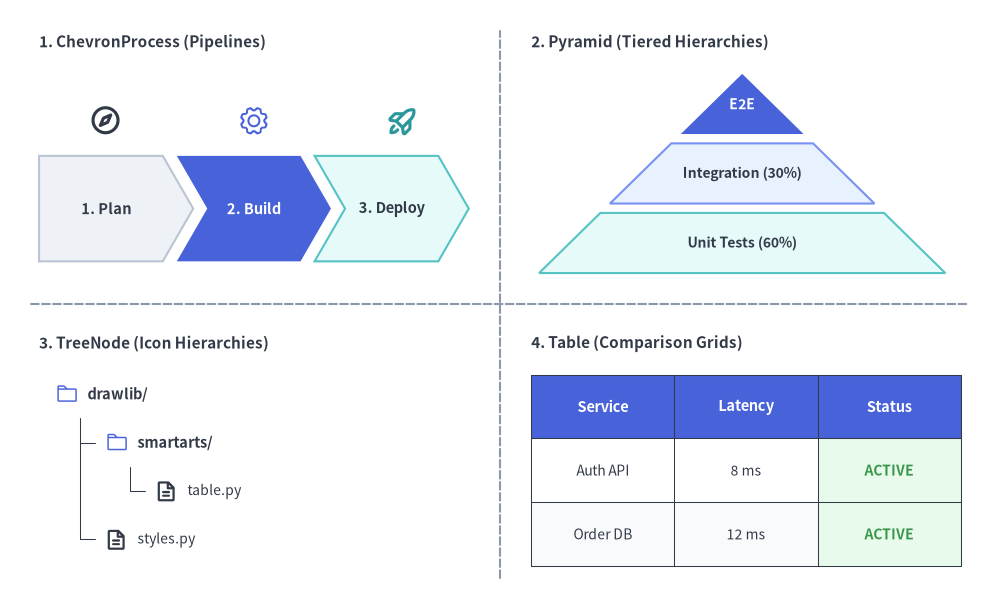
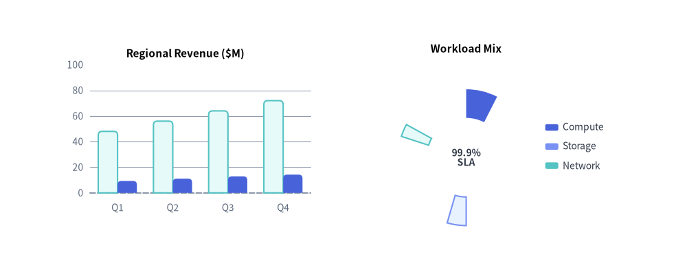
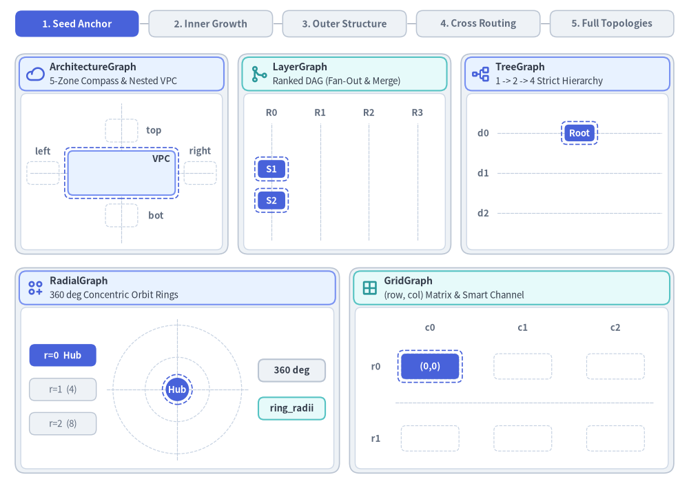
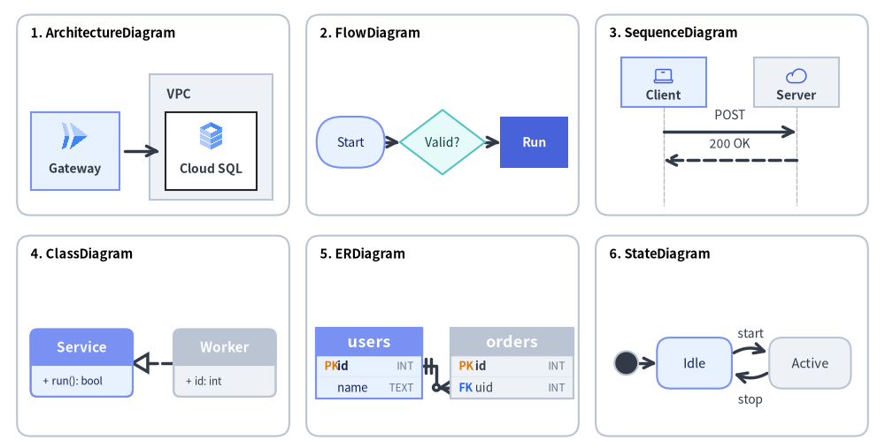
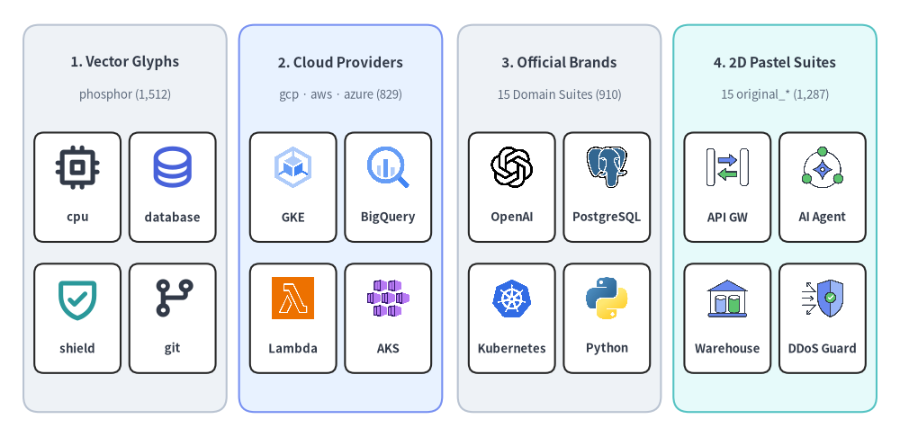
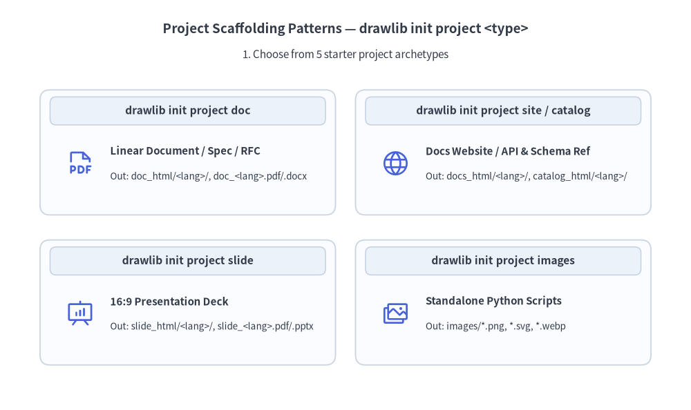
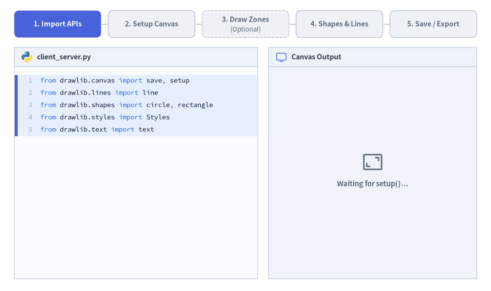

<div align="center">
  <a href="https://www.drawlib.com/ja/">
    <picture>
      <source media="(prefers-color-scheme: dark)" srcset="logo/logo_dark_transparent.png">
      <source media="(prefers-color-scheme: light)" srcset="logo/logo_transparent.png">
      
    </picture>
  </a>

  <p><strong>「Illustration as Code」&amp;「図解付きドキュメント as Code」のためのピュア Python ライブラリ</strong></p>

  <p>
    <a href="https://pypi.org/project/drawlib/"></a>
    <a href="https://pypi.org/project/drawlib/"></a>
    <a href="https://github.com/yuichi110/drawlib/actions/workflows/quality.yml"></a>
    <a href="https://github.com/yuichi110/drawlib/actions/workflows/ut_github.yml"></a>
    <a href="https://opensource.org/licenses/Apache-2.0"></a>
    <a href="https://www.drawlib.com/ja/"></a>
  </p>

  <p>
    <a href="../README.md"><strong>English</strong></a> | <strong>日本語</strong>
  </p>

  <p>
    <a href="#quick-try">30秒で試す (<code>uvx</code>)</a> ·
    <a href="https://www.drawlib.com/ja/">公式ドキュメント</a> ·
    <a href="#why-drawlib">なぜ Drawlib か？</a> ·
    <a href="#installation">インストール &amp; AI 設定</a> ·
    <a href="#quick-start">クイックスタート</a> ·
    <a href="../.github/CONTRIBUTING.md">コントリビュート</a>
  </p>
</div>

---

Drawlib は、ソフトウェア開発者と **自律型 AI コーディングエージェント** のために設計された、宣言的 Python 作図ライブラリ兼マルチフォーマット・ドキュメントコンパイラです。外部の GUI ツール（draw.io、Visio、PowerPoint）で壊れやすい図を手作業で保守してスクリーンショットを Wiki に貼り付ける代わりに、アーキテクチャ図・定量チャート・技術仕様書・16:9 プレゼンスライドの執筆・アニメーション化・多言語化・バージョン管理・ビルドまですべて Git 上のコードとして一元管理できます。


- **公式 Web サイト & ドキュメント**: [日本語 (`www.drawlib.com/ja/`)](https://www.drawlib.com/ja/) | [English (`www.drawlib.com`)](https://www.drawlib.com/)
- **リポジトリ内ガイド & ホワイトペーパー**:
  - [クイックスタートガイド — English (PDF)](quickstart_en.pdf)
  - [16:9 紹介プレゼンスライド — English (PDF)](slide_about_drawlib_en.pdf)
  - [Dogfooding 技術ホワイトペーパー — 日本語版 (PDF)](drawlib-dogfooding_ja.pdf) | [English (PDF)](drawlib-dogfooding_en.pdf)

---

<a id="quick-try"></a>

## 30秒で試す（`uvx` ゼロインストール）

[`uv`](https://docs.astral.sh/uv/) さえ入っていれば、`pyproject.toml` や仮想環境の作成・パッケージの事前インストールは一切不要です。**Go・Rust・TypeScript・Java などの非 Python リポジトリを含む任意のディレクトリ**ですぐに試せます。

```bash
# 1. 日英2言語のドキュメントサイトを初期化（doc / slide / images も選択可）
uvx drawlib init project site -l en,ja

# 2. (任意) AI コーディングエージェント向けルールを生成（claude, cursor, antigravity, copilot 等）
uvx drawlib init agent claude

# 3. HTML サイト・Markdown・図版を一括ビルドし、ローカルプレビューを起動
./docs_src/build.sh
uvx drawlib serve docs_html/
```

> **Python プロジェクトへの導入・常駐 CLI 化**: `uv add drawlib`、`uv tool install drawlib`、または `pip install drawlib` でインストールできます。

---

<a id="why-drawlib"></a>

## なぜ Drawlib なのか？

### 1. SmartArt インフォグラフィック・定量チャート・宣言的アニメーション

プレゼン品質のインフォグラフィック（`drawlib.smartarts`）、定量データグラフ（`drawlib.charts`）、そしてマルチフレーム **APNG / WebP / GIF** アニメーション（`drawlib.anim`）をすべて同一の座標キャンバス上で自由に組み合わせられます。



- **18種の SmartArt コンポーネント (`drawlib.smartarts`)**: `ChevronProcess`、`Cycle`、`Table`、`TreeNode`、`MindMapNode`、`Pyramid`、`BoxList`、`CardList`、`KpiCards`、`Roadmap`、`Panel`、`BulletPoints`、`GridLayout`、シンタックスハイライト付き `SourceCode`、オフライン世界地図 `GeoMap`、`MonthCalendar` / `WeekCalendar` / `DayCalendar` を標準搭載。



- **9種の定量データチャート (`drawlib.charts`)**: 低レベルな Matplotlib のボイラープレートを一切書かずに、周囲の図解と統一されたデザイントークンで `BarChart`、`LineChart`、`AreaChart`、`PieChart`、`RadarChart`、`ScatterChart`、`GanttChart`、`HeatmapChart` / `HeatmapOverlay` を描画。
- **宣言的アニメーション (`drawlib.anim`)**: あらゆる構成図・チャート・ワークフローを鮮明な **APNG**・**WebP**・**GIF** アニメーション（`Animation(fps=..., loop=0)`）として出力し、GitHub の `README.md` や Pull Request、HTML ドキュメントサイト上でそのまま再生可能。

---

### 2. 自動レイアウトグラフ & ソフトウェア設計図エンジン

複雑なノード座標の手作業調整は不要です。自動グラフレイアウトソルバー（`drawlib.graph`）とソフトウェア設計専用のダイアグラムエンジン（`drawlib.diagrams`）を組み合わせて効率よく作図できます。



- **5種の自動レイアウト座標ソルバー (`drawlib.graph`)**: `ArchitectureGraph`、`LayerGraph`、`TreeGraph`、`RadialGraph`、`GridGraph` が重なりのないノード中心座標（`.xy`）やネストされたクラスタ境界を `get_layout()` で自動算出し、`offset()` による微調整にも対応。



- **6種の技術ダイアグラムエンジン (`drawlib.diagrams`)**:
  - **クラウド構成図 (`ArchitectureDiagram`)**: ネストされた VPC / サブネット境界、マルチティアのサービスカード、公式クラウドアイコン。
  - **フローチャート (`FlowDiagram`)**: 処理ステップ、条件分岐、直交コネクタ。
  - **シーケンス図 (`SequenceDiagram`)**: クライアント／サーバーのライフライン、同期・非同期呼び出し、アクティベーションバー、loop / alt フレーム。
  - **状態遷移図・UML クラス図・ER 図 (`StateDiagram`, `ClassDiagram`, `ERDiagram`)**: ステートマシン、オブジェクト指向クラス階層、リレーショナル DB スキーマ。

---

### 3. 34種のアイコンスイート（4,500種以上）・43種の基本図形・セマンティックデザイン体系

HTML と CSS のように、Drawlib は **コンテンツ**（幾何形状・座標・構造）と **スタイル**（配色・タイポグラフィ・枠線・テーマ）を明確に分離しています。



- **34種の標準アイコンスイート (`drawlib.icons`)**: **Phosphor**（`1,512`種 × `5`ウェイト）、**主要クラウド**（`gcp`、`aws`、`azure`）、**15種の公式テックブランドスイート**（`ai`、`cicd`、`cloud`、`code`、`compute`、`container`、`data`、`database`、`k8s`、`linux`、`mobile`、`monitoring`、`network`、`security`、`workspace`）、**15種のフラット 2D スイート**（`original_*`）にわたる **4,500種以上のオフラインキャッシュ対応ベクターアイコン**。
- **豊富な描画プリミティブ (`drawlib.shapes`, `lines`, `images`, `text`, `fonts`)**:
  - **43種の幾何学シェイプ**: `basic`、`polygon`、`arrow`、`badge`、`container`、`symbol` を網羅。
  - **コネクタ & 曲線**: 直線、カーブ（`bend`）、2次／3次ベジェ曲線、角丸ポリライン、多彩な矢尻（`"->"`、`"<-"`、`"<->"`）。
  - **画像変換 & ネストキャンバス**: 非破壊の `Dimage` 変換（`crop()`、`sepia()`、`grayscale()`、`mosaic()`、`mirror()`）および `get_dimage_from_code()` による図の入れ子合成。
  - **多言語タイポグラフィ**: 日本語（`FontJapanese`）をはじめとする CJK・欧文・等幅フォント（`FontRoboto`、`FontSourceCode`、`FontChinese`、`FontKorean`、`FontArabic` 等）をオンデマンドで自動取得・キャッシュ。
- **7ロールのセマンティックスタイル体系 (`drawlib.styles`)**:
  - 6種の組み込みテーマ（`default`、`google`、`essentials`、`monochrome`、`warm`、`cold`）を `Styles.<Token>`（`Styles.Neutral`、`Styles.PrimaryFlat`、`Styles.SecondaryNeutral`、`Styles.MutedDashed`、`Styles.SuccessNeutral`、`Styles.WarningNeutral`、`Styles.DangerNeutral`）で一貫適用。

---

### 4. 図解付きドキュメント & 16:9 スライド as Code（多言語・SEO 標準対応）

統一設定ファイル `drawlib.toml` のもとで、Markdown 内に ```` ```drawlib ```` コードブロックを埋め込んで執筆します。1回のビルドで Web ポータル、GitHub Markdown、ベクター PDF、編集可能な Word 文書、HTML スライドデッキ、PowerPoint ファイルへ一括コンパイルできます。



- **統一 `drawlib.toml`・多言語 (`[i18n]`)・宣言的 SEO (`[seo]`)**: プロジェクト設定、`[build]` フラグ、`[i18n]` 多言語構成（`langs = ["en", "ja"]` と構造パリティ自動検査）、および `[seo]` 公開設定（`site_url`、OGP / X カード、`hreflang`、`sitemap.xml`、`robots.txt`、AI 向け `llms.txt`）をすべて `drawlib.toml` で宣言的に管理。
- **4種のプロジェクトスキャフォールド (`drawlib init project <type>`)**:
  - `drawlib init project site [-l en,ja]`: マルチページ Web ドキュメントサイト（言語切替・全文検索・目次サイドバー付き `docs_html/`）および GitHub Markdown（`docs_markdown/`）。
  - `drawlib init project doc [-l en,ja]`: 技術仕様書・ホワイトペーパー（`*_html/`、`*_markdown/`、ベクター `*_<lang>.pdf`、さらに `./<target>_src/build_docx.sh` による編集可能な MS Word `*_<lang>.docx`）。
  - `drawlib init project slide [-l en,ja]`: 16:9 プレゼンスライド（`::: block` + `::: note` スピーカーノート）、ネイティブ SVG タイポグラフィ・発表者ビュー付き `slide_html/`、ベクター `slide_<lang>.pdf`、および `./<target>_src/build_pptx.sh` による編集可能な MS PowerPoint `slide_<lang>.pptx`。
  - `drawlib init project images`: `.drawlib/cache.db` による高速差分キャッシュを備えたバッチ画像生成プロジェクト（`images_src/` -> `images/`）。
- **AI インナーループ & 人間アウターループ (`drawlib init agent <agent>`)**: Claude Code、Cursor、Antigravity、Copilot、Windsurf、Cline、Roo、Codex、Gemini などの AI コーディングエージェント向けにゼロから設計。`drawlib init agent claude` 1行でワークスペース指示書を生成でき、AI が `drawlib rules show <topic>` で仕様をオンデマンド参照し、`drawlib show -g` の座標グリッド画像を目視確認して文字切れやレイアウト崩れを自律修正します。

---

<a id="installation"></a>

## インストール


`uvx` を使ってインストール不要ですぐに実行するか、PyPI から Python プロジェクトまたはグローバル CLI 環境へインストールします（Python `>= 3.11`）：

```bash
# ゼロインストール CLI（お試し評価や Go / Rust / TypeScript / Java リポジトリに最適）
uvx drawlib --version

# Python uv プロジェクトの依存関係に追加（スクリプトから `drawlib.*` を import する場合）
uv add drawlib

# グローバル CLI ツールとして常駐インストール / pip でインストール
uv tool install drawlib   # または: pip install drawlib
```

### AI エージェント指示書のセットアップ *（任意・強く推奨）*

**Claude Code**・**Cursor**・**Antigravity**・**GitHub Copilot**・**Windsurf**・**Cline**・**Roo Code**・**OpenAI Codex**・**Gemini CLI** などの AI エージェントを利用する場合は、導入直後にワークスペース用ルールファイルを生成しておくことで（環境に応じて先頭に `uvx` や `uv run` を付与）、左下原点 `(0, 0)` の座標系、`50%+` ニュートラル配色ルール、`drawlib init project` の規約、3ステージ視覚自己検証ループを AI が自動的に遵守するようになります：

```bash
drawlib init agent list                   # 対応エージェントと出力先パスの一覧を表示
drawlib init agent claude                 # -> .claude/rules/drawlib.md
drawlib init agent cursor                 # -> .cursor/rules/drawlib.mdc
drawlib init agent antigravity            # -> .agents/rules/drawlib.md
drawlib init agent claude cursor copilot  # 複数エージェントを一括初期化（'all' も指定可）
```

### ゼロコンフィグ出力 & オフラインキャッシュ

PDF・MS Word（`.docx`）・MS PowerPoint（`.pptx`）出力は追加設定なしで動作します。`playwright`、`python-docx`、`python-pptx` が標準依存に含まれており、初回の `drawlib build pdf` / `drawlib build pptx` 実行時に軽量なヘッドレス Chromium（`chromium-headless-shell`）が自動ダウンロードされます。

- **オフライン環境・CI パイプライン**: `drawlib cache download --all` で全フォント・アイコン・地図・ヘッドレス Chromium を一括事前取得できます（ブラウザのみは `drawlib cache download --browser`）。
- **最小構成の Linux コンテナ**（`libnss3` や `libgbm1` 等の OS 共有ライブラリを含まない `python:3.12-slim` 等）: 初回のみ `playwright install-deps chromium` を実行してください。

---

<a id="quick-start"></a>

## クイックスタート

### 1. スタンドアロン Python スクリプト（5ステップ作図ワークフロー）

すべての Drawlib スクリプトは **Import -> Setup Canvas -> Draw Zones (任意) -> Shapes & Lines -> Save** の明快な 5 ステップで構成されます。



`client_server.py` を作成します：

```python
from drawlib.canvas import save, setup
from drawlib.lines import line
from drawlib.shapes import circle, rectangle
from drawlib.styles import Styles
from drawlib.text import text

setup(width=100, height=44)
# 任意: 境界ゾーン
rectangle((50, 22), 92, 36, style=Styles.MutedDashed)
circle((25, 22), 12,
       style=Styles.Neutral, text="Client")
rectangle((75, 22), 26, 20,
          style=Styles.PrimaryFlat, text="Server")
line((37, 22), (62, 22),
     arrow_head="->", style=Styles.DarkBold)
text((49.5, 27), "REST API", style=Styles.DarkBold)
save()
```

スクリプトを実行して `client_server.png` を生成します：

```bash
uv run python client_server.py
# プロジェクト未導入環境の場合: uvx drawlib show client_server.py -o client_server.png
```

#### 基本原則のポイント
- **左下原点 `(0, 0)`**: `setup(width=100, height=44)` は `x` が `0..100`（左から右）、`y` が `0..44`（下から上）のデカルト座標キャンバスを定義します。
- **直感的な座標アンカー**: 基本プリミティブ（`rectangle`、`circle`、`icon`、`image`、`text`）は整列しやすい **中心座標 `(cx, cy)`** 基準、高水準の `Charts` や `Diagrams` は **左下座標 `(x0, y0)`** 基準です。
- **50%+ ニュートラル基調**: 補助要素の 50% 以上を落ち着いたニュートラルトークン（`Styles.Neutral`、`Styles.SecondaryNeutral`、`Styles.MutedDashed`）で描き、彩度の高い塗り（`Styles.PrimaryFlat`）は 1〜2 個の主役要素に限定します。
- **非破壊スタイルパッチ (`.patch()`)**: `Styles.MutedBold.patch(text_size=10)` のように既存トークンを安全にカスタマイズできます。

---

### 2. 図解付きドキュメント & スライドデッキのワークフロー

数秒でマルチページサイト・技術仕様書・16:9 スライドデッキを初期化できます（`-l en,ja` で多言語 `<src_dir>/<lang>/` 構成を生成。ゼロインストール時は先頭に `uvx` を付与）：

```bash
# docs_src/ に日英2言語のドキュメントサイトを初期化 (en/ & ja/)
drawlib init project site -l en,ja

# または slide_src/ に 16:9 プレゼンスライドを初期化
drawlib init project slide -l en,ja

# IDE / CLI エージェント向けの指示書を生成
drawlib init agent claude
```

Markdown ファイル（`docs_src/ja/index.md` 等）の中に ```` ```drawlib ```` コードブロックを埋め込みます：

````markdown
# システムアーキテクチャ

リクエストルーティングの基本構成は以下の通りです。

```drawlib code=fold align=center file=service_routing.png caption="サービスルーティングパイプライン"
from drawlib.canvas import save, setup
from drawlib.lines import line
from drawlib.shapes import rectangle
from drawlib.styles import Styles

setup(width=100, height=40)
rectangle((25, 20), width=30, height=16, r=2, style=Styles.Neutral, text="Ingress")
rectangle((75, 20), width=30, height=16, r=2, style=Styles.PrimaryFlat, text="Core API", text_style=Styles.WhiteBold)
line((40, 20), (60, 20), arrow_head="->", style=Styles.DarkBold)
save()
```
````

生成されたビルドスクリプト（`uv run drawlib`・`drawlib`・`uvx drawlib` を自動判別）または CLI でコンパイル・出力・プレビューします：

```bash
# HTML サイト・GitHub Markdown・PDF 等を一括ビルド
./docs_src/build.sh

# 編集可能な MS Word (.docx) や MS PowerPoint (.pptx) を言語別に出力
./doc_src/build_docx.sh      # または: drawlib build docx doc_src/ -o spec.docx --generate-index
./slide_src/build_pptx.sh    # または: drawlib build pptx slide_src/ -o deck.pptx

# リンク切れ検査付きでローカル HTTP プレビューサーバーを起動
drawlib serve docs_html/ --check

# 単一の図版に座標グリッド (-g) を重ねてレイアウトを検査
drawlib show docs_src/ja/index.md service_routing.png -g -o preview_grid.png
```

---

### 3. CLI コマンド早見表

| コマンド | 説明 |
| :--- | :--- |
| `drawlib init project <site\|doc\|slide\|images\|list> [-l <langs>]` | ドキュメントサイト・技術文書・16:9 スライド・画像プロジェクトの雛形を生成（`drawlib.toml`） |
| `drawlib init agent <agent...\|all\|list> [-m <auto\|always>]` | AI コーディングエージェント向けルールを生成（`claude`, `cursor`, `antigravity`, `copilot`, `windsurf`, `cline`, `roo`, `codex`, `gemini`） |
| `drawlib build <html\|markdown\|pdf\|docx\|slide\|pptx\|image>` | ソースを HTML・Markdown・PDF・Word (`.docx`)・HTML スライド・PowerPoint (`.pptx`)・画像へコンパイル |
| `drawlib serve <html_dir> [--check]` | ビルド済み HTML ドキュメント／スライドのローカルサーバー起動とリンク切れ検証 |
| `drawlib show <file> [target] [-g]` | 単体スクリプトまたは Markdown 内ブロックのレンダリング・座標グリッド (`-g`) 検証 |
| `drawlib rules show [topic]` | AI エージェント向けオンデマンド CLI マニュアルの参照（`overview`, `style-guide`, `review-guide`, `api`, `lib-*`） |
| `drawlib cache <list\|download\|clear>` | フォント・アイコン・地図・ヘッドレス Chromium キャッシュの管理（`--all`, `--browser`, `--images`） |

---

## リンク & リソース

- **公式ドキュメント**: [日本語 (`https://www.drawlib.com/ja/`)](https://www.drawlib.com/ja/) | [English (`https://www.drawlib.com/`)](https://www.drawlib.com/)
- **リリースノート & 更新履歴**: [日本語](https://www.drawlib.com/ja/01_getting_started/release_notes.html) | [English](https://www.drawlib.com/en/01_getting_started/release_notes.html)
- **コントリビュート & 開発者ガイド**: [`.github/CONTRIBUTING.md`](../.github/CONTRIBUTING.md) | [`docs/README_DEV.md`](README_DEV.md)
- **PyPI パッケージ**: [https://pypi.org/project/drawlib/](https://pypi.org/project/drawlib/)
- **GitHub リポジトリ**: [https://github.com/yuichi110/drawlib](https://github.com/yuichi110/drawlib)
- **ライセンス**: Apache License 2.0
