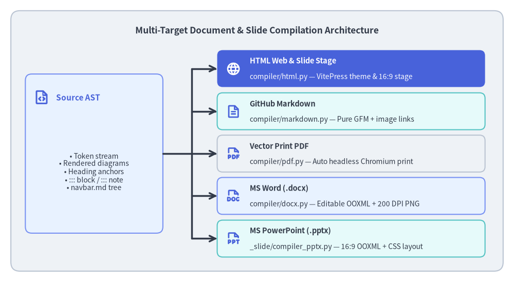
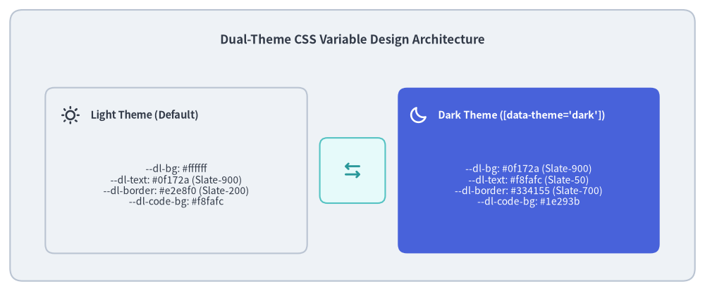

# Multi-Target Exporters (HTML, Markdown, PDF, Word & PowerPoint)

A core requirement of enterprise technical documentation is multi-format versatility. Engineers read documentation on GitHub repositories, architects study polished documentation websites, compliance teams require immutable vector PDFs for RFCs and audits, and stakeholders review editable Microsoft Word (`.docx`) documents and 16:9 PowerPoint (`.pptx`) decks.

Drawlib's builder (`_builder/doc_builder/` and `_slide/`) provides **Multi-Target Compilation**: a single source Markdown directory (`*_src/`) compiles simultaneously into an interactive web portal (`*_html/`), clean GitHub Flavored Markdown (`*_markdown/`), a print-ready vector PDF (`*.pdf`), a native editable MS Word document (`*.docx`), and a 16:9 MS PowerPoint presentation (`*.pptx`).


<figure class="drawlib-image" style="text-align: center;">
  
  <figcaption class="drawlib-caption">Multi-Target Document and Slide Compilation Architecture</figcaption>
</figure>

<details class="drawlib-code-details">
<summary>Source Code</summary>

```python
from drawlib.canvas import save, setup
from drawlib.icons import phosphor
from drawlib.lines import line
from drawlib.shapes import rectangle
from drawlib.styles import Styles
from drawlib.text import text

setup(width=142, height=78)

rectangle((71, 39), width=136, height=72, style=Styles.Neutral.patch(shape_r=2.5))
text(
    (71, 69.5),
    "Multi-Target Document & Slide Compilation Architecture",
    style=Styles.DarkBold.patch(text_size=12.5),
)

# Root AST Node (Left)
rectangle((26, 35.5), width=38, height=44, style=Styles.PrimaryNeutral.patch(shape_r=1.8))
phosphor.file_code((11.5, 51.0), width=4.4, style=Styles.PrimaryBold)
text((15.5, 51.0), "Source AST", style=Styles.PrimaryBold.patch(halign="left", text_size=11.0))
text(
    (26, 30.5),
    "• Token stream\n• Rendered diagrams\n• Heading anchors\n• ::: block / ::: note\n• navbar.md tree",
    style=Styles.Dark.patch(text_size=10.0),
)

# 5 Exporter Targets on Right
exporters = [
    (59.0, "HTML Web & Slide Stage", "compiler/html.py — VitePress theme & 16:9 stage", phosphor.globe, Styles.PrimaryFlat),
    (47.2, "GitHub Markdown", "compiler/markdown.py — Pure GFM + image links", phosphor.file_text, Styles.SecondaryNeutral),
    (35.5, "Vector Print PDF", "compiler/pdf.py — Auto headless Chromium print", phosphor.file_pdf, Styles.Neutral),
    (23.8, "MS Word (.docx)", "compiler/docx.py — Editable OOXML + 200 DPI PNG", phosphor.file_doc, Styles.PrimaryNeutral),
    (12.0, "MS PowerPoint (.pptx)", "_slide/compiler_pptx.py — 16:9 OOXML + CSS layout", phosphor.file_ppt, Styles.SecondaryNeutral),
]

line((45, 35.5), (53, 35.5), style=Styles.DarkBold)
line((53, 12.0), (53, 59.0), style=Styles.DarkBold)

for y, title, desc, icon_func, card_style in exporters:
    rectangle((97, y), width=74, height=10.2, style=card_style.patch(shape_r=1.5))
    is_hero = card_style == Styles.PrimaryFlat
    icon_style = Styles.WhiteBold if is_hero else Styles.PrimaryBold
    title_style = Styles.WhiteBold if is_hero else Styles.DarkBold
    desc_style = Styles.White if is_hero else Styles.Dark
    icon_func((64.5, y), width=4.0, style=icon_style)
    text((69.0, y + 2.1), title, style=title_style.patch(halign="left", text_size=10.5))
    text((69.0, y - 2.3), desc, style=desc_style.patch(halign="left", text_size=10.0))
    line((53, y), (60, y), arrow_head="->", style=Styles.DarkBold)

save()
```

</details>


---

## 1. Concept: Single Source of Truth, Zero Format Fragmentation

In traditional workflows, maintaining web documentation, PDF specifications, and editable Office deliverables requires separate authoring tools (e.g. Docusaurus for web, LaTeX for PDF, Word/PowerPoint for stakeholder review). When changes occur, synchronizing formatting across outputs is tedious and error-prone.

Drawlib eliminates this fragmentation by executing drawing code blocks once and serializing the resulting document or slide AST through five specialized target exporters:

| Exporter | Compiler Module | Primary Output | Key Capabilities |
| :--- | :--- | :--- | :--- |
| **HTML** | `compiler/html.py` | `docs_html/`, `slide_html/` | VitePress-inspired theme, sidebar navigation, instant dark mode, 16:9 interactive slide stage. |
| **Markdown** | `compiler/markdown.py` | `docs_markdown/` | Clean GitHub Flavored Markdown with relative image links for native Git viewing. |
| **PDF** | `compiler/pdf.py` | `document.pdf`, `slide.pdf` | Vector graphic embedding, automated pagination, TOC injection, auto-provisioned headless Chromium print. |
| **Word (`.docx`)** | `compiler/docx.py` | `document.docx` | Pure-Python editable OOXML headings, prose, lists, tables, syntax-highlighted code blocks, TOC, and 200 DPI PNG diagrams. |
| **PowerPoint (`.pptx`)** | `_slide/compiler_pptx.py` | `slide.pptx` | Headless Chromium `1920×1080` CSS layout measurement mapped to native 16:9 (`960×540 pt`) OOXML cards, text, tables, speaker notes, and 240 DPI PNG diagrams. |

---

## 2. Positioning: HTML Theme Engine & Design Tokens

The HTML exporter (`compiler/html.py`) combines Jinja2 HTML templates (`template.html`) and responsive CSS variables (`style.css`):


<figure class="drawlib-image" style="text-align: center;">
  
  <figcaption class="drawlib-caption">Dual-Theme CSS Variable Design Architecture</figcaption>
</figure>

<details class="drawlib-code-details">
<summary>Source Code</summary>

```python
from drawlib.canvas import save, setup
from drawlib.icons import phosphor
from drawlib.lines import line
from drawlib.shapes import rectangle
from drawlib.styles import Styles
from drawlib.text import text

setup(width=140, height=58)

rectangle((70, 29), width=136, height=54, style=Styles.Neutral.patch(shape_r=2.5))
text(
    (70, 50),
    "Dual-Theme CSS Variable Design Architecture",
    style=Styles.DarkBold.patch(text_size=12.2),
)

# Left Column: Light Theme
rectangle((35, 24), width=52, height=33, style=Styles.Neutral.patch(shape_r=1.8))
phosphor.sun((14, 35), width=3.8, style=Styles.DarkBold)
text((18, 35), "Light Theme (Default)", style=Styles.DarkBold.patch(halign="left", text_size=10.5))
text(
    (35, 21),
    "--dl-bg: #ffffff\n--dl-text: #0f172a (Slate-900)\n--dl-border: #e2e8f0 (Slate-200)\n--dl-code-bg: #f8fafc",
    style=Styles.Dark.patch(text_size=10.0),
)

# Right Column: Dark Theme
rectangle((105, 24), width=52, height=33, style=Styles.PrimaryFlat.patch(shape_r=1.8))
phosphor.moon((83, 35), width=3.8, style=Styles.WhiteBold)
text((87, 35), "Dark Theme ([data-theme='dark'])", style=Styles.WhiteBold.patch(halign="left", text_size=10.2))
text(
    (105, 21),
    "--dl-bg: #0f172a (Slate-900)\n--dl-text: #f8fafc (Slate-50)\n--dl-border: #334155 (Slate-700)\n--dl-code-bg: #1e293b",
    style=Styles.White.patch(text_size=10.0),
)

# Center: Toggle Mechanism
rectangle((70, 24), width=13, height=13, style=Styles.SecondaryNeutral.patch(shape_r=1.5))
phosphor.arrows_left_right((70, 24), width=4.2, style=Styles.SecondaryBold)

save()
```

</details>


### Theme System Features:
- **Instant Dark Mode Toggle**: Uses `localStorage` and prefers-color-scheme with zero render flash (`data-theme="dark"`).
- **Subtle Dividers & High Contrast**: Built with modern Tailwind/VitePress standard neutrals (`#334155` border tokens, `#f8fafc` dark text) to ensure readability for technical diagrams.
- **Collapsible Code Blocks**: Renders embedded drawing code inside `<details class="drawlib-code">` disclosure blocks.

---

## 3. Details: Vector PDF, Office (`.docx` / `.pptx`) & Markdown Export Mechanics

### 3.1. High-Resolution Vector PDF & Zero-Config Headless Chromium
When exporting to PDF (`drawlib build pdf`):
1. **Chapter Merging (`merger.py`)**: Concatenates individual chapter Markdown files in sorted sequence (with optional `--toc` / `--generate-index` Table of Contents between Chapter 1 and Chapter 2) into a continuous print document.
2. **Vector Graphic Injection**: Embeds crisp vector graphics and high-DPI diagrams for infinite print sharpness.
3. **Auto-Provisioned Headless Chromium**: `playwright` ships as a standard dependency; Drawlib automatically installs `chromium-headless-shell` on first run via Playwright's bundled driver (or pre-caches it via `drawlib cache download --browser` / `--all`, with `playwright install-deps chromium` diagnostics for minimal Linux containers).

### 3.2. Native Editable MS Word (`.docx`) & MS PowerPoint (`.pptx`) Exporters
- **MS Word (`compiler/docx.py`, `drawlib build docx`)**: Translates Markdown chapters or single `.md` files directly into native OOXML via `python-docx` without requiring a browser—preserving headings, prose, bullet/numbered lists, tables, blockquotes, syntax-highlighted code blocks, cover pages, and `--generate-index` Tables of Contents, while rendering ````drawlib```` blocks (including SVG, WebP, and animated blocks) as static high-DPI PNGs (`--dpi 200` default).
- **MS PowerPoint (`_slide/compiler_pptx.py`, `drawlib build pptx`)**: Renders each `1920×1080` slide in headless Chromium to measure exact DOM bounding boxes and computed CSS styles (`::: block` cards with `rgba` alpha fills/borders, typography, lists, tables, inline code), then emits native editable 16:9 (`960×540 pt`) `python-pptx` shapes, `::: note` speaker notes, and high-DPI static PNG diagrams (`--dpi 240` default, `--anim-frame first|last` defaulting to `last`).

### 3.3. Pure GitHub Flavored Markdown Export
When exporting to Markdown (`drawlib build markdown`):
- Strips HTML-specific interactive tags (`<details>`, `<summary>`).
- Rewrites ````drawlib```` code blocks to pure Markdown image syntax (e.g., ``).
- Replaces internal `.html` links with relative `.md` references for seamless navigation inside GitHub repository browsers.

Next, explore how link integrity and path hygiene are enforced in **[Link & Quality Scanner](03_link_and_quality_scanner.md)**.
