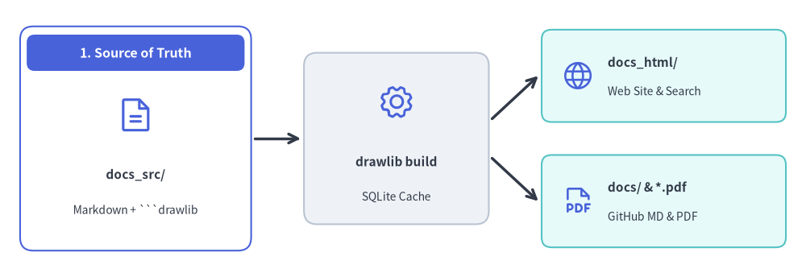
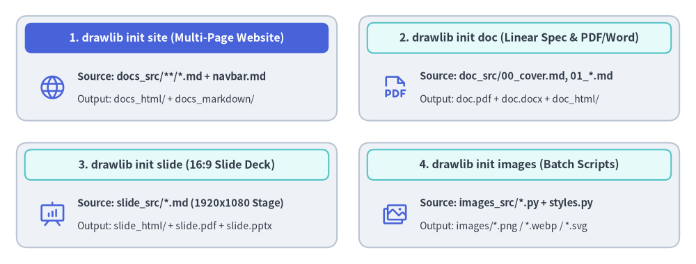

# Documentation Project & Build Overview

Drawlib is not only a drawing library—it is a **complete documentation compiler** that bridges executable Python illustrations and version-controlled technical documentation.


<figure class="drawlib-image" style="text-align: center;">
  
  <figcaption class="drawlib-caption">Drawlib Project Lifecycle: Scaffolding, Initial Build & Incremental Updates (APNG Animation)</figcaption>
</figure>

<details class="drawlib-code-details">
<summary>Source Code</summary>

```python
from __future__ import annotations

from drawlib.anim import Animation
from drawlib.canvas import save, setup
from drawlib.icons import ai, code, devops, phosphor, workspace
from drawlib.lines import line
from drawlib.shapes import circle, rectangle
from drawlib.styles import Styles
from drawlib.text import text

W, H = 138.0, 82.0
setup(width=W, height=H)
anim = Animation(fps=10.0, loop=0)

# Shared styles
PANE_BG = Styles.Neutral.patch(
    shape_fill_color=(250, 252, 255),
    shape_line_width=0,
    shape_r=1.8,
)
PANE_HEADER_TOP = Styles.Neutral.patch(
    shape_fill_color=(238, 243, 250),
    shape_line_width=0,
    shape_r=1.8,
)
PANE_HEADER_FLAT = Styles.Neutral.patch(
    shape_fill_color=(238, 243, 250),
    shape_line_width=0,
    shape_r=0.0,
)
PANE_BORDER = Styles.Neutral.patch(
    shape_fill_color=(0, 0, 0, 0),
    shape_line_color=(203, 213, 225),
    shape_line_width=1.2,
    shape_r=1.8,
)
SUBPANEL_BG = Styles.Neutral.patch(
    shape_fill_color=(243, 246, 252),
    shape_line_color=(214, 223, 236),
    shape_line_width=1.0,
    shape_r=1.4,
)
ROW_ACTIVE = Styles.PrimaryNeutral.patch(
    shape_fill_color=(232, 242, 255),
    shape_line_color=(59, 130, 246),
    shape_line_width=1.3,
    shape_r=1.0,
)
ROW_USER = Styles.Neutral.patch(
    shape_fill_color=(241, 245, 251),
    shape_line_color=(51, 65, 85),
    shape_line_width=1.4,
    shape_r=1.0,
)
ROW_OPTIONAL = Styles.PrimaryDashed.patch(
    shape_fill_color=(242, 247, 255),
    shape_line_color=(59, 130, 246),
    shape_line_width=1.2,
    shape_r=1.0,
)
ROW_OPTIONAL_DONE = Styles.MutedDashed.patch(
    shape_fill_color=(255, 255, 255),
    shape_line_color=(196, 208, 224),
    shape_line_width=1.0,
    shape_r=1.0,
)
ROW_OUTPUT = Styles.SecondaryNeutral.patch(
    shape_fill_color=(236, 250, 244),
    shape_line_color=(34, 160, 107),
    shape_line_width=1.2,
    shape_r=1.0,
)
ROW_DONE = Styles.Neutral.patch(
    shape_fill_color=(255, 255, 255),
    shape_line_color=(218, 226, 238),
    shape_line_width=1.0,
    shape_r=1.0,
)


def draw_pane_shell(cx: float, width: float) -> None:
    """Draw a rounded pane container with a seamlessly rounded top header bar."""
    rectangle((cx, 36.75), width=width, height=65.5, style=PANE_BG)
    rectangle((cx, 66.25), width=width, height=6.5, style=PANE_HEADER_TOP)
    rectangle((cx, 64.60), width=width, height=3.2, style=PANE_HEADER_FLAT)
    line(
        (cx - width / 2.0, 63.0),
        (cx + width / 2.0, 63.0),
        style=Styles.Neutral.patch(line_color=(203, 213, 225), line_width=1.2),
    )
    rectangle((cx, 36.75), width=width, height=65.5, style=PANE_BORDER)


def draw_user_avatar(xy: tuple[float, float], radius: float = 4.3) -> None:
    """Draw circular User (Developer) avatar badge."""
    circle(
        xy,
        radius=radius,
        style=Styles.Neutral.patch(
            shape_fill_color=(241, 245, 250),
            shape_line_color=(51, 65, 85),
            shape_line_width=1.6,
        ),
    )
    phosphor.user(xy, width=radius * 1.25, style=Styles.DarkBold)


def draw_gemini_avatar(xy: tuple[float, float], radius: float = 4.3) -> None:
    """Draw circular Gemini AI Agent avatar badge."""
    circle(
        xy,
        radius=radius,
        style=Styles.Neutral.patch(
            shape_fill_color=(248, 250, 255),
            shape_line_color=(59, 130, 246),
            shape_line_width=1.5,
        ),
    )
    ai.gemini(xy, width=radius * 1.42, style=Styles.Neutral)


def draw_scene_init_patterns(highlight_doc: bool) -> None:
    """Scene 1: Show 4 drawlib init archetypes and select 'doc'."""
    text(
        (69.0, 76.2),
        "Project Scaffolding Patterns — drawlib init <type>",
        style=Styles.DarkBold.patch(text_size=13.5),
    )
    sub_msg = (
        "2. Sample walkthrough: Linear Document (drawlib init doc)"
        if highlight_doc
        else "1. Choose from 4 starter project archetypes"
    )
    sub_st = (
        Styles.PrimaryBold.patch(text_size=11.0)
        if highlight_doc
        else Styles.Dark.patch(text_size=11.0)
    )
    text((69.0, 71.0), sub_msg, style=sub_st)

    cards = [
        (
            37.5,
            51.5,
            "doc",
            "drawlib init doc",
            "Linear Document / Spec / RFC",
            "Out: MD, HTML, PDF, DOCX",
            phosphor.file_pdf,
        ),
        (
            100.5,
            51.5,
            "site",
            "drawlib init site",
            "Multi-Page Docs Website",
            "Out: docs_html/, docs_markdown/",
            phosphor.globe,
        ),
        (
            37.5,
            21.5,
            "slide",
            "drawlib init slide",
            "16:9 Presentation Deck",
            "Out: slide_html/, PDF, PPTX",
            phosphor.presentation_chart,
        ),
        (
            100.5,
            21.5,
            "images",
            "drawlib init images",
            "Standalone Python Scripts",
            "Out: images/*.png, *.svg, *.webp",
            phosphor.images,
        ),
    ]

    for cx, cy, key, cmd_title, line1, line2, icon_fn in cards:
        is_selected = highlight_doc and key == "doc"
        is_dimmed = highlight_doc and key != "doc"

        if is_selected:
            card_st = Styles.PrimaryNeutral.patch(
                shape_fill_color=(242, 247, 255),
                shape_line_color=(37, 99, 235),
                shape_line_width=2.2,
                shape_r=2.0,
            )
            hdr_st = Styles.PrimaryFlat.patch(shape_r=1.2)
            hdr_txt = Styles.WhiteBold.patch(text_size=11.5)
            icon_st = Styles.PrimaryBold
            l1_st = Styles.DarkBold.patch(text_size=11.0, halign="left")
            l2_st = Styles.Dark.patch(text_size=10.2, halign="left")
        elif is_dimmed:
            card_st = Styles.Neutral.patch(
                shape_fill_color=(248, 250, 252),
                shape_line_color=(226, 232, 240),
                shape_line_width=1.0,
                shape_r=2.0,
            )
            hdr_st = Styles.Neutral.patch(
                shape_fill_color=(238, 242, 247),
                shape_line_width=0,
                shape_r=1.2,
            )
            hdr_txt = Styles.MutedBold.patch(text_size=11.2)
            icon_st = Styles.Muted
            l1_st = Styles.MutedBold.patch(text_size=10.8, halign="left")
            l2_st = Styles.Muted.patch(text_size=10.0, halign="left")
        else:
            card_st = Styles.Neutral.patch(
                shape_fill_color=(250, 252, 255),
                shape_line_color=(203, 213, 225),
                shape_line_width=1.3,
                shape_r=2.0,
            )
            hdr_st = Styles.Neutral.patch(
                shape_fill_color=(236, 242, 250),
                shape_line_color=(196, 209, 228),
                shape_line_width=1.1,
                shape_r=1.2,
            )
            hdr_txt = Styles.DarkBold.patch(text_size=11.2)
            icon_st = Styles.Primary
            l1_st = Styles.DarkBold.patch(text_size=10.8, halign="left")
            l2_st = Styles.Dark.patch(text_size=10.0, halign="left")

        rectangle((cx, cy), width=59.0, height=25.0, style=card_st)
        rectangle(
            (cx, cy + 8.3),
            width=55.0,
            height=5.6,
            style=hdr_st,
            text=cmd_title,
            text_style=hdr_txt,
        )
        icon_fn((cx - 21.5, cy - 2.2), width=5.8, style=icon_st)
        text((cx - 15.5, cy + 0.2), line1, style=l1_st)
        text((cx - 15.5, cy - 4.8), line2, style=l2_st)

        if is_selected:
            rectangle(
                (cx + 18.0, cy - 9.2),
                width=18.0,
                height=4.2,
                style=Styles.PrimaryFlat.patch(shape_r=1.0),
                text="Selected Sample",
                text_style=Styles.WhiteBold.patch(text_size=9.5),
            )


def draw_intertitle_one_day_later() -> None:
    """Scene 3: Clean time transition slide ('1 day later')."""
    rectangle(
        (69.0, 41.0),
        width=78.0,
        height=36.0,
        style=Styles.Neutral.patch(
            shape_fill_color=(248, 250, 255),
            shape_line_color=(196, 210, 230),
            shape_line_width=1.5,
            shape_r=2.5,
        ),
    )
    phosphor.clock((69.0, 50.5), width=7.2, style=Styles.Primary)
    text(
        (69.0, 40.5),
        "1 day later...",
        style=Styles.DarkBold.patch(text_size=17.0),
    )
    text(
        (69.0, 31.5),
        "Codebase evolves — update the specification incrementally",
        style=Styles.Dark.patch(text_size=10.8),
    )


def draw_actor_row_icon(
    actor_kind: str,
    xy: tuple[float, float],
    *,
    muted: bool = False,
) -> None:
    """Draw mini User or Gemini icon at the start of an operation row."""
    if actor_kind == "user":
        phosphor.user(
            xy,
            width=2.8,
            style=Styles.Muted if muted else Styles.DarkBold,
        )
    elif actor_kind == "user_git":
        phosphor.user(
            xy,
            width=2.8,
            style=Styles.Muted if muted else Styles.DarkBold,
        )
        devops.git((xy[0] + 2.8, xy[1]), width=2.6, style=Styles.Neutral)
    else:
        ai.gemini(xy, width=2.9, style=Styles.Neutral)


def draw_tree_icon(kind: str, xy: tuple[float, float], *, muted: bool = False) -> None:
    """Draw file or folder icon in the right-side directory tree."""
    if kind == "folder_open":
        phosphor.folder_open(
            xy,
            width=3.1,
            style=Styles.Muted if muted else Styles.PrimaryBold,
        )
    elif kind == "folder_out":
        phosphor.folder(
            xy,
            width=3.1,
            style=Styles.Muted if muted else Styles.SecondaryBold,
        )
    elif kind == "py":
        code.python(xy, width=2.9, style=Styles.Neutral)
    elif kind == "html":
        phosphor.file_html(
            xy,
            width=3.0,
            style=Styles.Muted if muted else Styles.Dark,
        )
    elif kind == "md":
        phosphor.file_text(
            xy,
            width=3.0,
            style=Styles.Muted if muted else Styles.Dark,
        )
    elif kind == "sh":
        phosphor.file_code(
            xy,
            width=3.0,
            style=Styles.Muted if muted else Styles.Dark,
        )
    elif kind == "globe":
        phosphor.globe(
            xy,
            width=3.0,
            style=Styles.Muted if muted else Styles.PrimaryBold,
        )
    elif kind == "pdf":
        phosphor.file_pdf(
            xy,
            width=3.0,
            style=Styles.Muted if muted else Styles.Danger,
        )
    elif kind == "word":
        workspace.word(xy, width=2.9, style=Styles.Neutral)


def draw_split_workspace(
    *,
    phase_badge: str,
    step_heading: str,
    actor: str,
    actor_title: str,
    actor_sub: str,
    actor_optional: bool,
    ops: list[tuple[str, str, str]],
    show_day2_note: bool,
    show_src: bool,
    show_outputs: bool,
    row_states: dict[str, tuple[str, str]],
    committed: bool,
    pulse_arrow: bool,
) -> None:
    """Draw split-screen workspace (Left: User & Gemini Actions, Right: Directory Tree).

    actor: 'user' or 'gemini'
    ops items: (actor_kind, label, state)
        actor_kind in {'user', 'user_git', 'gemini'}
        state in {'active_user', 'active_gemini', 'optional', 'optional_done', 'done'}
    row_states: mapping from tree item key to (state, badge_text)
        where state in {'new', 'active', 'optional', 'output', 'muted'}
    """
    # Top phase banner
    rectangle(
        (24.0, 75.8),
        width=40.0,
        height=5.8,
        style=Styles.PrimaryFlat.patch(shape_r=1.3),
        text=phase_badge,
        text_style=Styles.WhiteBold.patch(text_size=10.5),
    )
    text(
        (47.0, 75.8),
        step_heading,
        style=Styles.DarkBold.patch(text_size=11.2, halign="left"),
    )

    # =========================================================
    # Left Pane: User & Gemini Agent — Prompts & Commands
    # =========================================================
    draw_pane_shell(36.0, 64.0)
    phosphor.user((8.3, 66.25), width=3.4, style=Styles.DarkBold)
    ai.gemini((12.2, 66.25), width=3.7, style=Styles.Neutral)
    text(
        (15.4, 66.25),
        "User & Gemini — Prompts & Commands",
        style=Styles.DarkBold.patch(text_size=10.5, halign="left"),
    )

    # Prominent active actor avatar (User vs Gemini) + speech card
    if actor == "user":
        draw_user_avatar((10.8, 55.3), radius=4.2)
        bubble_st = ROW_USER
        title_st = Styles.DarkBold.patch(text_size=10.4, halign="left")
    else:
        draw_gemini_avatar((10.8, 55.3), radius=4.2)
        bubble_st = ROW_OPTIONAL if actor_optional else ROW_ACTIVE
        title_st = Styles.PrimaryBold.patch(text_size=10.4, halign="left")

    rectangle((41.5, 55.3), width=48.6, height=9.8, style=bubble_st)
    text((19.2, 57.3), actor_title, style=title_st)
    text(
        (19.2, 53.0),
        actor_sub,
        style=Styles.Dark.patch(text_size=9.8, halign="left"),
    )

    # Workflow log sub-panel (supports up to 8 steady rows)
    rectangle((36.0, 26.7), width=59.6, height=42.2, style=SUBPANEL_BG)
    phosphor.terminal_window((9.2, 45.2), width=3.1, style=Styles.Dark)
    text(
        (12.0, 45.2),
        "Workflow Steps",
        style=Styles.DarkBold.patch(text_size=9.8, halign="left"),
    )

    op_ys = [40.8, 36.2, 31.6, 27.0, 22.4, 17.8, 13.2, 8.6]
    for (akind, label, state), oy in zip(ops, op_ys):
        is_done_like = state in {"done", "optional_done"}
        if state == "active_user":
            ost = ROW_USER
            otxt = Styles.DarkBold.patch(text_size=9.8, halign="left")
        elif state == "active_gemini":
            ost = ROW_ACTIVE
            otxt = Styles.PrimaryBold.patch(text_size=9.8, halign="left")
        elif state == "optional":
            ost = ROW_OPTIONAL
            otxt = Styles.PrimaryBold.patch(text_size=9.8, halign="left")
        elif state == "optional_done":
            ost = ROW_OPTIONAL_DONE
            otxt = Styles.Dark.patch(text_size=9.6, halign="left")
        else:
            ost = ROW_DONE
            otxt = Styles.Dark.patch(text_size=9.6, halign="left")

        rectangle((36.0, oy), width=56.4, height=4.0, style=ost)
        draw_actor_row_icon(akind, (10.3, oy), muted=is_done_like)
        text((15.5 if akind == "user_git" else 12.8, oy), label, style=otxt)

        if state in {"optional", "optional_done"}:
            opt_pill_st = (
                Styles.PrimaryNeutral.patch(shape_r=0.8)
                if state == "optional"
                else Styles.Neutral.patch(
                    shape_fill_color=(244, 247, 252),
                    shape_line_color=(196, 208, 224),
                    shape_line_width=1.0,
                    shape_r=0.8,
                )
            )
            opt_txt_st = (
                Styles.PrimaryBold.patch(text_size=9.5)
                if state == "optional"
                else Styles.MutedBold.patch(text_size=9.5)
            )
            rectangle(
                (58.2, oy),
                width=10.4,
                height=3.2,
                style=opt_pill_st,
                text="Optional",
                text_style=opt_txt_st,
            )

    if show_day2_note:
        rectangle(
            (36.0, 12.0),
            width=55.6,
            height=7.4,
            style=Styles.Neutral.patch(
                shape_fill_color=(255, 255, 255),
                shape_line_color=(210, 220, 234),
                shape_line_width=1.0,
                shape_r=1.1,
            ),
        )
        text(
            (36.0, 13.7),
            "styles.py, utils.py & template.html stay untouched",
            style=Styles.MutedBold.patch(text_size=9.6),
        )
        text(
            (36.0, 10.1),
            "Unchanged diagrams hit .drawlib/cache.db instantly",
            style=Styles.Muted.patch(text_size=9.5),
        )

    # Center connector arrow
    line(
        (68.4, 36.75),
        (71.6, 36.75),
        arrow_head="->",
        style=(
            Styles.PrimaryBold.patch(line_width=1.8)
            if pulse_arrow
            else Styles.MutedThin.patch(line_width=1.2)
        ),
    )

    # =========================================================
    # Right Pane: Project Directory Structure
    # =========================================================
    draw_pane_shell(103.0, 62.0)
    phosphor.folder_open((76.6, 66.25), width=3.8, style=Styles.PrimaryBold)
    text(
        (79.8, 66.25),
        "Directory Structure",
        style=Styles.DarkBold.patch(text_size=10.6, halign="left"),
    )

    if committed:
        rectangle(
            (123.2, 66.25),
            width=17.6,
            height=4.4,
            style=ROW_OUTPUT,
        )
        devops.git((116.8, 66.25), width=2.8, style=Styles.Neutral)
        text(
            (119.0, 66.25),
            "Committed",
            style=Styles.SecondaryBold.patch(text_size=9.5, halign="left"),
        )

    # Tree item definitions: (key, level, icon_kind, label, y)
    tree_rows: list[tuple[str, int, str, str, float]] = [
        ("root", 0, "folder_open", "my_repo/", 59.00),
    ]
    if show_src:
        tree_rows.extend(
            [
                ("doc_src", 1, "folder_open", "doc_src/", 54.45),
                ("styles", 2, "py", "styles.py", 49.90),
                ("utils", 2, "py", "utils.py", 45.35),
                ("template", 2, "html", "template.html, style.css", 40.80),
                ("cover", 2, "md", "00_cover.md", 36.25),
                ("overview", 2, "md", "01_overview.md", 31.70),
                ("build_sh", 2, "sh", "build.sh", 27.15),
            ]
        )
    if show_outputs:
        tree_rows.extend(
            [
                ("out_md", 1, "folder_out", "doc_markdown/", 22.00),
                ("out_html", 1, "globe", "doc_html/", 17.45),
                ("out_pdf", 1, "pdf", "doc.pdf", 12.90),
                ("out_docx", 1, "word", "doc.docx", 8.35),
            ]
        )

    # Draw row highlight pills first (behind tree lines & text)
    for key, _lvl, _ik, _lbl, ry in tree_rows:
        if key not in row_states:
            continue
        rstate, badge_txt = row_states[key]
        if rstate in {"new", "active"}:
            rst = ROW_ACTIVE
            b_st = Styles.PrimaryFlat.patch(shape_r=0.8)
            b_txt = Styles.WhiteBold.patch(text_size=9.5)
        elif rstate == "optional":
            rst = ROW_OPTIONAL
            b_st = Styles.PrimaryNeutral.patch(shape_r=0.8)
            b_txt = Styles.PrimaryBold.patch(text_size=9.5)
        elif rstate == "output":
            rst = ROW_OUTPUT
            b_st = Styles.SecondaryFlat.patch(shape_r=0.8)
            b_txt = Styles.WhiteBold.patch(text_size=9.5)
        else:
            rst = None
            b_st = None
            b_txt = None

        if rst is not None:
            rectangle((103.1, ry), width=57.8, height=3.95, style=rst)
        if badge_txt and b_st is not None and b_txt is not None:
            rectangle(
                (125.0, ry),
                width=12.6,
                height=3.2,
                style=b_st,
                text=badge_txt,
                text_style=b_txt,
            )

    # Draw crisp geometric tree guide lines
    guide_st = Styles.MutedThin.patch(line_color=(180, 194, 212), line_width=1.0)
    if show_src:
        trunk_bottom = 8.35 if show_outputs else 54.45
        line((77.2, 57.2), (77.2, trunk_bottom), style=guide_st)
        line((81.6, 52.6), (81.6, 27.15), style=guide_st)

    for key, lvl, ik, lbl, ry in tree_rows:
        rstate = row_states.get(key, ("normal", ""))[0]
        is_muted = rstate == "muted"

        if lvl == 0:
            ix, lx = 77.2, 79.8
        elif lvl == 1:
            line((77.2, ry), (79.5, ry), style=guide_st)
            ix, lx = 81.6, 84.2
        else:
            line((81.6, ry), (83.9, ry), style=guide_st)
            ix, lx = 86.0, 88.5

        draw_tree_icon(ik, (ix, ry), muted=is_muted)

        if rstate in {"new", "active", "optional"}:
            t_st = Styles.PrimaryBold.patch(text_size=10.0, halign="left")
        elif rstate == "output":
            t_st = Styles.SecondaryBold.patch(text_size=10.0, halign="left")
        elif is_muted:
            t_st = Styles.Muted.patch(text_size=9.8, halign="left")
        elif lvl <= 1:
            t_st = Styles.DarkBold.patch(text_size=10.0, halign="left")
        else:
            t_st = Styles.Dark.patch(text_size=9.9, halign="left")

        text((lx, ry), lbl, style=t_st)

    if not show_src:
        text(
            (103.0, 35.0),
            "(Empty repository — waiting for drawlib init)",
            style=Styles.Muted.patch(text_size=10.0),
        )


# =====================================================================
# Scene 1: Project Scaffolding Patterns (Frames 0 & 1)
# =====================================================================
with anim.frame(duration=2.6):
    draw_scene_init_patterns(highlight_doc=False)

with anim.frame(duration=2.4):
    draw_scene_init_patterns(highlight_doc=True)

# =====================================================================
# Scene 2: Day 1 — Initial Project Setup, Authoring & Commit
# =====================================================================
# Day 1 - 1. [User] Ask Gemini to create initial project
with anim.frame(duration=2.4):
    draw_split_workspace(
        phase_badge="Day 1: Initial Project Setup",
        step_heading="1. User — Ask Gemini to Create Project",
        actor="user",
        actor_title='User: "Create an initial doc project"',
        actor_sub="Ask Gemini to scaffold & configure theme",
        actor_optional=False,
        ops=[
            ("user", 'Ask Gemini: "Create initial doc project"', "active_user"),
        ],
        show_day2_note=False,
        show_src=False,
        show_outputs=False,
        row_states={},
        committed=False,
        pulse_arrow=False,
    )

# Day 1 - 2. [Gemini] Run drawlib init doc
with anim.frame(duration=2.2):
    draw_split_workspace(
        phase_badge="Day 1: Initial Project Setup",
        step_heading="2. Gemini — Run drawlib init doc",
        actor="gemini",
        actor_title="Gemini: Initialize 'doc' project",
        actor_sub="Scaffold source folder, theme & build scripts",
        actor_optional=False,
        ops=[
            ("user", 'Ask Gemini: "Create initial doc project"', "done"),
            ("gemini", "$ drawlib init doc", "active_gemini"),
        ],
        show_day2_note=False,
        show_src=False,
        show_outputs=False,
        row_states={},
        committed=False,
        pulse_arrow=True,
    )

# Day 1 - 3. [Gemini] Starter files created in doc_src/
with anim.frame(duration=2.5):
    draw_split_workspace(
        phase_badge="Day 1: Initial Project Setup",
        step_heading="3. Gemini — Starter Files Created",
        actor="gemini",
        actor_title="Gemini: Starter template generated",
        actor_sub="doc_src/ holds config, templates & chapters",
        actor_optional=False,
        ops=[
            ("user", 'Ask Gemini: "Create initial doc project"', "done"),
            ("gemini", "$ drawlib init doc", "active_gemini"),
        ],
        show_day2_note=False,
        show_src=True,
        show_outputs=False,
        row_states={
            "doc_src": ("new", "Created"),
            "styles": ("new", ""),
            "utils": ("new", ""),
            "template": ("new", ""),
            "cover": ("new", ""),
            "overview": ("new", ""),
            "build_sh": ("new", ""),
        },
        committed=False,
        pulse_arrow=True,
    )

# Day 1 - 4. [Gemini] Update styles.py & utils.py
with anim.frame(duration=2.4):
    draw_split_workspace(
        phase_badge="Day 1: Initial Project Setup",
        step_heading="4. Gemini — Update styles.py & utils.py",
        actor="gemini",
        actor_title="Gemini: Configure styles & helpers",
        actor_sub="Set brand palette, fonts & reusable helpers",
        actor_optional=False,
        ops=[
            ("user", 'Ask Gemini: "Create initial doc project"', "done"),
            ("gemini", "$ drawlib init doc", "done"),
            ("gemini", "Edit doc_src/styles.py, utils.py", "active_gemini"),
        ],
        show_day2_note=False,
        show_src=True,
        show_outputs=False,
        row_states={
            "styles": ("active", "Updated"),
            "utils": ("active", "Updated"),
        },
        committed=False,
        pulse_arrow=True,
    )

# Day 1 - 5. [Gemini] Optional template.html & style.css update
with anim.frame(duration=2.4):
    draw_split_workspace(
        phase_badge="Day 1: Initial Project Setup",
        step_heading="5. Gemini — Customize Template (Optional)",
        actor="gemini",
        actor_title="Gemini: Tweak HTML/CSS (Optional)",
        actor_sub="Default theme works out of the box",
        actor_optional=True,
        ops=[
            ("user", 'Ask Gemini: "Create initial doc project"', "done"),
            ("gemini", "$ drawlib init doc", "done"),
            ("gemini", "Edit doc_src/styles.py, utils.py", "done"),
            ("gemini", "Edit template.html, style.css", "optional"),
        ],
        show_day2_note=False,
        show_src=True,
        show_outputs=False,
        row_states={
            "template": ("optional", "Optional"),
        },
        committed=False,
        pulse_arrow=True,
    )

# Day 1 - 6. [User] Ask Gemini to update project docs
with anim.frame(duration=2.4):
    draw_split_workspace(
        phase_badge="Day 1: Initial Project Setup",
        step_heading="6. User — Ask Gemini to Update Project",
        actor="user",
        actor_title='User: "Write & build the spec docs"',
        actor_sub="Ask Gemini to author chapters & diagrams",
        actor_optional=False,
        ops=[
            ("user", 'Ask Gemini: "Create initial doc project"', "done"),
            ("gemini", "$ drawlib init doc", "done"),
            ("gemini", "Edit doc_src/styles.py, utils.py", "done"),
            ("gemini", "Edit template.html, style.css", "optional_done"),
            ("user", 'Ask Gemini: "Update project docs"', "active_user"),
        ],
        show_day2_note=False,
        show_src=True,
        show_outputs=False,
        row_states={},
        committed=False,
        pulse_arrow=False,
    )

# Day 1 - 7. [Gemini] Edit Markdown chapters inside doc_src/
with anim.frame(duration=2.4):
    draw_split_workspace(
        phase_badge="Day 1: Initial Project Setup",
        step_heading="7. Gemini — Author Markdown & Diagrams",
        actor="gemini",
        actor_title="Gemini: Write chapters & ```drawlib",
        actor_sub="Prose and Python diagrams live together",
        actor_optional=False,
        ops=[
            ("user", 'Ask Gemini: "Create initial doc project"', "done"),
            ("gemini", "$ drawlib init doc", "done"),
            ("gemini", "Edit doc_src/styles.py, utils.py", "done"),
            ("gemini", "Edit template.html, style.css", "optional_done"),
            ("user", 'Ask Gemini: "Update project docs"', "done"),
            ("gemini", "Edit 00_cover.md, 01_overview.md", "active_gemini"),
        ],
        show_day2_note=False,
        show_src=True,
        show_outputs=False,
        row_states={
            "cover": ("active", "Updated"),
            "overview": ("active", "Updated"),
        },
        committed=False,
        pulse_arrow=True,
    )

# Day 1 - 8. [Gemini] Run build
with anim.frame(duration=2.2):
    draw_split_workspace(
        phase_badge="Day 1: Initial Project Setup",
        step_heading="8. Gemini — Run Build Pipeline",
        actor="gemini",
        actor_title="Gemini: Compile all deliverables",
        actor_sub="Execute ./doc_src/build.sh + build docx",
        actor_optional=False,
        ops=[
            ("user", 'Ask Gemini: "Create initial doc project"', "done"),
            ("gemini", "$ drawlib init doc", "done"),
            ("gemini", "Edit doc_src/styles.py, utils.py", "done"),
            ("gemini", "Edit template.html, style.css", "optional_done"),
            ("user", 'Ask Gemini: "Update project docs"', "done"),
            ("gemini", "Edit 00_cover.md, 01_overview.md", "done"),
            ("gemini", "$ ./doc_src/build.sh  (+ build docx)", "active_gemini"),
        ],
        show_day2_note=False,
        show_src=True,
        show_outputs=False,
        row_states={
            "build_sh": ("active", "Running"),
        },
        committed=False,
        pulse_arrow=True,
    )

# Day 1 - 9. [Gemini] Outputs generated (markdown, html, pdf, docx)
with anim.frame(duration=2.8):
    draw_split_workspace(
        phase_badge="Day 1: Initial Project Setup",
        step_heading="9. Gemini — Outputs Generated",
        actor="gemini",
        actor_title="Gemini: Built MD, HTML, PDF & DOCX",
        actor_sub="All 4 formats compiled from doc_src/",
        actor_optional=False,
        ops=[
            ("user", 'Ask Gemini: "Create initial doc project"', "done"),
            ("gemini", "$ drawlib init doc", "done"),
            ("gemini", "Edit doc_src/styles.py, utils.py", "done"),
            ("gemini", "Edit template.html, style.css", "optional_done"),
            ("user", 'Ask Gemini: "Update project docs"', "done"),
            ("gemini", "Edit 00_cover.md, 01_overview.md", "done"),
            ("gemini", "$ ./doc_src/build.sh  (+ build docx)", "active_gemini"),
        ],
        show_day2_note=False,
        show_src=True,
        show_outputs=True,
        row_states={
            "out_md": ("output", "Output"),
            "out_html": ("output", "Output"),
            "out_pdf": ("output", "Output"),
            "out_docx": ("output", "Output"),
        },
        committed=False,
        pulse_arrow=True,
    )

# Day 1 - 10. [User] git commit
with anim.frame(duration=2.8):
    draw_split_workspace(
        phase_badge="Day 1: Initial Project Setup",
        step_heading="10. User — Review & Git Commit",
        actor="user",
        actor_title="User: Review outputs & commit to Git",
        actor_sub="Source & deliverables versioned together",
        actor_optional=False,
        ops=[
            ("user", 'Ask Gemini: "Create initial doc project"', "done"),
            ("gemini", "$ drawlib init doc", "done"),
            ("gemini", "Edit doc_src/styles.py, utils.py", "done"),
            ("gemini", "Edit template.html, style.css", "optional_done"),
            ("user", 'Ask Gemini: "Update project docs"', "done"),
            ("gemini", "Edit 00_cover.md, 01_overview.md", "done"),
            ("gemini", "$ ./doc_src/build.sh  (+ build docx)", "done"),
            ("user_git", '$ git add . && git commit -m "Init doc"', "active_user"),
        ],
        show_day2_note=False,
        show_src=True,
        show_outputs=True,
        row_states={},
        committed=True,
        pulse_arrow=False,
    )

# =====================================================================
# Scene 3: Time Transition — "1 day later..."
# =====================================================================
with anim.frame(duration=2.4):
    draw_intertitle_one_day_later()

# =====================================================================
# Scene 4: Day 2 — Incremental Update Loop
# =====================================================================
# Day 2 - 1. [User] Ask Gemini to update project
with anim.frame(duration=2.4):
    draw_split_workspace(
        phase_badge="Day 2: Incremental Update",
        step_heading="1. User — Ask Gemini to Update Project",
        actor="user",
        actor_title='User: "Update spec for code changes"',
        actor_sub="Ask Gemini to refresh docs & diagrams",
        actor_optional=False,
        ops=[
            ("user", 'Ask Gemini: "Update project docs"', "active_user"),
        ],
        show_day2_note=True,
        show_src=True,
        show_outputs=True,
        row_states={
            "styles": ("muted", ""),
            "utils": ("muted", ""),
            "template": ("muted", ""),
            "out_md": ("muted", ""),
            "out_html": ("muted", ""),
            "out_pdf": ("muted", ""),
            "out_docx": ("muted", ""),
        },
        committed=False,
        pulse_arrow=False,
    )

# Day 2 - 2. [Gemini] Update Markdown only
with anim.frame(duration=2.6):
    draw_split_workspace(
        phase_badge="Day 2: Incremental Update",
        step_heading="2. Gemini — Update Markdown Only",
        actor="gemini",
        actor_title="Gemini: Edit 01_overview.md",
        actor_sub="Shared styles & templates stay untouched",
        actor_optional=False,
        ops=[
            ("user", 'Ask Gemini: "Update project docs"', "done"),
            ("gemini", "Edit doc_src/01_overview.md", "active_gemini"),
        ],
        show_day2_note=True,
        show_src=True,
        show_outputs=True,
        row_states={
            "styles": ("muted", ""),
            "utils": ("muted", ""),
            "template": ("muted", ""),
            "overview": ("active", "Modified"),
            "out_md": ("muted", ""),
            "out_html": ("muted", ""),
            "out_pdf": ("muted", ""),
            "out_docx": ("muted", ""),
        },
        committed=False,
        pulse_arrow=True,
    )

# Day 2 - 3. [Gemini] Rebuild
with anim.frame(duration=2.2):
    draw_split_workspace(
        phase_badge="Day 2: Incremental Update",
        step_heading="3. Gemini — Run Incremental Build",
        actor="gemini",
        actor_title="Gemini: Rebuild (SQLite cache active)",
        actor_sub="Only modified drawlib blocks re-render",
        actor_optional=False,
        ops=[
            ("user", 'Ask Gemini: "Update project docs"', "done"),
            ("gemini", "Edit doc_src/01_overview.md", "done"),
            ("gemini", "$ ./doc_src/build.sh  (+ build docx)", "active_gemini"),
        ],
        show_day2_note=True,
        show_src=True,
        show_outputs=True,
        row_states={
            "styles": ("muted", ""),
            "utils": ("muted", ""),
            "template": ("muted", ""),
            "build_sh": ("active", "Running"),
            "out_md": ("muted", ""),
            "out_html": ("muted", ""),
            "out_pdf": ("muted", ""),
            "out_docx": ("muted", ""),
        },
        committed=False,
        pulse_arrow=True,
    )

# Day 2 - 4. [Gemini] Outputs updated
with anim.frame(duration=2.6):
    draw_split_workspace(
        phase_badge="Day 2: Incremental Update",
        step_heading="4. Gemini — Deliverables Refreshed",
        actor="gemini",
        actor_title="Gemini: MD, HTML, PDF & DOCX updated",
        actor_sub="Zero manual screenshot copy-pasting",
        actor_optional=False,
        ops=[
            ("user", 'Ask Gemini: "Update project docs"', "done"),
            ("gemini", "Edit doc_src/01_overview.md", "done"),
            ("gemini", "$ ./doc_src/build.sh  (+ build docx)", "active_gemini"),
        ],
        show_day2_note=True,
        show_src=True,
        show_outputs=True,
        row_states={
            "styles": ("muted", ""),
            "utils": ("muted", ""),
            "template": ("muted", ""),
            "out_md": ("output", "Updated"),
            "out_html": ("output", "Updated"),
            "out_pdf": ("output", "Updated"),
            "out_docx": ("output", "Updated"),
        },
        committed=False,
        pulse_arrow=True,
    )

# Day 2 - 5. [User] git commit (final hold)
with anim.frame(duration=3.8):
    draw_split_workspace(
        phase_badge="Day 2: Incremental Update",
        step_heading="5. User — Review & Git Commit",
        actor="user",
        actor_title="User: Review & commit updated spec",
        actor_sub="Architecture and docs never drift apart",
        actor_optional=False,
        ops=[
            ("user", 'Ask Gemini: "Update project docs"', "done"),
            ("gemini", "Edit doc_src/01_overview.md", "done"),
            ("gemini", "$ ./doc_src/build.sh  (+ build docx)", "done"),
            ("user_git", '$ git add . && git commit -m "Update spec"', "active_user"),
        ],
        show_day2_note=True,
        show_src=True,
        show_outputs=True,
        row_states={},
        committed=True,
        pulse_arrow=False,
    )

save()
```

</details>


---

## The Documentation-as-Code Workflow

Instead of writing documentation in static wikis and manually copying and pasting PNG screenshots, Drawlib establishes a clean, repeatable human-in-the-loop workflow with AI coding agents:

1. **Day 1 — Initialize, Author & Commit**: Ask your AI agent to create the initial project (`drawlib init doc`, configuring `styles.py`, `utils.py`, and optional `template.html` / `style.css`), then ask it to author and compile your specification (`*.md` with ```` ```drawlib ```` blocks -> `doc_markdown/`, `doc_html/`, `doc.pdf`, `doc.docx`), and review & commit to Git.
2. **Day 2+ — Daily Incremental Updates**: Whenever application code evolves, simply ask the AI agent to update the project docs (editing `.md` chapters and running `./doc_src/build.sh` with `.drawlib/cache.db` caching) and commit the refreshed deliverables alongside your code.

### The Golden Rule: `<name>_src/` is the Single Source of Truth
- Always edit Markdown files and Python code inside the source directory (e.g. `docs_src/`).
- Never edit the output directories (`docs/`, `docs_html/`, `docs.pdf`, `doc.docx`, `slide.pptx`) directly; they are build artifacts completely overwritten during compilation.

---

## 1. Project Scaffolding (`drawlib init`)

Scaffold a complete project template with a single command:

```bash
# List available starter project templates
$ uv run drawlib init list

# Initialize a multi-page documentation website (creates docs_src/)
$ uv run drawlib init site

# Or scaffold into a custom target name (positional argument, e.g., mybook_src/ -> mybook_html/):
$ uv run drawlib init site mybook

# Optional flags: --style (-s) for theme and --lang (-l) for language fonts
$ uv run drawlib init doc rbac -s google --lang ja
```

Drawlib supports four starter project types:
- **`doc`**: Linear technical document / spec / RFC / report compiled to HTML (`doc_html/`), PDF (`doc.pdf`), editable MS Word (`doc.docx`), Markdown (`doc_markdown/`), and diagrams (`doc_images/`).
- **`site`**: Multi-page documentation website (`docs_html/`), Markdown site (`docs_markdown/` or `docs/`), and diagrams (`docs_images/`).
- **`slide`**: 16:9 presentation slide deck compiled to web deck (`slide_html/`), vector PDF (`slide.pdf`), editable MS PowerPoint (`slide.pptx`), and diagrams (`slide_images/`).
- **`images`**: Standalone Python illustration scripts (`images_src/*.py`) batch-compiled to image files (`images/*.png`).


<figure class="drawlib-image" style="text-align: center;">
  
  <figcaption class="drawlib-caption">The Four Drawlib Project Scaffolding Archetypes (drawlib init)</figcaption>
</figure>

<details class="drawlib-code-details">
<summary>Source Code</summary>

```python
from drawlib.canvas import save, setup
from drawlib.icons import phosphor
from drawlib.shapes import rectangle
from drawlib.styles import Styles
from drawlib.text import text

setup(width=126, height=48)

hdr_white = Styles.WhiteBold.patch(text_size=11.5)
hdr_dark = Styles.DarkBold.patch(text_size=11.5)
body_bold = Styles.DarkBold.patch(text_size=10.5, halign="left")
body_sub = Styles.Dark.patch(text_size=10.0, halign="left")

# 1. Top-Left: drawlib init site (Hero header)
rectangle((32.0, 35.5), width=58.0, height=19.0, style=Styles.Neutral.patch(shape_r=2.0))
rectangle((32.0, 41.0), width=55.0, height=5.5, style=Styles.PrimaryFlat.patch(shape_r=1.2), text="1. drawlib init site (Multi-Page Website)", text_style=hdr_white)
phosphor.globe((9.5, 32.0), width=5.2, style=Styles.Primary)
text((14.0, 34.0), "Source: docs_src/**/*.md + navbar.md", style=body_bold)
text((14.0, 29.8), "Output: docs_html/ + docs_markdown/", style=body_sub)

# 2. Top-Right: drawlib init doc
rectangle((94.0, 35.5), width=58.0, height=19.0, style=Styles.Neutral.patch(shape_r=2.0))
rectangle((94.0, 41.0), width=55.0, height=5.5, style=Styles.SecondaryNeutral.patch(shape_r=1.2), text="2. drawlib init doc (Linear Spec & PDF/Word)", text_style=hdr_dark)
phosphor.file_pdf((71.5, 32.0), width=5.2, style=Styles.Primary)
text((76.0, 34.0), "Source: doc_src/00_cover.md, 01_*.md", style=body_bold)
text((76.0, 29.8), "Output: doc.pdf + doc.docx + doc_html/", style=body_sub)

# 3. Bottom-Left: drawlib init slide
rectangle((32.0, 12.5), width=58.0, height=19.0, style=Styles.Neutral.patch(shape_r=2.0))
rectangle((32.0, 18.0), width=55.0, height=5.5, style=Styles.SecondaryNeutral.patch(shape_r=1.2), text="3. drawlib init slide (16:9 Slide Deck)", text_style=hdr_dark)
phosphor.presentation_chart((9.5, 9.0), width=5.2, style=Styles.Primary)
text((14.0, 11.0), "Source: slide_src/*.md (1920x1080 Stage)", style=body_bold)
text((14.0, 6.8), "Output: slide_html/ + slide.pdf + slide.pptx", style=body_sub)

# 4. Bottom-Right: drawlib init images
rectangle((94.0, 12.5), width=58.0, height=19.0, style=Styles.Neutral.patch(shape_r=2.0))
rectangle((94.0, 18.0), width=55.0, height=5.5, style=Styles.SecondaryNeutral.patch(shape_r=1.2), text="4. drawlib init images (Batch Scripts)", text_style=hdr_dark)
phosphor.images((71.5, 9.0), width=5.2, style=Styles.Primary)
text((76.0, 11.0), "Source: images_src/*.py + styles.py", style=body_bold)
text((76.0, 6.8), "Output: images/*.png / *.webp / *.svg", style=body_sub)

save()
```

</details>


---

## 2. One-Command Compilation (`drawlib build`)

Once initialized, compile your documentation using the generated `build.sh` script or the `drawlib build` CLI:

```bash
# Run the project master build script
$ ./docs_src/build.sh

# Or compile using the CLI subcommands directly:
$ uv run drawlib build html docs_src/ -o docs_html/
$ uv run drawlib build markdown docs_src/ -o docs/
$ uv run drawlib build pdf doc_src/ -o doc.pdf --toc
$ uv run drawlib build docx doc_src/ -o doc.docx --generate-index
$ uv run drawlib build slide slide_src/ -o slide_html/
$ uv run drawlib build pptx slide_src/ -o slide.pptx
$ uv run drawlib build image images_src/ -o images/

# Force a clean re-render bypassing the SQLite build cache (.drawlib/cache.db):
$ uv run drawlib build html docs_src/ -o docs_html/ --no-cache
```

During the build process:
1. Drawlib detects all ````drawlib```` code blocks across your Markdown documents (or `.py` scripts in `images_src/`).
2. The code blocks are executed in isolated memory spaces to render vector/raster diagrams.
3. Rendered images are cached deterministically in `.drawlib/cache.db` (only modified code blocks or styles re-render; pass `--no-cache` or run `uv run drawlib cache clear --images` to force re-rendering).
4. The final HTML website, slide deck, vector PDF, editable MS Word (`.docx`), MS PowerPoint (`.pptx`), or rendered Markdown documents are generated with verified image links.

---

## 3. Local Live Preview & Link Verification (`drawlib serve`)

Preview your compiled HTML site locally with automatic pre-flight link and asset inspection:

```bash
# Start local HTTP preview server on http://localhost:8000
$ uv run drawlib serve docs_html/

# Run headless broken-link and missing-asset verification only (ideal for CI/CD)
$ uv run drawlib serve docs_html/ --check
```

Open `http://localhost:8000` in your browser to inspect the full documentation site, navigation sidebar, and responsive styling.

---

> [!NOTE]
> For in-depth guides on code block attributes (`code=show`, `code=fold`, `caption="..."`), custom HTML templates, CSS theming, caching, and PDF / MS Word (`.docx`) / MS PowerPoint (`.pptx`) exports, see **[Chapter 8: Document Builder & CLI](../09_doc_builder_and_cli/overview.md)**.
