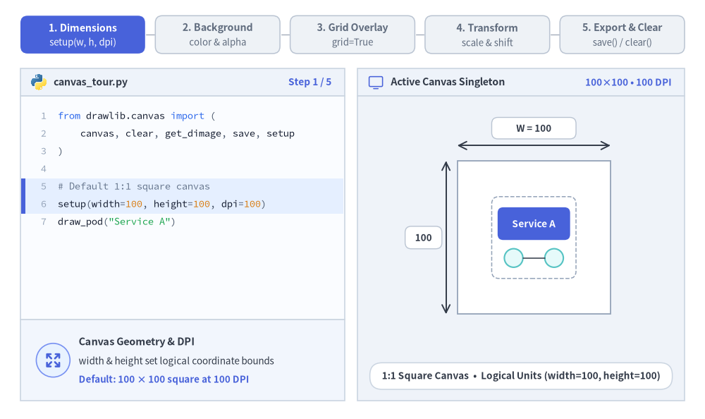
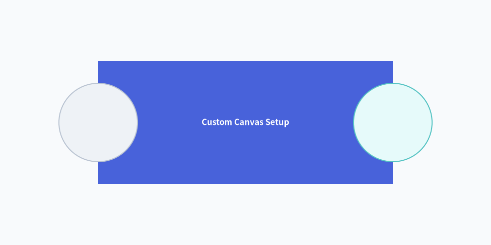
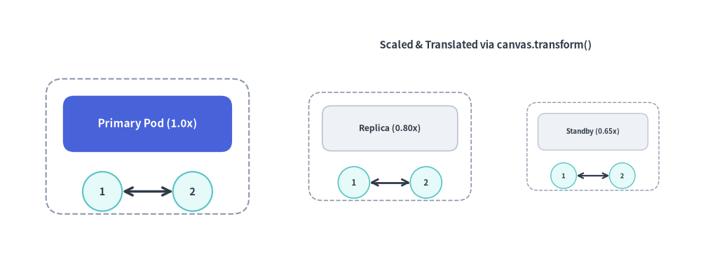

# Canvas & Coordinates

The `canvas` is the foundational drawing surface of Drawlib.  
Under the "Illustration as Code" paradigm, canvas dimensions, resolution, background coloring, coordinate grids, and export formats are managed entirely through declarative Python function calls.
Drawlib maintains an active `canvas` singleton where declarative calls configure dimensions, backgrounds, alignment grids, local coordinate transforms, multi-format exports, and state resets:


<figure class="drawlib-image" style="text-align: center;">
  
  <figcaption class="drawlib-caption">Drawlib Canvas Tour: Dimensions, Background & Alpha, Grid, Transform, Export & Clear (APNG Animation)</figcaption>
</figure>

<details class="drawlib-code-details">
<summary>Source Code</summary>

```python
from __future__ import annotations

from drawlib.anim import Animation
from drawlib.canvas import save, setup
from drawlib.icons import code as code_icons
from drawlib.icons import phosphor
from drawlib.lines import line, lines_curved
from drawlib.shapes import circle, rectangle
from drawlib.smartarts import SourceCode, SourceCodeStyles
from drawlib.styles import Colors, Styles
from drawlib.text import text

W, H = 138.0, 82.0
setup(width=W, height=H)
anim = Animation(fps=10.0, loop=0)

CODE_TEXT_SIZE = 10.0
PT_TO_CANVAS = W / 720.0
FONT_CANVAS = CODE_TEXT_SIZE * PT_TO_CANVAS
LINE_H = FONT_CANVAS * 1.8
PAD_Y = FONT_CANVAS * 1.2

CODE_STYLES = SourceCodeStyles.get("default", font_lang="en", text_size=CODE_TEXT_SIZE).patch(
    box_style=Styles.Neutral.patch(shape_fill_color=(0, 0, 0, 0), shape_line_width=0),
)

PANE_HEADER = Styles.Neutral.patch(
    shape_fill_color=(238, 243, 250),
    shape_line_color=(203, 213, 225),
    shape_line_width=1.2,
    shape_r=0.0,
)
EDITOR_BODY = Styles.Neutral.patch(
    shape_fill_color=(250, 252, 255),
    shape_line_color=(203, 213, 225),
    shape_line_width=1.2,
    shape_r=0.0,
)
TAKEAWAY_BODY = Styles.Neutral.patch(
    shape_fill_color=(242, 246, 253),
    shape_line_color=(203, 213, 225),
    shape_line_width=1.2,
    shape_r=0.0,
)
STUDIO_BODY = Styles.Neutral.patch(
    shape_fill_color=(239, 243, 249),
    shape_line_color=(203, 213, 225),
    shape_line_width=1.2,
    shape_r=0.0,
)

STEP_ITEMS = [
    ("1. Dimensions", "setup(w, h, dpi)"),
    ("2. Background", "color & alpha"),
    ("3. Grid Overlay", "grid=True"),
    ("4. Transform", "scale & shift"),
    ("5. Export & Clear", "save() / clear()"),
]


def draw_step_bar(active_step: int) -> None:
    """Draw top 5-step feature indicator bar (active_step is 1..5)."""
    pill_w = 24.4
    pill_h = 7.4
    gap = 2.0
    start_x = 4.0 + pill_w / 2.0
    cy = 75.2

    for idx, (label, sublabel) in enumerate(STEP_ITEMS, start=1):
        cx = start_x + (idx - 1) * (pill_w + gap)
        if idx > 1:
            prev_cx = cx - (pill_w + gap)
            line(
                (prev_cx + pill_w / 2.0 + 0.2, cy),
                (cx - pill_w / 2.0 - 0.2, cy),
                style=Styles.PrimaryBold if idx <= active_step else Styles.MutedThin,
            )

        if idx == active_step:
            st = Styles.PrimaryFlat.patch(shape_r=1.4)
            tst = Styles.WhiteBold.patch(text_size=10.2)
            sub_tst = Styles.White.patch(text_size=9.5)
        elif idx < active_step:
            st = Styles.PrimaryNeutral.patch(shape_r=1.4, shape_line_width=1.1)
            tst = Styles.PrimaryBold.patch(text_size=10.2)
            sub_tst = Styles.Primary.patch(text_size=9.5)
        else:
            st = Styles.Neutral.patch(shape_r=1.4, shape_line_width=1.1)
            tst = Styles.MutedBold.patch(text_size=10.2)
            sub_tst = Styles.Muted.patch(text_size=9.5)

        rectangle((cx, cy), width=pill_w, height=pill_h, style=st)
        text((cx, cy + 1.35), label, style=tst)
        text((cx, cy - 1.55), sublabel, style=sub_tst)


def draw_left_pane(
    active_step: int,
    code_lines: list[str],
    hl_range: tuple[int, int],
    icon_fn: object,
    summary_title: str,
    summary_line1: str,
    summary_line2: str,
) -> None:
    """Draw left Python editor pane + bottom feature takeaway strip."""
    x0, w = 4.0, 63.5
    cx = x0 + w / 2.0
    top_y = 63.2
    header_h = 5.4
    editor_h = 43.8
    takeaway_h = 15.8

    # Header bar
    rectangle((cx, top_y + header_h / 2.0), width=w, height=header_h, style=PANE_HEADER)
    code_icons.python((x0 + 3.6, top_y + header_h / 2.0), width=3.4, style=Styles.Neutral)
    text(
        (x0 + 6.5, top_y + header_h / 2.0),
        "canvas_tour.py",
        style=Styles.DarkBold.patch(text_size=10.2, halign="left"),
    )
    text(
        (x0 + w - 2.6, top_y + header_h / 2.0),
        f"Step {active_step} / 5",
        style=Styles.PrimaryBold.patch(text_size=9.8, halign="right"),
    )

    # Code editor body (y in [19.4, 63.2])
    rectangle((cx, top_y - editor_h / 2.0), width=w, height=editor_h, style=EDITOR_BODY)

    hl_start, hl_end = hl_range
    hl_top = top_y - PAD_Y - hl_start * LINE_H
    hl_bot = top_y - PAD_Y - (hl_end + 1) * LINE_H
    hl_cy = (hl_top + hl_bot) / 2.0
    hl_h = hl_top - hl_bot
    rectangle(
        (cx, hl_cy),
        width=w - 0.6,
        height=hl_h,
        style=Styles.Neutral.patch(shape_fill_color=(229, 239, 255), shape_line_width=0),
    )
    rectangle(
        (x0 + 0.55, hl_cy),
        width=0.9,
        height=hl_h,
        style=Styles.PrimaryFlat.patch(shape_line_width=0),
    )

    SourceCode.draw(
        xy=(x0, top_y),
        width=w,
        code="\n".join(code_lines),
        styles=CODE_STYLES,
        code_lang="python",
        show_linenum=True,
        align="top_left",
    )

    # Bottom takeaway strip (y in [3.6, 19.4])
    take_cy = 3.6 + takeaway_h / 2.0
    rectangle((cx, take_cy), width=w, height=takeaway_h, style=TAKEAWAY_BODY)
    circle(
        (x0 + 6.4, take_cy),
        radius=3.3,
        style=Styles.PrimaryNeutral.patch(shape_line_width=1.2),
    )
    icon_fn((x0 + 6.4, take_cy), width=3.8, style=Styles.PrimaryBold)  # type: ignore[operator]
    text(
        (x0 + 11.4, take_cy + 3.6),
        summary_title,
        style=Styles.DarkBold.patch(text_size=10.4, halign="left"),
    )
    text(
        (x0 + 11.4, take_cy - 0.2),
        summary_line1,
        style=Styles.Dark.patch(text_size=9.7, halign="left"),
    )
    text(
        (x0 + 11.4, take_cy - 3.8),
        summary_line2,
        style=Styles.PrimaryBold.patch(text_size=9.6, halign="left"),
    )


def draw_right_studio_shell(status_badge: str, footer_caption: str) -> None:
    """Draw right studio workspace shell and bottom caption pill."""
    x0, w = 70.0, 64.0
    cx = x0 + w / 2.0
    top_y = 63.2
    header_h = 5.4
    body_h = 59.6

    rectangle((cx, top_y + header_h / 2.0), width=w, height=header_h, style=PANE_HEADER)
    phosphor.monitor((x0 + 3.6, top_y + header_h / 2.0), width=3.4, style=Styles.Primary)
    text(
        (x0 + 6.5, top_y + header_h / 2.0),
        "Active Canvas Singleton",
        style=Styles.DarkBold.patch(text_size=10.2, halign="left"),
    )
    text(
        (x0 + w - 2.6, top_y + header_h / 2.0),
        status_badge,
        style=Styles.PrimaryBold.patch(text_size=9.6, halign="right"),
    )

    rectangle((cx, 3.6 + body_h / 2.0), width=w, height=body_h, style=STUDIO_BODY)

    rectangle(
        (cx, 8.4),
        width=59.2,
        height=5.2,
        style=Styles.Neutral.patch(
            shape_fill_color=(255, 255, 255),
            shape_line_color=(203, 213, 225),
            shape_line_width=1.1,
            shape_r=2.4,
        ),
        text=footer_caption,
        text_style=Styles.DarkBold.patch(text_size=9.8),
    )


def draw_pod_widget(
    cx: float,
    cy: float,
    w: float,
    h: float,
    label: str,
    *,
    variant: str = "primary",
) -> None:
    """Draw a miniature service pod widget inside the simulated canvas."""
    rectangle(
        (cx, cy),
        width=w,
        height=h,
        style=Styles.Neutral.patch(
            shape_fill_color=(255, 255, 255, 0.92),
            shape_line_color=(148, 163, 184),
            shape_line_width=1.1,
            shape_line_style="dashed",
            shape_r=1.4,
        ),
    )
    if variant == "primary":
        hdr_st = Styles.PrimaryFlat.patch(shape_r=1.1)
        txt_st = Styles.WhiteBold.patch(text_size=9.8)
    elif variant == "secondary":
        hdr_st = Styles.SecondaryNeutral.patch(shape_r=1.1, shape_line_width=1.1)
        txt_st = Styles.DarkBold.patch(text_size=9.5)
    else:
        hdr_st = Styles.Neutral.patch(
            shape_fill_color=(241, 245, 251),
            shape_line_color=(148, 163, 184),
            shape_line_width=1.1,
            shape_r=1.1,
        )
        txt_st = Styles.DarkBold.patch(text_size=9.6)

    hdr_h = max(5.2, h * 0.40)
    hdr_cy = cy + h * 0.17
    rectangle((cx, hdr_cy), width=w * 0.86, height=hdr_h, style=hdr_st, text=label, text_style=txt_st)

    node_y = cy - h * 0.25
    dx = w * 0.24
    r = max(1.15, min(1.85, w * 0.11))
    circle((cx - dx, node_y), radius=r, style=Styles.SecondaryNeutral)
    circle((cx + dx, node_y), radius=r, style=Styles.SecondaryNeutral)
    if dx - r > 0.4:
        line((cx - dx + r, node_y), (cx + dx - r, node_y), style=Styles.DarkBold.patch(line_width=1.1))


def draw_checkerboard(cx: float, cy: float, w: float, h: float, cols: int = 16, rows: int = 9) -> None:
    """Draw alpha transparency checkerboard inside simulated canvas bounds."""
    x0 = cx - w / 2.0
    y0 = cy - h / 2.0
    tw = w / cols
    th = h / rows
    light = Styles.Neutral.patch(shape_fill_color=(255, 255, 255), shape_line_width=0)
    dark = Styles.Neutral.patch(shape_fill_color=(220, 227, 237), shape_line_width=0)
    for r_idx in range(rows):
        for c_idx in range(cols):
            st = light if (r_idx + c_idx) % 2 == 0 else dark
            rectangle(
                (x0 + (c_idx + 0.5) * tw, y0 + (r_idx + 0.5) * th),
                width=tw + 0.04,
                height=th + 0.04,
                style=st,
            )
    rectangle(
        (cx, cy),
        width=w,
        height=h,
        style=Styles.Neutral.patch(
            shape_fill_color=(0, 0, 0, 0),
            shape_line_color=(148, 163, 184),
            shape_line_width=1.3,
        ),
    )


def draw_dimension_rulers(cx: float, cy: float, w: float, h: float, w_label: str, h_label: str, accent: bool) -> None:
    """Draw width and height dimension callouts around the simulated canvas."""
    x0, x1 = cx - w / 2.0, cx + w / 2.0
    y0, y1 = cy - h / 2.0, cy + h / 2.0
    arrow_st = Styles.PrimaryBold.patch(line_width=1.5) if accent else Styles.DarkBold.patch(line_width=1.4)
    pill_st = (
        Styles.PrimaryNeutral.patch(shape_r=1.2, shape_line_width=1.1)
        if accent
        else Styles.Neutral.patch(shape_fill_color=(255, 255, 255), shape_r=1.2, shape_line_width=1.0)
    )
    txt_st = Styles.PrimaryBold.patch(text_size=9.6) if accent else Styles.DarkBold.patch(text_size=9.6)

    # Top width ruler
    ry = y1 + 3.0
    line((x0, ry), (x1, ry), arrow_head="<->", style=arrow_st)
    rectangle((cx, ry + 3.4), width=16.5, height=4.2, style=pill_st, text=w_label, text_style=txt_st)

    # Left height ruler
    rx = x0 - 2.2
    line((rx, y0), (rx, y1), arrow_head="<->", style=arrow_st)
    rectangle((rx - 4.4, cy), width=7.2, height=4.4, style=pill_st, text=h_label, text_style=txt_st)


# -------------------------------------------------------------------------
# Step 1: Dimensions & DPI — 100x100 Square -> 160x90 Widescreen
# -------------------------------------------------------------------------
CODE_STEP1_SQ = [
    "from drawlib.canvas import (",
    "    canvas, clear, get_dimage, save, setup",
    ")",
    "",
    "# Default 1:1 square canvas",
    "setup(width=100, height=100, dpi=100)",
    'draw_pod("Service A")',
]
CODE_STEP1_WIDE = [
    "from drawlib.canvas import (",
    "    canvas, clear, get_dimage, save, setup",
    ")",
    "",
    "# Resize to 16:9 widescreen & 200 DPI",
    "setup(width=160, height=90, dpi=200)",
    'draw_pod("Service A")',
]

with anim.frame(duration=3.0):
    draw_step_bar(1)
    draw_left_pane(
        1,
        CODE_STEP1_SQ,
        (4, 5),
        phosphor.arrows_out,
        "Canvas Geometry & DPI",
        "width & height set logical coordinate bounds",
        "Default: 100 × 100 square at 100 DPI",
    )
    draw_right_studio_shell("100×100 • 100 DPI", "1:1 Square Canvas  •  Logical Units (width=100, height=100)")
    rectangle(
        (104.5, 35.5),
        width=30.0,
        height=30.0,
        style=Styles.Neutral.patch(shape_fill_color=(255, 255, 255), shape_line_color=(148, 163, 184), shape_line_width=1.3),
    )
    draw_dimension_rulers(104.5, 35.5, 30.0, 30.0, "W = 100", "100", accent=False)
    draw_pod_widget(104.5, 35.5, 16.5, 16.0, "Service A")

with anim.frame(duration=0.45):
    draw_step_bar(1)
    draw_left_pane(
        1,
        CODE_STEP1_WIDE,
        (4, 5),
        phosphor.arrows_out,
        "Canvas Geometry & DPI",
        "Resizing logical space to 16:9 widescreen...",
        "Higher dpi=200 sharpens raster exports",
    )
    draw_right_studio_shell("Resizing...", "Morphing Canvas Aspect Ratio (100×100 → 160×90)")
    rectangle(
        (104.5, 35.5),
        width=39.0,
        height=28.5,
        style=Styles.Neutral.patch(shape_fill_color=(255, 255, 255), shape_line_color=(59, 130, 246), shape_line_width=1.5),
    )
    draw_pod_widget(104.5, 35.5, 16.5, 16.0, "Service A")

with anim.frame(duration=3.3):
    draw_step_bar(1)
    draw_left_pane(
        1,
        CODE_STEP1_WIDE,
        (4, 5),
        phosphor.arrows_out,
        "Canvas Geometry & DPI",
        "16:9 widescreen layout (width=160, height=90)",
        "dpi=200 sharpens pixels without moving coords",
    )
    draw_right_studio_shell("160×90 • 200 DPI", "16:9 Widescreen Canvas  •  High-Resolution 200 DPI")
    rectangle(
        (104.5, 35.5),
        width=48.0,
        height=27.0,
        style=Styles.Neutral.patch(shape_fill_color=(255, 255, 255), shape_line_color=(59, 130, 246), shape_line_width=1.5),
    )
    draw_dimension_rulers(104.5, 35.5, 48.0, 27.0, "W = 160", "90", accent=True)
    draw_pod_widget(104.5, 35.5, 17.5, 16.0, "Service A")

# -------------------------------------------------------------------------
# Step 2: Background Color & Alpha Transparency
# -------------------------------------------------------------------------
CODE_STEP2_COLOR = [
    "from drawlib.canvas import setup",
    "from drawlib.styles import Colors",
    "",
    "setup(",
    "    width=160, height=90,",
    "    background_color=Colors.Primary1,",
    "    background_alpha=1.0,",
    ")",
    'draw_pod("Service A")',
]
CODE_STEP2_ALPHA = [
    "from drawlib.canvas import setup",
    "",
    "# Transparent PNG for badges & stickers",
    "setup(",
    "    width=160, height=90,",
    "    background_alpha=0.0,",
    ")",
    'draw_pod("Service A")',
]

with anim.frame(duration=3.3):
    draw_step_bar(2)
    draw_left_pane(
        2,
        CODE_STEP2_COLOR,
        (5, 6),
        phosphor.palette,
        "Custom Background Fill",
        "Accepts Colors.*, RGB/RGBA tuples, or hex strings",
        "Shorthand aliases: color=... and alpha=...",
    )
    draw_right_studio_shell("Colors.Primary1", "Tinted Fill  •  background_color = Colors.Primary1")
    rectangle(
        (104.5, 36.5),
        width=48.0,
        height=27.0,
        style=Styles.Neutral.patch(
            shape_fill_color=Colors.Primary1,
            shape_line_color=(96, 145, 225),
            shape_line_width=1.5,
        ),
    )
    rectangle(
        (104.5, 53.8),
        width=36.0,
        height=4.4,
        style=Styles.PrimaryNeutral.patch(shape_r=1.4, shape_line_width=1.1),
        text="background_color = Colors.Primary1",
        text_style=Styles.PrimaryBold.patch(text_size=9.6),
    )
    draw_pod_widget(104.5, 36.5, 17.5, 16.0, "Service A")

with anim.frame(duration=3.6):
    draw_step_bar(2)
    draw_left_pane(
        2,
        CODE_STEP2_ALPHA,
        (5, 5),
        phosphor.selection_background,
        "Transparent Canvas (alpha=0.0)",
        "Omits solid backdrop when exporting PNG / WebP",
        "Ideal for floating UI badges, icons & dark-mode docs",
    )
    draw_right_studio_shell("alpha = 0.0", "Transparent PNG Backdrop  •  Checkerboard = 0% Opacity")
    draw_checkerboard(104.5, 36.5, 48.0, 27.0, cols=16, rows=9)
    rectangle(
        (104.5, 53.8),
        width=34.0,
        height=4.4,
        style=Styles.Neutral.patch(shape_fill_color=(255, 255, 255), shape_r=1.4, shape_line_width=1.1),
        text="background_alpha = 0.0",
        text_style=Styles.PrimaryBold.patch(text_size=9.6),
    )
    draw_pod_widget(104.5, 36.5, 17.5, 16.0, "Service A")

# -------------------------------------------------------------------------
# Step 3: Coordinate Grid Overlay (grid=True)
# -------------------------------------------------------------------------
CODE_STEP3_GRID = [
    "from drawlib.canvas import save, setup",
    "",
    "setup(",
    "    width=160, height=90,",
    "    grid=True,",
    "    grid_xpitch=20, grid_ypitch=15,",
    ")",
    'draw_pod("Service A")',
    'save("out.png")  # + out_grid.png',
]

with anim.frame(duration=3.9):
    draw_step_bar(3)
    draw_left_pane(
        3,
        CODE_STEP3_GRID,
        (4, 5),
        phosphor.grid_four,
        "Coordinate Grid Scaffolding",
        "Overlays pitch lines & bold center axes (80, 45)",
        "save() exports both out.png and out_grid.png!",
    )
    draw_right_studio_shell("grid = True", "Alignment Grid (xpitch=20, ypitch=15) & Center (80, 45)")

    can_cx, can_cy = 104.5, 36.5
    can_w, can_h = 48.0, 27.0
    x0, y0 = can_cx - can_w / 2.0, can_cy - can_h / 2.0
    s = 0.30

    rectangle(
        (can_cx, can_cy),
        width=can_w,
        height=can_h,
        style=Styles.Neutral.patch(shape_fill_color=(255, 255, 255), shape_line_color=(148, 163, 184), shape_line_width=1.3),
    )

    grid_minor = Styles.MutedDashed.patch(line_color=(198, 210, 226), line_width=0.9)
    grid_center = Styles.PrimaryDashed.patch(line_color=(72, 118, 224), line_width=1.4)
    for vx in range(20, 160, 20):
        gx = x0 + vx * s
        line((gx, y0), (gx, y0 + can_h), style=grid_center if vx == 80 else grid_minor)
    for vy in range(15, 90, 15):
        gy = y0 + vy * s
        line((x0, gy), (x0 + can_w, gy), style=grid_center if vy == 45 else grid_minor)

    for vx in (0, 40, 80, 120, 160):
        st = Styles.PrimaryBold.patch(text_size=9.5) if vx == 80 else Styles.MutedBold.patch(text_size=9.5)
        text((x0 + vx * s, y0 - 2.6), str(vx), style=st)
    for vy in (0, 45, 90):
        st = Styles.PrimaryBold.patch(text_size=9.5, halign="right") if vy == 45 else Styles.MutedBold.patch(text_size=9.5, halign="right")
        text((x0 - 1.6, y0 + vy * s), str(vy), style=st)

    rectangle(
        (can_cx, 54.0),
        width=36.0,
        height=4.4,
        style=Styles.PrimaryNeutral.patch(shape_r=1.4, shape_line_width=1.1),
        text="Center Axes: x = 80, y = 45",
        text_style=Styles.PrimaryBold.patch(text_size=9.6),
    )
    draw_pod_widget(can_cx, can_cy, 17.5, 16.0, "Service A")

# -------------------------------------------------------------------------
# Step 4: Local Similarity Transform — canvas.transform()
# -------------------------------------------------------------------------
CODE_STEP4_A = [
    "setup(width=160, height=90, grid=True)",
    'draw_pod("Primary")          # 1.00x',
    "with canvas.transform(",
    "    (34, 45), scale=0.80, translate=(52, 0)",
    "):",
    '    draw_pod("Replica")      # 0.80x',
]
CODE_STEP4_B = [
    "setup(width=160, height=90, grid=True)",
    'draw_pod("Primary")          # 1.00x',
    "with canvas.transform(",
    "    (34, 45), scale=0.80, translate=(52, 0)",
    "):",
    '    draw_pod("Replica")      # 0.80x',
    "with canvas.transform(",
    "    (34, 45), scale=0.65, translate=(98, 0)",
    "):",
    '    draw_pod("Standby")      # 0.65x',
]


def draw_transform_studio(show_standby: bool) -> None:
    """Render Step 4 simulated canvas with 2 or 3 proportionally scaled pods."""
    can_cx, can_cy = 104.5, 35.0
    can_w, can_h = 48.0, 27.0
    x0, y0 = can_cx - can_w / 2.0, can_cy - can_h / 2.0
    rectangle(
        (can_cx, can_cy),
        width=can_w,
        height=can_h,
        style=Styles.Neutral.patch(shape_fill_color=(255, 255, 255), shape_line_color=(148, 163, 184), shape_line_width=1.3),
    )
    grid_minor = Styles.MutedDashed.patch(line_color=(220, 228, 240), line_width=0.8)
    for vx in (40, 80, 120):
        line((x0 + vx * 0.30, y0), (x0 + vx * 0.30, y0 + can_h), style=grid_minor)
    line((x0, can_cy), (x0 + can_w, can_cy), style=grid_minor)

    # Pod 1: Primary (1.0x)
    draw_pod_widget(89.8, 34.0, 13.6, 15.8, "Primary", variant="primary")
    text((89.8, 44.4), "1.0x", style=Styles.PrimaryBold.patch(text_size=9.6))

    # Pod 2: Replica (0.80x)
    draw_pod_widget(106.0, 34.0, 11.2, 12.8, "Replica", variant="neutral")
    text((106.0, 42.9), "0.80x", style=Styles.DarkBold.patch(text_size=9.5))

    lines_curved(
        [(89.8, 49.0), (89.8, 54.2), (106.0, 54.2), (106.0, 49.0)],
        r=2.2,
        arrow_head="->",
        style=Styles.PrimaryBold.patch(line_width=1.4),
    )

    if show_standby:
        draw_pod_widget(120.3, 34.0, 9.8, 10.6, "Standby", variant="secondary")
        text((120.3, 41.8), "0.65x", style=Styles.SecondaryBold.patch(text_size=9.5))
        lines_curved(
            [(106.0, 49.0), (106.0, 54.2), (120.3, 54.2), (120.3, 49.0)],
            r=2.2,
            arrow_head="->",
            style=Styles.SecondaryBold.patch(line_width=1.4),
        )
        text((105.0, 57.5), "scale + translate", style=Styles.PrimaryBold.patch(text_size=9.6))
    else:
        text((97.9, 57.5), "scale=0.80, translate=(52, 0)", style=Styles.PrimaryBold.patch(text_size=9.6))


with anim.frame(duration=3.15):
    draw_step_bar(4)
    draw_left_pane(
        4,
        CODE_STEP4_A,
        (2, 5),
        phosphor.corners_out,
        "Local Coordinate Transform",
        "Scales shapes, strokes, arrows & fonts together",
        "Reuses components without recalculating coords",
    )
    draw_right_studio_shell("transform()", "canvas.transform()  •  Proportional Scaling + Offset")
    draw_transform_studio(show_standby=False)

with anim.frame(duration=3.6):
    draw_step_bar(4)
    draw_left_pane(
        4,
        CODE_STEP4_B,
        (6, 9),
        phosphor.corners_out,
        "Reusable & Nestable Blocks",
        "Author once in local coords; instantiate at any scale",
        "Supports nested with canvas.transform() scopes",
    )
    draw_right_studio_shell("3 Pods", "1 Component Function  →  1.0x, 0.80x & 0.65x Instances")
    draw_transform_studio(show_standby=True)

# -------------------------------------------------------------------------
# Step 5: Multi-Format Export, In-Memory Dimage & clear() Reset
# -------------------------------------------------------------------------
CODE_STEP5_SAVE = [
    "from drawlib.canvas import (",
    "    clear, get_dimage, save, setup",
    ")",
    "# ... draw 3 service pods ...",
    'save("arch.png")      # PNG / WebP / JPG',
    'save("arch.svg")      # Vector SVG / PDF',
    "dimg = get_dimage()   # In-memory Dimage",
]
CODE_STEP5_CLEAR = [
    'save("arch.png")',
    "",
    "# Reset singleton before next drawing!",
    "clear()",
    "",
    "# Fresh Image 2 without bleed-over",
    "setup(width=120, height=80)",
    'circle((60, 40), radius=18, text="Img 2")',
    'save("next.png")',
]

with anim.frame(duration=3.6):
    draw_step_bar(5)
    draw_left_pane(
        5,
        CODE_STEP5_SAVE,
        (4, 6),
        phosphor.floppy_disk,
        "Multi-Format & RAM Export",
        "save() writes PNG, WebP, JPG, SVG, or PDF files",
        "get_dimage() renders in-memory without temp files",
    )
    draw_right_studio_shell("Exported ✓", "Disk Export via save()  •  RAM Image via get_dimage()")

    # Compact upper preview of the finished 3-pod canvas
    rectangle(
        (102.0, 45.2),
        width=46.0,
        height=22.4,
        style=Styles.Neutral.patch(shape_fill_color=(255, 255, 255), shape_line_color=(148, 163, 184), shape_line_width=1.3),
    )
    draw_pod_widget(88.0, 45.2, 13.0, 14.2, "Primary", variant="primary")
    draw_pod_widget(103.5, 45.2, 10.8, 11.6, "Replica", variant="neutral")
    draw_pod_widget(117.2, 45.2, 9.4, 9.8, "Standby", variant="secondary")

    # Export arrows to save() and get_dimage() cards
    line((90.5, 34.0), (86.8, 25.6), arrow_head="->", style=Styles.SuccessBold.patch(line_width=1.7))
    line((113.5, 34.0), (117.2, 25.6), arrow_head="->", style=Styles.PrimaryBold.patch(line_width=1.7))

    rectangle(
        (86.8, 19.8),
        width=28.2,
        height=11.0,
        style=Styles.SuccessNeutral.patch(
            shape_fill_color=(238, 252, 243),
            shape_line_color=(34, 160, 107),
            shape_line_width=1.4,
            shape_r=1.6,
        ),
    )
    phosphor.floppy_disk((79.8, 21.8), width=3.6, style=Styles.SuccessBold)
    text((82.6, 21.8), "save()  ✓", style=Styles.SuccessBold.patch(text_size=10.0, halign="left"))
    text((86.8, 16.8), "PNG • SVG • PDF • WebP", style=Styles.DarkBold.patch(text_size=9.5))

    rectangle(
        (117.2, 19.8),
        width=26.6,
        height=11.0,
        style=Styles.PrimaryNeutral.patch(
            shape_fill_color=(238, 245, 255),
            shape_line_color=(59, 130, 246),
            shape_line_width=1.4,
            shape_r=1.6,
        ),
    )
    phosphor.cpu((108.6, 21.8), width=3.6, style=Styles.PrimaryBold)
    text((111.4, 21.8), "get_dimage()", style=Styles.PrimaryBold.patch(text_size=10.0, halign="left"))
    text((117.2, 16.8), "In-Memory Dimage", style=Styles.DarkBold.patch(text_size=9.5))

with anim.frame(duration=3.75):
    draw_step_bar(5)
    draw_left_pane(
        5,
        CODE_STEP5_CLEAR,
        (2, 6),
        phosphor.arrows_clockwise,
        "Singleton State Reset (clear)",
        "Clears registered artists & resets setup() config",
        "Prevents bleed-over in multi-image Python scripts",
    )
    draw_right_studio_shell("Cleared ✓", "clear() Wipes Singleton State  →  Clean Slate for Image 2")

    rectangle(
        (102.0, 56.2),
        width=52.0,
        height=5.6,
        style=Styles.SuccessNeutral.patch(
            shape_fill_color=(236, 252, 242),
            shape_line_color=(34, 160, 107),
            shape_line_width=1.3,
            shape_r=1.6,
        ),
    )
    phosphor.arrows_clockwise((84.4, 56.2), width=3.6, style=Styles.SuccessBold)
    text(
        (87.6, 56.2),
        "clear() — Previous Artists Wiped ✓",
        style=Styles.SuccessBold.patch(text_size=9.8, halign="left"),
    )

    rectangle(
        (102.0, 35.8),
        width=36.0,
        height=24.0,
        style=Styles.Neutral.patch(shape_fill_color=(255, 255, 255), shape_line_color=(59, 130, 246), shape_line_width=1.4),
    )
    circle(
        (102.0, 35.8),
        radius=7.4,
        style=Styles.PrimaryFlat,
        text="Img 2",
        text_style=Styles.WhiteBold.patch(text_size=10.5),
    )
    text((102.0, 20.6), "Fresh Canvas (120 × 80)", style=Styles.PrimaryBold.patch(text_size=9.8))

save()
```

</details>


---

## 1. Imports & Core Lifecycle

Canvas lifecycle functions and the singleton `canvas` instance are imported from `drawlib.canvas`:

```python
from drawlib.canvas import (
    canvas,       # Active singleton Canvas instance (provides canvas.transform())
    clear,        # Reset canvas state and configuration between drawings
    get_dimage,   # Render canvas in-memory and return a Dimage object
    save,         # Save drawing to disk (PNG, WebP, JPG, SVG, PDF)
    setup,        # Configure dimensions, grid, background color, and DPI
    show,         # Display canvas in an interactive GUI window
)
```

> [!IMPORTANT]
> **Sequential Scripts & Multi-Image Generation**:  
> If you generate multiple illustrations in a single Python script, always call `clear()` between images. Otherwise, elements from earlier drawings will bleed onto subsequent canvases.

---

## 2. Cartesian Coordinate Space

Drawlib uses a mathematical Cartesian coordinate system:

- **Origin `(0, 0)`**: Fixed at the **bottom-left corner** of the canvas.
- **X-Axis**: Increases horizontally to the right (`0` to `width`).
- **Y-Axis**: Increases vertically upwards (`0` to `height`).
- **Center-Based Anchoring**: Coordinates `(x, y)` for shapes, text, and icons refer to their **exact geometric center** by default.


```python
from drawlib.canvas import save, setup
from drawlib.shapes import circle, rectangle
from drawlib.styles import Colors, Styles

# Custom background color (Muted tone 1) and coordinate grid
setup(width=100, height=50, background_color=Colors.Muted1, grid=True)

rectangle((50, 25), width=60, height=25, style=Styles.PrimaryFlat, text="Custom Canvas Setup", text_style=Styles.WhiteBold.patch(text_size=12.0))
circle((20, 25), radius=8, style=Styles.Neutral)
circle((80, 25), radius=8, style=Styles.SecondaryNeutral)
save()
```

<figure class="drawlib-image" style="text-align: center;">
  
  <figcaption class="drawlib-caption">Custom Canvas Configuration with Grid</figcaption>
</figure>


---

## 3. Function & Method Reference

### 3.1. `setup()`
Configures canvas geometry, resolution, coordinate grids, and background appearance. Must be called before drawing elements.

```python
setup(
    width: int | None = None,
    height: int | None = None,
    dpi: int | None = None,
    color: Color | tuple[int, int, int] | tuple[int, int, int, float] | str | None = None,
    alpha: float | None = None,
    background_color: Color | tuple[int, int, int] | tuple[int, int, int, float] | str | None = None,
    background_alpha: float | None = None,
    grid: bool | None = None,
    grid_only: bool | None = None,
    grid_style: Style | None = None,
    grid_centerstyle: Style | None = None,
    grid_xpitch: int | None = None,
    grid_ypitch: int | None = None,
)
```

#### Parameter Reference:
| Parameter | Type | Default | Description |
| :--- | :--- | :--- | :--- |
| `width` | `int` | `100` | Canvas width in virtual coordinate units (`> 0`). |
| `height` | `int` | `100` | Canvas height in virtual coordinate units (`> 0`). |
| `dpi` | `int` | `100` | Dots per inch (resolution and raster sharpness). |
| `background_color` / `color` | `Color \| tuple \| str` | `(255, 255, 255)` | Canvas background color as a `Color` instance, RGB/RGBA tuple, hex string (`"#f8fafc"`), or CSS color name (`color` is a shorthand alias for `background_color`). |
| `background_alpha` / `alpha` | `float` | `1.0` | Background opacity in `[0.0, 1.0]` (`0.0` = fully transparent, `1.0` = opaque; `alpha` is a shorthand alias for `background_alpha`). |
| `grid` | `bool` | `False` | Overlays coordinate grid lines for layout alignment. |
| `grid_only` | `bool` | `False` | Renders the coordinate grid overlay without saving a separate non-grid image. |
| `grid_style` | `Style` | Gray dashed | Custom line style for regular grid lines (automatically enables `grid=True`). |
| `grid_centerstyle`| `Style` | Bold gray dashed | Custom line style for center axes (`x = width / 2`, `y = height / 2`). |
| `grid_xpitch` | `int` | `width / 10` | Spacing between vertical grid lines. |
| `grid_ypitch` | `int` | `height / 10` | Spacing between horizontal grid lines. |

---

### 3.2. `save()`
Exports the active canvas to an image file on disk.

```python
save(
    file: str | None = None,
    format: Literal["png", "webp", "jpg", "pdf", "svg"] | None = None,
)
```

- **`file`**: Target file path. If omitted, defaults to `<script_name>.png` in the directory of the running script.
- **`format`**: Output image format (`"png"`, `"webp"`, `"jpg"`/`"jpeg"`, `"svg"`, `"pdf"`). If omitted, inferred from the filename extension or defaults to `"png"`.
- **Grid Export Behavior (`setup(..., grid=True)`)**:
  - When `grid=True` and `grid_only=False` (default), calling `save("out.png")` writes **two files**: the clean illustration (`out.png`) and a companion grid-overlaid image (`out_grid.png`).
  - When `grid_only=True`, calling `save("out.png")` writes **only a single file** (`out.png`) with the coordinate grid overlaid directly on the drawing.

> [!NOTE]
> **Handling `save()` in Markdown Blocks**:
> In Markdown embedded code blocks (` ```drawlib `), calling `save()` is optional because the Document Builder captures the canvas automatically. If `save()` is called within an embedded block, the engine treats it safely as a no-op to prevent duplicate writes or collisions. However, explicitly including `save()` (without arguments) in complete examples is recommended for 100% copy-paste compatibility with standalone `.py` scripts.

---

### 3.3. `show()`
Opens a local interactive desktop window displaying the illustration. In headless environments (CI/CD, Docker, remote servers), use `save()` or CLI `drawlib show -o <path>` instead.

### 3.4. `clear()`
Resets canvas geometry, clears registered artists, and restores default styles and configuration parameters.

### 3.5. `get_dimage()`
Renders the canvas in-memory and returns a `Dimage` object, allowing programmatic image transformations, cropping, and chaining without writing temporary files to disk.

---

### 3.6. Local Coordinate Scaling & Translation (`canvas.transform()`)

The `canvas.transform()` context manager applies a similarity transformation (proportional scaling around an anchor `origin` plus an `(dx, dy)` translation offset) to all shapes, lines, icons, and text drawn within its `with` block. Transforms can also be nested.

```python
with canvas.transform(
    origin: tuple[float, float] = (0.0, 0.0),
    scale: float = 1.0,
    translate: tuple[float, float] = (0.0, 0.0),
):
    ...
```

- **`origin`**: Anchor coordinate `(ox, oy)` around which scaling is performed (defaults to `(0.0, 0.0)`).
- **`scale`**: Positive proportional scale factor (`> 0`, defaults to `1.0`). Scales geometry, stroke widths, arrowheads, and font sizes together.
- **`translate`**: Additional `(dx, dy)` translation offset applied in canvas units (defaults to `(0.0, 0.0)`).


```python
from drawlib.canvas import canvas, save, setup
from drawlib.lines import line
from drawlib.shapes import circle, rectangle
from drawlib.styles import Styles
from drawlib.text import text

setup(width=124, height=46, grid=True, grid_xpitch=25, grid_ypitch=12)

def draw_service_pod(title: str, is_hero: bool = False) -> None:
    """Reusable pod component authored in local coordinates around (26, 20)."""
    card_style = Styles.PrimaryFlat if is_hero else Styles.Neutral
    label_style = (Styles.WhiteBold if is_hero else Styles.DarkBold).patch(text_size=11.0)
    rectangle((26, 20), width=36, height=24, style=Styles.MutedDashed.patch(shape_r=3))
    rectangle((26, 24), width=30, height=10, style=card_style.patch(shape_r=2), text=title, text_style=label_style)
    circle((18, 12), radius=3.5, style=Styles.SecondaryNeutral, text="1", text_style=Styles.DarkBold.patch(text_size=10.5))
    circle((34, 12), radius=3.5, style=Styles.SecondaryNeutral, text="2", text_style=Styles.DarkBold.patch(text_size=10.5))
    line((21.5, 12), (30.5, 12), arrow_head="<->", style=Styles.DarkBold)

# 1. Original 1.0x pod at (26, 20)
draw_service_pod("Primary Pod (1.0x)", is_hero=True)

# 2. Scaled (0.80x) and translated (+43, 0) replica pod
with canvas.transform(origin=(26, 20), scale=0.80, translate=(43, 0)):
    draw_service_pod("Replica (0.80x)")

# 3. Scaled (0.65x) and translated (+79, 0) standby pod
with canvas.transform(origin=(26, 20), scale=0.65, translate=(79, 0)):
    draw_service_pod("Standby (0.65x)")

text((86, 38), "Scaled & Translated via canvas.transform()", style=Styles.DarkBold.patch(text_size=10.5))
save()
```

<figure class="drawlib-image" style="text-align: center;">
  
  <figcaption class="drawlib-caption">Local Coordinate Scaling and Translation with canvas.transform()</figcaption>
</figure>


