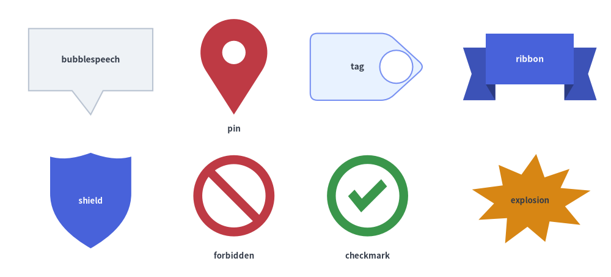
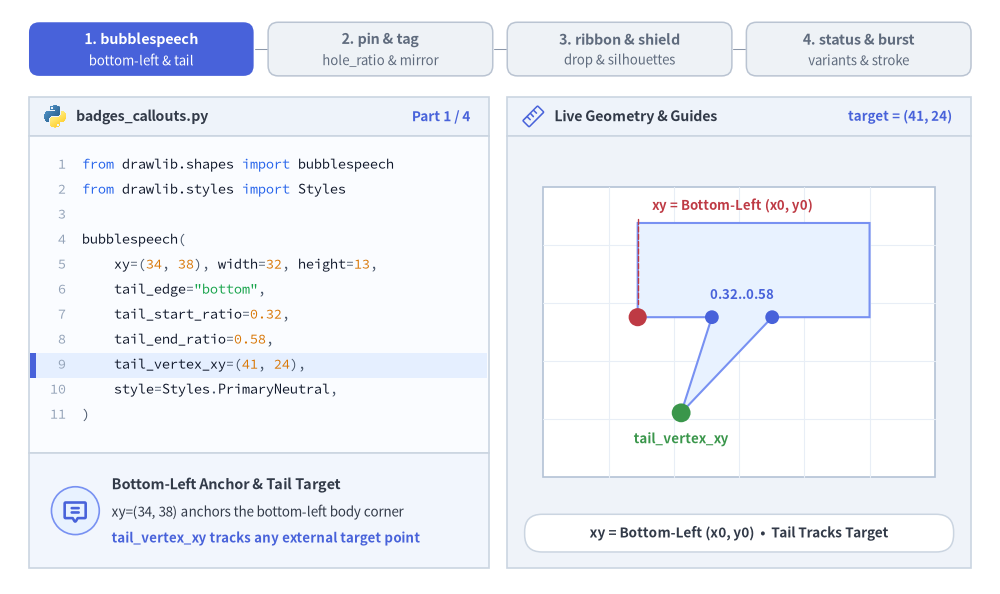
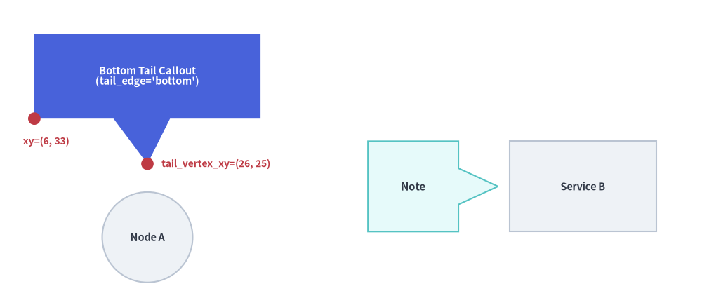
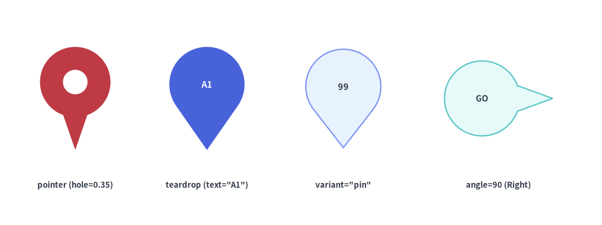
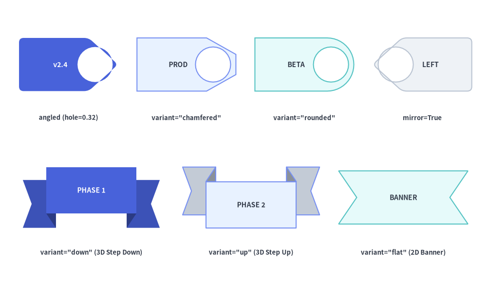
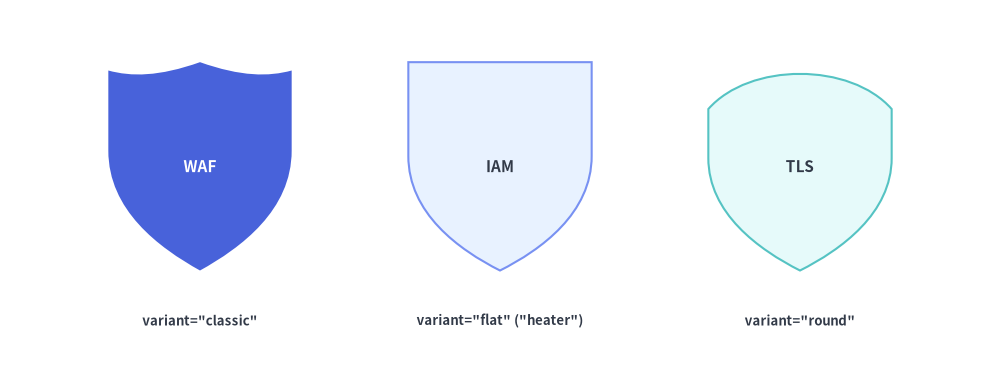
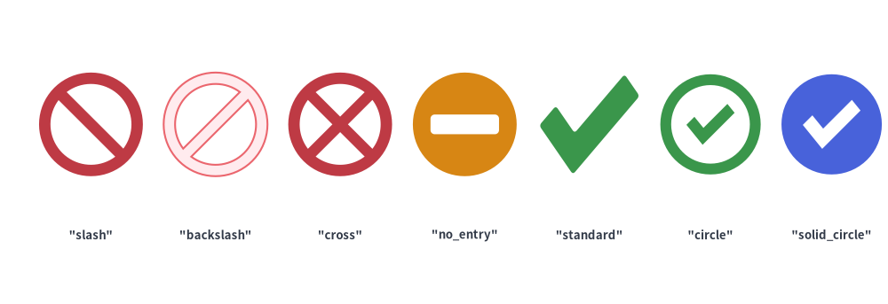
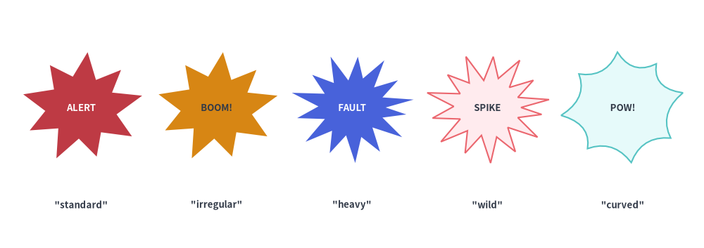

# Callouts, Badges & Status

The **Callouts, Badges & Status** category of `drawlib.shapes` provides **8 annotation, security, and verification primitives**: directional speech bubble callouts (`bubblespeech`), location/pointer pins (`pin`), release and classification tags (`tag`), 3D stepped milestone ribbons (`ribbon`), security/governance shields (`shield`), access-control prohibition badges (`forbidden`), verification checkmarks (`checkmark`), and comic/incident burst callouts (`explosion`).


<figure class="drawlib-image" style="text-align: center;">
  
  <figcaption class="drawlib-caption">Overview of the 8 Callout, Badge, Security, and Status Primitives in drawlib.shapes</figcaption>
</figure>

<details class="drawlib-code-details">
<summary>Source Code</summary>

```python
from drawlib.canvas import save, setup
from drawlib.shapes import (
    bubblespeech,
    checkmark,
    explosion,
    forbidden,
    pin,
    ribbon,
    shield,
    tag,
)
from drawlib.styles import Styles
from drawlib.text import text

setup(width=128, height=58)

lbl_dark = Styles.DarkBold.patch(text_size=10.0)
lbl_white = Styles.WhiteBold.patch(text_size=10.0)
cap_st = Styles.DarkBold.patch(text_size=9.5)

# Row 1: bubblespeech, pin, tag, ribbon
bubblespeech(
    xy=(6, 39),
    width=26,
    height=13,
    tail_edge="bottom",
    tail_start_ratio=0.35,
    tail_end_ratio=0.60,
    tail_vertex_xy=(19, 34),
    style=Styles.Neutral,
    text="bubblespeech",
    text_style=lbl_dark,
)
pin(
    (49, 44),
    width=14,
    height=20,
    variant="teardrop",
    hole_ratio=0.35,
    style=Styles.DangerFlat,
)
text((49, 31), "pin", style=cap_st)

tag(
    (77, 44),
    width=24,
    height=14,
    variant="angled",
    style=Styles.PrimaryNeutral.patch(shape_r=1.5),
    text="tag",
    text_style=lbl_dark,
)
ribbon(
    (111, 44),
    width=28,
    height=14,
    variant="down",
    style=Styles.PrimaryFlat,
    text="ribbon",
    text_style=lbl_white,
)

# Row 2: shield, forbidden, checkmark, explosion
shield(
    (19, 16),
    width=17,
    height=20,
    variant="classic",
    style=Styles.PrimaryFlat,
    text="shield",
    text_style=Styles.WhiteBold.patch(text_size=9.5),
)
forbidden((49, 17), radius=8.5, variant="slash", style=Styles.DangerFlat)
text((49, 4.5), "forbidden", style=cap_st)

checkmark((77, 17), width=17, variant="circle", style=Styles.SuccessFlat)
text((77, 4.5), "checkmark", style=cap_st)

explosion(
    (111, 16),
    width=26,
    height=20,
    variant="irregular",
    style=Styles.WarningFlat,
    text="explosion",
    text_style=Styles.DarkBold.patch(text_size=9.5),
)

save()
```

</details>


---

## 1. Core Geometric Concepts

While `pin`, `tag`, `ribbon`, `shield`, `forbidden`, `checkmark`, and `explosion` follow Drawlib's standard center-anchoring convention (`xy`), `bubblespeech` anchors its rectangular body at the bottom-left corner `(x0, y0)` so its pointer tail can track an exact target coordinate (`tail_vertex_xy`). Watch how edge attachment ratios (`tail_start_ratio`..`tail_end_ratio`), head/collar cutouts (`hole_ratio`) and horizontal mirroring (`mirror`), 3D ribbon step offsets (`drop_ratio`), and compound status/burst silhouettes (`variant` & `thickness_ratio`) reshape each primitive:


<figure class="drawlib-image" style="text-align: center;">
  
  <figcaption class="drawlib-caption">Parameter & Geometry Tour: Live Morphing of bubblespeech, pin, tag, ribbon, shield, forbidden, checkmark, and explosion (APNG Animation)</figcaption>
</figure>

<details class="drawlib-code-details">
<summary>Source Code</summary>

```python
from __future__ import annotations

from drawlib import shapes as sh
from drawlib.anim import Animation
from drawlib.canvas import save, setup
from drawlib.icons import code as code_icons
from drawlib.icons import phosphor
from drawlib.lines import line
from drawlib.shapes import (
    bubblespeech,
    circle,
    explosion,
    pin,
    rectangle,
    ribbon,
    shield,
    tag,
)
from drawlib.smartarts import SourceCode, SourceCodeStyles
from drawlib.styles import Styles
from drawlib.text import text

W, H = 138.0, 82.0
setup(width=W, height=H)
anim = Animation(fps=10.0, loop=0)

CODE_TEXT_SIZE = 10.0
PT_TO_CANVAS = W / 720.0
FONT_CANVAS = CODE_TEXT_SIZE * PT_TO_CANVAS
LINE_H = FONT_CANVAS * 1.8
PAD_Y = FONT_CANVAS * 1.2

CODE_STYLES = SourceCodeStyles.get("default", font_lang="en", text_size=CODE_TEXT_SIZE).patch(
    box_style=Styles.Neutral.patch(shape_fill_color=(0, 0, 0, 0), shape_line_width=0),
)

PANE_HEADER = Styles.Neutral.patch(
    shape_fill_color=(238, 243, 250),
    shape_line_color=(203, 213, 225),
    shape_line_width=1.2,
    shape_r=0.0,
)
EDITOR_BODY = Styles.Neutral.patch(
    shape_fill_color=(250, 252, 255),
    shape_line_color=(203, 213, 225),
    shape_line_width=1.2,
    shape_r=0.0,
)
TAKEAWAY_BODY = Styles.Neutral.patch(
    shape_fill_color=(242, 246, 253),
    shape_line_color=(203, 213, 225),
    shape_line_width=1.2,
    shape_r=0.0,
)
STUDIO_BODY = Styles.Neutral.patch(
    shape_fill_color=(239, 243, 249),
    shape_line_color=(203, 213, 225),
    shape_line_width=1.2,
    shape_r=0.0,
)

PART_ITEMS = [
    ("1. bubblespeech", "bottom-left & tail"),
    ("2. pin & tag", "hole_ratio & mirror"),
    ("3. ribbon & shield", "drop & silhouettes"),
    ("4. status & burst", "variants & stroke"),
]


def draw_step_bar(active_part: int) -> None:
    """Draw top 4-part progress bar (active_part is 1..4)."""
    pill_w = 31.0
    pill_h = 7.4
    gap = 2.0
    start_x = 4.0 + pill_w / 2.0
    cy = 75.2

    for idx, (label, sublabel) in enumerate(PART_ITEMS, start=1):
        cx = start_x + (idx - 1) * (pill_w + gap)
        if idx > 1:
            prev_cx = cx - (pill_w + gap)
            line(
                (prev_cx + pill_w / 2.0 + 0.2, cy),
                (cx - pill_w / 2.0 - 0.2, cy),
                style=Styles.PrimaryBold if idx <= active_part else Styles.MutedThin,
            )

        if idx == active_part:
            st = Styles.PrimaryFlat.patch(shape_r=1.4)
            tst = Styles.WhiteBold.patch(text_size=10.3)
            sub_tst = Styles.White.patch(text_size=9.5)
        elif idx < active_part:
            st = Styles.PrimaryNeutral.patch(shape_r=1.4, shape_line_width=1.1)
            tst = Styles.PrimaryBold.patch(text_size=10.3)
            sub_tst = Styles.Primary.patch(text_size=9.5)
        else:
            st = Styles.Neutral.patch(shape_r=1.4, shape_line_width=1.1)
            tst = Styles.MutedBold.patch(text_size=10.3)
            sub_tst = Styles.Muted.patch(text_size=9.5)

        rectangle((cx, cy), width=pill_w, height=pill_h, style=st)
        text((cx, cy + 1.35), label, style=tst)
        text((cx, cy - 1.55), sublabel, style=sub_tst)


def draw_left_pane(
    active_part: int,
    code_lines: list[str],
    hl_range: tuple[int, int],
    icon_fn: object,
    summary_title: str,
    summary_line1: str,
    summary_line2: str,
) -> None:
    """Draw left Python code editor + bottom geometric concept note."""
    x0, w = 4.0, 63.5
    cx = x0 + w / 2.0
    top_y = 63.2
    header_h = 5.4
    editor_h = 43.8
    takeaway_h = 15.8

    rectangle((cx, top_y + header_h / 2.0), width=w, height=header_h, style=PANE_HEADER)
    code_icons.python((x0 + 3.6, top_y + header_h / 2.0), width=3.4, style=Styles.Neutral)
    text(
        (x0 + 6.5, top_y + header_h / 2.0),
        "badges_callouts.py",
        style=Styles.DarkBold.patch(text_size=10.2, halign="left"),
    )
    text(
        (x0 + w - 2.6, top_y + header_h / 2.0),
        f"Part {active_part} / 4",
        style=Styles.PrimaryBold.patch(text_size=9.8, halign="right"),
    )

    rectangle((cx, top_y - editor_h / 2.0), width=w, height=editor_h, style=EDITOR_BODY)

    hl_start, hl_end = hl_range
    hl_top = top_y - PAD_Y - hl_start * LINE_H
    hl_bot = top_y - PAD_Y - (hl_end + 1) * LINE_H
    hl_cy = (hl_top + hl_bot) / 2.0
    hl_h = hl_top - hl_bot
    rectangle(
        (cx, hl_cy),
        width=w - 0.6,
        height=hl_h,
        style=Styles.Neutral.patch(shape_fill_color=(229, 239, 255), shape_line_width=0),
    )
    rectangle(
        (x0 + 0.55, hl_cy),
        width=0.9,
        height=hl_h,
        style=Styles.PrimaryFlat.patch(shape_line_width=0),
    )

    SourceCode.draw(
        xy=(x0, top_y),
        width=w,
        code="\n".join(code_lines),
        styles=CODE_STYLES,
        code_lang="python",
        show_linenum=True,
        align="top_left",
    )

    take_cy = 3.6 + takeaway_h / 2.0
    rectangle((cx, take_cy), width=w, height=takeaway_h, style=TAKEAWAY_BODY)
    circle(
        (x0 + 6.4, take_cy),
        radius=3.3,
        style=Styles.PrimaryNeutral.patch(shape_line_width=1.2),
    )
    icon_fn((x0 + 6.4, take_cy), width=3.8, style=Styles.PrimaryBold)  # type: ignore[operator]
    text(
        (x0 + 11.4, take_cy + 3.6),
        summary_title,
        style=Styles.DarkBold.patch(text_size=10.4, halign="left"),
    )
    text(
        (x0 + 11.4, take_cy - 0.2),
        summary_line1,
        style=Styles.Dark.patch(text_size=9.7, halign="left"),
    )
    text(
        (x0 + 11.4, take_cy - 3.8),
        summary_line2,
        style=Styles.PrimaryBold.patch(text_size=9.6, halign="left"),
    )


def draw_geometry_studio(param_badge: str, footer_caption: str) -> tuple[float, float]:
    """Draw right geometry lab shell, inner coordinate sheet with subtle grid, and footer."""
    x0, w = 70.0, 64.0
    cx = x0 + w / 2.0
    top_y = 63.2
    header_h = 5.4
    body_h = 59.6

    rectangle((cx, top_y + header_h / 2.0), width=w, height=header_h, style=PANE_HEADER)
    phosphor.ruler((x0 + 3.6, top_y + header_h / 2.0), width=3.4, style=Styles.Primary)
    text(
        (x0 + 6.5, top_y + header_h / 2.0),
        "Live Geometry & Guides",
        style=Styles.DarkBold.patch(text_size=10.2, halign="left"),
    )
    text(
        (x0 + w - 2.6, top_y + header_h / 2.0),
        param_badge,
        style=Styles.PrimaryBold.patch(text_size=9.6, halign="right"),
    )

    rectangle((cx, 3.6 + body_h / 2.0), width=w, height=body_h, style=STUDIO_BODY)

    # Inner coordinate sheet (54 x 40) with subtle grid lines visible through holes
    sheet_cx, sheet_cy = cx, 36.2
    sheet_w, sheet_h = 54.0, 40.0
    sx0, sy0 = sheet_cx - sheet_w / 2.0, sheet_cy - sheet_h / 2.0
    rectangle(
        (sheet_cx, sheet_cy),
        width=sheet_w,
        height=sheet_h,
        style=Styles.Neutral.patch(
            shape_fill_color=(255, 255, 255),
            shape_line_color=(180, 194, 214),
            shape_line_width=1.2,
        ),
    )
    g_st = Styles.MutedThin.patch(line_color=(232, 238, 246), line_width=0.8)
    for gx in range(1, 6):
        vx = sx0 + gx * (sheet_w / 6.0)
        line((vx, sy0), (vx, sy0 + sheet_h), style=g_st)
    for gy in range(1, 5):
        vy = sy0 + gy * (sheet_h / 5.0)
        line((sx0, vy), (sx0 + sheet_w, vy), style=g_st)

    rectangle(
        (cx, 8.4),
        width=59.2,
        height=5.2,
        style=Styles.Neutral.patch(
            shape_fill_color=(255, 255, 255),
            shape_line_color=(203, 213, 225),
            shape_line_width=1.1,
            shape_r=2.4,
        ),
        text=footer_caption,
        text_style=Styles.DarkBold.patch(text_size=9.8),
    )
    return sheet_cx, sheet_cy


# =========================================================================
# Part 1: bubblespeech — Bottom-Left Anchor, Moving Target, & tail_edge
# =========================================================================
for tx_code, tx_off, dur, hl in (
    (41, -8.0, 0.50, (8, 8)),
    (59, 10.0, 3.3, (4, 8)),
):
    code_b1 = [
        "from drawlib.shapes import bubblespeech",
        "from drawlib.styles import Styles",
        "",
        "bubblespeech(",
        "    xy=(34, 38), width=32, height=13,",
        '    tail_edge="bottom",',
        "    tail_start_ratio=0.32,",
        "    tail_end_ratio=0.58,",
        f"    tail_vertex_xy=({tx_code}, 24),",
        "    style=Styles.PrimaryNeutral,",
        ")",
    ]
    with anim.frame(duration=dur):
        draw_step_bar(1)
        draw_left_pane(
            1,
            code_b1,
            hl,
            phosphor.chat_centered_text,
            "Bottom-Left Anchor & Tail Target",
            "xy=(34, 38) anchors the bottom-left body corner",
            "tail_vertex_xy tracks any external target point",
        )
        scx, scy = draw_geometry_studio(
            f"target = ({tx_code}, 24)",
            "xy = Bottom-Left (x0, y0)  •  Tail Tracks Target",
        )
        bx, by = scx - 14.0, scy + 2.0
        bw, bh = 32.0, 13.0
        tx, ty = scx + tx_off, scy - 11.2
        bubblespeech(
            xy=(bx, by),
            width=bw,
            height=bh,
            tail_edge="bottom",
            tail_start_ratio=0.32,
            tail_end_ratio=0.58,
            tail_vertex_xy=(tx, ty),
            style=Styles.PrimaryNeutral,
        )
        # Edge ratio dots & span label
        xs0, xs1 = bx + bw * 0.32, bx + bw * 0.58
        circle((xs0, by), radius=0.95, style=Styles.PrimaryFlat)
        circle((xs1, by), radius=0.95, style=Styles.PrimaryFlat)
        text((0.5 * (xs0 + xs1), by + 3.2), "0.32..0.58", style=Styles.PrimaryBold.patch(text_size=9.5))

        # Bottom-left anchor xy (red) + target tail_vertex_xy (green)
        circle((bx, by), radius=1.25, style=Styles.DangerFlat)
        text((bx + 2.0, by + bh + 2.4), "xy = Bottom-Left (x0, y0)", style=Styles.DangerBold.patch(text_size=9.5, halign="left"))
        line((bx, by + bh + 0.5), (bx, by + 1.8), style=Styles.DangerDashed.patch(line_width=1.0))

        if tx_off > 0:
            circle((scx - 8.0, ty), radius=1.05, style=Styles.Muted)
            line((scx - 6.2, ty), (tx - 2.0, ty), arrow_head="->", style=Styles.SuccessBold.patch(line_width=1.4))
        circle((tx, ty), radius=1.3, style=Styles.SuccessFlat)
        text((tx, ty - 3.6), "tail_vertex_xy", style=Styles.SuccessBold.patch(text_size=9.6))

# 1B: Switch tail_edge="left" with vertical ratio 0.28..0.66
with anim.frame(duration=3.3):
    code_b2 = [
        "from drawlib.shapes import bubblespeech",
        "from drawlib.styles import Styles",
        "",
        "bubblespeech(",
        "    xy=(48, 28), width=27, height=17,",
        '    tail_edge="left",',
        "    tail_start_ratio=0.28,",
        "    tail_end_ratio=0.66,",
        "    tail_vertex_xy=(35, 36),",
        "    style=Styles.SecondaryNeutral,",
        ")",
    ]
    draw_step_bar(1)
    draw_left_pane(
        1,
        code_b2,
        (5, 8),
        phosphor.chat_centered_text,
        "Switching Edge & Attachment Span",
        "tail_edge selects left, top, right, or bottom",
        "0.28..0.66 spans bottom-to-top on vertical edges",
    )
    scx, scy = draw_geometry_studio(
        'tail_edge = "left"',
        'tail_edge="left"  •  Vertical Ratio 0.28..0.66',
    )
    bx, by = scx - 4.0, scy - 8.0
    bw, bh = 27.0, 17.0
    tx, ty = scx - 16.5, scy + 0.2
    bubblespeech(
        xy=(bx, by),
        width=bw,
        height=bh,
        tail_edge="left",
        tail_start_ratio=0.28,
        tail_end_ratio=0.66,
        tail_vertex_xy=(tx, ty),
        style=Styles.SecondaryNeutral,
    )
    ys0, ys1 = by + bh * 0.28, by + bh * 0.66
    circle((bx, ys0), radius=0.95, style=Styles.PrimaryFlat)
    circle((bx, ys1), radius=0.95, style=Styles.PrimaryFlat)
    text((bx + 2.4, 0.5 * (ys0 + ys1)), "0.28..0.66", style=Styles.PrimaryBold.patch(text_size=9.5, halign="left"))

    circle((bx, by), radius=1.25, style=Styles.DangerFlat)
    text((bx + bw / 2.0, by - 3.6), "xy (bottom-left)", style=Styles.DangerBold.patch(text_size=9.5))

    circle((tx, ty), radius=1.3, style=Styles.SuccessFlat)
    text((tx + 1.0, ty + 6.2), "tail_vertex_xy", style=Styles.SuccessBold.patch(text_size=9.6))

# =========================================================================
# Part 2: pin & tag — hole_ratio Cutouts, Silhouettes, & mirror Flip
# =========================================================================
for var, hr, dur in (("teardrop", 0.25, 0.50), ("pointer", 0.52, 3.4)):
    code_pin = [
        "from drawlib.shapes import pin",
        "from drawlib.styles import Styles",
        "",
        "pin(",
        "    (50, 30), width=19, height=26,",
        f'    variant="{var}",',
        f"    hole_ratio={hr:.2f},",
        "    style=Styles.DangerFlat,",
        ")",
    ]
    with anim.frame(duration=dur):
        draw_step_bar(2)
        draw_left_pane(
            2,
            code_pin,
            (5, 6),
            phosphor.map_pin,
            "Location Pin & Head Cutout",
            "variant switches teardrop curve to pointer cone",
            "hole_ratio=0.52 carves circular ring in pin head",
        )
        scx, scy = draw_geometry_studio(
            f"hole_ratio = {hr:.2f}",
            f'pin(variant="{var}", hole_ratio={hr:.2f})',
        )
        cy_p = scy - 0.8
        pin((scx, cy_p), width=19.0, height=26.0, variant=var, hole_ratio=hr, style=Styles.DangerFlat)
        circle((scx, cy_p), radius=1.6, style=Styles.Neutral.patch(shape_fill_color=(255, 255, 255), shape_line_width=0))
        circle((scx, cy_p), radius=1.1, style=Styles.PrimaryFlat)
        if hr >= 0.50:
            head_cy = cy_p + (13.0 - 9.36)
            hole_r = 9.36 * hr
            line(
                (scx - hole_r + 0.4, head_cy),
                (scx + hole_r - 0.4, head_cy),
                arrow_head="<->",
                style=Styles.DarkBold.patch(line_width=1.4),
            )
            line((scx + 1.8, cy_p), (scx + 10.6, cy_p), style=Styles.PrimaryDashed.patch(line_width=1.0))
            text((scx, cy_p + 16.0), "hole_ratio = 0.52 (Head Ring)", style=Styles.DangerBold.patch(text_size=9.6))
            text((scx + 11.4, cy_p), "xy (center)", style=Styles.PrimaryBold.patch(text_size=9.5, halign="left"))

for var, mir, st_name, st_obj, txt_st, dur in (
    ("angled", False, "PrimaryNeutral", Styles.PrimaryNeutral, Styles.DarkBold.patch(text_size=11.0), 0.55),
    ("rounded", False, "SecondaryNeutral", Styles.SecondaryNeutral, Styles.DarkBold.patch(text_size=11.0), 0.50),
    ("rounded", True, "PrimaryFlat", Styles.PrimaryFlat, Styles.WhiteBold.patch(text_size=11.0), 3.4),
):
    code_tag = [
        "from drawlib.shapes import tag",
        "from drawlib.styles import Styles",
        "",
        "tag(",
        "    (50, 30), width=34, height=17,",
        f'    variant="{var}",',
        f"    mirror={mir},",
        "    hole_ratio=0.16,",
        f"    style=Styles.{st_name},",
        '    text="v2.4",',
        ")",
    ]
    with anim.frame(duration=dur):
        draw_step_bar(2)
        draw_left_pane(
            2,
            code_tag,
            (5, 6),
            phosphor.tag,
            "Release Tag Collar & Mirror Flip",
            "variant morphs angled tip to rounded collar",
            "mirror=True flips collar & punch hole (+X → -X)",
        )
        badge_lbl = "mirror = True (-X)" if mir else f'"{var}" (+X)'
        foot_lbl = (
            'tag(variant="rounded", mirror=True)  •  +X → -X'
            if mir
            else f'tag(variant="{var}", mirror=False)  •  Collar +X'
        )
        scx, scy = draw_geometry_studio(badge_lbl, foot_lbl)
        cy_t = scy - 0.8
        tag(
            (scx, cy_t),
            width=34.0,
            height=17.0,
            variant=var,
            mirror=mir,
            hole_ratio=0.16,
            style=st_obj,
            text="v2.4",
            text_style=txt_st,
        )
        if mir:
            line((scx, cy_t - 13.0), (scx, cy_t - 9.0), style=Styles.MutedDashed.patch(line_width=1.2))
            line((scx, cy_t + 9.0), (scx, cy_t + 11.4), style=Styles.MutedDashed.patch(line_width=1.2))
            line((scx + 9.5, cy_t + 12.2), (scx - 9.5, cy_t + 12.2), arrow_head="->", style=Styles.PrimaryBold.patch(line_width=1.5))
            text((scx, cy_t + 15.6), "mirror=True (+X → -X)", style=Styles.PrimaryBold.patch(text_size=9.6))
        else:
            text((scx, cy_t + 13.5), "Collar & Punch Hole Point +X (Right)", style=Styles.DarkBold.patch(text_size=9.5))

# =========================================================================
# Part 3: ribbon & shield — 3D Step drop_ratio & Shield Silhouettes
# =========================================================================
for var, dr, st_name, st_obj, txt_val, txt_st, dur in (
    ("down", 0.18, "PrimaryFlat", Styles.PrimaryFlat, "PHASE 1", Styles.WhiteBold.patch(text_size=10.5), 3.3),
    ("up", 0.36, "PrimaryNeutral", Styles.PrimaryNeutral, "PHASE 2", Styles.DarkBold.patch(text_size=10.5), 3.3),
):
    code_rib = [
        "from drawlib.shapes import ribbon",
        "from drawlib.styles import Styles",
        "",
        "ribbon(",
        "    (50, 30), width=38, height=18,",
        f'    variant="{var}",',
        f"    drop_ratio={dr:.2f},",
        f"    style=Styles.{st_name},",
        f'    text="{txt_val}",',
        ")",
    ]
    with anim.frame(duration=dur):
        draw_step_bar(3)
        draw_left_pane(
            3,
            code_rib,
            (5, 6),
            phosphor.flag_banner,
            "3D Stepped Ribbon & drop_ratio",
            "variant='down' vs 'up' flips 3D tail step side",
            "drop_ratio scales vertical step offset × height",
        )
        step_dir = "Step Down" if var == "down" else "Step Up"
        scx, scy = draw_geometry_studio(
            f"{var} ({dr:.2f})",
            f'ribbon(variant="{var}", drop_ratio={dr:.2f})  •  {step_dir}',
        )
        rcx, rcy = scx - 3.5, scy - 0.8
        rw, rh = 38.0, 18.0
        ribbon(
            (rcx, rcy),
            width=rw,
            height=rh,
            variant=var,
            drop_ratio=dr,
            style=st_obj,
            text=txt_val,
            text_style=txt_st,
        )
        drop_h = rh * dr
        rx_guide = rcx + rw / 2.0 + 3.2
        if var == "down":
            y_lo, y_hi = rcy - rh / 2.0, rcy - rh / 2.0 + drop_h
            lbl_y = y_lo - 3.2
        else:
            y_lo, y_hi = rcy + rh / 2.0 - drop_h, rcy + rh / 2.0
            lbl_y = y_hi + 3.2
        line((rcx + 9.0, y_lo), (rx_guide + 1.2, y_lo), style=Styles.DangerDashed.patch(line_width=1.0))
        line((rcx + 9.0, y_hi), (rx_guide + 1.2, y_hi), style=Styles.DangerDashed.patch(line_width=1.0))
        line((rx_guide, y_lo), (rx_guide, y_hi), arrow_head="<->", style=Styles.DangerBold.patch(line_width=1.5))
        text((scx, lbl_y), f"drop_ratio = {dr:.2f} ({step_dir})", style=Styles.DangerBold.patch(text_size=9.6))

for var, st_name, st_obj, lbl_txt, txt_st, crest_note, dur in (
    ("classic", "PrimaryFlat", Styles.PrimaryFlat, "WAF", Styles.WhiteBold.patch(text_size=11.2), "Scalloped 3-Peak Crest", 0.50),
    ("flat", "PrimaryNeutral", Styles.PrimaryNeutral, "IAM", Styles.DarkBold.patch(text_size=11.2), "Flat Heater Top Edge", 0.50),
    ("round", "SecondaryNeutral", Styles.SecondaryNeutral, "TLS", Styles.DarkBold.patch(text_size=11.2), "Arched Convex Crest", 3.4),
):
    code_shd = [
        "from drawlib.shapes import shield",
        "from drawlib.styles import Styles",
        "",
        "shield(",
        "    (50, 30), width=23, height=26,",
        f'    variant="{var}",',
        f"    style=Styles.{st_name},",
        f'    text="{lbl_txt}",',
        ")",
    ]
    with anim.frame(duration=dur):
        draw_step_bar(3)
        draw_left_pane(
            3,
            code_shd,
            (5, 5),
            phosphor.shield_check,
            "Heraldic Security Shield Crests",
            "classic (scalloped), flat (heater), round (arch)",
            "Text auto-shifts slightly up into upper crest",
        )
        scx, scy = draw_geometry_studio(
            f'variant = "{var}"',
            f'shield(variant="{var}")  •  {crest_note}',
        )
        cy_s = scy - 1.2
        rectangle(
            (scx, cy_s),
            width=23.0,
            height=26.0,
            style=Styles.MutedDashed.patch(shape_fill_color=(0, 0, 0, 0), shape_line_color=(188, 202, 220), shape_line_width=1.0),
        )
        shield(
            (scx, cy_s),
            width=23.0,
            height=26.0,
            variant=var,
            style=st_obj,
            text=lbl_txt,
            text_style=txt_st,
        )
        text((scx, cy_s + 16.0), crest_note, style=Styles.PrimaryBold.patch(text_size=9.6))

# =========================================================================
# Part 4: forbidden, checkmark, & explosion — Status Variants & Bursts
# =========================================================================
for f_var, f_tr, c_var, icon_p4, badge_lbl, foot_lbl, dur in (
    ("slash", 0.18, "standard", phosphor.prohibit, "thickness = 0.18", "Thin Ring & Tick (thickness_ratio=0.18)", 0.50),
    ("slash", 0.32, "circle", phosphor.prohibit, "thickness = 0.32", "Bold Slash Ring (0.32)  &  Circle Checkmark", 3.3),
    ("no_entry", None, "solid_circle", phosphor.check_circle, "Solid Cutouts", "Compound Cutouts: no_entry  &  solid_circle", 3.4),
):
    if f_tr is not None:
        code_stat = [
            "from drawlib import shapes as sh",
            "from drawlib.styles import Styles",
            "",
            "sh.forbidden((35, 30), radius=9.5,",
            f'    variant="{f_var}", thickness_ratio={f_tr:.2f},',
            "    style=Styles.DangerFlat,",
            ")",
            "sh.checkmark((65, 30), width=19,",
            f'    variant="{c_var}",',
            "    style=Styles.SuccessFlat,",
            ")",
        ]
    else:
        code_stat = [
            "from drawlib import shapes as sh",
            "from drawlib.styles import Styles",
            "",
            "sh.forbidden((35, 30), radius=9.5,",
            f'    variant="{f_var}",',
            "    style=Styles.DangerFlat,",
            ")",
            "sh.checkmark((65, 30), width=19,",
            f'    variant="{c_var}",',
            "    style=Styles.SuccessFlat,",
            ")",
        ]
    with anim.frame(duration=dur):
        draw_step_bar(4)
        draw_left_pane(
            4,
            code_stat,
            (4, 8),
            icon_p4,
            "Access Control & Checkmark Gates",
            "thickness_ratio scales ring & slash stroke width",
            "no_entry & solid_circle carve compound cutouts",
        )
        scx, scy = draw_geometry_studio(badge_lbl, foot_lbl)
        cy_st = scy + 1.0
        lx, rx = scx - 13.0, scx + 13.0
        sh.forbidden((lx, cy_st), radius=9.5, variant=f_var, thickness_ratio=f_tr, style=Styles.DangerFlat)
        sh.checkmark((rx, cy_st), width=19.0, variant=c_var, style=Styles.SuccessFlat)

        f_cap = f'"{f_var}" ({f_tr:.2f})' if f_tr is not None else f'"{f_var}"'
        text((lx, cy_st - 13.5), f_cap, style=Styles.DangerBold.patch(text_size=9.5))
        text((rx, cy_st - 13.5), f'"{c_var}"', style=Styles.SuccessBold.patch(text_size=9.5))
        if f_tr == 0.32:
            text((scx, cy_st + 13.8), "Thicker Ring & Diagonal Bar", style=Styles.DarkBold.patch(text_size=9.5))
        elif f_tr is None:
            text((scx, cy_st + 13.8), "True Transparent Compound Cutouts", style=Styles.PrimaryBold.patch(text_size=9.5))

for var, ew, eh, st_lines, st_obj, txt_val, txt_st, note_top, dur in (
    (
        "standard",
        34.0,
        22.0,
        ["    style=Styles.WarningFlat,"],
        Styles.WarningFlat,
        "WARN",
        Styles.WhiteBold.patch(text_size=11.0),
        "Deterministic Alternating Sharp Spikes",
        0.50,
    ),
    (
        "irregular",
        36.0,
        24.0,
        ["    style=Styles.DangerNeutral.patch(", "        shape_r=0.8,", "    ),"],
        Styles.DangerNeutral.patch(shape_r=0.8),
        "FAULT",
        Styles.DarkBold.patch(text_size=11.0),
        "Rounded Spikes via style.shape_r=0.8",
        0.50,
    ),
    (
        "curved",
        38.0,
        25.0,
        ["    style=Styles.DangerFlat,"],
        Styles.DangerFlat,
        "OUTAGE!",
        Styles.WhiteBold.patch(text_size=11.0),
        "Inward-Curved Quadratic Bézier Valleys",
        3.5,
    ),
):
    code_exp = [
        "from drawlib.shapes import explosion",
        "from drawlib.styles import Styles",
        "",
        "explosion(",
        f"    (50, 30), width={ew:g}, height={eh:g},",
        f'    variant="{var}",',
        *st_lines,
        f'    text="{txt_val}",',
        ")",
    ]
    hl_exp = (5, 8) if len(st_lines) > 1 else (5, 6)
    with anim.frame(duration=dur):
        draw_step_bar(4)
        draw_left_pane(
            4,
            code_exp,
            hl_exp,
            phosphor.lightning,
            "Incident & Outage Impact Bursts",
            "standard & irregular use sharp/filleted spikes",
            "curved ('comic') sweeps inward Bézier valleys",
        )
        scx, scy = draw_geometry_studio(
            f'variant = "{var}"',
            f'explosion(variant="{var}")  •  Incident Callout',
        )
        cy_ex = scy - 1.0
        rectangle(
            (scx, cy_ex),
            width=ew,
            height=eh,
            style=Styles.MutedDashed.patch(shape_fill_color=(0, 0, 0, 0), shape_line_color=(188, 202, 220), shape_line_width=1.0),
        )
        explosion(
            (scx, cy_ex),
            width=ew,
            height=eh,
            variant=var,
            style=st_obj,
            text=txt_val,
            text_style=txt_st,
        )
        text((scx, cy_ex + 15.8), note_top, style=Styles.DangerBold.patch(text_size=9.5))

save()
```

</details>


- **Callout Anchoring & Pointer Ratios (`bubblespeech`)**: Anchors the rectangular body at its bottom-left corner `xy = (x0, y0)` while `tail_start_ratio`..`tail_end_ratio` attach a pointer along `tail_edge` aimed at `tail_vertex_xy`.
- **Head Cutouts & Collar Mirroring (`pin`, `tag`)**: `hole_ratio` punches transparent circular rings in pin heads and tag collars, while `mirror=True` flips `tag` horizontally from `+X` to `-X`.
- **3D Ribbon Drops & Shield Crests (`ribbon`, `shield`)**: `drop_ratio` controls the vertical 3D step offset on `"down"` and `"up"` ribbons, and `shield` switches cleanly across `"classic"`, `"flat"`, and `"round"` crests.
- **Compound Status & Burst Silhouettes (`forbidden`, `checkmark`, `explosion`)**: `thickness_ratio` scales ring/tick strokes, `"no_entry"` / `"solid_circle"` carve solid badge cutouts, and `explosion` morphs from sharp spikes to `"curved"` Bézier bursts.

---

## 2. Quick Comparison of Callouts, Badges & Status Primitives

Use the summary matrix below to compare default coordinate anchors, silhouette variants, key geometry modifiers, and typical diagram use cases across all 8 functions:

| Function | Default Anchor | Variants | Key Geometry Arguments | Primary Diagram Use Cases |
| :--- | :--- | :--- | :--- | :--- |
| **`bubblespeech`** | **Bottom-Left `(x0, y0)`** | 4 `tail_edge` sides (`"left"`, `"top"`, `"right"`, `"bottom"`) | `tail_start_ratio`, `tail_end_ratio`, `tail_vertex_xy` | Code annotations, architectural review notes, sequence/actor commentary. |
| **`pin`** | Center `(cx, cy)` | `"pointer"` (`"standard"`), `"teardrop"` (`"drop"`), `"pin"` (`"badge"`) | `hole_ratio` (`0.0`–`0.8`), `style.angle` | GeoMap location markers, timeline pointers, numbered inspection pins. |
| **`tag`** | Center `(cx, cy)` | `"angled"` (`"standard"`), `"chamfered"` (`"beveled"`), `"rounded"` | `mirror=False`, `hole_ratio` (`0.0`–`0.7`), `style.shape_r` | Git release tags (`v2.4.0`), resource labels, key-value metadata badges. |
| **`ribbon`** | Center `(cx, cy)` | `"down"` (`"standard"`), `"up"`, `"flat"` (`"banner"`) | `tail_width_ratio`, `drop_ratio` | Section headers, milestone banners, award titles, certificate headings. |
| **`shield`** | Center `(cx, cy)` | `"classic"` (`"standard"`), `"flat"` (`"heater"`), `"round"` | `width`, `height` | WAF firewalls, IAM auth gates, TLS encryption, security trust boundaries. |
| **`forbidden`** | Center `(cx, cy)` | `"slash"` (`"standard"`), `"backslash"`, `"cross"`, `"no_entry"` (`"minus"`) | `radius`, `thickness_ratio` (default `0.22`) | Blocked ports, firewall deny rules, deprecated paths, anti-patterns. |
| **`checkmark`** | Center `(cx, cy)` | `"standard"` (`"check"`), `"circle"`, `"solid_circle"` | `width`, `height`, `thickness_ratio` (default `0.24`), `style.shape_r` | CI/CD pass gates, SLA compliance checks, verified security controls. |
| **`explosion`** | Center `(cx, cy)` | `"standard"`, `"irregular"`, `"heavy"`, `"wild"`, `"curved"`, `"comic"` | `width`, `height`, `style.shape_r` | Incident/outage bursts, fault injection points, anomaly callouts. |

---

## 3. Callout Speech Bubbles (`bubblespeech`)

`bubblespeech` draws a rectangular callout box with an integrated triangular pointer tail that originates from any of the four edges (`"left"`, `"top"`, `"right"`, `"bottom"`) and points to an exact target coordinate `tail_vertex_xy`:

```python
bubblespeech(
    xy: tuple[float, float],
    width: float,
    height: float,
    tail_edge: Literal["left", "top", "right", "bottom"],
    tail_start_ratio: float,
    tail_vertex_xy: tuple[float, float],
    tail_end_ratio: float,
    *,
    style: Style,
    text: str = "",
    text_style: Style | None = None,
) -> None
```

### Parameter Reference

| Parameter | Type | Description |
| :--- | :--- | :--- |
| `xy` | `tuple[float, float]` | **Bottom-left corner** `(x0, y0)` of the rectangular bubble body (always bottom-left anchored regardless of `style.halign`/`valign`). |
| `width` / `height` | `float` | Width and height of the rectangular bubble body (`> 0`). |
| `tail_edge` | `"left" \| "top" \| "right" \| "bottom"` | Which edge of the bubble body the pointer tail attaches to. |
| `tail_start_ratio` | `float` | Start attachment position along `tail_edge` in `[0.0, 1.0]` (measured from bottom-to-top for `"left"`/`"right"`, or left-to-right for `"top"`/`"bottom"`). Must be `< tail_end_ratio`. |
| `tail_vertex_xy` | `tuple[float, float]` | Absolute canvas coordinate `(x, y)` where the tip of the pointer tail points (must lie outside the bubble body). |
| `tail_end_ratio` | `float` | End attachment position along `tail_edge` in `[0.0, 1.0]`. Must be `> tail_start_ratio`. |
| `style` / `text` / `text_style` | `Style` / `str` / `Style \| None` | Bubble fill/stroke style and centered annotation text. Note: `bubblespeech` ignores `style.shape_r`, `style.angle`, and `style.halign`/`valign`. |


```python
from drawlib.canvas import save, setup
from drawlib.shapes import bubblespeech, circle, rectangle
from drawlib.styles import Styles
from drawlib.text import text

setup(width=124, height=54)

# Target nodes
circle((26, 12), radius=8.0, style=Styles.Neutral, text="Node A", text_style=Styles.DarkBold.patch(text_size=10.5))
rectangle((103, 21), width=26, height=16, style=Styles.Neutral, text="Service B", text_style=Styles.DarkBold.patch(text_size=10.5))

# 1. Callout with bottom tail pointing down to Node A
bubblespeech(
    xy=(6, 33),
    width=40,
    height=15,
    tail_edge="bottom",
    tail_start_ratio=0.35,
    tail_end_ratio=0.60,
    tail_vertex_xy=(26, 25),
    style=Styles.PrimaryFlat,
    text="Bottom Tail Callout\n(tail_edge='bottom')",
    text_style=Styles.WhiteBold.patch(text_size=10.5),
)

# Coordinate indicators for bottom-left anchor xy and tail_vertex_xy
circle((6, 33), radius=1.1, style=Styles.DangerFlat)
text((4, 29.0), "xy=(6, 33)", style=Styles.DangerBold.patch(text_size=10.0, halign="left"))

circle((26, 25), radius=1.1, style=Styles.DangerFlat)
text((28.5, 25.0), "tail_vertex_xy=(26, 25)", style=Styles.DangerBold.patch(text_size=10.0, halign="left"))

# 2. Callout with right tail pointing to Service B
bubblespeech(
    xy=(65, 13),
    width=16,
    height=16,
    tail_edge="right",
    tail_start_ratio=0.30,
    tail_end_ratio=0.70,
    tail_vertex_xy=(88, 21),
    style=Styles.SecondaryNeutral,
    text="Note",
    text_style=Styles.DarkBold.patch(text_size=11.0),
)

save()
```

<figure class="drawlib-image" style="text-align: center;">
  
  <figcaption class="drawlib-caption">Speech Bubble Callouts with Bottom-Left Anchor xy and Pointer Tail Vertex</figcaption>
</figure>


---

## 4. Location Pins & Directional Markers (`pin`)

`pin` renders a map marker or directional pointer badge with an optional circular center cutout (`hole_ratio`) and optical text centering inside the upper circular head:

```python
pin(
    xy: tuple[float, float],
    width: float,
    height: float,
    *,
    variant: Literal[
        "pointer", "standard",
        "teardrop", "drop",
        "pin", "badge",
    ] = "pointer",
    hole_ratio: float | None = None,
    style: Style,
    text: str = "",
    text_style: Style | None = None,
) -> None
```

| Parameter | Type | Default | Description |
| :--- | :--- | :--- | :--- |
| `xy` | `tuple[float, float]` | *Required* | Center coordinate `(x, y)` of the pin bounding box (use `style.patch(valign="bottom")` to anchor the bottom tip at `xy`). |
| `width` / `height` | `float` | *Required* | Outer horizontal width (`> 0`) and vertical height (`> 0`). |
| `variant` | `PinVariant` | `"pointer"` | Pin silhouette:<br>• **`"pointer"`** (or `"standard"`): Circular head with straight tangent cone sides meeting at a sharp bottom tip.<br>• **`"teardrop"`** (or `"drop"`): Smooth cubic-Bézier teardrop curve.<br>• **`"pin"`** (or `"badge"`): Large circular badge head with a short pointer triangle at the base. |
| `hole_ratio` | `float \| None` | `None` | Optional center hole radius ratio in `(0.0, 0.8)` relative to the head radius (e.g. `hole_ratio=0.35` for a classic map pin ring). Omit `hole_ratio` when placing `text` inside the head. |
| `style.angle` | `float` | `0.0` | Rotates the pin counterclockwise (e.g. `angle=90` points right, `angle=180` points up). |
| `text` / `text_style` | `str` / `Style \| None` | `""` / `None` | Label automatically centered inside the circular upper head rather than the overall bounding-box center. |


```python
from drawlib.canvas import save, setup
from drawlib.shapes import pin
from drawlib.styles import Styles
from drawlib.text import text

setup(width=128, height=48)

lbl = Styles.DarkBold.patch(text_size=9.5)

# 1. Pointer with hole_ratio=0.35
pin((16, 27), width=15, height=22, variant="pointer", hole_ratio=0.35, style=Styles.DangerFlat)
text((16, 8.5), 'pointer (hole=0.35)', style=lbl)

# 2. Teardrop with embedded text (auto-centered in head)
pin(
    (44, 27),
    width=16,
    height=22,
    variant="teardrop",
    style=Styles.PrimaryFlat,
    text="A1",
    text_style=Styles.WhiteBold.patch(text_size=10.5),
)
text((44, 8.5), 'teardrop (text="A1")', style=lbl)

# 3. Badge / Pin variant (large circular head + short pointer tip)
pin(
    (73, 27),
    width=17,
    height=21,
    variant="pin",
    style=Styles.PrimaryNeutral,
    text="99",
    text_style=Styles.DarkBold.patch(text_size=10.5),
)
text((73, 8.5), 'variant="pin"', style=lbl)

# 4. Rotated pointer pin (angle=90 points right, text kept horizontal with angle=0)
pin(
    (106, 27),
    width=16,
    height=23,
    variant="pointer",
    style=Styles.SecondaryNeutral.patch(angle=90),
    text="GO",
    text_style=Styles.DarkBold.patch(text_size=10.0, angle=0),
)
text((106, 8.5), "angle=90 (Right)", style=lbl)

save()
```

<figure class="drawlib-image" style="text-align: center;">
  
  <figcaption class="drawlib-caption">Pin Variants (pointer, teardrop, pin), Center Hole Cutout (hole_ratio), and Directional Rotation</figcaption>
</figure>


---

## 5. Release Tags & Ribbon Banners (`tag`, `ribbon`)

### 5.1. Release & Metadata Tags (`tag`)
`tag` renders a price/label/version tag with a pointed or beveled collar, an optional punch hole (`hole_ratio`), and optical text centering inside the rectangular body:

```python
tag(
    xy: tuple[float, float],
    width: float,
    height: float,
    *,
    variant: Literal[
        "angled", "standard",
        "chamfered", "beveled",
        "rounded",
    ] = "angled",
    mirror: bool = False,
    hole_ratio: float | None = None,
    style: Style,
    text: str = "",
    text_style: Style | None = None,
) -> None
```

| Parameter | Type | Default | Description |
| :--- | :--- | :--- | :--- |
| `xy` | `tuple[float, float]` | *Required* | Center coordinate `(x, y)` of the tag bounding box. |
| `width` / `height` | `float` | *Required* | Outer horizontal width (`> 0`) and vertical height (`> 0`). |
| `variant` | `TagVariant` | `"angled"` | Collar silhouette:<br>• **`"angled"`** (or `"standard"`): 5-vertex tag with a triangular pointed tip on the right (`+X`).<br>• **`"chamfered"`** (or `"beveled"`): 6-vertex tag with `45°` beveled corners and a flat tip edge.<br>• **`"rounded"`**: Smooth cubic-Bézier rounded collar on the right and rounded body corners on the left. |
| `mirror` | `bool` | `False` | If `True`, flips the tag horizontally so the collar/hole points left (`-X`). |
| `hole_ratio` | `float \| None` | `None` | Optional circular punch hole radius ratio in `(0.0, 0.7)` placed inside the collar tip. |
| `style` | `Style` | *Required* | Supports `style.angle` rotation and `style.shape_r` vertex rounding (on `"angled"` and `"chamfered"`). |
| `text` / `text_style` | `str` / `Style \| None` | `""` / `None` | Label automatically shifted slightly away from the pointed collar so it centers cleanly in the main rectangular body. |

### 5.2. Stepped 3D & Swallowtail Ribbon Banners (`ribbon`)
`ribbon` renders a celebratory or structural banner with swallowtail V-notched ends:

```python
ribbon(
    xy: tuple[float, float],
    width: float,
    height: float,
    *,
    variant: Literal[
        "down", "standard",
        "up",
        "flat", "banner",
    ] = "down",
    tail_width_ratio: float | None = None,
    drop_ratio: float | None = None,
    style: Style,
    text: str = "",
    text_style: Style | None = None,
) -> None
```

| Parameter | Type | Default | Description |
| :--- | :--- | :--- | :--- |
| `xy` | `tuple[float, float]` | *Required* | Center coordinate `(x, y)` of the outer ribbon bounding box. |
| `width` / `height` | `float` | *Required* | Total horizontal span (`> 0`) and vertical height (`> 0`). |
| `variant` | `RibbonVariant` | `"down"` | Ribbon structure:<br>• **`"down"`** (or `"standard"`): 3D stepped ribbon where the central banner sits on top and the left/right swallowtail ends step **downward** behind darkened 3D fold triangles.<br>• **`"up"`**: 3D stepped ribbon where the central banner sits at the bottom and the swallowtail ends step **upward**.<br>• **`"flat"`** (or `"banner"`): Single-piece 2D swallowtail banner without 3D steps. |
| `tail_width_ratio` | `float \| None` | `None` | Horizontal fraction of `width` occupied by each side tail in `[0.10, 0.35]` (default `0.22`). |
| `drop_ratio` | `float \| None` | `None` | Vertical step offset fraction of `height` in `[0.10, 0.45]` on `"down"` and `"up"` variants (default `0.25`). |
| `text` / `text_style` | `str` / `Style \| None` | `""` / `None` | Centered on the **front central banner** (automatically shifted upward on `"down"` and downward on `"up"`). |


```python
from drawlib.canvas import save, setup
from drawlib.shapes import ribbon, tag
from drawlib.styles import Styles
from drawlib.text import text

setup(width=128, height=74)

lbl = Styles.DarkBold.patch(text_size=9.5)

# Row 1: Tag variants (angled, chamfered, rounded, mirrored + hole_ratio)
tag(
    (18, 57),
    width=26,
    height=14,
    variant="angled",
    hole_ratio=0.32,
    style=Styles.PrimaryFlat.patch(shape_r=1.2),
    text="v2.4",
    text_style=Styles.WhiteBold.patch(text_size=10.0),
)
text((18, 43), 'angled (hole=0.32)', style=lbl)

tag(
    (49, 57),
    width=26,
    height=14,
    variant="chamfered",
    hole_ratio=0.32,
    style=Styles.PrimaryNeutral,
    text="PROD",
    text_style=Styles.DarkBold.patch(text_size=10.0),
)
text((49, 43), 'variant="chamfered"', style=lbl)

tag(
    (80, 57),
    width=26,
    height=14,
    variant="rounded",
    hole_ratio=0.32,
    style=Styles.SecondaryNeutral,
    text="BETA",
    text_style=Styles.DarkBold.patch(text_size=10.0),
)
text((80, 43), 'variant="rounded"', style=lbl)

tag(
    (111, 57),
    width=26,
    height=14,
    variant="angled",
    mirror=True,
    hole_ratio=0.32,
    style=Styles.Neutral.patch(shape_r=1.2),
    text="LEFT",
    text_style=Styles.DarkBold.patch(text_size=10.0),
)
text((111, 43), "mirror=True", style=lbl)

# Row 2: Ribbon variants ("down", "up", "flat")
ribbon(
    (24, 22),
    width=36,
    height=16,
    variant="down",
    style=Styles.PrimaryFlat,
    text="PHASE 1",
    text_style=Styles.WhiteBold.patch(text_size=10.0),
)
text((24, 7.5), 'variant="down" (3D Step Down)', style=lbl)

ribbon(
    (66, 22),
    width=36,
    height=16,
    variant="up",
    style=Styles.PrimaryNeutral,
    text="PHASE 2",
    text_style=Styles.DarkBold.patch(text_size=10.0),
)
text((66, 7.5), 'variant="up" (3D Step Up)', style=lbl)

ribbon(
    (106, 22),
    width=34,
    height=14,
    variant="flat",
    style=Styles.SecondaryNeutral,
    text="BANNER",
    text_style=Styles.DarkBold.patch(text_size=10.0),
)
text((106, 7.5), 'variant="flat" (2D Banner)', style=lbl)

save()
```

<figure class="drawlib-image" style="text-align: center;">
  
  <figcaption class="drawlib-caption">Release Tag Variants (Row 1) and 3D Stepped / Swallowtail Ribbon Banners (Row 2)</figcaption>
</figure>


---

## 6. Security & Governance Shields (`shield`)

For Web Application Firewalls (WAF), IAM policy gates, zero-trust boundaries, and encryption badges, `shield` provides three classic heraldic silhouettes:

```python
shield(
    xy: tuple[float, float],
    width: float,
    height: float,
    *,
    variant: Literal[
        "classic", "standard",
        "flat", "heater",
        "round",
    ] = "classic",
    style: Style,
    text: str = "",
    text_style: Style | None = None,
) -> None
```

| Parameter | Type | Default | Description |
| :--- | :--- | :--- | :--- |
| `xy` | `tuple[float, float]` | *Required* | Center coordinate `(x, y)` of the shield bounding box. |
| `width` / `height` | `float` | *Required* | Outer horizontal width (`> 0`) and vertical height (`> 0`). |
| `variant` | `ShieldVariant` | `"classic"` | Shield crest silhouette:<br>• **`"classic"`** (or `"standard"`): 3-segment scalloped top crest with a central peak and curved sides tapering to a bottom point.<br>• **`"flat"`** (or `"heater"`): Straight horizontal top edge with smooth cubic-Bézier sides meeting at a pointed base.<br>• **`"round"`**: Arched convex top with a wide, rounded U-shaped base. |
| `style` | `Style` | *Required* | Fill, border, and rotation (`angle`) style. |
| `text` / `text_style` | `str` / `Style \| None` | `""` / `None` | Label optically shifted slightly upward (`+0.04 * height`) into the broader upper body of the shield. |


```python
from drawlib.canvas import save, setup
from drawlib.shapes import shield
from drawlib.styles import Styles
from drawlib.text import text

setup(width=120, height=46)

lbl = Styles.DarkBold.patch(text_size=9.5)

# 1. Classic scalloped crest shield
shield(
    (24, 26),
    width=22,
    height=25,
    variant="classic",
    style=Styles.PrimaryFlat,
    text="WAF",
    text_style=Styles.WhiteBold.patch(text_size=11.0),
)
text((24, 7.5), 'variant="classic"', style=lbl)

# 2. Flat-top heater shield
shield(
    (60, 26),
    width=22,
    height=25,
    variant="flat",
    style=Styles.PrimaryNeutral,
    text="IAM",
    text_style=Styles.DarkBold.patch(text_size=11.0),
)
text((60, 7.5), 'variant="flat" ("heater")', style=lbl)

# 3. Round-bottom shield
shield(
    (96, 26),
    width=22,
    height=25,
    variant="round",
    style=Styles.SecondaryNeutral,
    text="TLS",
    text_style=Styles.DarkBold.patch(text_size=11.0),
)
text((96, 7.5), 'variant="round"', style=lbl)

save()
```

<figure class="drawlib-image" style="text-align: center;">
  
  <figcaption class="drawlib-caption">The Three Security Shield Variants: classic, flat (heater), and round</figcaption>
</figure>


---

## 7. Access Control & Verification Badges (`forbidden`, `checkmark`)

For firewall rules, access control matrices, CI/CD verification gates, and audit checklists, `forbidden` and `checkmark` render crisp compound-path vector status symbols:

```python
forbidden(
    xy: tuple[float, float],
    radius: float,
    *,
    variant: Literal[
        "slash", "standard",
        "backslash",
        "cross",
        "no_entry", "minus",
    ] = "slash",
    thickness_ratio: float | None = None,
    style: Style,
    text: str = "",
    text_style: Style | None = None,
) -> None

checkmark(
    xy: tuple[float, float],
    width: float,
    height: float | None = None,
    *,
    variant: Literal[
        "standard", "check",
        "circle",
        "solid_circle",
    ] = "standard",
    thickness_ratio: float | None = None,
    style: Style,
    text: str = "",
    text_style: Style | None = None,
) -> None
```

| Function | Parameter | Type | Default | Description |
| :--- | :--- | :--- | :--- | :--- |
| **`forbidden`** | `xy` / `radius` | `tuple` / `float` | *Required* | Center coordinate `(cx, cy)` and outer circle radius (`> 0`). |
| | `variant` | `ForbiddenVariant` | `"slash"` | • **`"slash"`** (`"standard"`): Annular ring with top-left to bottom-right diagonal bar (two D-shaped cutouts).<br>• **`"backslash"`**: Annular ring with bottom-left to top-right diagonal bar.<br>• **`"cross"`**: Annular ring with an `'X'` cross (four sector cutouts).<br>• **`"no_entry"`** (`"minus"`): Solid circle with a horizontal rectangular cutout bar. |
| | `thickness_ratio` | `float \| None` | `None` | Ring and bar thickness ratio in `(0.0, 0.5)` relative to `radius` (default `0.22`). |
| **`checkmark`** | `xy` / `width` | `tuple` / `float` | *Required* | Center coordinate `(x, y)` and horizontal width (`> 0`). `height` defaults to `width` when `None`. |
| | `variant` | `CheckmarkVariant` | `"standard"` | • **`"standard"`** (`"check"`): Standalone 6-vertex L-shaped tick polygon (supports `style.shape_r`).<br>• **`"circle"`**: Outer circular ring combined with an inner checkmark polygon.<br>• **`"solid_circle"`**: Solid circular badge with a transparent checkmark cutout. |
| | `thickness_ratio` | `float \| None` | `None` | Stroke thickness ratio in `(0.0, 0.5)` relative to `min(width, height)` (default `0.24`). |


```python
from drawlib.canvas import save, setup
from drawlib.shapes import checkmark, forbidden
from drawlib.styles import Styles
from drawlib.text import text

setup(width=128, height=44)

lbl = Styles.DarkBold.patch(text_size=9.5)

# Forbidden variants
for i, (var, st) in enumerate([
    ("slash", Styles.DangerFlat),
    ("backslash", Styles.DangerNeutral),
    ("cross", Styles.DangerFlat),
    ("no_entry", Styles.WarningFlat),
]):
    cx = 13 + i * 18
    forbidden((cx, 26), radius=7.5, variant=var, style=st)
    text((cx, 10), f'"{var}"', style=lbl)

# Checkmark variants
for i, (var, st) in enumerate([
    ("standard", Styles.SuccessFlat.patch(shape_r=0.5)),
    ("circle", Styles.SuccessFlat),
    ("solid_circle", Styles.PrimaryFlat),
]):
    cx = 85 + i * 17.5
    checkmark((cx, 26), width=14.5, variant=var, style=st)
    text((cx, 10), f'"{var}"', style=lbl)

save()
```

<figure class="drawlib-image" style="text-align: center;">
  
  <figcaption class="drawlib-caption">Forbidden and Checkmark Variants for Security Gates and Verification</figcaption>
</figure>


---

## 8. Impact & Incident Bursts (`explosion`)

For chaos engineering fault points, outage callouts, anomaly alerts, and high-impact promotional badges, `explosion` provides six starburst silhouettes fitted to `(width, height)`:

```python
explosion(
    xy: tuple[float, float],
    width: float,
    height: float,
    *,
    variant: Literal[
        "standard",
        "irregular",
        "heavy",
        "wild",
        "curved", "comic",
    ] = "standard",
    style: Style,
    text: str = "",
    text_style: Style | None = None,
) -> None
```

| `variant` | Spike Count & Geometry | Supports `style.shape_r` | Typical Use Cases |
| :--- | :--- | :---: | :--- |
| **`"standard"`** *(default)* | 12-spike burst with deterministic alternating major/minor spike depths | Yes (`float` or 24-tuple) | Standard alert bursts, "NEW!" badges, and impact callouts. |
| **`"irregular"`** | 11-spike asymmetric burst with organic angular spacing | Yes (`float` or 22-tuple) | Crash/collision indicators, chaos fault injection markers. |
| **`"heavy"`** | 8-spike broad, heavy-Impact burst | Yes (`float` or 16-tuple) | Compact outage badges with ample interior room for text labels. |
| **`"wild"`** | 16-spike dense, high-energy burst with deep valleys | Yes (`float` or 32-tuple) | High-severity incident callouts, DDoS/traffic spike indicators. |
| **`"curved"`** / **`"comic"`** | 10-spike burst with inward-curved quadratic Bézier valleys | — (Curved Bézier arcs) | Comic-style blast callouts and expressive presentation highlights. |


```python
from drawlib.canvas import save, setup
from drawlib.shapes import explosion
from drawlib.styles import Styles
from drawlib.text import text

setup(width=130, height=46)

lbl = Styles.DarkBold.patch(text_size=9.5)
txt_w = Styles.WhiteBold.patch(text_size=9.5)
txt_d = Styles.DarkBold.patch(text_size=9.5)

specs = [
    ("standard", 15, Styles.DangerFlat, "ALERT", txt_w),
    ("irregular", 40, Styles.WarningFlat, "BOOM!", txt_d),
    ("heavy", 65, Styles.PrimaryFlat, "FAULT", txt_w),
    ("wild", 90, Styles.DangerNeutral, "SPIKE", txt_d),
    ("curved", 115, Styles.SecondaryNeutral, "POW!", txt_d),
]

for var, cx, st, inner, tst in specs:
    explosion((cx, 26), width=23, height=21, variant=var, style=st, text=inner, text_style=tst)
    text((cx, 8), f'"{var}"', style=lbl)

save()
```

<figure class="drawlib-image" style="text-align: center;">
  
  <figcaption class="drawlib-caption">The Five Explosion Variants: standard, irregular, heavy, wild, and curved (comic)</figcaption>
</figure>


