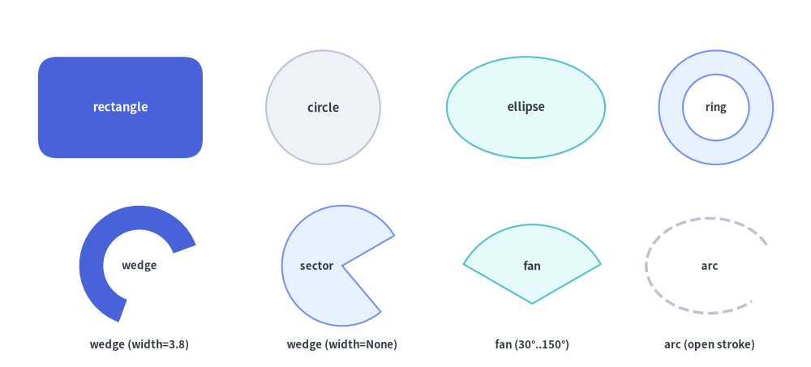
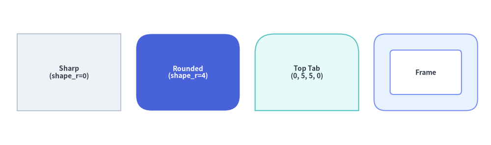
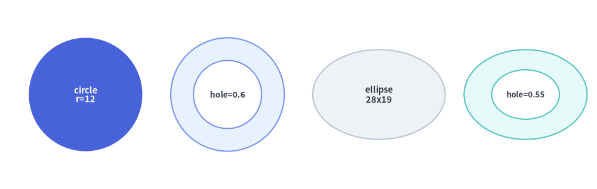
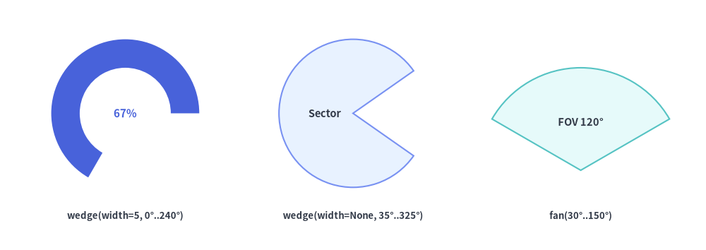
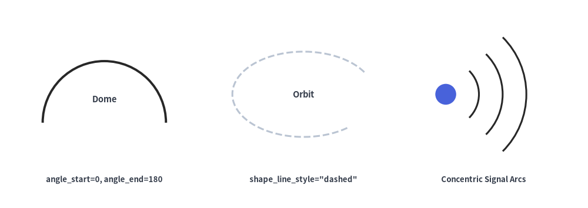

# Basic & Radial Shapes

The **Basic & Radial** category of `drawlib.shapes` provides the 6 foundational geometric primitives used across nearly every technical diagram: rectangular cards and frames (`rectangle`), circles and rings (`circle`), ellipses (`ellipse`), annular ring slices and pie wedges (`wedge`), circular pie sectors (`fan`), and open elliptical strokes (`arc`).


<figure class="drawlib-image" style="text-align: center;">
  
  <figcaption class="drawlib-caption">Overview of the 6 Basic Rectangular and Radial Primitives in drawlib.shapes</figcaption>
</figure>

<details class="drawlib-code-details">
<summary>Source Code</summary>

```python
from drawlib.canvas import save, setup
from drawlib.shapes import arc, circle, ellipse, fan, rectangle, wedge
from drawlib.styles import Styles
from drawlib.text import text

setup(width=128, height=58)

lbl_dark = Styles.DarkBold.patch(text_size=10.5)
lbl_white = Styles.WhiteBold.patch(text_size=10.5)
cap_st = Styles.DarkBold.patch(text_size=9.5)

# Row 1: rectangle, circle, ellipse, and hollow ring (hole_ratio)
rectangle(
    (19, 41),
    width=26,
    height=16,
    style=Styles.PrimaryFlat.patch(shape_r=3.0),
    text="rectangle",
    text_style=lbl_white,
)
circle((51, 41), radius=9.0, style=Styles.Neutral, text="circle", text_style=lbl_dark)
ellipse((83, 41), width=25, height=16, style=Styles.SecondaryNeutral, text="ellipse", text_style=lbl_dark)
circle(
    (113, 41),
    radius=9.0,
    hole_ratio=0.58,
    style=Styles.PrimaryNeutral,
    text="ring",
    text_style=cap_st,
)

# Row 2: wedge (donut slice), wedge (full sector), fan (FOV pie), arc (open stroke)
wedge(
    (22, 16),
    radius=9.5,
    width=3.8,
    angle_start=20,
    angle_end=250,
    style=Styles.PrimaryFlat,
    text="wedge",
    text_style=cap_st,
)
text((22, 3.5), "wedge (width=3.8)", style=cap_st)

wedge(
    (54, 16),
    radius=9.5,
    width=None,
    angle_start=30,
    angle_end=310,
    style=Styles.PrimaryNeutral,
    text="sector",
    text_style=cap_st.patch(xy_shift=(-4.0, 0)),
)
text((54, 3.5), "wedge (width=None)", style=cap_st)

fan(
    (84, 10),
    radius=12.5,
    angle_start=30,
    angle_end=150,
    style=Styles.SecondaryNeutral,
    text="fan",
    text_style=Styles.DarkBold.patch(text_size=10.0, xy_shift=(0, 6.0)),
)
text((84, 3.5), "fan (30°..150°)", style=cap_st)

arc(
    (112, 16),
    width=20,
    height=15,
    angle_start=20,
    angle_end=320,
    style=Styles.DarkBold.patch(shape_line_style="dashed"),
    text="arc",
    text_style=cap_st,
)
text((112, 3.5), "arc (open stroke)", style=cap_st)

save()
```

</details>


---

## 1. Quick Comparison of Basic & Radial Shapes

| Function | Required Geometry Args | Optional Geometry Args | Supports `hole_ratio` | Supports `shape_r` | Typical Diagram Use Cases |
| :--- | :--- | :--- | :---: | :---: | :--- |
| **`rectangle`** | `xy`, `width`, `height` | `hole_ratio=None` | Yes `(0.0, 1.0)` | Scalar `float` or 4-tuple `(bl, tl, tr, br)` | Service cards, containers, swimlanes, UI panels, tabs, and hollow frames. |
| **`circle`** | `xy`, `radius` | `hole_ratio=None` | Yes `(0.0, 1.0)` | — | State nodes, endpoints, numbered badges, and hollow annular rings. |
| **`ellipse`** | `xy`, `width`, `height` | `hole_ratio=None` | Yes `(0.0, 1.0)` | — | Use-case ovals, Venn diagrams, orbital rings, and wide pill nodes. |
| **`wedge`** | `xy`, `radius` | `width=None`, `angle_start=0`, `angle_end=360` | Via `width` | — | Gauge meters, donut slices (`width` set), or circular sectors (`width=None`). |
| **`fan`** | `xy`, `radius` | `angle_start=0`, `angle_end=180` | — | — | Camera/radar field-of-view (FOV) cones, wireless coverage sectors, pie wedges. |
| **`arc`** | `xy`, `width`, `height` | `angle_start=0.0`, `angle_end=360.0` | — (Unfilled) | — | Open circular/elliptical trajectory strokes, partial borders, and wave fronts. |

---

## 2. Rectangles, Per-Corner Rounding & Hollow Frames (`rectangle`)

`rectangle` draws a sharp, rounded, or hollow rectangular card centered at `xy` (when using preset `Styles.*`):

```python
rectangle(
    xy: tuple[float, float],
    width: float,
    height: float,
    *,
    hole_ratio: float | None = None,
    style: Style,
    text: str = "",
    text_style: Style | None = None,
) -> None
```

### Parameter & Style Reference

| Parameter / Style Field | Type | Default | Description |
| :--- | :--- | :--- | :--- |
| `xy` | `tuple[float, float]` | *Required* | Anchor coordinate `(x, y)` (center by default; customizable via `style.halign` / `style.valign`). |
| `width` | `float` | *Required* | Horizontal width in canvas units (`> 0`). |
| `height` | `float` | *Required* | Vertical height in canvas units (`> 0`). |
| `hole_ratio` | `float \| None` | `None` | Optional concentric rectangular cutout ratio in `(0.0, 1.0)`. Creates a hollow rectangular frame of wall thickness `(1 - hole_ratio) / 2` along both axes. |
| `style.shape_r` | `float \| tuple[float, float, float, float] \| None` | `None` | Corner fillet radius. Pass a scalar `float` to round all 4 corners equally, or a 4-tuple `(bottom_left, top_left, top_right, bottom_right)` to round specific corners selectively. Automatically clamped to `min(width, height) / 2`. |
| `style.angle` | `float` | `0.0` | Counterclockwise rotation angle in degrees around the rectangle's center. |
| `text` / `text_style` | `str` / `Style \| None` | `""` / `None` | Embedded text label centered inside the rectangle and optional typography override. |

### Corner Rounding & Hollow Frame Rules
- **4-Tuple Corner Order (`(bl, tl, tr, br)`)**: When passing a 4-tuple to `style.patch(shape_r=...)`, the four radii correspond to `(bottom_left, top_left, top_right, bottom_right)`:
  - **Top Header Tab**: `shape_r=(0, 4, 4, 0)` rounds only the top-left and top-right corners.
  - **Bottom Footer Bar**: `shape_r=(4, 0, 0, 4)` rounds only the bottom-left and bottom-right corners.
  - **Left Sidebar Tab**: `shape_r=(4, 4, 0, 0)` rounds only the left corners.
- **Hollow Frame + `shape_r`**: When both `hole_ratio` and `style.shape_r` are set, the inner cutout rectangle automatically scales its corner radii by `hole_ratio` so the frame maintains smooth concentric curvature.


```python
from drawlib.canvas import save, setup
from drawlib.shapes import rectangle
from drawlib.styles import Styles

setup(width=128, height=38)

# 1. Sharp-cornered neutral card
rectangle(
    (18, 19),
    width=27,
    height=20,
    style=Styles.Neutral,
    text="Sharp\n(shape_r=0)",
    text_style=Styles.DarkBold.patch(text_size=10.0),
)

# 2. Uniform rounded hero card
rectangle(
    (49, 19),
    width=27,
    height=20,
    style=Styles.PrimaryFlat.patch(shape_r=4),
    text="Rounded\n(shape_r=4)",
    text_style=Styles.WhiteBold.patch(text_size=10.0),
)

# 3. Per-corner rounded tab (top-left and top-right rounded)
rectangle(
    (80, 19),
    width=27,
    height=20,
    style=Styles.SecondaryNeutral.patch(shape_r=(0, 5, 5, 0)),
    text="Top Tab\n(0, 5, 5, 0)",
    text_style=Styles.DarkBold.patch(text_size=10.0),
)

# 4. Hollow rectangular frame (hole_ratio=0.58)
rectangle(
    (111, 19),
    width=27,
    height=20,
    hole_ratio=0.58,
    style=Styles.PrimaryNeutral.patch(shape_r=3),
    text="Frame",
    text_style=Styles.DarkBold.patch(text_size=10.0),
)

save()
```

<figure class="drawlib-image" style="text-align: center;">
  
  <figcaption class="drawlib-caption">Sharp, Uniform Rounded, Per-Corner Rounded Tabs, and Hollow Frame Rectangles</figcaption>
</figure>


---

## 3. Circles, Ellipses & Hollow Rings (`circle`, `ellipse`)

`circle` and `ellipse` draw smooth circular and oval primitives, with native support for concentric ring cutouts via `hole_ratio`:

```python
circle(
    xy: tuple[float, float],
    radius: float,
    *,
    hole_ratio: float | None = None,
    style: Style,
    text: str = "",
    text_style: Style | None = None,
) -> None

ellipse(
    xy: tuple[float, float],
    width: float,
    height: float,
    *,
    hole_ratio: float | None = None,
    style: Style,
    text: str = "",
    text_style: Style | None = None,
) -> None
```

| Function | Parameter | Type | Default | Description |
| :--- | :--- | :--- | :--- | :--- |
| **`circle`** | `xy` | `tuple[float, float]` | *Required* | Exact center coordinate `(cx, cy)` of the circle (`circle` is always center-anchored). |
| | `radius` | `float` | *Required* | Outer radius of the circle (`> 0`, total diameter = `2 * radius`). |
| | `hole_ratio` | `float \| None` | `None` | Concentric inner hole ratio in `(0.0, 1.0)`. Inner radius = `radius * hole_ratio`. |
| **`ellipse`** | `xy` | `tuple[float, float]` | *Required* | Anchor coordinate `(x, y)` (center by default; supports `style.halign` / `style.valign`). |
| | `width` / `height` | `float` | *Required* | Full horizontal diameter (`width > 0`) and vertical diameter (`height > 0`). |
| | `hole_ratio` | `float \| None` | `None` | Concentric elliptical cutout ratio in `(0.0, 1.0)` with inner axes `(width * hole_ratio, height * hole_ratio)`. |
| | `style.angle` | `float` | `0.0` | Counterclockwise rotation angle of the ellipse axes in degrees. |


```python
from drawlib.canvas import save, setup
from drawlib.shapes import circle, ellipse
from drawlib.styles import Styles

setup(width=126, height=40)

# 1. Solid focal circle
circle(
    (18, 20),
    radius=12,
    style=Styles.PrimaryFlat,
    text="circle\nr=12",
    text_style=Styles.WhiteBold.patch(text_size=10.5),
)

# 2. Hollow circular ring (hole_ratio=0.6)
circle(
    (48, 20),
    radius=12,
    hole_ratio=0.6,
    style=Styles.PrimaryNeutral,
    text="hole=0.6",
    text_style=Styles.DarkBold.patch(text_size=10.0),
)

# 3. Solid ellipse
ellipse(
    (80, 20),
    width=28,
    height=19,
    style=Styles.Neutral,
    text="ellipse\n28x19",
    text_style=Styles.DarkBold.patch(text_size=10.5),
)

# 4. Hollow elliptical ring (hole_ratio=0.55)
ellipse(
    (111, 20),
    width=26,
    height=19,
    hole_ratio=0.55,
    style=Styles.SecondaryNeutral,
    text="hole=0.55",
    text_style=Styles.DarkBold.patch(text_size=9.5),
)

save()
```

<figure class="drawlib-image" style="text-align: center;">
  
  <figcaption class="drawlib-caption">Circle, Ellipse, Rotated Ellipse, and Hollow Rings via hole_ratio</figcaption>
</figure>


---

## 4. Angular Sectors, Donut Slices & Pie Fans (`wedge`, `fan`)

`wedge` and `fan` draw circular angular sectors swept counterclockwise from `angle_start` to `angle_end` (in degrees, where $0^\circ$ points right along $+X$, $90^\circ$ points up along $+Y$, $180^\circ$ points left along $-X$, and $270^\circ$ points down along $-Y$):

```python
wedge(
    xy: tuple[float, float],
    radius: float,
    *,
    style: Style,
    width: float | None = None,
    angle_start: float = 0,
    angle_end: float = 360,
    text: str = "",
    text_style: Style | None = None,
) -> None

fan(
    xy: tuple[float, float],
    radius: float,
    *,
    style: Style,
    angle_start: float = 0,
    angle_end: float = 180,
    text: str = "",
    text_style: Style | None = None,
) -> None
```

| Parameter | Type | Default | Description |
| :--- | :--- | :--- | :--- |
| `xy` | `tuple[float, float]` | *Required* | Center coordinate `(cx, cy)` of the underlying circle (apex of the sector). |
| `radius` | `float` | *Required* | Outer radius of the circular arc (`> 0`). |
| `width` *(on `wedge`)* | `float \| None` | `None` | Radial wall thickness of the annular ring slice (`0 < width <= radius`), so the inner arc radius is `radius - width`. When `None`, `wedge` draws a solid pie sector all the way to `xy`. |
| `angle_start` | `float` | `0` | Starting angle in degrees counterclockwise from $+X$. |
| `angle_end` | `float` | `360` (`wedge`) / `180` (`fan`) | Ending angle in degrees counterclockwise from $+X$. |
| `style.angle` | `float` | `0.0` | Additional rotation offset in degrees added to both `angle_start` and `angle_end`. |
| `text` / `text_style` | `str` / `Style \| None` | `""` / `None` | Label anchored at `xy` by default. For narrow `fan` cones, use `text_style.patch(xy_shift=(dx, dy))` to place the label inside the sector body. |


```python
from drawlib.canvas import save, setup
from drawlib.shapes import fan, wedge
from drawlib.styles import Styles
from drawlib.text import text

setup(width=124, height=44)

lbl = Styles.DarkBold.patch(text_size=9.5)

# 1. Angular donut slice (wedge with wall thickness width=5)
wedge(
    (22, 24),
    radius=13,
    width=5,
    angle_start=0,
    angle_end=240,
    style=Styles.PrimaryFlat,
    text="67%",
    text_style=Styles.PrimaryBold.patch(text_size=11.0),
)
text((22, 6), "wedge(width=5, 0°..240°)", style=lbl)

# 2. Solid circular sector (wedge with width=None)
wedge(
    (62, 24),
    radius=13,
    width=None,
    angle_start=35,
    angle_end=325,
    style=Styles.PrimaryNeutral,
    text="Sector",
    text_style=Styles.DarkBold.patch(text_size=10.5, xy_shift=(-5.0, 0)),
)
text((62, 6), "wedge(width=None, 35°..325°)", style=lbl)

# 3. Circular pie sector (fan from 30° to 150°)
fan(
    (102, 14),
    radius=18,
    angle_start=30,
    angle_end=150,
    style=Styles.SecondaryNeutral,
    text="FOV 120°",
    text_style=Styles.DarkBold.patch(text_size=10.5, xy_shift=(0, 8.5)),
)
text((102, 6), "fan(30°..150°)", style=lbl)

save()
```

<figure class="drawlib-image" style="text-align: center;">
  
  <figcaption class="drawlib-caption">Angular Donut Wedge (width=5), Pac-Man Sector (width=None), and Radar FOV Fan</figcaption>
</figure>


---

## 5. Open Elliptical & Circular Arcs (`arc`)

`arc` draws an **open, unfilled vector stroke** along the perimeter of an ellipse or circle between `angle_start` and `angle_end`:

```python
arc(
    xy: tuple[float, float],
    width: float,
    height: float,
    *,
    style: Style,
    angle_start: float = 0.0,
    angle_end: float = 360.0,
    text: str = "",
    text_style: Style | None = None,
) -> None
```

| Parameter | Type | Default | Description |
| :--- | :--- | :--- | :--- |
| `xy` | `tuple[float, float]` | *Required* | Center coordinate `(x, y)` of the underlying ellipse (supports `style.halign` / `style.valign`). |
| `width` | `float` | *Required* | Full horizontal diameter of the ellipse (`> 0`). Set `width == height` for a circular arc. |
| `height` | `float` | *Required* | Full vertical diameter of the ellipse (`> 0`). |
| `angle_start` / `angle_end` | `float` | `0.0` / `360.0` | Counterclockwise start and end angles in degrees. |
| `style` | `Style` | *Required* | Stroke appearance is controlled by `shape_line_color` (or `line_color`), `shape_line_width` (or `line_width`), `shape_line_style` (`"solid"`, `"dashed"`, `"dotted"`, `"dashdot"`), and `angle` (rotates the entire ellipse frame). |
| `text` / `text_style` | `str` / `Style \| None` | `""` / `None` | Optional text label centered at `xy`. |


```python
from drawlib.canvas import save, setup
from drawlib.shapes import arc, circle
from drawlib.styles import Styles
from drawlib.text import text

setup(width=124, height=44)

lbl = Styles.DarkBold.patch(text_size=9.5)

# 1. Upper semicircle dome arc (0° to 180°)
arc(
    (22, 18),
    width=26,
    height=26,
    angle_start=0,
    angle_end=180,
    style=Styles.PrimaryBold.patch(shape_line_width=2.8),
    text="Dome",
    text_style=Styles.DarkBold.patch(text_size=10.5, xy_shift=(0, 5)),
)
text((22, 6), "angle_start=0, angle_end=180", style=lbl)

# 2. Dashed elliptical orbit (20° to 325°)
arc(
    (64, 24),
    width=30,
    height=18,
    angle_start=20,
    angle_end=325,
    style=Styles.DarkBold.patch(shape_line_style="dashed", shape_line_width=2.2),
    text="Orbit",
    text_style=Styles.DarkBold.patch(text_size=10.5),
)
text((64, 6), 'shape_line_style="dashed"', style=lbl)

# 3. Concentric wireless signal wave fronts (-45° to 45°)
circle((94, 24), radius=2.2, style=Styles.PrimaryFlat)
for r_diam in (14, 24, 34):
    arc(
        (94, 24),
        width=r_diam,
        height=r_diam,
        angle_start=-45,
        angle_end=45,
        style=Styles.PrimaryBold.patch(shape_line_width=2.2),
    )
text((102, 6), "Concentric Signal Arcs", style=lbl)

save()
```

<figure class="drawlib-image" style="text-align: center;">
  
  <figcaption class="drawlib-caption">Circular Semicircle Arc, Dashed Elliptical Orbit, and Rotated Acoustic Wave Fronts</figcaption>
</figure>


> [!TIP]
> - To draw curved arc connectors with **terminal arrowheads** (`arrow_head="->"`), use `line_arc()` or `line_curved()` in **[Lines & Connectors](./lines.md)**, or 2D filled block `arrow_arc()` in **[Block Arrows & Chevrons](./shapes_arrow.md)**.
> - For multi-sided polygons (`triangle`, `parallelogram`, `trapezoid`, `rhombus`, `regularpolygon`, `star`, `plaque`) and custom Bézier paths (`polygon`, `shape`), see **[Polygons & Custom Paths](./shapes_polygon.md)**.
