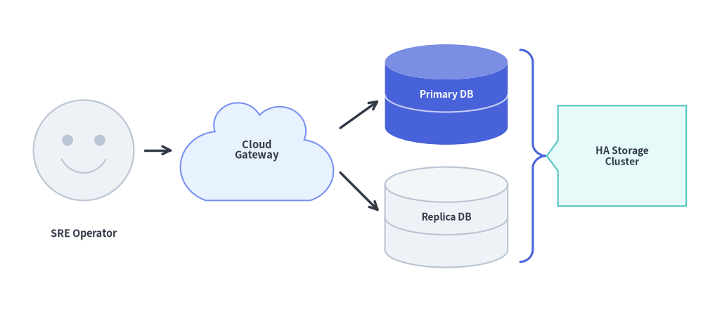
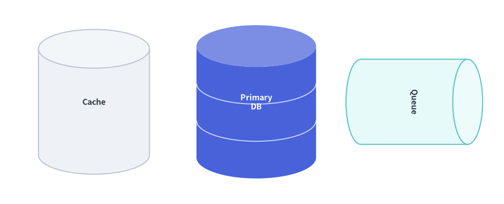
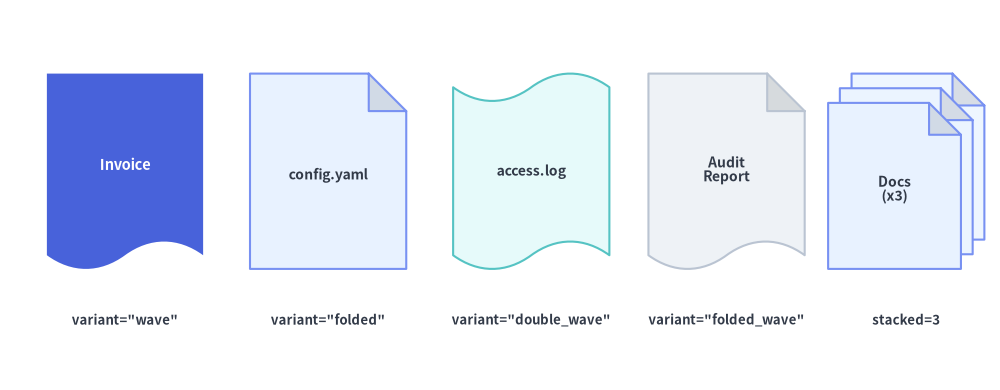
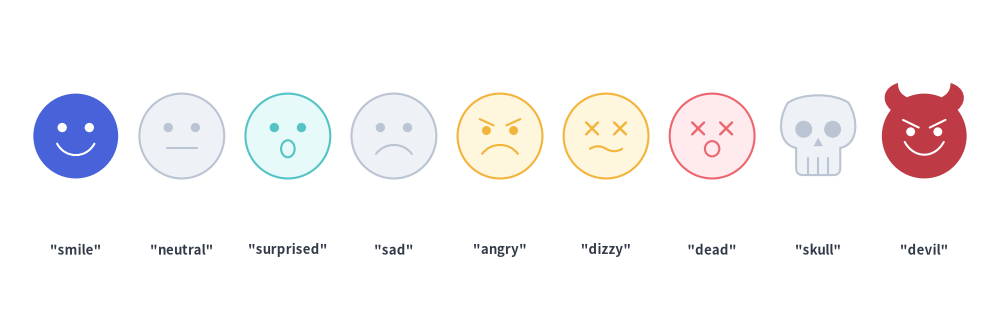
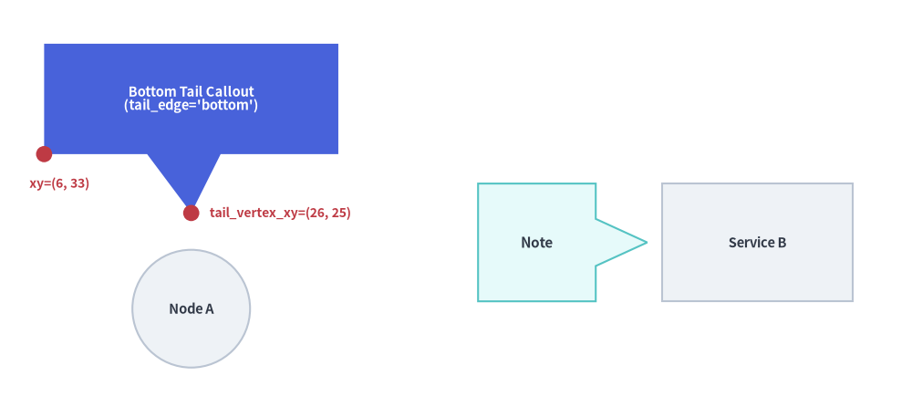
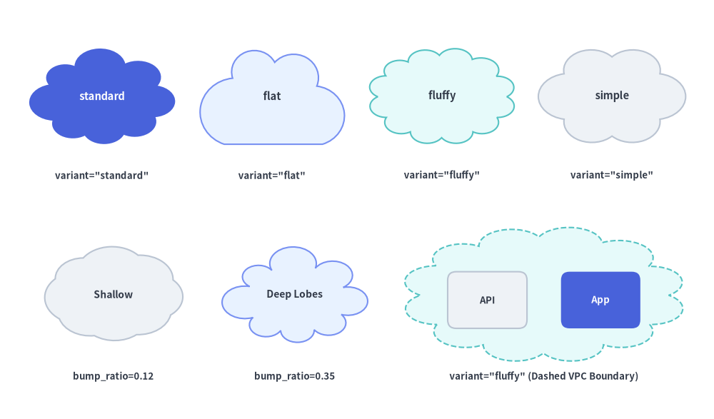
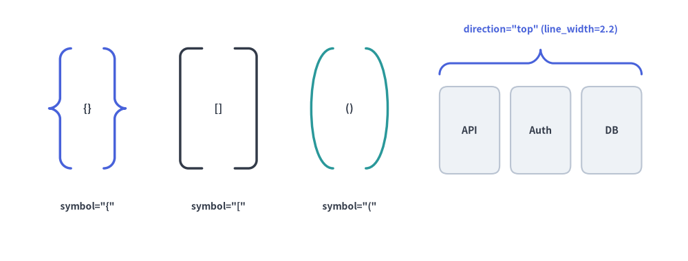

# Cylinders, Cubes, Documents, Clouds & Braces

Beyond standard geometric primitives, `drawlib.shapes` includes seven expressive 3D, domain, and annotation shapes (`cylinder`, `cube`, `document`, `cloud`, `brace`, `face`, and `bubblespeech`) for technical architecture and storytelling diagrams:


<figure class="drawlib-image" style="text-align: center;">
  
  <figcaption class="drawlib-caption">Combining Actor Faces, Cloud Gateways, 3D Cubes & Cylinders, Documents, Braces, and Callouts</figcaption>
</figure>

<details class="drawlib-code-details">
<summary>Source Code</summary>

```python
from drawlib.canvas import save, setup
from drawlib.lines import line
from drawlib.shapes import brace, bubblespeech, cloud, cube, cylinder, document, face
from drawlib.styles import Styles
from drawlib.text import text

setup(width=132, height=62)

# 1. User Actor Face
face((13, 33), radius=8.5, style=Styles.Neutral, mood="smile")
text((13, 18), "Developer", style=Styles.DarkBold.patch(text_size=10.0))

# 2. Cloud Gateway Node
cloud(
    (41, 33),
    width=25,
    height=17,
    variant="flat",
    style=Styles.PrimaryNeutral,
    text="Cloud\nGateway",
    text_style=Styles.DarkBold.patch(text_size=10.0),
)

# 3. 3D Worker Cube & 2-Disk Database Cylinder
cube(
    (73, 45),
    width=22,
    height=17,
    depth_ratio=0.25,
    style=Styles.PrimaryFlat,
    text="Worker\nPod",
    text_style=Styles.WhiteBold.patch(text_size=10.0),
)
cylinder(
    (73, 19),
    width=21,
    height=17,
    disks=2,
    style=Styles.Neutral,
    text="State DB",
    text_style=Styles.DarkBold.patch(text_size=10.0),
)

# 4. Curly Brace + Stacked Audit Documents & Callout Bubble
brace(
    (88.5, 32),
    width=4.2,
    height=40,
    symbol="}",
    style=Styles.PrimaryBold.patch(line_width=2.2),
)
document(
    (109, 44),
    width=22,
    height=19,
    variant="folded_wave",
    stacked=3,
    style=Styles.SecondaryNeutral,
    text="Audit\nReports",
    text_style=Styles.DarkBold.patch(text_size=10.0),
)
bubblespeech(
    xy=(96, 10),
    width=28,
    height=15,
    tail_edge="left",
    tail_start_ratio=0.40,
    tail_end_ratio=0.70,
    tail_vertex_xy=(91, 23),
    style=Styles.Neutral,
    text="Auto-Archived",
    text_style=Styles.DarkBold.patch(text_size=10.0),
)

line((23, 33), (27.5, 33), arrow_head="->", style=Styles.DarkBold)
line((54.5, 37), (61, 44), arrow_head="->", style=Styles.DarkBold)
line((54.5, 29), (61, 20), arrow_head="->", style=Styles.DarkBold)
line((92, 36), (97, 43), arrow_head="->", style=Styles.PrimaryBold)

save()
```

</details>


---

## 1. Overview of Domain Shapes

| Function | Default Anchor | Primary Role | Key Variant / Geometry Arguments |
| :--- | :--- | :--- | :--- |
| **`cylinder`** | Center `(cx, cy)` | 3D storage cylinders & multi-disk database stacks | `disks: int = 1` |
| **`cube`** | Center `(cx, cy)` | 3D shaded cubes, containers, & hardware blocks | `depth_ratio: float \| None = None` |
| **`document`** | Center `(cx, cy)` | Single or stacked document/file/log cards | `variant` (`"wave"`, `"folded"`, `"double_wave"`, `"folded_wave"`), `stacked: int = 1`, `wave_ratio`, `fold_ratio` |
| **`face`** | Center `(cx, cy)` | Expressive user/actor personas & status indicators | `mood` (`"smile"`, `"neutral"`, `"surprised"`, `"sad"`, `"angry"`) |
| **`bubblespeech`** | Bottom-Left `(x0, y0)` | Callout speech bubbles with directional pointer tails | `tail_edge` (`"left"`, `"top"`, `"right"`, `"bottom"`), `tail_start_ratio`, `tail_end_ratio`, `tail_vertex_xy` |
| **`cloud`** | Center `(cx, cy)` | Cloud service nodes & VPC/WAN boundary enclosures | `variant` (`"standard"`, `"flat"`, `"fluffy"`, `"simple"`), `bump_ratio: float \| None = None` |
| **`brace`** | Center `(cx, cy)` | Curly, square, & round grouping brackets/braces | `symbol` (`"{"`, `"}"`, `"["`, `"]"`, `"("`, `")"`), `direction` (`"left"`, `"right"`, `"top"`, `"bottom"`), `tip_ratio`, `tip_position_ratio` |

---

## 2. 3D Cylinders & Database Stacks (`cylinder`)

For relational databases, object storage buckets, disk arrays, and message queues, `cylinder` renders a 3D cylindrical container with an automatically lightened elliptical top cap:

```python
cylinder(
    xy: tuple[float, float],
    width: float,
    height: float,
    *,
    style: Style,
    disks: int = 1,
    text: str = "",
    text_style: Style | None = None,
)
```

### Parameter Reference

| Parameter | Type | Default | Description |
| :--- | :--- | :--- | :--- |
| `xy` | `tuple[float, float]` | *Required* | Center coordinate `(x, y)` of the outer cylinder bounding box. |
| `width` | `float` | *Required* | Total horizontal width of the cylinder (`> 0`). |
| `height` | `float` | *Required* | Total vertical height of the cylinder, including top and bottom elliptical caps (`> 0`). |
| `disks` | `int` | `1` | Number of stacked storage disk tiers (`>= 1`). When `disks >= 2`, curved horizontal divider seams are drawn along the cylinder body to represent multi-platter database storage. |
| `style` | `Style` | *Required* | Shape fill and border style. The top elliptical cap is automatically lightened from `style.shape_fill_color`. Set `style.patch(angle=-90)` to rotate the cylinder horizontally for FIFO message queues or pipelines. |
| `text` / `text_style` | `str` / `Style \| None` | `""` / `None` | Centered text label and optional typography override. |


```python
from drawlib.canvas import save, setup
from drawlib.shapes import cylinder
from drawlib.styles import Styles

setup(width=118, height=48)

# 1. Single-tier cache cylinder
cylinder((22, 24), width=26, height=34, style=Styles.Neutral, text="Cache", text_style=Styles.DarkBold.patch(text_size=11.5))

# 2. 3-disk database stack (disks=3)
cylinder(
    (60, 24),
    width=28,
    height=36,
    disks=3,
    style=Styles.PrimaryFlat,
    text="Primary\nDB",
    text_style=Styles.WhiteBold.patch(text_size=11.5),
)

# 3. Horizontal rotated cylinder (angle=-90 for message queue)
cylinder(
    (97, 24),
    width=20,
    height=32,
    style=Styles.SecondaryNeutral.patch(angle=-90),
    text="Queue",
    text_style=Styles.DarkBold.patch(text_size=11.5),
)

save()
```

<figure class="drawlib-image" style="text-align: center;">
  
  <figcaption class="drawlib-caption">Single Cylinder, 3-Disk Database Stack, and Horizontal Queue</figcaption>
</figure>


---

## 3. 3D Cubes & Rectangular Blocks (`cube`)

Complementing `cylinder`, `cube` renders an oblique 3D cube or rectangular box strictly fitted within the `(width, height)` bounding box centered at `xy`:

```python
cube(
    xy: tuple[float, float],
    width: float,
    height: float,
    *,
    depth_ratio: float | None = None,
    style: Style,
    text: str = "",
    text_style: Style | None = None,
)
```

### Parameter Reference

| Parameter | Type | Default | Description |
| :--- | :--- | :--- | :--- |
| `xy` | `tuple[float, float]` | *Required* | Center coordinate `(x, y)` of the outer 3D bounding box. |
| `width` | `float` | *Required* | Exact outer horizontal width of the 3D box, including the right-side oblique projection (`> 0`). |
| `height` | `float` | *Required* | Exact outer vertical height of the 3D box, including the top-face oblique projection (`> 0`). |
| `depth_ratio` | `float \| None` | `None` | 3D oblique depth fraction in `(0.0, 1.0)` relative to `min(width, height)`. Defaults to `0.25` when `None`. Smaller values (`0.15`) produce a shallow 3D card; larger values (`0.40`) produce a deep isometric block. |
| `style` | `Style` | *Required* | Fill, border (`shape_line_color`, `shape_line_width`, `shape_line_style`), and rotation (`angle`) style. |
| `text` / `text_style` | `str` / `Style \| None` | `""` / `None` | Label automatically centered on the **front face** (rather than the outer bounding box) so text never collides with the 3D seam lines. |

### 3-Face Automatic Shading & Stroke Mechanics
- **Automatic Face Shading**: From `style.shape_fill_color`, Drawlib automatically computes three distinct face shades:
  1. **Front Face**: Base `style.shape_fill_color`.
  2. **Top Face**: Lightened toward white (`+28%` on standard fills, `+55%` on high-luminance neutral fills) to simulate overhead lighting.
  3. **Right Side Face**: Darkened (`×0.82` on standard fills, `×0.92` on neutral fills) to create natural depth shadow.
- **Unified Stroke Path**: The outer perimeter and the three internal Y-seams are drawn in a single unified `PathPatch`, ensuring that `Dashed` or `Dotted` line styles never double-overlap on shared edges.


```python
from drawlib.canvas import save, setup
from drawlib.shapes import cube
from drawlib.styles import Styles
from drawlib.text import text

setup(width=126, height=48)

# 1. Standard Flat Cube (depth_ratio=0.25 default)
cube((18, 27), width=23, height=23, style=Styles.PrimaryFlat, text="Pod A", text_style=Styles.WhiteBold.patch(text_size=10.5))
text((18, 9), "depth_ratio=0.25 (Flat)", style=Styles.DarkBold.patch(text_size=9.5))

# 2. Shallow 3D Block (depth_ratio=0.15)
cube((49, 27), width=23, height=23, depth_ratio=0.15, style=Styles.PrimaryNeutral, text="Shallow", text_style=Styles.DarkBold.patch(text_size=10.5))
text((49, 9), "depth_ratio=0.15", style=Styles.DarkBold.patch(text_size=9.5))

# 3. Deep 3D Cube (depth_ratio=0.40)
cube((80, 27), width=23, height=23, depth_ratio=0.40, style=Styles.SecondaryNeutral, text="Deep", text_style=Styles.DarkBold.patch(text_size=10.5))
text((80, 9), "depth_ratio=0.40", style=Styles.DarkBold.patch(text_size=9.5))

# 4. Wide Hardware Appliance Block (30x19, dashed)
cube((111, 27), width=26, height=19, depth_ratio=0.24, style=Styles.Neutral.patch(shape_line_style="dashed"), text="Appliance", text_style=Styles.DarkBold.patch(text_size=10.0))
text((111, 9), "Wide Block (Dashed)", style=Styles.DarkBold.patch(text_size=9.5))

save()
```

<figure class="drawlib-image" style="text-align: center;">
  
  <figcaption class="drawlib-caption">3D Cubes and Rectangular Blocks Across Styles and depth_ratio Values</figcaption>
</figure>


---

## 4. Documents, Files & Multi-Sheet Stacks (`document`)

For flowchart output steps, configuration/source files, log stream snippets, and multi-page report stacks, `document` provides four `variant` silhouettes and multi-sheet cascading (`stacked >= 1`):

```python
document(
    xy: tuple[float, float],
    width: float,
    height: float,
    *,
    variant: Literal[
        "wave", "standard",
        "folded", "page", "note",
        "double_wave", "snippet",
        "folded_wave", "report",
    ] = "wave",
    stacked: int = 1,
    wave_ratio: float | None = None,
    fold_ratio: float | None = None,
    style: Style,
    text: str = "",
    text_style: Style | None = None,
)
```

### Parameter Reference

| Parameter | Type | Default | Description |
| :--- | :--- | :--- | :--- |
| `xy` | `tuple[float, float]` | *Required* | Center coordinate `(x, y)` of the outer document bounding box (including all stacked sheets). |
| `width` | `float` | *Required* | Total horizontal width of the document bounding box (`> 0`). |
| `height` | `float` | *Required* | Total vertical height of the document bounding box (`> 0`). |
| `variant` | `DocumentVariant` | `"wave"` | Silhouette style of the document sheet (see **Document `variant` Reference** below). |
| `stacked` | `int` | `1` | Number of overlapping document sheets (`>= 1`). When `stacked > 1` (e.g. `2` or `3`), sheets cascade from back-top-right to front-bottom-left inside `(width, height)`, with background sheets automatically lightened. |
| `wave_ratio` | `float \| None` | `None` | Wave peak-to-trough amplitude fraction in `(0.0, 1.0)` relative to sheet height. Defaults to `0.14`. Effective on `"wave"`, `"double_wave"`, and `"folded_wave"`. |
| `fold_ratio` | `float \| None` | `None` | Top-right dog-ear corner fold size fraction in `(0.0, 1.0)` relative to `min(sheet_w, sheet_h)`. Defaults to `0.24`. Effective on `"folded"` and `"folded_wave"`. |
| `style` | `Style` | *Required* | Fill, border, and rotation (`angle`) style. On folded variants, the triangular corner flap is automatically darkened for 3D contrast. |
| `text` / `text_style` | `str` / `Style \| None` | `""` / `None` | Text label optically centered on the **front-most sheet** (automatically shifted away from bottom waves and top-right corner folds). |

### Document `variant` Reference

| `variant` | Accepted Aliases | Top Edge | Bottom Edge | Active Ratio Args | Typical Use Cases |
| :--- | :--- | :--- | :--- | :--- | :--- |
| **`"wave"`** *(default)* | `"standard"` | Straight | Cubic-Bézier S-wave | `wave_ratio` | Classic ISO flowchart document/printout symbol, invoices, generated artifacts. |
| **`"folded"`** | `"page"`, `"note"` | Top-right dog-ear fold | Straight | `fold_ratio` | Configuration files (`config.yaml`), source code files, Markdown/PDF pages, UML notes. |
| **`"double_wave"`** | `"snippet"` | Cubic-Bézier S-wave | Cubic-Bézier S-wave | `wave_ratio` | Continuous log streams (`access.log`), truncated text excerpts, data stream chunks. |
| **`"folded_wave"`** | `"report"` | Top-right dog-ear fold | Cubic-Bézier S-wave | `wave_ratio`, `fold_ratio` | Multi-page technical reports, specifications, and audit logs combining file and wave cues. |


```python
from drawlib.canvas import save, setup
from drawlib.shapes import document
from drawlib.styles import Styles
from drawlib.text import text

setup(width=128, height=78)

# Row 1: The 4 Document Variants (stacked=1)
row1 = [
    ("wave", "Invoice", 18, Styles.PrimaryFlat, Styles.WhiteBold.patch(text_size=10.5), 'variant="wave"'),
    ("folded", "config.yaml", 49, Styles.PrimaryNeutral, Styles.DarkBold.patch(text_size=10.0), 'variant="folded"'),
    ("double_wave", "access.log", 80, Styles.SecondaryNeutral, Styles.DarkBold.patch(text_size=10.0), 'variant="double_wave"'),
    ("folded_wave", "Audit\nReport", 110, Styles.Neutral, Styles.DarkBold.patch(text_size=10.0), 'variant="folded_wave"'),
]
for var, lbl, cx, st, tst, cap in row1:
    document((cx, 59), width=22, height=25, variant=var, style=st, text=lbl, text_style=tst)
    text((cx, 42.5), cap, style=Styles.DarkBold.patch(text_size=9.5))

# Row 2: Multi-sheet stacking (stacked=3) and wave_ratio / fold_ratio customization
document((18, 22), width=23, height=25, variant="wave", stacked=3, style=Styles.PrimaryNeutral, text="Batch\n(x3)", text_style=Styles.DarkBold.patch(text_size=10.0))
text((18, 5.5), 'wave, stacked=3', style=Styles.DarkBold.patch(text_size=9.5))

document((49, 22), width=23, height=25, variant="folded", stacked=3, style=Styles.SecondaryNeutral, text="Pages\n(x3)", text_style=Styles.DarkBold.patch(text_size=10.0))
text((49, 5.5), 'folded, stacked=3', style=Styles.DarkBold.patch(text_size=9.5))

document((80, 22), width=22, height=25, variant="wave", wave_ratio=0.25, style=Styles.Neutral, text="Deep\nWave", text_style=Styles.DarkBold.patch(text_size=10.0))
text((80, 5.5), "wave_ratio=0.25", style=Styles.DarkBold.patch(text_size=9.5))

document((110, 22), width=22, height=25, variant="folded", fold_ratio=0.36, style=Styles.PrimaryNeutral, text="Large\nFold", text_style=Styles.DarkBold.patch(text_size=10.0))
text((110, 5.5), "fold_ratio=0.36", style=Styles.DarkBold.patch(text_size=9.5))

save()
```

<figure class="drawlib-image" style="text-align: center;">
  
  <figcaption class="drawlib-caption">The Four Document Variants (Row 1) and Multi-Sheet Stacking & Ratio Customizations (Row 2)</figcaption>
</figure>


---

## 5. Expressive Actor & Status Faces (`face`)

For user personas, customer journey maps, and system health indicators, `face` renders a circular face with eyes, eyebrows, and five built-in facial expressions (`mood`):

```python
face(
    xy: tuple[float, float],
    radius: float,
    *,
    style: Style,
    mood: Literal["smile", "neutral", "sad", "angry", "surprised"] = "smile",
    text: str = "",
    text_style: Style | None = None,
)
```

### Parameter Reference & `mood` Variants

| Parameter | Type | Default | Description |
| :--- | :--- | :--- | :--- |
| `xy` | `tuple[float, float]` | *Required* | Center coordinate `(x, y)` of the circular face. |
| `radius` | `float` | *Required* | Outer radius of the face circle (`> 0`). |
| `mood` | `FaceMood` | `"smile"` | Facial expression variant (case-insensitive):<br>• **`"smile"`**: Upward cubic-Bézier smile curve.<br>• **`"neutral"`**: Straight horizontal mouth line.<br>• **`"surprised"`**: Elliptical open `'O'` mouth.<br>• **`"sad"`**: Downward cubic-Bézier frown curve.<br>• **`"angry"`**: Downward frown curve plus inward-slanted eyebrows. |
| `style` | `Style` | *Required* | Face fill, outline, and rotation (`angle`). Eyes, eyebrows, and mouth automatically use `style.shape_line_color` when a border is present, or high-contrast `text_color`/white on flat borderless styles (`Styles.PrimaryFlat`). |
| `text` / `text_style` | `str` / `Style \| None` | `""` / `None` | Optional text label and typography style. |


```python
from drawlib.canvas import save, setup
from drawlib.shapes import face
from drawlib.styles import Styles
from drawlib.text import text

setup(width=120, height=44)

moods = [
    ("smile", Styles.PrimaryFlat),
    ("neutral", Styles.Neutral),
    ("surprised", Styles.SecondaryNeutral),
    ("sad", Styles.Neutral),
    ("angry", Styles.DangerNeutral),
]

for i, (mood_name, st) in enumerate(moods):
    cx = 16 + i * 22
    face((cx, 26), radius=9, style=st, mood=mood_name)
    text((cx, 10), f'mood="{mood_name}"', style=Styles.DarkBold.patch(text_size=10.0))

save()
```

<figure class="drawlib-image" style="text-align: center;">
  
  <figcaption class="drawlib-caption">The Five Facial Moods in drawlib.shapes.face</figcaption>
</figure>


---

## 6. Callout Speech Bubbles (`bubblespeech`)

`bubblespeech` draws a rectangular callout box with an integrated triangular pointer tail that originates from any of the four edges (`"left"`, `"top"`, `"right"`, `"bottom"`) and points to an exact target coordinate `tail_vertex_xy`:

```python
bubblespeech(
    xy: tuple[float, float],
    width: float,
    height: float,
    tail_edge: Literal["left", "top", "right", "bottom"],
    tail_start_ratio: float,
    tail_vertex_xy: tuple[float, float],
    tail_end_ratio: float,
    *,
    style: Style,
    text: str = "",
    text_style: Style | None = None,
)
```

### Parameter Reference

| Parameter | Type | Description |
| :--- | :--- | :--- |
| `xy` | `tuple[float, float]` | **Bottom-left corner** `(x, y)` of the rectangular bubble body (always bottom-left anchored regardless of `style.halign`/`valign`). |
| `width` / `height` | `float` | Width and height of the rectangular bubble body (`> 0`). |
| `tail_edge` | `"left" \| "top" \| "right" \| "bottom"` | Which edge of the bubble body the pointer tail attaches to. |
| `tail_start_ratio` | `float` | Start attachment position along `tail_edge` in `[0.0, 1.0]` (measured from bottom-to-top for `"left"`/`"right"`, or left-to-right for `"top"`/`"bottom"`). Must be `< tail_end_ratio`. |
| `tail_vertex_xy` | `tuple[float, float]` | Absolute canvas coordinate `(x, y)` where the tip of the pointer tail points (must lie outside the bubble body). |
| `tail_end_ratio` | `float` | End attachment position along `tail_edge` in `[0.0, 1.0]`. Must be `> tail_start_ratio`. |
| `style` / `text` / `text_style` | `Style` / `str` / `Style \| None` | Bubble fill/stroke style and centered annotation text. Note: `bubblespeech` ignores `style.shape_r`, `style.angle`, and `style.halign`/`valign`. |


```python
from drawlib.canvas import save, setup
from drawlib.shapes import bubblespeech, circle, rectangle
from drawlib.styles import Styles
from drawlib.text import text

setup(width=124, height=54)

# Target nodes
circle((26, 12), radius=8.0, style=Styles.Neutral, text="Node A", text_style=Styles.DarkBold.patch(text_size=10.5))
rectangle((103, 21), width=26, height=16, style=Styles.Neutral, text="Service B", text_style=Styles.DarkBold.patch(text_size=10.5))

# 1. Callout with bottom tail pointing down to Node A
bubblespeech(
    xy=(6, 33),
    width=40,
    height=15,
    tail_edge="bottom",
    tail_start_ratio=0.35,
    tail_end_ratio=0.60,
    tail_vertex_xy=(26, 25),
    style=Styles.PrimaryFlat,
    text="Bottom Tail Callout\n(tail_edge='bottom')",
    text_style=Styles.WhiteBold.patch(text_size=10.5),
)

# Coordinate indicators for bottom-left anchor xy and tail_vertex_xy
circle((6, 33), radius=1.1, style=Styles.DangerFlat)
text((4, 29.0), "xy=(6, 33)", style=Styles.DangerBold.patch(text_size=10.0, halign="left"))

circle((26, 25), radius=1.1, style=Styles.DangerFlat)
text((28.5, 25.0), "tail_vertex_xy=(26, 25)", style=Styles.DangerBold.patch(text_size=10.0, halign="left"))

# 2. Callout with right tail pointing to Service B
bubblespeech(
    xy=(65, 13),
    width=16,
    height=16,
    tail_edge="right",
    tail_start_ratio=0.30,
    tail_end_ratio=0.70,
    tail_vertex_xy=(88, 21),
    style=Styles.SecondaryNeutral,
    text="Note",
    text_style=Styles.DarkBold.patch(text_size=11.0),
)

save()
```

<figure class="drawlib-image" style="text-align: center;">
  
  <figcaption class="drawlib-caption">Speech Bubble Callouts with Bottom-Left Anchor xy and Pointer Tail Vertex</figcaption>
</figure>


---

## 7. Cloud Nodes & Boundaries (`cloud`)

`cloud` renders a smooth cubic-Bézier cloud silhouette normalized to fit its exact `(width, height)` bounding box centered at `xy`:

```python
cloud(
    xy: tuple[float, float],
    width: float,
    height: float,
    *,
    variant: Literal[
        "standard",
        "flat", "flat_bottom",
        "fluffy", "dense",
        "simple", "minimal",
    ] = "standard",
    bump_ratio: float | None = None,
    style: Style,
    text: str = "",
    text_style: Style | None = None,
)
```

### Parameter Reference

| Parameter | Type | Default | Description |
| :--- | :--- | :--- | :--- |
| `xy` | `tuple[float, float]` | *Required* | Center coordinate `(x, y)` of the cloud bounding box. |
| `width` | `float` | *Required* | Exact outer horizontal width of the cloud (`> 0`). |
| `height` | `float` | *Required* | Exact outer vertical height of the cloud (`> 0`). |
| `variant` | `CloudVariant` | `"standard"` | Cloud silhouette style (see **Cloud `variant` Reference** below). |
| `bump_ratio` | `float \| None` | `None` | Outward lobe bulge depth ratio in `(0.0, 1.0)`. When `None`, uses the optimal default for the selected `variant` (`0.20`–`0.24`). Lower values (`0.12`) create a subtle, shallow cloud; higher values (`0.34`) create deep, pronounced lobes. |
| `style` | `Style` | *Required* | Fill, border (`Dashed` is ideal for VPC/subnet enclosures), and rotation (`angle`) style. |
| `text` / `text_style` | `str` / `Style \| None` | `""` / `None` | Centered text label and optional typography override. |

### Cloud `variant` Reference

| `variant` | Accepted Aliases | Lobe Structure | Default `bump_ratio` | Typical Use Cases |
| :--- | :--- | :--- | :---: | :--- |
| **`"standard"`** *(default)* | — | 8 asymmetric lobes around the full perimeter | `0.22` | General-purpose "Internet", SaaS, or external network nodes. |
| **`"flat"`** | `"flat_bottom"` | Flat horizontal base + 4 upper domes | `0.24` | Standalone cloud service cards and gateway nodes with strong visual grounding for internal text/icons. |
| **`"fluffy"`** | `"dense"` | 12 fine lobes around the full perimeter | `0.20` | Large VPC, WAN, or multi-node cluster boundary enclosures (especially with `shape_line_style="dashed"`). |
| **`"simple"`** | `"minimal"` | 6 wide, symmetric lobes | `0.24` | Compact cloud badges, small icons, or thought bubbles. |


```python
from drawlib.canvas import save, setup
from drawlib.shapes import cloud, rectangle
from drawlib.styles import Styles
from drawlib.text import text

setup(width=126, height=74)

# Row 1: The 4 Cloud Variants
variants = [
    ("standard", 18, Styles.PrimaryFlat, Styles.WhiteBold.patch(text_size=10.5)),
    ("flat", 48, Styles.PrimaryNeutral, Styles.DarkBold.patch(text_size=10.5)),
    ("fluffy", 78, Styles.SecondaryNeutral, Styles.DarkBold.patch(text_size=10.5)),
    ("simple", 108, Styles.Neutral, Styles.DarkBold.patch(text_size=10.5)),
]
for v_name, cx, st, tst in variants:
    cloud((cx, 57), width=26, height=17, variant=v_name, style=st, text=v_name, text_style=tst)
    text((cx, 43), f'variant="{v_name}"', style=Styles.DarkBold.patch(text_size=9.5))

# Row 2 Left: Shallow vs Deep bump_ratio
cloud((20, 22), width=26, height=17, variant="standard", bump_ratio=0.12, style=Styles.Neutral, text="Shallow", text_style=Styles.DarkBold.patch(text_size=10.0))
text((20, 7.5), "bump_ratio=0.12", style=Styles.DarkBold.patch(text_size=9.5))

cloud((52, 22), width=26, height=17, variant="standard", bump_ratio=0.35, style=Styles.PrimaryNeutral, text="Deep Lobes", text_style=Styles.DarkBold.patch(text_size=10.0))
text((52, 7.5), "bump_ratio=0.35", style=Styles.DarkBold.patch(text_size=9.5))

# Row 2 Right: Large fluffy dashed VPC enclosure containing service cards
cloud((96, 22), width=50, height=24, variant="fluffy", style=Styles.SecondaryNeutral.patch(shape_line_style="dashed"))
rectangle((86, 21), width=14, height=10, style=Styles.Neutral.patch(shape_r=1.5), text="API", text_style=Styles.DarkBold.patch(text_size=9.5))
rectangle((106, 21), width=14, height=10, style=Styles.PrimaryFlat.patch(shape_r=1.5), text="App", text_style=Styles.WhiteBold.patch(text_size=9.5))
text((96, 7.5), 'variant="fluffy" (Dashed VPC Boundary)', style=Styles.DarkBold.patch(text_size=9.5))

save()
```

<figure class="drawlib-image" style="text-align: center;">
  
  <figcaption class="drawlib-caption">Four Cloud Variants (Row 1) and bump_ratio Comparison & VPC Boundary Usage (Row 2)</figcaption>
</figure>


---

## 8. Grouping Braces & Brackets (`brace`)

`brace` renders a curly (`{`, `}`), square (`[`, `]`), or round (`(`, `)`) grouping bracket in any of four directions (`"left"`, `"right"`, `"top"`, `"bottom"`), with stroke thickness controlled via `style.line_width`:

```python
brace(
    xy: tuple[float, float],
    width: float,
    height: float,
    *,
    symbol: Literal[
        "{", "}", "{}", "curly",
        "[", "]", "[]", "square",
        "(", ")", "()", "round",
    ] = "{",
    direction: Literal["left", "right", "top", "bottom"] | None = None,
    tip_ratio: float | None = None,
    tip_position_ratio: float | None = None,
    style: Style,
    text: str = "",
    text_style: Style | None = None,
)
```

### Parameter Reference

| Parameter | Type | Default | Description |
| :--- | :--- | :--- | :--- |
| `xy` | `tuple[float, float]` | *Required* | Center coordinate `(x, y)` of the brace bounding box. |
| `width` | `float` | *Required* | Horizontal width of the brace bounding box (`> 0`). For vertical braces (`"left"` / `"right"`), `width` is the bracket depth; for horizontal braces (`"top"` / `"bottom"`), `width` is the span length. |
| `height` | `float` | *Required* | Vertical height of the brace bounding box (`> 0`). For vertical braces (`"left"` / `"right"`), `height` is the span length; for horizontal braces (`"top"` / `"bottom"`), `height` is the bracket depth. |
| `symbol` | `BraceSymbol` | `"{"` | Bracket family and default orientation (see **`symbol` Variants** below). |
| `direction` | `BraceDirection \| None` | `None` | Which side of a grouped region the bracket is placed on (the direction the outer spine/tip points toward): `"left"`, `"right"`, `"top"`, or `"bottom"` (see **`direction` Variants** below). |
| `tip_ratio` | `float \| None` | `None` | **Curly brace (`{}`) only**: Fraction of the bracket depth occupied by the central outward tip in `(0.0, 1.0)`. Defaults to `0.50`. Higher values (`0.70`) create a sharp protruding tip; lower values (`0.25`) create a subtle tip. |
| `tip_position_ratio` | `float \| None` | `None` | **Curly brace (`{}`) only**: Position of the central tip along the span axis in `(0.0, 1.0)` (measured bottom-to-top for `"left"`/`"right"`, or left-to-right for `"top"`/`"bottom"`). Defaults to `0.50` (symmetric center). |
| `style` | `Style` | *Required* | Stroke thickness is controlled via `style.line_width` (or `style.shape_line_width`), color via `style.line_color` (or `style.shape_line_color`), line pattern via `style.line_style`, and rotation via `style.angle`. On `"square"` brackets (`[`, `]`), `style.shape_r` rounds the two $90^\circ$ corners. |
| `text` / `text_style` | `str` / `Style \| None` | `""` / `None` | Optional text label centered at `xy` and typography override. |

### `symbol` & `direction` Variants

| `symbol` Values | Bracket Family | Auto `direction` (when `direction=None`) | Supported Geometry Modifiers |
| :--- | :--- | :--- | :--- |
| **`"{"`**, **`"{}"`**, **`"curly"`** | Curly brace `{` | `"left"` (tip points left, ends curl right) | `tip_ratio`, `tip_position_ratio` |
| **`"}"`** | Curly brace `}` | `"right"` (tip points right, ends curl left) | `tip_ratio`, `tip_position_ratio` |
| **`"["`**, **`"[]"`**, **`"square"`** | Square bracket `[` | `"left"` (spine on left, ends point right) | `style.patch(shape_r=...)` corner rounding |
| **`"]"`** | Square bracket `]` | `"right"` (spine on right, ends point left) | `style.patch(shape_r=...)` corner rounding |
| **`"("`**, **`"()"`**, **`"round"`** | Round parenthesis `(` | `"left"` (arc bows left, ends point right) | Smooth cubic-Bézier arch |
| **`")"`** | Round parenthesis `)` | `"right"` (arc bows right, ends point left) | Smooth cubic-Bézier arch |

| `direction` Value | Orientation | Spine / Tip Points Toward | Open Ends Point Toward |
| :--- | :--- | :--- | :--- |
| **`"left"`** | Vertical (`span = height`) | Left ($-X$) | Right ($+X$, wrapping items to its right) |
| **`"right"`** | Vertical (`span = height`) | Right ($+X$) | Left ($-X$, wrapping items to its left) |
| **`"top"`** | Horizontal (`span = width`) | Top ($+Y$) | Bottom ($-Y$, wrapping items below it) |
| **`"bottom"`** | Horizontal (`span = width`) | Bottom ($-Y$) | Top ($+Y$, wrapping items above it) |


```python
from drawlib.canvas import save, setup
from drawlib.shapes import brace, rectangle
from drawlib.styles import Styles
from drawlib.text import text

setup(width=128, height=74)

# Row 1 Left: Three Bracket Families: { } , [ ] , ( )
families = [
    ("{}", "{", "}", 15, Styles.PrimaryBold.patch(line_width=2.5)),
    ("[]", "[", "]", 38, Styles.DarkBold.patch(line_width=2.5, shape_r=1.5)),
    ("()", "(", ")", 61, Styles.SecondaryBold.patch(line_width=2.5)),
]
for label, sym_l, sym_r, cx, st in families:
    brace((cx - 5, 57), width=4.0, height=21, symbol=sym_l, style=st)
    brace((cx + 5, 57), width=4.0, height=21, symbol=sym_r, style=st)
    text((cx, 57), label, style=Styles.DarkBold.patch(text_size=10.5))
    text((cx, 41.5), f'symbol="{sym_l}" / "{sym_r}"', style=Styles.DarkBold.patch(text_size=9.5))

# Row 1 Right: All 4 Directions (top, bottom, left, right) around a card group
for idx, name in enumerate(("API", "App", "DB")):
    rx = 88 + idx * 12
    rectangle((rx, 57), width=10, height=12, style=Styles.Neutral.patch(shape_r=1.5), text=name, text_style=Styles.DarkBold.patch(text_size=9.5))

brace((100, 66.5), width=34, height=3.8, symbol="{", direction="top", style=Styles.PrimaryBold.patch(line_width=2.0))
text((100, 71.0), 'direction="top"', style=Styles.PrimaryBold.patch(text_size=9.5))

brace((100, 47.5), width=34, height=3.8, symbol="{", direction="bottom", style=Styles.SecondaryBold.patch(line_width=2.0))
text((100, 41.5), 'direction="bottom"', style=Styles.SecondaryBold.patch(text_size=9.5))

# Row 2: Curly brace tip_ratio & tip_position_ratio variations
brace((22, 23), width=30, height=6.0, symbol="{", direction="top", tip_ratio=0.25, style=Styles.DarkBold.patch(line_width=2.2))
text((22, 11), "tip_ratio=0.25 (Shallow)", style=Styles.DarkBold.patch(text_size=9.5))

brace((62, 23), width=30, height=6.0, symbol="{", direction="top", tip_ratio=0.75, style=Styles.PrimaryBold.patch(line_width=2.2))
text((62, 11), "tip_ratio=0.75 (Sharp)", style=Styles.DarkBold.patch(text_size=9.5))

brace((104, 23), width=34, height=6.0, symbol="{", direction="top", tip_position_ratio=0.25, style=Styles.AccentBold.patch(line_width=2.2))
text((104, 11), "tip_position_ratio=0.25", style=Styles.DarkBold.patch(text_size=9.5))

save()
```

<figure class="drawlib-image" style="text-align: center;">
  
  <figcaption class="drawlib-caption">Bracket Families ({}, [], ()), All 4 Directions (left, right, top, bottom), and Curly Tip Ratios</figcaption>
</figure>


> [!TIP]
> For embedding syntax-highlighted source code blocks alongside callouts, see **[SourceCode](../03_smartarts/source_code.md)**.
