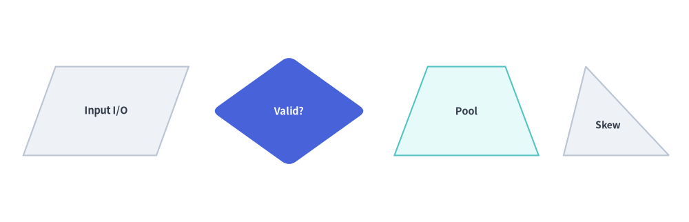
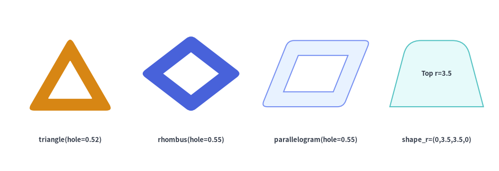
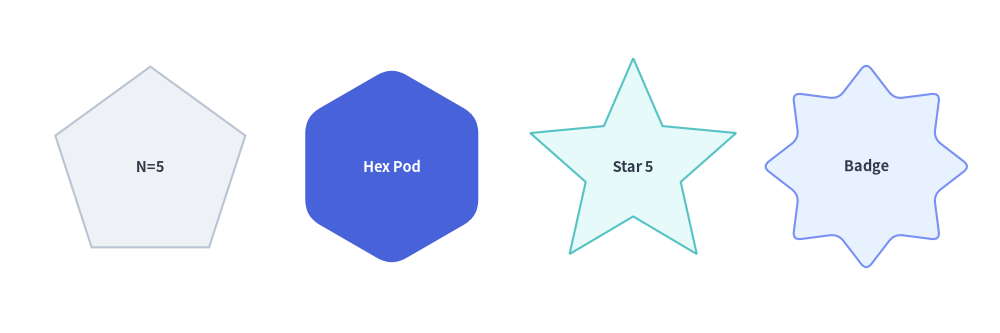
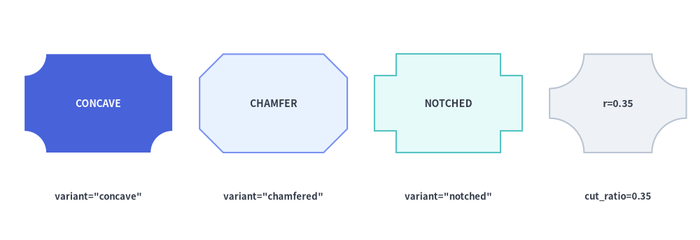
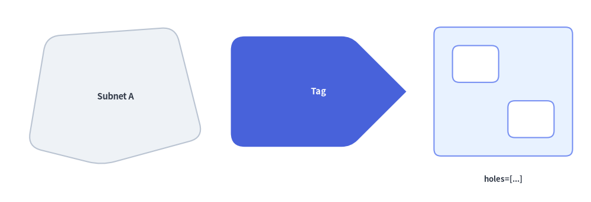
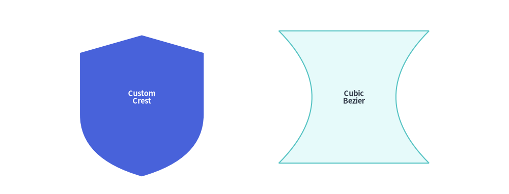

# Polygons & Custom Paths

The **Polygons & Custom Paths** category of `drawlib.shapes` provides **9 geometric and path primitives**: planar triangles and quadrilaterals (`triangle`, `parallelogram`, `trapezoid`, `rhombus`), radially symmetric shapes (`regularpolygon`, `star`), decorative corner-cut frames (`plaque`), arbitrary coordinate polygons (`polygon`), and a low-level Bézier vector path builder (`shape`).


<figure class="drawlib-image" style="text-align: center;">
  
  <figcaption class="drawlib-caption">Overview of the 9 Polygon, Plaque, and Custom Vector Path Primitives in drawlib.shapes</figcaption>
</figure>

<details class="drawlib-code-details">
<summary>Source Code</summary>

```python
from drawlib.canvas import save, setup
from drawlib.shapes import (
    parallelogram,
    plaque,
    polygon,
    regularpolygon,
    rhombus,
    shape,
    star,
    trapezoid,
    triangle,
)
from drawlib.styles import Styles

setup(width=128, height=58)

lbl_dark = Styles.DarkBold.patch(text_size=10.0)
lbl_white = Styles.WhiteBold.patch(text_size=10.0)

# Row 1: Planar Triangle, Parallelogram, Rhombus, Trapezoid, Plaque
triangle(
    (15, 42),
    width=19,
    height=16,
    style=Styles.Neutral,
    text="triangle",
    text_style=lbl_dark.patch(xy_shift=(0, -2.5)),
)
parallelogram(
    (40, 42),
    width=21,
    height=15,
    corner_angle=68,
    style=Styles.PrimaryNeutral,
    text="parallel",
    text_style=lbl_dark,
)
rhombus(
    (66, 42),
    width=23,
    height=17,
    style=Styles.PrimaryFlat,
    text="rhombus",
    text_style=lbl_white,
)
trapezoid(
    (91, 42),
    height=15,
    bottomedge_width=22,
    topedge_width=13,
    style=Styles.SecondaryNeutral,
    text="trapezoid",
    text_style=lbl_dark,
)
plaque(
    (115, 42),
    width=20,
    height=15,
    variant="concave",
    style=Styles.Neutral,
    text="plaque",
    text_style=lbl_dark,
)

# Row 2: Regular Polygon, Star, Hollow Hexagon, Arbitrary Polygon, Custom Bézier Shape
regularpolygon(
    (17, 15),
    num_vertex=6,
    radius=10.0,
    style=Styles.SecondaryNeutral,
    text="hex",
    text_style=lbl_dark,
)
star(
    (43, 15),
    num_vertex=5,
    radius_ext=11.0,
    radius_int=5.2,
    style=Styles.PrimaryFlat,
    text="star",
    text_style=lbl_white,
)
regularpolygon(
    (68, 15),
    num_vertex=6,
    radius=10.0,
    hole_ratio=0.55,
    style=Styles.PrimaryNeutral.patch(shape_r=1.5),
    text="ring",
    text_style=Styles.DarkBold.patch(text_size=9.5),
)
polygon(
    [(82, 8), (100, 8), (104, 15), (100, 22), (82, 22)],
    style=Styles.Neutral.patch(shape_r=1.5),
    text="polygon",
    text_style=lbl_dark,
)
shape(
    (116, 15),
    path_points=[(0, 6), (0, 18), (10, 22), (20, 18), (20, 6), ((20, 1), (10, 0)), ((0, 1), (0, 6))],
    style=Styles.SecondaryNeutral,
    text="shape",
    text_style=lbl_dark,
)

save()
```

</details>


---

## 1. Quick Comparison of Polygon & Path Primitives

| Function | Anchor | Vertex Count | `hole_ratio` | `style.shape_r` | Typical Diagram Use Cases |
| :--- | :--- | :---: | :---: | :--- | :--- |
| **`triangle`** | Center `(cx, cy)` | 3 | Yes `(0, 1)` | `float` or 3-tuple `(bl, top, br)` | Warning badges, delta markers, pyramids, right/skewed triangles. |
| **`parallelogram`** | Center `(cx, cy)` | 4 | Yes `(0, 1)` | `float` or 4-tuple `(bl, tl, tr, br)` | Flowchart data I/O blocks, message streams, skewed layers. |
| **`trapezoid`** | Center `(cx, cy)` | 4 | Yes `(0, 1)` | `float` or 4-tuple `(bl, tl, tr, br)` | Multiplexers, neural network pooling layers, stage reducers. |
| **`rhombus`** | Center `(cx, cy)` | 4 | Yes `(0, 1)` | `float` or 4-tuple `(left, top, right, bottom)` | Flowchart decision gates, ER relationship diamonds, routers. |
| **`regularpolygon`** | Center `(cx, cy)` | `num_vertex >= 3` | Yes `(0, 1)` | `float` or `N`-tuple | Hexagon microservice pods (`N=6`), octagons (`N=8`), pentagons (`N=5`). |
| **`star`** | Center `(cx, cy)` | `2 * num_vertex` | — | `float` or `(2N)`-tuple | Rating stars (`N=5`), seal/award badges (`N=8, 12`), focal markers. |
| **`plaque`** | Center `(cx, cy)` | 8 / 12 / Curved | — | `float` or tuple (`chamfered`/`notched`) | Certificate frames, SLA badges, formal labels, ticket cards. |
| **`polygon`** | Explicit `xys` | `len(xys) >= 3` | — | `float` or `N`-tuple | Custom network zones, irregular regions, bespoke multi-vertex cards. |
| **`shape`** | Center `(cx, cy)` | Arbitrary | — | — | Custom silhouettes mixing straight lines, quadratic, and cubic Béziers. |

---

## 2. Planar Quadrilaterals & Triangles (`triangle`, `parallelogram`, `trapezoid`, `rhombus`)

All four planar polygon functions share a consistent center-anchored bounding-box contract and support corner rounding (`style.shape_r`), hollow cutouts (`hole_ratio`), and rotation (`style.angle`):

```python
triangle(
    xy: tuple[float, float],
    width: float,
    height: float,
    topvertex_x: float | None = None,
    *,
    hole_ratio: float | None = None,
    style: Style,
    text: str = "",
    text_style: Style | None = None,
) -> None

parallelogram(
    xy: tuple[float, float],
    width: float,
    height: float,
    corner_angle: float = 60.0,
    *,
    hole_ratio: float | None = None,
    style: Style,
    text: str = "",
    text_style: Style | None = None,
) -> None

trapezoid(
    xy: tuple[float, float],
    height: float,
    bottomedge_width: float,
    topedge_width: float,
    topedge_x: float | None = None,
    *,
    hole_ratio: float | None = None,
    style: Style,
    text: str = "",
    text_style: Style | None = None,
) -> None

rhombus(
    xy: tuple[float, float],
    width: float,
    height: float,
    *,
    hole_ratio: float | None = None,
    style: Style,
    text: str = "",
    text_style: Style | None = None,
) -> None
```

### Parameter Reference

| Function | Parameter | Type | Default | Description |
| :--- | :--- | :--- | :--- | :--- |
| **Common** | `xy` | `tuple[float, float]` | *Required* | Center coordinate `(x, y)` of the unrotated bounding box (when using preset `Styles.*`). |
| | `hole_ratio` | `float \| None` | `None` | Optional concentric center cutout ratio in `(0.0, 1.0)`. |
| | `style` | `Style` | *Required* | Fill, border, rotation (`angle`), and vertex rounding (`shape_r`: scalar `float` or per-vertex tuple). |
| | `text` / `text_style` | `str` / `Style \| None` | `""` / `None` | Centered text label and optional typography override (use `xy_shift` to nudge text in asymmetric triangles/trapezoids). |
| **`triangle`** | `width` / `height` | `float` | *Required* | Base width (`> 0`) and vertical height (`> 0`). |
| | `topvertex_x` | `float \| None` | `None` | Horizontal offset of the top apex relative to the bottom-left corner (`None` defaults to `width / 2` for an isosceles triangle; `0` creates a left-aligned right triangle; `width` creates a right-aligned right triangle). |
| **`parallelogram`** | `width` / `height` | `float` | *Required* | Base edge width (`> 0`) and vertical height (`> 0`). Note: total horizontal bounding width is `width + height / tan(corner_angle)`. |
| | `corner_angle` | `float` | `60.0` | Bottom-left interior slant angle in degrees (`0 < corner_angle < 90`). |
| **`trapezoid`** | `height` | `float` | *Required* | Vertical height (`> 0`). Note: `trapezoid` specifies `bottomedge_width` and `topedge_width` instead of `width`. |
| | `bottomedge_width` | `float` | *Required* | Length of the bottom horizontal edge (`> 0`). |
| | `topedge_width` | `float` | *Required* | Length of the top horizontal edge (`> 0`). Set `topedge_width > bottomedge_width` for an inverted funnel trapezoid. |
| | `topedge_x` | `float \| None` | `None` | Horizontal offset of the top-left vertex relative to the bottom-left vertex (`None` centers the top edge symmetrically: `(bottomedge_width - topedge_width) / 2`). |
| **`rhombus`** | `width` / `height` | `float` | *Required* | Total horizontal diagonal span and vertical diagonal span (`> 0`). |


```python
from drawlib.canvas import save, setup
from drawlib.shapes import parallelogram, rhombus, trapezoid, triangle
from drawlib.styles import Styles

setup(width=124, height=40)

lbl_dark = Styles.DarkBold.patch(text_size=10.5)

# 1. Parallelogram (I/O Stream)
parallelogram(
    (19, 20),
    width=24,
    height=16,
    corner_angle=70,
    style=Styles.Neutral,
    text="Input I/O",
    text_style=lbl_dark,
)

# 2. Rhombus (Decision Gate with rounded vertices)
rhombus(
    (52, 20),
    width=28,
    height=20,
    style=Styles.PrimaryFlat.patch(shape_r=1.5),
    text="Valid?",
    text_style=Styles.WhiteBold.patch(text_size=10.5),
)

# 3. Symmetric Trapezoid (Pooling / Funnel Layer)
trapezoid(
    (84, 20),
    height=16,
    bottomedge_width=26,
    topedge_width=14,
    style=Styles.SecondaryNeutral,
    text="Pool",
    text_style=lbl_dark,
)

# 4. Asymmetric Triangle (topvertex_x shifts apex horizontally)
triangle(
    (111, 20),
    width=19,
    height=16,
    topvertex_x=4,
    style=Styles.Neutral,
    text="Skew",
    text_style=Styles.DarkBold.patch(text_size=10.0, xy_shift=(-1.5, -2.5)),
)

save()
```

<figure class="drawlib-image" style="text-align: center;">
  
  <figcaption class="drawlib-caption">Parallelogram, Rhombus, Trapezoid, and Asymmetric Triangle</figcaption>
</figure>


### Hollow Cutouts (`hole_ratio`) & Per-Vertex Rounding (`shape_r`) on Planar Polygons
All four planar polygons accept `hole_ratio` in `(0.0, 1.0)` to cut out a proportional inner hole, and accept either a scalar `float` or a per-vertex tuple in `style.patch(shape_r=...)`:


```python
from drawlib.canvas import save, setup
from drawlib.shapes import parallelogram, rhombus, trapezoid, triangle
from drawlib.styles import Styles
from drawlib.text import text

setup(width=128, height=44)

lbl = Styles.DarkBold.patch(text_size=9.5)

# 1. Hollow rounded triangle (warning frame)
triangle(
    (18, 25),
    width=22,
    height=19,
    hole_ratio=0.52,
    style=Styles.WarningFlat.patch(shape_r=1.8),
)
text((18, 8), "triangle(hole=0.52)", style=lbl)

# 2. Hollow rounded rhombus
rhombus(
    (49, 25),
    width=26,
    height=20,
    hole_ratio=0.55,
    style=Styles.PrimaryFlat.patch(shape_r=1.5),
)
text((49, 8), "rhombus(hole=0.55)", style=lbl)

# 3. Hollow parallelogram
parallelogram(
    (81, 25),
    width=21,
    height=17,
    corner_angle=68,
    hole_ratio=0.55,
    style=Styles.PrimaryNeutral.patch(shape_r=1.5),
)
text((81, 8), "parallelogram(hole=0.55)", style=lbl)

# 4. Trapezoid with top corners rounded only: shape_r=(0, 3.5, 3.5, 0)
trapezoid(
    (112, 25),
    height=17,
    bottomedge_width=24,
    topedge_width=15,
    style=Styles.SecondaryNeutral.patch(shape_r=(0, 3.5, 3.5, 0)),
    text="Top r=3.5",
    text_style=lbl,
)
text((112, 8), "shape_r=(0,3.5,3.5,0)", style=lbl)

save()
```

<figure class="drawlib-image" style="text-align: center;">
  
  <figcaption class="drawlib-caption">Hollow Cutouts (hole_ratio) and Per-Vertex Rounding (shape_r) on Planar Polygons</figcaption>
</figure>


---

## 3. Regular Polygons & Stars (`regularpolygon`, `star`)

`regularpolygon` and `star` construct radially symmetric shapes centered at `xy`, with the first vertex placed at the top ($90^\circ$, or rotated by `style.angle`):

```python
regularpolygon(
    xy: tuple[float, float],
    num_vertex: int,
    radius: float,
    *,
    hole_ratio: float | None = None,
    style: Style,
    text: str = "",
    text_style: Style | None = None,
) -> None

star(
    xy: tuple[float, float],
    num_vertex: int,
    radius_ext: float,
    radius_int: float,
    *,
    style: Style,
    text: str = "",
    text_style: Style | None = None,
) -> None
```

| Function | Parameter | Type | Default | Description |
| :--- | :--- | :--- | :--- | :--- |
| **`regularpolygon`** | `xy` | `tuple[float, float]` | *Required* | Center coordinate `(cx, cy)` of the circumscribed circle. |
| | `num_vertex` | `int` | *Required* | Number of polygon vertices/sides (`>= 3`, e.g. `5` for pentagon, `6` for hexagon, `8` for octagon). |
| | `radius` | `float` | *Required* | Circumscribed radius from center `xy` to each vertex (`> 0`). |
| | `hole_ratio` | `float \| None` | `None` | Optional concentric polygon cutout ratio in `(0.0, 1.0)`. |
| | `style` | `Style` | *Required* | Supports `angle` rotation and `shape_r` vertex rounding (scalar `float` or `num_vertex`-tuple). |
| **`star`** | `xy` | `tuple[float, float]` | *Required* | Center coordinate `(cx, cy)` of the star. |
| | `num_vertex` | `int` | *Required* | Number of outer star tips (`>= 3`). Total polygon vertices = `2 * num_vertex`. |
| | `radius_ext` | `float` | *Required* | Outer tip radius (`> radius_int`). |
| | `radius_int` | `float` | *Required* | Inner valley radius (`0 < radius_int < radius_ext`). |
| | `style` | `Style` | *Required* | Supports `angle` rotation and `shape_r` rounding (scalar `float` or `(2 * num_vertex)`-tuple of alternating `(outer_tip, inner_valley)` radii). |


```python
from drawlib.canvas import save, setup
from drawlib.shapes import regularpolygon, star
from drawlib.styles import Styles

setup(width=120, height=40)

lbl_dark = Styles.DarkBold.patch(text_size=10.5)

# 1. Pentagon (num_vertex=5)
regularpolygon(
    (18, 20),
    num_vertex=5,
    radius=12,
    style=Styles.Neutral,
    text="N=5",
    text_style=lbl_dark,
)

# 2. Rounded Hexagon Pod (num_vertex=6, shape_r=2)
regularpolygon(
    (47, 20),
    num_vertex=6,
    radius=12,
    style=Styles.PrimaryFlat.patch(shape_r=2),
    text="Hex Pod",
    text_style=Styles.WhiteBold.patch(text_size=10.5),
)

# 3. 5-Point Star (radius_ext=13, radius_int=6.0)
star(
    (76, 20),
    num_vertex=5,
    radius_ext=13,
    radius_int=6.0,
    style=Styles.SecondaryNeutral,
    text="Star 5",
    text_style=lbl_dark,
)

# 4. Rounded 8-Point Badge Star (num_vertex=8, shape_r=1.0)
star(
    (104, 20),
    num_vertex=8,
    radius_ext=12.5,
    radius_int=8.8,
    style=Styles.PrimaryNeutral.patch(shape_r=1.0),
    text="Badge",
    text_style=lbl_dark,
)

save()
```

<figure class="drawlib-image" style="text-align: center;">
  
  <figcaption class="drawlib-caption">Regular Polygons and Stars with Vertex Count and Corner Rounding Variations</figcaption>
</figure>


---

## 4. Decorative & Certificate Plaques (`plaque`)

`plaque` renders a rectangular frame with decorative corner cutouts—ideal for SLA/compliance badges, certificate headers, ticket stubs, and formal architectural labels:

```python
plaque(
    xy: tuple[float, float],
    width: float,
    height: float,
    *,
    variant: Literal[
        "concave", "standard",
        "chamfered", "octagon",
        "notched",
    ] = "concave",
    cut_ratio: float | None = None,
    style: Style,
    text: str = "",
    text_style: Style | None = None,
) -> None
```

### Parameter & `variant` Reference

| Parameter | Type | Default | Description |
| :--- | :--- | :--- | :--- |
| `xy` | `tuple[float, float]` | *Required* | Center coordinate `(x, y)` of the plaque bounding box (supports `style.halign` / `style.valign`). |
| `width` / `height` | `float` | *Required* | Outer horizontal width (`> 0`) and vertical height (`> 0`). |
| `variant` | `PlaqueVariant` | `"concave"` | Corner cutout geometry (see **Plaque `variant` Comparison** below). |
| `cut_ratio` | `float \| None` | `None` | Corner cutout size fraction in `[0.02, 0.45]` relative to `min(width, height)`. Defaults to `0.20` when `None`. |
| `style` | `Style` | *Required* | Fill, border, rotation (`angle`), and optional vertex filleting (`shape_r` is supported on `"chamfered"` and `"notched"` variants). |
| `text` / `text_style` | `str` / `Style \| None` | `""` / `None` | Centered text label and optional typography override. |

| `variant` | Accepted Aliases | Corner Geometry | Supports `style.shape_r` | Typical Use Cases |
| :--- | :--- | :--- | :---: | :--- |
| **`"concave"`** *(default)* | `"standard"` | Smooth inward quarter-circle arcs scooped out of all 4 corners | — (Curved arcs) | Classic ornamental plaques, tickets, and certification badges. |
| **`"chamfered"`** | `"octagon"` | Straight $45^\circ$ diagonal corner cuts (8-vertex octagonal card) | Yes (`float` or 8-tuple) | Industrial/hardware labels, stop/gate cards, and beveled frames. |
| **`"notched"`** | — | Orthogonal $90^\circ$ L-shaped inward corner steps (12-vertex stepped card) | Yes (`float` or 12-tuple) | Retro/pixel-style frames, bus cards, and architectural title blocks. |


```python
from drawlib.canvas import save, setup
from drawlib.shapes import plaque
from drawlib.styles import Styles
from drawlib.text import text

setup(width=128, height=44)

lbl = Styles.DarkBold.patch(text_size=9.5)

# 1. Concave (inward circular arc corners)
plaque(
    (18, 25),
    width=27,
    height=18,
    variant="concave",
    cut_ratio=0.22,
    style=Styles.PrimaryFlat,
    text="CONCAVE",
    text_style=Styles.WhiteBold.patch(text_size=10.0),
)
text((18, 8), 'variant="concave"', style=lbl)

# 2. Chamfered / Octagon (45° diagonal cut corners)
plaque(
    (50, 25),
    width=27,
    height=18,
    variant="chamfered",
    cut_ratio=0.24,
    style=Styles.PrimaryNeutral,
    text="CHAMFER",
    text_style=Styles.DarkBold.patch(text_size=10.0),
)
text((50, 8), 'variant="chamfered"', style=lbl)

# 3. Notched (90° inward step corners)
plaque(
    (82, 25),
    width=27,
    height=18,
    variant="notched",
    cut_ratio=0.22,
    style=Styles.SecondaryNeutral,
    text="NOTCHED",
    text_style=Styles.DarkBold.patch(text_size=10.0),
)
text((82, 8), 'variant="notched"', style=lbl)

# 4. Deep concave cut (cut_ratio=0.35)
plaque(
    (113, 25),
    width=25,
    height=18,
    variant="concave",
    cut_ratio=0.35,
    style=Styles.Neutral,
    text="r=0.35",
    text_style=Styles.DarkBold.patch(text_size=10.0),
)
text((113, 8), "cut_ratio=0.35", style=lbl)

save()
```

<figure class="drawlib-image" style="text-align: center;">
  
  <figcaption class="drawlib-caption">The Three Plaque Variants (concave, chamfered, notched) and cut_ratio Customization</figcaption>
</figure>


---

## 5. Arbitrary Coordinate Polygons (`polygon`)

`polygon` constructs a closed polygon directly from an explicit sequence of canvas vertex coordinates `xys=[(x1, y1), (x2, y2), ...]`, with optional interior cutout `holes`:

```python
polygon(
    xys: list[tuple[float, float]],
    *,
    holes: list[list[tuple[float, float]]] | None = None,
    style: Style,
    text: str = "",
    text_style: Style | None = None,
) -> None
```

| Parameter | Type | Default | Description |
| :--- | :--- | :--- | :--- |
| `xys` | `list[tuple[float, float]]` | *Required* | Ordered sequence of at least 3 outer canvas vertex coordinates `[(x1, y1), (x2, y2), ...]`. |
| `holes` | `list[list[tuple[float, float]]] \| None` | `None` | Optional list of inner cutout rings `[[(hx1, hy1), ...], ...]`. Winding direction is normalized automatically (`xys` CCW, `holes` CW). |
| `style.shape_r` | `float \| tuple[float, ...] \| None` | `None` | Pass a scalar `float` to round all outer and hole vertices equally, or a tuple of radii `(r1, r2, ..., rN)` matching `len(xys)` to round specific outer vertices selectively (`0` keeps a vertex sharp). |
| `text` / `text_style` | `str` / `Style \| None` | `""` / `None` | Embedded label automatically placed at the bounding-box center of `xys`. |


```python
from drawlib.canvas import save, setup
from drawlib.shapes import polygon
from drawlib.styles import Styles
from drawlib.text import text

setup(width=128, height=44)

lbl = Styles.DarkBold.patch(text_size=9.5)

# 1. Irregular network zone with uniform corner rounding
polygon(
    xys=[(6, 12), (10, 36), (38, 38), (44, 14), (22, 8)],
    style=Styles.Neutral.patch(shape_r=3),
    text="Subnet A",
    text_style=Styles.DarkBold.patch(text_size=10.5),
)

# 2. Custom tag card with per-vertex radii (sharp tip on right)
polygon(
    xys=[(50, 12), (50, 36), (76, 36), (88, 24), (76, 12)],
    style=Styles.PrimaryFlat.patch(shape_r=(3, 3, 2, 0, 2)),
    text="Tag",
    text_style=Styles.WhiteBold.patch(text_size=10.5),
)

# 3. Compound polygon frame with two interior cutout holes
polygon(
    xys=[(94, 10), (124, 10), (124, 38), (94, 38)],
    holes=[
        [(98, 26), (108, 26), (108, 34), (98, 34)],
        [(110, 14), (120, 14), (120, 22), (110, 22)],
    ],
    style=Styles.PrimaryNeutral.patch(shape_r=1.5),
)
text((109, 5), "holes=[...]", style=lbl)

save()
```

<figure class="drawlib-image" style="text-align: center;">
  
  <figcaption class="drawlib-caption">Custom Polygons with Uniform Rounding, Per-Vertex Rounding, and Interior Cutout Holes</figcaption>
</figure>


---

## 6. Low-Level Vector & Bézier Path Builder (`shape`)

For custom silhouettes that combine straight lines, quadratic Bézier curves, and cubic Bézier curves with relative positioning and rotation around `xy`, use `shape()`:

```python
shape(
    xy: tuple[float, float],
    path_points: list[
        tuple[float, float]
        | tuple[tuple[float, float], tuple[float, float]]
        | tuple[tuple[float, float], tuple[float, float], tuple[float, float]]
    ],
    *,
    style: Style,
    text: str = "",
    text_style: Style | None = None,
    is_default_center: bool = False,
) -> None
```

| Parameter / `path_points` Element | Type / Tuple Format | Description |
| :--- | :--- | :--- |
| **`xy`** | `tuple[float, float]` | Anchor coordinate `(x, y)` on the canvas (center of bounding box when using preset `Styles.*`). |
| **First Element `path_points[0]`** | `(x0, y0)` | Must be a 2-float starting vertex `(x0, y0)` in local coordinates (`Path.MOVETO`). |
| **Straight Line Segment** | `(x, y)` | Draws a straight line to `(x, y)` (`Path.LINETO`). |
| **Quadratic Bézier Segment** | `((cp_x, cp_y), (end_x, end_y))` | Curves toward single control point `cp` before ending at `end` (`Path.CURVE3`). |
| **Cubic Bézier Segment** | `((cp1_x, cp1_y), (cp2_x, cp2_y), (end_x, end_y))` | Curves via two control points `cp1` and `cp2` to `end` (`Path.CURVE4`). |
| **`is_default_center`** | `bool` | Fallback alignment when `style.halign` or `style.valign` is `None`. All preset `Styles.*` explicitly set `halign="center", valign="center"`, centering the path's bounding box at `xy`. |


```python
from drawlib.canvas import save, setup
from drawlib.shapes import shape
from drawlib.styles import Styles

setup(width=115, height=44)

# 1. Custom Crest Silhouette (Quadratic Bézier curved base)
shape(
    xy=(32, 22),
    path_points=[
        (0, 14),
        (0, 28),
        (14, 32),
        (28, 28),
        (28, 14),
        ((28, 4), (14, 0)),
        ((0, 4), (0, 14)),
    ],
    style=Styles.PrimaryFlat,
    text="Custom\nCrest",
    text_style=Styles.WhiteBold.patch(text_size=10.5),
)

# 2. Custom Symmetric Hourglass Silhouette (Cubic Bézier waist)
shape(
    xy=(80, 22),
    path_points=[
        (0, 0),
        ((10, 10), (10, 20), (0, 30)),
        (34, 30),
        ((24, 20), (24, 10), (34, 0)),
    ],
    style=Styles.SecondaryNeutral,
    text="Cubic\nBezier",
    text_style=Styles.DarkBold.patch(text_size=10.5),
)

save()
```

<figure class="drawlib-image" style="text-align: center;">
  
  <figcaption class="drawlib-caption">Custom Vector Shapes Using Quadratic and Cubic Bézier Path Points</figcaption>
</figure>


> [!TIP]
> - Before building a custom Bézier path from scratch with `shape()`, check **[3D Containers, Flow & Grouping](./shapes_container.md)** (`document`, `funnel`, `cloud`, `brace`), **[Callouts, Badges & Status](./shapes_badge.md)** (`shield`, `ribbon`, `pin`, `tag`, `explosion`), and **[Faces, Clocks, Symbols & Operators](./shapes_symbol.md)** (`gear`, `math_symbol`, `heart`, `lightning`, `moon`), which provide ready-made, parameterized implementations of common complex silhouettes.
