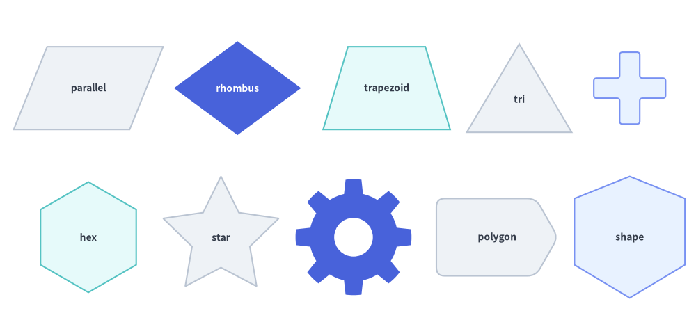
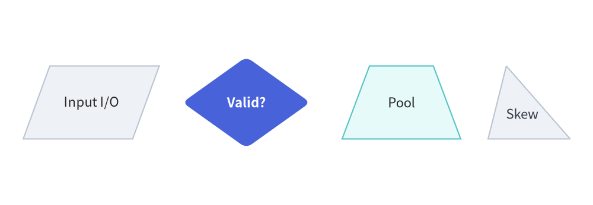
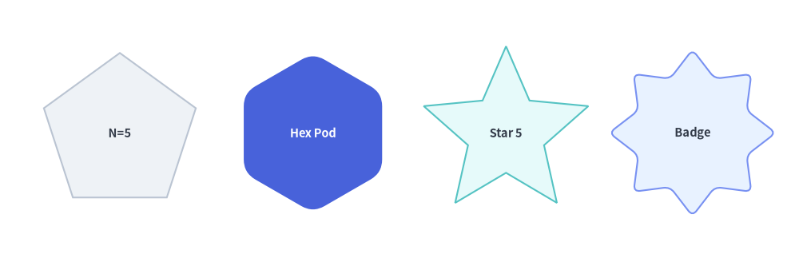
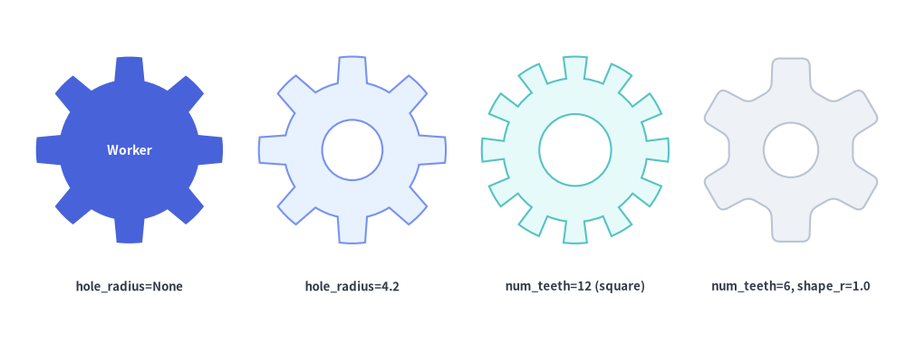
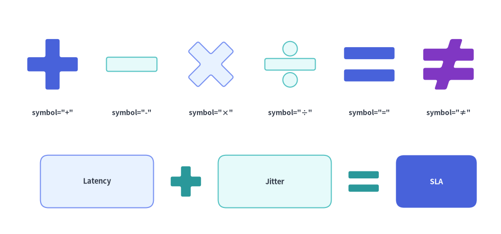
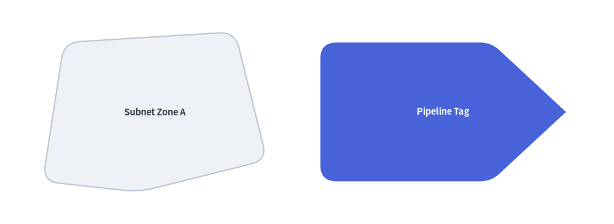
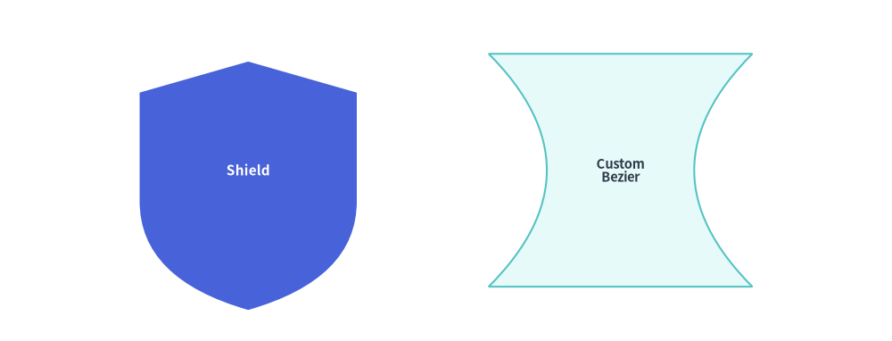

# Polygons, Gears, Math Symbols & Custom Paths

In addition to basic rectangles and circles, `drawlib.shapes` provides planar polygons (`parallelogram`, `rhombus`, `trapezoid`, `triangle`), radial equilateral shapes (`regularpolygon`, `star`), mechanical cogwheels (`gear`), mathematical operator symbols (`math_symbol`), arbitrary coordinate polygons (`polygon`), and a low-level Bézier vector path builder (`shape`).

---

## 1. Overview of Polygons & Custom Paths


<figure class="drawlib-image" style="text-align: center;">
  
  <figcaption class="drawlib-caption">Overview of Polygons, Gears, Math Symbols, and Custom Path Primitives</figcaption>
</figure>

<details class="drawlib-code-details">
<summary>Source Code</summary>

```python
from drawlib.canvas import save, setup
from drawlib.shapes import (
    gear,
    math_symbol,
    parallelogram,
    polygon,
    regularpolygon,
    rhombus,
    shape,
    star,
    trapezoid,
    triangle,
)
from drawlib.styles import Styles

setup(width=126, height=58)

lbl_dark = Styles.DarkBold.patch(text_size=10.0)
lbl_white = Styles.WhiteBold.patch(text_size=10.0)

# Row 1: Planar Quadrilaterals, Triangle & Math Symbol
parallelogram((16, 42), width=21, height=15, corner_angle=68, style=Styles.Neutral, text="parallel", text_style=lbl_dark)
rhombus(
    (43, 42),
    width=23,
    height=17,
    style=Styles.PrimaryFlat,
    text="rhombus",
    text_style=lbl_white,
)
trapezoid(
    (70, 42),
    height=15,
    bottomedge_width=23,
    topedge_width=14,
    style=Styles.SecondaryNeutral,
    text="trapezoid",
    text_style=lbl_dark,
)
triangle((94, 42), width=19, height=16, style=Styles.Neutral, text="tri", text_style=lbl_dark.patch(xy_shift=(0, -2)))
math_symbol((114, 42), symbol="+", width=13, style=Styles.PrimaryNeutral.patch(shape_r=0.5))

# Row 2: Regular Polygons, Stars, Gear, Polygon & Custom Shape
regularpolygon((16, 15), num_vertex=6, radius=10.0, style=Styles.SecondaryNeutral, text="hex", text_style=lbl_dark)
star((40, 15), num_vertex=5, radius_ext=11.0, radius_int=5.5, style=Styles.Neutral, text="star", text_style=lbl_dark)
gear((64, 15), num_teeth=8, radius_ext=10.5, radius_int=8.0, hole_radius=3.5, style=Styles.PrimaryFlat)
polygon(
    [(79, 8), (97, 8), (101, 15), (97, 22), (79, 22)],
    style=Styles.Neutral.patch(shape_r=1.5),
    text="polygon",
    text_style=lbl_dark,
)
shape(
    (114, 15),
    path_points=[(0, 6), (0, 18), (10, 22), (20, 18), (20, 6), (10, 0)],
    style=Styles.PrimaryNeutral,
    text="shape",
    text_style=lbl_dark,
)

save()
```

</details>


---

## 2. Planar Quadrilaterals & Triangles (`parallelogram`, `rhombus`, `trapezoid`, `triangle`)

All planar quadrilateral and triangle primitives support corner rounding via `style.patch(shape_r=...)` (either a uniform `float` or a per-vertex tuple) and rotation via `style.patch(angle=...)`:

```python
parallelogram(
    xy: tuple[float, float],
    width: float,
    height: float,
    corner_angle: float = 60.0,
    *,
    style: Style,
    text: str = "",
    text_style: Style | None = None,
)

rhombus(
    xy: tuple[float, float],
    width: float,
    height: float,
    *,
    style: Style,
    text: str = "",
    text_style: Style | None = None,
)

trapezoid(
    xy: tuple[float, float],
    height: float,
    bottomedge_width: float,
    topedge_width: float,
    topedge_x: float | None = None,
    *,
    style: Style,
    text: str = "",
    text_style: Style | None = None,
)

triangle(
    xy: tuple[float, float],
    width: float,
    height: float,
    topvertex_x: float | None = None,
    *,
    style: Style,
    text: str = "",
    text_style: Style | None = None,
)
```

| Function | Parameter | Type | Default | Description |
| :--- | :--- | :--- | :--- | :--- |
| **Common** | `xy` | `tuple[float, float]` | *Required* | Center coordinate `(x, y)` of the unrotated bounding box (when using preset `Styles.*`). |
| | `style` | `Style` | *Required* | Fill, border, rotation (`angle`), and vertex rounding (`shape_r`: scalar `float` or per-vertex tuple). |
| | `text` / `text_style` | `str` / `Style \| None` | `""` / `None` | Centered text label and optional typography override (use `xy_shift` to nudge text in asymmetric triangles/trapezoids). |
| **`parallelogram`** | `width` / `height` | `float` | *Required* | Base width (`> 0`) and vertical height (`> 0`). |
| | `corner_angle` | `float` | `60.0` | Bottom-left interior slant angle in degrees (`0 < corner_angle < 90`). |
| **`rhombus`** | `width` / `height` | `float` | *Required* | Total horizontal diagonal span and vertical diagonal span (`> 0`). |
| **`trapezoid`** | `height` | `float` | *Required* | Vertical height (`> 0`). Note: `trapezoid` uses `bottomedge_width` and `topedge_width` instead of `width`. |
| | `bottomedge_width` | `float` | *Required* | Length of the bottom horizontal edge (`> 0`). |
| | `topedge_width` | `float` | *Required* | Length of the top horizontal edge (`> 0`). |
| | `topedge_x` | `float \| None` | `None` | Horizontal offset of the top-left vertex relative to the bottom-left vertex (`None` centers the top edge symmetrically: `(bottomedge_width - topedge_width) / 2`). |
| **`triangle`** | `width` / `height` | `float` | *Required* | Base width (`> 0`) and vertical height (`> 0`). |
| | `topvertex_x` | `float \| None` | `None` | Horizontal offset of the top apex relative to the bottom-left corner (`None` defaults to `width / 2` for an isosceles triangle; `0` creates a left-aligned right triangle). |


```python
from drawlib.canvas import save, setup
from drawlib.shapes import parallelogram, rhombus, trapezoid, triangle
from drawlib.styles import Styles

setup(width=124, height=40)

lbl_dark = Styles.DarkBold.patch(text_size=10.5)

# 1. Parallelogram (I/O Stream)
parallelogram(
    (19, 20),
    width=24,
    height=16,
    corner_angle=70,
    style=Styles.Neutral,
    text="Input I/O",
    text_style=lbl_dark,
)

# 2. Rhombus (Decision Gate with rounded vertices)
rhombus(
    (52, 20),
    width=28,
    height=20,
    style=Styles.PrimaryFlat.patch(shape_r=1.5),
    text="Valid?",
    text_style=Styles.WhiteBold.patch(text_size=10.5),
)

# 3. Symmetric Trapezoid (Pooling / Funnel Layer)
trapezoid(
    (84, 20),
    height=16,
    bottomedge_width=26,
    topedge_width=14,
    style=Styles.SecondaryNeutral,
    text="Pool",
    text_style=lbl_dark,
)

# 4. Asymmetric Triangle (topvertex_x shifts apex horizontally)
triangle(
    (111, 20),
    width=19,
    height=16,
    topvertex_x=4,
    style=Styles.Neutral,
    text="Skew",
    text_style=Styles.DarkBold.patch(text_size=10.0, xy_shift=(-1.5, -2.5)),
)

save()
```

<figure class="drawlib-image" style="text-align: center;">
  
  <figcaption class="drawlib-caption">Parallelogram, Rhombus, Trapezoid, and Triangle</figcaption>
</figure>


---

## 3. Regular Polygons & Stars (`regularpolygon`, `star`)

`regularpolygon` and `star` construct radially symmetric shapes centered at `xy`:

```python
regularpolygon(
    xy: tuple[float, float],
    num_vertex: int,
    radius: float,
    *,
    style: Style,
    text: str = "",
    text_style: Style | None = None,
)

star(
    xy: tuple[float, float],
    num_vertex: int,
    radius_ext: float,
    radius_int: float,
    *,
    style: Style,
    text: str = "",
    text_style: Style | None = None,
)
```

| Function | Parameter | Type | Default | Description |
| :--- | :--- | :--- | :--- | :--- |
| **`regularpolygon`** | `xy` | `tuple[float, float]` | *Required* | Center coordinate `(x, y)` of the circumscribed circle. |
| | `num_vertex` | `int` | *Required* | Number of polygon vertices/sides (`>= 3`, e.g. `5` for pentagon, `6` for hexagon, `8` for octagon). |
| | `radius` | `float` | *Required* | Circumscribed radius from center `xy` to each vertex (`> 0`). |
| | `style` | `Style` | *Required* | Supports `angle` rotation and `shape_r` vertex rounding (scalar `float` or `num_vertex`-tuple). |
| **`star`** | `xy` | `tuple[float, float]` | *Required* | Center coordinate `(x, y)` of the star. |
| | `num_vertex` | `int` | *Required* | Number of outer star tips (`>= 3`). Total polygon vertices = `2 * num_vertex`. |
| | `radius_ext` | `float` | *Required* | Outer tip radius (`> radius_int`). |
| | `radius_int` | `float` | *Required* | Inner valley radius (`0 < radius_int < radius_ext`). |
| | `style` | `Style` | *Required* | Supports `angle` rotation and `shape_r` rounding (scalar `float` or `(2 * num_vertex)`-tuple of alternating outer/inner vertex radii). |


```python
from drawlib.canvas import save, setup
from drawlib.shapes import regularpolygon, star
from drawlib.styles import Styles

setup(width=120, height=40)

lbl_dark = Styles.DarkBold.patch(text_size=10.5)

# 1. Pentagon (num_vertex=5)
regularpolygon(
    (18, 20),
    num_vertex=5,
    radius=12,
    style=Styles.Neutral,
    text="N=5",
    text_style=lbl_dark,
)

# 2. Rounded Hexagon Pod (num_vertex=6, shape_r=2)
regularpolygon(
    (47, 20),
    num_vertex=6,
    radius=12,
    style=Styles.PrimaryFlat.patch(shape_r=2),
    text="Hex Pod",
    text_style=Styles.WhiteBold.patch(text_size=10.5),
)

# 3. 5-Point Star (radius_ext=13, radius_int=6.0)
star(
    (76, 20),
    num_vertex=5,
    radius_ext=13,
    radius_int=6.0,
    style=Styles.SecondaryNeutral,
    text="Star 5",
    text_style=lbl_dark,
)

# 4. Rounded 8-Point Badge Star (num_vertex=8, shape_r=1.0)
star(
    (104, 20),
    num_vertex=8,
    radius_ext=12.5,
    radius_int=8.8,
    style=Styles.PrimaryNeutral.patch(shape_r=1.0),
    text="Badge",
    text_style=lbl_dark,
)

save()
```

<figure class="drawlib-image" style="text-align: center;">
  
  <figcaption class="drawlib-caption">Regular Polygons and Stars with Vertex Count and Corner Rounding Variations</figcaption>
</figure>


---

## 4. Gears & Cogwheels (`gear`)

For automation engines, background workers, CI/CD runners, and system settings, `gear` renders an $N$-toothed mechanical cogwheel with circular root valleys, configurable tooth tip/base ratios, and an optional transparent center hole:

```python
gear(
    xy: tuple[float, float],
    num_teeth: int,
    radius_ext: float,
    radius_int: float,
    *,
    tooth_ext_ratio: float | None = None,
    tooth_int_ratio: float | None = None,
    hole_radius: float | None = None,
    style: Style,
    text: str = "",
    text_style: Style | None = None,
)
```

### Parameter Reference

| Parameter | Type | Default | Description |
| :--- | :--- | :--- | :--- |
| `xy` | `tuple[float, float]` | *Required* | Center coordinate `(x, y)` of the gear. |
| `num_teeth` | `int` | *Required* | Number of gear teeth (`>= 3`, typically `6` to `12`). Defines the angular pitch $\Delta\theta = 360^\circ / \text{num\_teeth}$. |
| `radius_ext` | `float` | *Required* | Outer tooth tip radius (`> radius_int`). |
| `radius_int` | `float` | *Required* | Inner root valley radius (`0 < radius_int < radius_ext`). |
| `tooth_ext_ratio` | `float \| None` | `None` | Fraction of one pitch angle $\Delta\theta$ occupied by the **outer tooth tip** in `(0.0, 1.0)`. Defaults to `0.35`. Must satisfy `tooth_ext_ratio <= tooth_int_ratio`. |
| `tooth_int_ratio` | `float \| None` | `None` | Fraction of one pitch angle $\Delta\theta$ occupied by the **inner tooth base** in `(0.0, 1.0)`. Defaults to `0.55`. Must satisfy `tooth_int_ratio >= tooth_ext_ratio`. |
| `hole_radius` | `float \| None` | `None` | Radius of the transparent circular cutout in the center (`0 < hole_radius < radius_int`). When `None` (default), the gear has a solid core ideal for displaying `text`. |
| `style` | `Style` | *Required* | Fill, border, rotation (`angle`), and tooth corner rounding (`shape_r`: scalar `float` or `(4 * num_teeth)`-tuple). |
| `text` / `text_style` | `str` / `Style \| None` | `""` / `None` | Centered text label and optional typography override. |

### Tooth Geometry & Customization Rules
- **Trapezoidal vs. Square Teeth**: By default (`tooth_ext_ratio=0.35`, `tooth_int_ratio=0.55`), each tooth tapers outward like a realistic involute gear. Setting both ratios equal (e.g. `tooth_ext_ratio=0.45, tooth_int_ratio=0.45`) produces straight-sided radial teeth.
- **Root Arcs & Corner Rounding (`style.shape_r`)**: When `style.shape_r` is `None`, root valleys and outer tips follow true circular arcs of radii `radius_int` and `radius_ext`. When `style.shape_r` is set (e.g. `Styles.PrimaryNeutral.patch(shape_r=0.8)`), all $4 \times \text{num\_teeth}$ tooth corners are smoothly filleted.
- **Solid Core vs. Center Hole (`hole_radius`)**: Omit `hole_radius` when placing a text label inside the gear; specify `hole_radius` (e.g. `0.4 * radius_int`) for a classic ring-style cogwheel.


```python
from drawlib.canvas import save, setup
from drawlib.shapes import gear
from drawlib.styles import Styles
from drawlib.text import text

setup(width=126, height=48)

# 1. Solid gear with embedded text (hole_radius=None)
gear(
    (18, 27),
    num_teeth=8,
    radius_ext=13.0,
    radius_int=9.8,
    style=Styles.PrimaryFlat,
    text="Worker",
    text_style=Styles.WhiteBold.patch(text_size=10.0),
)
text((18, 8), "hole_radius=None", style=Styles.DarkBold.patch(text_size=9.5))

# 2. Standard 8-tooth gear with center hole (tooth_ext_ratio=0.35, tooth_int_ratio=0.55)
gear(
    (49, 27),
    num_teeth=8,
    radius_ext=13.0,
    radius_int=9.5,
    hole_radius=4.2,
    style=Styles.PrimaryNeutral,
)
text((49, 8), "hole_radius=4.2", style=Styles.DarkBold.patch(text_size=9.5))

# 3. 12-tooth gear with wide square teeth (tooth_ext_ratio=0.48, tooth_int_ratio=0.48)
gear(
    (80, 27),
    num_teeth=12,
    radius_ext=13.0,
    radius_int=10.0,
    tooth_ext_ratio=0.48,
    tooth_int_ratio=0.48,
    hole_radius=5.0,
    style=Styles.SecondaryNeutral,
)
text((80, 8), "num_teeth=12 (square)", style=Styles.DarkBold.patch(text_size=9.5))

# 4. 6-tooth heavy gear with filleted tooth corners (shape_r=1.0)
gear(
    (110, 27),
    num_teeth=6,
    radius_ext=13.0,
    radius_int=8.8,
    tooth_ext_ratio=0.38,
    tooth_int_ratio=0.60,
    hole_radius=3.8,
    style=Styles.Neutral.patch(shape_r=1.0),
)
text((110, 8), "num_teeth=6, shape_r=1.0", style=Styles.DarkBold.patch(text_size=9.5))

save()
```

<figure class="drawlib-image" style="text-align: center;">
  
  <figcaption class="drawlib-caption">Gear Variations: Solid Core with Text, Standard Center Hole, Fine Teeth, and Rounded Tooth Corners</figcaption>
</figure>


---

## 5. Mathematical Operator Symbols (`math_symbol`)

For visual equations and concept formulas (`[Card A] + [Card B] = [Outcome]`), `math_symbol` renders mathematical operators as filled, bordered geometric shapes rather than thin font glyphs:

```python
math_symbol(
    xy: tuple[float, float],
    symbol: Literal[
        "+", "plus",
        "-", "−", "minus",
        "*", "x", "×", "multiply",
        "/", "÷", "divide",
        "=", "equal",
        "!=", "≠", "not_equal",
    ],
    width: float,
    height: float | None = None,
    *,
    thickness_ratio: float | None = None,
    style: Style,
    text: str = "",
    text_style: Style | None = None,
)
```

### Parameter Reference

| Parameter | Type | Default | Description |
| :--- | :--- | :--- | :--- |
| `xy` | `tuple[float, float]` | *Required* | Center coordinate `(x, y)` of the symbol bounding box. |
| `symbol` | `MathSymbol` | *Required* | Operator symbol or canonical name (see **Supported `symbol` Variants** below). |
| `width` | `float` | *Required* | Outer horizontal width of the symbol (`> 0`). |
| `height` | `float \| None` | `None` | Outer vertical height (`> 0`). When `None`, defaults to `width` (square bounding box). |
| `thickness_ratio` | `float \| None` | `None` | Bar thickness fraction in `(0.0, 1.0)` relative to `min(width, height)`. Defaults to `0.28`. |
| `style` | `Style` | *Required* | Fill, border, rotation (`angle`), and bar corner rounding (`shape_r`: scalar `float`). |
| `text` / `text_style` | `str` / `Style \| None` | `""` / `None` | Centered text label and optional typography override. |

### Supported `symbol` Variants & Aliases

| Primary `symbol` | Accepted Aliases | Geometric Construction |
| :--- | :--- | :--- |
| **`"+"`** | `"plus"` | Unified 12-vertex orthogonal cross contour (no internal overlapping stroke lines). |
| **`"-"`** | `"−"`, `"minus"` | Single horizontal rectangular bar centered vertically. |
| **`"×"`** | `"*"`, `"x"`, `"multiply"` | Unified 12-vertex diagonal cross rotated $45^\circ$ and scaled to fit `(width, height)`. |
| **`"÷"`** | `"/"`, `"divide"` | Horizontal center bar combined with upper and lower circular dots (`Path.make_compound_path`). |
| **`"="`** | `"equal"` | Two parallel horizontal bars spaced symmetrically above and below center. |
| **`"≠"`** | `"!="`, `"not_equal"` | Two parallel horizontal bars intersected by an angled slash in a single unified outer contour. |


```python
from drawlib.canvas import save, setup
from drawlib.shapes import math_symbol, rectangle
from drawlib.styles import Styles
from drawlib.text import text

setup(width=124, height=58)

# Row 1: All 6 symbols (+, -, ×, ÷, =, ≠)
symbols = [
    ("+", 'symbol="+"', Styles.PrimaryFlat),
    ("-", 'symbol="-"', Styles.SecondaryNeutral),
    ("×", 'symbol="×"', Styles.PrimaryNeutral),
    ("÷", 'symbol="÷"', Styles.SecondaryNeutral),
    ("=", 'symbol="="', Styles.PrimaryFlat),
    ("≠", 'symbol="≠"', Styles.AccentFlat),
]

for idx, (sym, label, st) in enumerate(symbols):
    cx = 13 + idx * 19.6
    math_symbol((cx, 42), symbol=sym, width=12.5, style=st.patch(shape_r=0.5))
    text((cx, 30), label, style=Styles.DarkBold.patch(text_size=10.0))

# Row 2: Visual equation layout (Card + Card = Result Card)
rectangle((24, 13), width=28, height=13, style=Styles.PrimaryNeutral.patch(shape_r=2), text="Latency", text_style=Styles.DarkBold.patch(text_size=10.5))
math_symbol((46, 13), symbol="+", width=7.5, thickness_ratio=0.32, style=Styles.SecondaryFlat.patch(shape_r=0.4))
rectangle((68, 13), width=28, height=13, style=Styles.SecondaryNeutral.patch(shape_r=2), text="Jitter", text_style=Styles.DarkBold.patch(text_size=10.5))
math_symbol((90, 13), symbol="=", width=7.5, thickness_ratio=0.28, style=Styles.SecondaryFlat.patch(shape_r=0.4))
rectangle((108, 13), width=20, height=13, style=Styles.PrimaryFlat.patch(shape_r=2), text="SLA", text_style=Styles.WhiteBold.patch(text_size=10.5))

save()
```

<figure class="drawlib-image" style="text-align: center;">
  
  <figcaption class="drawlib-caption">Mathematical Operator Symbols (+, -, ×, ÷, =, ≠), Thickness Ratios, and Visual Equation Layout</figcaption>
</figure>


---

## 6. Arbitrary Vertex Polygons (`polygon`)

`polygon(xys, *, style, text="", text_style=None)` constructs a closed polygon directly from a list of canvas vertex coordinates `xys=[(x1, y1), (x2, y2), ...]`.

- **Corner Rounding (`style.shape_r`)**: Pass a single float to round all vertices equally, or a tuple of radii `(r1, r2, ..., rN)` matching `len(xys)` to round individual vertices selectively.
- **Centroid Label**: Embedded `text` is automatically placed at the bounding-box center of `xys`.


```python
from drawlib.canvas import save, setup
from drawlib.shapes import polygon
from drawlib.styles import Styles

setup(width=115, height=42)

# 1. Irregular network zone with uniform corner rounding
polygon(
    xys=[(8, 8), (12, 34), (44, 36), (50, 12), (26, 6)],
    style=Styles.Neutral.patch(shape_r=3),
    text="Subnet Zone A",
    text_style=Styles.DarkBold.patch(text_size=10.5),
)

# 2. Custom tag card with per-vertex radii (sharp tip on right)
polygon(
    xys=[(60, 8), (60, 34), (92, 34), (106, 21), (92, 8)],
    style=Styles.PrimaryFlat.patch(shape_r=(3, 3, 2, 0, 2)),
    text="Pipeline Tag",
    text_style=Styles.WhiteBold.patch(text_size=10.5),
)

save()
```

<figure class="drawlib-image" style="text-align: center;">
  
  <figcaption class="drawlib-caption">Custom Coordinate Polygons with Uniform and Per-Vertex Rounding</figcaption>
</figure>


---

## 7. Custom Vector & Bézier Path Builder (`shape`)

For custom shields, badges, or bespoke silhouettes that combine straight lines and Bézier curves with relative positioning and rotation, use `shape()`:

```python
shape(
    xy: tuple[float, float],
    path_points: list[...],
    *,
    style: Style,
    text: str = "",
    text_style: Style | None = None,
    is_default_center: bool = False,
)
```

`path_points` defines a closed vector path in local coordinates, which Drawlib automatically aligns and rotates around `xy` according to `style`:
- **Line Vertex**: `(x, y)` adds a straight line segment.
- **Quadratic Bézier Segment**: `((cp_x, cp_y), (end_x, end_y))` curves toward control point `cp` before ending at `end`.
- **Cubic Bézier Segment**: `((cp1_x, cp1_y), (cp2_x, cp2_y), (end_x, end_y))` uses two control points for smooth S-curves and waves.
- **`is_default_center`**: Controls fallback alignment when `style.halign` or `style.valign` is `None`. All preset `Styles.*` explicitly set `halign="center", valign="center"`, centering the path's bounding box at `xy`.

> [!TIP]
> For wavy-bottom or folded-corner document shapes, use the built-in `document()` primitive in **[Cylinders, Cubes, Clouds & Callouts](./shapes_domain.md)** rather than constructing Bézier waves manually.


```python
from drawlib.canvas import save, setup
from drawlib.shapes import shape
from drawlib.styles import Styles

setup(width=115, height=44)

# 1. Custom Security Shield Badge (Quadratic Bézier curved bottom)
shape(
    xy=(32, 22),
    path_points=[
        (0, 14),
        (0, 28),
        (14, 32),
        (28, 28),
        (28, 14),
        ((28, 4), (14, 0)),
        ((0, 4), (0, 14)),
    ],
    style=Styles.PrimaryFlat,
    text="Shield",
    text_style=Styles.WhiteBold.patch(text_size=11.0),
)

# 2. Custom symmetric Hourglass / Ribbon Silhouette (Cubic Bézier waist)
shape(
    xy=(80, 22),
    path_points=[
        (0, 0),
        ((10, 10), (10, 20), (0, 30)),
        (34, 30),
        ((24, 20), (24, 10), (34, 0)),
    ],
    style=Styles.SecondaryNeutral,
    text="Custom\nBezier",
    text_style=Styles.DarkBold.patch(text_size=10.5),
)

save()
```

<figure class="drawlib-image" style="text-align: center;">
  
  <figcaption class="drawlib-caption">Custom Vector Shapes Using Quadratic and Cubic Bézier Path Points</figcaption>
</figure>


