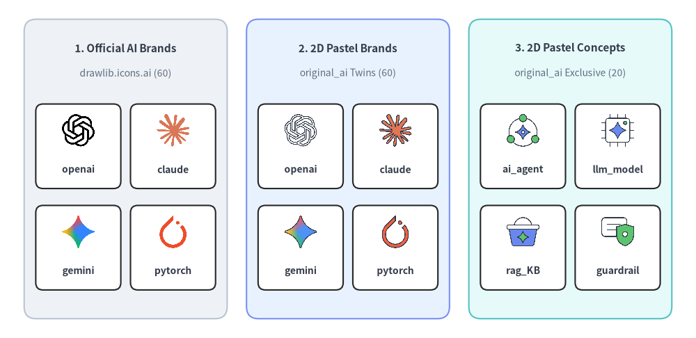
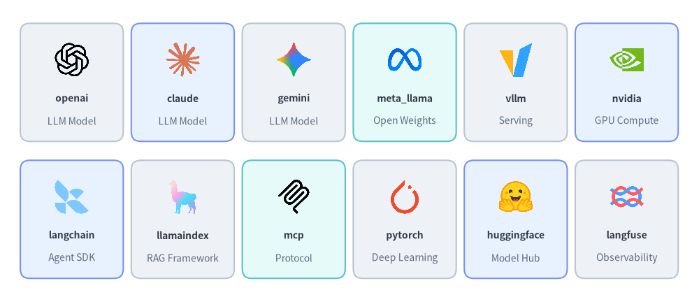
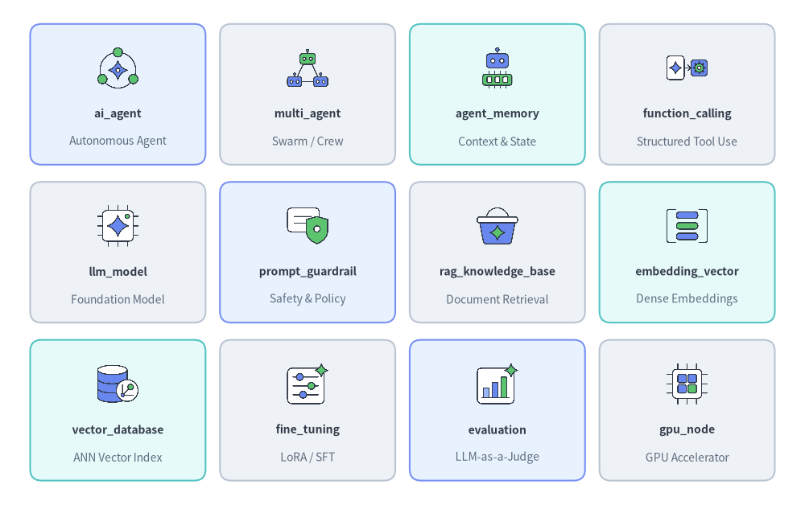

# AI & Machine Learning Icons

Drawlib provides **60 official AI & ML brand icons** in `drawlib.icons.ai` (`AiIcon`) and **80 flat 2D pastel icons** in `drawlib.icons.original_ai` (`OriginalAiIcon` — **60 brand twins** plus **20 vendor-neutral AI/LLM/Agent concept icons**). See [Icons Overview](./overview.md) for cross-tier guidance and [Architecture Diagrams](../06_diagrams/architecture.md) for topology integration.


<figure class="drawlib-image" style="text-align: center;">
  
  <figcaption class="drawlib-caption">Comparing Official Brand (ai), Original 2D Pastel Brand (original_ai), and Original 2D Pastel Concept (original_ai) Icons</figcaption>
</figure>

<details class="drawlib-code-details">
<summary>Source Code</summary>

```python
from drawlib.canvas import save, setup
from drawlib.icons import ai, original_ai
from drawlib.shapes import rectangle
from drawlib.styles import Styles
from drawlib.text import text

setup(width=144, height=70)

columns = [
    (
        26.0,
        "1. Official AI Brands",
        "drawlib.icons.ai (60)",
        Styles.Neutral,
        [
            ("openai", ai.openai),
            ("claude", ai.claude),
            ("gemini", ai.gemini),
            ("pytorch", ai.pytorch),
        ],
    ),
    (
        72.0,
        "2. 2D Pastel Brands",
        "original_ai Twins (60)",
        Styles.PrimaryNeutral,
        [
            ("openai", original_ai.openai),
            ("claude", original_ai.claude),
            ("gemini", original_ai.gemini),
            ("pytorch", original_ai.pytorch),
        ],
    ),
    (
        118.0,
        "3. 2D Pastel Concepts",
        "original_ai Exclusive (20)",
        Styles.SecondaryNeutral,
        [
            ("ai_agent", original_ai.ai_agent),
            ("llm_model", original_ai.llm_model),
            ("rag_KB", original_ai.rag_knowledge_base),
            ("guardrail", original_ai.prompt_guardrail),
        ],
    ),
]

for cx, title, subtitle, card_style, icons_list in columns:
    rectangle((cx, 35.0), width=42.0, height=62.0, style=card_style.patch(shape_r=2.5))
    text((cx, 60.0), title, style=Styles.DarkBold.patch(text_size=11.0))
    text((cx, 54.8), subtitle, style=Styles.Muted.patch(text_size=10.0))

    offsets = [(-9.8, 41.5), (9.8, 41.5), (-9.8, 20.5), (9.8, 20.5)]
    sub_card_style = Styles.White.patch(shape_r=1.5, line_width=0.6)
    for (dx, iy), (lbl, fn) in zip(offsets, icons_list, strict=True):
        ix = cx + dx
        rectangle((ix, iy - 1.8), width=17.6, height=17.5, style=sub_card_style)
        fn((ix, iy + 1.5), width=7.5, style=Styles.Primary)
        text((ix, iy - 6.6), lbl, style=Styles.DarkBold.patch(text_size=10.0))

save()
```

</details>


---

## 1. API Signature & Twin Module Structure

The AI icon suite is organized as a twin module pair sharing a 1-to-1 canonical naming convention:

- **`drawlib.icons.ai`** (`AiIcon` Enum): **60 official vendor and open-source brand icons** (`512×512` RGBA PNGs) for foundation models, inference servers, agent frameworks, and MLOps platforms.
- **`drawlib.icons.original_ai`** (`OriginalAiIcon` Enum): **80 flat 2D pastel icons** (`512×512` RGBA PNGs) comprising all **60 matching brand twins** plus **20 vendor-neutral AI/LLM/Agent concept icons** (`ai_agent`, `llm_model`, `rag_knowledge_base`, `embedding_vector`, `prompt_guardrail`, etc.).

```python
from drawlib.diagrams.architecture import AiIcon, Node, OriginalAiIcon
from drawlib.icons import ai, original_ai
from drawlib.styles import Styles

# 1. Direct canvas rendering (center-anchored at (cx, cy), 1:1 square aspect ratio)
ai.openai((30, 25), width=9.0, style=Styles.Primary)
original_ai.openai((60, 25), width=9.0, style=Styles.Primary)
original_ai.ai_agent((90, 25), width=9.0, style=Styles.Primary)

# 2. High-level ArchitectureDiagram / SequenceDiagram Enums
llm_node = Node("OpenAI API", width=24, height=18, icon=AiIcon.OPENAI, icon_size=7.5)
agent_node = Node("Router Agent", width=24, height=18, icon=OriginalAiIcon.AI_AGENT, icon_size=7.5)
```

| Aspect | Official Suite (`drawlib.icons.ai`) | Original 2D Pastel Suite (`drawlib.icons.original_ai`) |
| :--- | :--- | :--- |
| **Function Signature** | `ai.<name>(xy, width, *, style, variant="default")` | `original_ai.<name>(xy, width, *, style, variant="default")` |
| **Diagram Enum** | `AiIcon.<NAME>` (e.g., `AiIcon.OPENAI`) | `OriginalAiIcon.<NAME>` (e.g., `OriginalAiIcon.AI_AGENT`) |
| **Canonical Count** | **60** brand icons | **80** total (**60** brand twins + **20** concept icons) |
| **Coordinate Anchor** | Center `(cx, cy)` (`halign="center"`, `valign="center"`) | Center `(cx, cy)` (`halign="center"`, `valign="center"`) |
| **Asset Archive** | `icon_ai` (`512×512` RGBA PNG) | `icon_original_ai` (`512×512` RGBA PNG) |

---

## 2. Official & Pastel Brand Icons Showcase & Complete Reference (`ai` & `original_ai`)

All **60 brand icon names** listed below exist identically in both `drawlib.icons.ai` (official logos) and `drawlib.icons.original_ai` (matching 2D pastel brand twins):


<figure class="drawlib-image" style="text-align: center;">
  
  <figcaption class="drawlib-caption">Representative AI & ML Brand Icons Across Foundation Models, Inference, Agents, and Deep Learning</figcaption>
</figure>

<details class="drawlib-code-details">
<summary>Source Code</summary>

```python
from drawlib.canvas import save, setup
from drawlib.icons import ai
from drawlib.shapes import rectangle
from drawlib.styles import Styles
from drawlib.text import text

setup(width=148, height=64)

row1 = [
    ("openai", "LLM Model", ai.openai, Styles.Neutral),
    ("claude", "LLM Model", ai.claude, Styles.PrimaryNeutral),
    ("gemini", "LLM Model", ai.gemini, Styles.Neutral),
    ("meta_llama", "Open Weights", ai.meta_llama, Styles.SecondaryNeutral),
    ("vllm", "Serving", ai.vllm, Styles.Neutral),
    ("nvidia", "GPU Compute", ai.nvidia, Styles.PrimaryNeutral),
]

row2 = [
    ("langchain", "Agent SDK", ai.langchain, Styles.PrimaryNeutral),
    ("llamaindex", "RAG Framework", ai.llamaindex, Styles.Neutral),
    ("mcp", "Protocol", ai.mcp, Styles.SecondaryNeutral),
    ("pytorch", "Deep Learning", ai.pytorch, Styles.Neutral),
    ("huggingface", "Model Hub", ai.huggingface, Styles.PrimaryNeutral),
    ("langfuse", "Observability", ai.langfuse, Styles.Neutral),
]

for row_idx, items in enumerate([row1, row2]):
    cy = 46.5 if row_idx == 0 else 17.5
    for col_idx, (name, cat, icon_fn, card_st) in enumerate(items):
        cx = 15.2 + col_idx * 23.5
        rectangle((cx, cy), width=21.8, height=25.0, style=card_st.patch(shape_r=2))
        icon_fn((cx, cy + 4.8), width=8.0, style=Styles.Primary)
        text((cx, cy - 3.4), name, style=Styles.DarkBold.patch(text_size=10.0))
        text((cx, cy - 8.2), cat, style=Styles.Muted.patch(text_size=10.0))

save()
```

</details>


### 2.1. Complete 60 Shared Brand Icons (`ai.<name>` & `original_ai.<name>`)

| Category | Count | Canonical Function Names (`ai.<name>` & `original_ai.<name>`) |
| :--- | :---: | :--- |
| **Foundation LLM Providers & Model Families** | 10 | `claude`, `cohere`, `deepseek`, `gemini`, `grok`, `meta_llama`, `mistral`, `openai`, `perplexity`, `qwen` |
| **Inference Engines, Routers & GPU Clouds** | 13 | `fireworks_ai`, `groq`, `litellm`, `modal`, `nvidia`, `ollama`, `openrouter`, `replicate`, `runpod`, `sglang`, `together_ai`, `triton`, `vllm` |
| **Agent Frameworks, Protocols & Orchestration** | 14 | `a2a`, `autogen`, `crewai`, `dify`, `haystack`, `langchain`, `langgraph`, `llamaindex`, `mastra`, `mcp`, `n8n`, `openhands`, `pydantic_ai`, `semantic_kernel` |
| **Deep Learning & ML Frameworks** | 8 | `huggingface`, `jax`, `jupyter`, `keras`, `onnx`, `pytorch`, `scikit_learn`, `tensorflow` |
| **Observability, Evals, MLOps & Ingestion** | 8 | `arize_phoenix`, `braintrust`, `firecrawl`, `langfuse`, `mlflow`, `ray`, `tavily`, `wandb` |
| **AI Coding, Multimodal Voice & UI Apps** | 7 | `copilot`, `cursor`, `deepgram`, `elevenlabs`, `gradio`, `livekit`, `streamlit` |

---

## 3. Vendor-Neutral Concept Icons Showcase & Complete Reference (`original_ai`)

In addition to the 60 brand twins, `drawlib.icons.original_ai` (`OriginalAiIcon`) provides **20 exclusive vendor-neutral AI/ML architectural concept icons** for illustrating generic RAG pipelines, multi-agent memory, guardrails, and training workflows without locking the diagram to a specific vendor:


<figure class="drawlib-image" style="text-align: center;">
  
  <figcaption class="drawlib-caption">12 Representative Vendor-Neutral AI & Agent Concept Icons in drawlib.icons.original_ai</figcaption>
</figure>

<details class="drawlib-code-details">
<summary>Source Code</summary>

```python
from drawlib.canvas import save, setup
from drawlib.icons import original_ai
from drawlib.shapes import rectangle
from drawlib.styles import Styles
from drawlib.text import text

setup(width=140, height=88)

rows = [
    [
        ("ai_agent", "Autonomous Agent", original_ai.ai_agent, Styles.PrimaryNeutral),
        ("multi_agent", "Swarm / Crew", original_ai.multi_agent, Styles.Neutral),
        ("agent_memory", "Context & State", original_ai.agent_memory, Styles.SecondaryNeutral),
        ("function_calling", "Structured Tool Use", original_ai.function_calling, Styles.Neutral),
    ],
    [
        ("llm_model", "Foundation Model", original_ai.llm_model, Styles.Neutral),
        ("prompt_guardrail", "Safety & Policy", original_ai.prompt_guardrail, Styles.PrimaryNeutral),
        ("rag_knowledge_base", "Document Retrieval", original_ai.rag_knowledge_base, Styles.Neutral),
        ("embedding_vector", "Dense Embeddings", original_ai.embedding_vector, Styles.SecondaryNeutral),
    ],
    [
        ("vector_database", "ANN Vector Index", original_ai.vector_database, Styles.SecondaryNeutral),
        ("fine_tuning", "LoRA / SFT", original_ai.fine_tuning, Styles.Neutral),
        ("evaluation", "LLM-as-a-Judge", original_ai.evaluation, Styles.PrimaryNeutral),
        ("gpu_node", "GPU Accelerator", original_ai.gpu_node, Styles.Neutral),
    ],
]

for row_idx, items in enumerate(rows):
    cy = 71.5 - row_idx * 27.5
    for col_idx, (title, sub, icon_fn, card_st) in enumerate(items):
        cx = 20.5 + col_idx * 33.0
        rectangle((cx, cy), width=30.5, height=24.5, style=card_st.patch(shape_r=2))
        icon_fn((cx, cy + 4.6), width=8.0, style=Styles.Primary)
        text((cx, cy - 3.4), title, style=Styles.DarkBold.patch(text_size=10.0))
        text((cx, cy - 8.2), sub, style=Styles.Muted.patch(text_size=10.0))

save()
```

</details>


### 3.1. Complete 20 Vendor-Neutral Concept Icons (`original_ai.<name>`)

| Canonical Function (`original_ai.*`) | `OriginalAiIcon` Enum Member | Architectural Role |
| :--- | :--- | :--- |
| `agent_memory` | `OriginalAiIcon.AGENT_MEMORY` | Short-term working context and long-term episodic agent memory |
| `ai_agent` | `OriginalAiIcon.AI_AGENT` | Autonomous reasoning agent executing planning and tool loops |
| `dataset` | `OriginalAiIcon.DATASET` | Curated training, validation, or benchmark data corpus |
| `embedding_vector` | `OriginalAiIcon.EMBEDDING_VECTOR` | Dense vector encoder and semantic embedding representation |
| `evaluation` | `OriginalAiIcon.EVALUATION` | Automated LLM-as-a-Judge scoring and benchmark evaluation |
| `feature_store` | `OriginalAiIcon.FEATURE_STORE` | Centralized online/offline ML feature repository |
| `fine_tuning` | `OriginalAiIcon.FINE_TUNING` | Supervised fine-tuning (SFT), LoRA adaptation, and RLHF stages |
| `function_calling` | `OriginalAiIcon.FUNCTION_CALLING` | Structured tool invocation and external API execution |
| `gpu_node` | `OriginalAiIcon.GPU_NODE` | High-density GPU compute node for training or inference |
| `inference_endpoint` | `OriginalAiIcon.INFERENCE_ENDPOINT` | Low-latency model serving gateway and token streaming API |
| `llm_model` | `OriginalAiIcon.LLM_MODEL` | Vendor-neutral Large Language Model or foundation model core |
| `model_registry` | `OriginalAiIcon.MODEL_REGISTRY` | Versioned model weights, checkpoints, and lineage catalog |
| `multi_agent` | `OriginalAiIcon.MULTI_AGENT` | Supervisor and specialist multi-agent orchestration topology |
| `notebook` | `OriginalAiIcon.NOTEBOOK` | Interactive data science and ML experimentation notebook |
| `npu_node` | `OriginalAiIcon.NPU_NODE` | Neural Processing Unit (NPU) or custom AI ASIC accelerator node |
| `prompt_guardrail` | `OriginalAiIcon.PROMPT_GUARDRAIL` | Input/output safety filter, PII redaction, and policy guardrail |
| `prompt_template` | `OriginalAiIcon.PROMPT_TEMPLATE` | Parameterized system prompt and few-shot context template |
| `rag_knowledge_base` | `OriginalAiIcon.RAG_KNOWLEDGE_BASE` | Indexed document chunks and retrieval-augmented knowledge store |
| `training_pipeline` | `OriginalAiIcon.TRAINING_PIPELINE` | Distributed pre-training or continuous model retraining workflow |
| `vector_database` | `OriginalAiIcon.VECTOR_DATABASE` | Approximate nearest-neighbor (ANN) semantic vector store |

---

## 4. Practical Architecture Diagram (`AiIcon` & `OriginalAiIcon`)

The example below combines vendor-neutral concept icons (`OriginalAiIcon`) for the guardrail and RAG knowledge store with official brand icons (`AiIcon`) for `LangGraph`, `OpenAI`, and `MCP` inside an [`ArchitectureDiagram`](../06_diagrams/architecture.md):


```python
from drawlib.canvas import clear, save, setup
from drawlib.diagrams.architecture import (
    AiIcon,
    ArchitectureDiagram,
    Node,
    NodeGroup,
    OriginalAiIcon,
)
from drawlib.styles import Styles

clear()
setup(width=128, height=64)

d = ArchitectureDiagram(
    node_style=Styles.Primary,
    node_text_style=Styles.DarkBold.patch(text_size=10.0),
    edge_style=Styles.DarkBold,
    edge_text_style=Styles.DarkBold.patch(text_size=10.0),
    node_card_style=Styles.Neutral,
    title="Enterprise Agentic RAG & MCP Orchestration Topology",
)

cluster = d.add(NodeGroup(title="Agentic AI Runtime Cluster", padding=5.0), xy=(4.0, 4.0))
guard = cluster.add(
    Node(
        "Prompt\nGuardrail",
        width=25,
        height=18,
        icon=OriginalAiIcon.PROMPT_GUARDRAIL,
        icon_size=7.5,
    ),
    xy=(12.0, 18.0),
)
agent = cluster.add(
    Node(
        "LangGraph\nSupervisor",
        width=25,
        height=18,
        icon=AiIcon.LANGGRAPH,
        icon_size=7.5,
        card_style=Styles.PrimaryNeutral,
    ),
    xy=(56.0, 18.0),
)
llm = cluster.add(
    Node(
        "OpenAI\nReasoning",
        width=25,
        height=18,
        icon=AiIcon.OPENAI,
        icon_size=7.5,
        card_style=Styles.SecondaryNeutral,
    ),
    xy=(98.0, 28.0),
)
rag = cluster.add(
    Node(
        "MCP & RAG\nKnowledge",
        width=25,
        height=18,
        icon=AiIcon.MCP,
        icon_size=7.5,
    ),
    xy=(98.0, 8.0),
)

d.connect(guard, agent, label="Validated", padding=1.5)
agent.fork([llm, rag], at_x=88.0, padding=1.5)

d.draw(xy=(4.0, 4.0))
save()
```

<figure class="drawlib-image" style="text-align: center;">
  
  <figcaption class="drawlib-caption">Agentic RAG & MCP Tool-Use Topology Mixing OriginalAiIcon and AiIcon</figcaption>
</figure>


