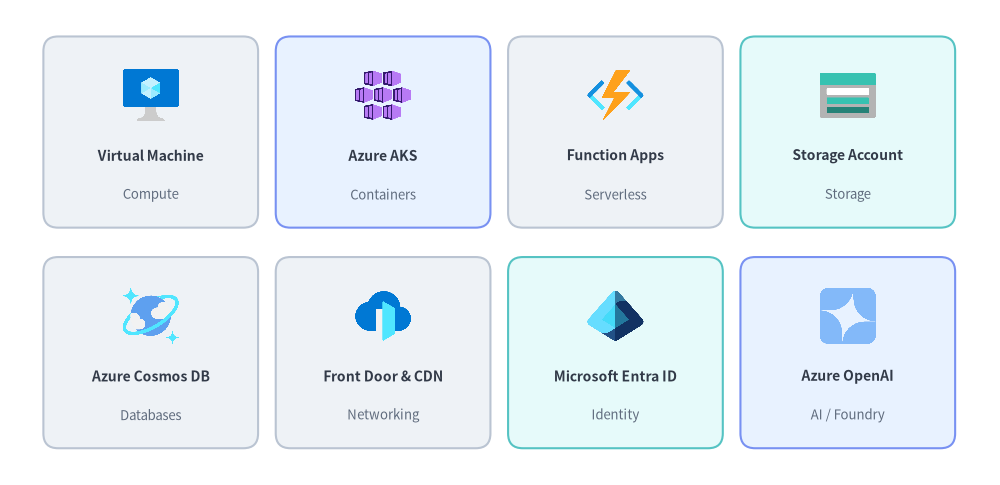
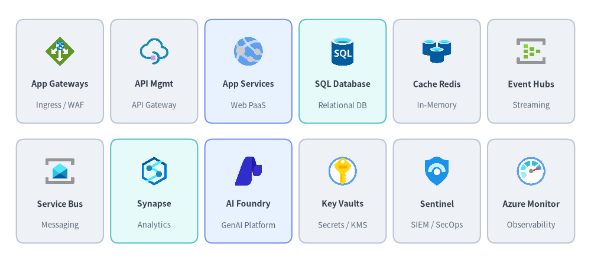
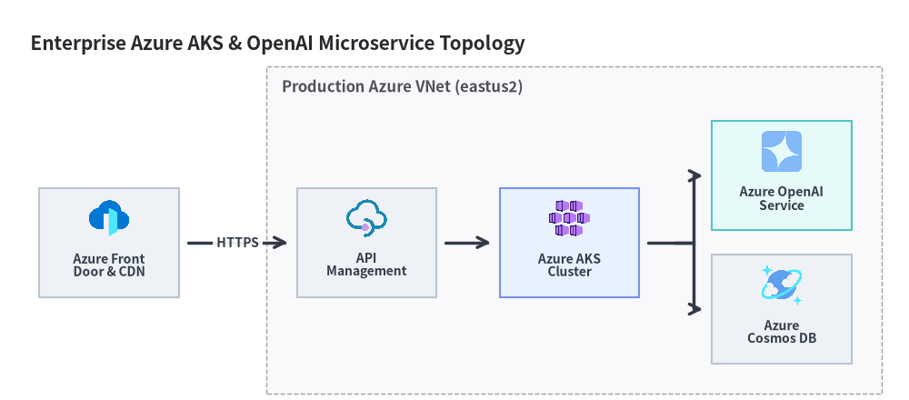

# Microsoft Azure Icons

Drawlib provides **250 high-resolution (`512×512`) Microsoft Azure** architecture service icons via `drawlib.icons.azure` and the [`AzureIcon`](../06_diagrams/architecture.md) Enum. See also [Icons Overview](./overview.md), [Google Cloud (GCP) Icons](./gcp.md), [AWS Icons](./aws.md), and [Cloud & Original Cloud Icons](./cloud.md).


<figure class="drawlib-image" style="text-align: center;">
  
  <figcaption class="drawlib-caption">Core Microsoft Azure Services Across 8 Architectural Domains (drawlib.icons.azure)</figcaption>
</figure>

<details class="drawlib-code-details">
<summary>Source Code</summary>

```python
from drawlib.canvas import save, setup
from drawlib.icons import azure
from drawlib.shapes import rectangle
from drawlib.styles import Styles
from drawlib.text import text

setup(width=136, height=66)

row1 = [
    ("Virtual Machine", "Compute", azure.virtual_machine, Styles.Neutral),
    ("Azure AKS", "Containers", azure.kubernetes_services, Styles.PrimaryNeutral),
    ("Function Apps", "Serverless", azure.function_apps, Styles.Neutral),
    ("Storage Account", "Storage", azure.storage_accounts, Styles.SecondaryNeutral),
]

row2 = [
    ("Azure Cosmos DB", "Databases", azure.cosmos_db, Styles.Neutral),
    ("Front Door & CDN", "Networking", azure.front_door_and_cdn_profiles, Styles.Neutral),
    ("Microsoft Entra ID", "Identity", azure.entra_id, Styles.SecondaryNeutral),
    ("Azure OpenAI", "AI / Foundry", azure.openai, Styles.PrimaryNeutral),
]

for row_idx, items in enumerate([row1, row2]):
    cy = 48.0 if row_idx == 0 else 18.0
    for col_idx, (title, cat, icon_fn, card_st) in enumerate(items):
        cx = 20.5 + col_idx * 31.6
        rectangle((cx, cy), width=29.2, height=26.0, style=card_st.patch(shape_r=2))
        icon_fn((cx, cy + 5.0), width=8.5, style=Styles.Primary)
        text((cx, cy - 3.2), title, style=Styles.DarkBold.patch(text_size=10.0))
        text((cx, cy - 8.5), cat, style=Styles.Muted.patch(text_size=9.5))

save()
```

</details>


---

## 1. API Signature & `AzureIcon` Enum Usage

Every Azure icon function in `drawlib.icons.azure` shares a center-anchored `(cx, cy)` call signature, while [`ArchitectureDiagram`](../06_diagrams/architecture.md) and [`SequenceDiagram`](../06_diagrams/sequence.md) accept the strongly typed `AzureIcon` Enum:

```python
from drawlib.diagrams.architecture import ArchitectureDiagram, AzureIcon, Node
from drawlib.icons import azure
from drawlib.styles import Styles

# 1. Direct canvas icon rendering at center (cx, cy) with 1:1 square aspect ratio
azure.kubernetes_services((40, 25), width=10.0, style=Styles.Primary, variant="default")

# 2. High-level ArchitectureDiagram node using AzureIcon Enum
d = ArchitectureDiagram()
aks_node = d.add(
    Node("AKS Cluster", width=25, height=18, icon=AzureIcon.KUBERNETES_SERVICES, icon_size=7.5),
    xy=(10.0, 10.0),
)
```

| Parameter / `Style` Attribute | Type | Default | Description |
| :--- | :--- | :--- | :--- |
| `xy` | `tuple[float, float]` | *Required* | Center coordinate `(cx, cy)` of the icon (`halign="center"`, `valign="center"`). |
| `width` | `float` | *Required* | Horizontal width in canvas units; height scales automatically (`1:1`). |
| `style` | `Style` | *Required* | Controls `alpha` (`0.0–1.0` opacity), `angle` (rotation), `image_tint_color`, and `image_border_*`. |
| `variant` | `Literal["default"]` | `"default"` | Visual variant (`"default"` official Microsoft Azure architecture palette). |
| `AzureIcon.<NAME>` | `AzureIcon` | — | Upper-case `StrEnum` member matching `azure.<name>` (e.g., `AzureIcon.COSMOS_DB` -> `azure.cosmos_db`). |

---

## 2. Core Azure Services Showcase (250 Canonical Icons)

The following 12-card (2×6) catalog highlights foundational Microsoft Azure web, networking, data, AI Foundry, and security services:


<figure class="drawlib-image" style="text-align: center;">
  
  <figcaption class="drawlib-caption">12 Foundational Microsoft Azure Infrastructure, Data, AI, and Security Icons</figcaption>
</figure>

<details class="drawlib-code-details">
<summary>Source Code</summary>

```python
from drawlib.canvas import save, setup
from drawlib.icons import azure
from drawlib.shapes import rectangle
from drawlib.styles import Styles
from drawlib.text import text

setup(width=148, height=66)

row1 = [
    ("App Gateways", "Ingress / WAF", azure.application_gateways, Styles.Neutral),
    ("API Mgmt", "API Gateway", azure.api_management_services, Styles.Neutral),
    ("App Services", "Web PaaS", azure.app_services, Styles.PrimaryNeutral),
    ("SQL Database", "Relational DB", azure.sql_database, Styles.SecondaryNeutral),
    ("Cache Redis", "In-Memory", azure.cache_redis, Styles.Neutral),
    ("Event Hubs", "Streaming", azure.event_hubs, Styles.Neutral),
]

row2 = [
    ("Service Bus", "Messaging", azure.service_bus, Styles.Neutral),
    ("Synapse", "Analytics", azure.synapse_analytics, Styles.SecondaryNeutral),
    ("AI Foundry", "GenAI Platform", azure.ai_foundry, Styles.PrimaryNeutral),
    ("Key Vaults", "Secrets / KMS", azure.key_vaults, Styles.Neutral),
    ("Sentinel", "SIEM / SecOps", azure.sentinel, Styles.Neutral),
    ("Azure Monitor", "Observability", azure.monitor, Styles.Neutral),
]

for row_idx, items in enumerate([row1, row2]):
    cy = 48.0 if row_idx == 0 else 18.0
    for col_idx, (title, sub, icon_fn, card_st) in enumerate(items):
        cx = 15.0 + col_idx * 23.6
        rectangle((cx, cy), width=21.8, height=26.0, style=card_st.patch(shape_r=2))
        icon_fn((cx, cy + 5.0), width=8.0, style=Styles.Primary)
        text((cx, cy - 3.2), title, style=Styles.DarkBold.patch(text_size=10.0))
        text((cx, cy - 8.5), sub, style=Styles.Muted.patch(text_size=9.5))

save()
```

</details>


### 2.1. Complete Categorized Reference of All 250 Azure Icons

All 250 canonical functions in `drawlib.icons.azure` follow a strict 1-to-1 naming rule (with matching uppercase members on `AzureIcon`):

| Category | Count | Canonical `drawlib.icons.azure.<name>` Functions (`AzureIcon.<NAME>`) |
| :--- | :---: | :--- |
| **Compute & Hybrid** | 27 | `arc`, `arc_kubernetes`, `arc_machines`, `auto_scale`, `availability_sets`, `batch_accounts`, `cloud_shell`, `compute_fleet`, `compute_galleries`, `disks`, `disks_snapshots`, `images`, `linux`, `local`, `managed_service_fabric`, `migrate`, `operator_5g_core`, `operator_nexus`, `red_hat_openshift`, `service_fabric_clusters`, `sphere`, `spring_apps`, `stack_hci_premium`, `virtual_desktop`, `virtual_machine`, `vm_scale_sets`, `vmware_solution` |
| **Containers & Serverless** | 13 | `aks_automatic`, `app_service_environments`, `app_services`, `application_gateway_containers`, `container_apps_environments`, `container_instances`, `container_registries`, `container_storage`, `function_apps`, `kubernetes_services`, `logic_apps`, `static_apps`, `worker_container_app` |
| **Storage & Backup** | 18 | `backup_center`, `backup_vault`, `data_box`, `data_shares`, `data_sharing`, `data_transfer`, `databox_gateway`, `edge_storage_accelerator`, `fileshares`, `managed_file_shares`, `netapp_files`, `recovery_services_vaults`, `storage_accounts`, `storage_azure_files`, `storage_container`, `storage_mover`, `storage_queue`, `storage_sync_services` |
| **Databases & Caching** | 18 | `cache_redis`, `cosmos_db`, `database_mariadb_server`, `database_migration_services`, `database_mysql_server`, `database_postgresql_server`, `documentdb`, `managed_database`, `managed_redis`, `oracle_database`, `sql`, `sql_data_warehouses`, `sql_database`, `sql_edge`, `sql_elastic_pools`, `sql_managed_instance`, `sql_server`, `sql_vm` |
| **Networking & CDN** | 34 | `access_point`, `application_gateways`, `bastions`, `cdn_profiles`, `communications_gateway`, `ddos_custom_policy`, `ddos_protection_plans`, `dns_private_resolver`, `dns_zones`, `expressroute_circuits`, `firewall_manager`, `firewall_policy`, `firewalls`, `front_door_and_cdn_profiles`, `hybrid_connectivity_hub`, `ip_address_manager`, `load_balancers`, `nat`, `network_security_groups`, `network_watcher`, `on_premises_data_gateways`, `private_link`, `private_link_service`, `public_ip_addresses`, `relays`, `route_tables`, `subnet`, `traffic_manager_profiles`, `virtual_network_gateways`, `virtual_networks`, `virtual_router`, `virtual_wan_hub`, `virtual_wans`, `web_application_firewall_policies_waf` |
| **Identity, Security & Governance** | 38 | `ad_b2c`, `app_registrations`, `application_security_groups`, `azureattestation`, `blueprints`, `compliance`, `conditional_access`, `defender_easm`, `defender_for_cloud`, `defender_for_iot`, `enterprise_applications`, `entra_connect`, `entra_connect_health`, `entra_connect_sync`, `entra_domain_services`, `entra_global_secure_access`, `entra_id`, `entra_id_protection`, `entra_internet_access`, `entra_managed_identities`, `entra_private_access`, `entra_privleged_identity_management`, `entra_verified_id`, `external_id`, `external_identities`, `identity_governance`, `information_protection`, `key_vaults`, `managed_identities`, `multi_factor_authentication`, `multi_tenancy`, `multifactor_authentication`, `policy`, `security`, `sentinel`, `token_service`, `users`, `verifiable_credentials` |
| **Analytics, Data & Messaging** | 26 | `analysis_services`, `api_center`, `api_for_fhir`, `api_management_services`, `api_proxy`, `communication_services`, `data_catalog`, `data_explorer_clusters`, `data_factories`, `data_lake_analytics`, `databricks`, `event_grid_domains`, `event_grid_topics`, `event_hub_clusters`, `event_hubs`, `hd_insight_clusters`, `notification_hub_namespaces`, `notification_hubs`, `power_bi_embedded`, `power_platform`, `pubsub`, `sendgrid_accounts`, `service_bus`, `signalr`, `stream_analytics_jobs`, `synapse_analytics` |
| **AI, ML & Cognitive Services** | 32 | `agentic_web_apps`, `ai_at_edge`, `ai_foundry`, `ai_foundry_iq`, `ai_gateway`, `ai_studio`, `anomaly_detector`, `applied_ai_services`, `batch_ai`, `bonsai`, `bot_services`, `cognitive_search`, `cognitive_services`, `computer_vision`, `content_moderators`, `content_safety`, `custom_vision`, `face_apis`, `form_recognizers`, `foundry_agent_service`, `foundry_models`, `genomics`, `immersive_readers`, `language`, `language_understanding`, `machine_learning`, `metrics_advisor`, `openai`, `personalizers`, `qna_makers`, `speech_services`, `translator_text` |
| **DevOps, Monitoring, IoT & Management** | 44 | `activity_log`, `advisor`, `alerts`, `app_configuration`, `app_testing`, `application_insights`, `automation_accounts`, `blockchain_applications`, `blockchain_service`, `chaos_studio`, `cost_management_and_billing`, `deployment_environments`, `device_provisioning_services`, `devops`, `devops_starter`, `devtest_labs`, `diagnostics_settings`, `digital_twins`, `endpoint_analytics`, `industrial_iot`, `iot_central_applications`, `iot_edge`, `iot_hub`, `iot_operations`, `lab_services`, `landing_zone`, `lighthouse`, `load_testing`, `log_analytics_workspaces`, `managed_devops_pools`, `managed_grafana`, `maps_accounts`, `media_service`, `mesh_applications`, `metrics`, `monitor`, `monitor_pipeline`, `remote_rendering`, `resiliency`, `resource_graph_explorer`, `spatial_anchor_accounts`, `toolchain_orchestrator`, `workbooks`, `workload_orchestration` |

---

## 3. Azure Cloud Architecture Example (`ArchitectureDiagram` & `AzureIcon`)

Use [`ArchitectureDiagram`](../06_diagrams/architecture.md) with `AzureIcon` to build connected Azure Virtual Network (`VNet`) topologies with automatic card layout and orthogonal routing:


```python
from drawlib.canvas import save, setup
from drawlib.diagrams.architecture import ArchitectureDiagram, AzureIcon, Node, NodeGroup
from drawlib.styles import Styles

setup(width=150, height=66)

d = ArchitectureDiagram(
    node_style=Styles.Primary,
    node_text_style=Styles.DarkBold.patch(text_size=10.0),
    edge_style=Styles.DarkBold,
    edge_text_style=Styles.DarkBold.patch(text_size=10.0),
    node_card_style=Styles.Neutral,
    title="Enterprise Azure AKS & OpenAI Microservice Topology",
)

fd = d.add(
    Node(
        "Azure Front\nDoor & CDN",
        width=23,
        height=18,
        icon=AzureIcon.FRONT_DOOR_AND_CDN_PROFILES,
        icon_size=7.5,
    ),
    xy=(14.0, 22.0),
)

vnet = d.add(NodeGroup(title="Production Azure VNet (eastus2)", padding=5.0), xy=(40.0, 4.0))
apim = vnet.add(
    Node("API\nManagement", width=23, height=18, icon=AzureIcon.API_MANAGEMENT_SERVICES, icon_size=7.5),
    xy=(16.5, 18.0),
)
aks = vnet.add(
    Node(
        "Azure AKS\nCluster",
        width=23,
        height=18,
        icon=AzureIcon.KUBERNETES_SERVICES,
        icon_size=7.5,
        card_style=Styles.PrimaryNeutral,
    ),
    xy=(50.0, 18.0),
)
aoai = vnet.add(
    Node(
        "Azure OpenAI\nService",
        width=23,
        height=18,
        icon=AzureIcon.OPENAI,
        icon_size=7.5,
        card_style=Styles.SecondaryNeutral,
    ),
    xy=(85.0, 29.0),
)
cosmos = vnet.add(
    Node("Azure\nCosmos DB", width=23, height=18, icon=AzureIcon.COSMOS_DB, icon_size=7.5),
    xy=(85.0, 7.0),
)

d.connect(fd, apim, label="HTTPS", padding=1.5)
d.connect(apim, aks, padding=1.5)
aks.fork([aoai, cosmos], at_x=107.5, padding=1.5)

d.draw(xy=(4.0, 4.0))
save()
```

<figure class="drawlib-image" style="text-align: center;">
  
  <figcaption class="drawlib-caption">Enterprise Azure AKS & AI Microservice Topology Using ArchitectureDiagram and AzureIcon</figcaption>
</figure>


