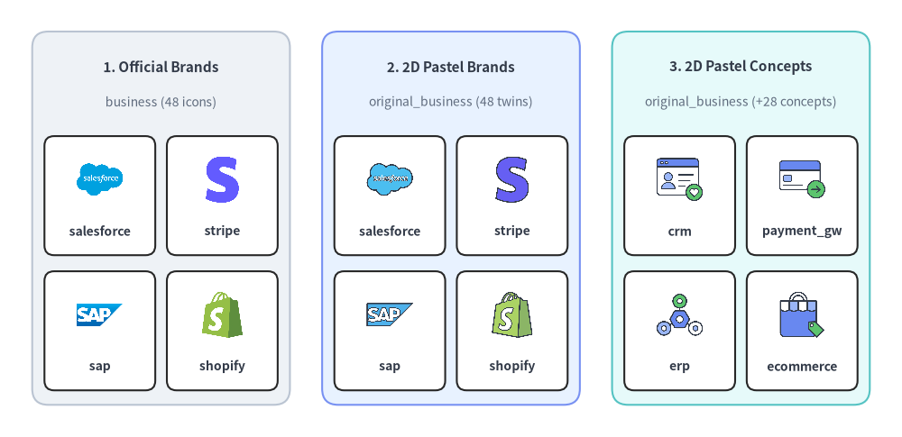
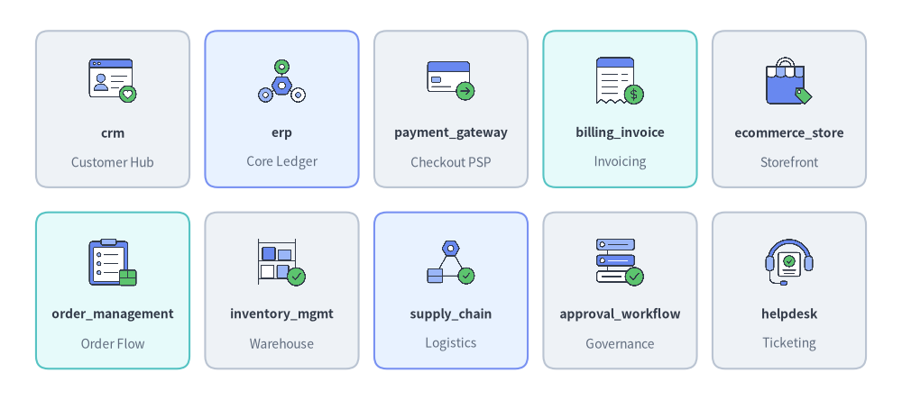

# Enterprise Business & FinTech Icons (`business` & `original_business`)

Drawlib provides **48 official enterprise SaaS and FinTech brand icons** in `drawlib.icons.business` (`BusinessIcon`) and **76 flat 2D pastel icons** in `drawlib.icons.original_business` (`OriginalBusinessIcon` — all 48 brand twins plus 28 vendor-neutral enterprise concept icons). See the [Icons Overview](./overview.md) for cross-tier guidelines and [Architecture Diagrams](../06_diagrams/architecture.md) for automated topology routing.


<figure class="drawlib-image" style="text-align: center;">
  
  <figcaption class="drawlib-caption">Comparing Official Brand Icons (business), 2D Pastel Brand Twins (original_business), and Vendor-Neutral Business Concepts (original_business)</figcaption>
</figure>

<details class="drawlib-code-details">
<summary>Source Code</summary>

```python
from drawlib.canvas import save, setup
from drawlib.icons import business, original_business
from drawlib.shapes import rectangle
from drawlib.styles import Styles
from drawlib.text import text

setup(width=140, height=68)

columns = [
    (
        25.0,
        "1. Official Brands",
        "business (48 icons)",
        Styles.Neutral,
        [
            ("salesforce", business.salesforce),
            ("stripe", business.stripe),
            ("sap", business.sap),
            ("shopify", business.shopify),
        ],
    ),
    (
        70.0,
        "2. 2D Pastel Brands",
        "original_business (48 twins)",
        Styles.PrimaryNeutral,
        [
            ("salesforce", original_business.salesforce),
            ("stripe", original_business.stripe),
            ("sap", original_business.sap),
            ("shopify", original_business.shopify),
        ],
    ),
    (
        115.0,
        "3. 2D Pastel Concepts",
        "original_business (+28 concepts)",
        Styles.SecondaryNeutral,
        [
            ("crm", original_business.crm),
            ("payment_gw", original_business.payment_gateway),
            ("erp", original_business.erp),
            ("ecommerce", original_business.ecommerce_store),
        ],
    ),
]

for cx, title, subtitle, card_style, items in columns:
    rectangle((cx, 34.0), width=40.0, height=58.0, style=card_style.patch(shape_r=2.5))
    text((cx, 57.5), title, style=Styles.DarkBold.patch(text_size=11.0))
    text((cx, 52.0), subtitle, style=Styles.Muted.patch(text_size=10.0))

    offsets = [(-9.5, 37.5), (9.5, 37.5), (-9.5, 16.5), (9.5, 16.5)]
    sub_style = Styles.White.patch(shape_r=1.5, line_width=0.6)
    for (dx, iy), (lbl, fn) in zip(offsets, items, strict=True):
        ix = cx + dx
        rectangle((ix, iy), width=17.2, height=18.5, style=sub_style)
        fn((ix, iy + 2.5), width=8.0, style=Styles.Primary)
        text((ix, iy - 5.5), lbl, style=Styles.DarkBold.patch(text_size=10.0))

save()
```

</details>


---

## 1. API Signature & Twin Module Structure

The `business` and `original_business` modules form a **twin icon pair** designed for enterprise SaaS, ERP, CRM, e-commerce, and FinTech system architectures:

| Module | Diagram Enum | Canonical Count | Asset Archive | Visual Purpose |
| :--- | :--- | :---: | :--- | :--- |
| `drawlib.icons.business` | `BusinessIcon` | **48** | `icon_business` | Official multi-color vendor logos (Salesforce, SAP, Stripe, Shopify, Workday, Twilio, etc.) for production stack diagrams. |
| `drawlib.icons.original_business` | `OriginalBusinessIcon` | **76** (`48` brand twins + `28` concepts) | `icon_original_business` | Cohesive flat 2D pastel equivalents of all 48 brands plus 28 vendor-neutral business domain concepts (`erp`, `crm`, `payment_gateway`, `billing_invoice`, etc.). |

Every icon function is center-anchored at `xy=(cx, cy)` with a `1:1` square aspect ratio and accepts `Style` attributes (`alpha`, `angle`, `image_tint_color`, `image_border_*`):

```python
from drawlib.diagrams.architecture import BusinessIcon, Node, OriginalBusinessIcon
from drawlib.icons import business, original_business
from drawlib.styles import Styles

# 1. Direct canvas rendering (center-anchored at (cx, cy))
business.stripe((30, 25), width=9.0, style=Styles.Primary)
original_business.stripe((60, 25), width=9.0, style=Styles.Primary)
original_business.payment_gateway((90, 25), width=9.0, style=Styles.Primary)

# 2. High-level ArchitectureDiagram nodes via Enum tokens
psp_node = Node("Stripe Billing", width=26, height=18, icon=BusinessIcon.STRIPE, icon_size=7.5)
erp_node = Node("Core ERP", width=26, height=18, icon=OriginalBusinessIcon.ERP, icon_size=7.5)
```

---

## 2. Official & Pastel Brand Icons Showcase & Complete Reference (`business` & `original_business`)

All **48 canonical brand names** below exist identically in both `drawlib.icons.business.<name>` (`BusinessIcon.<NAME>`) and `drawlib.icons.original_business.<name>` (`OriginalBusinessIcon.<NAME>`), allowing you to switch between official logos and unified 2D pastel artwork by changing the module import.


<figure class="drawlib-image" style="text-align: center;">
  
  <figcaption class="drawlib-caption">10 Representative Enterprise SaaS & FinTech Brand Icons (business.*)</figcaption>
</figure>

<details class="drawlib-code-details">
<summary>Source Code</summary>

```python
from drawlib.canvas import save, setup
from drawlib.icons import business
from drawlib.shapes import rectangle
from drawlib.styles import Styles
from drawlib.text import text

setup(width=144, height=64)

row1 = [
    ("salesforce", "CRM", business.salesforce, Styles.Neutral),
    ("sap", "ERP", business.sap, Styles.PrimaryNeutral),
    ("stripe", "Payments", business.stripe, Styles.Neutral),
    ("shopify", "E-Commerce", business.shopify, Styles.SecondaryNeutral),
    ("workday", "HR & HCM", business.workday, Styles.Neutral),
]

row2 = [
    ("servicenow", "ITSM", business.servicenow, Styles.SecondaryNeutral),
    ("zendesk", "Support", business.zendesk, Styles.Neutral),
    ("twilio", "CPaaS", business.twilio, Styles.PrimaryNeutral),
    ("docusign", "E-Sign", business.docusign, Styles.Neutral),
    ("contentful", "Headless CMS", business.contentful, Styles.Neutral),
]

for row_idx, items in enumerate([row1, row2]):
    cy = 46.5 if row_idx == 0 else 17.5
    for col_idx, (name, cat, icon_fn, card_st) in enumerate(items):
        cx = 18.0 + col_idx * 27.0
        rectangle((cx, cy), width=24.5, height=25.0, style=card_st.patch(shape_r=2))
        icon_fn((cx, cy + 4.5), width=8.5, style=Styles.Primary)
        text((cx, cy - 3.8), name, style=Styles.DarkBold.patch(text_size=10.0))
        text((cx, cy - 8.5), cat, style=Styles.Muted.patch(text_size=10.0))

save()
```

</details>


### Complete 48 Brand Icons Reference (`business` & `original_business`)

| Category | Count | Canonical Function (`business.*` & `original_business.*`) | Enum Member (`BusinessIcon.*` & `OriginalBusinessIcon.*`) |
| :--- | :---: | :--- | :--- |
| **CRM, Sales & Marketing Automation** | 8 | `braze`, `dynamics_365`, `hubspot`, `marketo`, `pipedrive`, `salesforce`, `sansan`, `zoho` | `BRAZE`, `DYNAMICS_365`, `HUBSPOT`, `MARKETO`, `PIPEDRIVE`, `SALESFORCE`, `SANSAN`, `ZOHO` |
| **ERP, Accounting & Spend Management** | 7 | `concur`, `coupa`, `freee`, `moneyforward`, `netsuite`, `odoo`, `sap` | `CONCUR`, `COUPA`, `FREEE`, `MONEYFORWARD`, `NETSUITE`, `ODOO`, `SAP` |
| **HR, Payroll & People Operations** | 4 | `bamboohr`, `deel`, `smarthr`, `workday` | `BAMBOOHR`, `DEEL`, `SMARTHR`, `WORKDAY` |
| **FinTech, Payments & Subscription Billing** | 7 | `adyen`, `paypal`, `paypay`, `plaid`, `square`, `stripe`, `zuora` | `ADYEN`, `PAYPAL`, `PAYPAY`, `PLAID`, `SQUARE`, `STRIPE`, `ZUORA` |
| **E-Commerce, Headless CMS & Search** | 9 | `algolia`, `bigcommerce`, `contentful`, `magento`, `sanity`, `shopify`, `strapi`, `woocommerce`, `wordpress` | `ALGOLIA`, `BIGCOMMERCE`, `CONTENTFUL`, `MAGENTO`, `SANITY`, `SHOPIFY`, `STRAPI`, `WOOCOMMERCE`, `WORDPRESS` |
| **Customer Support, ITSM & Contact Center** | 5 | `freshdesk`, `genesys`, `intercom`, `servicenow`, `zendesk` | `FRESHDESK`, `GENESYS`, `INTERCOM`, `SERVICENOW`, `ZENDESK` |
| **Communications, E-Signature & Workflow** | 8 | `cloudsign`, `docusign`, `kintone`, `line`, `mailgun`, `sendgrid`, `twilio`, `vonage` | `CLOUDSIGN`, `DOCUSIGN`, `KINTONE`, `LINE`, `MAILGUN`, `SENDGRID`, `TWILIO`, `VONAGE` |

---

## 3. Vendor-Neutral Concept Icons Showcase & Complete Reference (`original_business`)

In addition to the 48 brand twins above, `drawlib.icons.original_business` (`OriginalBusinessIcon`) provides **28 vendor-neutral enterprise concept icons** for reference architectures, domain-driven design (DDD) bounded contexts, and RFC specifications where vendor-specific logos are not desired.


<figure class="drawlib-image" style="text-align: center;">
  
  <figcaption class="drawlib-caption">10 Representative Vendor-Neutral Enterprise Concept Icons (original_business.*)</figcaption>
</figure>

<details class="drawlib-code-details">
<summary>Source Code</summary>

```python
from drawlib.canvas import save, setup
from drawlib.icons import original_business
from drawlib.shapes import rectangle
from drawlib.styles import Styles
from drawlib.text import text

setup(width=144, height=64)

row1 = [
    ("crm", "Customer Hub", original_business.crm, Styles.Neutral),
    ("erp", "Core Ledger", original_business.erp, Styles.PrimaryNeutral),
    ("payment_gateway", "Checkout PSP", original_business.payment_gateway, Styles.Neutral),
    ("billing_invoice", "Invoicing", original_business.billing_invoice, Styles.SecondaryNeutral),
    ("ecommerce_store", "Storefront", original_business.ecommerce_store, Styles.Neutral),
]

row2 = [
    ("order_management", "Order Flow", original_business.order_management, Styles.SecondaryNeutral),
    ("inventory_mgmt", "Warehouse", original_business.inventory_management, Styles.Neutral),
    ("supply_chain", "Logistics", original_business.supply_chain, Styles.PrimaryNeutral),
    ("approval_workflow", "Governance", original_business.approval_workflow, Styles.Neutral),
    ("helpdesk", "Ticketing", original_business.helpdesk, Styles.Neutral),
]

for row_idx, items in enumerate([row1, row2]):
    cy = 46.5 if row_idx == 0 else 17.5
    for col_idx, (name, cat, icon_fn, card_st) in enumerate(items):
        cx = 18.0 + col_idx * 27.0
        rectangle((cx, cy), width=24.5, height=25.0, style=card_st.patch(shape_r=2))
        icon_fn((cx, cy + 4.5), width=8.5, style=Styles.Primary)
        text((cx, cy - 3.8), name, style=Styles.DarkBold.patch(text_size=10.0))
        text((cx, cy - 8.5), cat, style=Styles.Muted.patch(text_size=10.0))

save()
```

</details>


### Complete 28 Vendor-Neutral Concept Icons (`original_business`)

| Canonical Function (`original_business.*`) | Enum Member (`OriginalBusinessIcon.*`) | Domain Category | Typical Architectural Role |
| :--- | :--- | :--- | :--- |
| `accounting_ledger` | `ACCOUNTING_LEDGER` | Finance & ERP | General ledger, double-entry bookkeeping, and financial journal subsystem |
| `approval_workflow` | `APPROVAL_WORKFLOW` | Operations & Governance | Multi-stage sign-off, purchase requisition, or compliance gate |
| `bank_transfer` | `BANK_TRANSFER` | FinTech & Payments | ACH, wire transfer, SEPA, or interbank settlement rail |
| `billing_invoice` | `BILLING_INVOICE` | Finance & Billing | Automated invoice generation, accounts receivable, and receipt engine |
| `call_center` | `CALL_CENTER` | Customer Support | Inbound/outbound voice contact center and IVR routing tier |
| `cms` | `CMS` | Content & Commerce | Headless or editorial content management service |
| `contract_management` | `CONTRACT_MANAGEMENT` | Legal & Procurement | Contract lifecycle management (CLM) and legal repository |
| `crm` | `CRM` | Sales & Marketing | Customer relationship management and account master database |
| `customer_data_platform` | `CUSTOMER_DATA_PLATFORM` | Sales & Marketing | Unified customer profile, event ingestion, and audience segmentation (CDP) |
| `e_signature` | `E_SIGNATURE` | Legal & Operations | Digital agreement signing and tamper-evident document verification |
| `ecommerce_store` | `ECOMMERCE_STORE` | Commerce & Retail | Online storefront, product catalog, and shopping cart service |
| `edi_exchange` | `EDI_EXCHANGE` | B2B Integration | Electronic Data Interchange (EDI) gateway for B2B partner documents |
| `erp` | `ERP` | Finance & ERP | Core enterprise resource planning and back-office orchestration system |
| `helpdesk` | `HELPDESK` | Customer Support | Omnichannel customer support ticketing and agent workspace |
| `hr_portal` | `HR_PORTAL` | HR & People Ops | Employee self-service portal, onboarding, and directory system |
| `inventory_management` | `INVENTORY_MANAGEMENT` | Commerce & Supply Chain | Real-time stock level tracking, SKU reservation, and warehouse sync |
| `itsm` | `ITSM` | IT Operations | Internal IT service desk, incident management, and change request catalog |
| `logistics_shipping` | `LOGISTICS_SHIPPING` | Supply Chain | Carrier integration, parcel dispatch, and last-mile delivery tracking |
| `loyalty_points` | `LOYALTY_POINTS` | Commerce & Marketing | Rewards wallet, points accrual, and promotional tier engine |
| `marketing_automation` | `MARKETING_AUTOMATION` | Sales & Marketing | Campaign orchestration, lead nurturing, and lifecycle triggers |
| `notification_gateway` | `NOTIFICATION_GATEWAY` | Communications | Transactional email, SMS, and push notification delivery hub |
| `order_management` | `ORDER_MANAGEMENT` | Commerce & Retail | Order management system (OMS) coordinating checkout to fulfillment |
| `partner_portal` | `PARTNER_PORTAL` | B2B Integration | External reseller, supplier, or channel partner extranet |
| `payment_gateway` | `PAYMENT_GATEWAY` | FinTech & Payments | Payment service provider (PSP) tokenization and card authorization |
| `procurement` | `PROCUREMENT` | Finance & Spend | Source-to-pay purchasing, vendor bidding, and PO management |
| `subscription_billing` | `SUBSCRIPTION_BILLING` | FinTech & Billing | Recurring SaaS metering, plan upgrades, and dunning management |
| `supply_chain` | `SUPPLY_CHAIN` | Supply Chain | End-to-end supplier network, demand planning, and fulfillment pipeline |
| `tax_compliance` | `TAX_COMPLIANCE` | Finance & Legal | Automated sales tax, VAT calculation, and regulatory e-invoicing |

---

## 4. Practical Architecture Diagram (`ArchitectureDiagram`)

The following example combines `BusinessIcon` and `OriginalBusinessIcon` inside **[`ArchitectureDiagram`](../06_diagrams/architecture.md)** to model an end-to-end **Order-to-Cash (O2C) Commerce & ERP Integration Pipeline**:


```python
from drawlib.canvas import clear, save, setup
from drawlib.diagrams.architecture import (
    ArchitectureDiagram,
    BusinessIcon,
    Node,
    NodeGroup,
    OriginalBusinessIcon,
)
from drawlib.styles import Styles

clear()
setup(width=136, height=68)

d = ArchitectureDiagram(
    node_style=Styles.Primary,
    node_text_style=Styles.DarkBold.patch(text_size=10.0),
    edge_style=Styles.DarkBold,
    edge_text_style=Styles.DarkBold.patch(text_size=10.0),
    node_card_style=Styles.Neutral,
    title="Order-to-Cash (O2C) Commerce & FinTech Integration Architecture",
)

store = d.add(
    Node(
        "Shopify\nStorefront",
        width=24,
        height=18,
        icon=BusinessIcon.SHOPIFY,
        icon_size=7.5,
        card_style=Styles.PrimaryNeutral,
    ),
    xy=(14.0, 24.5),
)

bus = d.add(
    NodeGroup(title="Enterprise Back-Office & FinTech Core", padding=5.0),
    xy=(42.0, 4.0),
)

stripe_gw = bus.add(
    Node(
        "Stripe\nCheckout",
        width=24,
        height=18,
        icon=BusinessIcon.STRIPE,
        icon_size=7.5,
        card_style=Styles.PrimaryNeutral,
    ),
    xy=(17.0, 32.0),
)
oms = bus.add(
    Node(
        "Order\nManagement",
        width=24,
        height=18,
        icon=OriginalBusinessIcon.ORDER_MANAGEMENT,
        icon_size=7.5,
    ),
    xy=(17.0, 9.0),
)
sap_erp = bus.add(
    Node(
        "SAP ERP\nLedger",
        width=24,
        height=18,
        icon=BusinessIcon.SAP,
        icon_size=7.5,
        card_style=Styles.SecondaryNeutral,
    ),
    xy=(65.0, 32.0),
)
crm_hub = bus.add(
    Node(
        "Salesforce\nCRM",
        width=24,
        height=18,
        icon=BusinessIcon.SALESFORCE,
        icon_size=7.5,
    ),
    xy=(65.0, 9.0),
)

store.fork([stripe_gw, oms], at_x=35.0, padding=1.5)
d.connect(stripe_gw, sap_erp, label="Settlement", padding=1.5)
d.connect(oms, crm_hub, label="Fulfillment", padding=1.5)

d.draw(xy=(4.0, 4.0))
save()
```

<figure class="drawlib-image" style="text-align: center;">
  
  <figcaption class="drawlib-caption">Order-to-Cash (O2C) Enterprise SaaS & FinTech Topology Using BusinessIcon and OriginalBusinessIcon</figcaption>
</figure>


