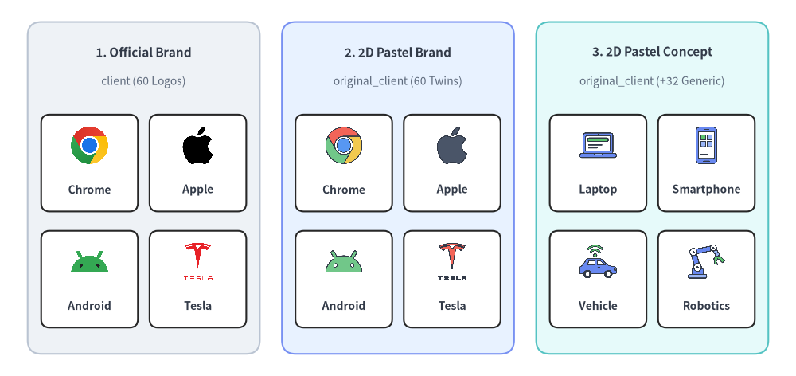
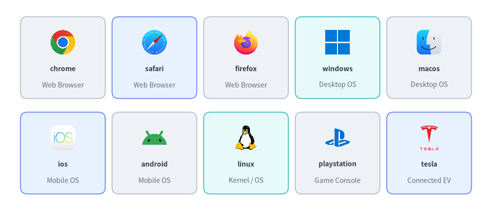
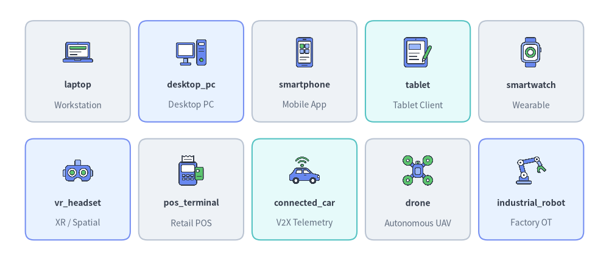
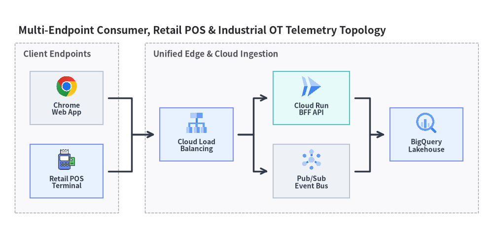

# Client Devices & Endpoints Icons

Drawlib provides **60 official brand icons** in `drawlib.icons.client` (`ClientIcon`) and **92 flat 2D pastel icons** in `drawlib.icons.original_client` (`OriginalClientIcon`)—comprising all 60 matching brand twins plus 32 vendor-neutral device, wearable, retail POS, connected vehicle, and industrial robotics concept icons. Use these suites in custom canvas layouts or inside [Architecture Diagrams](../06_diagrams/architecture.md) (see [Icons Overview](./overview.md) for the complete 34-module catalog).


<figure class="drawlib-image" style="text-align: center;">
  
  <figcaption class="drawlib-caption">Client Devices & Endpoints Icons: Official Brand (client) vs. 2D Pastel Brand & Concept Twins (original_client)</figcaption>
</figure>

<details class="drawlib-code-details">
<summary>Source Code</summary>

```python
from drawlib.canvas import save, setup
from drawlib.icons import client, original_client
from drawlib.shapes import rectangle
from drawlib.styles import Styles
from drawlib.text import text

setup(width=144, height=68)

columns = [
    (
        26.0,
        "1. Official Brand",
        "client (60 Logos)",
        Styles.Neutral,
        [
            ("Chrome", client.chrome),
            ("Apple", client.apple),
            ("Android", client.android),
            ("Tesla", client.tesla),
        ],
    ),
    (
        72.0,
        "2. 2D Pastel Brand",
        "original_client (60 Twins)",
        Styles.PrimaryNeutral,
        [
            ("Chrome", original_client.chrome),
            ("Apple", original_client.apple),
            ("Android", original_client.android),
            ("Tesla", original_client.tesla),
        ],
    ),
    (
        118.0,
        "3. 2D Pastel Concept",
        "original_client (+32 Generic)",
        Styles.SecondaryNeutral,
        [
            ("Laptop", original_client.laptop),
            ("Smartphone", original_client.smartphone),
            ("Vehicle", original_client.connected_car),
            ("Robotics", original_client.industrial_robot),
        ],
    ),
]

for cx, title, subtitle, card_style, icons_list in columns:
    rectangle((cx, 34), width=42.0, height=60, style=card_style.patch(shape_r=2.5))
    text((cx, 58.5), title, style=Styles.DarkBold.patch(text_size=11.0))
    text((cx, 53.2), subtitle, style=Styles.Muted.patch(text_size=10.0))

    offsets = [(-9.8, 40.5), (9.8, 40.5), (-9.8, 19.5), (9.8, 19.5)]
    sub_card_style = Styles.White.patch(shape_r=1.5, line_width=0.6)
    for (dx, iy), (lbl, fn) in zip(offsets, icons_list, strict=True):
        ix = cx + dx
        rectangle((ix, iy - 2.0), width=17.5, height=17.5, style=sub_card_style)
        fn((ix, iy + 1.2), width=7.5, style=Styles.Primary)
        text((ix, iy - 6.8), lbl, style=Styles.DarkBold.patch(text_size=10.0))

save()
```

</details>


---

## 1. API Signature & Twin Module Structure

The Client icon pair separates official browser, OS, and hardware manufacturer logos from cohesive 2D pastel endpoint illustrations:

| Module | Diagram Enum | Canonical Count | Asset Package | Primary Use Case |
| :--- | :--- | :---: | :--- | :--- |
| `drawlib.icons.client` | `ClientIcon` | **60** | `icon_client` | Official logos for web browsers, desktop/mobile operating systems, PC/mobile OEMs, gaming consoles, and industrial/automotive brands. |
| `drawlib.icons.original_client` | `OriginalClientIcon` | **92** (`60 + 32`) | `icon_original_client` | Flat 2D pastel twins for all 60 brands plus **32 vendor-neutral endpoint concept icons** (`laptop`, `smartphone`, `pos_terminal`, `plc_controller`, etc.). |

Every function in both modules renders a normalized `512×512` RGBA PNG anchored at its **center `(cx, cy)`** with a `1:1` square aspect ratio:

```python
from drawlib.diagrams.architecture import ClientIcon, Node, OriginalClientIcon
from drawlib.icons import client, original_client
from drawlib.styles import Colors, Styles

# 1. Direct canvas rendering — official browser logo vs. 2D pastel twin
client.chrome((30, 25), width=9.0, style=Styles.Primary)
original_client.chrome((50, 25), width=9.0, style=Styles.Primary)

# 2. Vendor-neutral endpoint concept icon with background tint & border
framed = Styles.Primary.patch(
    image_tint_color=Colors.Primary1,
    image_border_color=Colors.Primary,
    image_border_width=1.2,
    image_border_style="dashed",
)
original_client.pos_terminal((70, 25), width=9.0, style=framed)

# 3. Inside ArchitectureDiagram Node or SequenceDiagram Participant
web_node = Node("Web Browser", width=24, height=18, icon=ClientIcon.CHROME, icon_size=7.5)
iot_node = Node("PLC Edge", width=24, height=18, icon=OriginalClientIcon.PLC_CONTROLLER, icon_size=7.5)
```

---

## 2. Official & Pastel Brand Icons (`client` & `original_client`)

All **60 brand icons** listed below share identical canonical function names across `client.<name>()` and `original_client.<name>()` (and identical uppercase enum members on `ClientIcon.<NAME>` and `OriginalClientIcon.<NAME>`):


<figure class="drawlib-image" style="text-align: center;">
  
  <figcaption class="drawlib-caption">10 Representative Brand Icons from drawlib.icons.client (Shared with original_client)</figcaption>
</figure>

<details class="drawlib-code-details">
<summary>Source Code</summary>

```python
from drawlib.canvas import save, setup
from drawlib.icons import client
from drawlib.shapes import rectangle
from drawlib.styles import Styles
from drawlib.text import text

setup(width=144, height=62)

row1 = [
    ("chrome", "Web Browser", client.chrome, Styles.Neutral),
    ("safari", "Web Browser", client.safari, Styles.PrimaryNeutral),
    ("firefox", "Web Browser", client.firefox, Styles.Neutral),
    ("windows", "Desktop OS", client.windows, Styles.SecondaryNeutral),
    ("macos", "Desktop OS", client.macos, Styles.Neutral),
]

row2 = [
    ("ios", "Mobile OS", client.ios, Styles.PrimaryNeutral),
    ("android", "Mobile OS", client.android, Styles.Neutral),
    ("linux", "Kernel / OS", client.linux, Styles.SecondaryNeutral),
    ("playstation", "Game Console", client.playstation, Styles.Neutral),
    ("tesla", "Connected EV", client.tesla, Styles.PrimaryNeutral),
]

for row_idx, items in enumerate([row1, row2]):
    cy = 45.0 if row_idx == 0 else 17.0
    for col_idx, (name, cat, icon_fn, card_st) in enumerate(items):
        cx = 18.4 + col_idx * 26.8
        rectangle((cx, cy), width=24.8, height=24.0, style=card_st.patch(shape_r=2))
        icon_fn((cx, cy + 4.5), width=8.0, style=Styles.Primary)
        text((cx, cy - 3.2), name, style=Styles.DarkBold.patch(text_size=10.0))
        text((cx, cy - 8.0), cat, style=Styles.Muted.patch(text_size=10.0))

save()
```

</details>


### 2.1. Complete 60 Canonical Brand Icons (`client` & `original_client`)

| Category | Count | Canonical Function Names (`client.<name>` / `original_client.<name>`) |
| :--- | :---: | :--- |
| **Web Browsers** | 10 | `arc`, `brave`, `chrome`, `chromium`, `edge`, `firefox`, `opera`, `safari`, `tor_browser`, `vivaldi` |
| **Operating Systems & App Stores** | 10 | `android`, `app_store`, `chromeos`, `ios`, `linux`, `macos`, `microsoft_store`, `play_store`, `ubuntu`, `windows` |
| **PC, Mobile & Electronics OEMs** | 13 | `acer`, `apple`, `asus`, `dell`, `hp`, `lenovo`, `logitech`, `meta`, `microsoft`, `panasonic`, `samsung`, `sony`, `switchbot` |
| **Smart Home, Media & Gaming** | 10 | `alexa`, `amazon_fire`, `fire_tv`, `fitbit`, `kindle`, `netflix`, `nintendo`, `playstation`, `xbox`, `youtube` |
| **Printers, Scanners & Connectivity** | 7 | `bluetooth`, `brother`, `canon`, `epson`, `ricoh`, `usb`, `zebra` |
| **Automotive, Heavy Machinery & OT** | 10 | `abb`, `bmw`, `caterpillar`, `fanuc`, `honeywell`, `john_deere`, `komatsu`, `siemens`, `tesla`, `toyota` |

---

## 3. Vendor-Neutral Concept Icons (`original_client` Exclusive)

In addition to the 60 brand twins, `drawlib.icons.original_client` (`OriginalClientIcon`) provides **32 vendor-neutral client device, peripheral, wearable, retail POS, vehicle, and robotics concept icons**:


<figure class="drawlib-image" style="text-align: center;">
  
  <figcaption class="drawlib-caption">10 Representative Vendor-Neutral Endpoint Concept Icons Exclusive to drawlib.icons.original_client</figcaption>
</figure>

<details class="drawlib-code-details">
<summary>Source Code</summary>

```python
from drawlib.canvas import save, setup
from drawlib.icons import original_client
from drawlib.shapes import rectangle
from drawlib.styles import Styles
from drawlib.text import text

setup(width=144, height=62)

row1 = [
    ("laptop", "Workstation", original_client.laptop, Styles.Neutral),
    ("desktop_pc", "Desktop PC", original_client.desktop_pc, Styles.PrimaryNeutral),
    ("smartphone", "Mobile App", original_client.smartphone, Styles.Neutral),
    ("tablet", "Tablet Client", original_client.tablet, Styles.SecondaryNeutral),
    ("smartwatch", "Wearable", original_client.smartwatch, Styles.Neutral),
]

row2 = [
    ("vr_headset", "XR / Spatial", original_client.vr_headset, Styles.PrimaryNeutral),
    ("pos_terminal", "Retail POS", original_client.pos_terminal, Styles.Neutral),
    ("connected_car", "V2X Telemetry", original_client.connected_car, Styles.SecondaryNeutral),
    ("drone", "Autonomous UAV", original_client.drone, Styles.Neutral),
    ("industrial_robot", "Factory OT", original_client.industrial_robot, Styles.PrimaryNeutral),
]

for row_idx, items in enumerate([row1, row2]):
    cy = 45.0 if row_idx == 0 else 17.0
    for col_idx, (name, role, icon_fn, card_st) in enumerate(items):
        cx = 18.4 + col_idx * 26.8
        rectangle((cx, cy), width=24.8, height=24.0, style=card_st.patch(shape_r=2))
        icon_fn((cx, cy + 4.5), width=8.0, style=Styles.Primary)
        text((cx, cy - 3.2), name, style=Styles.DarkBold.patch(text_size=10.0))
        text((cx, cy - 8.0), role, style=Styles.Muted.patch(text_size=10.0))

save()
```

</details>


### 3.1. Complete 32 Canonical Concept Icons (`original_client` Only)

| Canonical Function (`original_client.*`) | `OriginalClientIcon` Enum | Endpoint Category | Typical Architectural Role |
| :--- | :--- | :--- | :--- |
| `barcode_scanner` | `OriginalClientIcon.BARCODE_SCANNER` | Retail & Logistics | Handheld 1D/2D warehouse and retail inventory scanner |
| `connected_car` | `OriginalClientIcon.CONNECTED_CAR` | Automotive & V2X | Connected vehicle telematics and over-the-air (OTA) client |
| `desktop_pc` | `OriginalClientIcon.DESKTOP_PC` | Personal Computing | Office desktop workstation or thin client terminal |
| `drone` | `OriginalClientIcon.DRONE` | Autonomous & Robotics | Unmanned aerial vehicle (UAV) inspection and delivery node |
| `ereader` | `OriginalClientIcon.EREADER` | Mobile & Consumer | E-ink digital book reader and offline document tablet |
| `external_monitor` | `OriginalClientIcon.EXTERNAL_MONITOR` | Office Peripherals | High-resolution display monitor or digital signage screen |
| `game_console` | `OriginalClientIcon.GAME_CONSOLE` | Living Room & Media | Home video gaming console and controller endpoint |
| `gps_tracker` | `OriginalClientIcon.GPS_TRACKER` | Fleet & IoT | Asset location beacon and GNSS fleet tracking module |
| `headset` | `OriginalClientIcon.HEADSET` | Office Peripherals | Call center VoIP audio headset with boom microphone |
| `heavy_machinery` | `OriginalClientIcon.HEAVY_MACHINERY` | Industrial & OT | Construction excavator, mining haul truck, or agricultural rig |
| `industrial_robot` | `OriginalClientIcon.INDUSTRIAL_ROBOT` | Industrial & OT | Articulated factory assembly arm and robotic cell |
| `ip_phone` | `OriginalClientIcon.IP_PHONE` | Office Peripherals | Enterprise SIP / VoIP desk telephone |
| `keyboard_mouse` | `OriginalClientIcon.KEYBOARD_MOUSE` | Office Peripherals | Desktop input peripherals and HID workstation interface |
| `kiosk_terminal` | `OriginalClientIcon.KIOSK_TERMINAL` | Retail & Public | Self-service check-in, ticketing, or ordering touchscreen kiosk |
| `laptop` | `OriginalClientIcon.LAPTOP` | Personal Computing | Developer or enterprise notebook computer |
| `nfc_tag` | `OriginalClientIcon.NFC_TAG` | Identity & IoT | Contactless NFC smart tag or tap-to-pair trigger |
| `plc_controller` | `OriginalClientIcon.PLC_CONTROLLER` | Industrial & OT | Programmable logic controller (PLC) for factory SCADA lines |
| `pos_terminal` | `OriginalClientIcon.POS_TERMINAL` | Retail & Payments | Point-of-sale card reader and merchant checkout terminal |
| `printer` | `OriginalClientIcon.PRINTER` | Office Peripherals | Networked laser/inkjet multifunction printer |
| `projector` | `OriginalClientIcon.PROJECTOR` | Office Peripherals | Conference room presentation projector |
| `qr_code` | `OriginalClientIcon.QR_CODE` | Mobile & Identity | Scan-to-authenticate or mobile deep-link QR matrix |
| `smart_card` | `OriginalClientIcon.SMART_CARD` | Identity & Security | EMV chip card, employee badge, or hardware PIV credential |
| `smart_glasses` | `OriginalClientIcon.SMART_GLASSES` | Wearables & XR | Augmented reality (AR) optical head-mounted display |
| `smart_ring` | `OriginalClientIcon.SMART_RING` | Wearables & Health | Biometric health and contactless token ring |
| `smart_speaker` | `OriginalClientIcon.SMART_SPEAKER` | Smart Home | Voice-activated home assistant speaker hub |
| `smart_tv` | `OriginalClientIcon.SMART_TV` | Living Room & Media | Connected OTT streaming television client |
| `smartphone` | `OriginalClientIcon.SMARTPHONE` | Mobile & Consumer | Native iOS/Android mobile application client |
| `smartwatch` | `OriginalClientIcon.SMARTWATCH` | Wearables & Health | Wrist-worn companion app and biometric sensor watch |
| `tablet` | `OriginalClientIcon.TABLET` | Mobile & Consumer | Touch tablet for field service, healthcare, or media |
| `usb_drive` | `OriginalClientIcon.USB_DRIVE` | Storage & Security | Removable USB flash drive or hardware security token |
| `vr_headset` | `OriginalClientIcon.VR_HEADSET` | Wearables & XR | Immersive virtual/mixed reality spatial computing headset |
| `webcam` | `OriginalClientIcon.WEBCAM` | Office Peripherals | USB video conferencing camera or edge vision sensor |

---

## 4. Practical Architecture Diagram (`ClientIcon` & `OriginalClientIcon`)

You can combine `ClientIcon` and `OriginalClientIcon` inside **[`ArchitectureDiagram`](../06_diagrams/architecture.md)** to model multi-channel user devices, retail terminals, and industrial OT endpoints connecting to backend gateways:


```python
from drawlib.canvas import save, setup
from drawlib.diagrams.architecture import (
    ArchitectureDiagram,
    ClientIcon,
    GcpIcon,
    Node,
    NodeGroup,
    OriginalClientIcon,
)
from drawlib.styles import Styles

setup(width=148, height=68)

d = ArchitectureDiagram(
    node_style=Styles.Primary,
    node_text_style=Styles.DarkBold.patch(text_size=10.0),
    edge_style=Styles.DarkBold,
    edge_text_style=Styles.DarkBold.patch(text_size=10.0),
    node_card_style=Styles.Neutral,
    title="Multi-Endpoint Consumer, Retail POS & Industrial OT Telemetry Topology",
)

# Client & Edge Endpoints
endpoints = d.add(NodeGroup(title="Client Endpoints", padding=4.5), xy=(0.0, 0.0))
web = endpoints.add(
    Node("Chrome\nWeb App", width=22, height=16, icon=ClientIcon.CHROME, icon_size=6.8),
    xy=(15.5, 34.5),
)
pos = endpoints.add(
    Node(
        "Retail POS\nTerminal",
        width=22,
        height=16,
        icon=OriginalClientIcon.POS_TERMINAL,
        icon_size=6.8,
        card_style=Styles.PrimaryNeutral,
    ),
    xy=(15.5, 12.5),
)

# Cloud & OT Ingestion Platform
cloud = d.add(NodeGroup(title="Unified Edge & Cloud Ingestion", padding=4.5), xy=(39.0, 0.0))
lb = cloud.add(
    Node(
        "Cloud Load\nBalancing",
        width=22,
        height=16,
        icon=GcpIcon.CLOUD_LOAD_BALANCING,
        icon_size=6.8,
        card_style=Styles.PrimaryNeutral,
    ),
    xy=(15.5, 23.5),
)
run = cloud.add(
    Node(
        "Cloud Run\nBFF API",
        width=23,
        height=16,
        icon=GcpIcon.CLOUD_RUN,
        icon_size=6.8,
        card_style=Styles.SecondaryNeutral,
    ),
    xy=(50.0, 34.5),
)
pubsub = cloud.add(
    Node(
        "Pub/Sub\nEvent Bus",
        width=23,
        height=16,
        icon=GcpIcon.PUBSUB,
        icon_size=6.8,
    ),
    xy=(50.0, 12.5),
)
bq = cloud.add(
    Node(
        "BigQuery\nLakehouse",
        width=22,
        height=16,
        icon=GcpIcon.BIGQUERY,
        icon_size=6.8,
        card_style=Styles.PrimaryNeutral,
    ),
    xy=(84.5, 23.5),
)

d.connect(web, lb, padding=1.5)
d.connect(pos, lb, padding=1.5)
d.connect(lb, run, padding=1.5)
d.connect(lb, pubsub, padding=1.5)
d.connect(run, bq, padding=1.5)
d.connect(pubsub, bq, padding=1.5)

d.draw(xy=(4.5, 4.0))
save()
```

<figure class="drawlib-image" style="text-align: center;">
  
  <figcaption class="drawlib-caption">Multi-Endpoint Consumer, Retail POS & Industrial OT Edge Ingestion Topology</figcaption>
</figure>


> [!TIP]
> See **[Social, Media & Community Icons (`social` / `original_social`)](./social.md)** for social platforms and marketing analytics, or return to **[Icons Overview](./overview.md)**.
