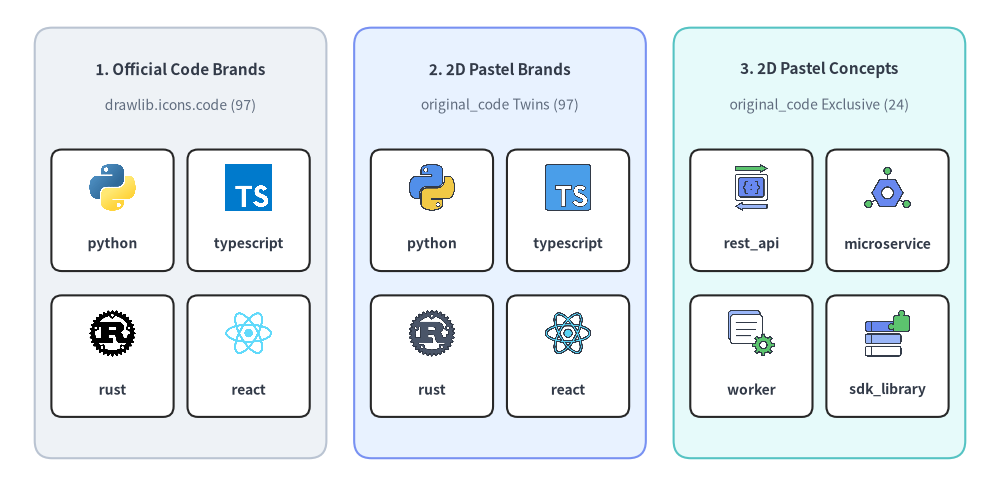
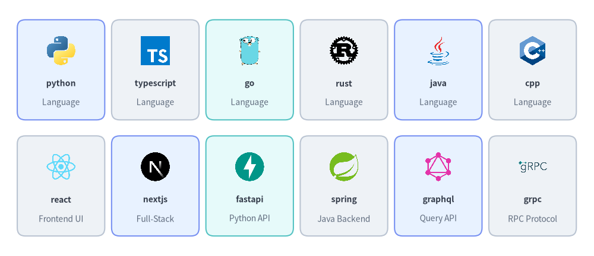
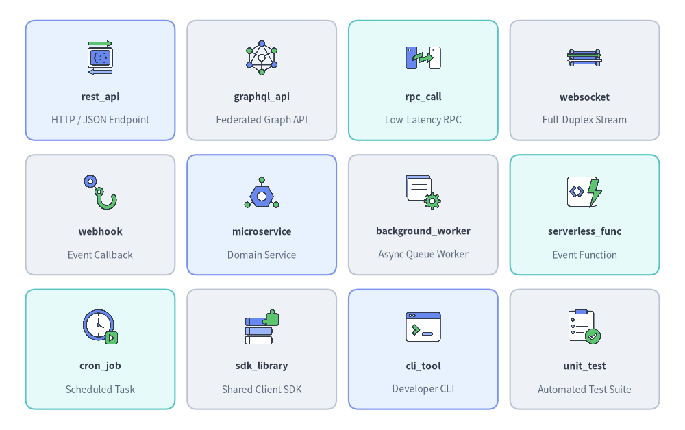
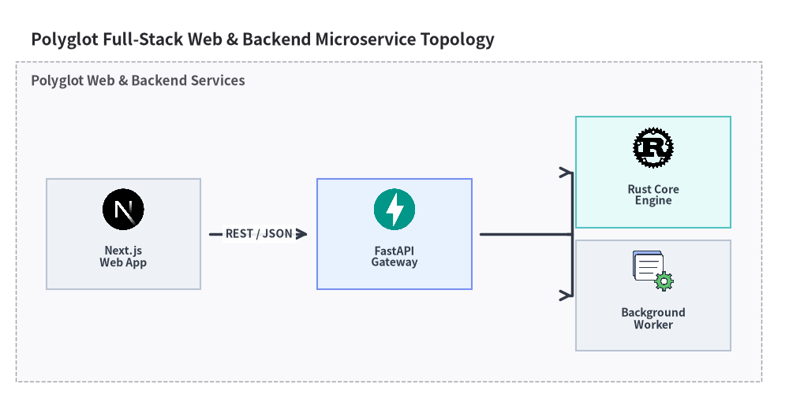

# Code, Languages & Frameworks Icons

Drawlib provides **97 official programming language, framework & SDK brand icons** in `drawlib.icons.code` (`CodeIcon`) and **121 flat 2D pastel icons** in `drawlib.icons.original_code` (`OriginalCodeIcon` — **97 brand twins** plus **24 vendor-neutral software engineering & API concept icons**). See [Icons Overview](./overview.md) for cross-tier guidance and [Architecture Diagrams](../06_diagrams/architecture.md) for topology integration.


<figure class="drawlib-image" style="text-align: center;">
  
  <figcaption class="drawlib-caption">Comparing Official Brand (code), Original 2D Pastel Brand (original_code), and Original 2D Pastel Concept (original_code) Icons</figcaption>
</figure>

<details class="drawlib-code-details">
<summary>Source Code</summary>

```python
from drawlib.canvas import save, setup
from drawlib.icons import code, original_code
from drawlib.shapes import rectangle
from drawlib.styles import Styles
from drawlib.text import text

setup(width=144, height=70)

columns = [
    (
        26.0,
        "1. Official Code Brands",
        "drawlib.icons.code (97)",
        Styles.Neutral,
        [
            ("python", code.python),
            ("typescript", code.typescript),
            ("rust", code.rust),
            ("react", code.react),
        ],
    ),
    (
        72.0,
        "2. 2D Pastel Brands",
        "original_code Twins (97)",
        Styles.PrimaryNeutral,
        [
            ("python", original_code.python),
            ("typescript", original_code.typescript),
            ("rust", original_code.rust),
            ("react", original_code.react),
        ],
    ),
    (
        118.0,
        "3. 2D Pastel Concepts",
        "original_code Exclusive (24)",
        Styles.SecondaryNeutral,
        [
            ("rest_api", original_code.rest_api),
            ("microservice", original_code.microservice),
            ("worker", original_code.background_worker),
            ("sdk_library", original_code.sdk_library),
        ],
    ),
]

for cx, title, subtitle, card_style, icons_list in columns:
    rectangle((cx, 35.0), width=42.0, height=62.0, style=card_style.patch(shape_r=2.5))
    text((cx, 60.0), title, style=Styles.DarkBold.patch(text_size=11.0))
    text((cx, 54.8), subtitle, style=Styles.Muted.patch(text_size=10.0))

    offsets = [(-9.8, 41.5), (9.8, 41.5), (-9.8, 20.5), (9.8, 20.5)]
    sub_card_style = Styles.White.patch(shape_r=1.5, line_width=0.6)
    for (dx, iy), (lbl, fn) in zip(offsets, icons_list, strict=True):
        ix = cx + dx
        rectangle((ix, iy - 1.8), width=17.6, height=17.5, style=sub_card_style)
        fn((ix, iy + 1.5), width=7.5, style=Styles.Primary)
        text((ix, iy - 6.6), lbl, style=Styles.DarkBold.patch(text_size=10.0))

save()
```

</details>


---

## 1. API Signature & Twin Module Structure

The Code, Languages & Frameworks icon suite is organized as a twin module pair sharing a 1-to-1 canonical naming convention:

- **`drawlib.icons.code`** (`CodeIcon` Enum): **97 official vendor and open-source brand icons** (`512×512` RGBA PNGs) spanning programming languages, frontend/mobile UI frameworks, backend servers, package managers, API protocols, and IDEs.
- **`drawlib.icons.original_code`** (`OriginalCodeIcon` Enum): **121 flat 2D pastel icons** (`512×512` RGBA PNGs) comprising all **97 matching brand twins** plus **24 vendor-neutral software engineering & API concept icons** (`rest_api`, `graphql_api`, `rpc_call`, `microservice`, `background_worker`, `cli_tool`, etc.).

```python
from drawlib.diagrams.architecture import CodeIcon, Node, OriginalCodeIcon
from drawlib.icons import code, original_code
from drawlib.styles import Styles

# 1. Direct canvas rendering (center-anchored at (cx, cy), 1:1 square aspect ratio)
code.python((30, 25), width=9.0, style=Styles.Primary)
original_code.python((60, 25), width=9.0, style=Styles.Primary)
original_code.rest_api((90, 25), width=9.0, style=Styles.Primary)

# 2. High-level ArchitectureDiagram / SequenceDiagram Enums
api_node = Node("FastAPI Service", width=25, height=18, icon=CodeIcon.FASTAPI, icon_size=7.5)
worker_node = Node("Job Worker", width=25, height=18, icon=OriginalCodeIcon.BACKGROUND_WORKER, icon_size=7.5)
```

| Aspect | Official Suite (`drawlib.icons.code`) | Original 2D Pastel Suite (`drawlib.icons.original_code`) |
| :--- | :--- | :--- |
| **Function Signature** | `code.<name>(xy, width, *, style, variant="default")` | `original_code.<name>(xy, width, *, style, variant="default")` |
| **Diagram Enum** | `CodeIcon.<NAME>` (e.g., `CodeIcon.PYTHON`) | `OriginalCodeIcon.<NAME>` (e.g., `OriginalCodeIcon.REST_API`) |
| **Canonical Count** | **97** brand icons | **121** total (**97** brand twins + **24** concept icons) |
| **Coordinate Anchor** | Center `(cx, cy)` (`halign="center"`, `valign="center"`) | Center `(cx, cy)` (`halign="center"`, `valign="center"`) |
| **Asset Archive** | `icon_code` (`512×512` RGBA PNG) | `icon_original_code` (`512×512` RGBA PNG) |

---

## 2. Official & Pastel Brand Icons Showcase & Complete Reference (`code` & `original_code`)

All **97 brand icon names** listed below exist identically in both `drawlib.icons.code` (official logos) and `drawlib.icons.original_code` (matching 2D pastel brand twins):


<figure class="drawlib-image" style="text-align: center;">
  
  <figcaption class="drawlib-caption">Representative Languages, Web Frameworks, Runtimes, and API Protocols in drawlib.icons.code</figcaption>
</figure>

<details class="drawlib-code-details">
<summary>Source Code</summary>

```python
from drawlib.canvas import save, setup
from drawlib.icons import code
from drawlib.shapes import rectangle
from drawlib.styles import Styles
from drawlib.text import text

setup(width=148, height=64)

row1 = [
    ("python", "Language", code.python, Styles.PrimaryNeutral),
    ("typescript", "Language", code.typescript, Styles.Neutral),
    ("go", "Language", code.go, Styles.SecondaryNeutral),
    ("rust", "Language", code.rust, Styles.Neutral),
    ("java", "Language", code.java, Styles.PrimaryNeutral),
    ("cpp", "Language", code.cpp, Styles.Neutral),
]

row2 = [
    ("react", "Frontend UI", code.react, Styles.Neutral),
    ("nextjs", "Full-Stack", code.nextjs, Styles.PrimaryNeutral),
    ("fastapi", "Python API", code.fastapi, Styles.SecondaryNeutral),
    ("spring", "Java Backend", code.spring, Styles.Neutral),
    ("graphql", "Query API", code.graphql, Styles.PrimaryNeutral),
    ("grpc", "RPC Protocol", code.grpc, Styles.Neutral),
]

for row_idx, items in enumerate([row1, row2]):
    cy = 46.5 if row_idx == 0 else 17.5
    for col_idx, (name, cat, icon_fn, card_st) in enumerate(items):
        cx = 15.2 + col_idx * 23.5
        rectangle((cx, cy), width=21.8, height=25.0, style=card_st.patch(shape_r=2))
        icon_fn((cx, cy + 4.8), width=8.0, style=Styles.Primary)
        text((cx, cy - 3.4), name, style=Styles.DarkBold.patch(text_size=10.0))
        text((cx, cy - 8.2), cat, style=Styles.Muted.patch(text_size=10.0))

save()
```

</details>


### 2.1. Complete 97 Shared Brand Icons (`code.<name>` & `original_code.<name>`)

| Category | Count | Canonical Function Names (`code.<name>` & `original_code.<name>`) |
| :--- | :---: | :--- |
| **Programming & Markup Languages** | 25 | `bash`, `c`, `cpp`, `csharp`, `css3`, `dart`, `elixir`, `go`, `html5`, `java`, `javascript`, `julia`, `kotlin`, `lua`, `php`, `python`, `r`, `ruby`, `rust`, `scala`, `solidity`, `sql`, `swift`, `typescript`, `zig` |
| **Frontend, Mobile & Desktop UI Frameworks** | 18 | `angular`, `astro`, `blazor`, `electron`, `expo`, `flutter`, `htmx`, `jquery`, `nextjs`, `nuxt`, `react`, `react_native`, `remix`, `storybook`, `svelte`, `tailwind_css`, `tauri`, `vuejs` |
| **Backend, Web & Systems Frameworks** | 21 | `appwrite`, `axum`, `celery`, `convex`, `django`, `dotnet`, `echo`, `express`, `fastapi`, `firebase`, `flask`, `gin`, `hono`, `laravel`, `nestjs`, `pocketbase`, `quarkus`, `rails`, `spring`, `tokio`, `uvicorn` |
| **Runtimes, Package Managers & Build Toolchains** | 14 | `biome`, `bun`, `cargo`, `deno`, `gradle`, `nodejs`, `npm`, `pnpm`, `poetry`, `pypi`, `uv`, `vite`, `webassembly`, `yarn` |
| **APIs, Data Access, Scientific & Testing Libraries** | 14 | `apollo`, `graphql`, `grpc`, `hasura`, `numpy`, `openapi`, `pandas`, `prisma`, `protobuf`, `pydantic`, `pytest`, `sqlalchemy`, `trpc`, `vitest` |
| **IDEs, Editors & Cloud Notebooks** | 5 | `android_studio`, `antigravity`, `colab`, `intellij`, `vscode` |

---

## 3. Vendor-Neutral Concept Icons Showcase & Complete Reference (`original_code`)

In addition to the 97 brand twins, `drawlib.icons.original_code` (`OriginalCodeIcon`) provides **24 exclusive vendor-neutral software engineering and API concept icons** for illustrating microservices, REST/GraphQL/RPC endpoints, background workers, build toolchains, and SDK modules:


<figure class="drawlib-image" style="text-align: center;">
  
  <figcaption class="drawlib-caption">12 Representative Vendor-Neutral Software Engineering & API Concept Icons in drawlib.icons.original_code</figcaption>
</figure>

<details class="drawlib-code-details">
<summary>Source Code</summary>

```python
from drawlib.canvas import save, setup
from drawlib.icons import original_code
from drawlib.shapes import rectangle
from drawlib.styles import Styles
from drawlib.text import text

setup(width=140, height=88)

rows = [
    [
        ("rest_api", "HTTP / JSON Endpoint", original_code.rest_api, Styles.PrimaryNeutral),
        ("graphql_api", "Federated Graph API", original_code.graphql_api, Styles.Neutral),
        ("rpc_call", "Low-Latency RPC", original_code.rpc_call, Styles.SecondaryNeutral),
        ("websocket", "Full-Duplex Stream", original_code.websocket, Styles.Neutral),
    ],
    [
        ("webhook", "Event Callback", original_code.webhook, Styles.Neutral),
        ("microservice", "Domain Service", original_code.microservice, Styles.PrimaryNeutral),
        ("background_worker", "Async Queue Worker", original_code.background_worker, Styles.Neutral),
        ("serverless_func", "Event Function", original_code.serverless_func, Styles.SecondaryNeutral),
    ],
    [
        ("cron_job", "Scheduled Task", original_code.cron_job, Styles.SecondaryNeutral),
        ("sdk_library", "Shared Client SDK", original_code.sdk_library, Styles.Neutral),
        ("cli_tool", "Developer CLI", original_code.cli_tool, Styles.PrimaryNeutral),
        ("unit_test", "Automated Test Suite", original_code.unit_test, Styles.Neutral),
    ],
]

for row_idx, items in enumerate(rows):
    cy = 71.5 - row_idx * 27.5
    for col_idx, (title, sub, icon_fn, card_st) in enumerate(items):
        cx = 20.5 + col_idx * 33.0
        rectangle((cx, cy), width=30.5, height=24.5, style=card_st.patch(shape_r=2))
        icon_fn((cx, cy + 4.6), width=8.0, style=Styles.Primary)
        text((cx, cy - 3.4), title, style=Styles.DarkBold.patch(text_size=10.0))
        text((cx, cy - 8.2), sub, style=Styles.Muted.patch(text_size=10.0))

save()
```

</details>


### 3.1. Complete 24 Vendor-Neutral Concept Icons (`original_code.<name>`)

| Canonical Function (`original_code.*`) | `OriginalCodeIcon` Enum Member | Architectural Role |
| :--- | :--- | :--- |
| `background_worker` | `OriginalCodeIcon.BACKGROUND_WORKER` | Asynchronous queue consumer and background job worker |
| `binary_executable` | `OriginalCodeIcon.BINARY_EXECUTABLE` | Compiled native binary or standalone executable artifact |
| `cli_tool` | `OriginalCodeIcon.CLI_TOOL` | Command-line interface utility and developer shell tool |
| `compiler_build` | `OriginalCodeIcon.COMPILER_BUILD` | Source compilation, bundling, and artifact build stage |
| `cron_job` | `OriginalCodeIcon.CRON_JOB` | Time-triggered scheduled batch task or cron job |
| `debugger` | `OriginalCodeIcon.DEBUGGER` | Breakpoint inspection, profiling, and runtime diagnostics |
| `graphql_api` | `OriginalCodeIcon.GRAPHQL_API` | Federated GraphQL query and mutation endpoint |
| `ide_editor` | `OriginalCodeIcon.IDE_EDITOR` | Integrated development environment or code editor |
| `json_schema` | `OriginalCodeIcon.JSON_SCHEMA` | Structured JSON payload contract and schema validator |
| `linter_formatter` | `OriginalCodeIcon.LINTER_FORMATTER` | Static code analysis, formatting, and type-checking gate |
| `microservice` | `OriginalCodeIcon.MICROSERVICE` | Independently deployable domain microservice |
| `monolith` | `OriginalCodeIcon.MONOLITH` | Unified monolithic application server |
| `package_module` | `OriginalCodeIcon.PACKAGE_MODULE` | Distributable software package or reusable module |
| `regex_parser` | `OriginalCodeIcon.REGEX_PARSER` | Regular expression matcher, lexer, or text parser |
| `rest_api` | `OriginalCodeIcon.REST_API` | Standard RESTful HTTP/JSON API endpoint |
| `rpc_call` | `OriginalCodeIcon.RPC_CALL` | High-performance remote procedure call (RPC) interface |
| `runtime_vm` | `OriginalCodeIcon.RUNTIME_VM` | Managed language virtual machine or bytecode runtime |
| `sdk_library` | `OriginalCodeIcon.SDK_LIBRARY` | Shared client SDK or internal platform library |
| `serverless_func` | `OriginalCodeIcon.SERVERLESS_FUNC` | Event-driven serverless function handler |
| `source_code` | `OriginalCodeIcon.SOURCE_CODE` | Application source file or repository module |
| `unit_test` | `OriginalCodeIcon.UNIT_TEST` | Automated unit and integration test runner |
| `webhook` | `OriginalCodeIcon.WEBHOOK` | Outbound HTTP event notification callback |
| `websocket` | `OriginalCodeIcon.WEBSOCKET` | Persistent full-duplex WebSocket streaming channel |
| `xml_markup` | `OriginalCodeIcon.XML_MARKUP` | XML/HTML structured document markup |

---

## 4. Practical Architecture Diagram (`CodeIcon` & `OriginalCodeIcon`)

The example below illustrates a polyglot full-stack web and microservice architecture combining `CodeIcon` (`Next.js`, `FastAPI`, `Rust`) and `OriginalCodeIcon` (`BACKGROUND_WORKER`) inside an [`ArchitectureDiagram`](../06_diagrams/architecture.md):


```python
from drawlib.canvas import clear, save, setup
from drawlib.diagrams.architecture import (
    ArchitectureDiagram,
    CodeIcon,
    Node,
    NodeGroup,
    OriginalCodeIcon,
)
from drawlib.styles import Styles

clear()
setup(width=128, height=64)

d = ArchitectureDiagram(
    node_style=Styles.Primary,
    node_text_style=Styles.DarkBold.patch(text_size=10.0),
    edge_style=Styles.DarkBold,
    edge_text_style=Styles.DarkBold.patch(text_size=10.0),
    node_card_style=Styles.Neutral,
    title="Polyglot Full-Stack Web & Backend Microservice Topology",
)

backend = d.add(NodeGroup(title="Polyglot Web & Backend Services", padding=5.0), xy=(4.0, 4.0))
web = backend.add(
    Node(
        "Next.js\nWeb App",
        width=25,
        height=18,
        icon=CodeIcon.NEXTJS,
        icon_size=7.5,
    ),
    xy=(12.0, 18.0),
)
api = backend.add(
    Node(
        "FastAPI\nGateway",
        width=25,
        height=18,
        icon=CodeIcon.FASTAPI,
        icon_size=7.5,
        card_style=Styles.PrimaryNeutral,
    ),
    xy=(56.0, 18.0),
)
engine = backend.add(
    Node(
        "Rust Core\nEngine",
        width=25,
        height=18,
        icon=CodeIcon.RUST,
        icon_size=7.5,
        card_style=Styles.SecondaryNeutral,
    ),
    xy=(98.0, 28.0),
)
worker = backend.add(
    Node(
        "Background\nWorker",
        width=25,
        height=18,
        icon=OriginalCodeIcon.BACKGROUND_WORKER,
        icon_size=7.5,
    ),
    xy=(98.0, 8.0),
)

d.connect(web, api, label="REST / JSON", padding=1.5)
api.fork([engine, worker], at_x=88.0, padding=1.5)

d.draw(xy=(4.0, 4.0))
save()
```

<figure class="drawlib-image" style="text-align: center;">
  
  <figcaption class="drawlib-caption">Polyglot Full-Stack & Microservice Topology Using CodeIcon and OriginalCodeIcon</figcaption>
</figure>


