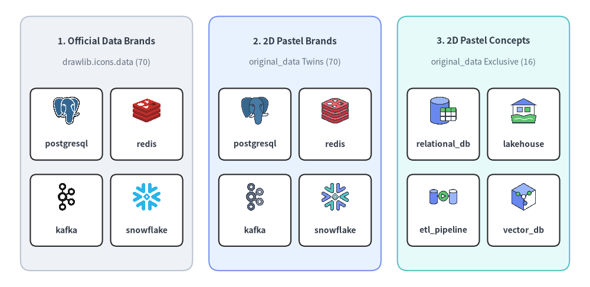
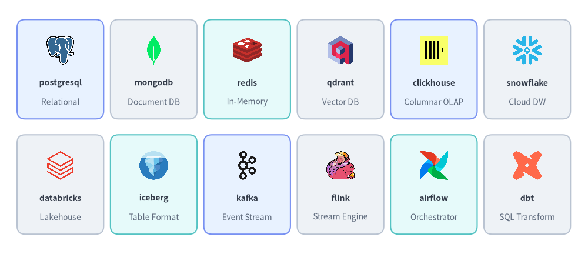
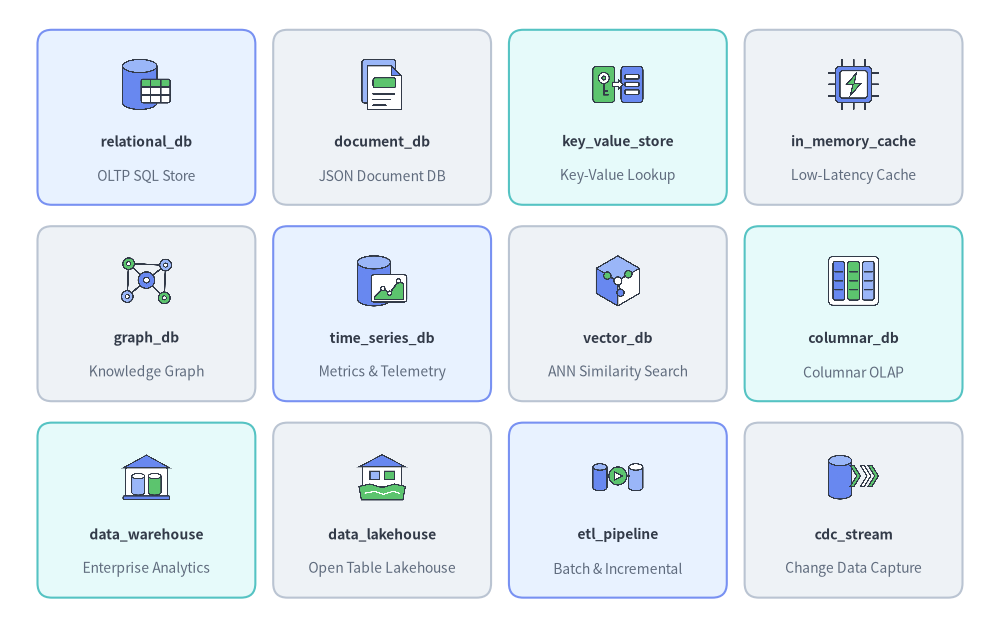
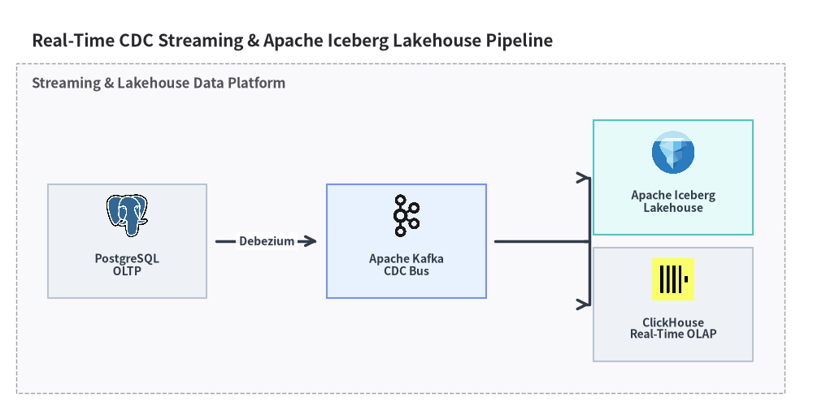

# Data & Database Icons

Drawlib provides **70 official data & database brand icons** in `drawlib.icons.data` (`DataIcon`) and **86 flat 2D pastel icons** in `drawlib.icons.original_data` (`OriginalDataIcon` — **70 brand twins** plus **16 vendor-neutral database & data architecture concept icons**). See [Icons Overview](./overview.md) for cross-tier guidance and [Architecture Diagrams](../06_diagrams/architecture.md) for topology integration.


<figure class="drawlib-image" style="text-align: center;">
  
  <figcaption class="drawlib-caption">Comparing Official Brand (data), Original 2D Pastel Brand (original_data), and Original 2D Pastel Concept (original_data) Icons</figcaption>
</figure>

<details class="drawlib-code-details">
<summary>Source Code</summary>

```python
from drawlib.canvas import save, setup
from drawlib.icons import data, original_data
from drawlib.shapes import rectangle
from drawlib.styles import Styles
from drawlib.text import text

setup(width=144, height=70)

columns = [
    (
        26.0,
        "1. Official Data Brands",
        "drawlib.icons.data (70)",
        Styles.Neutral,
        [
            ("postgresql", data.postgresql),
            ("redis", data.redis),
            ("kafka", data.kafka),
            ("snowflake", data.snowflake),
        ],
    ),
    (
        72.0,
        "2. 2D Pastel Brands",
        "original_data Twins (70)",
        Styles.PrimaryNeutral,
        [
            ("postgresql", original_data.postgresql),
            ("redis", original_data.redis),
            ("kafka", original_data.kafka),
            ("snowflake", original_data.snowflake),
        ],
    ),
    (
        118.0,
        "3. 2D Pastel Concepts",
        "original_data Exclusive (16)",
        Styles.SecondaryNeutral,
        [
            ("relational_db", original_data.relational_db),
            ("lakehouse", original_data.data_lakehouse),
            ("etl_pipeline", original_data.etl_pipeline),
            ("vector_db", original_data.vector_db),
        ],
    ),
]

for cx, title, subtitle, card_style, icons_list in columns:
    rectangle((cx, 35.0), width=42.0, height=62.0, style=card_style.patch(shape_r=2.5))
    text((cx, 60.0), title, style=Styles.DarkBold.patch(text_size=11.0))
    text((cx, 54.8), subtitle, style=Styles.Muted.patch(text_size=10.0))

    offsets = [(-9.8, 41.5), (9.8, 41.5), (-9.8, 20.5), (9.8, 20.5)]
    sub_card_style = Styles.White.patch(shape_r=1.5, line_width=0.6)
    for (dx, iy), (lbl, fn) in zip(offsets, icons_list, strict=True):
        ix = cx + dx
        rectangle((ix, iy - 1.8), width=17.6, height=17.5, style=sub_card_style)
        fn((ix, iy + 1.5), width=7.5, style=Styles.Primary)
        text((ix, iy - 6.6), lbl, style=Styles.DarkBold.patch(text_size=10.0))

save()
```

</details>


---

## 1. API Signature & Twin Module Structure

The Data & Database icon suite is organized as a twin module pair sharing a 1-to-1 canonical naming convention:

- **`drawlib.icons.data`** (`DataIcon` Enum): **70 official vendor and open-source brand icons** (`512×512` RGBA PNGs) covering relational databases, NoSQL stores, vector databases, data warehouses, Apache lakehouse formats, streaming brokers, and ETL/BI platforms.
- **`drawlib.icons.original_data`** (`OriginalDataIcon` Enum): **86 flat 2D pastel icons** (`512×512` RGBA PNGs) comprising all **70 matching brand twins** plus **16 vendor-neutral data architecture concept icons** (`relational_db`, `data_warehouse`, `data_lakehouse`, `etl_pipeline`, `cdc_stream`, etc.).

```python
from drawlib.diagrams.architecture import DataIcon, Node, OriginalDataIcon
from drawlib.icons import data, original_data
from drawlib.styles import Styles

# 1. Direct canvas rendering (center-anchored at (cx, cy), 1:1 square aspect ratio)
data.postgresql((30, 25), width=9.0, style=Styles.Primary)
original_data.postgresql((60, 25), width=9.0, style=Styles.Primary)
original_data.data_lakehouse((90, 25), width=9.0, style=Styles.Primary)

# 2. High-level ArchitectureDiagram / SequenceDiagram Enums
pg_node = Node("PostgreSQL Primary", width=25, height=18, icon=DataIcon.POSTGRESQL, icon_size=7.5)
dw_node = Node("Enterprise DW", width=25, height=18, icon=OriginalDataIcon.DATA_WAREHOUSE, icon_size=7.5)
```

| Aspect | Official Suite (`drawlib.icons.data`) | Original 2D Pastel Suite (`drawlib.icons.original_data`) |
| :--- | :--- | :--- |
| **Function Signature** | `data.<name>(xy, width, *, style, variant="default")` | `original_data.<name>(xy, width, *, style, variant="default")` |
| **Diagram Enum** | `DataIcon.<NAME>` (e.g., `DataIcon.POSTGRESQL`) | `OriginalDataIcon.<NAME>` (e.g., `OriginalDataIcon.DATA_WAREHOUSE`) |
| **Canonical Count** | **70** brand icons | **86** total (**70** brand twins + **16** concept icons) |
| **Coordinate Anchor** | Center `(cx, cy)` (`halign="center"`, `valign="center"`) | Center `(cx, cy)` (`halign="center"`, `valign="center"`) |
| **Asset Archive** | `icon_data` (`512×512` RGBA PNG) | `icon_original_data` (`512×512` RGBA PNG) |

---

## 2. Official & Pastel Brand Icons Showcase & Complete Reference (`data` & `original_data`)

All **70 brand icon names** listed below exist identically in both `drawlib.icons.data` (official logos) and `drawlib.icons.original_data` (matching 2D pastel brand twins):


<figure class="drawlib-image" style="text-align: center;">
  
  <figcaption class="drawlib-caption">Representative Data & Database Brand Icons Across Relational, NoSQL, Vector, Streaming, and Lakehouse Tiers</figcaption>
</figure>

<details class="drawlib-code-details">
<summary>Source Code</summary>

```python
from drawlib.canvas import save, setup
from drawlib.icons import data
from drawlib.shapes import rectangle
from drawlib.styles import Styles
from drawlib.text import text

setup(width=148, height=64)

row1 = [
    ("postgresql", "Relational", data.postgresql, Styles.PrimaryNeutral),
    ("mongodb", "Document DB", data.mongodb, Styles.Neutral),
    ("redis", "In-Memory", data.redis, Styles.SecondaryNeutral),
    ("qdrant", "Vector DB", data.qdrant, Styles.Neutral),
    ("clickhouse", "Columnar OLAP", data.clickhouse, Styles.PrimaryNeutral),
    ("snowflake", "Cloud DW", data.snowflake, Styles.Neutral),
]

row2 = [
    ("databricks", "Lakehouse", data.databricks, Styles.Neutral),
    ("iceberg", "Table Format", data.iceberg, Styles.SecondaryNeutral),
    ("kafka", "Event Stream", data.kafka, Styles.PrimaryNeutral),
    ("flink", "Stream Engine", data.flink, Styles.Neutral),
    ("airflow", "Orchestrator", data.airflow, Styles.SecondaryNeutral),
    ("dbt", "SQL Transform", data.dbt, Styles.Neutral),
]

for row_idx, items in enumerate([row1, row2]):
    cy = 46.5 if row_idx == 0 else 17.5
    for col_idx, (name, cat, icon_fn, card_st) in enumerate(items):
        cx = 15.2 + col_idx * 23.5
        rectangle((cx, cy), width=21.8, height=25.0, style=card_st.patch(shape_r=2))
        icon_fn((cx, cy + 4.8), width=8.0, style=Styles.Primary)
        text((cx, cy - 3.4), name, style=Styles.DarkBold.patch(text_size=10.0))
        text((cx, cy - 8.2), cat, style=Styles.Muted.patch(text_size=10.0))

save()
```

</details>


### 2.1. Complete 70 Shared Brand Icons (`data.<name>` & `original_data.<name>`)

| Category | Count | Canonical Function Names (`data.<name>` & `original_data.<name>`) |
| :--- | :---: | :--- |
| **Relational, Distributed SQL & Serverless DBs** | 13 | `cockroachdb`, `mariadb`, `mysql`, `neon`, `oracle_db`, `planetscale`, `postgresql`, `sql_server`, `sqlite`, `supabase`, `tidb`, `turso`, `yugabytedb` |
| **NoSQL, Document, Wide-Column, Graph & Time-Series** | 10 | `cassandra`, `couchbase`, `influxdb`, `memcached`, `mongodb`, `neo4j`, `redis`, `scylladb`, `timescaledb`, `valkey` |
| **Vector Databases & Search Engines** | 9 | `chromadb`, `elasticsearch`, `lancedb`, `meilisearch`, `milvus`, `opensearch`, `pgvector`, `qdrant`, `weaviate` |
| **Cloud Data Warehouses, OLAP & Lakehouse Formats** | 15 | `arrow`, `clickhouse`, `databricks`, `delta_lake`, `doris`, `druid`, `duckdb`, `hadoop`, `hudi`, `iceberg`, `minio`, `parquet`, `snowflake`, `starrocks`, `trino` |
| **Streaming, Event Brokers & CDC Engines** | 9 | `beam`, `debezium`, `flink`, `kafka`, `nats`, `pulsar`, `rabbitmq`, `redpanda`, `spark` |
| **Data Integration, Orchestration, Catalog & BI** | 14 | `airbyte`, `airflow`, `dagster`, `datahub`, `dbt`, `fivetran`, `marimo`, `metabase`, `nifi`, `openmetadata`, `polars`, `prefect`, `redash`, `superset` |

---

## 3. Vendor-Neutral Concept Icons Showcase & Complete Reference (`original_data`)

In addition to the 70 brand twins, `drawlib.icons.original_data` (`OriginalDataIcon`) provides **16 exclusive vendor-neutral database and data platform concept icons** for illustrating logical data architectures, storage engines, and ETL/CDC pipelines:


<figure class="drawlib-image" style="text-align: center;">
  
  <figcaption class="drawlib-caption">12 Representative Vendor-Neutral Data & Database Concept Icons in drawlib.icons.original_data</figcaption>
</figure>

<details class="drawlib-code-details">
<summary>Source Code</summary>

```python
from drawlib.canvas import save, setup
from drawlib.icons import original_data
from drawlib.shapes import rectangle
from drawlib.styles import Styles
from drawlib.text import text

setup(width=140, height=88)

rows = [
    [
        ("relational_db", "OLTP SQL Store", original_data.relational_db, Styles.PrimaryNeutral),
        ("document_db", "JSON Document DB", original_data.document_db, Styles.Neutral),
        ("key_value_store", "Key-Value Lookup", original_data.key_value_store, Styles.SecondaryNeutral),
        ("in_memory_cache", "Low-Latency Cache", original_data.in_memory_cache, Styles.Neutral),
    ],
    [
        ("graph_db", "Knowledge Graph", original_data.graph_db, Styles.Neutral),
        ("time_series_db", "Metrics & Telemetry", original_data.time_series_db, Styles.PrimaryNeutral),
        ("vector_db", "ANN Similarity Search", original_data.vector_db, Styles.Neutral),
        ("columnar_db", "Columnar OLAP", original_data.columnar_db, Styles.SecondaryNeutral),
    ],
    [
        ("data_warehouse", "Enterprise Analytics", original_data.data_warehouse, Styles.SecondaryNeutral),
        ("data_lakehouse", "Open Table Lakehouse", original_data.data_lakehouse, Styles.Neutral),
        ("etl_pipeline", "Batch & Incremental", original_data.etl_pipeline, Styles.PrimaryNeutral),
        ("cdc_stream", "Change Data Capture", original_data.cdc_stream, Styles.Neutral),
    ],
]

for row_idx, items in enumerate(rows):
    cy = 71.5 - row_idx * 27.5
    for col_idx, (title, sub, icon_fn, card_st) in enumerate(items):
        cx = 20.5 + col_idx * 33.0
        rectangle((cx, cy), width=30.5, height=24.5, style=card_st.patch(shape_r=2))
        icon_fn((cx, cy + 4.6), width=8.0, style=Styles.Primary)
        text((cx, cy - 3.4), title, style=Styles.DarkBold.patch(text_size=10.0))
        text((cx, cy - 8.2), sub, style=Styles.Muted.patch(text_size=10.0))

save()
```

</details>


### 3.1. Complete 16 Vendor-Neutral Concept Icons (`original_data.<name>`)

| Canonical Function (`original_data.*`) | `OriginalDataIcon` Enum Member | Architectural Role |
| :--- | :--- | :--- |
| `cdc_stream` | `OriginalDataIcon.CDC_STREAM` | Change Data Capture (CDC) log tailing and real-time replication stream |
| `columnar_db` | `OriginalDataIcon.COLUMNAR_DB` | Column-oriented analytical database engine (OLAP) |
| `data_catalog` | `OriginalDataIcon.DATA_CATALOG` | Enterprise metadata governance, schema discovery, and lineage catalog |
| `data_lakehouse` | `OriginalDataIcon.DATA_LAKEHOUSE` | Unified open table format lakehouse combining object storage and ACID SQL |
| `data_warehouse` | `OriginalDataIcon.DATA_WAREHOUSE` | Centralized enterprise analytical data warehouse |
| `document_db` | `OriginalDataIcon.DOCUMENT_DB` | Schema-flexible JSON/BSON document database |
| `etl_pipeline` | `OriginalDataIcon.ETL_PIPELINE` | Extract-Transform-Load (ETL / ELT) batch and incremental data pipeline |
| `graph_db` | `OriginalDataIcon.GRAPH_DB` | Property graph or RDF knowledge graph database |
| `in_memory_cache` | `OriginalDataIcon.IN_MEMORY_CACHE` | Sub-millisecond in-memory caching tier |
| `key_value_store` | `OriginalDataIcon.KEY_VALUE_STORE` | Distributed key-value lookup and session storage engine |
| `message_broker` | `OriginalDataIcon.MESSAGE_BROKER` | Asynchronous pub/sub event bus and message queue broker |
| `nosql_db` | `OriginalDataIcon.NOSQL_DB` | Partitioned non-relational wide-column or distributed NoSQL store |
| `object_storage` | `OriginalDataIcon.OBJECT_STORAGE` | Durable blob and parquet object storage bucket |
| `relational_db` | `OriginalDataIcon.RELATIONAL_DB` | ACID-compliant relational SQL transactional database (OLTP) |
| `time_series_db` | `OriginalDataIcon.TIME_SERIES_DB` | High-ingest telemetry, metrics, and IoT time-series database |
| `vector_db` | `OriginalDataIcon.VECTOR_DB` | High-dimensional vector similarity search database |

---

## 4. Practical Architecture Diagram (`DataIcon` & `OriginalDataIcon`)

The example below illustrates a real-time CDC and Lakehouse analytics pipeline combining official `DataIcon` logos (`PostgreSQL`, `Kafka`, `Iceberg`, `ClickHouse`) inside an [`ArchitectureDiagram`](../06_diagrams/architecture.md):


```python
from drawlib.canvas import clear, save, setup
from drawlib.diagrams.architecture import (
    ArchitectureDiagram,
    DataIcon,
    Node,
    NodeGroup,
)
from drawlib.styles import Styles

clear()
setup(width=128, height=64)

d = ArchitectureDiagram(
    node_style=Styles.Primary,
    node_text_style=Styles.DarkBold.patch(text_size=10.0),
    edge_style=Styles.DarkBold,
    edge_text_style=Styles.DarkBold.patch(text_size=10.0),
    node_card_style=Styles.Neutral,
    title="Real-Time CDC Streaming & Apache Iceberg Lakehouse Pipeline",
)

platform = d.add(NodeGroup(title="Streaming & Lakehouse Data Platform", padding=5.0), xy=(4.0, 4.0))
oltp = platform.add(
    Node(
        "PostgreSQL\nOLTP",
        width=25,
        height=18,
        icon=DataIcon.POSTGRESQL,
        icon_size=7.5,
    ),
    xy=(12.0, 18.0),
)
kafka_node = platform.add(
    Node(
        "Apache Kafka\nCDC Bus",
        width=25,
        height=18,
        icon=DataIcon.KAFKA,
        icon_size=7.5,
        card_style=Styles.PrimaryNeutral,
    ),
    xy=(56.0, 18.0),
)
iceberg_node = platform.add(
    Node(
        "Apache Iceberg\nLakehouse",
        width=25,
        height=18,
        icon=DataIcon.ICEBERG,
        icon_size=7.5,
        card_style=Styles.SecondaryNeutral,
    ),
    xy=(98.0, 28.0),
)
ch_node = platform.add(
    Node(
        "ClickHouse\nReal-Time OLAP",
        width=25,
        height=18,
        icon=DataIcon.CLICKHOUSE,
        icon_size=7.5,
    ),
    xy=(98.0, 8.0),
)

d.connect(oltp, kafka_node, label="Debezium", padding=1.5)
kafka_node.fork([iceberg_node, ch_node], at_x=88.0, padding=1.5)

d.draw(xy=(4.0, 4.0))
save()
```

<figure class="drawlib-image" style="text-align: center;">
  
  <figcaption class="drawlib-caption">Real-Time CDC Streaming & Lakehouse Analytics Topology Using DataIcon</figcaption>
</figure>


