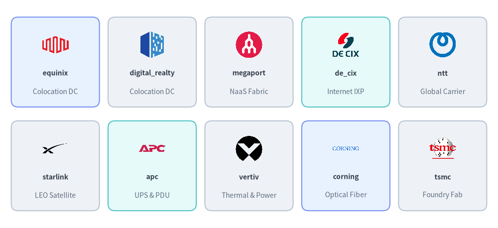
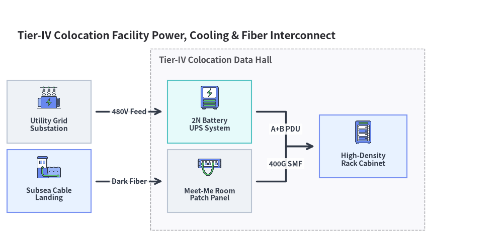

# Data Center & Facility Icons (`facility` & `original_facility`)

Drawlib provides two paired icon modules for physical data centers, colocation providers, internet exchanges (IXPs), telecom carriers, power/cooling infrastructure, semiconductor cleanrooms, and enterprise sites: **`drawlib.icons.facility`** (`FacilityIcon`, **49** official colocation, carrier, IXP, rack/power, and semiconductor equipment brand logos) and **`drawlib.icons.original_facility`** (`OriginalFacilityIcon`, **86** flat 2D pastel icons comprising all **49** brand twins plus **37** vendor-neutral data center, power, logistics, and building concept icons). Both modules share the unified coordinate contract documented in **[Icons Overview](./overview.md)** and integrate directly with **[Architecture Diagrams](../06_diagrams/architecture.md)**.


<figure class="drawlib-image" style="text-align: center;">
  
  <figcaption class="drawlib-caption">Official Facility & Carrier Brands (facility) vs. Original 2D Pastel Icons (original_facility)</figcaption>
</figure>

<details class="drawlib-code-details">
<summary>Source Code</summary>

```python
from drawlib.canvas import save, setup
from drawlib.icons import facility, original_facility
from drawlib.shapes import rectangle
from drawlib.styles import Styles
from drawlib.text import text

setup(width=148, height=68)

columns = [
    ("Colocation DC", "equinix", facility.equinix, original_facility.equinix),
    ("Internet IXP", "de_cix", facility.de_cix, original_facility.de_cix),
    ("Carrier Fiber", "ntt", facility.ntt, original_facility.ntt),
    ("UPS & Power", "apc", facility.apc, original_facility.apc),
    ("Foundry / Fab", "tsmc", facility.tsmc, original_facility.tsmc),
]

for col_idx, (cat_label, _, _, _) in enumerate(columns):
    cx = 43.0 + col_idx * 22.8
    text((cx, 62.0), cat_label, style=Styles.DarkBold.patch(text_size=10.5))

rows = [
    (43.5, "Official Suite", "facility (49)", Styles.Neutral),
    (17.5, "2D Pastel Suite", "original_facility (86)", Styles.PrimaryNeutral),
]

for row_idx, (cy, row_title, row_sub, row_style) in enumerate(rows):
    rectangle((16.5, cy), width=25.0, height=22.0, style=row_style.patch(shape_r=2))
    text((16.5, cy + 3.0), row_title, style=Styles.DarkBold.patch(text_size=10.0))
    text((16.5, cy - 3.5), row_sub, style=Styles.Muted.patch(text_size=10.0))

    for col_idx, (_, fn_name, fn_off, fn_orig) in enumerate(columns):
        cx = 43.0 + col_idx * 22.8
        rectangle((cx, cy), width=20.5, height=22.0, style=row_style.patch(shape_r=2))
        icon_fn = fn_off if row_idx == 0 else fn_orig
        icon_fn((cx, cy + 3.2), width=8.5, style=Styles.Primary)
        text((cx, cy - 6.8), fn_name, style=Styles.DarkBold.patch(text_size=10.0))

save()
```

</details>


---

## 1. API Signature & Twin Module Structure

Every icon in `drawlib.icons.facility` and `drawlib.icons.original_facility` renders a `512×512` RGBA PNG centered at `xy=(cx, cy)` with a `1:1` square aspect ratio:

```python
from drawlib.diagrams.architecture import FacilityIcon, Node, OriginalFacilityIcon
from drawlib.icons import (
    facility,
    facility_icon,
    original_facility,
    original_facility_icon,
)
from drawlib.styles import Styles

# 1. Direct module function calls (49 shared brand icons + 37 concept icons in original_facility)
facility.equinix((30, 25), width=10.0, style=Styles.Primary)
original_facility.equinix((55, 25), width=10.0, style=Styles.Primary)
original_facility.datacenter((80, 25), width=10.0, style=Styles.Primary)
original_facility.rack_cabinet((105, 25), width=10.0, style=Styles.Primary)

# 2. Dynamic string lookup helpers
facility_icon((30, 10), width=9.0, name="megaport", style=Styles.Primary)
original_facility_icon((55, 10), width=9.0, name="ups_power", style=Styles.Primary)

# 3. Strongly typed Enums for ArchitectureDiagram & SequenceDiagram
colo_node = Node("Equinix IBX", icon=FacilityIcon.EQUINIX)
rack_node = Node("42U Cabinet", icon=OriginalFacilityIcon.RACK_CABINET)
```

| Feature | `drawlib.icons.facility` | `drawlib.icons.original_facility` |
| :--- | :--- | :--- |
| **Visual Style** | Official colocation, IXP, telecom, power/rack, and foundry brand logos | Cohesive 2D pastel brand twins + vendor-neutral facility/site/DC concept icons |
| **Total Canonical Icons** | **49** official brand icons | **86** (`49` brand twins + `37` physical facility & infrastructure concepts) |
| **Diagram Enum** | `FacilityIcon.<NAME>` | `OriginalFacilityIcon.<NAME>` |
| **Dynamic Dispatcher** | `facility_icon(xy, width, name=..., style=...)` | `original_facility_icon(xy, width, name=..., style=...)` |
| **Asset Package** | `icon_facility` | `icon_original_facility` |

---

## 2. Brand & Vendor Facility Icons (`49` Icons in Both Modules)

Both `facility` and `original_facility` provide **49 canonical brand names** covering global colocation operators, internet exchanges (IXPs) and NaaS fabrics, tier-1 telecom and satellite carriers, physical rack/power/cabling manufacturers, and semiconductor foundries:


<figure class="drawlib-image" style="text-align: center;">
  
  <figcaption class="drawlib-caption">10 Representative Colocation, Carrier, Power & Foundry Brand Icons in facility and original_facility</figcaption>
</figure>

<details class="drawlib-code-details">
<summary>Source Code</summary>

```python
from drawlib.canvas import save, setup
from drawlib.icons import facility
from drawlib.shapes import rectangle
from drawlib.styles import Styles
from drawlib.text import text

setup(width=144, height=66)

row1 = [
    ("equinix", "Colocation DC", facility.equinix, Styles.PrimaryNeutral),
    ("digital_realty", "Colocation DC", facility.digital_realty, Styles.Neutral),
    ("megaport", "NaaS Fabric", facility.megaport, Styles.Neutral),
    ("de_cix", "Internet IXP", facility.de_cix, Styles.SecondaryNeutral),
    ("ntt", "Global Carrier", facility.ntt, Styles.Neutral),
]

row2 = [
    ("starlink", "LEO Satellite", facility.starlink, Styles.Neutral),
    ("apc", "UPS & PDU", facility.apc, Styles.SecondaryNeutral),
    ("vertiv", "Thermal & Power", facility.vertiv, Styles.Neutral),
    ("corning", "Optical Fiber", facility.corning, Styles.PrimaryNeutral),
    ("tsmc", "Foundry Fab", facility.tsmc, Styles.Neutral),
]

for row_idx, items in enumerate([row1, row2]):
    cy = 48.0 if row_idx == 0 else 18.0
    for col_idx, (fn_name, cat, icon_fn, card_st) in enumerate(items):
        cx = 16.0 + col_idx * 28.0
        rectangle((cx, cy), width=25.5, height=26.0, style=card_st.patch(shape_r=2))
        icon_fn((cx, cy + 5.0), width=8.5, style=Styles.Primary)
        text((cx, cy - 3.2), fn_name, style=Styles.DarkBold.patch(text_size=10.0))
        text((cx, cy - 8.5), cat, style=Styles.Muted.patch(text_size=10.0))

save()
```

</details>


### 2.1. Complete Shared Brand Icon Reference (`49` Canonical Names)

Every function name below is available identically as `facility.<name>()` (`FacilityIcon.<NAME>`) and `original_facility.<name>()` (`OriginalFacilityIcon.<NAME>`):

| Category | Count | Canonical Function Names (`facility.*` & `original_facility.*`) |
| :--- | :---: | :--- |
| **Colocation & Data Center Operators** | 10 | `at_tokyo`, `coresite`, `cyrusone`, `digital_realty`, `equinix`, `iron_mountain`, `ntt_gdc`, `qts`, `switch_dc`, `vantage_dc` |
| **Internet Exchanges (IXPs) & Cloud Interconnect** | 8 | `bbix`, `console_connect`, `de_cix`, `jpix`, `jpnap`, `linx`, `megaport`, `packetfabric` |
| **Global Telecom, Fiber & Satellite Carriers** | 12 | `att`, `colt`, `deutsche_telekom`, `iij`, `intelsat`, `kddi`, `lumen`, `ntt`, `orange`, `softbank`, `starlink`, `verizon` |
| **Power, Cooling, Racks, Cabling & Access Control** | 10 | `apc`, `axis`, `commscope`, `corning`, `eaton`, `hid_global`, `panduit`, `rittal`, `schneider_electric`, `vertiv` |
| **Semiconductor Foundries, Equipment & EMS** | 9 | `applied_materials`, `asml`, `foxconn`, `globalfoundries`, `kyocera`, `murata`, `rapidus`, `tokyo_electron`, `tsmc` |

---

## 3. Vendor-Neutral Data Center, Power & Site Concept Icons (`37` Icons in `original_facility`)

When illustrating physical data center layouts, power/HVAC redundancy, submarine fiber landings, enterprise branch offices, or industrial supply chains without vendor logos, `drawlib.icons.original_facility` (`OriginalFacilityIcon`) provides **37 vendor-neutral concept icons**:


<figure class="drawlib-image" style="text-align: center;">
  
  <figcaption class="drawlib-caption">10 Representative Data Center, Power, Telecom & Site Concept Icons in drawlib.icons.original_facility</figcaption>
</figure>

<details class="drawlib-code-details">
<summary>Source Code</summary>

```python
from drawlib.canvas import save, setup
from drawlib.icons import original_facility
from drawlib.shapes import rectangle
from drawlib.styles import Styles
from drawlib.text import text

setup(width=144, height=66)

row1 = [
    ("datacenter", "Hyperscale DC", original_facility.datacenter, Styles.PrimaryNeutral),
    ("colocation", "Carrier Hotel", original_facility.colocation, Styles.Neutral),
    ("rack_cabinet", "42U Rack", original_facility.rack_cabinet, Styles.Neutral),
    ("ups_power", "Battery UPS", original_facility.ups_power, Styles.SecondaryNeutral),
    ("cooling_hvac", "CRAC / Chiller", original_facility.cooling_hvac, Styles.Neutral),
]

row2 = [
    ("fiber_optic", "Dark Fiber", original_facility.fiber_optic, Styles.Neutral),
    ("cable_landing", "Subsea CLS", original_facility.cable_landing, Styles.SecondaryNeutral),
    ("headquarters", "Corporate HQ", original_facility.headquarters, Styles.PrimaryNeutral),
    ("semiconductor_fab", "Cleanroom Fab", original_facility.semiconductor_fab, Styles.Neutral),
    ("security_gate", "Mantrap Gate", original_facility.security_gate, Styles.Neutral),
]

for row_idx, items in enumerate([row1, row2]):
    cy = 48.0 if row_idx == 0 else 18.0
    for col_idx, (fn_name, cat, icon_fn, card_st) in enumerate(items):
        cx = 16.0 + col_idx * 28.0
        rectangle((cx, cy), width=25.5, height=26.0, style=card_st.patch(shape_r=2))
        icon_fn((cx, cy + 5.0), width=8.5, style=Styles.Primary)
        text((cx, cy - 3.2), fn_name, style=Styles.DarkBold.patch(text_size=10.0))
        text((cx, cy - 8.5), cat, style=Styles.Muted.patch(text_size=10.0))

save()
```

</details>


### 3.1. Complete Vendor-Neutral Facility Concept Reference (`37` Canonical Names)

| Category | Count | Canonical Function Names (`original_facility.*` / `OriginalFacilityIcon.*`) |
| :--- | :---: | :--- |
| **Data Centers, Racks & Physical Security** | 8 | `colocation`, `datacenter`, `fire_suppression`, `patch_panel`, `rack_cabinet`, `security_gate`, `server_room`, `surveillance_camera` |
| **Power Generation, Grid & HVAC Cooling** | 7 | `cooling_hvac`, `generator`, `power_plant`, `solar_wind`, `substation`, `transmission_tower`, `ups_power` |
| **Telecom Outside Plant, Subsea & Satellite** | 6 | `cable_landing`, `cell_tower`, `fiber_optic`, `satellite_station`, `underground_conduit`, `utility_pole` |
| **Enterprise Offices, Public Buildings & Campuses** | 9 | `branch_office`, `campus`, `headquarters`, `home_office`, `hospital`, `public_building`, `retail_store`, `school`, `shared_office` |
| **Manufacturing, Cleanrooms & Logistics Fleet** | 7 | `cargo_plane`, `cargo_ship`, `cargo_truck`, `factory`, `semiconductor_fab`, `service_van`, `warehouse` |

---

## 4. Practical Architecture Diagram

The following diagram models a Tier-IV colocation data center power, cooling, and optical interconnect topology using **[`ArchitectureDiagram`](../06_diagrams/architecture.md)** with `OriginalFacilityIcon`:


```python
from drawlib.canvas import clear, save, setup
from drawlib.diagrams.architecture import (
    ArchitectureDiagram,
    Node,
    NodeGroup,
    OriginalFacilityIcon,
)
from drawlib.styles import Styles

clear()
setup(width=144, height=68)

d = ArchitectureDiagram(
    node_style=Styles.Primary,
    node_text_style=Styles.DarkBold.patch(text_size=10.0),
    edge_style=Styles.DarkBold,
    edge_text_style=Styles.DarkBold.patch(text_size=10.0),
    node_card_style=Styles.Neutral,
    title="Tier-IV Colocation Facility Power, Cooling & Fiber Interconnect",
)

substation = d.add(
    Node(
        "Utility Grid\nSubstation",
        width=24,
        height=18,
        icon=OriginalFacilityIcon.SUBSTATION,
        icon_size=7.5,
    ),
    xy=(10.0, 32.0),
)
cls = d.add(
    Node(
        "Subsea Cable\nLanding",
        width=24,
        height=18,
        icon=OriginalFacilityIcon.CABLE_LANDING,
        icon_size=7.5,
        card_style=Styles.PrimaryNeutral,
    ),
    xy=(10.0, 12.0),
)

dc = d.add(NodeGroup(title="Tier-IV Colocation Data Hall", padding=5.0), xy=(42.0, 4.0))

ups = dc.add(
    Node(
        "2N Battery\nUPS System",
        width=24,
        height=18,
        icon=OriginalFacilityIcon.UPS_POWER,
        icon_size=7.5,
        card_style=Styles.SecondaryNeutral,
    ),
    xy=(14.0, 28.0),
)
patch = dc.add(
    Node(
        "Meet-Me Room\nPatch Panel",
        width=24,
        height=18,
        icon=OriginalFacilityIcon.PATCH_PANEL,
        icon_size=7.5,
    ),
    xy=(14.0, 8.0),
)
rack = dc.add(
    Node(
        "High-Density\nRack Cabinet",
        width=25,
        height=18,
        icon=OriginalFacilityIcon.RACK_CABINET,
        icon_size=7.5,
        card_style=Styles.PrimaryNeutral,
    ),
    xy=(58.0, 18.0),
)

d.connect(substation, ups, label="480V Feed", padding=1.5)
d.connect(cls, patch, label="Dark Fiber", padding=1.5)
d.connect(ups, rack, label="A+B PDU", padding=1.5)
d.connect(patch, rack, label="400G SMF", padding=1.5)

d.draw(xy=(4.0, 4.0))
save()
```

<figure class="drawlib-image" style="text-align: center;">
  
  <figcaption class="drawlib-caption">Tier-IV Data Center Power, Cooling & Optical Interconnect Topology Using ArchitectureDiagram</figcaption>
</figure>


> [!TIP]
> Combine `OriginalFacilityIcon` site containers with **[Network & Cisco Topology Icons (`network` & `original_network`)](./network.md)** and **[Server, OS & Virtualization Icons (`server` & `original_server`)](./server.md)** to model end-to-end physical-to-virtual infrastructure.
