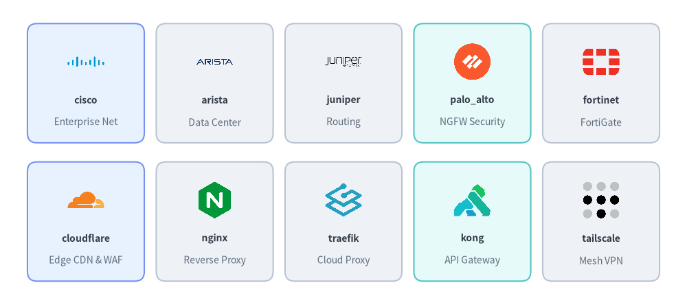
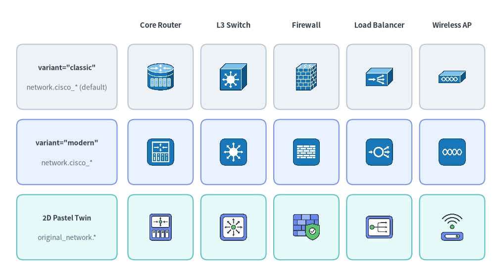

# Network & Cisco Topology Icons

Drawlib provides **70 official networking & Cisco topology icons** in `drawlib.icons.network` (`NetworkIcon`) and **70 matching 2D pastel icons** in `drawlib.icons.original_network` (`OriginalNetworkIcon`). Both suites include **48 networking vendor/project logos** and **22 L2/L3 network topology icons** (`cisco_*` in `network` with `"classic"` and `"modern"` variants, paired with 22 vendor-neutral topology icons in `original_network`) for standalone diagrams or **[Architecture Diagrams](../06_diagrams/architecture.md)** (see **[Icons Overview](./overview.md)**).


<figure class="drawlib-image" style="text-align: center;">
  
  <figcaption class="drawlib-caption">Comparing Official Network & Cisco Icons (drawlib.icons.network) and Original 2D Pastel Twins (drawlib.icons.original_network)</figcaption>
</figure>

<details class="drawlib-code-details">
<summary>Source Code</summary>

```python
from drawlib.canvas import save, setup
from drawlib.icons import network, original_network
from drawlib.shapes import rectangle
from drawlib.styles import Styles
from drawlib.text import text

setup(width=146, height=64)

columns = [
    ("Cloudflare", network.cloudflare, original_network.cloudflare),
    ("NGINX Proxy", network.nginx, original_network.nginx),
    ("Palo Alto", network.palo_alto, original_network.palo_alto),
    ("Core Router", network.cisco_core_router, original_network.core_router),
    ("L3 Switch", network.cisco_l3_switch, original_network.l3_switch),
]

rows = [
    (40.0, "Official / Cisco", "drawlib.icons.network", Styles.Neutral),
    (16.0, "2D Pastel Suite", "original_network", Styles.PrimaryNeutral),
]

for col_idx, (col_title, _, _) in enumerate(columns):
    cx = 46.5 + col_idx * 22.0
    text((cx, 56.5), col_title, style=Styles.DarkBold.patch(text_size=10.5))

for row_idx, (cy, row_title, row_sub, card_st) in enumerate(rows):
    rectangle((19.0, cy), width=28.0, height=21.0, style=card_st.patch(shape_r=2))
    text((19.0, cy + 3.0), row_title, style=Styles.DarkBold.patch(text_size=10.0))
    text((19.0, cy - 3.0), row_sub, style=Styles.Muted.patch(text_size=10.0))

    for col_idx, (lbl, fn_off, fn_orig) in enumerate(columns):
        cx = 46.5 + col_idx * 22.0
        cell_st = Styles.SecondaryNeutral if (row_idx == 1 and col_idx >= 3) else card_st
        rectangle((cx, cy), width=19.5, height=21.0, style=cell_st.patch(shape_r=2))
        fn = fn_off if row_idx == 0 else fn_orig
        fn((cx, cy + 3.0), width=8.5, style=Styles.Primary)
        text((cx, cy - 6.0), lbl, style=Styles.DarkBold.patch(text_size=10.0))

save()
```

</details>


---

## 1. API Signature, Twin Module Structure & Cisco `variant` Options

All 48 networking brand icons share identical names across `drawlib.icons.network` and `drawlib.icons.original_network`. In addition, the **22 `cisco_*` topology functions** in `drawlib.icons.network` accept `variant="default" | "classic" | "modern"`:

```python
from drawlib.diagrams.architecture import NetworkIcon, Node, OriginalNetworkIcon
from drawlib.icons import network, original_network
from drawlib.styles import Styles

# 1. Networking brand icons (identical function names in both suites)
network.cloudflare((25, 25), width=10.0, style=Styles.Primary)
original_network.cloudflare((55, 25), width=10.0, style=Styles.Primary)

# 2. Cisco topology icons support variant="default" ("classic") or variant="modern"
network.cisco_core_router((85, 25), width=10.0, style=Styles.Primary, variant="classic")
network.cisco_core_router((115, 25), width=10.0, style=Styles.Primary, variant="modern")

# 3. Vendor-neutral 2D pastel topology twin in original_network
original_network.core_router((145, 25), width=10.0, style=Styles.Primary)

# 4. High-level ArchitectureDiagram Node integration via Enum
fw_node = Node("Perimeter FW", icon=NetworkIcon.CISCO_FIREWALL, icon_size=8.0)
sw_node = Node("Core Switch", icon=OriginalNetworkIcon.CORE_SWITCH, icon_size=8.0)
```

| Feature | Official & Cisco Suite (`network`) | Original 2D Pastel Suite (`original_network`) |
| :--- | :--- | :--- |
| **Module Import** | `from drawlib.icons import network` | `from drawlib.icons import original_network` |
| **Brand Function Signature** | `network.<brand>(xy, width, *, style, variant="default")` | `original_network.<brand>(xy, width, *, style, variant="default")` |
| **Topology Function Signature** | `network.cisco_<role>(xy, width, *, style, variant="default" \| "classic" \| "modern")` | `original_network.<role>(xy, width, *, style, variant="default")` |
| **Architecture Enum** | `NetworkIcon.<NAME>` | `OriginalNetworkIcon.<NAME>` |
| **Canonical Count** | **70** (`48` vendor/OSS brands + `22` `cisco_*` topology icons) | **70** (`48` 2D pastel brand twins + `22` topology icons) |

---

## 2. Networking Vendor, CDN, Proxy & VPN Brand Icons (48 Icons)

The 48 brand icons cover enterprise switching/routing hardware, next-generation firewalls (NGFW), Zero-Trust mesh VPNs, CDNs, reverse proxies, API gateways, and DNS authorities:


<figure class="drawlib-image" style="text-align: center;">
  
  <figcaption class="drawlib-caption">Representative Networking Hardware, CDN, Proxy & Mesh VPN Brand Icons (drawlib.icons.network)</figcaption>
</figure>

<details class="drawlib-code-details">
<summary>Source Code</summary>

```python
from drawlib.canvas import save, setup
from drawlib.icons import network
from drawlib.shapes import rectangle
from drawlib.styles import Styles
from drawlib.text import text

setup(width=144, height=64)

row1 = [
    ("cisco", "Enterprise Net", network.cisco, Styles.PrimaryNeutral),
    ("arista", "Data Center", network.arista, Styles.Neutral),
    ("juniper", "Routing", network.juniper, Styles.Neutral),
    ("palo_alto", "NGFW Security", network.palo_alto, Styles.SecondaryNeutral),
    ("fortinet", "FortiGate", network.fortinet, Styles.Neutral),
]

row2 = [
    ("cloudflare", "Edge CDN & WAF", network.cloudflare, Styles.PrimaryNeutral),
    ("nginx", "Reverse Proxy", network.nginx, Styles.Neutral),
    ("traefik", "Cloud Proxy", network.traefik, Styles.Neutral),
    ("kong", "API Gateway", network.kong, Styles.SecondaryNeutral),
    ("tailscale", "Mesh VPN", network.tailscale, Styles.Neutral),
]

for row_idx, items in enumerate([row1, row2]):
    cy = 46.5 if row_idx == 0 else 17.5
    for col_idx, (title, cat, icon_fn, card_st) in enumerate(items):
        cx = 18.0 + col_idx * 27.0
        rectangle((cx, cy), width=24.5, height=25.0, style=card_st.patch(shape_r=2))
        icon_fn((cx, cy + 4.5), width=8.5, style=Styles.Primary)
        text((cx, cy - 3.5), title, style=Styles.DarkBold.patch(text_size=10.0))
        text((cx, cy - 8.2), cat, style=Styles.Muted.patch(text_size=10.0))

save()
```

</details>


### 2.1. Complete Networking Brand Icons Reference (48 Canonical Names)

All 48 canonical brand names below are available in both `network.<name>` (`NetworkIcon.<NAME>`) and `original_network.<name>` (`OriginalNetworkIcon.<NAME>`):

| Category | Count | Canonical Icon Names (`network.*` & `original_network.*`) |
| :--- | :---: | :--- |
| **Enterprise & Campus Network Hardware Vendors** | 15 | `arista`, `aruba`, `asus`, `cisco`, `d_link`, `frrouting`, `juniper`, `linksys`, `meraki`, `mikrotik`, `netgear`, `openwrt`, `tp_link`, `ubiquiti`, `yamaha` |
| **Next-Gen Firewalls (NGFW), Zero-Trust VPN & SASE** | 11 | `checkpoint`, `fortinet`, `netbird`, `opnsense`, `openvpn`, `palo_alto`, `pfsense`, `tailscale`, `wireguard`, `zerotier`, `zscaler` |
| **CDNs, Load Balancers, Reverse Proxies & API Gateways** | 12 | `akamai`, `apisix`, `caddy`, `cloudflare`, `f5`, `fastly`, `haproxy`, `kong`, `nginx`, `squid`, `traefik`, `varnish` |
| **DNS Servers, Ad-Blockers, TLS CAs & Domain Registrars** | 10 | `adguard`, `bind`, `digicert`, `godaddy`, `lets_encrypt`, `namecheap`, `pi_hole`, `porkbun`, `powerdns`, `unbound` |

---

## 3. Cisco Topology Variants (`classic` vs. `modern`) & 2D Pastel Twins (22 Icons)

For standard L2/L3 network topology symbols (routers, switches, firewalls, wireless controllers, and optical transport), Drawlib provides three visual styles:
1. **`network.cisco_<role>(..., variant="classic")`** *(or `variant="default"`)*: Classic 3D isometric Cisco teal/blue topology pucks.
2. **`network.cisco_<role>(..., variant="modern")`**: Flat modern Cisco circular/square blue topology badges.
3. **`original_network.<role>(...)`**: Vendor-neutral 2D pastel topology icons authored in Drawlib's flat aesthetic.


```python
from drawlib.canvas import save, setup
from drawlib.icons import network, original_network
from drawlib.shapes import rectangle
from drawlib.styles import Styles
from drawlib.text import text

setup(width=148, height=82)

columns = [
    ("Core Router", network.cisco_core_router, original_network.core_router),
    ("L3 Switch", network.cisco_l3_switch, original_network.l3_switch),
    ("Firewall", network.cisco_firewall, original_network.firewall),
    ("Load Balancer", network.cisco_load_balancer, original_network.load_balancer),
    ("Wireless AP", network.cisco_wireless_ap, original_network.wireless_ap),
]

rows = [
    (59.0, 'variant="classic"', "network.cisco_* (default)", Styles.Neutral),
    (36.5, 'variant="modern"', "network.cisco_*", Styles.PrimaryNeutral),
    (14.0, "2D Pastel Twin", "original_network.*", Styles.SecondaryNeutral),
]

for col_idx, (col_title, _, _) in enumerate(columns):
    cx = 48.0 + col_idx * 21.8
    text((cx, 74.5), col_title, style=Styles.DarkBold.patch(text_size=10.5))

for row_idx, (cy, row_title, row_sub, card_st) in enumerate(rows):
    rectangle((20.0, cy), width=30.0, height=19.5, style=card_st.patch(shape_r=2))
    text((20.0, cy + 2.8), row_title, style=Styles.DarkBold.patch(text_size=10.0))
    text((20.0, cy - 3.2), row_sub, style=Styles.Muted.patch(text_size=10.0))

    for col_idx, (_, fn_cisco, fn_orig) in enumerate(columns):
        cx = 48.0 + col_idx * 21.8
        rectangle((cx, cy), width=19.5, height=19.5, style=card_st.patch(shape_r=2))
        if row_idx == 0:
            fn_cisco((cx, cy), width=9.0, style=Styles.Primary, variant="classic")
        elif row_idx == 1:
            fn_cisco((cx, cy), width=9.0, style=Styles.Primary, variant="modern")
        else:
            fn_orig((cx, cy), width=9.0, style=Styles.Primary)

save()
```

<figure class="drawlib-image" style="text-align: center;">
  
  <figcaption class="drawlib-caption">Comparing Cisco Classic (3D), Cisco Modern (Flat), and Original 2D Pastel Network Topology Icons</figcaption>
</figure>


### 3.1. Complete 22 Network Topology Icons Reference (`network.cisco_*` & `original_network.*`)

| `network.cisco_*` Function (`classic` / `modern`) | `NetworkIcon` Enum | `original_network.*` 2D Pastel Twin | `OriginalNetworkIcon` Enum | Network Topology Role |
| :--- | :--- | :--- | :--- | :--- |
| `cisco_client_pc` | `CISCO_CLIENT_PC` | `client_pc` | `CLIENT_PC` | End-user workstation or desktop client host |
| `cisco_core_router` | `CISCO_CORE_ROUTER` | `core_router` | `CORE_ROUTER` | High-capacity backbone / core MPLS/BGP router |
| `cisco_core_switch` | `CISCO_CORE_SWITCH` | `core_switch` | `CORE_SWITCH` | Campus or distribution core chassis switch |
| `cisco_firewall` | `CISCO_FIREWALL` | `firewall` | `FIREWALL` | Perimeter L3/L4/L7 stateful security appliance |
| `cisco_ids_ips` | `CISCO_IDS_IPS` | `ids_ips` | `IDS_IPS` | Intrusion detection and prevention sensor |
| `cisco_ip_phone` | `CISCO_IP_PHONE` | `ip_phone` | `IP_PHONE` | VoIP desk telephone endpoint |
| `cisco_ise` | `CISCO_ISE` | `nac_server` | `NAC_SERVER` | Network Access Control (NAC) / Cisco ISE policy server |
| `cisco_l2_switch` | `CISCO_L2_SWITCH` | `l2_switch` | `L2_SWITCH` | Access-layer Ethernet VLAN switch |
| `cisco_l3_switch` | `CISCO_L3_SWITCH` | `l3_switch` | `L3_SWITCH` | Multilayer inter-VLAN routing switch |
| `cisco_load_balancer` | `CISCO_LOAD_BALANCER` | `load_balancer` | `LOAD_BALANCER` | Server load balancer / ADC appliance |
| `cisco_nexus_switch` | `CISCO_NEXUS_SWITCH` | `datacenter_switch` | `DATACENTER_SWITCH` | Leaf-spine data center fabric switch (Cisco Nexus) |
| `cisco_optical_transport` | `CISCO_OPTICAL_TRANSPORT` | `optical_transport` | `OPTICAL_TRANSPORT` | DWDM / fiber-optic metro transport node |
| `cisco_router` | `CISCO_ROUTER` | `router` | `ROUTER` | Standard branch or edge IP router |
| `cisco_server` | `CISCO_SERVER` | `server` | `SERVER` | Rack or tower application server host |
| `cisco_voice_gateway` | `CISCO_VOICE_GATEWAY` | `voice_gateway` | `VOICE_GATEWAY` | SIP / PSTN unified communications voice gateway |
| `cisco_vpn_gateway` | `CISCO_VPN_GATEWAY` | `vpn_gateway` | `VPN_GATEWAY` | Site-to-site IPsec / SSL VPN concentrator |
| `cisco_wan_cloud` | `CISCO_WAN_CLOUD` | `wan_cloud` | `WAN_CLOUD` | Public Internet, MPLS carrier cloud, or ISP transit |
| `cisco_wan_router` | `CISCO_WAN_ROUTER` | `wan_router` | `WAN_ROUTER` | SD-WAN / wide-area edge router |
| `cisco_web_security` | `CISCO_WEB_SECURITY` | `web_security` | `WEB_SECURITY` | Secure web gateway (SWG) & URL filtering proxy |
| `cisco_wireless_ap` | `CISCO_WIRELESS_AP` | `wireless_ap` | `WIRELESS_AP` | Wi-Fi wireless access point (AP) |
| `cisco_wireless_controller` | `CISCO_WIRELESS_CONTROLLER` | `wireless_controller` | `WIRELESS_CONTROLLER` | Centralized WLAN controller (WLC) |
| `cisco_wireless_router` | `CISCO_WIRELESS_ROUTER` | `wireless_router` | `WIRELESS_ROUTER` | SOHO integrated Wi-Fi gateway router |

---

## 4. Practical Architecture Diagram (`NetworkIcon` & `OriginalNetworkIcon`)

The following **[`ArchitectureDiagram`](../06_diagrams/architecture.md)** models an enterprise campus and data center perimeter network using `NetworkIcon`:


```python
from drawlib.canvas import save, setup
from drawlib.diagrams.architecture import ArchitectureDiagram, NetworkIcon, Node, NodeGroup
from drawlib.styles import Styles

setup(width=150, height=68)

d = ArchitectureDiagram(
    node_style=Styles.Primary,
    node_text_style=Styles.DarkBold.patch(text_size=10.0),
    edge_style=Styles.DarkBold,
    edge_text_style=Styles.DarkBold.patch(text_size=10.0),
    node_card_style=Styles.Neutral,
    title="Enterprise Perimeter & Campus Network Topology (NetworkIcon)",
)

wan = d.add(
    Node(
        "Cloudflare\nAnycast Edge",
        width=22,
        height=18,
        icon=NetworkIcon.CLOUDFLARE,
        icon_size=7.5,
        card_style=Styles.PrimaryNeutral,
    ),
    xy=(13.0, 23.0),
)

dc = d.add(NodeGroup(title="Corporate DMZ & Core Network", padding=4.5), xy=(36.0, 4.0))
fw = dc.add(
    Node(
        "Cisco Firewall\n(ASA / Firepower)",
        width=25,
        height=18,
        icon=NetworkIcon.CISCO_FIREWALL,
        icon_size=7.5,
        card_style=Styles.SecondaryNeutral,
    ),
    xy=(15.5, 19.0),
)
core_sw = dc.add(
    Node(
        "Cisco L3 Core\nSwitch",
        width=24,
        height=18,
        icon=NetworkIcon.CISCO_L3_SWITCH,
        icon_size=7.5,
        card_style=Styles.PrimaryNeutral,
    ),
    xy=(52.0, 19.0),
)
lb = dc.add(
    Node(
        "NGINX Reverse\nProxy Cluster",
        width=24,
        height=17,
        icon=NetworkIcon.NGINX,
        icon_size=7.2,
    ),
    xy=(88.0, 29.0),
)
wifi = dc.add(
    Node(
        "Campus Wi-Fi\nAccess Point",
        width=24,
        height=17,
        icon=NetworkIcon.CISCO_WIRELESS_AP,
        icon_size=7.2,
    ),
    xy=(88.0, 9.0),
)

d.connect(wan, fw, label="BGP", padding=1.5)
d.connect(fw, core_sw, padding=1.5)
d.connect(core_sw, lb, padding=1.5)
d.connect(core_sw, wifi, padding=1.5)

d.draw(xy=(4.0, 4.0))
save()
```

<figure class="drawlib-image" style="text-align: center;">
  
  <figcaption class="drawlib-caption">Enterprise Perimeter & Campus Network Topology Using NetworkIcon</figcaption>
</figure>


> [!TIP]
> For bare-metal servers, hypervisors, and Linux/Windows operating systems, see **[Server, OS & Virtualization Icons](./server.md)**. For IAM, SIEM, and endpoint security icons, see **[Security & Zero-Trust Icons](./security.md)**.
