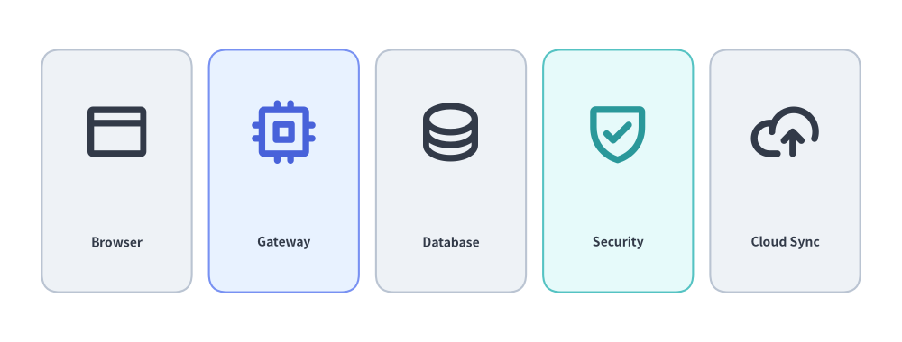
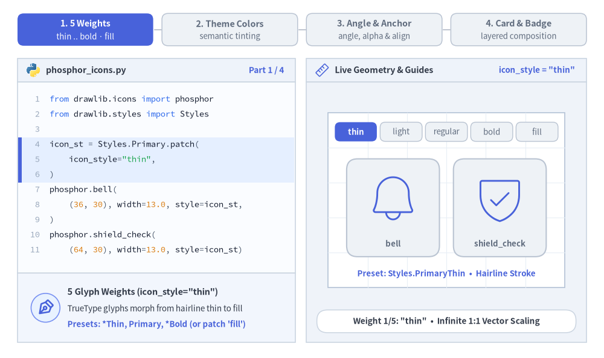
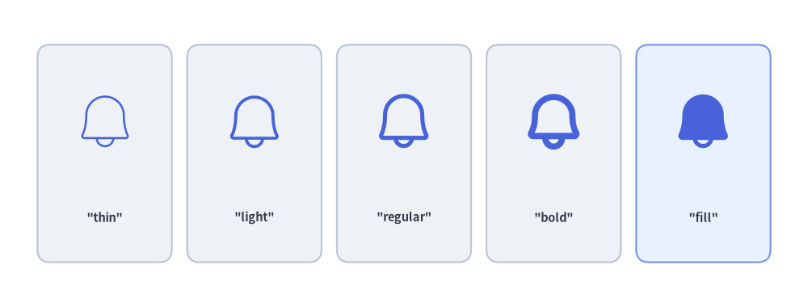
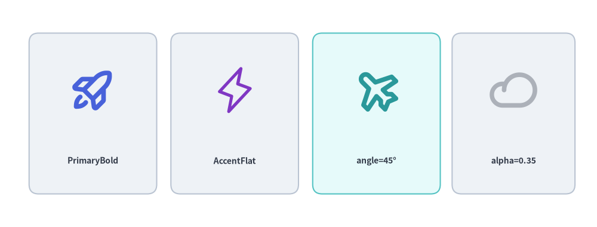
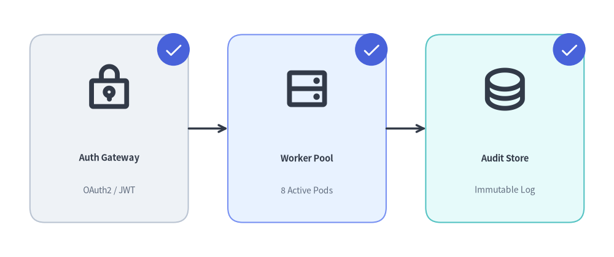

# Phosphor Vector Icons

Drawlib bundles the complete **Phosphor Icons** (<https://phosphoricons.com>) vector glyph family via `drawlib.icons.phosphor`—offering over 1,500 razor-sharp vector icons across 5 typographic weights—alongside the low-level `font_icon()` function for custom TrueType icon fonts.


<figure class="drawlib-image" style="text-align: center;">
  
  <figcaption class="drawlib-caption">Phosphor Vector Icons Paired with Calm Neutral Cards</figcaption>
</figure>

<details class="drawlib-code-details">
<summary>Source Code</summary>

```python
from drawlib.canvas import save, setup
from drawlib.icons import phosphor
from drawlib.shapes import rectangle
from drawlib.styles import Styles
from drawlib.text import text

setup(width=126, height=48)

items = [
    ("Browser", phosphor.browser, Styles.Neutral, Styles.DarkBold),
    ("Gateway", phosphor.cpu, Styles.PrimaryNeutral, Styles.PrimaryBold),
    ("Database", phosphor.database, Styles.Neutral, Styles.DarkBold),
    ("Security", phosphor.shield_check, Styles.SecondaryNeutral, Styles.SecondaryBold),
    ("Cloud Sync", phosphor.cloud_arrow_up, Styles.Neutral, Styles.DarkBold),
]

for i, (label, icon_fn, card_st, icon_st) in enumerate(items):
    cx = 16.2 + i * 23.4
    rectangle((cx, 24), width=21, height=34, style=card_st.patch(shape_r=2.5))
    icon_fn((cx, 29.5), width=9.5, style=icon_st)
    text((cx, 14), label, style=Styles.DarkBold.patch(text_size=10.0))

save()
```

</details>


---

## 1. Core Vector Glyph Concepts

Unlike static bitmap icons, every function in `drawlib.icons.phosphor` renders directly from embedded TrueType vector fonts—scaling infinitely at a 1:1 aspect ratio while dynamically adapting stroke weight, theme color, rotation, opacity, and anchor alignment via `Style`. Watch how `icon_style` morphs across all 5 typographic weights, semantic theme presets recolor glyphs on neutral and saturated surfaces, `angle` / `alpha` / `halign` / `valign` transform placement around `xy`, and calm container cards compose with corner verification badges:


<figure class="drawlib-image" style="text-align: center;">
  
  <figcaption class="drawlib-caption">Parameter & Styling Tour: Live Morphing of Phosphor Weights, Theme Colors, Transforms, and Card Badges (APNG Animation)</figcaption>
</figure>

<details class="drawlib-code-details">
<summary>Source Code</summary>

```python
from __future__ import annotations

import math
from drawlib.anim import Animation
from drawlib.canvas import save, setup
from drawlib.icons import code as code_icons
from drawlib.icons import phosphor
from drawlib.lines import line
from drawlib.shapes import arc, circle, rectangle
from drawlib.smartarts import SourceCode, SourceCodeStyles
from drawlib.styles import Styles
from drawlib.text import text

W, H = 138.0, 82.0
setup(width=W, height=H)
anim = Animation(fps=10.0, loop=0)

CODE_TEXT_SIZE = 10.0
PT_TO_CANVAS = W / 720.0
FONT_CANVAS = CODE_TEXT_SIZE * PT_TO_CANVAS
LINE_H = FONT_CANVAS * 1.8
PAD_Y = FONT_CANVAS * 1.2

CODE_STYLES = SourceCodeStyles.get("default", font_lang="en", text_size=CODE_TEXT_SIZE).patch(
    box_style=Styles.Neutral.patch(shape_fill_color=(0, 0, 0, 0), shape_line_width=0),
)

PANE_HEADER = Styles.Neutral.patch(
    shape_fill_color=(238, 243, 250),
    shape_line_color=(203, 213, 225),
    shape_line_width=1.2,
    shape_r=0.0,
)
EDITOR_BODY = Styles.Neutral.patch(
    shape_fill_color=(250, 252, 255),
    shape_line_color=(203, 213, 225),
    shape_line_width=1.2,
    shape_r=0.0,
)
TAKEAWAY_BODY = Styles.Neutral.patch(
    shape_fill_color=(242, 246, 253),
    shape_line_color=(203, 213, 225),
    shape_line_width=1.2,
    shape_r=0.0,
)
STUDIO_BODY = Styles.Neutral.patch(
    shape_fill_color=(239, 243, 249),
    shape_line_color=(203, 213, 225),
    shape_line_width=1.2,
    shape_r=0.0,
)

PART_ITEMS = [
    ("1. 5 Weights", "thin .. bold · fill"),
    ("2. Theme Colors", "semantic tinting"),
    ("3. Angle & Anchor", "angle, alpha & align"),
    ("4. Card & Badge", "layered composition"),
]


def draw_step_bar(active_part: int) -> None:
    """Draw top 4-part progress bar (active_part is 1..4)."""
    pill_w = 31.0
    pill_h = 7.4
    gap = 2.0
    start_x = 4.0 + pill_w / 2.0
    cy = 75.2

    for idx, (label, sublabel) in enumerate(PART_ITEMS, start=1):
        cx = start_x + (idx - 1) * (pill_w + gap)
        if idx > 1:
            prev_cx = cx - (pill_w + gap)
            line(
                (prev_cx + pill_w / 2.0 + 0.2, cy),
                (cx - pill_w / 2.0 - 0.2, cy),
                style=Styles.PrimaryBold if idx <= active_part else Styles.MutedThin,
            )

        if idx == active_part:
            st = Styles.PrimaryFlat.patch(shape_r=1.4)
            tst = Styles.WhiteBold.patch(text_size=10.3)
            sub_tst = Styles.White.patch(text_size=9.5)
        elif idx < active_part:
            st = Styles.PrimaryNeutral.patch(shape_r=1.4, shape_line_width=1.1)
            tst = Styles.PrimaryBold.patch(text_size=10.3)
            sub_tst = Styles.Primary.patch(text_size=9.5)
        else:
            st = Styles.Neutral.patch(shape_r=1.4, shape_line_width=1.1)
            tst = Styles.MutedBold.patch(text_size=10.3)
            sub_tst = Styles.Muted.patch(text_size=9.5)

        rectangle((cx, cy), width=pill_w, height=pill_h, style=st)
        text((cx, cy + 1.35), label, style=tst)
        text((cx, cy - 1.55), sublabel, style=sub_tst)


def draw_left_pane(
    active_part: int,
    code_lines: list[str],
    hl_range: tuple[int, int],
    icon_fn: object,
    summary_title: str,
    summary_line1: str,
    summary_line2: str,
) -> None:
    """Draw left Python code editor + bottom vector glyph concept note."""
    x0, w = 4.0, 63.5
    cx = x0 + w / 2.0
    top_y = 63.2
    header_h = 5.4
    editor_h = 43.8
    takeaway_h = 15.8

    rectangle((cx, top_y + header_h / 2.0), width=w, height=header_h, style=PANE_HEADER)
    code_icons.python((x0 + 3.6, top_y + header_h / 2.0), width=3.4, style=Styles.Neutral)
    text(
        (x0 + 6.5, top_y + header_h / 2.0),
        "phosphor_icons.py",
        style=Styles.DarkBold.patch(text_size=10.2, halign="left"),
    )
    text(
        (x0 + w - 2.6, top_y + header_h / 2.0),
        f"Part {active_part} / 4",
        style=Styles.PrimaryBold.patch(text_size=9.8, halign="right"),
    )

    rectangle((cx, top_y - editor_h / 2.0), width=w, height=editor_h, style=EDITOR_BODY)

    hl_start, hl_end = hl_range
    hl_top = top_y - PAD_Y - hl_start * LINE_H
    hl_bot = top_y - PAD_Y - (hl_end + 1) * LINE_H
    hl_cy = (hl_top + hl_bot) / 2.0
    hl_h = hl_top - hl_bot
    rectangle(
        (cx, hl_cy),
        width=w - 0.6,
        height=hl_h,
        style=Styles.Neutral.patch(shape_fill_color=(229, 239, 255), shape_line_width=0),
    )
    rectangle(
        (x0 + 0.55, hl_cy),
        width=0.9,
        height=hl_h,
        style=Styles.PrimaryFlat.patch(shape_line_width=0),
    )

    SourceCode.draw(
        xy=(x0, top_y),
        width=w,
        code="\n".join(code_lines),
        styles=CODE_STYLES,
        code_lang="python",
        show_linenum=True,
        align="top_left",
    )

    take_cy = 3.6 + takeaway_h / 2.0
    rectangle((cx, take_cy), width=w, height=takeaway_h, style=TAKEAWAY_BODY)
    circle(
        (x0 + 6.4, take_cy),
        radius=3.3,
        style=Styles.PrimaryNeutral.patch(shape_line_width=1.2),
    )
    icon_fn((x0 + 6.4, take_cy), width=3.8, style=Styles.PrimaryBold)  # type: ignore[operator]
    text(
        (x0 + 11.4, take_cy + 3.6),
        summary_title,
        style=Styles.DarkBold.patch(text_size=10.4, halign="left"),
    )
    text(
        (x0 + 11.4, take_cy - 0.2),
        summary_line1,
        style=Styles.Dark.patch(text_size=9.7, halign="left"),
    )
    text(
        (x0 + 11.4, take_cy - 3.8),
        summary_line2,
        style=Styles.PrimaryBold.patch(text_size=9.6, halign="left"),
    )


def draw_geometry_studio(param_badge: str, footer_caption: str) -> tuple[float, float]:
    """Draw right geometry lab shell, inner coordinate sheet with subtle grid, and footer."""
    x0, w = 70.0, 64.0
    cx = x0 + w / 2.0
    top_y = 63.2
    header_h = 5.4
    body_h = 59.6

    rectangle((cx, top_y + header_h / 2.0), width=w, height=header_h, style=PANE_HEADER)
    phosphor.ruler((x0 + 3.6, top_y + header_h / 2.0), width=3.4, style=Styles.Primary)
    text(
        (x0 + 6.5, top_y + header_h / 2.0),
        "Live Geometry & Guides",
        style=Styles.DarkBold.patch(text_size=10.2, halign="left"),
    )
    text(
        (x0 + w - 2.6, top_y + header_h / 2.0),
        param_badge,
        style=Styles.PrimaryBold.patch(text_size=9.6, halign="right"),
    )

    rectangle((cx, 3.6 + body_h / 2.0), width=w, height=body_h, style=STUDIO_BODY)

    sheet_cx, sheet_cy = cx, 36.2
    sheet_w, sheet_h = 54.0, 40.0
    sx0, sy0 = sheet_cx - sheet_w / 2.0, sheet_cy - sheet_h / 2.0
    rectangle(
        (sheet_cx, sheet_cy),
        width=sheet_w,
        height=sheet_h,
        style=Styles.Neutral.patch(
            shape_fill_color=(255, 255, 255),
            shape_line_color=(180, 194, 214),
            shape_line_width=1.2,
        ),
    )
    g_st = Styles.MutedThin.patch(line_color=(232, 238, 246), line_width=0.8)
    for gx in range(1, 6):
        vx = sx0 + gx * (sheet_w / 6.0)
        line((vx, sy0), (vx, sy0 + sheet_h), style=g_st)
    for gy in range(1, 5):
        vy = sy0 + gy * (sheet_h / 5.0)
        line((sx0, vy), (sx0 + sheet_w, vy), style=g_st)

    rectangle(
        (cx, 8.4),
        width=59.2,
        height=5.2,
        style=Styles.Neutral.patch(
            shape_fill_color=(255, 255, 255),
            shape_line_color=(203, 213, 225),
            shape_line_width=1.1,
            shape_r=2.4,
        ),
        text=footer_caption,
        text_style=Styles.DarkBold.patch(text_size=9.8),
    )
    return sheet_cx, sheet_cy


# =========================================================================
# Part 1: 5 Weights — style.icon_style ("thin" .. "bold" + "fill")
# =========================================================================
WEIGHT_STATES = [
    ("thin", 3.2, "Preset: Styles.PrimaryThin  •  Hairline Stroke"),
    ("light", 0.50, 'icon_style="light"  •  Delicate Schema Stroke'),
    ("regular", 3.2, "Preset: Styles.Primary  •  Standard Stroke"),
    ("bold", 0.50, "Preset: Styles.PrimaryBold  •  Heavy Stroke"),
    ("fill", 3.5, 'icon_style="fill"  •  Solid Filled Silhouette'),
]
ALL_WEIGHTS = ["thin", "light", "regular", "bold", "fill"]

for w_idx, (w_name, dur, preset_note) in enumerate(WEIGHT_STATES):
    code_w = [
        "from drawlib.icons import phosphor",
        "from drawlib.styles import Styles",
        "",
        "icon_st = Styles.Primary.patch(",
        f'    icon_style="{w_name}",',
        ")",
        "phosphor.bell(",
        "    (36, 30), width=13.0, style=icon_st,",
        ")",
        "phosphor.shield_check(",
        "    (64, 30), width=13.0, style=icon_st)",
    ]
    with anim.frame(duration=dur):
        draw_step_bar(1)
        draw_left_pane(
            1,
            code_w,
            (3, 5),
            phosphor.pen_nib,
            f'5 Glyph Weights (icon_style="{w_name}")',
            "TrueType glyphs morph from hairline thin to fill",
            "Presets: *Thin, Primary, *Bold (or patch 'fill')",
        )
        scx, scy = draw_geometry_studio(
            f'icon_style = "{w_name}"',
            f'Weight {w_idx + 1}/5: "{w_name}"  •  Infinite 1:1 Vector Scaling',
        )

        # Top 5-pill weight tracker inside studio sheet
        pw, ph, pgap = 9.6, 4.4, 0.75
        p_start = scx - (5 * pw + 4 * pgap) / 2.0 + pw / 2.0
        for pidx, pw_label in enumerate(ALL_WEIGHTS):
            px = p_start + pidx * (pw + pgap)
            if pidx == w_idx:
                pst = Styles.PrimaryFlat.patch(shape_r=1.2)
                ptst = Styles.WhiteBold.patch(text_size=9.5)
            elif pidx < w_idx:
                pst = Styles.PrimaryNeutral.patch(shape_r=1.2, shape_line_width=1.0)
                ptst = Styles.PrimaryBold.patch(text_size=9.5)
            else:
                pst = Styles.Neutral.patch(shape_r=1.2, shape_line_width=1.0)
                ptst = Styles.Muted.patch(text_size=9.5)
            rectangle((px, 51.8), width=pw, height=ph, style=pst, text=pw_label, text_style=ptst)

        # Dual preview cards showing stroke & solid fill progression
        card_st = Styles.PrimaryNeutral if w_name == "fill" else Styles.Neutral
        glyph_st = Styles.Primary.patch(icon_style=w_name)
        for dx, fn, name_lbl in (
            (-12.2, phosphor.bell, "bell"),
            (12.2, phosphor.shield_check, "shield_check"),
        ):
            rectangle((scx + dx, 34.4), width=21.2, height=22.4, style=card_st.patch(shape_r=2.5))
            fn((scx + dx, 36.6), width=12.4, style=glyph_st)
            text((scx + dx, 26.2), name_lbl, style=Styles.MutedBold.patch(text_size=9.5))

        text((scx, 19.3), preset_note, style=Styles.PrimaryBold.patch(text_size=9.6))

# =========================================================================
# Part 2: Theme Colors — Semantic Vector Recoloring & Inverted Contrast
# =========================================================================
COLOR_STATES = [
    (
        "Neutral",
        "PrimaryBold",
        Styles.Neutral,
        Styles.PrimaryBold,
        Styles.PrimaryFlat,
        3.2,
        (6, 9),
        "Semantic Vector Recoloring",
        "style.icon_color tints glyphs from any Style",
        "Pair colored glyphs with calm *Neutral surfaces",
        "Styles.PrimaryBold  •  Brand Primary Vector Tint",
        "Calm Neutral Surface + Brand Primary Glyph",
    ),
    (
        "SecondaryNeutral",
        "SecondaryBold",
        Styles.SecondaryNeutral,
        Styles.SecondaryBold,
        Styles.SecondaryFlat,
        0.55,
        (6, 9),
        "Semantic Vector Recoloring",
        "style.icon_color tints glyphs from any Style",
        "Pair colored glyphs with calm *Neutral surfaces",
        "Styles.SecondaryBold  •  Teal Secondary Tint",
        "Calm SecondaryNeutral + Teal Secondary Glyph",
    ),
    (
        "Neutral",
        "DangerFlat",
        Styles.Neutral,
        Styles.DangerFlat,
        Styles.DangerFlat,
        3.2,
        (6, 9),
        "Semantic Alert Coloring",
        "DangerFlat & WarningBold highlight critical states",
        "Monochrome glyphs recolor cleanly with zero blur",
        "Styles.DangerFlat  •  Alert Crimson Vector Tint",
        "Calm Neutral Surface + Alert Crimson Glyph",
    ),
    (
        "PrimaryFlat",
        "WhiteBold",
        Styles.PrimaryFlat,
        Styles.WhiteBold,
        Styles.PrimaryFlat,
        3.5,
        (4, 9),
        "High-Contrast Inverted Badge",
        "Mount Styles.WhiteBold atop Styles.PrimaryFlat",
        "Crisp contrast for focal alerts & hero badges",
        "Styles.WhiteBold on Saturated Styles.PrimaryFlat",
        "Inverted Contrast: WhiteBold on PrimaryFlat Badge",
    ),
]
SWATCH_LABELS = ["Primary", "Secondary", "Danger", "White / Flat"]

for c_idx, (
    badge_name,
    icon_name,
    badge_st,
    icon_st,
    pill_active_st,
    dur,
    hl_rng,
    s_title,
    s_l1,
    s_l2,
    foot_cap,
    note_txt,
) in enumerate(COLOR_STATES):
    code_c = [
        "from drawlib.icons import phosphor",
        "from drawlib.shapes import circle",
        "from drawlib.styles import Styles",
        "",
        "circle((50, 30), radius=11.2,",
        f"       style=Styles.{badge_name})",
        "phosphor.shield_check(",
        "    (50, 30), width=12.8,",
        f"    style=Styles.{icon_name},",
        ")",
    ]
    with anim.frame(duration=dur):
        draw_step_bar(2)
        draw_left_pane(2, code_c, hl_rng, phosphor.palette, s_title, s_l1, s_l2)
        scx, scy = draw_geometry_studio(f"Styles.{icon_name}", foot_cap)

        # Top 4-pill semantic color tracker
        cw, ch, cgap = 12.1, 4.4, 0.8
        c_start = scx - (4 * cw + 3 * cgap) / 2.0 + cw / 2.0
        for sidx, slbl in enumerate(SWATCH_LABELS):
            sx = c_start + sidx * (cw + cgap)
            if sidx == c_idx:
                sst = pill_active_st.patch(shape_r=1.2)
                stst = Styles.WhiteBold.patch(text_size=9.5)
            else:
                sst = Styles.Neutral.patch(shape_r=1.2, shape_line_width=1.0)
                stst = Styles.MutedBold.patch(text_size=9.5)
            rectangle((sx, 51.8), width=cw, height=ch, style=sst, text=slbl, text_style=stst)

        circle((scx, 34.4), radius=11.2, style=badge_st)
        phosphor.shield_check((scx, 34.4), width=12.8, style=icon_st)
        text((scx, 19.3), note_txt, style=Styles.PrimaryBold.patch(text_size=9.6))

# =========================================================================
# Part 3: Angle & Anchor — angle, alpha, and halign / valign
# =========================================================================
for ang, dur in ((0, 0.50), (22, 0.50), (45, 3.4)):
    code_rot = [
        "from drawlib.icons import phosphor",
        "from drawlib.styles import Styles",
        "",
        "ghost = Styles.DarkBold.patch(alpha=0.35)",
        f"st = Styles.SecondaryBold.patch(angle={ang})",
        "phosphor.airplane(",
        "    (50, 30), width=14, style=ghost,",
        ")",
        "phosphor.airplane(",
        "    (50, 30), width=14, style=st,",
        ")",
    ]
    with anim.frame(duration=dur):
        draw_step_bar(3)
        draw_left_pane(
            3,
            code_rot,
            (3, 4),
            phosphor.compass,
            "CCW Rotation & Opacity (angle, alpha)",
            "style.angle rotates CCW in degrees around xy",
            "alpha=0.35 fades standby or inactive glyphs",
        )
        scx, scy = draw_geometry_studio(
            f"angle = {ang}°",
            f"angle={ang}° CCW Around xy  •  Standby Ghost alpha=0.35",
        )
        cy_a = 34.5
        line((scx - 20.0, cy_a), (scx + 20.0, cy_a), style=Styles.MutedDashed.patch(line_width=1.0))
        line((scx, cy_a - 14.5), (scx, cy_a + 18.0), style=Styles.MutedDashed.patch(line_width=1.0))
        rectangle(
            (scx, cy_a),
            width=14.0,
            height=14.0,
            style=Styles.MutedDashed.patch(
                shape_fill_color=(0, 0, 0, 0),
                shape_line_color=(188, 200, 218),
                shape_line_width=1.0,
            ),
        )

        # Standby ghost at 0 deg (alpha=0.35) + active rotated glyph
        phosphor.airplane((scx, cy_a), width=14.0, style=Styles.DarkBold.patch(alpha=0.35))
        phosphor.airplane((scx, cy_a), width=14.0, style=Styles.SecondaryBold.patch(angle=ang))

        if ang > 0:
            rad = math.radians(90.0 + ang)
            line(
                (scx, cy_a),
                (scx + 17.5 * math.cos(rad), cy_a + 17.5 * math.sin(rad)),
                style=Styles.PrimaryDashed.patch(line_width=1.3),
            )
            arc(
                (scx, cy_a),
                width=29.0,
                height=29.0,
                angle_start=90,
                angle_end=90 + ang,
                style=Styles.PrimaryNeutral.patch(shape_line_width=2.0),
            )
            text(
                (scx - 10.5, cy_a + 14.8),
                f"+{ang}° CCW",
                style=Styles.PrimaryBold.patch(text_size=9.8, halign="right"),
            )

        line(
            (scx + 6.8, cy_a - 2.2),
            (scx + 10.6, cy_a - 2.2),
            style=Styles.MutedBold.patch(line_width=1.1),
        )
        text(
            (scx + 11.4, cy_a - 2.2),
            "alpha=0.35\n(ghost)",
            style=Styles.MutedBold.patch(text_size=9.5, halign="left"),
        )
        line(
            (scx - 8.2, cy_a - 9.4),
            (scx - 1.5, cy_a - 1.5),
            style=Styles.DangerBold.patch(line_width=1.1),
        )
        circle((scx, cy_a), radius=1.25, style=Styles.DangerFlat)
        text(
            (scx - 8.8, cy_a - 9.8),
            "xy (center)",
            style=Styles.DangerBold.patch(text_size=9.6, halign="right"),
        )

for ha, va, dur in (("center", "center", 0.55), ("left", "bottom", 3.5)):
    code_align = [
        "from drawlib.icons import phosphor",
        "from drawlib.styles import Styles",
        "",
        "# Align 14x14 glyph box relative to xy",
        "phosphor.paper_plane_tilt(",
        "    (44, 24), width=14.0,",
        "    style=Styles.PrimaryBold.patch(",
        f'        halign="{ha}", valign="{va}",',
        "    ),",
        ")",
    ]
    with anim.frame(duration=dur):
        draw_step_bar(3)
        draw_left_pane(
            3,
            code_align,
            (6, 8),
            phosphor.crosshair,
            "Anchor Alignment (halign & valign)",
            "Default 'center' centers the width×width square",
            "halign='left', valign='bottom' pins corner to xy",
        )
        badge_txt = "center / center" if ha == "center" else "left / bottom"
        foot_txt = (
            'Default halign="center", valign="center" at xy'
            if ha == "center"
            else 'halign="left", valign="bottom"  •  14×14 Box at xy'
        )
        scx, scy = draw_geometry_studio(badge_txt, foot_txt)
        ax, ay = scx - 4.0, scy - 4.2
        line((ax - 15.0, ay), (ax + 22.0, ay), style=Styles.MutedDashed.patch(line_width=1.0))
        line((ax, ay - 12.0), (ax, ay + 20.0), style=Styles.MutedDashed.patch(line_width=1.0))

        if ha == "left":
            # Ghost default center box for clear comparison
            rectangle(
                (ax, ay),
                width=14.0,
                height=14.0,
                style=Styles.MutedDashed.patch(
                    shape_fill_color=(0, 0, 0, 0),
                    shape_line_color=(195, 206, 222),
                    shape_line_width=1.0,
                ),
            )
            text(
                (ax - 7.8, ay - 9.2),
                "default center",
                style=Styles.MutedBold.patch(text_size=9.5),
            )
            box_cx, box_cy = ax + 7.0, ay + 7.0
        else:
            box_cx, box_cy = ax, ay

        rectangle(
            (box_cx, box_cy),
            width=14.0,
            height=14.0,
            style=Styles.PrimaryDashed.patch(shape_fill_color=(0, 0, 0, 0), shape_line_width=1.4),
        )
        phosphor.paper_plane_tilt(
            (ax, ay),
            width=14.0,
            style=Styles.PrimaryBold.patch(halign=ha, valign=va),
        )
        line(
            (box_cx - 7.0, box_cy + 9.2),
            (box_cx + 7.0, box_cy + 9.2),
            arrow_head="<->",
            style=Styles.PrimaryBold.patch(line_width=1.3),
        )
        text((box_cx, box_cy + 12.0), "width = 14", style=Styles.PrimaryBold.patch(text_size=9.6))

        circle((ax, ay), radius=1.3, style=Styles.DangerFlat)
        if ha == "center":
            line(
                (ax - 8.2, ay - 9.4),
                (ax - 1.6, ay - 1.6),
                style=Styles.DangerBold.patch(line_width=1.1),
            )
            text(
                (ax - 8.8, ay - 9.8),
                "xy (center)",
                style=Styles.DangerBold.patch(text_size=9.6, halign="right"),
            )
        else:
            text(
                (ax + 2.2, ay - 3.2),
                "xy anchor",
                style=Styles.DangerBold.patch(text_size=9.6, halign="left"),
            )

# =========================================================================
# Part 4: Card & Badge — 3-Layer Service Card Composition
# =========================================================================
CARD_STEPS = [
    (
        1,
        0.55,
        (0, 1),
        "Layer 1 / 3",
        "Step 1: Calm PrimaryNeutral Container Card",
        "1. Calm Neutral Container Card",
        "Ground service nodes in calm *Neutral cards",
        "Keeps 50%+ neutral balance across diagrams",
    ),
    (
        2,
        3.3,
        (2, 5),
        "Layer 2 / 3",
        "Step 2: Centered DarkBold Glyph + Node Labels",
        "2. Centered Primary Glyph & Labels",
        "Place phosphor.lock_key (DarkBold) above labels",
        "High contrast readability on light card fills",
    ),
    (
        3,
        0.50,
        (6, 7),
        "Layer 3 / 3",
        "Step 3: Saturated PrimaryFlat Corner Badge",
        "3. Circular Corner Verification Badge",
        "Anchor a small PrimaryFlat circle on card corner",
        "Reserves saturated color strictly for status focal",
    ),
    (
        4,
        3.6,
        (6, 10),
        "3-Layer Card",
        "Complete 3-Layer Card: Card + Glyph + Check Badge",
        "3. Complete Service Card + Check Badge",
        "Overlay WhiteBold phosphor.check inside badge",
        "Reusable idiom for gateways, pools & audit nodes",
    ),
]

code_card = [
    "rectangle((44, 34), width=28, height=32,",
    "          style=Styles.PrimaryNeutral)",
    "phosphor.lock_key(",
    "    (44, 42), 10, style=Styles.DarkBold)",
    'text((44, 30), "Auth Gateway",',
    "     style=Styles.DarkBold)",
    "circle((56, 49), radius=3.4,",
    "       style=Styles.PrimaryFlat)",
    "phosphor.check(",
    "    (56, 49), width=3.9,",
    "    style=Styles.WhiteBold)",
]

for step_num, dur, hl_rng, badge_lbl, foot_lbl, s_title, s_l1, s_l2 in CARD_STEPS:
    with anim.frame(duration=dur):
        draw_step_bar(4)
        draw_left_pane(4, code_card, hl_rng, phosphor.stack, s_title, s_l1, s_l2)
        scx, scy = draw_geometry_studio(badge_lbl, foot_lbl)

        card_cx, card_cy = 91.5, 35.2
        bx, by = card_cx + 12.0, card_cy + 13.6

        # Layer 1: Calm PrimaryNeutral container card
        rectangle(
            (card_cx, card_cy),
            width=28.0,
            height=32.0,
            style=Styles.PrimaryNeutral.patch(shape_r=3.0),
        )

        # Layer 2: Centered DarkBold glyph + labels
        if step_num >= 2:
            phosphor.lock_key((card_cx, card_cy + 6.8), width=10.0, style=Styles.DarkBold)
            text(
                (card_cx, card_cy - 5.4),
                "Auth Gateway",
                style=Styles.DarkBold.patch(text_size=10.2),
            )
            text(
                (card_cx, card_cy - 10.8),
                "OAuth2 / JWT",
                style=Styles.Muted.patch(text_size=9.6),
            )

        # Layer 3a: Saturated PrimaryFlat corner circle
        if step_num >= 3:
            circle((bx, by), radius=3.4, style=Styles.PrimaryFlat)

        # Layer 3b: WhiteBold check glyph + layer callouts
        if step_num >= 4:
            phosphor.check((bx, by), width=3.9, style=Styles.WhiteBold)

            line((bx + 3.8, by), (109.5, by), style=Styles.PrimaryBold.patch(line_width=1.2))
            text(
                (110.3, by),
                "3. Check Badge",
                style=Styles.PrimaryBold.patch(text_size=9.5, halign="left"),
            )
            line(
                (card_cx + 6.2, card_cy + 6.8),
                (109.5, card_cy + 6.8),
                style=Styles.DarkBold.patch(line_width=1.2),
            )
            text(
                (110.3, card_cy + 6.8),
                "2. DarkBold Icon",
                style=Styles.DarkBold.patch(text_size=9.5, halign="left"),
            )
            line(
                (card_cx + 14.3, card_cy - 12.5),
                (109.5, card_cy - 12.5),
                style=Styles.Primary.patch(line_width=1.2),
            )
            text(
                (110.3, card_cy - 12.5),
                "1. Neutral Card",
                style=Styles.Primary.patch(text_size=9.5, halign="left"),
            )

save()
```

</details>


- **5 Typographic Weights (`style.icon_style`)**: Morphs any Phosphor glyph across `"thin"`, `"light"`, `"regular"`, `"bold"`, and solid `"fill"` via `style.patch(icon_style=...)` or preset variants (`*Thin`, base `Styles.Primary`, `*Bold`).
- **Semantic Vector Recoloring (`style.icon_color`)**: Tints monochrome vector glyphs with theme presets (`Styles.PrimaryBold`, `Styles.SecondaryBold`, `Styles.DangerFlat`), pairing `Styles.WhiteBold` atop saturated `*Flat` badges for crisp contrast.
- **Rotation, Opacity & Anchor Alignment (`angle`, `alpha`, `halign`, `valign`)**: Rotates counterclockwise in degrees around `xy`, fades standby glyphs via `alpha`, and shifts the `width × width` glyph box relative to `xy` (or offsets via `xy_shift`).
- **Layered Card & Badge Composition**: Combines calm neutral container cards (`Styles.PrimaryNeutral`) with centered primary icons (`Styles.DarkBold`) and circular corner verification badges (`Styles.PrimaryFlat` + `Styles.WhiteBold`).

---

## 2. Function Signature & Styling Parameters

Every Phosphor icon is exposed as a function named after the icon in `snake_case`:

```python
from drawlib.icons import phosphor

phosphor.<icon_name>(
    xy: tuple[float, float],
    width: float,
    *,
    style: Style,
) -> None
```

| Parameter / Style Field | Type | Default | Description |
| :--- | :--- | :--- | :--- |
| `xy` | `tuple[float, float]` | *Required* | Anchor coordinate `(x, y)` of the icon (center-aligned by default). |
| `width` | `float` | *Required* | Icon width in canvas units (height scales proportionally at a 1:1 aspect ratio). |
| `style` | `Style` | *Required* | Preset or patched `Style` controlling weight, color, alignment, offset, rotation, and opacity. |
| `style.icon_style` | `"thin" \| "light" \| "regular" \| "bold" \| "fill"` | `"thin"` | Typographic stroke weight of the Phosphor glyph. |
| `style.icon_color` | `tuple[int, int, int] \| Color` | Theme color | Glyph color (automatically mapped by preset styles like `Styles.PrimaryBold`, `Styles.DarkBold`, `Styles.WhiteBold`). |
| `style.halign` | `"left" \| "center" \| "right"` | `"center"` | Horizontal anchor alignment relative to `xy[0]`. |
| `style.valign` | `"bottom" \| "center" \| "top"` | `"center"` | Vertical anchor alignment relative to `xy[1]`. |
| `style.xy_shift` | `tuple[float, float] \| None` | `None` | Relative `(dx, dy)` coordinate offset rotated along with `angle`. |
| `style.xy_abs_shift` | `tuple[float, float] \| None` | `None` | Absolute `(dx, dy)` coordinate offset independent of `angle`. |
| `style.angle` | `float` | `0.0` | Counterclockwise rotation angle in degrees around `xy`. |
| `style.alpha` | `float` | `1.0` | Opacity from `0.0` (transparent) to `1.0` (fully opaque). |


---

## 3. Typographic Weights (`thin`, `light`, `regular`, `bold`, `fill`)

Phosphor vector icons support 5 typographic weights controlled via `style.patch(icon_style=...)` or preset style suffixes (`*Light` -> `"light"`, `*Bold` -> `"bold"`, `*Flat` -> `"fill"`):

- **`"thin"`**: Ultra-fine stroke for subtle background watermarks.
- **`"light"`**: Delicate line weight for dense technical schemas.
- **`"regular"`**: Balanced standard stroke for general diagram nodes.
- **`"bold"`**: Prominent heavy stroke for primary gateways and services.
- **`"fill"`**: Solid filled silhouette for active states, badges, and alerts.


```python
from drawlib.canvas import save, setup
from drawlib.icons import phosphor
from drawlib.shapes import rectangle
from drawlib.styles import Styles
from drawlib.text import text

setup(width=126, height=48)

weights = ["thin", "light", "regular", "bold", "fill"]

for i, w_name in enumerate(weights):
    cx = 16.2 + i * 23.4
    card_st = Styles.PrimaryNeutral if w_name == "fill" else Styles.Neutral
    rectangle((cx, 24), width=21, height=34, style=card_st.patch(shape_r=2))
    phosphor.bell((cx, 29), width=10, style=Styles.Primary.patch(icon_style=w_name))
    text((cx, 14), f'"{w_name}"', style=Styles.DarkBold.patch(text_size=10.5))

save()
```

<figure class="drawlib-image" style="text-align: center;">
  
  <figcaption class="drawlib-caption">The Five Phosphor Typographic Weights</figcaption>
</figure>


---

## 4. Semantic Coloring, Rotation & Opacity

Because Phosphor icons are rendered as vector glyphs, you can tint them with any preset theme style (`Styles.PrimaryBold`, `Styles.SecondaryBold`, `Styles.DarkBold`, `Styles.WhiteBold`), rotate them via `angle`, or fade them via `alpha`:


```python
from drawlib.canvas import save, setup
from drawlib.icons import phosphor
from drawlib.shapes import rectangle
from drawlib.styles import Styles
from drawlib.text import text

setup(width=126, height=48)

# 1. Semantic PrimaryBold
rectangle((19.5, 24), width=27, height=34, style=Styles.Neutral.patch(shape_r=2))
phosphor.rocket_launch((19.5, 29), width=10, style=Styles.PrimaryBold)
text((19.5, 14), "PrimaryBold", style=Styles.DarkBold.patch(text_size=10.0))

# 2. Filled Accent Silhouette
rectangle((49.5, 24), width=27, height=34, style=Styles.Neutral.patch(shape_r=2))
phosphor.lightning((49.5, 29), width=10, style=Styles.AccentFlat)
text((49.5, 14), "AccentFlat", style=Styles.DarkBold.patch(text_size=10.0))

# 3. Rotated Icon (angle=45)
rectangle((79.5, 24), width=27, height=34, style=Styles.SecondaryNeutral.patch(shape_r=2))
phosphor.airplane((79.5, 29), width=10, style=Styles.SecondaryBold.patch(angle=45))
text((79.5, 14), "angle=45°", style=Styles.DarkBold.patch(text_size=10.0))

# 4. Semi-Transparent Icon (alpha=0.35)
rectangle((108.5, 24), width=26, height=34, style=Styles.Neutral.patch(shape_r=2))
phosphor.cloud((108.5, 29), width=10, style=Styles.DarkBold.patch(alpha=0.35))
text((108.5, 14), "alpha=0.35", style=Styles.DarkBold.patch(text_size=10.0))

save()
```

<figure class="drawlib-image" style="text-align: center;">
  
  <figcaption class="drawlib-caption">Semantic Coloring, Rotation (angle), and Opacity (alpha)</figcaption>
</figure>


---

## 5. Pairing Phosphor Icons with Shapes & Badges

In architectural diagrams and pipelines, pair Phosphor icons with neutral container cards (`rectangle`) and circular corner badges (`circle`):


```python
from drawlib.canvas import save, setup
from drawlib.icons import phosphor
from drawlib.lines import line
from drawlib.shapes import circle, rectangle
from drawlib.styles import Styles
from drawlib.text import text

setup(width=124, height=52)

stages = [
    (22, "Auth Gateway", "OAuth2 / JWT", phosphor.lock_key, Styles.Neutral),
    (62, "Worker Pool", "8 Active Pods", phosphor.hard_drives, Styles.PrimaryNeutral),
    (102, "Audit Store", "Immutable Log", phosphor.database, Styles.SecondaryNeutral),
]

for cx, title, subtitle, icon_fn, card_st in stages:
    # 1. Container card
    rectangle((cx, 26), width=32, height=38, style=card_st.patch(shape_r=3))
    # 2. Main Phosphor icon
    icon_fn((cx, 34), width=10, style=Styles.DarkBold)
    # 3. Title & subtitle labels
    text((cx, 20), title, style=Styles.DarkBold.patch(text_size=10.5))
    text((cx, 13.5), subtitle, style=Styles.Muted.patch(text_size=10.0))
    # 4. Corner check badge
    bx, by = cx + 13, 42
    circle((bx, by), radius=3.3, style=Styles.PrimaryFlat)
    phosphor.check((bx, by), width=3.8, style=Styles.WhiteBold)

line((38, 26), (46, 26), arrow_head="->", style=Styles.DarkBold)
line((78, 26), (86, 26), arrow_head="->", style=Styles.DarkBold)

save()
```

<figure class="drawlib-image" style="text-align: center;">
  
  <figcaption class="drawlib-caption">Pairing Phosphor Icons with Service Cards and Corner Badges</figcaption>
</figure>


---

## 6. Low-Level `font_icon()` for Custom Icon Fonts

To render glyphs from custom or third-party `.ttf` icon fonts (such as FontAwesome or corporate icon fonts), use `font_icon()` from `drawlib.icons`:

```python
from drawlib.icons import font_icon
from drawlib.styles import Styles

font_icon(
    xy=(50, 25),
    width=12,
    code="\uf09b",  # Unicode glyph code point
    file="assets/fonts/fa-brands-400.ttf",  # Path to .ttf font file
    style=Styles.DarkBold,
)
```

---

## 7. Frequently Used Phosphor Icons by Category

| Category | Popular `phosphor.<name>` Functions |
| :--- | :--- |
| **Compute & Systems** | `cpu`, `hard_drive`, `hard_drives`, `desktop`, `laptop`, `device_mobile`, `terminal_window`, `code`, `browser`, `globe` |
| **Cloud & Storage** | `cloud`, `cloud_arrow_up`, `cloud_arrow_down`, `cloud_check`, `database`, `folder`, `file_text`, `file_code`, `archive` |
| **Networking & Git** | `broadcast`, `wifi_high`, `arrows_left_right`, `git_branch`, `git_commit`, `git_merge`, `git_pull_request`, `share_network` |
| **Security & Users** | `lock`, `lock_key`, `shield`, `shield_check`, `shield_warning`, `key`, `fingerprint`, `user`, `users`, `user_circle` |
| **Status & Analytics** | `check`, `check_circle`, `warning`, `warning_circle`, `info`, `gear`, `bell`, `magnifying_glass`, `chart_bar`, `chart_line_up` |

> [!TIP]
> For an overview of all 34 icon modules (4,538 total icons)—including **[Google Cloud (GCP)](./gcp.md)**, **[AWS](./aws.md)**, **[Azure](./azure.md)**, **[Cloud & Original Cloud](./cloud.md)**, **[AI & ML](./ai.md)**, **[Data & Databases](./data.md)**, and **[Code & Frameworks](./code.md)**—see **[Icons Overview](./overview.md)**.
