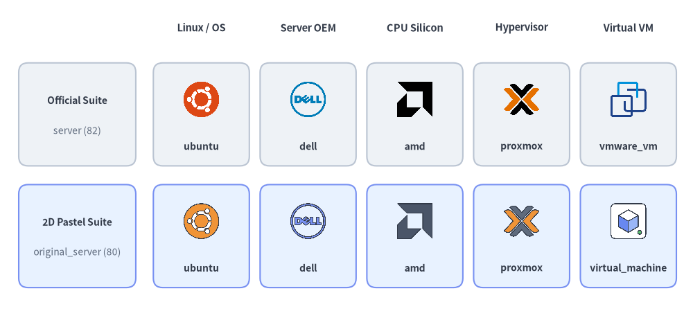
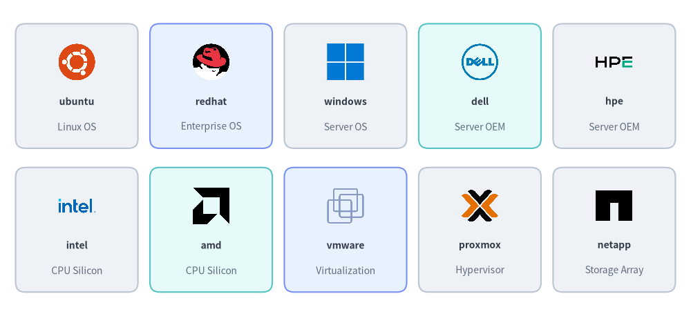
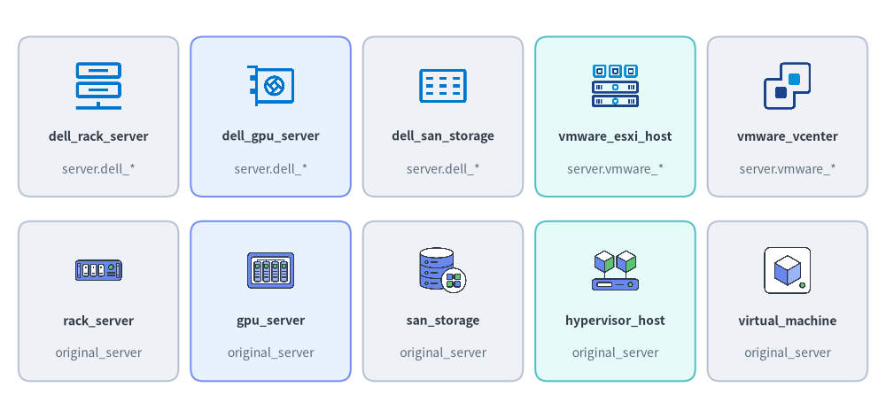
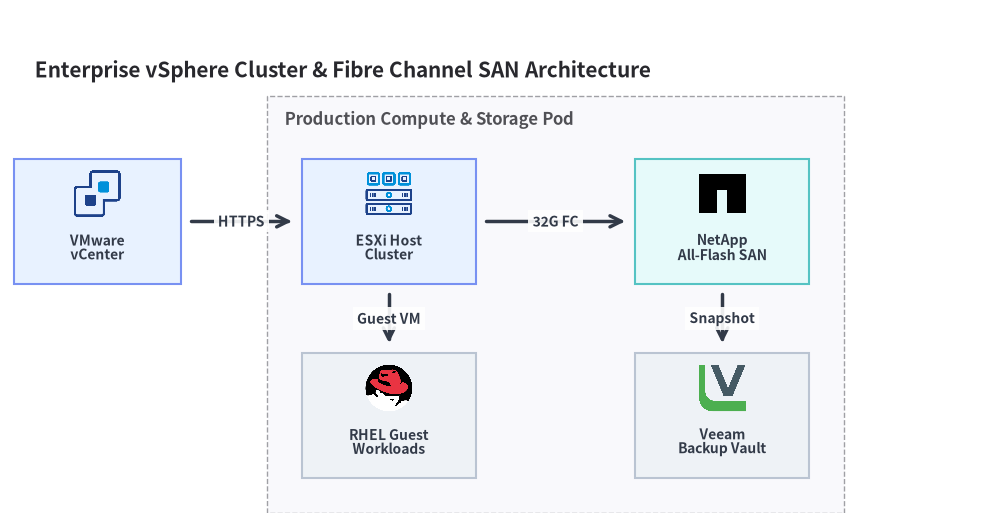

# Server, OS & Virtualization Icons (`server` & `original_server`)

Drawlib provides two paired icon modules for physical servers, operating systems, CPU architectures, storage arrays, and virtualization platforms: **`drawlib.icons.server`** (`ServerIcon`, **82** official brand, Dell hardware, and VMware vSphere icons) and **`drawlib.icons.original_server`** (`OriginalServerIcon`, **80** flat 2D pastel brand twins and vendor-neutral compute/storage/virtualization concept icons). Both modules share the unified coordinate anchor documented in **[Icons Overview](./overview.md)** and plug directly into **[Architecture Diagrams](../06_diagrams/architecture.md)**.


<figure class="drawlib-image" style="text-align: center;">
  
  <figcaption class="drawlib-caption">Official Brand & Hardware Icons (server) vs. Original 2D Pastel Icons (original_server)</figcaption>
</figure>

<details class="drawlib-code-details">
<summary>Source Code</summary>

```python
from drawlib.canvas import save, setup
from drawlib.icons import original_server, server
from drawlib.shapes import rectangle
from drawlib.styles import Styles
from drawlib.text import text

setup(width=148, height=68)

columns = [
    ("Linux / OS", "ubuntu", server.ubuntu, original_server.ubuntu),
    ("Server OEM", "dell", server.dell, original_server.dell),
    ("CPU Silicon", "amd", server.amd, original_server.amd),
    ("Hypervisor", "proxmox", server.proxmox, original_server.proxmox),
    ("Virtual VM", "virtual_machine", server.vmware_vm, original_server.virtual_machine),
]

for col_idx, (cat_label, _, _, _) in enumerate(columns):
    cx = 43.0 + col_idx * 22.8
    text((cx, 62.0), cat_label, style=Styles.DarkBold.patch(text_size=10.5))

rows = [
    (43.5, "Official Suite", "server (82)", Styles.Neutral),
    (17.5, "2D Pastel Suite", "original_server (80)", Styles.PrimaryNeutral),
]

for row_idx, (cy, row_title, row_sub, row_style) in enumerate(rows):
    rectangle((16.5, cy), width=25.0, height=22.0, style=row_style.patch(shape_r=2))
    text((16.5, cy + 3.0), row_title, style=Styles.DarkBold.patch(text_size=10.0))
    text((16.5, cy - 3.5), row_sub, style=Styles.Muted.patch(text_size=10.0))

    for col_idx, (_, fn_name, fn_off, fn_orig) in enumerate(columns):
        cx = 43.0 + col_idx * 22.8
        rectangle((cx, cy), width=20.5, height=22.0, style=row_style.patch(shape_r=2))
        icon_fn = fn_off if row_idx == 0 else fn_orig
        lbl = (
            "vmware_vm"
            if (row_idx == 0 and fn_name == "virtual_machine")
            else fn_name
        )
        icon_fn((cx, cy + 3.2), width=8.5, style=Styles.Primary)
        text((cx, cy - 6.8), lbl, style=Styles.DarkBold.patch(text_size=10.0))

save()
```

</details>


---

## 1. API Signature & Twin Module Structure

Every icon in `drawlib.icons.server` and `drawlib.icons.original_server` is a center-anchored `(cx, cy)` function that renders a `512×512` RGBA PNG asset at a `1:1` square aspect ratio:

```python
from drawlib.diagrams.architecture import Node, OriginalServerIcon, ServerIcon
from drawlib.icons import original_server, original_server_icon, server, server_icon
from drawlib.styles import Styles

# 1. Direct module function calls (56 shared brand names + domain-specific hardware/concepts)
server.redhat((30, 25), width=10.0, style=Styles.Primary)
original_server.redhat((55, 25), width=10.0, style=Styles.Primary)
server.dell_rack_server((80, 25), width=10.0, style=Styles.Primary)
original_server.rack_server((105, 25), width=10.0, style=Styles.Primary)

# 2. Dynamic string lookup helpers
server_icon((30, 10), width=9.0, name="ubuntu", style=Styles.Primary)
original_server_icon((55, 10), width=9.0, name="hypervisor_host", style=Styles.Primary)

# 3. Strongly typed Enums for ArchitectureDiagram & SequenceDiagram
node_a = Node("RHEL Host", icon=ServerIcon.REDHAT)
node_b = Node("Hypervisor", icon=OriginalServerIcon.HYPERVISOR_HOST)
```

| Feature | `drawlib.icons.server` | `drawlib.icons.original_server` |
| :--- | :--- | :--- |
| **Visual Style** | Official vendor logos + Dell/VMware hardware & topology artwork | Cohesive 2D pastel brand twins & vendor-neutral infrastructure concepts |
| **Total Canonical Icons** | **82** (`56` brands + `12` `dell_*` + `14` `vmware_*`) | **80** (`56` brand twins + `24` vendor-neutral concepts) |
| **Diagram Enum** | `ServerIcon.<NAME>` | `OriginalServerIcon.<NAME>` |
| **Dynamic Dispatcher** | `server_icon(xy, width, name=..., style=...)` | `original_server_icon(xy, width, name=..., style=...)` |
| **Asset Package** | `icon_server` | `icon_original_server` |

---

## 2. Shared Brand & Vendor Icons (`56` Icons in Both Modules)

Both `server` and `original_server` provide the exact same **56 canonical brand and open-source project names** spanning Linux/BSD/Windows operating systems, enterprise server OEMs, CPU silicon architectures, hypervisors, and enterprise storage vendors:


<figure class="drawlib-image" style="text-align: center;">
  
  <figcaption class="drawlib-caption">10 Representative Brand & OS Icons Available in Both server and original_server</figcaption>
</figure>

<details class="drawlib-code-details">
<summary>Source Code</summary>

```python
from drawlib.canvas import save, setup
from drawlib.icons import server
from drawlib.shapes import rectangle
from drawlib.styles import Styles
from drawlib.text import text

setup(width=144, height=66)

row1 = [
    ("ubuntu", "Linux OS", server.ubuntu, Styles.Neutral),
    ("redhat", "Enterprise OS", server.redhat, Styles.PrimaryNeutral),
    ("windows", "Server OS", server.windows, Styles.Neutral),
    ("dell", "Server OEM", server.dell, Styles.SecondaryNeutral),
    ("hpe", "Server OEM", server.hpe, Styles.Neutral),
]

row2 = [
    ("intel", "CPU Silicon", server.intel, Styles.Neutral),
    ("amd", "CPU Silicon", server.amd, Styles.SecondaryNeutral),
    ("vmware", "Virtualization", server.vmware, Styles.PrimaryNeutral),
    ("proxmox", "Hypervisor", server.proxmox, Styles.Neutral),
    ("netapp", "Storage Array", server.netapp, Styles.Neutral),
]

for row_idx, items in enumerate([row1, row2]):
    cy = 48.0 if row_idx == 0 else 18.0
    for col_idx, (fn_name, cat, icon_fn, card_st) in enumerate(items):
        cx = 16.0 + col_idx * 28.0
        rectangle((cx, cy), width=25.5, height=26.0, style=card_st.patch(shape_r=2))
        icon_fn((cx, cy + 5.0), width=8.5, style=Styles.Primary)
        text((cx, cy - 3.2), fn_name, style=Styles.DarkBold.patch(text_size=10.0))
        text((cx, cy - 8.5), cat, style=Styles.Muted.patch(text_size=10.0))

save()
```

</details>


### 2.1. Complete Shared Brand Icon Reference (`56` Canonical Names)

Every function name below is available identically as `server.<name>()` (`ServerIcon.<NAME>`) and `original_server.<name>()` (`OriginalServerIcon.<NAME>`):

| Category | Count | Canonical Function Names (`server.*` & `original_server.*`) |
| :--- | :---: | :--- |
| **Linux Distributions** | 13 | `almalinux`, `alpine_linux`, `arch_linux`, `centos`, `debian`, `fedora`, `kali_linux`, `linux`, `nixos`, `redhat`, `rocky_linux`, `suse`, `ubuntu` |
| **BSD, Desktop & Server OS** | 4 | `apple`, `freebsd`, `openbsd`, `windows` |
| **Enterprise Server OEMs** | 9 | `asus`, `dell`, `fujitsu`, `hitachi`, `hpe`, `ibm`, `lenovo`, `nec`, `supermicro` |
| **CPU & Silicon Architectures** | 4 | `amd`, `arm`, `intel`, `risc_v` |
| **SBC, Compact & Power Hardware** | 5 | `apc`, `arduino`, `beaglebone`, `mac_mini`, `raspberry_pi` |
| **Hypervisors, Virtualization & Cloud** | 10 | `citrix`, `kvm`, `lxc`, `nutanix`, `openstack`, `proxmox`, `qemu`, `virtualbox`, `vmware`, `xen` |
| **Enterprise Storage, NAS & Backup** | 11 | `buffalo`, `netapp`, `openzfs`, `pure_storage`, `qnap`, `rubrik`, `seagate`, `synology`, `truenas`, `veeam`, `western_digital` |

---

## 3. Hardware & Virtualization Topology Icons (`dell_*` / `vmware_*` vs. Vendor-Neutral Concepts)

In addition to the 56 shared brand icons, each module provides specialized infrastructure topology icons tailored to its visual tier:
- **`drawlib.icons.server` (`26` icons)**: Includes **12 Dell hardware/storage appliance icons (`dell_*`)** and **14 VMware vSphere virtualization icons (`vmware_*`)**.
- **`drawlib.icons.original_server` (`24` icons)**: Includes **24 vendor-neutral 2D pastel server, storage, and virtualization concept icons** (`rack_server`, `gpu_server`, `hypervisor_host`, `virtual_machine`, `san_storage`, etc.) that map directly to the physical and virtual layers without vendor branding.


<figure class="drawlib-image" style="text-align: center;">
  
  <figcaption class="drawlib-caption">Comparing server (dell_* / vmware_*) and original_server Vendor-Neutral Concept Icons</figcaption>
</figure>

<details class="drawlib-code-details">
<summary>Source Code</summary>

```python
from drawlib.canvas import save, setup
from drawlib.icons import original_server, server
from drawlib.shapes import rectangle
from drawlib.styles import Styles
from drawlib.text import text

setup(width=144, height=68)

row1 = [
    ("dell_rack_server", "server.dell_*", server.dell_rack_server, Styles.Neutral),
    ("dell_gpu_server", "server.dell_*", server.dell_gpu_server, Styles.PrimaryNeutral),
    ("dell_san_storage", "server.dell_*", server.dell_san_storage, Styles.Neutral),
    ("vmware_esxi_host", "server.vmware_*", server.vmware_esxi_host, Styles.SecondaryNeutral),
    ("vmware_vcenter", "server.vmware_*", server.vmware_vcenter, Styles.Neutral),
]

row2 = [
    ("rack_server", "original_server", original_server.rack_server, Styles.Neutral),
    ("gpu_server", "original_server", original_server.gpu_server, Styles.PrimaryNeutral),
    ("san_storage", "original_server", original_server.san_storage, Styles.Neutral),
    ("hypervisor_host", "original_server", original_server.hypervisor_host, Styles.SecondaryNeutral),
    ("virtual_machine", "original_server", original_server.virtual_machine, Styles.Neutral),
]

for row_idx, items in enumerate([row1, row2]):
    cy = 49.0 if row_idx == 0 else 19.0
    for col_idx, (fn_name, mod_label, icon_fn, card_st) in enumerate(items):
        cx = 16.0 + col_idx * 28.0
        rectangle((cx, cy), width=26.0, height=26.0, style=card_st.patch(shape_r=2))
        icon_fn((cx, cy + 5.0), width=8.5, style=Styles.Primary)
        text((cx, cy - 3.2), fn_name, style=Styles.DarkBold.patch(text_size=10.0))
        text((cx, cy - 8.5), mod_label, style=Styles.Muted.patch(text_size=10.0))

save()
```

</details>


### 3.1. `drawlib.icons.server` — Dell Hardware & VMware vSphere Icons (`26` Icons)

| Sub-Suite | Count | Canonical Function Names (`server.*` / `ServerIcon.*`) |
| :--- | :---: | :--- |
| **Dell Server & Compute Hardware (`dell_*`)** | 7 | `dell_blade_chassis`, `dell_bmc_management`, `dell_fc_switch`, `dell_gpu_server`, `dell_hci_appliance`, `dell_rack_server`, `dell_tower_server` |
| **Dell Storage & Backup Appliances (`dell_*`)** | 5 | `dell_backup_appliance`, `dell_nas_storage`, `dell_object_storage`, `dell_san_storage`, `dell_tape_library` |
| **VMware vSphere Hosts & Clusters (`vmware_*`)** | 6 | `vmware_cluster`, `vmware_esxi_host`, `vmware_rack_server`, `vmware_resource_pool`, `vmware_vcenter`, `vmware_vmotion` |
| **VMware Virtual Machines & Storage (`vmware_*`)** | 8 | `vmware_datastore`, `vmware_snapshot`, `vmware_storage_array`, `vmware_template`, `vmware_vm`, `vmware_vm_group`, `vmware_vsan`, `vmware_vswitch` |

### 3.2. `drawlib.icons.original_server` — Vendor-Neutral Hardware & Virtualization Concepts (`24` Icons)

| Sub-Suite | Count | Canonical Function Names (`original_server.*` / `OriginalServerIcon.*`) |
| :--- | :---: | :--- |
| **Physical Servers & Out-of-Band Management** | 7 | `blade_chassis`, `bmc`, `gpu_server`, `hci_appliance`, `management_server`, `rack_server`, `tower_server` |
| **Hypervisor Hosts, VMs & Live Migration** | 9 | `host_cluster`, `hypervisor_host`, `live_migration`, `resource_pool`, `virtual_machine`, `virtual_switch`, `vm_group`, `vm_snapshot`, `vm_template` |
| **SAN, NAS, Object Storage & Backup** | 8 | `backup_appliance`, `datastore`, `fc_switch`, `nas_storage`, `object_storage`, `san_storage`, `tape_library`, `virtual_san` |

---

## 4. Practical Architecture Diagram

The following example builds a hybrid virtualization and SAN storage topology using **[`ArchitectureDiagram`](../06_diagrams/architecture.md)** and `ServerIcon`:


```python
from drawlib.canvas import clear, save, setup
from drawlib.diagrams.architecture import ArchitectureDiagram, Node, NodeGroup, ServerIcon
from drawlib.styles import Styles

clear()
setup(width=144, height=74)

d = ArchitectureDiagram(
    node_style=Styles.Primary,
    node_text_style=Styles.DarkBold.patch(text_size=10.0),
    edge_style=Styles.DarkBold,
    edge_text_style=Styles.DarkBold.patch(text_size=10.0),
    node_card_style=Styles.Neutral,
    title="Enterprise vSphere Cluster & Fibre Channel SAN Architecture",
)

vcenter = d.add(
    Node(
        "VMware\nvCenter",
        width=24,
        height=18,
        icon=ServerIcon.VMWARE_VCENTER,
        icon_size=7.5,
        card_style=Styles.PrimaryNeutral,
    ),
    xy=(10.0, 38.0),
)

cluster = d.add(NodeGroup(title="Production Compute & Storage Pod", padding=5.0), xy=(40.0, 4.0))

esxi = cluster.add(
    Node(
        "ESXi Host\nCluster",
        width=25,
        height=18,
        icon=ServerIcon.VMWARE_ESXI_HOST,
        icon_size=7.5,
        card_style=Styles.PrimaryNeutral,
    ),
    xy=(12.0, 34.0),
)
rhel = cluster.add(
    Node(
        "RHEL Guest\nWorkloads",
        width=25,
        height=18,
        icon=ServerIcon.REDHAT,
        icon_size=7.5,
    ),
    xy=(12.0, 6.0),
)
san = cluster.add(
    Node(
        "NetApp\nAll-Flash SAN",
        width=25,
        height=18,
        icon=ServerIcon.NETAPP,
        icon_size=7.5,
        card_style=Styles.SecondaryNeutral,
    ),
    xy=(60.0, 34.0),
)
veeam = cluster.add(
    Node(
        "Veeam\nBackup Vault",
        width=25,
        height=18,
        icon=ServerIcon.VEEAM,
        icon_size=7.5,
    ),
    xy=(60.0, 6.0),
)

d.connect(vcenter, esxi, label="HTTPS", padding=1.5)
d.connect(esxi, rhel, label="Guest VM", padding=1.5)
d.connect(esxi, san, label="32G FC", padding=1.5)
d.connect(san, veeam, label="Snapshot", padding=1.5)

d.draw(xy=(4.0, 4.0))
save()
```

<figure class="drawlib-image" style="text-align: center;">
  
  <figcaption class="drawlib-caption">Enterprise Virtualization & Fibre Channel SAN Topology Using ArchitectureDiagram and ServerIcon</figcaption>
</figure>


> [!TIP]
> See **[Network & Cisco Topology Icons (`network` & `original_network`)](./network.md)** for physical switches, routers, and firewalls, or **[Data Center & Facility Icons (`facility` & `original_facility`)](./facility.md)** for racks, UPS power, and colocation buildings.
