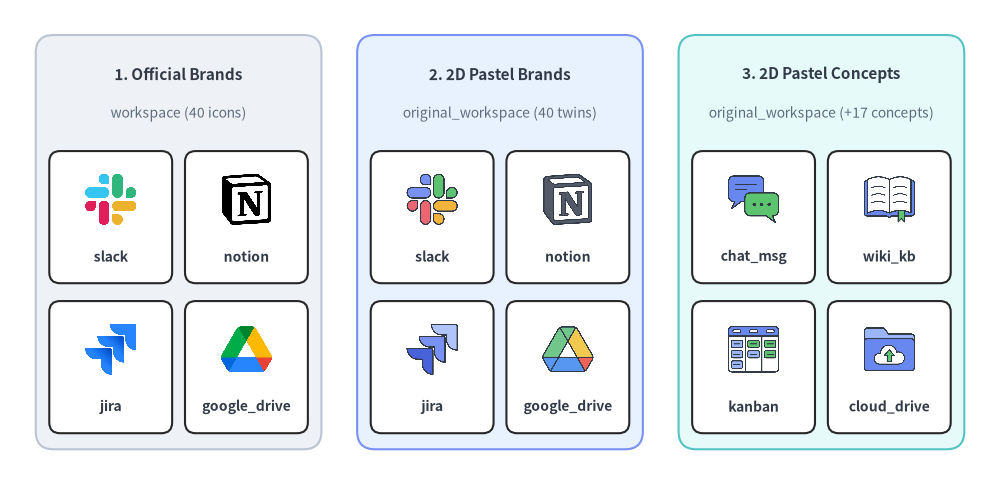
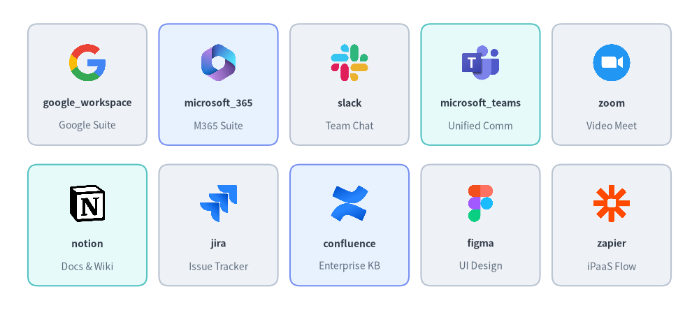
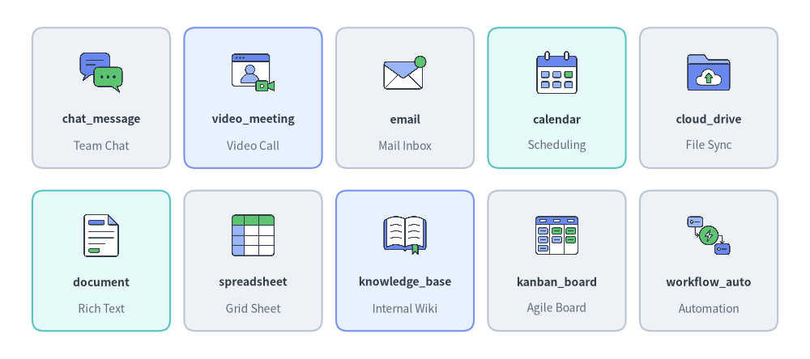
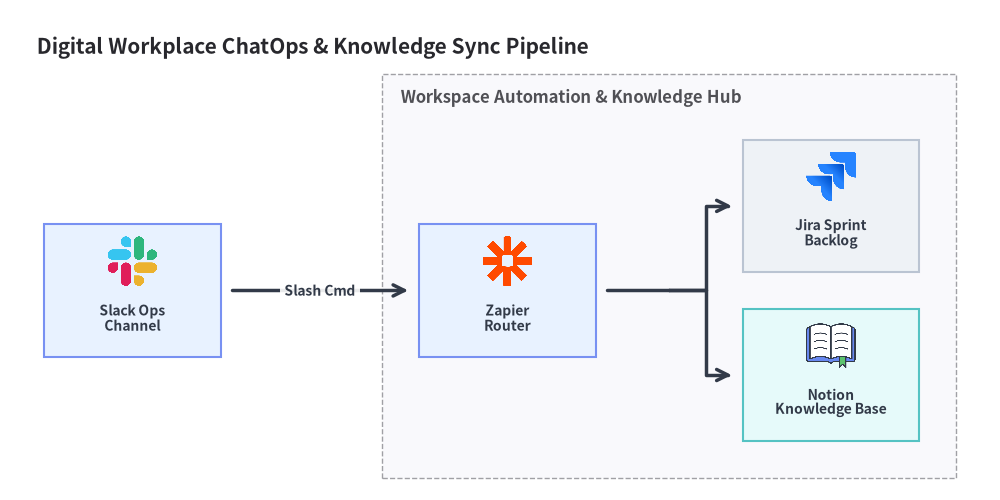

# Workspace & Collaboration Icons (`workspace` & `original_workspace`)

Drawlib provides **40 official productivity, collaboration, and knowledge base brand icons** in `drawlib.icons.workspace` (`WorkspaceIcon`) and **57 flat 2D pastel icons** in `drawlib.icons.original_workspace` (`OriginalWorkspaceIcon` — all 40 brand twins plus 17 vendor-neutral collaboration and document concept icons). See the [Icons Overview](./overview.md) for cross-tier guidelines and [Architecture Diagrams](../06_diagrams/architecture.md) for connected enterprise workflow topologies.


<figure class="drawlib-image" style="text-align: center;">
  
  <figcaption class="drawlib-caption">Comparing Official Workspace Brands (workspace), 2D Pastel Brand Twins (original_workspace), and Collaboration Concepts (original_workspace)</figcaption>
</figure>

<details class="drawlib-code-details">
<summary>Source Code</summary>

```python
from drawlib.canvas import save, setup
from drawlib.icons import original_workspace, workspace
from drawlib.shapes import rectangle
from drawlib.styles import Styles
from drawlib.text import text

setup(width=140, height=68)

columns = [
    (
        25.0,
        "1. Official Brands",
        "workspace (40 icons)",
        Styles.Neutral,
        [
            ("slack", workspace.slack),
            ("notion", workspace.notion),
            ("jira", workspace.jira),
            ("google_drive", workspace.google_drive),
        ],
    ),
    (
        70.0,
        "2. 2D Pastel Brands",
        "original_workspace (40 twins)",
        Styles.PrimaryNeutral,
        [
            ("slack", original_workspace.slack),
            ("notion", original_workspace.notion),
            ("jira", original_workspace.jira),
            ("google_drive", original_workspace.google_drive),
        ],
    ),
    (
        115.0,
        "3. 2D Pastel Concepts",
        "original_workspace (+17 concepts)",
        Styles.SecondaryNeutral,
        [
            ("chat_msg", original_workspace.chat_message),
            ("wiki_kb", original_workspace.knowledge_base),
            ("kanban", original_workspace.kanban_board),
            ("cloud_drive", original_workspace.cloud_drive),
        ],
    ),
]

for cx, title, subtitle, card_style, items in columns:
    rectangle((cx, 34.0), width=40.0, height=58.0, style=card_style.patch(shape_r=2.5))
    text((cx, 57.5), title, style=Styles.DarkBold.patch(text_size=11.0))
    text((cx, 52.0), subtitle, style=Styles.Muted.patch(text_size=10.0))

    offsets = [(-9.5, 37.5), (9.5, 37.5), (-9.5, 16.5), (9.5, 16.5)]
    sub_style = Styles.White.patch(shape_r=1.5, line_width=0.6)
    for (dx, iy), (lbl, fn) in zip(offsets, items, strict=True):
        ix = cx + dx
        rectangle((ix, iy), width=17.2, height=18.5, style=sub_style)
        fn((ix, iy + 2.5), width=8.0, style=Styles.Primary)
        text((ix, iy - 5.5), lbl, style=Styles.DarkBold.patch(text_size=10.0))

save()
```

</details>


---

## 1. API Signature & Twin Module Structure

The `workspace` and `original_workspace` modules form a **twin icon pair** for digital workplace architectures, ChatOps automation, knowledge management, and BI reporting pipelines:

| Module | Diagram Enum | Canonical Count | Asset Archive | Visual Purpose |
| :--- | :--- | :---: | :--- | :--- |
| `drawlib.icons.workspace` | `WorkspaceIcon` | **40** | `icon_workspace` | Official product logos for Google Workspace, Microsoft 365, Slack, Notion, Jira, Figma, and Tableau. |
| `drawlib.icons.original_workspace` | `OriginalWorkspaceIcon` | **57** (`40` brand twins + `17` concepts) | `icon_original_workspace` | Cohesive flat 2D pastel equivalents of all 40 workspace brands plus 17 vendor-neutral collaboration concepts (`chat_message`, `knowledge_base`, `kanban_board`, `workflow_automation`, etc.). |

Every icon function is center-anchored at `xy=(cx, cy)` with a `1:1` square aspect ratio and accepts `Style` attributes (`alpha`, `angle`, `image_tint_color`, `image_border_*`):

```python
from drawlib.diagrams.architecture import Node, OriginalWorkspaceIcon, WorkspaceIcon
from drawlib.icons import original_workspace, workspace
from drawlib.styles import Styles

# 1. Direct canvas rendering (center-anchored at (cx, cy))
workspace.slack((30, 25), width=9.0, style=Styles.Primary)
original_workspace.slack((60, 25), width=9.0, style=Styles.Primary)
original_workspace.knowledge_base((90, 25), width=9.0, style=Styles.Primary)

# 2. High-level ArchitectureDiagram nodes via Enum tokens
chat_node = Node("Slack Bot", width=26, height=18, icon=WorkspaceIcon.SLACK, icon_size=7.5)
wiki_node = Node("Team Wiki", width=26, height=18, icon=OriginalWorkspaceIcon.KNOWLEDGE_BASE, icon_size=7.5)
```

---

## 2. Official & Pastel Brand Icons Showcase & Complete Reference (`workspace` & `original_workspace`)

All **40 canonical brand names** below are available identically in both `drawlib.icons.workspace.<name>` (`WorkspaceIcon.<NAME>`) and `drawlib.icons.original_workspace.<name>` (`OriginalWorkspaceIcon.<NAME>`).


<figure class="drawlib-image" style="text-align: center;">
  
  <figcaption class="drawlib-caption">10 Representative Digital Workplace & Collaboration Brand Icons (workspace.*)</figcaption>
</figure>

<details class="drawlib-code-details">
<summary>Source Code</summary>

```python
from drawlib.canvas import save, setup
from drawlib.icons import workspace
from drawlib.shapes import rectangle
from drawlib.styles import Styles
from drawlib.text import text

setup(width=144, height=64)

row1 = [
    ("google_workspace", "Google Suite", workspace.google_workspace, Styles.Neutral),
    ("microsoft_365", "M365 Suite", workspace.microsoft_365, Styles.PrimaryNeutral),
    ("slack", "Team Chat", workspace.slack, Styles.Neutral),
    ("microsoft_teams", "Unified Comm", workspace.microsoft_teams, Styles.SecondaryNeutral),
    ("zoom", "Video Meet", workspace.zoom, Styles.Neutral),
]

row2 = [
    ("notion", "Docs & Wiki", workspace.notion, Styles.SecondaryNeutral),
    ("jira", "Issue Tracker", workspace.jira, Styles.Neutral),
    ("confluence", "Enterprise KB", workspace.confluence, Styles.PrimaryNeutral),
    ("figma", "UI Design", workspace.figma, Styles.Neutral),
    ("zapier", "iPaaS Flow", workspace.zapier, Styles.Neutral),
]

for row_idx, items in enumerate([row1, row2]):
    cy = 46.5 if row_idx == 0 else 17.5
    for col_idx, (name, cat, icon_fn, card_st) in enumerate(items):
        cx = 18.0 + col_idx * 27.0
        rectangle((cx, cy), width=24.5, height=25.0, style=card_st.patch(shape_r=2))
        icon_fn((cx, cy + 4.5), width=8.5, style=Styles.Primary)
        text((cx, cy - 3.8), name, style=Styles.DarkBold.patch(text_size=10.0))
        text((cx, cy - 8.5), cat, style=Styles.Muted.patch(text_size=10.0))

save()
```

</details>


### Complete 40 Brand Icons Reference (`workspace` & `original_workspace`)

| Category | Count | Canonical Function (`workspace.*` & `original_workspace.*`) | Enum Member (`WorkspaceIcon.*` & `OriginalWorkspaceIcon.*`) |
| :--- | :---: | :--- | :--- |
| **Google Workspace Suite** | 10 | `gmail`, `google_calendar`, `google_chat`, `google_docs`, `google_drive`, `google_forms`, `google_meet`, `google_sheets`, `google_slides`, `google_workspace` | `GMAIL`, `GOOGLE_CALENDAR`, `GOOGLE_CHAT`, `GOOGLE_DOCS`, `GOOGLE_DRIVE`, `GOOGLE_FORMS`, `GOOGLE_MEET`, `GOOGLE_SHEETS`, `GOOGLE_SLIDES`, `GOOGLE_WORKSPACE` |
| **Microsoft 365 Productivity Suite** | 8 | `excel`, `microsoft_365`, `microsoft_teams`, `onedrive`, `outlook`, `powerpoint`, `sharepoint`, `word` | `EXCEL`, `MICROSOFT_365`, `MICROSOFT_TEAMS`, `ONEDRIVE`, `OUTLOOK`, `POWERPOINT`, `SHAREPOINT`, `WORD` |
| **Team Messaging & Video Conferencing** | 4 | `discord`, `slack`, `webex`, `zoom` | `DISCORD`, `SLACK`, `WEBEX`, `ZOOM` |
| **Project Management, Issue Tracking & Wiki** | 7 | `asana`, `confluence`, `jira`, `linear`, `monday`, `notion`, `trello` | `ASANA`, `CONFLUENCE`, `JIRA`, `LINEAR`, `MONDAY`, `NOTION`, `TRELLO` |
| **Cloud Storage, PDF & Collaborative Design** | 6 | `adobe_acrobat`, `box`, `canva`, `dropbox`, `figma`, `miro` | `ADOBE_ACROBAT`, `BOX`, `CANVA`, `DROPBOX`, `FIGMA`, `MIRO` |
| **No-Code Databases, BI & Workflow Automation** | 5 | `airtable`, `power_automate`, `power_bi`, `tableau`, `zapier` | `AIRTABLE`, `POWER_AUTOMATE`, `POWER_BI`, `TABLEAU`, `ZAPIER` |

---

## 3. Vendor-Neutral Concept Icons Showcase & Complete Reference (`original_workspace`)

In addition to the 40 brand twins above, `drawlib.icons.original_workspace` (`OriginalWorkspaceIcon`) provides **17 vendor-neutral collaboration and productivity concept icons** for generic document pipelines, internal knowledge bases, and ChatOps workflows.


<figure class="drawlib-image" style="text-align: center;">
  
  <figcaption class="drawlib-caption">10 Representative Vendor-Neutral Collaboration & Productivity Concept Icons (original_workspace.*)</figcaption>
</figure>

<details class="drawlib-code-details">
<summary>Source Code</summary>

```python
from drawlib.canvas import save, setup
from drawlib.icons import original_workspace
from drawlib.shapes import rectangle
from drawlib.styles import Styles
from drawlib.text import text

setup(width=144, height=64)

row1 = [
    ("chat_message", "Team Chat", original_workspace.chat_message, Styles.Neutral),
    ("video_meeting", "Video Call", original_workspace.video_meeting, Styles.PrimaryNeutral),
    ("email", "Mail Inbox", original_workspace.email, Styles.Neutral),
    ("calendar", "Scheduling", original_workspace.calendar, Styles.SecondaryNeutral),
    ("cloud_drive", "File Sync", original_workspace.cloud_drive, Styles.Neutral),
]

row2 = [
    ("document", "Rich Text", original_workspace.document, Styles.SecondaryNeutral),
    ("spreadsheet", "Grid Sheet", original_workspace.spreadsheet, Styles.Neutral),
    ("knowledge_base", "Internal Wiki", original_workspace.knowledge_base, Styles.PrimaryNeutral),
    ("kanban_board", "Agile Board", original_workspace.kanban_board, Styles.Neutral),
    ("workflow_auto", "Automation", original_workspace.workflow_automation, Styles.Neutral),
]

for row_idx, items in enumerate([row1, row2]):
    cy = 46.5 if row_idx == 0 else 17.5
    for col_idx, (name, cat, icon_fn, card_st) in enumerate(items):
        cx = 18.0 + col_idx * 27.0
        rectangle((cx, cy), width=24.5, height=25.0, style=card_st.patch(shape_r=2))
        icon_fn((cx, cy + 4.5), width=8.5, style=Styles.Primary)
        text((cx, cy - 3.8), name, style=Styles.DarkBold.patch(text_size=10.0))
        text((cx, cy - 8.5), cat, style=Styles.Muted.patch(text_size=10.0))

save()
```

</details>


### Complete 17 Vendor-Neutral Concept Icons (`original_workspace`)

| Canonical Function (`original_workspace.*`) | Enum Member (`OriginalWorkspaceIcon.*`) | Collaboration Category | Typical Architectural Role |
| :--- | :--- | :--- | :--- |
| `announcement` | `ANNOUNCEMENT` | Communications | Company-wide broadcast, release bulletin, or incident status banner |
| `calendar` | `CALENDAR` | Scheduling | Shared team calendar, on-call rotation schedule, or booking service |
| `chat_message` | `CHAT_MESSAGE` | Real-Time Messaging | Instant messaging channel, ChatOps webhook, or bot notification |
| `cloud_drive` | `CLOUD_DRIVE` | File Storage | Enterprise file sync and share (EFSS) repository |
| `document` | `DOCUMENT` | Office Documents | Collaborative word processing document or technical specification |
| `email` | `EMAIL` | Communications | Corporate email inbox, SMTP relay target, or digest notification |
| `form_survey` | `FORM_SURVEY` | Data Collection | User feedback form, intake questionnaire, or survey portal |
| `kanban_board` | `KANBAN_BOARD` | Project Tracking | Sprint backlog, issue triage board, or task tracking workflow |
| `knowledge_base` | `KNOWLEDGE_BASE` | Documentation | Internal engineering wiki, runbook portal, or RAG document corpus |
| `pdf_document` | `PDF_DOCUMENT` | Office Documents | Portable Document Format (PDF) report, signed contract, or export artifact |
| `presentation` | `PRESENTATION` | Office Documents | Slide deck, executive briefing, or architecture review presentation |
| `project_plan` | `PROJECT_PLAN` | Project Tracking | Roadmap timeline, milestone plan, or delivery schedule |
| `spreadsheet` | `SPREADSHEET` | Office Documents | Tabular financial model, CSV export, or operational data sheet |
| `video_meeting` | `VIDEO_MEETING` | Conferencing | Multiparty video conference bridge, webinar, or virtual war room |
| `voice_call` | `VOICE_CALL` | Conferencing | VoIP audio call, SIP softphone, or conference bridge |
| `whiteboard` | `WHITEBOARD` | Visual Collaboration | Infinite canvas for architecture brainstorming and retrospective workshops |
| `workflow_automation` | `WORKFLOW_AUTOMATION` | No-Code / iPaaS | Event-driven webhook trigger, low-code connector, or workspace automation |

---

## 4. Practical Architecture Diagram (`ArchitectureDiagram`)

The following example combines `WorkspaceIcon` and `OriginalWorkspaceIcon` inside **[`ArchitectureDiagram`](../06_diagrams/architecture.md)** to model an **Automated ChatOps Incident Triage & Knowledge Base Sync Pipeline**:


```python
from drawlib.canvas import clear, save, setup
from drawlib.diagrams.architecture import (
    ArchitectureDiagram,
    Node,
    NodeGroup,
    OriginalWorkspaceIcon,
    WorkspaceIcon,
)
from drawlib.styles import Styles

clear()
setup(width=136, height=68)

d = ArchitectureDiagram(
    node_style=Styles.Primary,
    node_text_style=Styles.DarkBold.patch(text_size=10.0),
    edge_style=Styles.DarkBold,
    edge_text_style=Styles.DarkBold.patch(text_size=10.0),
    node_card_style=Styles.Neutral,
    title="Digital Workplace ChatOps & Knowledge Sync Pipeline",
)

slack_ch = d.add(
    Node(
        "Slack Ops\nChannel",
        width=24,
        height=18,
        icon=WorkspaceIcon.SLACK,
        icon_size=7.5,
        card_style=Styles.PrimaryNeutral,
    ),
    xy=(14.0, 24.5),
)

hub = d.add(
    NodeGroup(title="Workspace Automation & Knowledge Hub", padding=5.0),
    xy=(48.0, 4.0),
)

zapier_flow = hub.add(
    Node(
        "Zapier\nRouter",
        width=24,
        height=18,
        icon=WorkspaceIcon.ZAPIER,
        icon_size=7.5,
        card_style=Styles.PrimaryNeutral,
    ),
    xy=(17.0, 20.5),
)
jira_board = hub.add(
    Node(
        "Jira Sprint\nBacklog",
        width=24,
        height=18,
        icon=WorkspaceIcon.JIRA,
        icon_size=7.5,
    ),
    xy=(61.0, 32.0),
)
notion_kb = hub.add(
    Node(
        "Notion\nKnowledge Base",
        width=24,
        height=18,
        icon=OriginalWorkspaceIcon.KNOWLEDGE_BASE,
        icon_size=7.5,
        card_style=Styles.SecondaryNeutral,
    ),
    xy=(61.0, 9.0),
)

d.connect(slack_ch, zapier_flow, label="Slash Cmd", padding=1.5)
zapier_flow.fork([jira_board, notion_kb], at_x=87.0, padding=1.5)

d.draw(xy=(4.0, 4.0))
save()
```

<figure class="drawlib-image" style="text-align: center;">
  
  <figcaption class="drawlib-caption">ChatOps Incident Triage & Knowledge Base Automation Using WorkspaceIcon and OriginalWorkspaceIcon</figcaption>
</figure>


