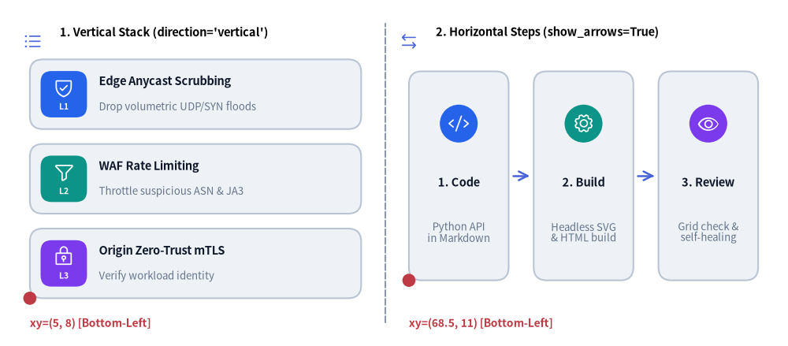
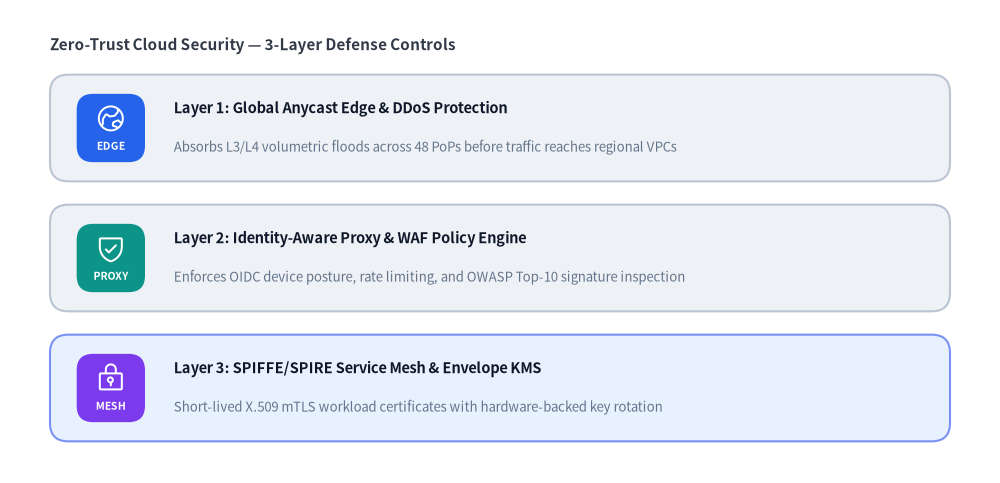
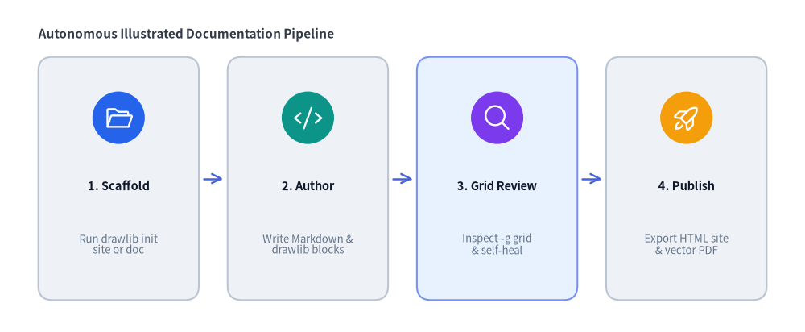

# CardList

The `CardList` component renders vertical stacks (`direction="vertical"`) or horizontal step sequences (`direction="horizontal"`) of rich cards equipped with circular or rounded-rectangle badges (`badge_shape`), vector icons (`icon`), numbered or text badge labels (`badge_text`), multi-line descriptions, and optional inter-card connecting arrows (`show_arrows=True`).
Unlike [`BoxList`](./box_list.md) (which draws contiguous single-label boxes) or [`KpiCards`](./kpi_cards.md) (which highlights large numeric metrics), `CardList` is purpose-built for **feature catalogs, defense-in-depth layer explanations, and multi-step engineering workflows**.


<figure class="drawlib-image" style="text-align: center;">
  
  <figcaption class="drawlib-caption">CardList Orientation Modes: Vertical Feature Stack vs. Horizontal Workflow Sequence with Arrows</figcaption>
</figure>

<details class="drawlib-code-details">
<summary>Source Code</summary>

```python
from drawlib.canvas import save, setup
from drawlib.icons import phosphor
from drawlib.lines import line
from drawlib.shapes import circle
from drawlib.smartarts import CardList
from drawlib.styles import Styles
from drawlib.text import text

setup(width=132, height=58)

# Subtle center divider
line((64.5, 4.0), (64.5, 54.0), style=Styles.MutedDashed)

# 1. Left Panel: Vertical Feature Stack (direction="vertical", badge_shape="rounded_rect")
phosphor.list_bullets(xy=(5.5, 51.0), width=3.4, style=Styles.PrimaryFlat)
text((10.0, 52.5), "1. Vertical Stack (direction='vertical')", style=Styles.BlackBold.patch(text_size=10.5, halign="left"))

cl_v = CardList(
    direction="vertical",
    badge_shape="rounded_rect",
    spacing=2.5,
)
cl_v.add("Edge Anycast Scrubbing", "Drop volumetric UDP/SYN floods", badge_text="L1", icon=phosphor.shield_check)
cl_v.add("WAF Rate Limiting", "Throttle suspicious ASN & JA3", badge_text="L2", icon=phosphor.funnel)
cl_v.add("Origin Zero-Trust mTLS", "Verify workload identity", badge_text="L3", icon=phosphor.lock_key)
cl_v.draw(xy=(5.0, 8.0), width=55.5, height=40.0)

circle((5.0, 8.0), radius=1.1, style=Styles.DangerFlat)
text((5.0, 3.8), "xy=(5, 8) [Bottom-Left]", style=Styles.DangerBold.patch(text_size=10.0, halign="left"))

# 2. Right Panel: Horizontal Step Sequence (direction="horizontal", show_arrows=True)
phosphor.arrows_left_right(xy=(68.5, 51.0), width=3.4, style=Styles.PrimaryFlat)
text((73.0, 52.5), "2. Horizontal Steps (show_arrows=True)", style=Styles.BlackBold.patch(text_size=10.5, halign="left"))

cl_h = CardList(
    direction="horizontal",
    badge_shape="circle",
    show_arrows=True,
    spacing=4.2,
)
cl_h.add("1. Code", "Python API\nin Markdown", icon=phosphor.code)
cl_h.add("2. Build", "Headless SVG\n& HTML build", icon=phosphor.gear)
cl_h.add("3. Review", "Grid check &\nself-healing", icon=phosphor.eye)
cl_h.draw(xy=(68.5, 11.0), width=58.5, height=35.0)

circle((68.5, 11.0), radius=1.1, style=Styles.DangerFlat)
text((68.5, 3.8), "xy=(68.5, 11) [Bottom-Left]", style=Styles.DangerBold.patch(text_size=10.0, halign="left"))

save()
```

</details>


---

## 1. Vertical Feature & Defense-in-Depth Cards (`direction="vertical"`)

In `direction="vertical"` (the default), cards are ordered **top-to-bottom** inside the `(width, height)` bounding box. Each card displays a left-side badge (`badge_shape="rounded_rect"` or `"circle"`), followed by a bold `title` and multi-line `description`. When both `icon` and `badge_text` are provided on a vertical card, the icon is rendered inside the left badge while a secondary pill tag displays `badge_text` on the right side of the card.


```python
from drawlib.canvas import save, setup
from drawlib.icons import phosphor
from drawlib.smartarts import CardList
from drawlib.styles import Styles
from drawlib.text import text

setup(width=120, height=58)

text((6.0, 52.5), "Zero-Trust Cloud Security — 3-Layer Defense Controls", style=Styles.DarkBold.patch(text_size=11.0, halign="left"))

layers = CardList(
    direction="vertical",
    badge_shape="rounded_rect",
    spacing=2.8,
)
layers.add(
    "Layer 1: Global Anycast Edge & DDoS Protection",
    "Absorbs L3/L4 volumetric floods across 48 PoPs before traffic reaches regional VPCs",
    badge_text="EDGE",
    icon=phosphor.globe_hemisphere_east,
)
layers.add(
    "Layer 2: Identity-Aware Proxy & WAF Policy Engine",
    "Enforces OIDC device posture, rate limiting, and OWASP Top-10 signature inspection",
    badge_text="PROXY",
    icon=phosphor.shield_check,
)
layers.add(
    "Layer 3: SPIFFE/SPIRE Service Mesh & Envelope KMS",
    "Short-lived X.509 mTLS workload certificates with hardware-backed key rotation",
    badge_text="MESH",
    icon=phosphor.lock_key,
    style=Styles.PrimaryNeutral,
)
layers.draw(xy=(6.0, 5.0), width=108.0, height=44.0)

save()
```

<figure class="drawlib-image" style="text-align: center;">
  
  <figcaption class="drawlib-caption">Zero-Trust Security Architecture Layers with Vertical CardList</figcaption>
</figure>


---

## 2. Horizontal Step Sequence with Connecting Arrows (`direction="horizontal"`)

Setting `direction="horizontal"` arranges cards **left-to-right**, placing the badge/icon centered in the upper zone of each card with the title and description stacked below. Enabling `show_arrows=True` automatically draws connecting arrows (`->`) between adjacent cards across the `spacing` gap.


```python
from drawlib.canvas import save, setup
from drawlib.icons import phosphor
from drawlib.smartarts import CardList
from drawlib.styles import Styles
from drawlib.text import text

setup(width=126, height=52)

text((6.0, 46.5), "Autonomous Illustrated Documentation Pipeline", style=Styles.DarkBold.patch(text_size=11.0, halign="left"))

workflow = CardList(
    direction="horizontal",
    badge_shape="circle",
    show_arrows=True,
    spacing=4.5,
)
workflow.add(
    "1. Scaffold",
    "Run drawlib init\nsite or doc",
    icon=phosphor.folder_open,
)
workflow.add(
    "2. Author",
    "Write Markdown &\ndrawlib blocks",
    icon=phosphor.code,
)
workflow.add(
    "3. Grid Review",
    "Inspect -g grid\n& self-heal",
    icon=phosphor.magnifying_glass,
    style=Styles.PrimaryNeutral,
)
workflow.add(
    "4. Publish",
    "Export HTML site\n& vector PDF",
    icon=phosphor.rocket_launch,
)
workflow.draw(xy=(6.0, 5.0), width=114.0, height=38.0)

save()
```

<figure class="drawlib-image" style="text-align: center;">
  
  <figcaption class="drawlib-caption">4-Stage CI/CD Documentation & Verification Pipeline with Horizontal CardList</figcaption>
</figure>


---

## 3. Badge Modes & Orientation Geometry

- **Bottom-Left Anchor (`xy`)**: `CardList.draw(xy=(x, y), width=W, height=H)` places the bottom-left corner of the bounding box at `(x, y)` and extends `W` units rightward (`+x`) and `H` units upward (`+y`).
- **Badge Shapes (`badge_shape`)**:
  - `"rounded_rect"` *(default)*: Draws a rounded square badge container with subtle corner rounding.
  - `"circle"`: Draws a circular badge container.
  - `"none"`: Draws no badge background shape and renders the icon or badge text directly in the accent palette color.
- **Automatic Badge Content Fallback**:
  - If `icon` is provided, the vector icon is centered inside the badge.
  - If `icon` is omitted and `badge_text` is provided, `badge_text` is centered inside the badge.
  - If both `icon` and `badge_text` are omitted, `CardList` automatically numbers the badges `"1"`, `"2"`, `"3"`, etc.

---

## 4. API Reference

### Constructor
```python
CardList(
    *,
    style: Style | None = None,
    title_style: Style | None = None,
    description_style: Style | None = None,
    badge_shape: Literal["circle", "rounded_rect", "none"] = "rounded_rect",
    badge_style: Style | None = None,
    badge_text_style: Style | None = None,
    badge_palette: Sequence[ColorRGB | ColorRGBA] | None = None,
    icon_style: Style | None = None,
    direction: Literal["vertical", "horizontal"] = "vertical",
    spacing: float = 2.5,
    show_arrows: bool = False,
    arrow_style: Style | None = None,
)
```

### Methods & Properties
- **`add(title: str, description: str = "", *, badge_text: str | None = None, icon: Callable | None = None, style: Style | None = None, title_style: Style | None = None, description_style: Style | None = None, badge_style: Style | None = None, badge_text_style: Style | None = None, icon_style: Style | None = None, show: bool = True) -> CardListItem`**:
  Appends a card item and returns a mutable `CardListItem`. Setting `item.show = False` hides that card (and any adjacent arrow) while preserving the coordinates of all sibling cards.
- **`cardlist.items -> list[CardListItem]`**:
  Returns the list of registered `CardListItem` instances for deferred mutation.
- **`draw(xy: tuple[float, float], width: float = 100.0, height: float = 60.0, *, scale: float = 1.0) -> Self`**:
  Renders the card sequence inside the `(width, height)` bounding box anchored at bottom-left `xy`.
