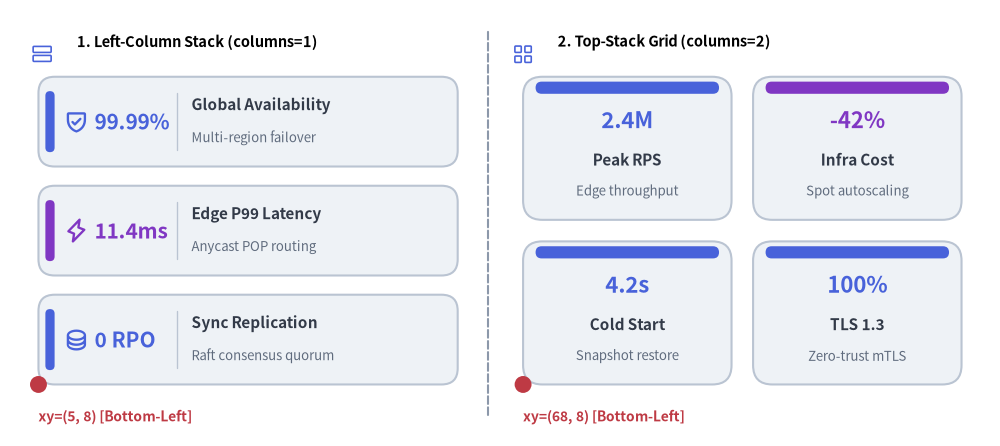
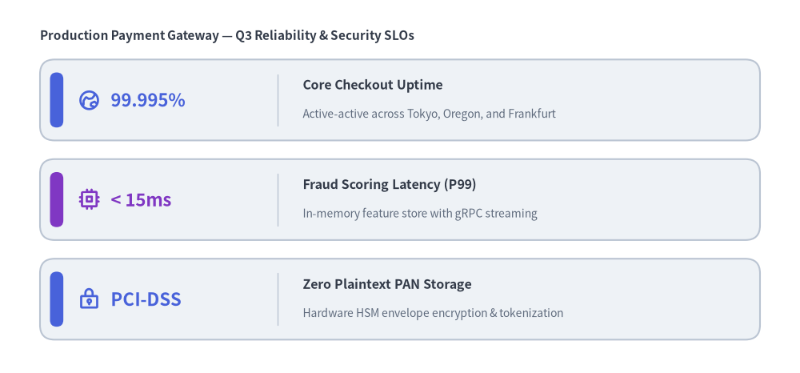
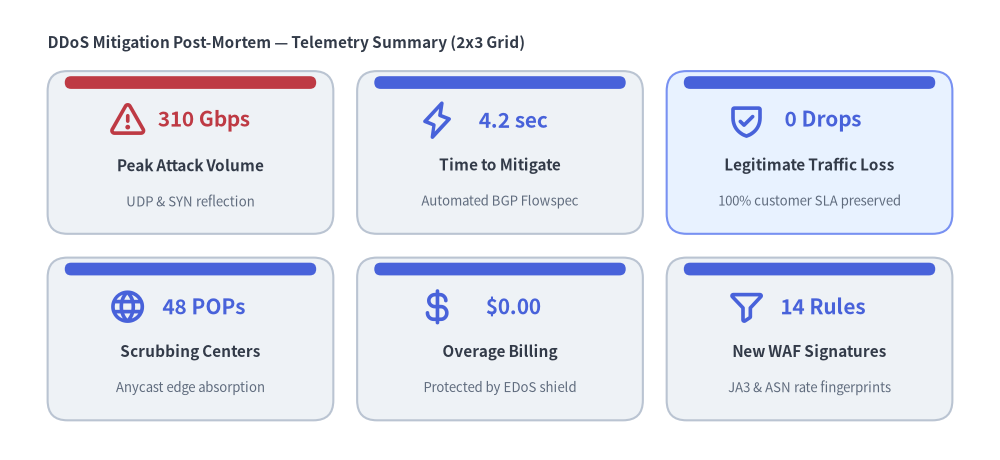

# KpiCards

The `KpiCards` component (also aliased as `KpiCard`) renders metric highlight cards that pair a prominent headline number or status token (`metric`) with a structured card title (`text`), supporting `description`, optional vector `icon`, and accent indicator (`"left_pill"`, `"top_bar"`, or `"none"`).
It supports both vertical stacks (`columns=1`) and multi-column dashboard grids (`columns=2..N`), making it ideal for SLA targets, benchmark summaries, and executive KPI overviews.


<figure class="drawlib-image" style="text-align: center;">
  
  <figcaption class="drawlib-caption">KpiCards Layout Modes: Left-Column Stack (columns=1) vs. Top-Stack 2x2 Grid (columns=2)</figcaption>
</figure>

<details class="drawlib-code-details">
<summary>Source Code</summary>

```python
from drawlib.canvas import save, setup
from drawlib.icons import phosphor
from drawlib.lines import line
from drawlib.shapes import circle
from drawlib.smartarts import KpiCards
from drawlib.styles import Styles
from drawlib.text import text

setup(width=130, height=58)

# Subtle center divider
line((63.5, 4.0), (63.5, 54.0), style=Styles.MutedDashed)

# 1. Left Panel: Vertical Stack (metric_layout="left_column", accent_position="left_pill")
phosphor.rows(xy=(5.5, 51.0), width=3.4, style=Styles.PrimaryFlat)
text((10.0, 52.5), "1. Left-Column Stack (columns=1)", style=Styles.BlackBold.patch(text_size=10.5, halign="left"))

kpi_stack = KpiCards(
    style=Styles.Neutral,
    metric_style=Styles.PrimaryBold.patch(text_size=15.0),
    text_style=Styles.DarkBold.patch(text_size=11.0),
    description_style=Styles.Muted.patch(text_size=9.5),
    accent_style=Styles.PrimaryFlat,
    icon_style=Styles.PrimaryBold,
    accent_position="left_pill",
    metric_layout="left_column",
    metric_width_ratio=0.30,
    spacing=2.5,
)
kpi_stack.add("99.99%", "Global Availability", "Multi-region failover", icon=phosphor.shield_check)
kpi_stack.add(
    "11.4ms",
    "Edge P99 Latency",
    "Anycast POP routing",
    icon=phosphor.lightning,
    metric_style=Styles.AccentBold.patch(text_size=15.0),
    accent_style=Styles.AccentFlat,
    icon_style=Styles.AccentBold,
)
kpi_stack.add("0 RPO", "Sync Replication", "Raft consensus quorum", icon=phosphor.database)
kpi_stack.draw(xy=(5.0, 8.0), width=54.5, height=40.0, columns=1)

circle((5.0, 8.0), radius=1.1, style=Styles.DangerFlat)
text((5.0, 3.8), "xy=(5, 8) [Bottom-Left]", style=Styles.DangerBold.patch(text_size=10.0, halign="left"))

# 2. Right Panel: 2x2 Dashboard Grid (metric_layout="top_stack", accent_position="top_bar")
phosphor.squares_four(xy=(68.0, 51.0), width=3.4, style=Styles.PrimaryFlat)
text((72.5, 52.5), "2. Top-Stack Grid (columns=2)", style=Styles.BlackBold.patch(text_size=10.5, halign="left"))

kpi_grid = KpiCards(
    style=Styles.Neutral,
    metric_style=Styles.PrimaryBold.patch(text_size=16.0),
    text_style=Styles.DarkBold.patch(text_size=11.0),
    description_style=Styles.Muted.patch(text_size=9.5),
    accent_style=Styles.PrimaryFlat,
    accent_position="top_bar",
    metric_layout="top_stack",
    spacing=2.8,
)
kpi_grid.add("2.4M", "Peak RPS", "Edge throughput")
kpi_grid.add(
    "-42%",
    "Infra Cost",
    "Spot autoscaling",
    metric_style=Styles.AccentBold.patch(text_size=16.0),
    accent_style=Styles.AccentFlat,
)
kpi_grid.add("4.2s", "Cold Start", "Snapshot restore")
kpi_grid.add("100%", "TLS 1.3", "Zero-trust mTLS")
kpi_grid.draw(xy=(68.0, 8.0), width=57.0, height=40.0, columns=2)

circle((68.0, 8.0), radius=1.1, style=Styles.DangerFlat)
text((68.0, 3.8), "xy=(68, 8) [Bottom-Left]", style=Styles.DangerBold.patch(text_size=10.0, halign="left"))

save()
```

</details>


---

## 1. Vertical Metric Stack with Left-Column Layout (`metric_layout="left_column"`)

When `metric_layout="left_column"` (the default), each card reserves its left column (`metric_width_ratio`) for the large headline metric and places the card title (`text`) and `description` on the right, with an optional vector `icon` anchored on the far right of the card.


```python
from drawlib.canvas import save, setup
from drawlib.icons import phosphor
from drawlib.smartarts import KpiCards
from drawlib.styles import Styles
from drawlib.text import text

setup(width=120, height=56)

text((6.0, 50.5), "Production Payment Gateway — Q3 Reliability & Security SLOs", style=Styles.DarkBold.patch(text_size=11.0, halign="left"))

slo_cards = KpiCards(
    style=Styles.Neutral,
    metric_style=Styles.PrimaryBold.patch(text_size=16.0),
    text_style=Styles.DarkBold.patch(text_size=11.5),
    description_style=Styles.Muted.patch(text_size=10.0),
    accent_style=Styles.PrimaryFlat,
    icon_style=Styles.PrimaryBold,
    accent_position="left_pill",
    metric_layout="left_column",
    metric_width_ratio=0.28,
    spacing=2.8,
)
slo_cards.add(
    "99.995%",
    "Core Checkout Uptime",
    "Active-active across Tokyo, Oregon, and Frankfurt",
    icon=phosphor.globe_hemisphere_east,
)
slo_cards.add(
    "< 15ms",
    "Fraud Scoring Latency (P99)",
    "In-memory feature store with gRPC streaming",
    icon=phosphor.cpu,
    metric_style=Styles.AccentBold.patch(text_size=16.0),
    accent_style=Styles.AccentFlat,
    icon_style=Styles.AccentBold,
)
slo_cards.add(
    "PCI-DSS",
    "Zero Plaintext PAN Storage",
    "Hardware HSM envelope encryption & tokenization",
    icon=phosphor.lock_key,
)
slo_cards.draw(xy=(6.0, 5.0), width=108.0, height=42.0, columns=1)

save()
```

<figure class="drawlib-image" style="text-align: center;">
  
  <figcaption class="drawlib-caption">Service Level Objectives (SLO) Summary Stack with KpiCards</figcaption>
</figure>


---

## 2. Multi-Column Dashboard Grid & Custom Highlighting (`columns=2..N`)

Combining `metric_layout="top_stack"` and `accent_position="top_bar"` with `columns >= 2` arranges cards into a multi-column row-major grid. You can override `style`, `metric_style`, `text_style`, or `accent_style` on individual items (or mutate `kpi.items[i]` after registration) to highlight specific focal metrics.


```python
from drawlib.canvas import save, setup
from drawlib.icons import phosphor
from drawlib.smartarts import KpiCards
from drawlib.styles import Styles
from drawlib.text import text

setup(width=126, height=58)

text((6.0, 52.5), "DDoS Mitigation Post-Mortem — Telemetry Summary (2x3 Grid)", style=Styles.DarkBold.patch(text_size=11.0, halign="left"))

grid = KpiCards(
    style=Styles.Neutral,
    metric_style=Styles.PrimaryBold.patch(text_size=15.0),
    text_style=Styles.DarkBold.patch(text_size=11.0),
    description_style=Styles.Muted.patch(text_size=9.5),
    accent_style=Styles.PrimaryFlat,
    icon_style=Styles.PrimaryBold,
    accent_position="top_bar",
    metric_layout="top_stack",
    spacing=3.0,
)
grid.add(
    "310 Gbps",
    "Peak Attack Volume",
    "UDP & SYN reflection",
    icon=phosphor.warning,
    metric_style=Styles.DangerBold.patch(text_size=15.0),
    accent_style=Styles.DangerFlat,
    icon_style=Styles.DangerBold,
)
grid.add("4.2 sec", "Time to Mitigate", "Automated BGP Flowspec", icon=phosphor.lightning)
grid.add(
    "0 Drops",
    "Legitimate Traffic Loss",
    "100% customer SLA preserved",
    icon=phosphor.shield_check,
    style=Styles.PrimaryNeutral,
)
grid.add("48 POPs", "Scrubbing Centers", "Anycast edge absorption", icon=phosphor.globe)
grid.add("$0.00", "Overage Billing", "Protected by EDoS shield", icon=phosphor.currency_dollar)
grid.add("14 Rules", "New WAF Signatures", "JA3 & ASN rate fingerprints", icon=phosphor.funnel)

grid.draw(xy=(6.0, 5.0), width=114.0, height=44.0, columns=3)

save()
```

<figure class="drawlib-image" style="text-align: center;">
  
  <figcaption class="drawlib-caption">3-Column Incident Forensics & Mitigation Dashboard Grid</figcaption>
</figure>


---

## 3. Layout Modes & Coordinate Geometry

- **Bottom-Left Anchor (`xy`)**: `KpiCards.draw(xy=(x, y), width=W, height=H, columns=C)` anchors the bottom-left corner of the overall bounding box at `(x, y)` and extends `W` units rightward (`+x`) and `H` units upward (`+y`).
- **Row-Major Grid Ordering**: When `columns > 1`, items are placed from **top row to bottom row, left to right**, so `items[0]` appears at the top-left of the bounding box.
- **Accent Positions (`accent_position`)**:
  - `"left_pill"` *(default)*: Draws a vertical rounded accent bar inside the left edge of each card (`accent_style` required).
  - `"top_bar"`: Draws a horizontal accent bar along the top edge of each card (`accent_style` required).
  - `"none"`: Omits the accent bar for a clean border-only card.
- **Metric Layouts (`metric_layout`)**:
  - `"left_column"` *(default)*: Splits each card horizontally into a left metric zone (`metric_width_ratio`, default `0.28`) and a right title/description/icon zone. Best for `columns=1` or wide `columns=2` layouts.
  - `"top_stack"`: Stacks the large metric centered in the upper half of the card with the title (`text`) and `description` centered below. Best for compact multi-column grids (`columns=2` or `3`).

---

## 4. API Reference

### Constructor
```python
KpiCards(
    *,
    style: Style,
    metric_style: Style,
    text_style: Style,
    description_style: Style | None = None,
    accent_style: Style | None = None,
    icon_style: Style | None = None,
    accent_position: Literal["left_pill", "top_bar", "none"] = "left_pill",
    metric_layout: Literal["left_column", "top_stack"] = "left_column",
    metric_width_ratio: float = 0.28,
    spacing: float = 3.0,
)
```
*(Alias: `KpiCard` is exported from `drawlib.smartarts` as an alias for `KpiCards`.)*

### Methods & Properties
- **`add(metric: str, text: str, description: str = "", *, style: Style | None = None, metric_style: Style | None = None, text_style: Style | None = None, description_style: Style | None = None, accent_style: Style | None = None, icon: Callable | None = None, icon_style: Style | None = None, show: bool = True) -> KpiCardItem`**:
  Registers a metric card item (`text` is the primary card title) and returns a mutable `KpiCardItem`. Setting `item.show = False` skips rendering that card while keeping all other cards' grid positions and dimensions fixed.
- **`kpicards.items -> list[KpiCardItem]`**:
  Returns the list of registered `KpiCardItem` instances for deferred style/text/visibility mutation.
- **`draw(xy: tuple[float, float], width: float = 100.0, height: float = 60.0, *, columns: int = 1, scale: float = 1.0) -> Self`**:
  Renders all visible cards inside the `(width, height)` bounding box anchored at bottom-left `xy`.
