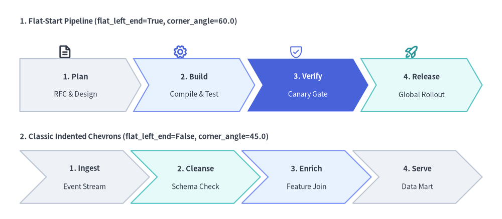
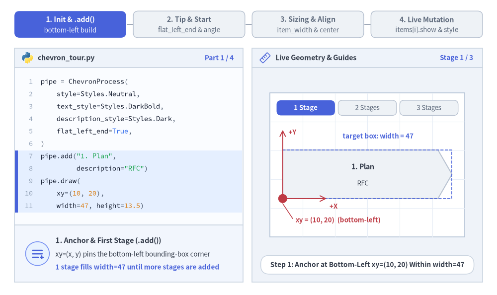
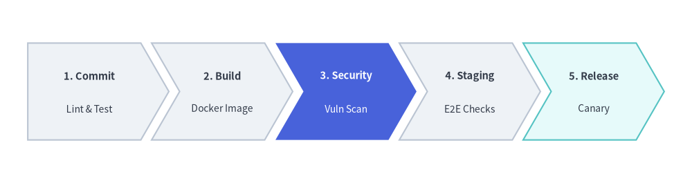
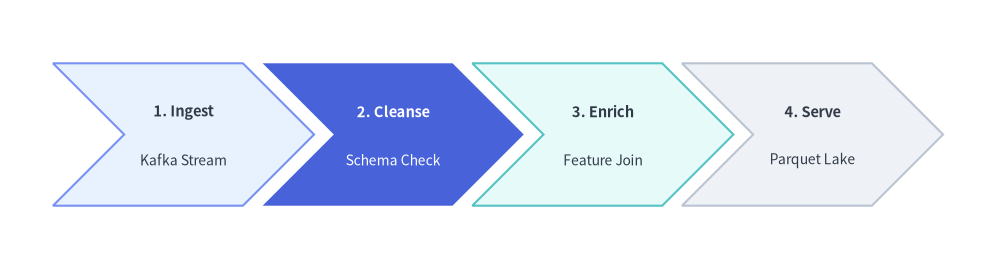

# ChevronProcess Component

The `ChevronProcess` component draws horizontal, sequential process pipelines consisting of interlocking arrowhead blocks (chevrons). 
It is the premier component for CI/CD delivery pipelines, phased development milestones, fulfillment lifecycles, and multi-step workflows.


<figure class="drawlib-image" style="text-align: center;">
  
  <figcaption class="drawlib-caption">Overview of ChevronProcess: Standard Flat-Start vs. Indented Multi-Line Pipelines</figcaption>
</figure>

<details class="drawlib-code-details">
<summary>Source Code</summary>

```python
from drawlib.canvas import save, setup
from drawlib.icons import phosphor
from drawlib.smartarts import ChevronProcess
from drawlib.styles import Styles
from drawlib.text import text

setup(width=128, height=56)

# 1. Top Row: Flat-Start Chevron Pipeline (flat_left_end=True, corner_angle=60.0)
text((5, 50.5), "1. Flat-Start Pipeline (flat_left_end=True, corner_angle=60.0)", style=Styles.DarkBold.patch(text_size=10.5, halign="left"))

# Stage icons above each chevron
phosphor.file_text(xy=(16.5, 42.8), width=3.8, style=Styles.DarkBold)
phosphor.gear(xy=(46.0, 42.8), width=3.8, style=Styles.PrimaryBold)
phosphor.shield_check(xy=(75.5, 42.8), width=3.8, style=Styles.PrimaryFlat)
phosphor.rocket_launch(xy=(105.0, 42.8), width=3.8, style=Styles.SecondaryBold)

flat_pipe = ChevronProcess(
    style=Styles.Neutral,
    text_style=Styles.DarkBold.patch(text_size=10.5),
    description_style=Styles.Dark.patch(text_size=10.0),
    corner_angle=60.0,
    spacing=2.0,
    flat_left_end=True,
)
flat_pipe.add("1. Plan", description="RFC & Design")
flat_pipe.add("2. Build", description="Compile & Test", style=Styles.PrimaryNeutral)
flat_pipe.add(
    "3. Verify",
    description="Canary Gate",
    style=Styles.PrimaryFlat,
    text_style=Styles.WhiteBold.patch(text_size=10.5),
    description_style=Styles.White.patch(text_size=10.0),
)
flat_pipe.add("4. Release", description="Global Rollout", style=Styles.SecondaryNeutral)
flat_pipe.draw(xy=(5, 27.5), width=118.0, height=13.5)

# 2. Bottom Row: Classic Indented Chevrons (flat_left_end=False, corner_angle=45.0)
text((5, 21.0), "2. Classic Indented Chevrons (flat_left_end=False, corner_angle=45.0)", style=Styles.DarkBold.patch(text_size=10.5, halign="left"))

indented_pipe = ChevronProcess(
    style=Styles.Neutral,
    text_style=Styles.DarkBold.patch(text_size=10.5),
    description_style=Styles.Dark.patch(text_size=10.0),
    corner_angle=45.0,
    spacing=2.0,
    flat_left_end=False,
)
indented_pipe.add("1. Ingest", description="Event Stream")
indented_pipe.add("2. Cleanse", description="Schema Check", style=Styles.SecondaryNeutral)
indented_pipe.add("3. Enrich", description="Feature Join", style=Styles.PrimaryNeutral)
indented_pipe.add("4. Serve", description="Data Mart")
indented_pipe.draw(xy=(5, 4.0), width=118.0, height=13.5)

save()
```

</details>


---

## 1. Core Concepts & Basic Usage

`ChevronProcess` constructs sequential interlocking pipelines step-by-step via `.add(...)`, anchoring by default at the **Bottom-Left `(x, y)`** corner of the overall process bounding box (or its center when `align="center"`). You can customize start-edge and arrowhead tip geometry (`flat_left_end`, `corner_angle`, `spacing`), switch between auto-divided `width` and fixed per-stage `item_width`, and mutate or hide individual `.items[i]` stages in place without shifting sibling coordinates:


<figure class="drawlib-image" style="text-align: center;">
  
  <figcaption class="drawlib-caption">Basic Usage & Parameter Tour: Step-by-Step Construction, Tip Geometry, Sizing, and Live Item Mutation (APNG Animation)</figcaption>
</figure>

<details class="drawlib-code-details">
<summary>Source Code</summary>

```python
from __future__ import annotations

import math
from drawlib.anim import Animation
from drawlib.canvas import save, setup
from drawlib.icons import code as code_icons
from drawlib.icons import phosphor
from drawlib.lines import line
from drawlib.shapes import chevron, circle, rectangle
from drawlib.smartarts import ChevronProcess, SourceCode, SourceCodeStyles
from drawlib.styles import Styles
from drawlib.text import text

W, H = 138.0, 82.0
setup(width=W, height=H)
anim = Animation(fps=10.0, loop=0)

CODE_TEXT_SIZE = 10.0
PT_TO_CANVAS = W / 720.0
FONT_CANVAS = CODE_TEXT_SIZE * PT_TO_CANVAS
LINE_H = FONT_CANVAS * 1.8
PAD_Y = FONT_CANVAS * 1.2

CODE_STYLES = SourceCodeStyles.get("default", font_lang="en", text_size=CODE_TEXT_SIZE).patch(
    box_style=Styles.Neutral.patch(shape_fill_color=(0, 0, 0, 0), shape_line_width=0),
)

PANE_HEADER = Styles.Neutral.patch(
    shape_fill_color=(238, 243, 250),
    shape_line_color=(203, 213, 225),
    shape_line_width=1.2,
    shape_r=0.0,
)
EDITOR_BODY = Styles.Neutral.patch(
    shape_fill_color=(250, 252, 255),
    shape_line_color=(203, 213, 225),
    shape_line_width=1.2,
    shape_r=0.0,
)
TAKEAWAY_BODY = Styles.Neutral.patch(
    shape_fill_color=(242, 246, 253),
    shape_line_color=(203, 213, 225),
    shape_line_width=1.2,
    shape_r=0.0,
)
STUDIO_BODY = Styles.Neutral.patch(
    shape_fill_color=(239, 243, 249),
    shape_line_color=(203, 213, 225),
    shape_line_width=1.2,
    shape_r=0.0,
)

PART_ITEMS = [
    ("1. Init & .add()", "bottom-left build"),
    ("2. Tip & Start", "flat_left_end & angle"),
    ("3. Sizing & Align", "item_width & center"),
    ("4. Live Mutation", "items[i].show & style"),
]


def draw_step_bar(active_part: int) -> None:
    """Draw top 4-part progress bar (active_part is 1..4)."""
    pill_w = 31.0
    pill_h = 7.4
    gap = 2.0
    start_x = 4.0 + pill_w / 2.0
    cy = 75.2

    for idx, (label, sublabel) in enumerate(PART_ITEMS, start=1):
        cx = start_x + (idx - 1) * (pill_w + gap)
        if idx > 1:
            prev_cx = cx - (pill_w + gap)
            line(
                (prev_cx + pill_w / 2.0 + 0.2, cy),
                (cx - pill_w / 2.0 - 0.2, cy),
                style=Styles.PrimaryBold if idx <= active_part else Styles.MutedThin,
            )

        if idx == active_part:
            st = Styles.PrimaryFlat.patch(shape_r=1.4)
            tst = Styles.WhiteBold.patch(text_size=10.3)
            sub_tst = Styles.White.patch(text_size=9.5)
        elif idx < active_part:
            st = Styles.PrimaryNeutral.patch(shape_r=1.4, shape_line_width=1.1)
            tst = Styles.PrimaryBold.patch(text_size=10.3)
            sub_tst = Styles.Primary.patch(text_size=9.5)
        else:
            st = Styles.Neutral.patch(shape_r=1.4, shape_line_width=1.1)
            tst = Styles.MutedBold.patch(text_size=10.3)
            sub_tst = Styles.Muted.patch(text_size=9.5)

        rectangle((cx, cy), width=pill_w, height=pill_h, style=st)
        text((cx, cy + 1.35), label, style=tst)
        text((cx, cy - 1.55), sublabel, style=sub_tst)


def draw_left_pane(
    active_part: int,
    code_lines: list[str],
    hl_range: tuple[int, int],
    icon_fn: object,
    summary_title: str,
    summary_line1: str,
    summary_line2: str,
) -> None:
    """Draw left Python code editor + bottom concept takeaway card."""
    x0, w = 4.0, 63.5
    cx = x0 + w / 2.0
    top_y = 63.2
    header_h = 5.4
    editor_h = 43.8
    takeaway_h = 15.8

    rectangle((cx, top_y + header_h / 2.0), width=w, height=header_h, style=PANE_HEADER)
    code_icons.python((x0 + 3.6, top_y + header_h / 2.0), width=3.4, style=Styles.Neutral)
    text(
        (x0 + 6.5, top_y + header_h / 2.0),
        "chevron_tour.py",
        style=Styles.DarkBold.patch(text_size=10.2, halign="left"),
    )
    text(
        (x0 + w - 2.6, top_y + header_h / 2.0),
        f"Part {active_part} / 4",
        style=Styles.PrimaryBold.patch(text_size=9.8, halign="right"),
    )

    rectangle((cx, top_y - editor_h / 2.0), width=w, height=editor_h, style=EDITOR_BODY)

    hl_start, hl_end = hl_range
    hl_top = top_y - PAD_Y - hl_start * LINE_H
    hl_bot = top_y - PAD_Y - (hl_end + 1) * LINE_H
    hl_cy = (hl_top + hl_bot) / 2.0
    hl_h = hl_top - hl_bot
    rectangle(
        (cx, hl_cy),
        width=w - 0.6,
        height=hl_h,
        style=Styles.Neutral.patch(shape_fill_color=(229, 239, 255), shape_line_width=0),
    )
    rectangle(
        (x0 + 0.55, hl_cy),
        width=0.9,
        height=hl_h,
        style=Styles.PrimaryFlat.patch(shape_line_width=0),
    )

    SourceCode.draw(
        xy=(x0, top_y),
        width=w,
        code="\n".join(code_lines),
        styles=CODE_STYLES,
        code_lang="python",
        show_linenum=True,
        align="top_left",
    )

    take_cy = 3.6 + takeaway_h / 2.0
    rectangle((cx, take_cy), width=w, height=takeaway_h, style=TAKEAWAY_BODY)
    circle(
        (x0 + 6.4, take_cy),
        radius=3.3,
        style=Styles.PrimaryNeutral.patch(shape_line_width=1.2),
    )
    icon_fn((x0 + 6.4, take_cy), width=3.8, style=Styles.PrimaryBold)  # type: ignore[operator]
    text(
        (x0 + 11.4, take_cy + 3.6),
        summary_title,
        style=Styles.DarkBold.patch(text_size=10.4, halign="left"),
    )
    text(
        (x0 + 11.4, take_cy - 0.2),
        summary_line1,
        style=Styles.Dark.patch(text_size=9.7, halign="left"),
    )
    text(
        (x0 + 11.4, take_cy - 3.8),
        summary_line2,
        style=Styles.PrimaryBold.patch(text_size=9.6, halign="left"),
    )


def draw_geometry_studio(param_badge: str, footer_caption: str) -> tuple[float, float]:
    """Draw right geometry lab shell, inner coordinate sheet with subtle grid, and footer."""
    x0, w = 70.0, 64.0
    cx = x0 + w / 2.0
    top_y = 63.2
    header_h = 5.4
    body_h = 59.6

    rectangle((cx, top_y + header_h / 2.0), width=w, height=header_h, style=PANE_HEADER)
    phosphor.ruler((x0 + 3.6, top_y + header_h / 2.0), width=3.4, style=Styles.Primary)
    text(
        (x0 + 6.5, top_y + header_h / 2.0),
        "Live Geometry & Guides",
        style=Styles.DarkBold.patch(text_size=10.2, halign="left"),
    )
    text(
        (x0 + w - 2.6, top_y + header_h / 2.0),
        param_badge,
        style=Styles.PrimaryBold.patch(text_size=9.6, halign="right"),
    )

    rectangle((cx, 3.6 + body_h / 2.0), width=w, height=body_h, style=STUDIO_BODY)

    sheet_cx, sheet_cy = cx, 36.2
    sheet_w, sheet_h = 54.0, 40.0
    sx0, sy0 = sheet_cx - sheet_w / 2.0, sheet_cy - sheet_h / 2.0
    rectangle(
        (sheet_cx, sheet_cy),
        width=sheet_w,
        height=sheet_h,
        style=Styles.Neutral.patch(
            shape_fill_color=(255, 255, 255),
            shape_line_color=(180, 194, 214),
            shape_line_width=1.2,
        ),
    )
    g_st = Styles.MutedThin.patch(line_color=(232, 238, 246), line_width=0.8)
    for gx in range(1, 6):
        vx = sx0 + gx * (sheet_w / 6.0)
        line((vx, sy0), (vx, sy0 + sheet_h), style=g_st)
    for gy in range(1, 5):
        vy = sy0 + gy * (sheet_h / 5.0)
        line((sx0, vy), (sx0 + sheet_w, vy), style=g_st)

    rectangle(
        (cx, 8.4),
        width=59.2,
        height=5.2,
        style=Styles.Neutral.patch(
            shape_fill_color=(255, 255, 255),
            shape_line_color=(203, 213, 225),
            shape_line_width=1.1,
            shape_r=2.4,
        ),
        text=footer_caption,
        text_style=Styles.DarkBold.patch(text_size=9.8),
    )
    return sheet_cx, sheet_cy


def draw_sub_pills(scx: float, labels: list[str], active_idx: int) -> None:
    """Draw 3-step tracker pills near the top of the studio sheet."""
    pw, ph, pgap = 16.2, 4.2, 0.9
    p_start = scx - (3 * pw + 2 * pgap) / 2.0 + pw / 2.0
    for idx, lbl in enumerate(labels):
        px = p_start + idx * (pw + pgap)
        if idx == active_idx:
            pst = Styles.PrimaryFlat.patch(shape_r=1.2)
            ptst = Styles.WhiteBold.patch(text_size=9.5)
        elif idx < active_idx:
            pst = Styles.PrimaryNeutral.patch(shape_r=1.2, shape_line_width=1.0)
            ptst = Styles.PrimaryBold.patch(text_size=9.5)
        else:
            pst = Styles.Neutral.patch(shape_r=1.2, shape_line_width=1.0)
            ptst = Styles.Muted.patch(text_size=9.5)
        rectangle((px, 52.0), width=pw, height=ph, style=pst, text=lbl, text_style=ptst)


TITLE_DARK = Styles.DarkBold.patch(text_size=10.2)
DESC_DARK = Styles.Dark.patch(text_size=9.5)
TITLE_WHITE = Styles.WhiteBold.patch(text_size=10.2)
DESC_WHITE = Styles.White.patch(text_size=9.5)

# =========================================================================
# Part 1: Init & .add() — Step-by-Step Bottom-Left Pipeline Construction
# =========================================================================
BUILD_STATES = [
    (
        1,
        3.2,
        [
            "pipe = ChevronProcess(",
            "    style=Styles.Neutral,",
            "    text_style=Styles.DarkBold,",
            "    description_style=Styles.Dark,",
            "    flat_left_end=True,",
            ")",
            'pipe.add("1. Plan",',
            '         description="RFC")',
            "pipe.draw(",
            "    xy=(10, 20),",
            "    width=47, height=13.5)",
        ],
        (6, 10),
        "Stage 1 / 3",
        "Step 1: Anchor at Bottom-Left xy=(10, 20) Within width=47",
        "1. Anchor & First Stage (.add())",
        "xy=(x, y) pins the bottom-left bounding-box corner",
        "1 stage fills width=47 until more stages are added",
    ),
    (
        2,
        3.2,
        [
            "pipe = ChevronProcess(",
            "    style=Styles.Neutral, ...,",
            "    flat_left_end=True)",
            'pipe.add("1. Plan",',
            '         description="RFC")',
            "pipe.add(",
            '    "2. Build",',
            '    description="Test",',
            "    style=Styles.PrimaryFlat,",
            "    text_style=Styles.WhiteBold)",
            "pipe.draw((10, 20), 47, 13.5)",
        ],
        (5, 9),
        "Stage 2 / 3",
        "Step 2: Interlock Focal Stage 2 Across Shared width=47",
        "2. Interlocking Stage + Per-Item Style",
        "Each .add() subdivides width=47 with interlocking tips",
        "Override style=Styles.PrimaryFlat on 1 focal stage",
    ),
    (
        3,
        3.5,
        [
            "pipe = ChevronProcess(",
            "    ..., flat_left_end=True)",
            'pipe.add("1. Plan",',
            '         description="RFC")',
            'pipe.add("2. Build", ...,',
            "         style=Styles.PrimaryFlat)",
            "pipe.add(",
            '    "3. Ship",',
            '    description="Canary",',
            "    style=Styles.SecondaryNeutral)",
            "pipe.draw((10, 20), 47, 13.5)",
        ],
        (6, 9),
        "Stage 3 / 3",
        "Step 3: Complete 3-Stage Pipeline Filling width=47",
        "3. Balanced 3-Stage Pipeline",
        "Calm Neutral & SecondaryNeutral ground outer stages",
        "Stage 2 stands out cleanly with WhiteBold contrast",
    ),
]

for b_idx, (n_stages, dur, code_b, hl_rng, badge_txt, foot_txt, s_t, s_1, s_2) in enumerate(BUILD_STATES):
    with anim.frame(duration=dur):
        draw_step_bar(1)
        draw_left_pane(1, code_b, hl_rng, phosphor.list_plus, s_t, s_1, s_2)
        scx, scy = draw_geometry_studio(badge_txt, foot_txt)
        draw_sub_pills(scx, ["1 Stage", "2 Stages", "3 Stages"], b_idx)

        px0, py0, pw_tot, ph_tot = 78.5, 26.8, 47.0, 13.5

        pipe = ChevronProcess(
            style=Styles.Neutral,
            text_style=TITLE_DARK,
            description_style=DESC_DARK,
            corner_angle=60.0,
            spacing=1.5,
            flat_left_end=True,
        )
        pipe.add("1. Plan", description="RFC")
        if n_stages >= 2:
            pipe.add(
                "2. Build",
                description="Test",
                style=Styles.PrimaryFlat,
                text_style=TITLE_WHITE,
                description_style=DESC_WHITE,
            )
        if n_stages >= 3:
            pipe.add("3. Ship", description="Canary", style=Styles.SecondaryNeutral)
        pipe.draw(xy=(px0, py0), width=pw_tot, height=ph_tot)

        # Dashed width=47 target bounding box
        rectangle(
            (px0 + pw_tot / 2.0, py0 + ph_tot / 2.0),
            width=pw_tot,
            height=ph_tot,
            style=Styles.PrimaryDashed.patch(shape_fill_color=(0, 0, 0, 0), shape_line_width=1.2),
        )
        text(
            (px0 + pw_tot / 2.0 + 3.0, py0 + ph_tot + 3.8),
            "target box: width = 47",
            style=Styles.PrimaryBold.patch(text_size=9.5),
        )

        # Bottom-Left xy anchor dot + +X / +Y Cartesian axes
        line(
            (px0, py0),
            (px0, py0 + ph_tot + 5.6),
            arrow_head="->",
            style=Styles.DangerBold.patch(line_width=1.4),
        )
        text(
            (px0 + 1.6, py0 + ph_tot + 5.0),
            "+Y",
            style=Styles.DangerBold.patch(text_size=9.5, halign="left"),
        )
        line(
            (px0, py0),
            (px0 + 12.2, py0),
            arrow_head="->",
            style=Styles.DangerBold.patch(line_width=1.4),
        )
        text(
            (px0 + 13.0, py0 - 2.1),
            "+X",
            style=Styles.DangerBold.patch(text_size=9.5, halign="left"),
        )
        circle((px0, py0), radius=1.25, style=Styles.DangerFlat)
        line(
            (px0, py0 - 1.4),
            (px0 + 2.8, py0 - 5.6),
            style=Styles.DangerBold.patch(line_width=1.1),
        )
        text(
            (px0 + 3.6, py0 - 6.0),
            "xy = (10, 20)  (bottom-left)",
            style=Styles.DangerBold.patch(text_size=9.6, halign="left"),
        )

# =========================================================================
# Part 2: Tip & Start — flat_left_end & corner_angle (10°..80°)
# =========================================================================
TIP_STATES = [
    (
        False,
        60.0,
        1.8,
        3.3,
        (6, 6),
        "flat_left_end=False",
        "flat_left_end=False (Default): Indented Notch on Stage 1",
        "Indented Start (flat_left_end=False)",
        "Default False indents every chevron including Stage 1",
        "Matches repeating multi-row or continuation flows",
    ),
    (
        True,
        60.0,
        1.8,
        3.3,
        (6, 6),
        "flat_left_end=True",
        "flat_left_end=True: Clean Vertical Left Edge on Stage 1",
        "Flat Start Edge (flat_left_end=True)",
        "Draws Stage 1 as a flat-backed pentagon at x0",
        "Aligns cleanly against left margins and axis guides",
    ),
    (
        True,
        42.0,
        2.6,
        3.4,
        (4, 5),
        "corner_angle = 42°",
        "corner_angle=42.0, spacing=2.6: Deeper Tips & Wider Gap",
        "Tip Angle & Gap (corner_angle, spacing)",
        "Lower angles (42° vs 60°) deepen arrowhead tips",
        "Valid corner_angle range: 10.0° to 80.0°",
    ),
]

for t_idx, (flat_left, c_ang, spc, dur, hl_rng, badge_txt, foot_txt, s_t, s_1, s_2) in enumerate(TIP_STATES):
    code_t = [
        "pipe = ChevronProcess(",
        "    style=Styles.Neutral,",
        "    text_style=Styles.DarkBold,",
        "    description_style=Styles.Dark,",
        f"    corner_angle={c_ang},",
        f"    spacing={spc},",
        f"    flat_left_end={flat_left},",
        ")",
        'pipe.add("Plan", description="RFC")',
        'pipe.add("Build", ...)',
        "pipe.draw((10, 20), 47, 13.0)",
    ]
    with anim.frame(duration=dur):
        draw_step_bar(2)
        draw_left_pane(2, code_t, hl_rng, phosphor.caret_double_right, s_t, s_1, s_2)
        scx, scy = draw_geometry_studio(badge_txt, foot_txt)
        draw_sub_pills(scx, ["Indented 60°", "Flat-Start 60°", "Sharp 42°"], t_idx)

        px0, py0, pw_tot, ph_tot = 78.5, 27.5, 47.0, 13.0
        cy_p = py0 + ph_tot / 2.0
        x_ind = (ph_tot / 2.0) / math.tan(math.radians(c_ang))
        w_itm = (pw_tot - 2.0 * spc - x_ind) / 3.0

        pipe = ChevronProcess(
            style=Styles.Neutral,
            text_style=TITLE_DARK,
            description_style=DESC_DARK,
            corner_angle=c_ang,
            spacing=spc,
            flat_left_end=flat_left,
        )
        pipe.add("Plan", description="RFC")
        pipe.add(
            "Build",
            description="Test",
            style=Styles.PrimaryFlat,
            text_style=TITLE_WHITE,
            description_style=DESC_WHITE,
        )
        pipe.add("Ship", description="Prod", style=Styles.SecondaryNeutral)
        pipe.draw(xy=(px0, py0), width=pw_tot, height=ph_tot)

        if t_idx == 0:
            # Highlight indented V-notch on Stage 1
            line((px0, py0 + ph_tot), (px0 + x_ind, cy_p), style=Styles.DangerBold.patch(line_width=2.2))
            line((px0 + x_ind, cy_p), (px0, py0), style=Styles.DangerBold.patch(line_width=2.2))
            circle((px0 + x_ind, cy_p), radius=1.05, style=Styles.DangerFlat)
            line(
                (px0 + x_ind * 0.5, py0 - 0.6),
                (px0 + 4.5, 20.8),
                style=Styles.DangerBold.patch(line_width=1.1),
            )
            text(
                (px0 + 5.4, 20.4),
                "indented notch (flat_left_end=False)",
                style=Styles.DangerBold.patch(text_size=9.5, halign="left"),
            )
        elif t_idx == 1:
            # Highlight clean vertical left edge on Stage 1
            line((px0, py0), (px0, py0 + ph_tot), style=Styles.PrimaryBold.patch(line_width=2.6))
            line((px0, py0 - 0.8), (px0 + 4.2, 20.8), style=Styles.PrimaryBold.patch(line_width=1.1))
            text(
                (px0 + 5.2, 20.4),
                "vertical start edge (flat_left_end=True)",
                style=Styles.PrimaryBold.patch(text_size=9.5, halign="left"),
            )
        else:
            # Highlight sharper 42 deg tip & wider spacing=2.6 gap
            tip_x = px0 + w_itm + x_ind
            sh_x = px0 + w_itm
            line((sh_x, py0 + ph_tot), (tip_x, cy_p), style=Styles.DangerBold.patch(line_width=2.2))
            line((tip_x, cy_p), (sh_x, py0), style=Styles.DangerBold.patch(line_width=2.2))
            lx = sh_x + 0.35 * x_ind
            ly = py0 + 0.35 * (ph_tot / 2.0)
            line((lx, ly - 0.5), (lx - 1.8, 21.8), style=Styles.DangerBold.patch(line_width=1.1))
            text(
                (px0 + 2.5, 20.4),
                "corner_angle = 42°  (sharper tip)",
                style=Styles.DangerBold.patch(text_size=9.5, halign="left"),
            )
            # Spacing callout above gap between Stage 1 and Stage 2
            g_x1, g_x2 = sh_x, sh_x + spc
            line((g_x1, py0 + ph_tot + 0.7), (g_x1, py0 + ph_tot + 3.6), style=Styles.PrimaryBold.patch(line_width=1.2))
            line((g_x2, py0 + ph_tot + 0.7), (g_x2, py0 + ph_tot + 3.6), style=Styles.PrimaryBold.patch(line_width=1.2))
            text(
                ((g_x1 + g_x2) / 2.0 + 2.0, py0 + ph_tot + 5.2),
                "spacing = 2.6",
                style=Styles.PrimaryBold.patch(text_size=9.5),
            )

# =========================================================================
# Part 3: Sizing & Align — width vs. item_width & align="center"
# =========================================================================
SIZE_STATES = [
    (
        "auto_width",
        3.3,
        [
            "pipe = ChevronProcess(",
            "    ..., spacing=1.8,",
            "    flat_left_end=True)",
            'pipe.add("Plan", description="RFC")',
            'pipe.add("Build", ...)',
            'pipe.add("Ship", ...)',
            "",
            "# Auto-divide total width=47",
            "pipe.draw(",
            "    xy=(10, 20),",
            "    width=47, height=13)",
        ],
        (8, 10),
        "width = 47 (auto)",
        "item_width=None: Auto-Divides width=47 Across Stages",
        "Auto-Divided Total Width (width=47)",
        "Computes item_width automatically from total width",
        "Keeps overall pipeline locked to exact target span",
    ),
    (
        "fixed_item",
        3.3,
        [
            "pipe = ChevronProcess(",
            "    ..., spacing=1.8,",
            "    flat_left_end=True)",
            'pipe.add("Plan", description="RFC")',
            'pipe.add("Build", ...)',
            'pipe.add("Ship", ...)',
            "",
            "# Fixed body width per stage",
            "pipe.draw(",
            "    xy=(10, 20), height=13,",
            "    item_width=12.5)",
        ],
        (8, 10),
        "item_width = 12.5",
        "Explicit item_width=12.5: Fixed Body Width per Stage",
        "Explicit Stage Width (item_width=12.5)",
        "Each chevron body gets exact width=12.5 units",
        "Overrides total width so pipeline grows with N",
    ),
    (
        "center_align",
        3.4,
        [
            "pipe = ChevronProcess(",
            "    ..., spacing=1.8,",
            "    flat_left_end=True)",
            'pipe.add("Plan", description="RFC")',
            'pipe.add("Build", ...)',
            'pipe.add("Ship", ...)',
            "",
            "# Center bounding box on xy",
            "pipe.draw(",
            "    xy=(34, 27), width=47,",
            '    height=13, align="center")',
        ],
        (8, 10),
        'align = "center"',
        'align="center": Centers Bounding Box on xy=(cx, cy)',
        'Centered Anchor (align="center")',
        "Centers total bounding box horizontally & vertically",
        "Ideal when aligning pipelines to canvas midlines",
    ),
]

for s_idx, (mode, dur, code_s, hl_rng, badge_txt, foot_txt, s_t, s_1, s_2) in enumerate(SIZE_STATES):
    with anim.frame(duration=dur):
        draw_step_bar(3)
        draw_left_pane(3, code_s, hl_rng, phosphor.arrows_out_line_horizontal, s_t, s_1, s_2)
        scx, scy = draw_geometry_studio(badge_txt, foot_txt)
        draw_sub_pills(scx, ["width = 47", "item_width=12.5", 'align="center"'], s_idx)

        px0, py0, pw_tot, ph_tot = 78.5, 27.5, 47.0, 13.0
        spc = 1.8
        x_ind = (ph_tot / 2.0) / math.tan(math.radians(60.0))

        pipe = ChevronProcess(
            style=Styles.Neutral,
            text_style=TITLE_DARK,
            description_style=DESC_DARK,
            corner_angle=60.0,
            spacing=spc,
            flat_left_end=True,
        )
        pipe.add("Plan", description="RFC")
        if mode == "center_align":
            pipe.add("Build", description="Test", style=Styles.PrimaryNeutral)
        else:
            pipe.add(
                "Build",
                description="Test",
                style=Styles.PrimaryFlat,
                text_style=TITLE_WHITE,
                description_style=DESC_WHITE,
            )
        pipe.add("Ship", description="Prod", style=Styles.SecondaryNeutral)

        if mode == "auto_width":
            pipe.draw(xy=(px0, py0), width=pw_tot, height=ph_tot)
            cal_y = py0 + ph_tot + 3.0
            line((px0, py0 + ph_tot + 0.8), (px0, cal_y + 1.2), style=Styles.PrimaryBold.patch(line_width=1.2))
            line(
                (px0 + pw_tot, py0 + ph_tot + 0.8),
                (px0 + pw_tot, cal_y + 1.2),
                style=Styles.PrimaryBold.patch(line_width=1.2),
            )
            line((px0, cal_y), (px0 + pw_tot, cal_y), arrow_head="<->", style=Styles.PrimaryBold.patch(line_width=1.4))
            text((scx, cal_y + 2.8), "width = 47  (auto-divided)", style=Styles.PrimaryBold.patch(text_size=9.5))
            circle((px0, py0), radius=1.2, style=Styles.DangerFlat)
            text(
                (px0 + 2.2, 20.6),
                'xy (default align="bottom_left")',
                style=Styles.DangerBold.patch(text_size=9.5, halign="left"),
            )
        elif mode == "fixed_item":
            w_fixed = 12.5
            pipe.draw(xy=(px0, py0), height=ph_tot, item_width=w_fixed)
            # Ghost vertical tick showing previous width=47 right edge
            line(
                (px0 + pw_tot, py0),
                (px0 + pw_tot, py0 + ph_tot),
                style=Styles.MutedDashed.patch(line_width=1.1),
            )
            cal_y = py0 + ph_tot + 3.0
            line((px0, py0 + ph_tot + 0.8), (px0, cal_y + 1.2), style=Styles.PrimaryBold.patch(line_width=1.2))
            line(
                (px0 + w_fixed, py0 + ph_tot + 0.8),
                (px0 + w_fixed, cal_y + 1.2),
                style=Styles.PrimaryBold.patch(line_width=1.2),
            )
            line(
                (px0, cal_y),
                (px0 + w_fixed, cal_y),
                arrow_head="<->",
                style=Styles.PrimaryBold.patch(line_width=1.4),
            )
            text(
                (px0 + w_fixed / 2.0 + 3.2, cal_y + 2.8),
                "item_width = 12.5",
                style=Styles.PrimaryBold.patch(text_size=9.5),
            )
            tot_fixed = 3.0 * w_fixed + 2.0 * spc + x_ind
            line(
                (px0, 22.8),
                (px0 + tot_fixed, 22.8),
                arrow_head="<->",
                style=Styles.MutedBold.patch(line_width=1.1),
            )
            text(
                (px0 + tot_fixed / 2.0, 19.8),
                f"total span = {tot_fixed:.1f} (3 × 12.5 + gaps + tip)",
                style=Styles.DarkBold.patch(text_size=9.5),
            )
        else:
            cx_a, cy_a = scx, 34.0
            pipe.draw(xy=(cx_a, cy_a), width=pw_tot, height=ph_tot, align="center")
            rectangle(
                (cx_a, cy_a),
                width=pw_tot,
                height=ph_tot,
                style=Styles.PrimaryDashed.patch(shape_fill_color=(0, 0, 0, 0), shape_line_width=1.3),
            )
            # Red center crosshair extending cleanly outside bounding box
            line((cx_a - 25.5, cy_a), (cx_a - 23.5, cy_a), style=Styles.DangerBold.patch(line_width=1.5))
            line((cx_a + 23.5, cy_a), (cx_a + 25.5, cy_a), style=Styles.DangerBold.patch(line_width=1.5))
            line((cx_a, cy_a + 6.5), (cx_a, cy_a + 10.6), style=Styles.DangerBold.patch(line_width=1.5))
            line((cx_a, cy_a - 10.2), (cx_a, cy_a - 6.5), style=Styles.DangerBold.patch(line_width=1.5))
            circle(
                (cx_a, cy_a),
                radius=1.6,
                style=Styles.Neutral.patch(shape_fill_color=(255, 255, 255), shape_line_width=0),
            )
            circle((cx_a, cy_a), radius=1.15, style=Styles.DangerFlat)
            text(
                (cx_a, 20.4),
                'xy = (34, 27)  •  align="center"',
                style=Styles.DangerBold.patch(text_size=9.6),
            )

# =========================================================================
# Part 4: Live Mutation — .items[i].style & .items[i].show
# =========================================================================
MUTATE_STATES = [
    (
        "all_shown",
        3.3,
        [
            "pipe = ChevronProcess(",
            "    style=Styles.Neutral, ...,",
            "    flat_left_end=True)",
            'pipe.add("Plan", description="RFC")',
            'pipe.add("Build",',
            '         description="Test")',
            'pipe.add("Ship",',
            '         description="Prod")',
            "# Access stages via pipe.items[i]",
            "pipe.draw((10, 20), 47, 13.0)",
        ],
        (3, 8),
        "pipe.items[0..2]",
        "All 3 ChevronItem Instances Registered in pipe.items[0..2]",
        "Inspectable Stage List (pipe.items)",
        ".add() appends mutable ChevronItem models in order",
        "Modify text, style, or show any time before .draw()",
    ),
    (
        "spotlight_mid",
        3.4,
        [
            "pipe = ChevronProcess(",
            "    style=Styles.Neutral, ...)",
            'pipe.add("Plan", description="RFC")',
            'pipe.add("Build", ...)',
            'pipe.add("Ship", ...)',
            "mid = pipe.items[1]",
            "mid.style = Styles.PrimaryFlat",
            "mid.text_style = Styles.WhiteBold",
            "mid.description_style = (",
            "    Styles.White)",
            "pipe.draw((10, 20), 47, 13.0)",
        ],
        (5, 9),
        "items[1].style",
        "Deferred Style Override: Spotlight items[1] Before .draw()",
        "Deferred Style Mutation (.items[1].style)",
        "Re-theme active pipeline stages without rebuilding",
        "Great for step-by-step state & slide animations",
    ),
    (
        "hide_mid",
        3.6,
        [
            "pipe = ChevronProcess(",
            "    style=Styles.Neutral, ...)",
            'pipe.add("Plan", description="RFC")',
            'pipe.add("Build", ...)',
            'pipe.add("Ship", ...)',
            "",
            "# Hide stage; sibling slots stay!",
            "pipe.items[1].show = False",
            "",
            "pipe.draw((10, 20), 47, 13.0)",
        ],
        (6, 7),
        "items[1].show=False",
        "items[1].show = False: Hides Stage Without Shifting Siblings",
        "Slot-Preserving Visibility (.show = False)",
        "Skips rendering items[1] while keeping N-stage layout",
        "items[0] and items[2] hold exact X positions",
    ),
]

for m_idx, (m_mode, dur, code_m, hl_rng, badge_txt, foot_txt, s_t, s_1, s_2) in enumerate(MUTATE_STATES):
    with anim.frame(duration=dur):
        draw_step_bar(4)
        draw_left_pane(4, code_m, hl_rng, phosphor.sliders_horizontal, s_t, s_1, s_2)
        scx, scy = draw_geometry_studio(badge_txt, foot_txt)
        draw_sub_pills(scx, ["All Shown", ".style Override", ".show = False"], m_idx)

        px0, py0, pw_tot, ph_tot = 78.5, 26.2, 47.0, 13.0
        cy_m = py0 + ph_tot / 2.0
        spc = 1.8
        x_ind = (ph_tot / 2.0) / math.tan(math.radians(60.0))
        w_itm = (pw_tot - 2.0 * spc - x_ind) / 3.0

        pipe = ChevronProcess(
            style=Styles.Neutral,
            text_style=TITLE_DARK,
            description_style=DESC_DARK,
            corner_angle=60.0,
            spacing=spc,
            flat_left_end=True,
        )
        pipe.add("Plan", description="RFC")
        pipe.add("Build", description="Test")
        pipe.add("Ship", description="Prod", style=Styles.SecondaryNeutral)

        if m_mode == "spotlight_mid":
            pipe.items[1].style = Styles.PrimaryFlat
            pipe.items[1].text_style = TITLE_WHITE
            pipe.items[1].description_style = DESC_WHITE
        elif m_mode == "hide_mid":
            pipe.items[1].show = False

        pipe.draw(xy=(px0, py0), width=pw_tot, height=ph_tot)

        # Stage center X positions for badges & ghost slot
        cx0 = px0 + (w_itm + 0.5 * x_ind) / 2.0
        cx1 = px0 + 1.5 * w_itm + spc + 0.5 * x_ind
        cx2 = px0 + 2.5 * w_itm + 2.0 * spc + 0.5 * x_ind

        for idx_b, bx in enumerate((cx0, cx1, cx2)):
            if m_mode == "spotlight_mid" and idx_b == 1:
                bst = Styles.PrimaryFlat.patch(shape_r=1.1)
                btst = Styles.WhiteBold.patch(text_size=9.5)
            elif m_mode == "hide_mid" and idx_b == 1:
                bst = Styles.MutedDashed.patch(
                    shape_fill_color=(248, 250, 252),
                    shape_line_color=(148, 163, 184),
                    shape_line_width=1.1,
                    shape_r=1.1,
                )
                btst = Styles.MutedBold.patch(text_size=9.5)
            else:
                bst = Styles.PrimaryNeutral.patch(shape_r=1.1, shape_line_width=1.0)
                btst = Styles.PrimaryBold.patch(text_size=9.5)
            rectangle((bx, 44.0), width=13.4, height=3.9, style=bst, text=f"items[{idx_b}]", text_style=btst)
            line((bx, 42.0), (bx, py0 + ph_tot + 0.6), style=Styles.MutedThin.patch(line_width=1.0))

        if m_mode == "all_shown":
            text(
                (scx, 20.2),
                "3 mutable ChevronItem models in pipe.items",
                style=Styles.DarkBold.patch(text_size=9.5),
            )
        elif m_mode == "spotlight_mid":
            text(
                (scx, 20.2),
                "items[1].style = Styles.PrimaryFlat  (in-place)",
                style=Styles.PrimaryBold.patch(text_size=9.5),
            )
        else:
            # Subtle dashed ghost chevron in preserved middle slot
            chevron(
                xy=(cx1, cy_m),
                width=w_itm,
                height=ph_tot,
                corner_angle=60.0,
                style=Styles.MutedDashed.patch(
                    shape_fill_color=(248, 250, 252),
                    shape_line_color=(148, 163, 184),
                    shape_line_width=1.3,
                ),
            )
            text(
                (cx1 + 0.9, cy_m),
                "slot\npreserved",
                style=Styles.MutedBold.patch(text_size=9.5),
            )
            text(
                (scx, 20.2),
                "items[0] & items[2] keep exact X coordinates",
                style=Styles.PrimaryBold.patch(text_size=9.5),
            )

save()
```

</details>


- **Step-by-Step Construction & Anchor (`xy`, `align`)**: Append stages in sequence via `.add(text, description=..., style=...)` and render at `xy=(x, y)`—anchored at the **Bottom-Left** bounding-box corner by default (`align="bottom_left"`) or centered via `align="center"`.
- **Start Edge & Tip Geometry (`flat_left_end`, `corner_angle`, `spacing`)**: Set `flat_left_end=True` for a clean vertical left border on Stage 1 (or `False` for a classic indented notch), and tune `corner_angle` (`10.0°`–`80.0°`) and `spacing` to control arrowhead depth and inter-stage gaps.
- **Auto-Divided `width` vs. Fixed `item_width` (`scale`)**: Leave `item_width=None` to automatically subdivide total `width` across all stages, pass an explicit `item_width` to lock per-stage body width, or resize proportionally around `xy` via `scale`.
- **Live `.items[i]` Mutation & Slot-Preserving `.show`**: Mutate `pipe.items[i].style` or `text_style` before `.draw()` to spotlight active milestones, or set `pipe.items[i].show = False` to hide a stage while keeping sibling X coordinates completely unchanged.

---

## 2. Quick Example: CI/CD Pipeline


```python
from drawlib.canvas import setup
from drawlib.smartarts import ChevronProcess
from drawlib.styles import Styles

setup(width=128, height=34)

pipeline = ChevronProcess(
    style=Styles.Neutral,
    text_style=Styles.DarkBold.patch(text_size=10.5),
    description_style=Styles.Dark.patch(text_size=10.0),
    corner_angle=60.0,
    spacing=2.0,
    flat_left_end=True,
)
pipeline.add("1. Commit", description="Lint & Test")
pipeline.add("2. Build", description="Docker Image")
pipeline.add(
    "3. Security",
    description="Vuln Scan",
    style=Styles.PrimaryFlat,
    text_style=Styles.WhiteBold.patch(text_size=10.5),
    description_style=Styles.White.patch(text_size=10.0),
)
pipeline.add("4. Staging", description="E2E Checks")
pipeline.add("5. Release", description="Canary", style=Styles.SecondaryNeutral)

pipeline.draw(xy=(5, 8), width=118.0, height=18.0)
```

<figure class="drawlib-image" style="text-align: center;">
  
  <figcaption class="drawlib-caption">Continuous Delivery Pipeline with ChevronProcess</figcaption>
</figure>


---

## 3. Classic Indented Chevrons with Explicit `item_width` & `corner_angle`

Setting `flat_left_end=False` (the default) renders every stage—including the first—as a classic indented chevron, while passing an explicit `item_width` to `draw(...)` gives every stage an exact fixed body width instead of auto-dividing a bounding container width. You can also adjust `corner_angle` (valid range: `10.0` to `80.0` degrees) to control arrowhead sharpness, and mutate returned `ChevronItem` instances before drawing.


```python
from drawlib.canvas import save, setup
from drawlib.smartarts import ChevronProcess
from drawlib.styles import Styles

setup(width=126, height=34)

etl = ChevronProcess(
    style=Styles.Neutral,
    text_style=Styles.DarkBold.patch(text_size=10.5),
    description_style=Styles.Dark.patch(text_size=10.0),
    corner_angle=45.0,
    spacing=2.5,
    flat_left_end=False,
)

etl.add("1. Ingest", description="Kafka Stream", style=Styles.PrimaryNeutral)
transform_stage = etl.add("2. Cleanse", description="Schema Check")
etl.add("3. Enrich", description="Feature Join", style=Styles.SecondaryNeutral)
etl.add("4. Serve", description="Parquet Lake")

# Mutate a ChevronItem (or access via etl.items[1]) before calling draw()
transform_stage.style = Styles.PrimaryFlat
transform_stage.text_style = Styles.WhiteBold.patch(text_size=10.5)
transform_stage.description_style = Styles.White.patch(text_size=10.0)

etl.draw(xy=(6.5, 8.0), height=18.0, item_width=24.0)
save()
```

<figure class="drawlib-image" style="text-align: center;">
  
  <figcaption class="drawlib-caption">Classic Indented Chevrons (flat_left_end=False, corner_angle=45.0, explicit item_width)</figcaption>
</figure>


---

## 4. Geometry & Coordinate Anchor

- **Coordinate Anchor (`xy` & `align`)**: By default (`align="bottom_left"`), `draw(xy=...)` anchors the **bottom-left corner** `(x, y)` of the entire process bounding box. Passing `align="center"` centers the overall bounding box horizontally and vertically on `xy`.
- **`flat_left_end`**:
  - `False` *(default)*: All stages—including the first—have an indented left notch matching the arrowhead tip angle.
  - `True`: The first chevron is drawn as a flat-backed pentagon with a clean vertical left border.
- **`corner_angle`**: Angle of the arrowhead tip in degrees (**valid range: `10.0` to `80.0`**, default `60.0`). Lower angles (`45.0`) produce deeper, sharper arrowheads; higher angles (`70.0`) produce flatter tips.
- **Automatic vs. Explicit Stage Width (`width` vs. `item_width`)**:
  - When `item_width=None` *(default)*, `draw()` automatically calculates each stage's body width from the total `width`, `spacing`, and arrowhead indent (`x_indent = (height / 2) / tan(corner_angle)`):
    ```text
    item_width = (width - (N - 1) * spacing - x_indent) / N
    ```
  - When `item_width` is explicitly provided, `width` is ignored and each stage uses `item_width` directly (`total_width = N * item_width + (N - 1) * spacing + x_indent`).

---

## 5. API Reference

### Constructor (`ChevronProcess`)
```python
ChevronProcess(
    *,
    style: Style,
    text_style: Style,
    description_style: Style,
    corner_angle: float = 60.0,
    spacing: float = 1.5,
    flat_left_end: bool = False,
)
```

| Parameter | Type | Default | Description |
| :--- | :--- | :--- | :--- |
| **`style`** | `Style` | *(Required)* | Default shape style applied to chevron blocks. |
| **`text_style`** | `Style` | *(Required)* | Default text style for primary stage titles. |
| **`description_style`** | `Style` | *(Required)* | Default text style for secondary description lines. |
| **`corner_angle`** | `float` | `60.0` | Arrowhead tip angle in degrees (`10.0 <= corner_angle <= 80.0`). |
| **`spacing`** | `float` | `1.5` | Horizontal gap between consecutive chevrons (`> 0`). |
| **`flat_left_end`** | `bool` | `False` | If `True`, replaces the first chevron's left indent with a flat vertical edge. |

### Adding & Inspecting Stages (`.add()` & `.items`)
```python
pipeline.add(
    text: str,
    *,
    description: str = "",
    style: Style | None = None,
    text_style: Style | None = None,
    description_style: Style | None = None,
    show: bool = True,
) -> ChevronItem
```

| Parameter | Type | Default | Description |
| :--- | :--- | :--- | :--- |
| **`text`** | `str` | *(Required)* | Primary stage title displayed inside the chevron. |
| **`description`** | `str` | `""` | Optional secondary description line displayed below `text`. |
| **`style`** | `Style \| None` | `None` | Custom shape style for this stage (falls back to constructor `style`). |
| **`text_style`** | `Style \| None` | `None` | Custom title text style for this stage (falls back to constructor `text_style`). |
| **`description_style`** | `Style \| None` | `None` | Custom description text style (falls back to constructor `description_style`). |
| **`show`** | `bool` | `True` | Whether to render this stage. Setting `False` hides the chevron while preserving layout slots for sibling stages. |

- **`pipeline.items -> list[ChevronItem]`**: Returns the list of registered `ChevronItem` instances in order.
- **`ChevronItem` Model Fields**: Each returned item exposes mutable attributes resolved at `draw()` time:
  - `text: str`
  - `style: Style`
  - `text_style: Style`
  - `description_style: Style`
  - `description: str = ""`
  - `show: bool = True`

### Drawing (`.draw()`)
```python
pipeline.draw(
    xy: tuple[float, float],
    width: float = 90.0,
    height: float = 12.0,
    item_width: float | None = None,
    align: Literal["bottom_left", "center"] = "bottom_left",
    scale: float = 1.0,
) -> Self
```

| Parameter | Type | Default | Description |
| :--- | :--- | :--- | :--- |
| **`xy`** | `tuple[float, float]` | *(Required)* | Anchor coordinate `(x, y)` of the process bounding box (bottom-left by default, or center when `align="center"`). |
| **`width`** | `float` | `90.0` | Total bounding width allocated across all stages (used when `item_width=None`). |
| **`height`** | `float` | `12.0` | Vertical height of each chevron block (`> 0`). |
| **`item_width`** | `float \| None` | `None` | Explicit body width per chevron block. Overrides automatic `width` division when set. |
| **`align`** | `Literal["bottom_left", "center"]` | `"bottom_left"` | Anchor alignment of `xy` relative to the overall process bounding box. |
| **`scale`** | `float` | `1.0` | Proportional scale factor around anchor `xy` (`> 0`). |

