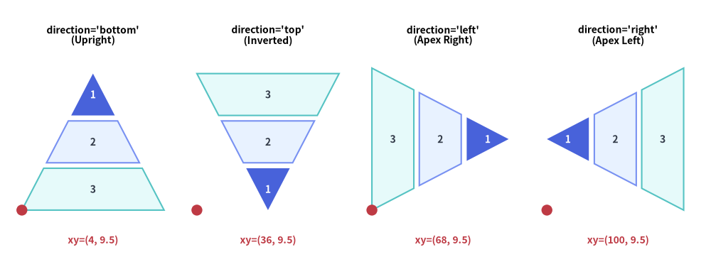
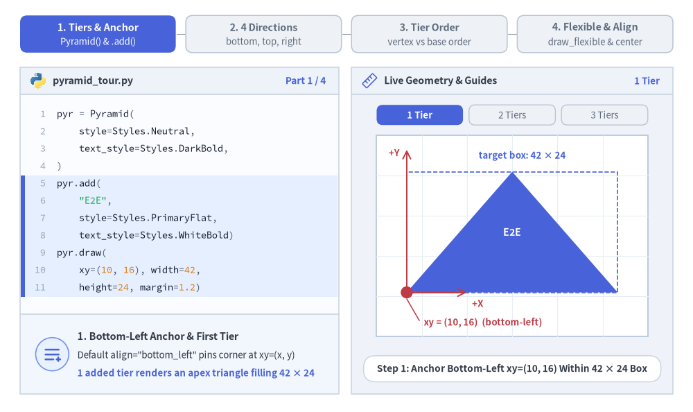
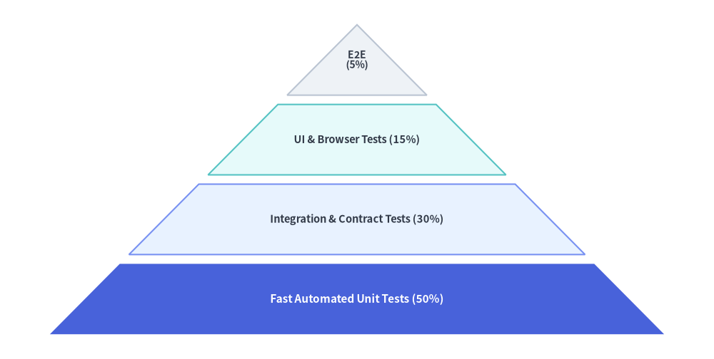
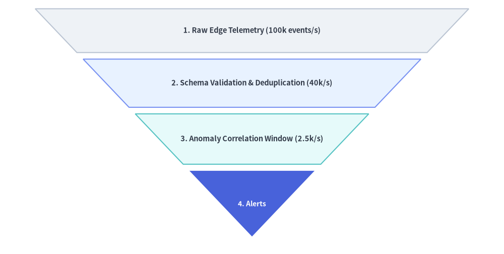

# Pyramid

The `Pyramid` component renders tiered hierarchical trapezoids crowned by an apex triangle.
It supports standard upright pyramids, inverted funnels, horizontal orientations, and custom per-tier heights—making it ideal for software testing pyramids, DIKW knowledge hierarchies, defense-in-depth tiers, and conversion funnels.


<figure class="drawlib-image" style="text-align: center;">
  
  <figcaption class="drawlib-caption">All Four Pyramid Directions: bottom, top, left, and right</figcaption>
</figure>

<details class="drawlib-code-details">
<summary>Source Code</summary>

```python
from drawlib.canvas import save, setup
from drawlib.shapes import circle
from drawlib.smartarts import Pyramid
from drawlib.styles import Styles
from drawlib.text import text

setup(width=130, height=48)

p = Pyramid(
    style=Styles.Neutral,
    text_style=Styles.DarkBold.patch(text_size=10.0),
)
p.add("1", style=Styles.PrimaryFlat, text_style=Styles.WhiteBold.patch(text_size=10.0))
p.add("2", style=Styles.PrimaryNeutral)
p.add("3", style=Styles.SecondaryNeutral)

panels = [
    ("bottom", (4.0, 9.5), "direction='bottom'\n(Upright)"),
    ("top", (36.0, 9.5), "direction='top'\n(Inverted)"),
    ("left", (68.0, 9.5), "direction='left'\n(Apex Right)"),
    ("right", (100.0, 9.5), "direction='right'\n(Apex Left)"),
]

for dir_val, (px, py), label in panels:
    text((px + 13.0, 41.5), label, style=Styles.BlackBold.patch(text_size=10.0))
    p.draw(xy=(px, py), width=26.0, height=25.0, margin=1.0, direction=dir_val, order="vertex_to_base")
    circle((px, py), radius=1.0, style=Styles.DangerFlat)
    text((px + 13.0, 4.0), f"xy=({int(px)}, 9.5)", style=Styles.DangerBold.patch(text_size=10.0))

save()
```

</details>


---

## 1. Core Concepts & Basic Usage

`Pyramid` builds tiered hierarchies and conversion funnels step-by-step via `.add(...)`, anchoring by default at the **Bottom-Left `xy=(x, y)`** bounding-box corner (or its center when `align="center"`). You can rotate the wide base across all 4 `direction` orientations (`"bottom"`, `"top"`, `"left"`, `"right"`), choose `"vertex_to_base"` vs. `"base_to_vertex"` ordering, and pass custom per-tier heights via `draw_flexible(...)` or hide `.items[i]` slices without shifting sibling geometry:


<figure class="drawlib-image" style="text-align: center;">
  
  <figcaption class="drawlib-caption">Basic Usage & Parameter Tour: Step-by-Step Tiers, 4 Base Directions, Vertex vs. Base Ordering, and Flexible Sizing (APNG Animation)</figcaption>
</figure>

<details class="drawlib-code-details">
<summary>Source Code</summary>

```python
from __future__ import annotations

from drawlib.anim import Animation
from drawlib.canvas import save, setup
from drawlib.icons import code as code_icons
from drawlib.icons import phosphor
from drawlib.lines import line
from drawlib.shapes import circle, polygon, rectangle
from drawlib.smartarts import Pyramid, SourceCode, SourceCodeStyles
from drawlib.styles import Styles
from drawlib.text import text

W, H = 138.0, 82.0
setup(width=W, height=H)
anim = Animation(fps=10.0, loop=0)

CODE_TEXT_SIZE = 10.0
PT_TO_CANVAS = W / 720.0
FONT_CANVAS = CODE_TEXT_SIZE * PT_TO_CANVAS
LINE_H = FONT_CANVAS * 1.8
PAD_Y = FONT_CANVAS * 1.2

CODE_STYLES = SourceCodeStyles.get("default", font_lang="en", text_size=CODE_TEXT_SIZE).patch(
    box_style=Styles.Neutral.patch(shape_fill_color=(0, 0, 0, 0), shape_line_width=0),
)

PANE_HEADER = Styles.Neutral.patch(
    shape_fill_color=(238, 243, 250),
    shape_line_color=(203, 213, 225),
    shape_line_width=1.2,
    shape_r=0.0,
)
EDITOR_BODY = Styles.Neutral.patch(
    shape_fill_color=(250, 252, 255),
    shape_line_color=(203, 213, 225),
    shape_line_width=1.2,
    shape_r=0.0,
)
TAKEAWAY_BODY = Styles.Neutral.patch(
    shape_fill_color=(242, 246, 253),
    shape_line_color=(203, 213, 225),
    shape_line_width=1.2,
    shape_r=0.0,
)
STUDIO_BODY = Styles.Neutral.patch(
    shape_fill_color=(239, 243, 249),
    shape_line_color=(203, 213, 225),
    shape_line_width=1.2,
    shape_r=0.0,
)

PART_ITEMS = [
    ("1. Tiers & Anchor", "Pyramid() & .add()"),
    ("2. 4 Directions", "bottom, top, right"),
    ("3. Tier Order", "vertex vs base order"),
    ("4. Flexible & Align", "draw_flexible & center"),
]


def draw_step_bar(active_part: int) -> None:
    """Draw top 4-part progress bar (active_part is 1..4)."""
    pill_w = 31.0
    pill_h = 7.4
    gap = 2.0
    start_x = 4.0 + pill_w / 2.0
    cy = 75.2

    for idx, (label, sublabel) in enumerate(PART_ITEMS, start=1):
        cx = start_x + (idx - 1) * (pill_w + gap)
        if idx > 1:
            prev_cx = cx - (pill_w + gap)
            line(
                (prev_cx + pill_w / 2.0 + 0.2, cy),
                (cx - pill_w / 2.0 - 0.2, cy),
                style=Styles.PrimaryBold if idx <= active_part else Styles.MutedThin,
            )

        if idx == active_part:
            st = Styles.PrimaryFlat.patch(shape_r=1.4)
            tst = Styles.WhiteBold.patch(text_size=10.3)
            sub_tst = Styles.White.patch(text_size=9.5)
        elif idx < active_part:
            st = Styles.PrimaryNeutral.patch(shape_r=1.4, shape_line_width=1.1)
            tst = Styles.PrimaryBold.patch(text_size=10.3)
            sub_tst = Styles.Primary.patch(text_size=9.5)
        else:
            st = Styles.Neutral.patch(shape_r=1.4, shape_line_width=1.1)
            tst = Styles.MutedBold.patch(text_size=10.3)
            sub_tst = Styles.Muted.patch(text_size=9.5)

        rectangle((cx, cy), width=pill_w, height=pill_h, style=st)
        text((cx, cy + 1.35), label, style=tst)
        text((cx, cy - 1.55), sublabel, style=sub_tst)


def draw_left_pane(
    active_part: int,
    code_lines: list[str],
    hl_range: tuple[int, int],
    icon_fn: object,
    summary_title: str,
    summary_line1: str,
    summary_line2: str,
) -> None:
    """Draw left Python code editor + bottom concept takeaway card."""
    x0, w = 4.0, 63.5
    cx = x0 + w / 2.0
    top_y = 63.2
    header_h = 5.4
    editor_h = 43.8
    takeaway_h = 15.8

    rectangle((cx, top_y + header_h / 2.0), width=w, height=header_h, style=PANE_HEADER)
    code_icons.python((x0 + 3.6, top_y + header_h / 2.0), width=3.4, style=Styles.Neutral)
    text(
        (x0 + 6.5, top_y + header_h / 2.0),
        "pyramid_tour.py",
        style=Styles.DarkBold.patch(text_size=10.2, halign="left"),
    )
    text(
        (x0 + w - 2.6, top_y + header_h / 2.0),
        f"Part {active_part} / 4",
        style=Styles.PrimaryBold.patch(text_size=9.8, halign="right"),
    )

    rectangle((cx, top_y - editor_h / 2.0), width=w, height=editor_h, style=EDITOR_BODY)

    hl_start, hl_end = hl_range
    hl_top = top_y - PAD_Y - hl_start * LINE_H
    hl_bot = top_y - PAD_Y - (hl_end + 1) * LINE_H
    hl_cy = (hl_top + hl_bot) / 2.0
    hl_h = hl_top - hl_bot
    rectangle(
        (cx, hl_cy),
        width=w - 0.6,
        height=hl_h,
        style=Styles.Neutral.patch(shape_fill_color=(229, 239, 255), shape_line_width=0),
    )
    rectangle(
        (x0 + 0.55, hl_cy),
        width=0.9,
        height=hl_h,
        style=Styles.PrimaryFlat.patch(shape_line_width=0),
    )

    SourceCode.draw(
        xy=(x0, top_y),
        width=w,
        code="\n".join(code_lines),
        styles=CODE_STYLES,
        code_lang="python",
        show_linenum=True,
        align="top_left",
    )

    take_cy = 3.6 + takeaway_h / 2.0
    rectangle((cx, take_cy), width=w, height=takeaway_h, style=TAKEAWAY_BODY)
    circle(
        (x0 + 6.4, take_cy),
        radius=3.3,
        style=Styles.PrimaryNeutral.patch(shape_line_width=1.2),
    )
    icon_fn((x0 + 6.4, take_cy), width=3.8, style=Styles.PrimaryBold)  # type: ignore[operator]
    text(
        (x0 + 11.4, take_cy + 3.6),
        summary_title,
        style=Styles.DarkBold.patch(text_size=10.4, halign="left"),
    )
    text(
        (x0 + 11.4, take_cy - 0.2),
        summary_line1,
        style=Styles.Dark.patch(text_size=9.7, halign="left"),
    )
    text(
        (x0 + 11.4, take_cy - 3.8),
        summary_line2,
        style=Styles.PrimaryBold.patch(text_size=9.6, halign="left"),
    )


def draw_geometry_studio(param_badge: str, footer_caption: str) -> tuple[float, float]:
    """Draw right geometry lab shell, inner 54x40 coordinate sheet, and footer."""
    x0, w = 70.0, 64.0
    cx = x0 + w / 2.0
    top_y = 63.2
    header_h = 5.4
    body_h = 59.6

    rectangle((cx, top_y + header_h / 2.0), width=w, height=header_h, style=PANE_HEADER)
    phosphor.ruler((x0 + 3.6, top_y + header_h / 2.0), width=3.4, style=Styles.Primary)
    text(
        (x0 + 6.5, top_y + header_h / 2.0),
        "Live Geometry & Guides",
        style=Styles.DarkBold.patch(text_size=10.2, halign="left"),
    )
    text(
        (x0 + w - 2.6, top_y + header_h / 2.0),
        param_badge,
        style=Styles.PrimaryBold.patch(text_size=9.6, halign="right"),
    )

    rectangle((cx, 3.6 + body_h / 2.0), width=w, height=body_h, style=STUDIO_BODY)

    sheet_cx, sheet_cy = cx, 35.0
    sheet_w, sheet_h = 54.0, 40.0
    sx0, sy0 = sheet_cx - sheet_w / 2.0, sheet_cy - sheet_h / 2.0
    rectangle(
        (sheet_cx, sheet_cy),
        width=sheet_w,
        height=sheet_h,
        style=Styles.Neutral.patch(
            shape_fill_color=(255, 255, 255),
            shape_line_color=(180, 194, 214),
            shape_line_width=1.2,
        ),
    )
    g_st = Styles.MutedThin.patch(line_color=(232, 238, 246), line_width=0.8)
    for gx in range(1, 6):
        vx = sx0 + gx * (sheet_w / 6.0)
        line((vx, sy0), (vx, sy0 + sheet_h), style=g_st)
    for gy in range(1, 5):
        vy = sy0 + gy * (sheet_h / 5.0)
        line((sx0, vy), (sx0 + sheet_w, vy), style=g_st)

    rectangle(
        (cx, 8.6),
        width=59.2,
        height=5.2,
        style=Styles.Neutral.patch(
            shape_fill_color=(255, 255, 255),
            shape_line_color=(203, 213, 225),
            shape_line_width=1.1,
            shape_r=2.4,
        ),
        text=footer_caption,
        text_style=Styles.DarkBold.patch(text_size=9.8),
    )
    return sheet_cx, sheet_cy


def draw_sub_pills(scx: float, labels: list[str], active_idx: int) -> None:
    """Draw 3-step tracker pills above the studio coordinate sheet."""
    pw, ph, pgap = 17.2, 4.0, 1.2
    p_start = scx - (3 * pw + 2 * pgap) / 2.0 + pw / 2.0
    for idx, lbl in enumerate(labels):
        px = p_start + idx * (pw + pgap)
        if idx == active_idx:
            pst = Styles.PrimaryFlat.patch(shape_r=1.2)
            ptst = Styles.WhiteBold.patch(text_size=9.5)
        elif idx < active_idx:
            pst = Styles.PrimaryNeutral.patch(shape_r=1.2, shape_line_width=1.0)
            ptst = Styles.PrimaryBold.patch(text_size=9.5)
        else:
            pst = Styles.Neutral.patch(shape_r=1.2, shape_line_width=1.0)
            ptst = Styles.Muted.patch(text_size=9.5)
        rectangle((px, 59.1), width=pw, height=ph, style=pst, text=lbl, text_style=ptst)


TITLE_DARK = Styles.DarkBold.patch(text_size=10.0)
TITLE_WHITE = Styles.WhiteBold.patch(text_size=10.0)

# =========================================================================
# Part 1: Tiers & Anchor — Bottom-Left xy & Progressive 1 -> 2 -> 3 Tiers
# =========================================================================
PART1_STATES = [
    (
        1,
        3.2,
        [
            "pyr = Pyramid(",
            "    style=Styles.Neutral,",
            "    text_style=Styles.DarkBold,",
            ")",
            "pyr.add(",
            '    "E2E",',
            "    style=Styles.PrimaryFlat,",
            "    text_style=Styles.WhiteBold)",
            "pyr.draw(",
            "    xy=(10, 16), width=42,",
            "    height=24, margin=1.2)",
        ],
        (4, 10),
        "1 Tier",
        "Step 1: Anchor Bottom-Left xy=(10, 16) Within 42 × 24 Box",
        "1. Bottom-Left Anchor & First Tier",
        'Default align="bottom_left" pins corner at xy=(x, y)',
        "1 added tier renders an apex triangle filling 42 × 24",
    ),
    (
        2,
        3.3,
        [
            "pyr = Pyramid(",
            "    style=Styles.Neutral,",
            "    text_style=Styles.DarkBold)",
            'pyr.add("E2E",',
            "        style=Styles.PrimaryFlat)",
            "pyr.add(",
            '    "Integ",',
            "    style=Styles.PrimaryNeutral)",
            "pyr.draw(",
            "    xy=(10, 16), width=42,",
            "    height=24, margin=1.2)",
        ],
        (5, 7),
        "2 Tiers",
        "Step 2: Second .add() Splits Height with margin=1.2 Gap",
        "2. Automatic Trapezoid Subdivision",
        "1st item stays at apex; 2nd item forms trapezoid below",
        "Uniform tier height = (height - sum(margins)) / N",
    ),
    (
        3,
        3.5,
        [
            "pyr = Pyramid(",
            "    style=Styles.Neutral, ...)",
            'pyr.add("E2E",',
            "        style=Styles.PrimaryFlat)",
            'pyr.add("Integ")',
            "pyr.add(",
            '    "Unit",',
            "    style=Styles.SecondaryNeutral)",
            "pyr.draw(",
            "    xy=(10, 16), width=42,",
            "    height=24, margin=1.2)",
        ],
        (5, 7),
        "3 Tiers",
        "Step 3: Balanced 3-Tier Testing Hierarchy Within 42 × 24",
        "3. Balanced 3-Tier Hierarchy",
        "Calm neutral base tiers ground 1 focal PrimaryFlat apex",
        "All tiers remain locked inside the 42 × 24 target box",
    ),
]

for p1_idx, (n_tiers, dur, code_p1, hl_rng, badge_txt, foot_txt, s_t, s_1, s_2) in enumerate(PART1_STATES):
    with anim.frame(duration=dur):
        draw_step_bar(1)
        draw_left_pane(1, code_p1, hl_rng, phosphor.list_plus, s_t, s_1, s_2)
        scx, scy = draw_geometry_studio(badge_txt, foot_txt)
        draw_sub_pills(scx, ["1 Tier", "2 Tiers", "3 Tiers"], p1_idx)

        px0, py0, pw, ph = 81.0, 23.8, 42.0, 24.0
        pyr = Pyramid(style=Styles.Neutral, text_style=TITLE_DARK)
        pyr.add("E2E", style=Styles.PrimaryFlat, text_style=TITLE_WHITE)
        if n_tiers >= 2:
            pyr.add("Integ", style=Styles.PrimaryNeutral)
        if n_tiers >= 3:
            pyr.add("Unit", style=Styles.SecondaryNeutral)
        pyr.draw(xy=(px0, py0), width=pw, height=ph, margin=1.2)

        rectangle(
            (px0 + pw / 2.0, py0 + ph / 2.0),
            width=pw,
            height=ph,
            style=Styles.PrimaryDashed.patch(shape_fill_color=(0, 0, 0, 0), shape_line_width=1.2),
        )
        text(
            (px0 + pw / 2.0 + 2.0, py0 + ph + 3.2),
            "target box: 42 × 24",
            style=Styles.PrimaryBold.patch(text_size=9.5),
        )

        line((px0, py0), (px0, py0 + ph + 4.4), arrow_head="->", style=Styles.DangerBold.patch(line_width=1.4))
        text((px0 - 1.4, py0 + ph + 3.8), "+Y", style=Styles.DangerBold.patch(text_size=9.5, halign="right"))
        line((px0, py0), (px0 + 12.0, py0), arrow_head="->", style=Styles.DangerBold.patch(line_width=1.4))
        text((px0 + 13.0, py0 - 2.2), "+X", style=Styles.DangerBold.patch(text_size=9.5, halign="left"))
        circle((px0, py0), radius=1.2, style=Styles.DangerFlat)
        line((px0, py0 - 1.3), (px0 + 2.5, 18.2), style=Styles.DangerBold.patch(line_width=1.1))
        text(
            (px0 + 3.4, 17.8),
            "xy = (10, 16)  (bottom-left)",
            style=Styles.DangerBold.patch(text_size=9.5, halign="left"),
        )

# =========================================================================
# Part 2: 4 Directions — bottom, top, right (and left)
# =========================================================================
PART2_STATES = [
    (
        "bottom",
        3.3,
        [
            "pyr = Pyramid(",
            "    style=Styles.Neutral,",
            "    text_style=Styles.DarkBold)",
            'pyr.add("E2E",',
            "        style=Styles.PrimaryFlat)",
            'pyr.add("Integ")',
            'pyr.add("Unit")',
            "pyr.draw(",
            "    (10, 16), width=42, height=24,",
            '    margin=1.2, direction="bottom"',
            ")",
        ],
        (8, 9),
        'direction="bottom"',
        'direction="bottom" (Default): Wide Base at Bottom, Apex Up',
        'Upright Pyramid (direction="bottom")',
        "direction names the edge where the wide base sits",
        'Default "bottom" points the triangular apex upward',
    ),
    (
        "top",
        3.3,
        [
            "pyr = Pyramid(",
            "    style=Styles.Neutral,",
            "    text_style=Styles.DarkBold)",
            'pyr.add("E2E",',
            "        style=Styles.PrimaryFlat)",
            'pyr.add("Integ")',
            'pyr.add("Unit")',
            "pyr.draw(",
            "    (10, 16), width=42, height=24,",
            '    margin=1.2, direction="top")',
        ],
        (8, 9),
        'direction="top"',
        'direction="top": Wide Base at Top for Inverted Funnels',
        'Inverted Funnel (direction="top")',
        "Places wide base at top and apex pointing downward",
        "xy still anchors the bottom-left bounding-box corner",
    ),
    (
        "right",
        3.5,
        [
            "pyr = Pyramid(",
            "    style=Styles.Neutral, ...)",
            'pyr.add("E2E",',
            "        style=Styles.PrimaryFlat)",
            'pyr.add("API")',
            'pyr.add("Unit")',
            "# width=base(Y), height=span(X)",
            "pyr.draw(",
            "    (12, 15), width=26, height=38,",
            '    margin=1.2, direction="right")',
        ],
        (7, 9),
        'direction="right"',
        'direction="right": Base on Right, Apex Pointing Left',
        'Horizontal Wedge ("right" & "left")',
        "width sets vertical base span; height sets X altitude",
        'Keep labels concise; "left" mirrors with base on left',
    ),
]

for p2_idx, (dir_mode, dur, code_p2, hl_rng, badge_txt, foot_txt, s_t, s_1, s_2) in enumerate(PART2_STATES):
    with anim.frame(duration=dur):
        draw_step_bar(2)
        draw_left_pane(2, code_p2, hl_rng, phosphor.compass, s_t, s_1, s_2)
        scx, scy = draw_geometry_studio(badge_txt, foot_txt)
        draw_sub_pills(scx, ['"bottom"', '"top"', '"right"'], p2_idx)

        pyr = Pyramid(style=Styles.Neutral, text_style=TITLE_DARK)
        pyr.add("E2E", style=Styles.PrimaryFlat, text_style=TITLE_WHITE)
        pyr.add("API" if dir_mode == "right" else "Integ", style=Styles.PrimaryNeutral)
        pyr.add("Unit", style=Styles.SecondaryNeutral)

        if dir_mode == "bottom":
            px0, py0, pw, ph = 81.0, 23.0, 42.0, 24.0
            pyr.draw(xy=(px0, py0), width=pw, height=ph, margin=1.2, direction="bottom")
            line((px0, py0 - 1.2), (px0 + pw, py0 - 1.2), style=Styles.PrimaryBold.patch(line_width=2.4))
            text((scx, 18.2), 'wide base on "bottom"  •  apex up', style=Styles.PrimaryBold.patch(text_size=9.5))
            circle((px0, py0), radius=1.1, style=Styles.DangerFlat)
        elif dir_mode == "top":
            px0, py0, pw, ph = 81.0, 22.0, 42.0, 24.0
            pyr.draw(xy=(px0, py0), width=pw, height=ph, margin=1.2, direction="top")
            line((px0, py0 + ph + 1.2), (px0 + pw, py0 + ph + 1.2), style=Styles.PrimaryBold.patch(line_width=2.4))
            text((scx, py0 + ph + 4.2), 'wide base on "top"  •  apex down', style=Styles.PrimaryBold.patch(text_size=9.5))
            circle((px0, py0), radius=1.1, style=Styles.DangerFlat)
            text((px0 + 2.2, 18.2), "xy (bottom-left)", style=Styles.DangerBold.patch(text_size=9.5, halign="left"))
        else:
            px0, py0, base_w, alt_h = 82.0, 22.5, 26.0, 38.0
            pyr.draw(xy=(px0, py0), width=base_w, height=alt_h, margin=1.2, direction="right")
            line((px0 + alt_h + 1.4, py0), (px0 + alt_h + 1.4, py0 + base_w), style=Styles.PrimaryBold.patch(line_width=2.4))
            text((px0 + alt_h / 2.0, py0 + base_w + 3.0), "height = 38 (X altitude)", style=Styles.PrimaryBold.patch(text_size=9.5))
            text((scx, 18.0), 'wide base on "right"  •  width = 26 (Y)', style=Styles.PrimaryBold.patch(text_size=9.5))
            circle((px0, py0), radius=1.1, style=Styles.DangerFlat)

# =========================================================================
# Part 3: Tier Order — vertex_to_base vs. base_to_vertex
# =========================================================================
PART3_STATES = [
    (
        "top",
        "vertex_to_base",
        3.3,
        "vertex_to_base",
        'order="vertex_to_base": 1st .add() Lands at Apex',
        'Default Order ("vertex_to_base")',
        "Places 1st .add() at narrow vertex, last at wide base",
        'With direction="top", items[0] lands at bottom tip',
    ),
    (
        "top",
        "base_to_vertex",
        3.4,
        "base_to_vertex",
        'order="base_to_vertex": Natural Top-Down Funnel!',
        'Natural Funnel Order ("base_to_vertex")',
        "Places 1st .add() at wide top intake, last at apex",
        "Reads top-to-bottom in exact Python .add() sequence",
    ),
    (
        "bottom",
        "base_to_vertex",
        3.4,
        "bottom + base",
        'direction="bottom" + "base_to_vertex": Base-Up Stack',
        "Foundation-Up Hierarchy",
        'With direction="bottom", 1st .add() sits at wide base',
        "Builds upward from foundation [0] to crown apex [2]",
    ),
]

for p3_idx, (d_ord, ord_val, dur, badge_txt, foot_txt, s_t, s_1, s_2) in enumerate(PART3_STATES):
    code_p3 = [
        "pyr = Pyramid(",
        "    style=Styles.Neutral, ...)",
        'pyr.add("Raw")    # [0]',
        'pyr.add("Clean")  # [1]',
        'pyr.add("KPI",    # [2]',
        "        style=Styles.PrimaryFlat)",
        "pyr.draw(",
        "    (10, 16), 42, 24, margin=1.2,",
        f'    direction="{d_ord}",',
        f'    order="{ord_val}")',
    ]
    with anim.frame(duration=dur):
        draw_step_bar(3)
        draw_left_pane(3, code_p3, (7, 9), phosphor.funnel, s_t, s_1, s_2)
        scx, scy = draw_geometry_studio(badge_txt, foot_txt)
        draw_sub_pills(scx, ["top: vtx->base", "top: base->vtx", "bot: base->vtx"], p3_idx)

        px0, py0, pw, ph = 84.5, 22.5, 39.0, 24.0
        pyr = Pyramid(style=Styles.Neutral, text_style=TITLE_DARK)
        pyr.add("Raw", style=Styles.Neutral)
        pyr.add("Clean", style=Styles.PrimaryNeutral)
        pyr.add("KPI", style=Styles.PrimaryFlat, text_style=TITLE_WHITE)
        pyr.draw(xy=(px0, py0), width=pw, height=ph, margin=1.2, direction=d_ord, order=ord_val)

        # Tier index badges along left margin
        y_low, y_mid, y_high = py0 + 3.6, py0 + 12.0, py0 + 20.4
        if (d_ord == "top" and ord_val == "vertex_to_base") or (d_ord == "bottom" and ord_val == "base_to_vertex"):
            idx_ys = [(0, y_low), (1, y_mid), (2, y_high)]
            arr_p = ((79.2, y_low + 2.2), (79.2, y_high - 2.2))
        else:
            idx_ys = [(0, y_high), (1, y_mid), (2, y_low)]
            arr_p = ((79.2, y_high - 2.2), (79.2, y_low + 2.2))

        line(arr_p[0], arr_p[1], arrow_head="->", style=Styles.PrimaryBold.patch(line_width=1.4))
        for idx_num, by_pos in idx_ys:
            is_foc = idx_num == 2
            rectangle(
                (79.2, by_pos),
                width=5.8,
                height=3.6,
                style=(Styles.PrimaryFlat if is_foc else Styles.PrimaryNeutral).patch(shape_r=1.0),
                text=f"[{idx_num}]",
                text_style=(Styles.WhiteBold if is_foc else Styles.PrimaryBold).patch(text_size=9.5),
            )
        text(
            (scx + 1.5, 17.8),
            f'direction="{d_ord}", order="{ord_val}"',
            style=Styles.PrimaryBold.patch(text_size=9.5),
        )

# =========================================================================
# Part 4: Flexible & Align — draw_flexible, .show=False & align="center"
# =========================================================================
PART4_STATES = [
    (
        "flexible",
        3.4,
        [
            "pyr = Pyramid(",
            "    style=Styles.Neutral, ...)",
            'pyr.add("E2E",',
            "        style=Styles.PrimaryFlat)",
            'pyr.add("Integ")',
            'pyr.add("Unit")',
            "pyr.draw_flexible(",
            "    xy=(10, 15), width=42,",
            "    item_heights=[5.5, 7.5, 10.5],",
            "    margins=[1.2, 1.2])",
        ],
        (6, 9),
        "draw_flexible()",
        "draw_flexible(): item_heights Ordered Base -> Vertex",
        "Custom Heights (draw_flexible)",
        "item_heights=[5.5, 7.5, 10.5] sizes base -> apex",
        "Taller apex (10.5) gives top labels generous room",
    ),
    (
        "hide_mid",
        3.4,
        [
            "pyr = Pyramid(",
            "    style=Styles.Neutral, ...)",
            'pyr.add("E2E", ...)',
            'pyr.add("Integ")',
            'pyr.add("Unit")',
            "",
            "# Hide tier; sibling slices stay!",
            "pyr.items[1].show = False",
            "pyr.draw(",
            "    (10, 16), 42, 24, margin=1.2)",
        ],
        (6, 7),
        "items[1].show=False",
        "items[1].show = False: Hides Tier Without Shifting",
        "Slot-Preserving Visibility (.show = False)",
        "Skips rendering items[1] while keeping slice geometry",
        "Apex and base trapezoids hold exact Y & slope edges",
    ),
    (
        "center_align",
        3.6,
        [
            "pyr = Pyramid(",
            "    style=Styles.Neutral, ...)",
            'pyr.add("E2E", ...)',
            'pyr.add("Integ")',
            'pyr.add("Unit")',
            "",
            "# Center bounding box on xy",
            "pyr.draw(",
            "    (34, 26), 42, 24, margin=1.2,",
            '    align="center")',
        ],
        (7, 9),
        'align = "center"',
        'align="center": Centers Bounding Box on xy=(cx, cy)',
        'Centered Anchor (align="center")',
        "Centers total width × height box on xy=(cx, cy)",
        "Great for symmetric cards and multi-column layouts",
    ),
]

for p4_idx, (p4_mode, dur, code_p4, hl_rng, badge_txt, foot_txt, s_t, s_1, s_2) in enumerate(PART4_STATES):
    with anim.frame(duration=dur):
        draw_step_bar(4)
        draw_left_pane(4, code_p4, hl_rng, phosphor.sliders_horizontal, s_t, s_1, s_2)
        scx, scy = draw_geometry_studio(badge_txt, foot_txt)
        draw_sub_pills(scx, ["draw_flexible()", ".show = False", 'align="center"'], p4_idx)

        pyr = Pyramid(style=Styles.Neutral, text_style=TITLE_DARK)
        pyr.add("E2E", style=Styles.PrimaryFlat, text_style=TITLE_WHITE)
        pyr.add("Integ", style=Styles.PrimaryNeutral)
        pyr.add("Unit", style=Styles.SecondaryNeutral)

        if p4_mode == "flexible":
            px0, py0, pw = 77.5, 22.0, 42.0
            heights = [5.5, 7.5, 10.5]
            margs = [1.2, 1.2]
            pyr.draw_flexible(xy=(px0, py0), width=pw, item_heights=heights, margins=margs)

            cur_y = py0
            rx = px0 + pw + 1.8
            for h_idx, h_val in enumerate(heights):
                line((rx, cur_y), (rx, cur_y + h_val), arrow_head="<->", style=Styles.PrimaryBold.patch(line_width=1.2))
                text(
                    (rx + 1.2, cur_y + h_val / 2.0),
                    f"{h_val}",
                    style=Styles.PrimaryBold.patch(text_size=9.5, halign="left"),
                )
                if h_idx < len(margs):
                    cur_y += h_val + margs[h_idx]
            text(
                (scx - 1.5, 17.8),
                "ordered base (5.5) -> apex (10.5)",
                style=Styles.PrimaryBold.patch(text_size=9.5),
            )
        elif p4_mode == "hide_mid":
            px0, py0, pw, ph = 81.0, 23.0, 42.0, 24.0
            pyr.items[1].show = False
            pyr.draw(xy=(px0, py0), width=pw, height=ph, margin=1.2)

            cx_p = px0 + pw / 2.0
            y_bot, y_top = py0 + 8.4, py0 + 15.6
            polygon(
                [
                    (cx_p - 13.65, y_bot),
                    (cx_p + 13.65, y_bot),
                    (cx_p + 7.35, y_top),
                    (cx_p - 7.35, y_top),
                ],
                style=Styles.MutedDashed.patch(
                    shape_fill_color=(248, 250, 252),
                    shape_line_color=(148, 163, 184),
                    shape_line_width=1.2,
                ),
            )
            text((cx_p, (y_bot + y_top) / 2.0), "items[1] slot kept", style=Styles.MutedBold.patch(text_size=9.5))
            text((scx, 18.0), "apex & base slices stay locked in place", style=Styles.PrimaryBold.patch(text_size=9.5))
        else:
            cx_a, cy_a, pw, ph = scx, 36.2, 42.0, 24.0
            pyr.draw(xy=(cx_a, cy_a), width=pw, height=ph, margin=1.2, align="center")
            rectangle(
                (cx_a, cy_a),
                width=pw,
                height=ph,
                style=Styles.PrimaryDashed.patch(shape_fill_color=(0, 0, 0, 0), shape_line_width=1.2),
            )
            # Outer bounding-box crosshair ticks + inner center reticle around "Integ"
            line((cx_a - 24.4, cy_a), (cx_a - 21.0, cy_a), style=Styles.DangerBold.patch(line_width=1.5))
            line((cx_a + 21.0, cy_a), (cx_a + 24.4, cy_a), style=Styles.DangerBold.patch(line_width=1.5))
            line((cx_a, cy_a + 12.0), (cx_a, cy_a + 15.2), style=Styles.DangerBold.patch(line_width=1.5))
            line((cx_a, cy_a - 15.2), (cx_a, cy_a - 12.0), style=Styles.DangerBold.patch(line_width=1.5))
            line((cx_a - 7.8, cy_a), (cx_a - 4.4, cy_a), style=Styles.DangerBold.patch(line_width=1.4))
            line((cx_a + 4.4, cy_a), (cx_a + 7.8, cy_a), style=Styles.DangerBold.patch(line_width=1.4))
            line((cx_a, cy_a + 2.2), (cx_a, cy_a + 4.3), style=Styles.DangerBold.patch(line_width=1.4))
            line((cx_a, cy_a - 4.3), (cx_a, cy_a - 2.2), style=Styles.DangerBold.patch(line_width=1.4))
            rectangle(
                (cx_a, cy_a),
                width=8.8,
                height=4.4,
                style=Styles.DangerDashed.patch(shape_fill_color=(0, 0, 0, 0), shape_line_width=1.1, shape_r=1.0),
            )
            text(
                (cx_a, 18.0),
                'xy = (34, 26)  •  align="center"',
                style=Styles.DangerBold.patch(text_size=9.6),
            )

save()
```

</details>


- **Step-by-Step Tiers & Anchor (`xy`, `align`)**: Append hierarchical slices via `.add(text, style=...)` and draw within `width × height` separated by `margin`—anchored at the **Bottom-Left** corner (`align="bottom_left"`, default) or centered via `align="center"`.
- **Four Base Directions (`direction`)**: `direction` names where the wide base sits: `"bottom"` (upright hierarchy), `"top"` (inverted funnel), `"left"` (base left, apex right), or `"right"` (base right, apex left, where `width` sets vertical base span and `height` sets horizontal altitude).
- **Vertex vs. Base Ordering (`order`)**: Default `order="vertex_to_base"` places the 1st `.add()` item at the triangular apex; pass `order="base_to_vertex"` so the 1st `.add()` item starts at the wide base (ideal for top-down funnels with `direction="top"`).
- **Flexible Tier Heights & Slot-Preserving `.show` (`draw_flexible`, `.items[i]`)**: Call `draw_flexible(..., item_heights=[...], margins=[...])` (ordered base to vertex) for custom slice heights, or set `pyr.items[i].show = False` to hide a tier without shifting sibling geometry.

---

## 2. Upward Hierarchy Pyramid (`direction="bottom"`)

By default (`direction="bottom", order="vertex_to_base"`), the first added item is placed at the top apex triangle, and subsequent items form progressively wider trapezoidal tiers toward the base.


```python
from drawlib.canvas import save, setup
from drawlib.smartarts import Pyramid
from drawlib.styles import Styles

setup(width=115, height=58)

pyramid = Pyramid(
    style=Styles.Neutral,
    text_style=Styles.DarkBold.patch(text_size=10.5),
)

# Added from apex (top) to base (bottom) when order="vertex_to_base"
pyramid.add(
    "E2E\n(5%)",
    style=Styles.Neutral,
    text_style=Styles.DarkBold.patch(text_size=10.0),
)
pyramid.add(
    "UI & Browser Tests (15%)",
    style=Styles.SecondaryNeutral,
)
pyramid.add(
    "Integration & Contract Tests (30%)",
    style=Styles.PrimaryNeutral,
)
pyramid.add(
    "Fast Automated Unit Tests (50%)",
    style=Styles.PrimaryFlat,
    text_style=Styles.WhiteBold.patch(text_size=11.0),
)

pyramid.draw(
    xy=(8, 4),
    width=99,
    height=50,
    margin=1.5,
    direction="bottom",
    order="vertex_to_base",
)
save()
```

<figure class="drawlib-image" style="text-align: center;">
  
  <figcaption class="drawlib-caption">Software Testing Pyramid (Upright Hierarchy)</figcaption>
</figure>


---

## 3. Inverted Conversion Funnel with Custom Tier Heights (`draw_flexible`)

Setting `direction="top"` and `order="base_to_vertex"` inverts the pyramid into a top-down funnel where the first item is the wide top intake and the last item is the bottom apex. Using `draw_flexible(...)` lets you assign custom `item_heights` and `margins` to each stage.


```python
from drawlib.canvas import save, setup
from drawlib.smartarts import Pyramid
from drawlib.styles import Styles

setup(width=115, height=58)

funnel = Pyramid(
    style=Styles.Neutral,
    text_style=Styles.DarkBold.patch(text_size=10.5),
)

# Added from wide top base to bottom apex when direction="top", order="base_to_vertex"
funnel.add("1. Raw Edge Telemetry (100k events/s)", style=Styles.Neutral)
funnel.add("2. Schema Validation & Deduplication (40k/s)", style=Styles.PrimaryNeutral)
funnel.add("3. Anomaly Correlation Window (2.5k/s)", style=Styles.SecondaryNeutral)
funnel.add(
    "4. Alerts",
    style=Styles.PrimaryFlat,
    text_style=Styles.WhiteBold.patch(text_size=10.0),
)

funnel.draw_flexible(
    xy=(8, 4),
    width=99,
    item_heights=[10.0, 11.0, 11.5, 15.0],
    margins=[1.5, 1.5, 1.5],
    direction="top",
    order="base_to_vertex",
)
save()
```

<figure class="drawlib-image" style="text-align: center;">
  
  <figcaption class="drawlib-caption">Telemetry Ingestion & Filtering Funnel (direction='top' with draw_flexible)</figcaption>
</figure>


---

## 4. Geometry, Orientations & Ordering

As illustrated in the opening diagram at the top of this page:

- **Anchor Alignment (`align`)**: The `xy` coordinate passed to `draw()` or `draw_flexible()` specifies the **bottom-left corner** (`align="bottom_left"`, default) or **center** (`align="center"`) of the pyramid's bounding box.
- **Orientation Direction (`direction`)**:
  - `"bottom"` *(default)*: Upright pyramid—wide base at the bottom, apex pointing up.
  - `"top"`: Inverted funnel—wide base at the top, apex pointing down.
  - `"left"`: Horizontal pyramid—wide base on the left, apex pointing right.
  - `"right"`: Horizontal pyramid—wide base on the right, apex pointing left.
- **Item Ordering (`order`)**:
  - `"vertex_to_base"` *(default)*: First added item is placed at the triangular apex; last added item is at the wide base.
  - `"base_to_vertex"`: First added item is placed at the wide base; last added item is at the triangular apex.

---

## 5. API Reference

### Constructor
```python
Pyramid(
    *,
    style: Style,
    text_style: Style,
)
```

### Methods & Properties
- **`add(text: str, *, style: Style | None = None, text_style: Style | None = None, show: bool = True) -> PyramidItem`**:
  Appends a tier to the pyramid and returns a mutable `PyramidItem` (`style`, `text`, `text_style`, `show`). Setting `show=False` hides that tier while preserving its slice geometry so sibling tiers never shift.
- **`pyramid.items -> list[PyramidItem]`**:
  Returns the list of all registered `PyramidItem` instances (`style: Style`, `text: str`, `text_style: Style`, `show: bool`), allowing deferred mutation before or between `draw()` calls.
- **`draw(xy: tuple[float, float], width: float, height: float, margin: float, direction: Literal["bottom", "top", "left", "right"] = "bottom", order: Literal["vertex_to_base", "base_to_vertex"] = "vertex_to_base", align: Literal["bottom_left", "center"] = "bottom_left", scale: float = 1.0) -> None`**:
  Renders the pyramid with uniform tier heights separated by `margin`, anchored at `xy` via `align`, with optional proportional scaling around `xy`.
- **`draw_flexible(xy: tuple[float, float], width: float, item_heights: list[float], margins: list[float], direction: Literal["bottom", "top", "left", "right"] = "bottom", order: Literal["vertex_to_base", "base_to_vertex"] = "vertex_to_base", align: Literal["bottom_left", "center"] = "bottom_left", scale: float = 1.0) -> None`**:
  Renders the pyramid with explicit per-tier heights (`len(item_heights) == len(items)`) and inter-tier margins (`len(margins) == len(items) - 1`). Notice that `item_heights` are ordered from the base toward the vertex.

