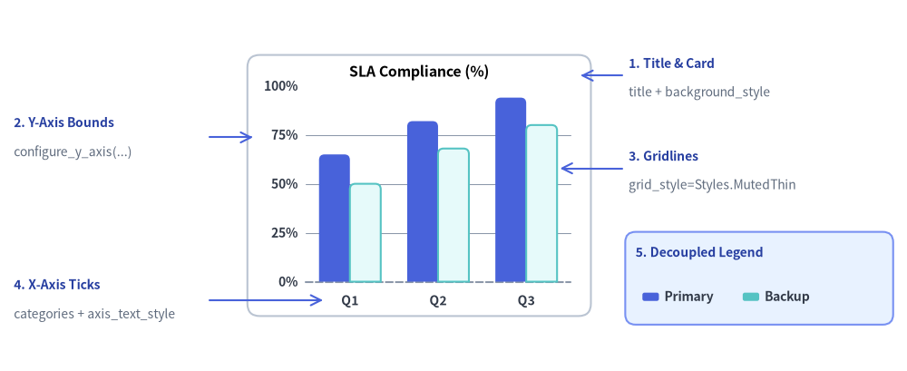
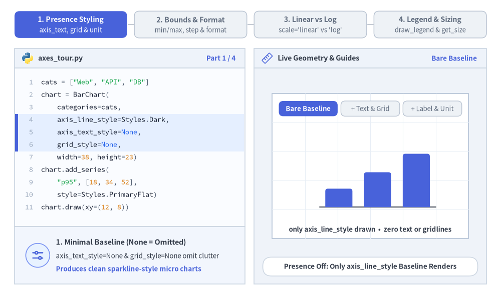
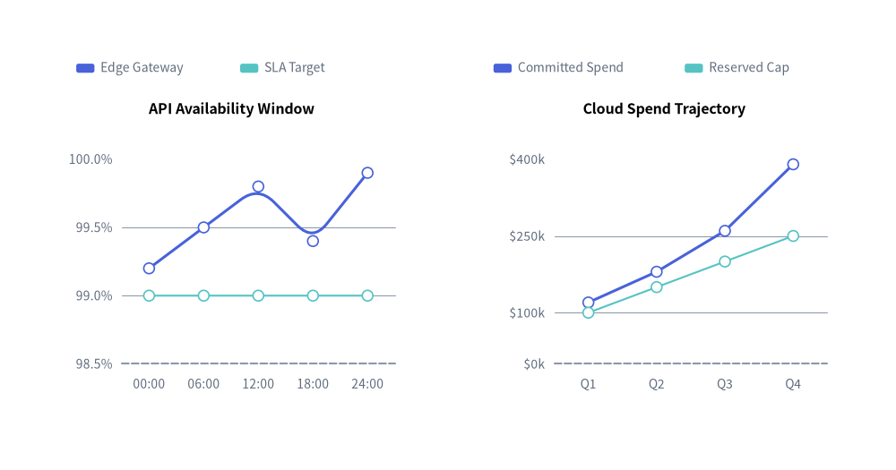
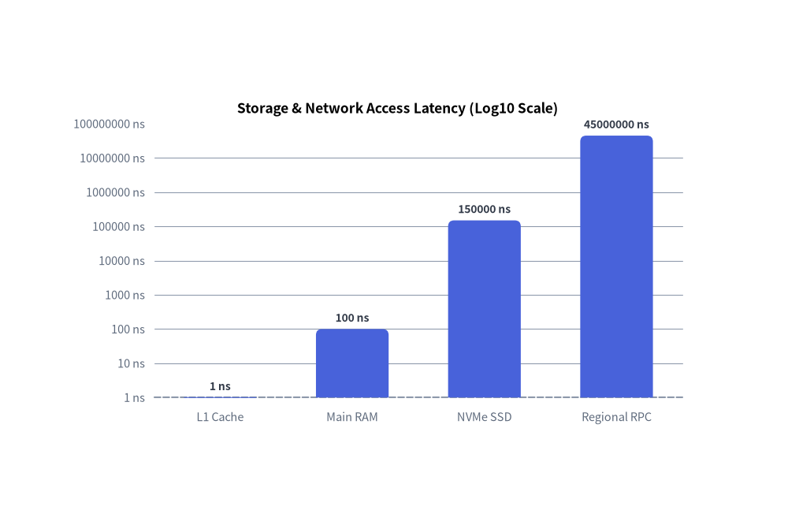
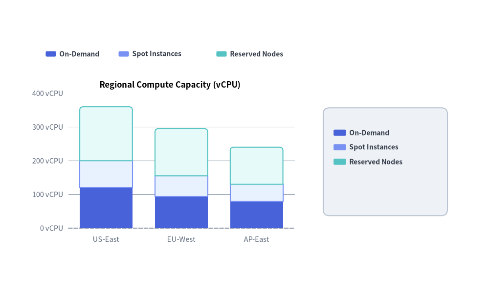

# Axes, Scales & Legends

All Cartesian charts (`BarChart`, `LineChart`, `AreaChart`, `ScatterChart`) and multi-series/slice charts (`PieChart`, `RadarChart`) share a unified foundation for **coordinate axis scaling**, **tick and unit formatting**, **decoupled legend placement**, and **bounding-box measurement**.

Every visual axis element follows Drawlib's presence-based styling model, giving you independent control over domain bounds, gridlines, tick formatters, and legend coordinates.


<figure class="drawlib-image" style="text-align: center;">
  
  <figcaption class="drawlib-caption">Anatomy of Drawlib Chart Axes, Gridlines, Tick Formatters, and Decoupled Legends</figcaption>
</figure>

<details class="drawlib-code-details">
<summary>Source Code</summary>

```python
from drawlib.canvas import save, setup
from drawlib.charts.bar import BarChart
from drawlib.lines import line
from drawlib.shapes import rectangle
from drawlib.styles import Colors, Styles
from drawlib.text import text

setup(width=132, height=54)

chart = BarChart(
    categories=["Q1", "Q2", "Q3"],
    axis_line_style=Styles.MutedDashed,
    axis_text_style=Styles.DarkBold.patch(text_size=10.0),
    grid_style=Styles.MutedThin,
    background_style=Styles.Neutral.patch(shape_r=1.8, shape_fill_color=Colors.White, shape_line_color=Colors.Gray4),
    width=50.0,
    height=38.0,
    title="SLA Compliance (%)",
    title_style=Styles.BlackBold.patch(text_size=11.5),
    bar_mode="group",
    bar_r=0.8,
)
chart.add_series("Primary", [65.0, 82.0, 94.0], style=Styles.PrimaryFlat)
chart.add_series("Backup", [50.0, 68.0, 80.0], style=Styles.SecondaryNeutral)
chart.configure_y_axis(min_value=0, max_value=100, tick_step=25, format="{:.0f}%")
chart.draw(xy=(36.0, 8.0))

callout_title = Styles.DarkBold.patch(text_size=10.0, halign="left", text_color=Colors.Primary5)
callout_sub = Styles.Muted.patch(text_size=10.0, halign="left")
arrow_style = Styles.Primary.patch(shape_line_width=1.2)

# 1. Title & Background Card (Top-Right Callout)
line((90.5, 43.0), (84.5, 43.0), arrow_head="->", style=arrow_style)
text((91.5, 44.8), "1. Title & Card", style=callout_title)
text((91.5, 40.5), "title + background_style", style=callout_sub)

# 2. Y-Axis Bounds & Format (Top-Left Callout)
line((30.5, 34.0), (36.8, 34.0), arrow_head="->", style=arrow_style)
text((2.0, 36.2), "2. Y-Axis Bounds", style=callout_title)
text((2.0, 31.8), "configure_y_axis(...)", style=callout_sub)

# 3. Horizontal Gridlines (Middle-Right Callout)
line((90.5, 29.5), (81.5, 29.5), arrow_head="->", style=arrow_style)
text((91.5, 31.3), "3. Gridlines", style=callout_title)
text((91.5, 27.0), "grid_style=Styles.MutedThin", style=callout_sub)

# 4. X-Axis Category Ticks (Bottom-Left Callout)
line((30.5, 10.3), (47.0, 10.3), arrow_head="->", style=arrow_style)
text((2.0, 12.6), "4. X-Axis Ticks", style=callout_title)
text((2.0, 8.2), "categories + axis_text_style", style=callout_sub)

# 5. Decoupled Legend (Bottom-Right Box & Callout)
rectangle((110.5, 13.5), width=39.0, height=13.5, style=Styles.PrimaryNeutral.patch(shape_r=1.5))
text((92.5, 17.2), "5. Decoupled Legend", style=callout_title)
chart.draw_legend(
    xy=(93.5, 10.8),
    text_style=Styles.DarkBold.patch(text_size=10.0),
    orientation="horizontal",
    swatch_width=2.4,
    swatch_height=1.2,
    item_gap=3.0,
)

save()
```

</details>


---

## 1. Core Concepts & Basic Usage

Cartesian and multi-series charts follow Drawlib's presence-based styling model: `axis_line_style` anchors the coordinate baseline while tick labels (`axis_text_style`) and gridlines (`grid_style`) activate cleanly on opt-in. Domain bounds, formatters, `"linear"` vs. `"log"` scales (`configure_y_axis` / `configure_x_axis`), and decoupled legends (`draw_legend` + `get_size`) compose orthogonally without shifting plot geometry:


<figure class="drawlib-image" style="text-align: center;">
  
  <figcaption class="drawlib-caption">Basic Usage & Parameter Tour: Presence Styling, Axis Bounds & Formatting, Linear vs. Log Scaling, and Decoupled Legends (APNG Animation)</figcaption>
</figure>

<details class="drawlib-code-details">
<summary>Source Code</summary>

```python
from __future__ import annotations

from drawlib.anim import Animation
from drawlib.canvas import save, setup
from drawlib.charts.bar import BarChart
from drawlib.charts.line import LineChart
from drawlib.icons import code as code_icons
from drawlib.icons import phosphor
from drawlib.lines import line
from drawlib.shapes import circle, rectangle
from drawlib.smartarts import SourceCode, SourceCodeStyles
from drawlib.styles import Styles
from drawlib.text import text

W, H = 138.0, 82.0
setup(width=W, height=H)
anim = Animation(fps=10.0, loop=0)

CODE_TEXT_SIZE = 10.0
PT_TO_CANVAS = W / 720.0
FONT_CANVAS = CODE_TEXT_SIZE * PT_TO_CANVAS
LINE_H = FONT_CANVAS * 1.8
PAD_Y = FONT_CANVAS * 1.2

CODE_STYLES = SourceCodeStyles.get("default", font_lang="en", text_size=CODE_TEXT_SIZE).patch(
    box_style=Styles.Neutral.patch(shape_fill_color=(0, 0, 0, 0), shape_line_width=0),
)

PANE_HEADER = Styles.Neutral.patch(
    shape_fill_color=(238, 243, 250),
    shape_line_color=(203, 213, 225),
    shape_line_width=1.2,
    shape_r=0.0,
)
EDITOR_BODY = Styles.Neutral.patch(
    shape_fill_color=(250, 252, 255),
    shape_line_color=(203, 213, 225),
    shape_line_width=1.2,
    shape_r=0.0,
)
TAKEAWAY_BODY = Styles.Neutral.patch(
    shape_fill_color=(242, 246, 253),
    shape_line_color=(203, 213, 225),
    shape_line_width=1.2,
    shape_r=0.0,
)
STUDIO_BODY = Styles.Neutral.patch(
    shape_fill_color=(239, 243, 249),
    shape_line_color=(203, 213, 225),
    shape_line_width=1.2,
    shape_r=0.0,
)

PART_ITEMS = [
    ("1. Presence Styling", "axis_text, grid & unit"),
    ("2. Bounds & Format", "min/max, step & format"),
    ("3. Linear vs Log", "scale='linear' vs 'log'"),
    ("4. Legend & Sizing", "draw_legend & get_size"),
]


def draw_step_bar(active_part: int) -> None:
    """Draw top 4-part progress bar (active_part is 1..4)."""
    pill_w = 31.0
    pill_h = 7.4
    gap = 2.0
    start_x = 4.0 + pill_w / 2.0
    cy = 75.2

    for idx, (label, sublabel) in enumerate(PART_ITEMS, start=1):
        cx = start_x + (idx - 1) * (pill_w + gap)
        if idx > 1:
            prev_cx = cx - (pill_w + gap)
            line(
                (prev_cx + pill_w / 2.0 + 0.2, cy),
                (cx - pill_w / 2.0 - 0.2, cy),
                style=Styles.PrimaryBold if idx <= active_part else Styles.MutedThin,
            )

        if idx == active_part:
            st = Styles.PrimaryFlat.patch(shape_r=1.4)
            tst = Styles.WhiteBold.patch(text_size=10.3)
            sub_tst = Styles.White.patch(text_size=9.5)
        elif idx < active_part:
            st = Styles.PrimaryNeutral.patch(shape_r=1.4, shape_line_width=1.1)
            tst = Styles.PrimaryBold.patch(text_size=10.3)
            sub_tst = Styles.Primary.patch(text_size=9.5)
        else:
            st = Styles.Neutral.patch(shape_r=1.4, shape_line_width=1.1)
            tst = Styles.MutedBold.patch(text_size=10.3)
            sub_tst = Styles.Muted.patch(text_size=9.5)

        rectangle((cx, cy), width=pill_w, height=pill_h, style=st)
        text((cx, cy + 1.35), label, style=tst)
        text((cx, cy - 1.55), sublabel, style=sub_tst)


def draw_left_pane(
    active_part: int,
    code_lines: list[str],
    hl_range: tuple[int, int],
    icon_fn: object,
    summary_title: str,
    summary_line1: str,
    summary_line2: str,
) -> None:
    """Draw left Python code editor + bottom concept takeaway card."""
    x0, w = 4.0, 63.5
    cx = x0 + w / 2.0
    top_y = 63.2
    header_h = 5.4
    editor_h = 43.8
    takeaway_h = 15.8

    rectangle((cx, top_y + header_h / 2.0), width=w, height=header_h, style=PANE_HEADER)
    code_icons.python((x0 + 3.6, top_y + header_h / 2.0), width=3.4, style=Styles.Neutral)
    text(
        (x0 + 6.5, top_y + header_h / 2.0),
        "axes_tour.py",
        style=Styles.DarkBold.patch(text_size=10.2, halign="left"),
    )
    text(
        (x0 + w - 2.6, top_y + header_h / 2.0),
        f"Part {active_part} / 4",
        style=Styles.PrimaryBold.patch(text_size=9.8, halign="right"),
    )

    rectangle((cx, top_y - editor_h / 2.0), width=w, height=editor_h, style=EDITOR_BODY)

    hl_start, hl_end = hl_range
    hl_top = top_y - PAD_Y - hl_start * LINE_H
    hl_bot = top_y - PAD_Y - (hl_end + 1) * LINE_H
    hl_cy = (hl_top + hl_bot) / 2.0
    hl_h = hl_top - hl_bot
    rectangle(
        (cx, hl_cy),
        width=w - 0.6,
        height=hl_h,
        style=Styles.Neutral.patch(shape_fill_color=(229, 239, 255), shape_line_width=0),
    )
    rectangle(
        (x0 + 0.55, hl_cy),
        width=0.9,
        height=hl_h,
        style=Styles.PrimaryFlat.patch(shape_line_width=0),
    )

    SourceCode.draw(
        xy=(x0, top_y),
        width=w,
        code="\n".join(code_lines),
        styles=CODE_STYLES,
        code_lang="python",
        show_linenum=True,
        align="top_left",
    )

    take_cy = 3.6 + takeaway_h / 2.0
    rectangle((cx, take_cy), width=w, height=takeaway_h, style=TAKEAWAY_BODY)
    circle(
        (x0 + 6.4, take_cy),
        radius=3.3,
        style=Styles.PrimaryNeutral.patch(shape_line_width=1.2),
    )
    icon_fn((x0 + 6.4, take_cy), width=3.8, style=Styles.PrimaryBold)  # type: ignore[operator]
    text(
        (x0 + 11.4, take_cy + 3.6),
        summary_title,
        style=Styles.DarkBold.patch(text_size=10.4, halign="left"),
    )
    text(
        (x0 + 11.4, take_cy - 0.2),
        summary_line1,
        style=Styles.Dark.patch(text_size=9.7, halign="left"),
    )
    text(
        (x0 + 11.4, take_cy - 3.8),
        summary_line2,
        style=Styles.PrimaryBold.patch(text_size=9.6, halign="left"),
    )


def draw_geometry_studio(param_badge: str, footer_caption: str) -> tuple[float, float]:
    """Draw right geometry lab shell, inner coordinate sheet with subtle grid, and footer."""
    x0, w = 70.0, 64.0
    cx = x0 + w / 2.0
    top_y = 63.2
    header_h = 5.4
    body_h = 59.6

    rectangle((cx, top_y + header_h / 2.0), width=w, height=header_h, style=PANE_HEADER)
    phosphor.ruler((x0 + 3.6, top_y + header_h / 2.0), width=3.4, style=Styles.Primary)
    text(
        (x0 + 6.5, top_y + header_h / 2.0),
        "Live Geometry & Guides",
        style=Styles.DarkBold.patch(text_size=10.2, halign="left"),
    )
    text(
        (x0 + w - 2.6, top_y + header_h / 2.0),
        param_badge,
        style=Styles.PrimaryBold.patch(text_size=9.6, halign="right"),
    )

    rectangle((cx, 3.6 + body_h / 2.0), width=w, height=body_h, style=STUDIO_BODY)

    sheet_cx, sheet_cy = cx, 36.2
    sheet_w, sheet_h = 54.0, 40.0
    sx0, sy0 = sheet_cx - sheet_w / 2.0, sheet_cy - sheet_h / 2.0
    rectangle(
        (sheet_cx, sheet_cy),
        width=sheet_w,
        height=sheet_h,
        style=Styles.Neutral.patch(
            shape_fill_color=(255, 255, 255),
            shape_line_color=(180, 194, 214),
            shape_line_width=1.2,
        ),
    )
    g_st = Styles.MutedThin.patch(line_color=(232, 238, 246), line_width=0.8)
    for gx in range(1, 6):
        vx = sx0 + gx * (sheet_w / 6.0)
        line((vx, sy0), (vx, sy0 + sheet_h), style=g_st)
    for gy in range(1, 5):
        vy = sy0 + gy * (sheet_h / 5.0)
        line((sx0, vy), (sx0 + sheet_w, vy), style=g_st)

    rectangle(
        (cx, 8.4),
        width=59.2,
        height=5.2,
        style=Styles.Neutral.patch(
            shape_fill_color=(255, 255, 255),
            shape_line_color=(203, 213, 225),
            shape_line_width=1.1,
            shape_r=2.4,
        ),
        text=footer_caption,
        text_style=Styles.DarkBold.patch(text_size=9.8),
    )
    return sheet_cx, sheet_cy


def draw_sub_pills(scx: float, labels: list[str], active_idx: int) -> None:
    """Draw 3-step tracker pills near the top of the studio sheet."""
    pw, ph, pgap = 16.2, 4.2, 0.9
    p_start = scx - (3 * pw + 2 * pgap) / 2.0 + pw / 2.0
    for idx, lbl in enumerate(labels):
        px = p_start + idx * (pw + pgap)
        if idx == active_idx:
            pst = Styles.PrimaryFlat.patch(shape_r=1.2)
            ptst = Styles.WhiteBold.patch(text_size=9.5)
        elif idx < active_idx:
            pst = Styles.PrimaryNeutral.patch(shape_r=1.2, shape_line_width=1.0)
            ptst = Styles.PrimaryBold.patch(text_size=9.5)
        else:
            pst = Styles.Neutral.patch(shape_r=1.2, shape_line_width=1.0)
            ptst = Styles.Muted.patch(text_size=9.5)
        rectangle((px, 52.0), width=pw, height=ph, style=pst, text=lbl, text_style=ptst)


AXIS_TXT = Styles.Dark.patch(text_size=9.6)
LEGEND_TXT = Styles.DarkBold.patch(text_size=9.6)
VAL_TXT = Styles.DarkBold.patch(text_size=9.5)

# =========================================================================
# Part 1: Presence Styling — Bare Baseline -> Text & Grid -> Label & Unit
# =========================================================================
PART1_STATES = [
    (
        "bare",
        3.3,
        [
            'cats = ["Web", "API", "DB"]',
            "chart = BarChart(",
            "    categories=cats,",
            "    axis_line_style=Styles.Dark,",
            "    axis_text_style=None,",
            "    grid_style=None,",
            "    width=38, height=23)",
            "chart.add_series(",
            '    "p95", [18, 34, 52],',
            "    style=Styles.PrimaryFlat)",
            "chart.draw(xy=(12, 8))",
        ],
        (3, 5),
        "Bare Baseline",
        "Presence Off: Only axis_line_style Baseline Renders",
        "1. Minimal Baseline (None = Omitted)",
        "axis_text_style=None & grid_style=None omit clutter",
        "Produces clean sparkline-style micro charts",
    ),
    (
        "text_grid",
        3.3,
        [
            'cats = ["Web", "API", "DB"]',
            "chart = BarChart(",
            "    categories=cats,",
            "    axis_line_style=Styles.Dark,",
            "    axis_text_style=Styles.Dark,",
            "    grid_style=Styles.MutedThin,",
            "    width=38, height=23)",
            "chart.add_series(",
            '    "p95", [18, 34, 52],',
            "    style=Styles.PrimaryFlat)",
            "chart.draw(xy=(12, 8))",
        ],
        (4, 5),
        "axis_text + grid",
        "Opt-In Styles: Ticks, Category Names & Gridlines Appear",
        "2. Opt-In Ticks & Gridlines",
        "Passing axis_text_style enables X/Y tick typography",
        "Passing grid_style draws horizontal reference lines",
    ),
    (
        "label_unit",
        3.5,
        [
            "chart = BarChart(",
            "    categories=cats, ...,",
            "    axis_text_style=Styles.Dark,",
            "    grid_style=Styles.MutedThin)",
            "chart.add_series(",
            '    "p95", [18, 34, 52],',
            "    style=Styles.PrimaryFlat)",
            "chart.configure_y_axis(",
            '    label="Latency",',
            '    unit="ms")',
            "chart.draw(xy=(12, 8))",
        ],
        (7, 9),
        'unit = "ms"',
        'configure_y_axis(label="Latency", unit="ms") Appends Units',
        "3. Axis Label & Unit Suffix (configure_y_axis)",
        'unit="ms" formats every Y tick as "0 ms .. 60 ms"',
        "Stores label metadata cleanly on chart.y_axis",
    ),
]

for p1_idx, (p_mode, dur, code_1, hl_rng, badge_txt, foot_txt, s_t, s_1, s_2) in enumerate(PART1_STATES):
    with anim.frame(duration=dur):
        draw_step_bar(1)
        draw_left_pane(1, code_1, hl_rng, phosphor.sliders_horizontal, s_t, s_1, s_2)
        scx, scy = draw_geometry_studio(badge_txt, foot_txt)
        draw_sub_pills(scx, ["Bare Baseline", "+ Text & Grid", "+ Label & Unit"], p1_idx)

        cx0, cy0, cw, ch = 85.0, 21.8, 38.0, 22.5
        chart = BarChart(
            categories=["Web", "API", "DB"],
            axis_line_style=Styles.Dark.patch(line_width=1.4),
            axis_text_style=None if p_mode == "bare" else AXIS_TXT,
            grid_style=None if p_mode == "bare" else Styles.MutedThin,
            width=cw,
            height=ch,
            bar_r=0.7,
        )
        chart.add_series("p95", [18.0, 34.0, 52.0], style=Styles.PrimaryFlat)
        if p_mode == "label_unit":
            chart.configure_y_axis(label="Latency", unit="ms")
        chart.draw(xy=(cx0, cy0))

        if p_mode == "bare":
            text(
                (scx, 18.6),
                "only axis_line_style drawn  •  zero text or gridlines",
                style=Styles.DarkBold.patch(text_size=9.5),
            )
        elif p_mode == "text_grid":
            text(
                (scx, 18.6),
                "ticks (0..60), categories & horizontal gridlines active",
                style=Styles.PrimaryBold.patch(text_size=9.5),
            )
        else:
            # Rotated axis label callout + unit highlight
            text(
                (78.2, 33.8),
                "Latency",
                style=Styles.PrimaryBold.patch(text_size=9.5, angle=90),
            )
            text(
                (scx, 18.6),
                'unit="ms" formats Y ticks: "0 ms" .. "60 ms"',
                style=Styles.PrimaryBold.patch(text_size=9.5),
            )

# =========================================================================
# Part 2: Bounds & Format — Auto Nice Numbers -> min/max+step -> format
# =========================================================================
PART2_STATES = [
    (
        "auto_nice",
        3.3,
        [
            'cats = ["T1", "T2", "T3", "T4"]',
            "chart = LineChart(",
            "    categories=cats,",
            "    axis_line_style=Styles.Dark,",
            "    axis_text_style=Styles.Dark,",
            "    grid_style=Styles.MutedThin,",
            "    show_points=True)",
            "chart.add_series(",
            '    "SLA", [42, 68, 61, 86],',
            "    style=Styles.PrimaryFlat)",
            "chart.draw(xy=(12, 8))",
        ],
        (7, 10),
        "Auto Nice Ticks",
        "Default Auto-Scale: Nice Numbers Snaps Data [42..86] -> 40..90",
        "Auto Nice Numbers Algorithm",
        "Selects human-friendly 1, 2, 5 * 10^k step intervals",
        "Data [42..86] snaps automatically to 40..90 (step 10)",
    ),
    (
        "min_max_step",
        3.3,
        [
            "chart = LineChart(",
            "    categories=cats, ...,",
            "    show_points=True)",
            "chart.add_series(",
            '    "SLA", [42, 68, 61, 86],',
            "    style=Styles.PrimaryFlat)",
            "chart.configure_y_axis(",
            "    min_value=0,",
            "    max_value=100,",
            "    tick_step=25)",
            "chart.draw(xy=(12, 8))",
        ],
        (6, 9),
        "0..100, step=25",
        "min_value=0, max_value=100, tick_step=25 Locks Full Domain",
        "Explicit Domain & Step (min/max, tick_step)",
        "Pins Y-axis domain from 0 to 100 in 25-unit steps",
        "Prevents misleading zoomed-in axes across charts",
    ),
    (
        "ticks_fmt",
        3.5,
        [
            "chart = LineChart(",
            "    categories=cats, ...,",
            "    show_points=True)",
            "chart.add_series(",
            '    "SLA", [42, 68, 61, 86],',
            "    style=Styles.PrimaryFlat)",
            "chart.configure_y_axis(",
            "    ticks=[0, 50, 80, 100],",
            '    format="{:.0f}%",',
            ")",
            "chart.draw(xy=(12, 8))",
        ],
        (6, 9),
        'ticks + "{:.0f}%"',
        'Custom ticks=[0, 50, 80, 100] & format="{:.0f}%" Thresholds',
        "Explicit Ticks & Formatters (ticks, format)",
        "ticks=[...] places exact non-uniform SLA thresholds",
        "format accepts Python format strings or callables",
    ),
]

for p2_idx, (b_mode, dur, code_2, hl_rng, badge_txt, foot_txt, s_t, s_1, s_2) in enumerate(PART2_STATES):
    with anim.frame(duration=dur):
        draw_step_bar(2)
        draw_left_pane(2, code_2, hl_rng, phosphor.ruler, s_t, s_1, s_2)
        scx, scy = draw_geometry_studio(badge_txt, foot_txt)
        draw_sub_pills(scx, ["Auto Nice", "min/max + step", "ticks + format"], p2_idx)

        cx0, cy0, cw, ch = 84.0, 21.8, 39.0, 23.5
        chart = LineChart(
            categories=["T1", "T2", "T3", "T4"],
            axis_line_style=Styles.MutedDashed,
            axis_text_style=AXIS_TXT,
            grid_style=Styles.MutedThin,
            width=cw,
            height=ch,
            show_points=True,
            smooth=True,
        )
        chart.add_series("SLA", [42.0, 68.0, 61.0, 86.0], style=Styles.PrimaryFlat, line_width=2.0)

        if b_mode == "min_max_step":
            chart.configure_y_axis(min_value=0, max_value=100, tick_step=25)
        elif b_mode == "ticks_fmt":
            chart.configure_y_axis(ticks=[0, 50, 80, 100], format="{:.0f}%")

        chart.draw(xy=(cx0, cy0))

        if b_mode == "auto_nice":
            text(
                (scx, 18.6),
                "auto bounds: 40..90  •  Nice Numbers step = 10",
                style=Styles.DarkBold.patch(text_size=9.5),
            )
        elif b_mode == "min_max_step":
            text(
                (scx, 18.6),
                "pinned bounds: 0..100  •  uniform tick_step = 25",
                style=Styles.PrimaryBold.patch(text_size=9.5),
            )
        else:
            text(
                (scx, 18.6),
                'custom SLA ticks: 0%, 50%, 80%, 100%  •  format="{:.0f}%"',
                style=Styles.PrimaryBold.patch(text_size=9.5),
            )

# =========================================================================
# Part 3: Linear vs Log — [1, 15, 500] across ["L1", "SSD", "Cloud"]
# =========================================================================
PART3_STATES = [
    (
        "linear",
        3.3,
        [
            'cats = ["L1", "SSD", "Cloud"]',
            "chart = LineChart(",
            "    categories=cats, ...,",
            "    value_text_style=Styles.Dark,",
            "    show_points=True)",
            "chart.add_series(",
            '    "Read", [1, 15, 500],',
            "    style=Styles.PrimaryFlat)",
            "chart.configure_y_axis(",
            '    scale="linear")',
            "chart.draw(xy=(12, 8))",
        ],
        (8, 9),
        'scale="linear"',
        'scale="linear": [1, 15] Crushed Flat Against 500 Max!',
        'Linear Scale (scale="linear")',
        "500 dominates the 0..500 span; 1 & 15 hug zero",
        "Small latencies become indistinguishable near base",
    ),
    (
        "log",
        3.3,
        [
            'cats = ["L1", "SSD", "Cloud"]',
            "chart = LineChart(",
            "    categories=cats, ...,",
            "    value_text_style=Styles.Dark,",
            "    show_points=True)",
            "chart.add_series(",
            '    "Read", [1, 15, 500],',
            "    style=Styles.PrimaryFlat)",
            "chart.configure_y_axis(",
            '    scale="log", unit="ms")',
            "chart.draw(xy=(12, 8))",
        ],
        (8, 9),
        'scale="log"',
        'scale="log": Powers of 10 (1..1000) Cleanly Separated!',
        'Log10 Scale (scale="log")',
        "Snaps bounds to powers of 10 (1, 10, 100, 1000)",
        "1 ms, 15 ms & 500 ms separate cleanly across plot",
    ),
    (
        "log_custom",
        3.5,
        [
            "chart = LineChart(",
            '    categories=["L1", "SSD",',
            '                "Cloud"], ...)',
            "chart.add_series(",
            '    "Read", [1, 15, 500],',
            "    style=Styles.PrimaryFlat)",
            "chart.configure_y_axis(",
            '    scale="log", unit="ms",',
            "    show_grid=False,",
            "    line_style=Styles.PrimaryBold)",
            "chart.draw(xy=(12, 8))",
        ],
        (6, 9),
        "show_grid=False",
        "Per-Axis Overrides: show_grid=False & Custom line_style",
        "Per-Axis Grid & Baseline Control",
        "show_grid=False suppresses horizontal gridlines",
        "line_style overrides baseline stroke per axis",
    ),
]

for p3_idx, (s_mode, dur, code_3, hl_rng, badge_txt, foot_txt, s_t, s_1, s_2) in enumerate(PART3_STATES):
    with anim.frame(duration=dur):
        draw_step_bar(3)
        draw_left_pane(3, code_3, hl_rng, phosphor.chart_line_up, s_t, s_1, s_2)
        scx, scy = draw_geometry_studio(badge_txt, foot_txt)
        draw_sub_pills(scx, ['scale="linear"', 'scale="log"', "Grid & Stroke"], p3_idx)

        cx0, cy0, cw, ch = 85.5, 21.8, 38.5, 23.5
        chart = LineChart(
            categories=["L1", "SSD", "Cloud"],
            axis_line_style=Styles.MutedDashed,
            axis_text_style=AXIS_TXT,
            grid_style=Styles.MutedThin,
            value_text_style=VAL_TXT if s_mode != "linear" else None,
            width=cw,
            height=ch,
            show_points=True,
        )
        chart.add_series("Read", [1.0, 15.0, 500.0], style=Styles.PrimaryFlat, line_width=2.0)

        if s_mode == "linear":
            chart.configure_y_axis(scale="linear")
        elif s_mode == "log":
            chart.configure_y_axis(scale="log", unit="ms")
        else:
            chart.configure_y_axis(
                scale="log",
                unit="ms",
                show_grid=False,
                line_style=Styles.PrimaryBold.patch(line_width=1.8),
            )

        chart.draw(xy=(cx0, cy0))

        if s_mode == "linear":
            # Point out 1 & 15 crushed near 0
            line((101.5, 34.0), (101.5, 28.8), arrow_head="->", style=Styles.DangerBold.patch(line_width=1.3))
            text(
                (95.8, 35.8),
                "1 & 15 crushed",
                style=Styles.DangerBold.patch(text_size=9.5, halign="left"),
            )
            text(
                (scx, 18.6),
                "linear 0..500 crushes L1 (1) & SSD (15) near baseline",
                style=Styles.DangerBold.patch(text_size=9.5),
            )
        elif s_mode == "log":
            text(
                (scx, 18.6),
                "log10 powers of 10 (1..1000 ms) separate all 3 tiers!",
                style=Styles.PrimaryBold.patch(text_size=9.5),
            )
        else:
            text(
                (scx, 18.6),
                "show_grid=False  •  line_style=Styles.PrimaryBold",
                style=Styles.PrimaryBold.patch(text_size=9.5),
            )

# =========================================================================
# Part 4: Legend & Sizing — Horizontal -> Vertical+get_size -> s2.show=False
# =========================================================================
PART4_STATES = [
    (
        "horiz_leg",
        3.3,
        [
            "chart = BarChart(",
            '    categories=["US", "EU", "AP"],',
            "    axis_line_style=Styles.Dark,",
            "    ...)",
            's1 = chart.add_series("App", ...)',
            's2 = chart.add_series("Peak", ...)',
            "chart.draw(xy=(10, 8))",
            "chart.draw_legend(",
            "    xy=(15, 34),",
            "    text_style=Styles.DarkBold,",
            '    orientation="horizontal")',
        ],
        (7, 10),
        "horiz legend",
        'draw_legend(orientation="horizontal") Flows Right From xy',
        "Decoupled Horizontal Legend",
        "xy sets the middle-left start point; items flow +X",
        "Placed freely above plot without shrinking bars",
    ),
    (
        "vert_size",
        3.3,
        [
            "chart = BarChart(",
            '    categories=["US", "EU", "AP"],',
            "    width=31, height=22, ...)",
            's1 = chart.add_series("App", ...)',
            's2 = chart.add_series("Peak", ...)',
            "chart.draw(xy=(8, 8))",
            "w, h = chart.get_size()",
            "chart.draw_legend(",
            "    xy=(8 + w + 2.5, 8 + h - 3),",
            "    text_style=Styles.DarkBold,",
            '    orientation="vertical")',
        ],
        (6, 10),
        "get_size() + vert",
        "w, h = chart.get_size() Aligns Vertical Sidebar Legend",
        "Sidebar Alignment via chart.get_size()",
        "Returns (width, height) in canvas coordinates",
        'orientation="vertical" steps downward from top-left',
    ),
    (
        "hide_s2",
        3.5,
        [
            "chart = BarChart(",
            '    categories=["US", "EU", "AP"],',
            "    width=31, height=22, ...)",
            "s1 = chart.add_series(",
            '    "App", [32, 44, 38], ...)',
            "s2 = chart.add_series(",
            '    "Peak", [65, 88, 76], ...)',
            "# Hide s2; Y-axis stays 0..100!",
            "s2.show = False",
            "chart.draw(xy=(8, 8))",
            "chart.draw_legend(...)",
        ],
        (7, 8),
        "s2.show = False",
        "s2.show = False: Hides Bars & Legend While Locking Bounds!",
        "Bound-Preserving Visibility (s2.show = False)",
        "Omits Peak from plot & legend; keeps App X-slots",
        "Y-axis domain stays locked at 0..100 (no jump!)",
    ),
]

for p4_idx, (l_mode, dur, code_4, hl_rng, badge_txt, foot_txt, s_t, s_1, s_2) in enumerate(PART4_STATES):
    with anim.frame(duration=dur):
        draw_step_bar(4)
        draw_left_pane(4, code_4, hl_rng, phosphor.layout, s_t, s_1, s_2)
        scx, scy = draw_geometry_studio(badge_txt, foot_txt)
        draw_sub_pills(scx, ["Horiz Legend", "Vert + get_size()", "s2.show = False"], p4_idx)

        if l_mode == "horiz_leg":
            cx0, cy0, cw, ch = 84.0, 21.5, 37.0, 21.5
            chart = BarChart(
                categories=["US", "EU", "AP"],
                axis_line_style=Styles.MutedDashed,
                axis_text_style=AXIS_TXT,
                grid_style=Styles.MutedThin,
                width=cw,
                height=ch,
                bar_mode="group",
                bar_r=0.6,
            )
            chart.add_series("App", [32.0, 44.0, 38.0], style=Styles.PrimaryFlat)
            chart.add_series("Peak", [65.0, 88.0, 76.0], style=Styles.SecondaryNeutral)
            chart.draw(xy=(cx0, cy0))

            lx, ly = 93.0, 45.8
            chart.draw_legend(
                xy=(lx, ly),
                text_style=LEGEND_TXT,
                orientation="horizontal",
                swatch_width=2.4,
                swatch_height=1.2,
                item_gap=3.5,
            )
            circle((lx - 1.5, ly), radius=0.75, style=Styles.DangerFlat)
            text(
                (scx, 18.6),
                'orientation="horizontal"  •  middle-left xy flows +X',
                style=Styles.DarkBold.patch(text_size=9.5),
            )
        else:
            cx0, cy0, cw, ch = 77.2, 21.6, 31.0, 21.0
            chart = BarChart(
                categories=["US", "EU", "AP"],
                axis_line_style=Styles.MutedDashed,
                axis_text_style=AXIS_TXT,
                grid_style=Styles.MutedThin,
                width=cw,
                height=ch,
                bar_mode="group",
                bar_r=0.6,
            )
            chart.add_series("App", [32.0, 44.0, 38.0], style=Styles.PrimaryFlat)
            s2 = chart.add_series("Peak", [65.0, 88.0, 76.0], style=Styles.SecondaryNeutral)
            if l_mode == "hide_s2":
                s2.show = False
            chart.draw(xy=(cx0, cy0))

            w_c, h_c = chart.get_size()
            card_cx = cx0 + w_c + 10.2
            rectangle(
                (card_cx, cy0 + h_c / 2.0 + 1.0),
                width=16.5,
                height=13.0,
                style=Styles.Neutral.patch(shape_r=1.2, shape_line_width=1.0),
            )
            lx, ly = card_cx - 6.2, cy0 + h_c / 2.0 + 4.2
            chart.draw_legend(
                xy=(lx, ly),
                text_style=LEGEND_TXT,
                orientation="vertical",
                swatch_width=2.4,
                swatch_height=1.2,
            )

            if l_mode == "vert_size":
                circle((lx - 1.3, ly), radius=0.75, style=Styles.DangerFlat)
                line(
                    (cx0, 44.4),
                    (cx0 + w_c, 44.4),
                    arrow_head="<->",
                    style=Styles.PrimaryBold.patch(line_width=1.3),
                )
                text(
                    (cx0 + w_c / 2.0, 46.6),
                    "w = 31 (get_size)",
                    style=Styles.PrimaryBold.patch(text_size=9.5),
                )
                text(
                    (scx, 18.6),
                    "w, h = chart.get_size()  •  vertical legend at x0 + w",
                    style=Styles.PrimaryBold.patch(text_size=9.5),
                )
            else:
                text(
                    (scx, 18.6),
                    "s2.show=False  •  Peak hidden, Y-axis locked at 0..100!",
                    style=Styles.PrimaryBold.patch(text_size=9.5),
                )

save()
```

</details>


- **Presence-Based Axis Styling (`axis_text_style`, `grid_style`, `unit`)**: Omit optional styles for sparkline-clean baselines, opt into `axis_text_style` and `grid_style` for ticks and gridlines, and append suffixes via `configure_y_axis(label=..., unit=...)`.
- **Domain Bounds, Step & Format (`min_value`, `max_value`, `tick_step`, `format`)**: Override automatic Nice Numbers intervals with explicit bounds, fixed `tick_step` or `ticks=[...]` lists, and Python format strings (`"{:.0f}%"`) or callables.
- **Linear vs. Logarithmic Scaling (`scale="linear"` vs. `"log"`)**: Switch `scale="log"` to separate multi-order-of-magnitude data across powers of 10, and customize per-axis `show_grid` or `line_style`.
- **Decoupled Legends & Sizing (`draw_legend`, `get_size`, `.show`)**: Place horizontal or vertical legends anywhere using `w, h = chart.get_size()`, and toggle `series.show = False` while keeping axis bounds locked.

---

## 2. Custom Axis Bounds, Tick Steps & Value Formatting

Cartesian charts expose `chart.configure_x_axis(...)` and `chart.configure_y_axis(...)` (backed by the `Axis` model) to customize domain bounds (`min_value`, `max_value`), explicit ticks (`ticks` or `tick_step`), format strings or callables (`format`), unit suffixes (`unit`), and axis titles (`label`).


```python
from drawlib.canvas import save, setup
from drawlib.charts.line import LineChart
from drawlib.styles import Styles

setup(width=118, height=62)

# Left Chart: Explicit tick_step, format string, and unit suffix
sla_chart = LineChart(
    axis_line_style=Styles.MutedDashed,
    categories=["00:00", "06:00", "12:00", "18:00", "24:00"],
    axis_text_style=Styles.Muted.patch(text_size=10.0),
    grid_style=Styles.MutedThin,
    width=49.0,
    height=42.0,
    title="API Availability Window",
    title_style=Styles.BlackBold.patch(text_size=11.5),
    smooth=True,
    show_points=True,
)
sla_chart.add_series("Edge Gateway", [99.2, 99.5, 99.8, 99.4, 99.9], style=Styles.PrimaryFlat, line_width=2.2)
sla_chart.add_series("SLA Target", [99.0, 99.0, 99.0, 99.0, 99.0], style=Styles.SecondaryNeutral, line_style="dashed")

sla_chart.configure_y_axis(
    min_value=98.5,
    max_value=100.0,
    tick_step=0.5,
    format="{:.1f}%",
    label="Uptime (%)",
)
sla_chart.draw(xy=(6.0, 8.0))
sla_chart.draw_legend(xy=(10.0, 53.0), text_style=Styles.Muted.patch(text_size=10.0), orientation="horizontal")

# Right Chart: Custom callable formatter and explicit ticks list
cost_chart = LineChart(
    axis_line_style=Styles.MutedDashed,
    categories=["Q1", "Q2", "Q3", "Q4"],
    axis_text_style=Styles.Muted.patch(text_size=10.0),
    grid_style=Styles.MutedThin,
    width=49.0,
    height=42.0,
    title="Cloud Spend Trajectory",
    title_style=Styles.BlackBold.patch(text_size=11.5),
    show_points=True,
)
cost_chart.add_series("Committed Spend", [120, 180, 260, 390], style=Styles.PrimaryFlat, line_width=2.2)
cost_chart.add_series("Reserved Cap", [100, 150, 200, 250], style=Styles.SecondaryNeutral, line_style="dotted")

cost_chart.configure_y_axis(
    ticks=[0, 100, 250, 400],
    format=lambda v: f"${v:,.0f}k",
    label="Quarterly Cost (USD)",
)
cost_chart.draw(xy=(63.0, 8.0))
cost_chart.draw_legend(xy=(65.0, 53.0), text_style=Styles.Muted.patch(text_size=10.0), orientation="horizontal")
save()
```

<figure class="drawlib-image" style="text-align: center;">
  
  <figcaption class="drawlib-caption">Custom Axis Bounds, Tick Steps, Format Specifiers, and Units</figcaption>
</figure>


---

## 3. Linear ("Nice Numbers") vs. Logarithmic (`scale="log"`) Scaling

Each `Axis` supports two scaling engines via `scale`:
- **`scale="linear"` *(default)***: Uses the **Nice Numbers algorithm** to automatically select human-readable step intervals (`1, 2, 5 * 10^k`) across the data range when `tick_step` and `ticks` are omitted.
- **`scale="log"`**: Maps positive values onto a base-10 logarithmic axis (`log10`). Bounds automatically snap to powers of 10 (`10^0, 10^1, 10^2, ...`), and intermediate ticks (`1, 2, 5 * 10^k`) are generated automatically when the span covers `<= 2` orders of magnitude.


```python
from drawlib.canvas import save, setup
from drawlib.charts.bar import BarChart
from drawlib.styles import Styles

setup(width=105, height=68)

chart = BarChart(
    axis_line_style=Styles.MutedDashed,
    categories=["L1 Cache", "Main RAM", "NVMe SSD", "Regional RPC"],
    axis_text_style=Styles.Muted.patch(text_size=10.5),
    grid_style=Styles.MutedThin,
    value_text_style=Styles.DarkBold.patch(text_size=10.0),
    value_format="{:g} ns",
    width=82.0,
    height=46.0,
    title="Storage & Network Access Latency (Log10 Scale)",
    title_style=Styles.BlackBold.patch(text_size=12.5),
    bar_width_ratio=0.55,
    bar_r=0.8,
)
chart.add_series("Median Read Latency", [1.0, 100.0, 150000.0, 45000000.0], style=Styles.PrimaryFlat)

chart.configure_y_axis(
    scale="log",
    unit="ns",
    label="Access Time in Nanoseconds (log10)",
)
chart.draw(xy=(12.0, 10.0))
save()
```

<figure class="drawlib-image" style="text-align: center;">
  
  <figcaption class="drawlib-caption">Logarithmic Y-Axis Scale (scale='log') Across Storage Hierarchy Latencies</figcaption>
</figure>


---

## 4. Decoupled Legends (`draw_legend`) & Bounding Sizing (`get_size`)

Instead of hardcoding legends inside a rigid chart box, Drawlib decouples legend rendering via `chart.draw_legend(...)`. You can place horizontal or vertical legends anywhere on the canvas, customize `swatch_width`, `swatch_height`, and `item_gap`, and query `chart.get_size() -> (width, height)` to align legends or surrounding cards relative to the chart's dimensions.


```python
from drawlib.canvas import save, setup
from drawlib.charts.bar import BarChart
from drawlib.shapes import rectangle
from drawlib.styles import Styles

setup(width=118, height=68)

chart = BarChart(
    categories=["US-East", "EU-West", "AP-East"],
    axis_line_style=Styles.MutedDashed,
    axis_text_style=Styles.Muted.patch(text_size=10.5),
    grid_style=Styles.MutedThin,
    width=66.0,
    height=42.0,
    title="Regional Compute Capacity (vCPU)",
    title_style=Styles.BlackBold.patch(text_size=12.0),
    bar_mode="stack",
    bar_r=0.8,
)
chart.add_series("On-Demand", [120, 95, 80], style=Styles.PrimaryFlat)
chart.add_series("Spot Instances", [80, 60, 50], style=Styles.PrimaryNeutral)
chart.add_series("Reserved Nodes", [160, 140, 110], style=Styles.SecondaryNeutral)
chart.configure_y_axis(unit="vCPU")

chart_x, chart_y = 8.0, 8.0
chart.draw(xy=(chart_x, chart_y))

# 1. Horizontal Legend placed above the chart plot area
chart.draw_legend(
    xy=(11.0, 55.0),
    orientation="horizontal",
    item_gap=3.5,
    swatch_width=2.5,
    swatch_height=1.3,
    text_style=Styles.DarkBold.patch(text_size=10.0),
)

# 2. Vertical Legend inside a Sidebar Card aligned via chart.get_size()
chart_w, chart_h = chart.get_size()
legend_card_cx = chart_x + chart_w + 19.0
rectangle(
    xy=(legend_card_cx, chart_y + chart_h / 2.0),
    width=30.0,
    height=26.0,
    style=Styles.Neutral.patch(shape_r=1.5),
)

chart.draw_legend(
    xy=(legend_card_cx - 12.5, chart_y + chart_h / 2.0 + 7.0),
    text_style=Styles.DarkBold.patch(text_size=10.0),
    orientation="vertical",
    swatch_width=3.0,
    swatch_height=1.5,
)
save()
```

<figure class="drawlib-image" style="text-align: center;">
  
  <figcaption class="drawlib-caption">Decoupled Horizontal and Vertical Legends with Custom Swatches and get_size() Alignment</figcaption>
</figure>


---

## 5. API Reference

### Axis Configuration (`configure_x_axis` / `configure_y_axis` & `Axis`)

Available on `BarChart`, `LineChart`, `AreaChart`, and `ScatterChart` (returns the underlying `Axis` instance):

```python
chart.configure_x_axis(
    scale: Literal["linear", "log"] | None = None,
    min_value: float | None = None,
    max_value: float | None = None,
    ticks: list[float] | None = None,
    tick_step: float | None = None,
    format: str | Callable[[float], str] | None = None,
    unit: str | None = None,
    label: str | None = None,
    show_grid: bool | None = None,
    grid_style: Style | None = None,
    show_axis_line: bool | None = None,
    line_style: Style | None = None,
    show_ticks: bool | None = None,
    tick_label_style: Style | None = None,
) -> Axis
```
*(Identical parameters are accepted by `chart.configure_y_axis(...)`. The underlying `Axis(...)` constructor and `axis.configure(...)` method also accept `label_style: Style | None = None`).*

| Parameter | Type | Default | Description |
| :--- | :--- | :--- | :--- |
| `scale` | `"linear"` \| `"log"` | `"linear"` | Coordinate scaling mode (linear Nice Numbers or base-10 logarithmic). |
| `min_value` / `max_value` | `float \| None` | `None` | Explicit minimum/maximum axis bounds. If `None`, derived from series data. |
| `ticks` | `list[float] \| None` | `None` | Explicit list of tick values (overrides automatic tick generation). |
| `tick_step` | `float \| None` | `None` | Explicit step interval between linear ticks. |
| `format` | `str \| Callable[[float], str] \| None` | `None` | Python format string (e.g. `"{:.1f}%"`, `"${:,.0f}"`) or callable `fn(val) -> str`. |
| `unit` | `str` | `""` | Unit suffix appended to formatted tick labels if not already present (e.g. `"ms"`, `"Gbps"`). |
| `label` | `str` | `""` | Axis title label rendered along the axis. |
| `show_grid` | `bool` | `True` | Whether to draw gridlines for this axis when `grid_style` is present. |
| `grid_style` | `Style \| None` | `None` | Per-axis gridline style override. |
| `show_axis_line` | `bool` | `True` | Whether to draw the axis baseline stroke. |
| `line_style` | `Style \| None` | `None` | Per-axis baseline stroke style override. |
| `show_ticks` | `bool` | `True` | Whether to draw tick labels along this axis. |
| `tick_label_style` | `Style \| None` | `None` | Per-axis tick label text style override. |
| `label_style` | `Style \| None` | `None` | Optional `Style` override on `Axis` for the axis title (`label`) typography (`axis.configure(label_style=...)` or `chart.y_axis.label_style = ...`). |

### Direct Axis Property Access & `Axis.format_value(val)`

In addition to `configure_x_axis()` and `configure_y_axis()`, you can inspect or mutate the underlying `Axis` objects directly via properties:

- **`chart.x_axis -> Axis`** and **`chart.y_axis -> Axis`**: Direct access to the horizontal and vertical `Axis` instances on `BarChart`, `LineChart`, `AreaChart`, and `ScatterChart`.
- **`bar_chart.value_axis -> Axis`**: Orientation-aware property on `BarChart` that returns `y_axis` when `orientation == "vertical"` and `x_axis` when `orientation == "horizontal"`.
- **`bar_chart.category_axis -> Axis`**: Orientation-aware property on `BarChart` that returns `x_axis` when `orientation == "vertical"` and `y_axis` when `orientation == "horizontal"`.
- **`axis.format_value(value: float) -> str`**: Formats any numeric value into a display string using the axis's configured `format` string/callable and `unit` suffix (automatically rounding near-integers when `format=None`).

```python
# Orientation-independent configuration on BarChart + custom label_style and format_value()
chart.value_axis.configure(min_value=0, max_value=100, unit="%", label="Utilization", label_style=Styles.DarkBold)
formatted = chart.value_axis.format_value(85.0)  # -> "85 %"
```

> **Radial Axis Configuration (`RadarChart`)**: `RadarChart` provides `chart.configure_axis(*, min_value=None, max_value=None, levels=None, scale_format=None) -> RadarChart` to configure concentric spoke rings.

### Decoupled Legend Rendering (`draw_legend`)

Available on `BarChart`, `LineChart`, `AreaChart`, `PieChart`, `RadarChart`, and `ScatterChart`:

```python
chart.draw_legend(
    xy: tuple[float, float],
    text_style: Style,
    orientation: Literal["vertical", "horizontal"] = "vertical",
    swatch_width: float = 2.4,
    swatch_height: float = 1.2,
    item_gap: float = 4.0,
    *,
    scale: float = 1.0,
) -> None
```
- **Coordinate Anchor `xy`**: For `orientation="vertical"`, `xy` is the **top-left** starting point (items step downward). For `orientation="horizontal"`, `xy` is the **middle-left** starting point (items flow rightward separated by `item_gap`).
- **Per-Item Styling & Visibility**: Each `add_series(...)` or `add_slice(...)` call accepts `legend_text_style: Style | None = None` and `show: bool = True`. If an element has `show=False`, its legend entry is automatically hidden while preserving horizontal layout spacing.

### Layout Sizing (`get_size`)

Available on all 7 chart classes (`BarChart`, `LineChart`, `AreaChart`, `PieChart`, `RadarChart`, `ScatterChart`, `GanttChart`):

```python
width, height = chart.get_size()
```
Returns the unscaled `(width, height)` bounding box dimensions of the chart in canvas units.
