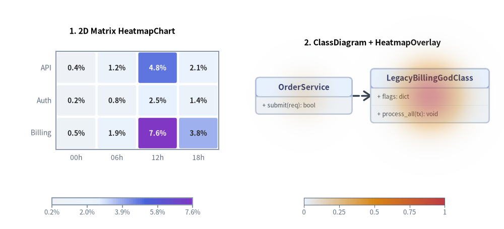
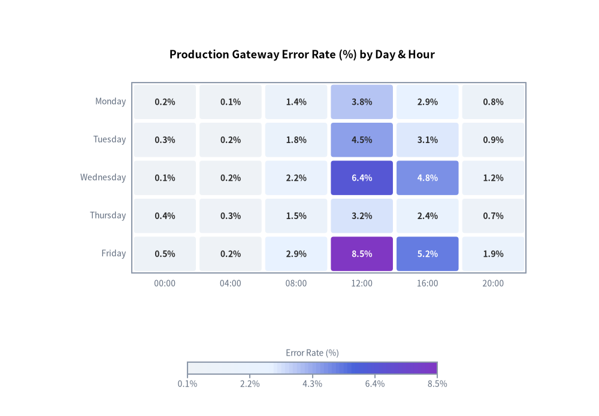
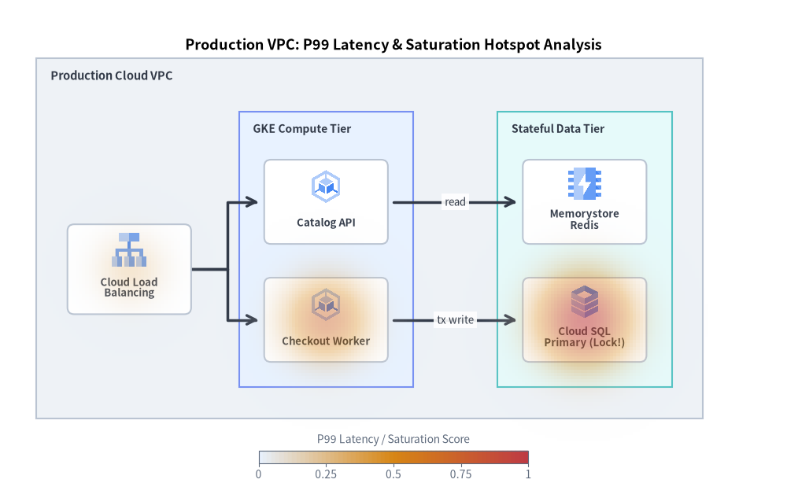
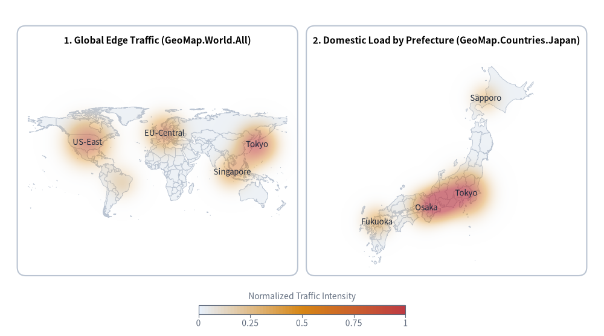

# HeatmapChart & HeatmapOverlay: 2D Matrix Grids & Diagram Thermal Overlays

`drawlib.charts.heatmap` provides two complementary heatmap visualization classes styled via `Style` color-stop interpolation (`styles=[Style, ...]` or `min_style=...`, `max_style=...`):
1. **`HeatmapChart`**: A standard 2D matrix/grid heatmap across categorical `x_categories` and `y_categories` with auto-contrasting in-cell numerical labels, configurable cell gaps and corner rounding (`cell_gap`, `cell_r`), and continuous colorbar (`draw_colorbar`) or stepped legend (`draw_legend`).
2. **`HeatmapOverlay`**: A spatial thermal/hotspot overlay designed to be drawn directly on top of diagrams (such as `ClassDiagram`, `ArchitectureDiagram`, `ErDiagram`, or `GeoMap`) to highlight high-risk classes, cyclomatic complexity, bug density, or regional/service bottlenecks in either `"smooth"` (2D Gaussian thermal gradient) or `"contour"` (concentric vector isoline rings) mode.

---

## 1. Overview & Topologies


<figure class="drawlib-image" style="text-align: center;">
  
  <figcaption class="drawlib-caption">Heatmap Topologies: 2D Matrix HeatmapChart vs. ClassDiagram Thermal HeatmapOverlay</figcaption>
</figure>

<details class="drawlib-code-details">
<summary>Source Code</summary>

```python
from drawlib.canvas import save, setup
from drawlib.charts.heatmap import HeatmapChart, HeatmapOverlay
from drawlib.diagrams.class_diagram import ClassDiagram, ClassNode
from drawlib.styles import Styles

setup(width=136, height=62)

# Left: 2D Matrix HeatmapChart
matrix = HeatmapChart(
    styles=[Styles.Neutral, Styles.PrimaryNeutral, Styles.PrimaryFlat, Styles.AccentFlat],
    x_categories=["00h", "06h", "12h", "18h"],
    axis_line_style=Styles.Muted,
    axis_text_style=Styles.Muted.patch(text_size=10.0),
    value_text_style=Styles.BlackBold.patch(text_size=10.0),
    width=58.0,
    height=40.0,
    title="1. 2D Matrix HeatmapChart",
    title_style=Styles.BlackBold.patch(text_size=11.5),
    value_format="{:.1f}%",
)
matrix.add_row("API", [0.4, 1.2, 4.8, 2.1])
matrix.add_row("Auth", [0.2, 0.8, 2.5, 1.4])
matrix.add_row("Billing", [0.5, 1.9, 7.6, 3.8])
matrix.draw(xy=(4.0, 16.0))
matrix.draw_colorbar(
    xy=(14.0, 6.5),
    text_style=Styles.Muted.patch(text_size=9.5),
    length=38.0,
    thickness=2.0,
)

# Right: Spatial Thermal HeatmapOverlay on ClassDiagram
diag = ClassDiagram(
    node_style=Styles.Neutral,
    header_style=Styles.PrimaryNeutral,
    edge_style=Styles.DarkBold,
    edge_text_style=Styles.Dark.patch(text_size=9.5),
    title="2. ClassDiagram + HeatmapOverlay",
    title_style=Styles.BlackBold.patch(text_size=11.5),
)
c_api = diag.add(ClassNode("OrderService", width=26.0).add_method("submit", "req", "bool"), xy=(82.0, 36.0))
c_god = diag.add(
    ClassNode("LegacyBillingGodClass", width=32.0)
    .add_attribute("flags", "dict")
    .add_method("process_all", "tx", "void"),
    xy=(116.0, 36.0),
)
diag.connect(c_api, c_god, "dependency", directed=True)
diag.draw(xy=(0.0, 0.0))

overlay = HeatmapOverlay(
    styles=[Styles.PrimaryNeutral, Styles.WarningFlat, Styles.DangerFlat],
    mode="smooth",
    max_alpha=0.55,
)
overlay.add_spot(c_god, value=0.95, radius=19.0)
overlay.add_spot(c_api, value=0.35, radius=14.0)
overlay.draw(xy=(0.0, 0.0))
overlay.draw_colorbar(
    xy=(82.0, 6.5),
    text_style=Styles.Muted.patch(text_size=9.5),
    length=38.0,
    thickness=2.0,
)

save()
```

</details>


---

## 2. Standard 2D Matrix Heatmap (`HeatmapChart`)

`HeatmapChart` maps a 2D grid of values across `x_categories` and `y_categories` into interpolated `Style` colors, automatically adjusting cell label contrast (`auto_contrast_text=True`) so numbers stay legible across both light and dark cells:


```python
from drawlib.canvas import save, setup
from drawlib.charts.heatmap import HeatmapChart
from drawlib.styles import Styles

setup(width=115, height=80)

chart = HeatmapChart(
    styles=[Styles.Neutral, Styles.PrimaryNeutral, Styles.PrimaryFlat, Styles.AccentFlat],
    x_categories=["00:00", "04:00", "08:00", "12:00", "16:00", "20:00"],
    axis_line_style=Styles.Muted,
    axis_text_style=Styles.Muted.patch(text_size=10.0),
    value_text_style=Styles.BlackBold.patch(text_size=10.0),
    width=92.0,
    height=50.0,
    cell_gap=0.7,
    cell_r=0.5,
    title="Production Gateway Error Rate (%) by Day & Hour",
    title_style=Styles.BlackBold.patch(text_size=13.0),
    value_format="{:.1f}%",
)
chart.add_row("Monday", [0.2, 0.1, 1.4, 3.8, 2.9, 0.8])
chart.add_row("Tuesday", [0.3, 0.2, 1.8, 4.5, 3.1, 0.9])
chart.add_row("Wednesday", [0.1, 0.2, 2.2, 6.4, 4.8, 1.2])
chart.add_row("Thursday", [0.4, 0.3, 1.5, 3.2, 2.4, 0.7])
chart.add_row("Friday", [0.5, 0.2, 2.9, 8.5, 5.2, 1.9])

chart.draw(xy=(12.0, 22.0))
chart.draw_colorbar(
    xy=(36.0, 8.0),
    text_style=Styles.Muted.patch(text_size=10.0),
    length=48.0,
    thickness=2.4,
    label="Error Rate (%)",
)

save()
```

<figure class="drawlib-image" style="text-align: center;">
  
  <figcaption class="drawlib-caption">Service Latency & Error Correlation Matrix with Continuous Colorbar</figcaption>
</figure>


---

## 3. 6-Class `ClassDiagram` Hotspot Overlay (`HeatmapOverlay`: Smooth Mode)

When analyzing codebases, architecture topologies, or UML class models, `HeatmapOverlay` lets you raise the visual temperature over fragile or complex components (`add_spot(class_node, value=..., radius=...)`). Passing a `ClassNode` directly resolves its canvas center `.xy` automatically.

The following example overlays a smooth 2D Gaussian thermal field (`mode="smooth"`) onto a **6-class Order & Payment UML `ClassDiagram`**, pinpointing the high-risk `LegacyPaymentGateway` God class (`0.96`) and its tightly-coupled `OrderOrchestrator` (`0.72`) and `FraudRuleEngine` (`0.55`):


```python
from drawlib.canvas import save, setup
from drawlib.charts.heatmap import HeatmapOverlay
from drawlib.diagrams.class_diagram import ClassDiagram, ClassNode
from drawlib.styles import Styles

setup(width=142, height=96)

# 1. Build 6-Class UML ClassDiagram (2 rows x 3 columns)
diagram = ClassDiagram(
    node_style=Styles.Neutral,
    header_style=Styles.PrimaryNeutral,
    edge_style=Styles.DarkBold,
    edge_text_style=Styles.Dark.patch(text_size=9.5),
    title="Order & Payment Subsystem: Complexity & Bug Hotspot Analysis (6 Classes)",
    title_style=Styles.BlackBold.patch(text_size=13.0),
    margin=8.0,
)

# Top Tier (Row 1: y = 68.0)
ctrl = diagram.add(
    ClassNode("OrderController", width=29.0)
    .add_method("create_order", "req", "Order")
    .add_method("cancel_order", "id", "bool"),
    xy=(24.0, 68.0),
)
orch = diagram.add(
    ClassNode("OrderOrchestrator", width=31.0)
    .add_attribute("retry_policy", "dict", is_public=False)
    .add_method("dispatch", "order", "Receipt")
    .add_method("rollback", "tx_id", "void"),
    xy=(71.0, 68.0),
)
notif = diagram.add(
    ClassNode("NotificationService", width=29.0)
    .add_attribute("smtp_host", "str", is_public=False)
    .add_method("send_receipt", "user", "bool")
    .add_method("alert_ops", "msg", "void"),
    xy=(118.0, 68.0),
)

# Bottom Tier (Row 2: y = 33.0)
fraud = diagram.add(
    ClassNode("FraudRuleEngine", width=29.0)
    .add_attribute("rule_cache", "list", is_public=False)
    .add_method("evaluate", "order", "float")
    .add_method("reload_rules", "", "int"),
    xy=(24.0, 33.0),
)
gateway = diagram.add(
    ClassNode("LegacyPaymentGateway", width=33.0)
    .add_attribute("global_locks", "dict", is_public=False)
    .add_attribute("raw_socket_pool", "list", is_public=False)
    .add_method("charge_card", "payload", "str")
    .add_method("reconcile_batch", "raw", "void")
    .add_method("parse_iso8583", "buf", "dict"),
    xy=(71.0, 33.0),
)
ledger = diagram.add(
    ClassNode("LedgerRepository", width=29.0)
    .add_attribute("db_pool", "Pool", is_public=False)
    .add_method("append_entry", "tx", "UUID")
    .add_method("query_audit", "id", "list"),
    xy=(118.0, 33.0),
)

# Connect the 6 classes orthogonally
diagram.connect(ctrl, orch, "dependency", start_side="right", end_side="left", label="delegates", directed=True)
diagram.connect(orch, notif, "dependency", start_side="right", end_side="left", label="notifies", directed=True)
diagram.connect(ctrl, fraud, "dependency", start_side="bottom", end_side="top", label="validates", directed=True)
diagram.connect(orch, gateway, "composition", start_side="bottom", end_side="top", label="invokes", directed=True)
diagram.connect(fraud, gateway, "association", start_side="right", end_side="left", label="scores", directed=True)
diagram.connect(gateway, ledger, "association", start_side="right", end_side="left", label="records", directed=True)

diagram.draw(xy=(0.0, 0.0))

# 2. Overlay Thermal Hotspots directly onto ClassNode coordinates
overlay = HeatmapOverlay(
    styles=[Styles.PrimaryNeutral, Styles.WarningFlat, Styles.DangerFlat],
    mode="smooth",
    max_alpha=0.55,
    blend_mode="max",
)
overlay.add_spot(gateway, value=0.96, radius=22.0)
overlay.add_spot(orch, value=0.72, radius=18.0)
overlay.add_spot(fraud, value=0.55, radius=16.0)
overlay.add_spot(ctrl, value=0.30, radius=14.0)
overlay.add_spot(ledger, value=0.15, radius=12.0)
overlay.draw(xy=(0.0, 0.0))

overlay.draw_colorbar(
    xy=(47.0, 6.5),
    text_style=Styles.Muted.patch(text_size=10.0),
    length=48.0,
    thickness=2.2,
    label="Complexity & Bug Risk Score",
)

save()
```

<figure class="drawlib-image" style="text-align: center;">
  
  <figcaption class="drawlib-caption">6-Class UML ClassDiagram with Smooth Thermal Hotspot Overlay (mode='smooth')</figcaption>
</figure>


---

## 4. Concentric Isoline Ring Overlay (`mode="contour"`)

For crisp vector diagrams or print documentation where discrete isoline rings are preferred over continuous gradients, set `mode="contour"` and `levels=4` on the 6-class diagram:


```python
from drawlib.canvas import save, setup
from drawlib.charts.heatmap import HeatmapOverlay
from drawlib.diagrams.class_diagram import ClassDiagram, ClassNode
from drawlib.styles import Styles

setup(width=142, height=96)

diagram = ClassDiagram(
    node_style=Styles.Neutral,
    header_style=Styles.PrimaryNeutral,
    edge_style=Styles.DarkBold,
    edge_text_style=Styles.Dark.patch(text_size=9.5),
    title="Change Blast Radius Analysis Across 6 Classes (mode='contour')",
    title_style=Styles.BlackBold.patch(text_size=13.0),
    margin=10.0,
)

# Top Tier (Row 1: y = 66.0)
ctrl = diagram.add(
    ClassNode("OrderController", width=29.0)
    .add_method("create_order", "req", "Order")
    .add_method("cancel_order", "id", "bool"),
    xy=(24.0, 66.0),
)
orch = diagram.add(
    ClassNode("OrderOrchestrator", width=31.0)
    .add_attribute("retry_policy", "dict", is_public=False)
    .add_method("dispatch", "order", "Receipt")
    .add_method("rollback", "tx_id", "void"),
    xy=(71.0, 66.0),
)
notif = diagram.add(
    ClassNode("NotificationService", width=29.0)
    .add_attribute("smtp_host", "str", is_public=False)
    .add_method("send_receipt", "user", "bool")
    .add_method("alert_ops", "msg", "void"),
    xy=(118.0, 66.0),
)

# Bottom Tier (Row 2: y = 32.0)
fraud = diagram.add(
    ClassNode("FraudRuleEngine", width=29.0)
    .add_attribute("rule_cache", "list", is_public=False)
    .add_method("evaluate", "order", "float")
    .add_method("reload_rules", "", "int"),
    xy=(24.0, 32.0),
)
gateway = diagram.add(
    ClassNode("LegacyPaymentGateway", width=33.0)
    .add_attribute("global_locks", "dict", is_public=False)
    .add_attribute("raw_socket_pool", "list", is_public=False)
    .add_method("charge_card", "payload", "str")
    .add_method("reconcile_batch", "raw", "void")
    .add_method("parse_iso8583", "buf", "dict"),
    xy=(71.0, 32.0),
)
ledger = diagram.add(
    ClassNode("LedgerRepository", width=29.0)
    .add_attribute("db_pool", "Pool", is_public=False)
    .add_method("append_entry", "tx", "UUID")
    .add_method("query_audit", "id", "list"),
    xy=(118.0, 32.0),
)

diagram.connect(ctrl, orch, "dependency", start_side="right", end_side="left", label="delegates", directed=True)
diagram.connect(orch, notif, "dependency", start_side="right", end_side="left", label="notifies", directed=True)
diagram.connect(ctrl, fraud, "dependency", start_side="bottom", end_side="top", label="validates", directed=True)
diagram.connect(orch, gateway, "composition", start_side="bottom", end_side="top", label="invokes", directed=True)
diagram.connect(fraud, gateway, "association", start_side="right", end_side="left", label="scores", directed=True)
diagram.connect(gateway, ledger, "association", start_side="right", end_side="left", label="records", directed=True)

diagram.draw(xy=(0.0, 0.0))

overlay = HeatmapOverlay(
    styles=[Styles.PrimaryNeutral, Styles.WarningFlat, Styles.DangerFlat],
    mode="contour",
    levels=4,
    max_alpha=0.45,
)
overlay.add_spot(gateway, value=0.96, radius=20.0)
overlay.add_spot(orch, value=0.72, radius=16.0)
overlay.add_spot(fraud, value=0.55, radius=14.0)
overlay.draw(xy=(0.0, 0.0))

overlay.draw_legend(
    xy=(43.0, 6.0),
    text_style=Styles.Muted.patch(text_size=10.0),
    orientation="horizontal",
    labels=["Low", "Moderate", "High", "Critical"],
)

save()
```

<figure class="drawlib-image" style="text-align: center;">
  
  <figcaption class="drawlib-caption">6-Class UML ClassDiagram with Concentric Vector Isoline Rings (mode='contour')</figcaption>
</figure>


---

## 5. Cloud Architecture Latency & Incident Overlay (`ArchitectureDiagram` + `HeatmapOverlay`)

`HeatmapOverlay.add_spot()` also accepts `ArchitectureDiagram` `Node` and `NodeGroup` instances directly—automatically resolving nested `NodeGroup` hierarchy offsets so you can highlight infrastructure bottlenecks, CPU saturation, or P99 latency spikes over cloud architecture diagrams:


```python
from drawlib.canvas import save, setup
from drawlib.charts.heatmap import HeatmapOverlay
from drawlib.diagrams.architecture import ArchitectureDiagram, GcpIcon, Node, NodeGroup
from drawlib.styles import Colors, Styles

setup(width=140, height=88)

arch = ArchitectureDiagram(
    node_style=Styles.Primary,
    node_text_style=Styles.DarkBold.patch(text_size=9.5),
    edge_style=Styles.DarkBold,
    edge_text_style=Styles.Dark.patch(text_size=9.5),
    node_card_style=Styles.Neutral.patch(shape_fill_color=Colors.White, shape_r=1.2),
)

vpc = arch.add(
    NodeGroup(
        title="Production Cloud VPC",
        padding=5.5,
        style=Styles.Neutral,
        text_style=Styles.DarkBold.patch(text_size=10.5, halign="left", valign="top"),
    ),
    xy=(8.0, 15.0),
)

# Edge Ingress
lb = vpc.add(
    Node("Cloud Load\nBalancing", width=22.0, height=16.0, icon=GcpIcon.CLOUD_LOAD_BALANCING, icon_size=6.8),
    xy=(15.0, 25.0),
)

# Compute Subnet
compute_grp = vpc.add(
    NodeGroup(
        title="GKE Compute Tier",
        padding=4.5,
        style=Styles.PrimaryNeutral,
        text_style=Styles.DarkBold.patch(text_size=10.0, halign="left", valign="top"),
    ),
    xy=(36.0, 4.0),
)
api_svc = compute_grp.add(
    Node("Catalog API", width=22.0, height=15.0, icon=GcpIcon.GOOGLE_KUBERNETES_ENGINE, icon_size=6.5),
    xy=(14.0, 33.0),
)
checkout_svc = compute_grp.add(
    Node("Checkout Worker", width=22.0, height=15.0, icon=GcpIcon.GOOGLE_KUBERNETES_ENGINE, icon_size=6.5),
    xy=(14.0, 12.0),
)

# Data Subnet
data_grp = vpc.add(
    NodeGroup(
        title="Stateful Data Tier",
        padding=4.5,
        style=Styles.SecondaryNeutral,
        text_style=Styles.DarkBold.patch(text_size=10.0, halign="left", valign="top"),
    ),
    xy=(82.0, 4.0),
)
cache_node = data_grp.add(
    Node("Memorystore\nRedis", width=22.0, height=15.0, icon=GcpIcon.MEMORYSTORE, icon_size=6.5),
    xy=(14.0, 33.0),
)
sql_primary = data_grp.add(
    Node("Cloud SQL\nPrimary (Lock!)", width=22.0, height=15.0, icon=GcpIcon.CLOUD_SQL, icon_size=6.5),
    xy=(14.0, 12.0),
)

lb.fork([api_svc, checkout_svc], at_x=34.0, padding=1.0)
api_svc.connect(cache_node, label="read", padding=1.0)
checkout_svc.connect(sql_primary, label="tx write", padding=1.0)

arch.draw(xy=(0.0, 0.0))

# Overlay thermal hotspots directly on nested ArchitectureDiagram Nodes
overlay = HeatmapOverlay(
    styles=[Styles.PrimaryNeutral, Styles.WarningFlat, Styles.DangerFlat],
    mode="smooth",
    max_alpha=0.58,
    width=140.0,
    height=77.0,
    title="Production VPC: P99 Latency & Saturation Hotspot Analysis",
    title_style=Styles.BlackBold.patch(text_size=13.0),
)
overlay.add_spot(sql_primary, value=0.96, radius=19.0)
overlay.add_spot(checkout_svc, value=0.72, radius=17.0)
overlay.add_spot(lb, value=0.35, radius=14.0)
overlay.draw(xy=(0.0, 0.0))

overlay.draw_colorbar(
    xy=(46.0, 5.5),
    text_style=Styles.Muted.patch(text_size=10.0),
    length=48.0,
    thickness=2.2,
    label="P99 Latency / Saturation Score",
)

save()
```

<figure class="drawlib-image" style="text-align: center;">
  
  <figcaption class="drawlib-caption">Cloud VPC Architecture Diagram with Thermal Bottleneck Overlay</figcaption>
</figure>


---

## 6. Geographical Traffic & Regional Heatmap (`GeoMap` + `HeatmapOverlay`)

When working with `GeoMap` (`drawlib.smartarts.GeoMap`), pass `gmap.get_area_xy(area)` (by country, prefecture, or ward name) or `gmap.lonlat_to_xy(lon, lat)` (by longitude and latitude) directly to `overlay.add_spot()` to build geographical heatmaps over world, country, or city maps:


```python
from drawlib.canvas import save, setup
from drawlib.charts.heatmap import HeatmapOverlay
from drawlib.shapes import rectangle
from drawlib.smartarts import GeoMap
from drawlib.styles import Colors, Styles
from drawlib.text import text

setup(width=140, height=78)

card_style = Styles.Neutral.patch(shape_r=2.0, shape_line_color=Colors.Gray4, shape_fill_color=Colors.White)
rectangle((36.5, 43.0), width=65.0, height=58.0, style=card_style)
rectangle((103.5, 43.0), width=65.0, height=58.0, style=card_style)

text((36.5, 68.5), "1. Global Edge Traffic (GeoMap.World.All)", style=Styles.BlackBold.patch(text_size=11.0))
text((103.5, 68.5), "2. Domestic Load by Prefecture (GeoMap.Countries.Japan)", style=Styles.BlackBold.patch(text_size=11.0))

# Left: World Map + HeatmapOverlay
world = GeoMap(GeoMap.World.All, area_style=Styles.Neutral)
world.draw(xy=(6.5, 16.0), width=60.0, height=48.0)

world_overlay = HeatmapOverlay(
    styles=[Styles.PrimaryNeutral, Styles.WarningFlat, Styles.DangerFlat],
    mode="smooth",
    max_alpha=0.62,
    min_value=0.0,
    max_value=1.0,
)
world_overlay.add_spot(world.get_area_xy("Japan"), value=0.95, radius=9.5, label="Tokyo")
world_overlay.add_spot(world.get_area_xy("United States"), value=0.85, radius=11.0, label="US-East")
world_overlay.add_spot(world.get_area_xy("Germany"), value=0.72, radius=9.5, label="EU-Central")
world_overlay.add_spot(world.get_area_xy("Singapore"), value=0.60, radius=8.5, label="Singapore")
world_overlay.add_spot(world.get_area_xy("Brazil"), value=0.40, radius=8.0)
world_overlay.draw(xy=(0.0, 0.0))

# Right: Japan Map + HeatmapOverlay
jp = GeoMap(GeoMap.Countries.Japan, area_style=Styles.Neutral)
jp.draw(xy=(73.5, 16.0), width=60.0, height=48.0, lon_range=(129, 146), lat_range=(30, 46))

jp_overlay = HeatmapOverlay(
    styles=[Styles.PrimaryNeutral, Styles.WarningFlat, Styles.DangerFlat],
    mode="smooth",
    max_alpha=0.65,
    min_value=0.0,
    max_value=1.0,
)
jp_overlay.add_spot(jp.get_area_xy("Tokyo"), value=0.98, radius=10.5, label="Tokyo")
jp_overlay.add_spot(jp.get_area_xy("Osaka"), value=0.80, radius=8.5, label="Osaka")
jp_overlay.add_spot(jp.get_area_xy("Aichi"), value=0.62, radius=7.0)
jp_overlay.add_spot(jp.get_area_xy("Fukuoka"), value=0.55, radius=7.5, label="Fukuoka")
jp_overlay.add_spot(jp.lonlat_to_xy(141.35, 43.06), value=0.45, radius=7.5, label="Sapporo")
jp_overlay.draw(xy=(0.0, 0.0))

jp_overlay.draw_colorbar(
    xy=(46.0, 5.0),
    text_style=Styles.Muted.patch(text_size=10.0),
    length=48.0,
    thickness=2.2,
    label="Normalized Traffic Intensity",
)

save()
```

<figure class="drawlib-image" style="text-align: center;">
  
  <figcaption class="drawlib-caption">Geographical Traffic & Edge Request Heatmaps on GeoMap (World & Japan)</figcaption>
</figure>


