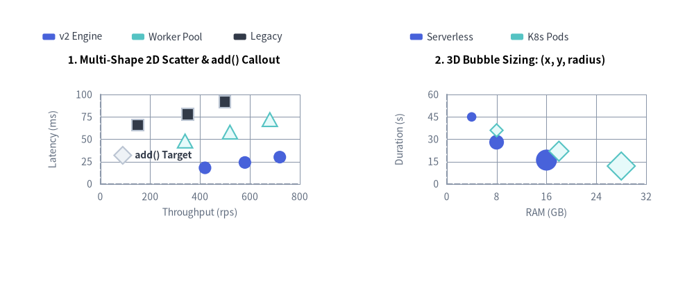
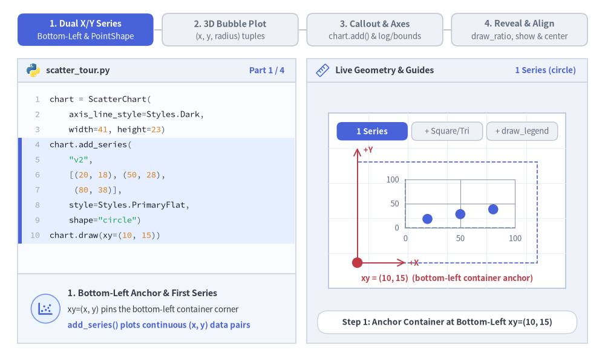
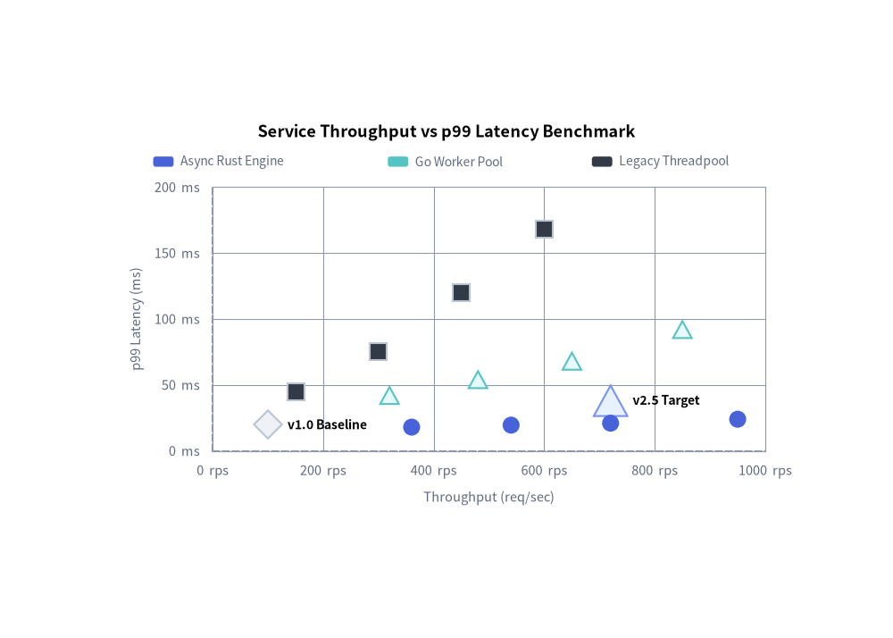
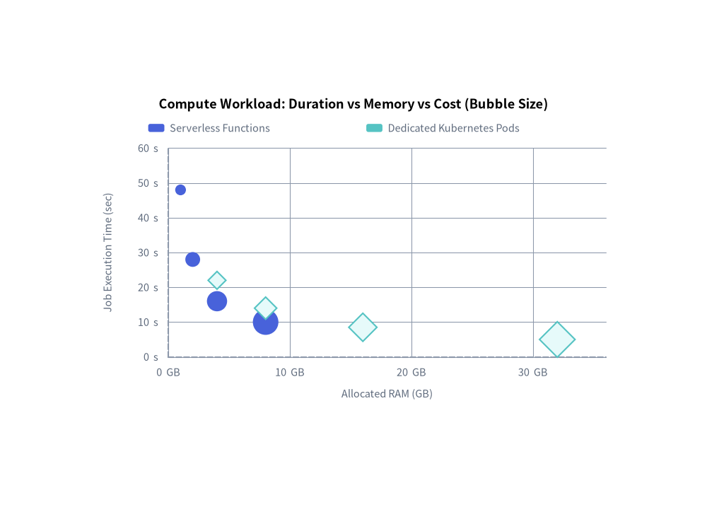

# ScatterChart: Dual-Axis Plots & Multidimensional Bubble Charts

`ScatterChart` (`drawlib.charts.scatter`) plots continuous numerical data across dual Cartesian axes (`X` and `Y`). It is ideal for identifying statistical correlations, clustering patterns, latency vs. throughput trade-offs, and 3D bubble analysis (where marker radius encodes a third numerical variable).


<figure class="drawlib-image" style="text-align: center;">
  
  <figcaption class="drawlib-caption">ScatterChart Topologies: Multi-Shape 2D Scatter vs. 3D Bubble Sizing</figcaption>
</figure>

<details class="drawlib-code-details">
<summary>Source Code</summary>

```python
from drawlib.canvas import save, setup
from drawlib.charts.scatter import ScatterChart
from drawlib.styles import Styles

setup(width=132, height=55)

# Left: 2D Scatter with Multiple PointShapes & add() Callout
scatter_2d = ScatterChart(
    axis_line_style=Styles.MutedDashed,
    axis_text_style=Styles.Muted.patch(text_size=10.0),
    value_text_style=Styles.DarkBold.patch(text_size=10.0),
    grid_style=Styles.MutedThin,
    width=58.0,
    height=38.0,
    title="1. Multi-Shape 2D Scatter & add() Callout",
    title_style=Styles.BlackBold.patch(text_size=11.0),
)
scatter_2d.configure_x_axis(label="Throughput (rps)", min_value=0, max_value=800, tick_step=200)
scatter_2d.configure_y_axis(label="Latency (ms)", min_value=0, max_value=100, tick_step=25)

scatter_2d.add(xy=(90, 32), style=Styles.Neutral, radius=1.5, shape="rhombus", label="add() Target")
scatter_2d.add_series("v2 Engine", [(420, 18), (580, 24), (720, 30)], style=Styles.PrimaryFlat, shape="circle", radius=1.2)
scatter_2d.add_series("Worker Pool", [(340, 48), (520, 58), (680, 72)], style=Styles.SecondaryNeutral, shape="triangle", radius=1.3)
scatter_2d.add_series("Legacy", [(150, 66), (350, 78), (500, 92)], style=Styles.Dark, shape="square", radius=1.1)
scatter_2d.draw(xy=(4.0, 8.0))
scatter_2d.draw_legend(xy=(8.0, 48.0), text_style=Styles.Dark.patch(text_size=10.0), orientation="horizontal", item_gap=3.0)

# Right: 3D Proportional Bubble Plot (x, y, radius)
bubble_3d = ScatterChart(
    axis_line_style=Styles.MutedDashed,
    axis_text_style=Styles.Muted.patch(text_size=10.0),
    grid_style=Styles.MutedThin,
    width=58.0,
    height=38.0,
    title="2. 3D Bubble Sizing: (x, y, radius)",
    title_style=Styles.BlackBold.patch(text_size=11.0),
)
bubble_3d.configure_x_axis(label="RAM (GB)", min_value=0, max_value=32, tick_step=8)
bubble_3d.configure_y_axis(label="Duration (s)", min_value=0, max_value=60, tick_step=15)

bubble_3d.add_series(
    "Serverless",
    [(4, 45, 0.9), (8, 28, 1.4), (16, 16, 2.0)],
    style=Styles.PrimaryFlat,
    shape="circle",
)
bubble_3d.add_series(
    "K8s Pods",
    [(8, 36, 1.1), (18, 22, 1.7), (28, 12, 2.4)],
    style=Styles.SecondaryNeutral,
    shape="rhombus",
)
bubble_3d.draw(xy=(70.0, 8.0))
bubble_3d.draw_legend(xy=(78.0, 48.0), text_style=Styles.Dark.patch(text_size=10.0), orientation="horizontal", item_gap=4.0)

save()
```

</details>


---

## 1. Core Concepts & Basic Usage

`ScatterChart` plots continuous numerical data across independent X and Y axes, anchoring by default at the **Bottom-Left `(x, y)`** corner of its container (or centered via `align="center"`). You can register multi-shape runs with `.add_series(...)`, encode a third metric into marker radii using `(x, y, radius)` 3-tuples, pinpoint standalone outliers via `.add(...)`, tune linear or logarithmic axes, and animate progressive reveals via `draw_ratio` and `show`:


<figure class="drawlib-image" style="text-align: center;">
  
  <figcaption class="drawlib-caption">Basic Usage & Parameter Tour: Dual-Axis Series, 3D Bubble Sizing, Point Callouts & Log Axes, and Partial Reveals (APNG Animation)</figcaption>
</figure>

<details class="drawlib-code-details">
<summary>Source Code</summary>

```python
from __future__ import annotations

from drawlib.anim import Animation
from drawlib.canvas import save, setup
from drawlib.charts.scatter import ScatterChart
from drawlib.icons import code as code_icons
from drawlib.icons import phosphor
from drawlib.lines import line
from drawlib.shapes import circle, rectangle
from drawlib.smartarts import SourceCode, SourceCodeStyles
from drawlib.styles import Styles
from drawlib.text import text

W, H = 138.0, 82.0
setup(width=W, height=H)
anim = Animation(fps=10.0, loop=0)

CODE_TEXT_SIZE = 10.0
PT_TO_CANVAS = W / 720.0
FONT_CANVAS = CODE_TEXT_SIZE * PT_TO_CANVAS
LINE_H = FONT_CANVAS * 1.8
PAD_Y = FONT_CANVAS * 1.2

CODE_STYLES = SourceCodeStyles.get("default", font_lang="en", text_size=CODE_TEXT_SIZE).patch(
    box_style=Styles.Neutral.patch(shape_fill_color=(0, 0, 0, 0), shape_line_width=0),
)

PANE_HEADER = Styles.Neutral.patch(
    shape_fill_color=(238, 243, 250),
    shape_line_color=(203, 213, 225),
    shape_line_width=1.2,
    shape_r=0.0,
)
EDITOR_BODY = Styles.Neutral.patch(
    shape_fill_color=(250, 252, 255),
    shape_line_color=(203, 213, 225),
    shape_line_width=1.2,
    shape_r=0.0,
)
TAKEAWAY_BODY = Styles.Neutral.patch(
    shape_fill_color=(242, 246, 253),
    shape_line_color=(203, 213, 225),
    shape_line_width=1.2,
    shape_r=0.0,
)
STUDIO_BODY = Styles.Neutral.patch(
    shape_fill_color=(239, 243, 249),
    shape_line_color=(203, 213, 225),
    shape_line_width=1.2,
    shape_r=0.0,
)

PART_ITEMS = [
    ("1. Dual X/Y Series", "Bottom-Left & PointShape"),
    ("2. 3D Bubble Plot", "(x, y, radius) tuples"),
    ("3. Callout & Axes", "chart.add() & log/bounds"),
    ("4. Reveal & Align", "draw_ratio, show & center"),
]


def draw_step_bar(active_part: int) -> None:
    """Draw top 4-part progress bar (active_part is 1..4)."""
    pill_w = 31.0
    pill_h = 7.4
    gap = 2.0
    start_x = 4.0 + pill_w / 2.0
    cy = 75.2

    for idx, (label, sublabel) in enumerate(PART_ITEMS, start=1):
        cx = start_x + (idx - 1) * (pill_w + gap)
        if idx > 1:
            prev_cx = cx - (pill_w + gap)
            line(
                (prev_cx + pill_w / 2.0 + 0.2, cy),
                (cx - pill_w / 2.0 - 0.2, cy),
                style=Styles.PrimaryBold if idx <= active_part else Styles.MutedThin,
            )

        if idx == active_part:
            st = Styles.PrimaryFlat.patch(shape_r=1.4)
            tst = Styles.WhiteBold.patch(text_size=10.3)
            sub_tst = Styles.White.patch(text_size=9.5)
        elif idx < active_part:
            st = Styles.PrimaryNeutral.patch(shape_r=1.4, shape_line_width=1.1)
            tst = Styles.PrimaryBold.patch(text_size=10.3)
            sub_tst = Styles.Primary.patch(text_size=9.5)
        else:
            st = Styles.Neutral.patch(shape_r=1.4, shape_line_width=1.1)
            tst = Styles.MutedBold.patch(text_size=10.3)
            sub_tst = Styles.Muted.patch(text_size=9.5)

        rectangle((cx, cy), width=pill_w, height=pill_h, style=st)
        text((cx, cy + 1.35), label, style=tst)
        text((cx, cy - 1.55), sublabel, style=sub_tst)


def draw_left_pane(
    active_part: int,
    code_lines: list[str],
    hl_range: tuple[int, int],
    icon_fn: object,
    summary_title: str,
    summary_line1: str,
    summary_line2: str,
) -> None:
    """Draw left Python code editor + bottom concept takeaway card."""
    x0, w = 4.0, 63.5
    cx = x0 + w / 2.0
    top_y = 63.2
    header_h = 5.4
    editor_h = 43.8
    takeaway_h = 15.8

    rectangle((cx, top_y + header_h / 2.0), width=w, height=header_h, style=PANE_HEADER)
    code_icons.python((x0 + 3.6, top_y + header_h / 2.0), width=3.4, style=Styles.Neutral)
    text(
        (x0 + 6.5, top_y + header_h / 2.0),
        "scatter_tour.py",
        style=Styles.DarkBold.patch(text_size=10.2, halign="left"),
    )
    text(
        (x0 + w - 2.6, top_y + header_h / 2.0),
        f"Part {active_part} / 4",
        style=Styles.PrimaryBold.patch(text_size=9.8, halign="right"),
    )

    rectangle((cx, top_y - editor_h / 2.0), width=w, height=editor_h, style=EDITOR_BODY)

    hl_start, hl_end = hl_range
    hl_top = top_y - PAD_Y - hl_start * LINE_H
    hl_bot = top_y - PAD_Y - (hl_end + 1) * LINE_H
    hl_cy = (hl_top + hl_bot) / 2.0
    hl_h = hl_top - hl_bot
    rectangle(
        (cx, hl_cy),
        width=w - 0.6,
        height=hl_h,
        style=Styles.Neutral.patch(shape_fill_color=(229, 239, 255), shape_line_width=0),
    )
    rectangle(
        (x0 + 0.55, hl_cy),
        width=0.9,
        height=hl_h,
        style=Styles.PrimaryFlat.patch(shape_line_width=0),
    )

    SourceCode.draw(
        xy=(x0, top_y),
        width=w,
        code="\n".join(code_lines),
        styles=CODE_STYLES,
        code_lang="python",
        show_linenum=True,
        align="top_left",
    )

    take_cy = 3.6 + takeaway_h / 2.0
    rectangle((cx, take_cy), width=w, height=takeaway_h, style=TAKEAWAY_BODY)
    circle(
        (x0 + 6.4, take_cy),
        radius=3.3,
        style=Styles.PrimaryNeutral.patch(shape_line_width=1.2),
    )
    icon_fn((x0 + 6.4, take_cy), width=3.8, style=Styles.PrimaryBold)  # type: ignore[operator]
    text(
        (x0 + 11.4, take_cy + 3.6),
        summary_title,
        style=Styles.DarkBold.patch(text_size=10.4, halign="left"),
    )
    text(
        (x0 + 11.4, take_cy - 0.2),
        summary_line1,
        style=Styles.Dark.patch(text_size=9.7, halign="left"),
    )
    text(
        (x0 + 11.4, take_cy - 3.8),
        summary_line2,
        style=Styles.PrimaryBold.patch(text_size=9.6, halign="left"),
    )


def draw_geometry_studio(param_badge: str, footer_caption: str) -> tuple[float, float]:
    """Draw right geometry lab shell, inner coordinate sheet with subtle grid, and footer."""
    x0, w = 70.0, 64.0
    cx = x0 + w / 2.0
    top_y = 63.2
    header_h = 5.4
    body_h = 59.6

    rectangle((cx, top_y + header_h / 2.0), width=w, height=header_h, style=PANE_HEADER)
    phosphor.ruler((x0 + 3.6, top_y + header_h / 2.0), width=3.4, style=Styles.Primary)
    text(
        (x0 + 6.5, top_y + header_h / 2.0),
        "Live Geometry & Guides",
        style=Styles.DarkBold.patch(text_size=10.2, halign="left"),
    )
    text(
        (x0 + w - 2.6, top_y + header_h / 2.0),
        param_badge,
        style=Styles.PrimaryBold.patch(text_size=9.6, halign="right"),
    )

    rectangle((cx, 3.6 + body_h / 2.0), width=w, height=body_h, style=STUDIO_BODY)

    sheet_cx, sheet_cy = cx, 36.2
    sheet_w, sheet_h = 54.0, 40.0
    sx0, sy0 = sheet_cx - sheet_w / 2.0, sheet_cy - sheet_h / 2.0
    rectangle(
        (sheet_cx, sheet_cy),
        width=sheet_w,
        height=sheet_h,
        style=Styles.Neutral.patch(
            shape_fill_color=(255, 255, 255),
            shape_line_color=(180, 194, 214),
            shape_line_width=1.2,
        ),
    )
    g_st = Styles.MutedThin.patch(line_color=(232, 238, 246), line_width=0.8)
    for gx in range(1, 6):
        vx = sx0 + gx * (sheet_w / 6.0)
        line((vx, sy0), (vx, sy0 + sheet_h), style=g_st)
    for gy in range(1, 5):
        vy = sy0 + gy * (sheet_h / 5.0)
        line((sx0, vy), (sx0 + sheet_w, vy), style=g_st)

    rectangle(
        (cx, 8.4),
        width=59.2,
        height=5.2,
        style=Styles.Neutral.patch(
            shape_fill_color=(255, 255, 255),
            shape_line_color=(203, 213, 225),
            shape_line_width=1.1,
            shape_r=2.4,
        ),
        text=footer_caption,
        text_style=Styles.DarkBold.patch(text_size=9.8),
    )
    return sheet_cx, sheet_cy


def draw_sub_pills(scx: float, labels: list[str], active_idx: int) -> None:
    """Draw 3-step tracker pills near the top of the studio sheet."""
    pw, ph, pgap = 16.2, 4.2, 0.9
    p_start = scx - (3 * pw + 2 * pgap) / 2.0 + pw / 2.0
    for idx, lbl in enumerate(labels):
        px = p_start + idx * (pw + pgap)
        if idx == active_idx:
            pst = Styles.PrimaryFlat.patch(shape_r=1.2)
            ptst = Styles.WhiteBold.patch(text_size=9.5)
        elif idx < active_idx:
            pst = Styles.PrimaryNeutral.patch(shape_r=1.2, shape_line_width=1.0)
            ptst = Styles.PrimaryBold.patch(text_size=9.5)
        else:
            pst = Styles.Neutral.patch(shape_r=1.2, shape_line_width=1.0)
            ptst = Styles.Muted.patch(text_size=9.5)
        rectangle((px, 52.0), width=pw, height=ph, style=pst, text=lbl, text_style=ptst)


AXIS_TEXT = Styles.Muted.patch(text_size=9.5)
LEGEND_TEXT = Styles.DarkBold.patch(text_size=9.5)

# =========================================================================
# Part 1: Dual X/Y Series — Bottom-Left xy Anchor, PointShape & Legend
# =========================================================================
SERIES_STATES = [
    (
        1,
        3.3,
        [
            "chart = ScatterChart(",
            "    axis_line_style=Styles.Dark,",
            "    width=41, height=23)",
            "chart.add_series(",
            '    "v2",',
            "    [(20, 18), (50, 28),",
            "     (80, 38)],",
            "    style=Styles.PrimaryFlat,",
            '    shape="circle")',
            "chart.draw(xy=(10, 15))",
        ],
        (3, 9),
        "1 Series (circle)",
        "Step 1: Anchor Container at Bottom-Left xy=(10, 15)",
        "1. Bottom-Left Anchor & First Series",
        "xy=(x, y) pins the bottom-left container corner",
        "add_series() plots continuous (x, y) data pairs",
    ),
    (
        2,
        3.3,
        [
            "chart = ScatterChart(",
            "    ..., width=41, height=23)",
            'chart.add_series("v2", ...,',
            '    shape="circle")',
            "chart.add_series(",
            '    "Pool", [(25, 48), ...],',
            '    shape="triangle",',
            "    style=Styles.Neutral)",
            'chart.add_series("v1", ...,',
            '    shape="square")',
            "chart.draw(xy=(10, 15))",
        ],
        (4, 9),
        'shape="triangle"',
        "Step 2: Add Multi-Shape Series (circle, triangle, square)",
        "2. Distinct Marker Shapes (PointShape)",
        "Pick circle, triangle, square, or rhombus",
        "Calm neutral series keep 1 focal run prominent",
    ),
    (
        3,
        3.4,
        [
            "chart = ScatterChart(...)",
            'chart.add_series("v2", ...,',
            '    shape="circle")',
            'chart.add_series("Pool", ...,',
            '    shape="triangle")',
            'chart.add_series("v1", ...,',
            '    shape="square")',
            "chart.draw(xy=(10, 15))",
            "chart.draw_legend(",
            "    xy=(14, 40),",
            '    orientation="horizontal")',
        ],
        (8, 10),
        "draw_legend()",
        "Step 3: Place Decoupled Legend at Explicit xy=(14, 40)",
        "3. Decoupled Legend Placement",
        "draw_legend(xy, ...) places swatches at any xy",
        'Supports "horizontal" or "vertical" orientation',
    ),
]

for p1_idx, (mode_p1, dur, code_1, hl_rng, badge_txt, foot_txt, s_t, s_1, s_2) in enumerate(SERIES_STATES):
    with anim.frame(duration=dur):
        draw_step_bar(1)
        draw_left_pane(1, code_1, hl_rng, phosphor.chart_scatter, s_t, s_1, s_2)
        scx, _ = draw_geometry_studio(badge_txt, foot_txt)
        draw_sub_pills(scx, ["1 Series", "+ Square/Tri", "+ draw_legend"], p1_idx)

        bx, by, cw, ch = 81.5, 22.0, 41.0, 23.0
        chart = ScatterChart(
            axis_line_style=Styles.MutedDashed,
            axis_text_style=AXIS_TEXT,
            grid_style=Styles.MutedThin,
            width=cw,
            height=ch,
        )
        chart.configure_x_axis(min_value=0, max_value=100, tick_step=50)
        chart.configure_y_axis(min_value=0, max_value=100, tick_step=50)
        chart.add_series(
            "v2",
            [(20, 18), (50, 28), (80, 38)],
            style=Styles.PrimaryFlat,
            shape="circle",
            radius=1.15,
        )
        if mode_p1 >= 2:
            chart.add_series(
                "Pool",
                [(25, 48), (55, 62), (85, 74)],
                style=Styles.SecondaryNeutral,
                shape="triangle",
                radius=1.25,
            )
            chart.add_series(
                "v1",
                [(15, 68), (45, 80), (75, 92)],
                style=Styles.PrimaryNeutral,
                shape="square",
                radius=1.1,
            )
        chart.draw(xy=(bx, by))

        if mode_p1 == 1:
            rectangle(
                (bx + cw / 2.0, by + ch / 2.0),
                width=cw,
                height=ch,
                style=Styles.PrimaryDashed.patch(shape_fill_color=(0, 0, 0, 0), shape_line_width=1.2),
            )
            line((bx, by), (bx, by + ch + 3.2), arrow_head="->", style=Styles.DangerBold.patch(line_width=1.4))
            text((bx + 1.4, by + ch + 2.8), "+Y", style=Styles.DangerBold.patch(text_size=9.5, halign="left"))
            line((bx, by), (bx + 11.0, by), arrow_head="->", style=Styles.DangerBold.patch(line_width=1.4))
            text((bx + 11.8, by), "+X", style=Styles.DangerBold.patch(text_size=9.5, halign="left"))
            circle((bx, by), radius=1.2, style=Styles.DangerFlat)
            text(
                (scx, 18.4),
                "xy = (10, 15)  (bottom-left container anchor)",
                style=Styles.DangerBold.patch(text_size=9.5),
            )
        elif mode_p1 == 2:
            text(
                (scx, 18.4),
                "3 PointShape series: circle • triangle • square",
                style=Styles.PrimaryBold.patch(text_size=9.5),
            )
        else:
            chart.draw_legend(
                xy=(bx + 6.5, 47.0),
                text_style=LEGEND_TEXT,
                orientation="horizontal",
                item_gap=3.4,
            )
            text(
                (scx, 18.4),
                "Decoupled legend anchored above plot at (14, 40)",
                style=Styles.PrimaryBold.patch(text_size=9.5),
            )

# =========================================================================
# Part 2: 3D Bubble Plot — Encoding a 3rd Variable via (x, y, radius)
# =========================================================================
BUBBLE_STATES = [
    (
        "fixed_2d",
        3.3,
        [
            "chart = ScatterChart(",
            "    ..., width=41, height=23)",
            "",
            "# 2-tuples: fixed marker radius",
            "chart.add_series(",
            '    "Fn",',
            "    [(2, 46), (5, 28), (8, 16)],",
            "    style=Styles.PrimaryNeutral,",
            "    radius=1.1)",
            "chart.draw(xy=(10, 15))",
        ],
        (4, 8),
        "2-tuple (x, y)",
        "2-Tuples (x, y): Every Point Uses Uniform radius=1.1",
        "Standard 2-Tuple Data ((x, y))",
        "2-tuples share the series default radius",
        "Shows X/Y position without a 3rd size dimension",
    ),
    (
        "bubble_single",
        3.3,
        [
            "chart = ScatterChart(",
            "    ..., width=41, height=23)",
            "",
            "# 3-tuples: (x, y, radius)",
            "chart.add_series(",
            '    "Fn",',
            "    [(2, 40, 0.9), (5, 26, 1.5),",
            "     (8, 15, 2.2)],",
            "    style=Styles.PrimaryNeutral)",
            "chart.draw(xy=(10, 15))",
        ],
        (4, 8),
        "(x, y, radius)",
        "3-Tuples (x, y, r): Marker Radius Encodes 3rd Variable",
        "3-Tuple Bubble Sizing ((x, y, r))",
        "3rd tuple item sets each point's marker radius",
        "Encodes cost, traffic, or memory footprint",
    ),
    (
        "bubble_multi",
        3.4,
        [
            "chart = ScatterChart(...)",
            'chart.add_series("Fn",',
            "    [(2, 42, 0.9), (5, 26, 1.5),",
            "     (8, 15, 2.1)],",
            "    style=Styles.PrimaryNeutral)",
            'chart.add_series("Pods",',
            "    [(3, 34, 1.1), (6, 20, 1.7),",
            "     (9, 12, 2.4)],",
            '    shape="rhombus", ...)',
            "chart.draw(xy=(10, 15))",
            "chart.draw_legend((14, 40), ...)",
        ],
        (5, 8),
        "Multi-Bubble",
        "Translucent Neutral Fills Keep Multi-Series Bubbles Clear",
        "Multi-Series Translucent Bubbles",
        "Translucent neutral fills prevent occlusion",
        "Combine shapes + bubble radii for 4D plots",
    ),
]

for p2_idx, (mode_p2, dur, code_2, hl_rng, badge_txt, foot_txt, s_t, s_1, s_2) in enumerate(BUBBLE_STATES):
    with anim.frame(duration=dur):
        draw_step_bar(2)
        draw_left_pane(2, code_2, hl_rng, phosphor.circles_three, s_t, s_1, s_2)
        scx, _ = draw_geometry_studio(badge_txt, foot_txt)
        draw_sub_pills(scx, ["2D Fixed r", "3-Tuple (x,y,r)", "Multi-Bubble"], p2_idx)

        bx, by, cw, ch = 81.5, 22.0, 41.0, 23.0
        chart = ScatterChart(
            axis_line_style=Styles.MutedDashed,
            axis_text_style=AXIS_TEXT,
            grid_style=Styles.MutedThin,
            width=cw,
            height=ch,
        )
        chart.configure_x_axis(min_value=0, max_value=10, tick_step=5)
        chart.configure_y_axis(min_value=0, max_value=60, tick_step=30)

        if mode_p2 == "fixed_2d":
            chart.add_series(
                "Fn",
                [(2, 46), (5, 28), (8, 16)],
                style=Styles.PrimaryNeutral,
                shape="circle",
                radius=1.1,
            )
            chart.draw(xy=(bx, by))
            text(
                (scx, 18.4),
                "Uniform radius = 1.1 across all points",
                style=Styles.DarkBold.patch(text_size=9.5),
            )
        elif mode_p2 == "bubble_single":
            pts_b = [(2.0, 40.0, 0.9), (5.0, 26.0, 1.5), (8.0, 15.0, 2.2)]
            chart.add_series("Fn", pts_b, style=Styles.PrimaryNeutral, shape="circle")
            chart.draw(xy=(bx, by))
            p_min_x, p_min_y, plot_w, plot_h = bx + 11.0, by + 8.0, cw - 16.0, ch - 12.0
            for xv, yv, rv in pts_b:
                px_b = p_min_x + (xv / 10.0) * plot_w
                py_b = p_min_y + (yv / 60.0) * plot_h
                line(
                    (px_b, py_b + rv + 0.35),
                    (px_b, 42.3),
                    style=Styles.PrimaryDashed.patch(line_width=0.9),
                )
                text(
                    (px_b, 43.6),
                    f"r={rv}",
                    style=Styles.PrimaryBold.patch(text_size=9.5),
                )
            text(
                (scx, 18.4),
                "Per-point radius encodes 3rd metric (0.9 -> 1.5 -> 2.2)",
                style=Styles.PrimaryBold.patch(text_size=9.5),
            )
        else:
            chart.add_series(
                "Fn",
                [(2, 42, 0.9), (5, 26, 1.5), (8, 15, 2.1)],
                style=Styles.PrimaryNeutral,
                shape="circle",
            )
            chart.add_series(
                "Pods",
                [(3, 34, 1.1), (6, 20, 1.7), (9, 12, 2.4)],
                style=Styles.SecondaryNeutral,
                shape="rhombus",
            )
            chart.draw(xy=(bx, by))
            chart.draw_legend(
                xy=(bx + 9.0, 47.0),
                text_style=LEGEND_TEXT,
                orientation="horizontal",
                item_gap=4.5,
            )
            text(
                (scx, 18.4),
                "Calm neutral fills preserve clarity on overlapping bubbles",
                style=Styles.PrimaryBold.patch(text_size=9.5),
            )

# =========================================================================
# Part 3: Callout & Axes — chart.add() & Axis Bounds / Log Scale
# =========================================================================
AXIS_STATES = [
    (
        "callout",
        3.3,
        [
            "chart = ScatterChart(...)",
            'chart.add_series("v2", ...)',
            'chart.add_series("Pool", ...)',
            "",
            "# Standalone target / outlier",
            "chart.add(",
            "    (60, 82),",
            "    style=Styles.DangerFlat,",
            '    shape="rhombus", radius=1.3,',
            '    label="SLA")',
            "chart.draw(xy=(10, 15))",
        ],
        (5, 9),
        "chart.add()",
        'chart.add(): Pinpoint Outlier/Target with Inline "SLA" Label',
        "Standalone Point Callout (chart.add())",
        "Plots a single (x, y) point outside series",
        "Draws inline label without adding a legend row",
    ),
    (
        "bounds",
        3.3,
        [
            "chart = ScatterChart(...)",
            "chart.configure_x_axis(",
            "    min_value=0, max_value=100,",
            "    tick_step=25)",
            "chart.configure_y_axis(",
            "    min_value=0, max_value=100,",
            '    tick_step=25, unit="ms")',
            "chart.add((60, 82), ...,",
            '          label="SLA")',
            'chart.add_series("v2", ...)',
            "chart.draw(xy=(10, 15))",
        ],
        (1, 6),
        'unit = "ms"',
        "configure_x/y_axis: Explicit Bounds, tick_step & Unit Suffix",
        "Linear Bounds, Ticks & Units",
        "Lock min_value, max_value, and tick_step=25",
        'unit="ms" appends suffix to every Y-axis tick',
    ),
    (
        "log_scale",
        3.4,
        [
            "chart = ScatterChart(...)",
            "# Logarithmic decade X-axis",
            "chart.configure_x_axis(",
            '    scale="log",',
            "    min_value=10, max_value=1000,",
            "    ticks=[10, 100, 1000])",
            'chart.configure_y_axis(unit="ms")',
            "chart.add((250, 82), ...,",
            '          label="SLA")',
            'chart.add_series("v2", ...)',
            "chart.draw(xy=(10, 15))",
        ],
        (2, 5),
        'scale = "log"',
        'scale="log": Equal Decade Spacing Across 10 -> 100 -> 1000',
        'Logarithmic Scale (scale="log")',
        "Spaces powers of 10 evenly along X or Y axis",
        "Ideal for multi-decade load or latency spans",
    ),
]

for p3_idx, (mode_p3, dur, code_3, hl_rng, badge_txt, foot_txt, s_t, s_1, s_2) in enumerate(AXIS_STATES):
    with anim.frame(duration=dur):
        draw_step_bar(3)
        draw_left_pane(3, code_3, hl_rng, phosphor.crosshair, s_t, s_1, s_2)
        scx, _ = draw_geometry_studio(badge_txt, foot_txt)
        draw_sub_pills(scx, ["chart.add()", "Bounds & Unit", 'scale="log"'], p3_idx)

        bx, by, cw, ch = 81.5, 22.0, 41.0, 23.0
        chart = ScatterChart(
            axis_line_style=Styles.MutedDashed,
            axis_text_style=AXIS_TEXT,
            value_text_style=Styles.DangerBold.patch(text_size=9.5),
            grid_style=Styles.MutedThin,
            width=cw,
            height=ch,
        )

        if mode_p3 == "callout":
            chart.configure_x_axis(min_value=0, max_value=100, tick_step=50)
            chart.configure_y_axis(min_value=0, max_value=100, tick_step=50)
            chart.add_series("v2", [(20, 22), (50, 32), (80, 42)], style=Styles.PrimaryNeutral, radius=1.1)
            chart.add_series(
                "Pool",
                [(25, 46), (55, 58), (85, 68)],
                style=Styles.SecondaryNeutral,
                shape="triangle",
                radius=1.2,
            )
            chart.add((60, 82), style=Styles.DangerFlat, shape="rhombus", radius=1.3, label="SLA")
            chart.draw(xy=(bx, by))
            text(
                (scx, 18.4),
                'Standalone chart.points[0] callout ("SLA" rhombus)',
                style=Styles.DangerBold.patch(text_size=9.5),
            )
        elif mode_p3 == "bounds":
            chart.configure_x_axis(min_value=0, max_value=100, tick_step=25)
            chart.configure_y_axis(min_value=0, max_value=100, tick_step=25, unit="ms")
            chart.add_series("v2", [(20, 22), (50, 32), (80, 42)], style=Styles.PrimaryNeutral, radius=1.1)
            chart.add_series(
                "Pool",
                [(25, 46), (55, 58), (85, 68)],
                style=Styles.SecondaryNeutral,
                shape="triangle",
                radius=1.2,
            )
            chart.add((60, 82), style=Styles.DangerFlat, shape="rhombus", radius=1.3, label="SLA")
            chart.draw(xy=(bx, by))
            text(
                (scx, 18.4),
                'tick_step=25 on X/Y + unit="ms" on Y ticks',
                style=Styles.PrimaryBold.patch(text_size=9.5),
            )
        else:
            chart.configure_x_axis(scale="log", min_value=10, max_value=1000, ticks=[10, 100, 1000])
            chart.configure_y_axis(min_value=0, max_value=100, tick_step=50, unit="ms")
            chart.add_series("v2", [(12, 20), (80, 32), (700, 46)], style=Styles.PrimaryNeutral, radius=1.1)
            chart.add_series(
                "Pool",
                [(20, 42), (160, 58), (850, 72)],
                style=Styles.SecondaryNeutral,
                shape="triangle",
                radius=1.2,
            )
            chart.add((250, 82), style=Styles.DangerFlat, shape="rhombus", radius=1.3, label="SLA")
            chart.draw(xy=(bx, by))
            text(
                (scx, 18.4),
                'Log10 X-axis: 10, 100, 1000 spaced equally',
                style=Styles.PrimaryBold.patch(text_size=9.5),
            )

# =========================================================================
# Part 4: Reveal & Align — draw_ratio, s2.show=False & align="center"
# =========================================================================
REVEAL_STATES = [
    (
        "ratio",
        3.3,
        [
            "chart = ScatterChart(...)",
            "s1 = chart.add_series(",
            '    "v2", data_v2,',
            "    style=Styles.PrimaryFlat,",
            "    draw_ratio=0.6)",
            "s2 = chart.add_series(",
            '    "v1", data_v1,',
            '    shape="square",',
            "    draw_ratio=0.6)",
            "chart.draw(xy=(10, 15))",
        ],
        (4, 8),
        "draw_ratio = 0.6",
        "draw_ratio=0.6: Progressive Left-to-Right X-Range Reveal",
        "Progressive Spatial Reveal (draw_ratio)",
        "Reveals points up to 60% of the X-axis range",
        "Axis bounds stay fixed across animation frames",
    ),
    (
        "hide_series",
        3.4,
        [
            "chart = ScatterChart(...)",
            's1 = chart.add_series("v2", ...)',
            's2 = chart.add_series("v1", ...)',
            "",
            "# Hide series; X/Y axes stay!",
            "s2.show = False",
            "",
            "chart.draw(xy=(10, 15))",
            "chart.draw_legend((14, 40), ...)",
        ],
        (4, 5),
        "s2.show = False",
        "s2.show = False: Hides Series While Keeping X/Y Axes Locked",
        "Scale-Preserving Visibility (.show = False)",
        "Hides s2 markers & swatch while locking axes",
        "Prevents axis jumps when toggling visibility",
    ),
    (
        "center_align",
        3.6,
        [
            "chart = ScatterChart(",
            "    ..., width=41, height=23)",
            's1 = chart.add_series("v2", ...)',
            's2 = chart.add_series("v1", ...)',
            "",
            "# Center container on xy=(34, 24)",
            "chart.draw(",
            "    xy=(34, 24),",
            '    align="center")',
        ],
        (6, 8),
        'align = "center"',
        'align="center": Centers Chart Container on xy=(cx, cy)',
        'Centered Container Anchor (align="center")',
        "Centers width × height container on xy=(cx, cy)",
        "Handy for grid cells and multi-chart layouts",
    ),
]

for p4_idx, (mode_p4, dur, code_4, hl_rng, badge_txt, foot_txt, s_t, s_1, s_2) in enumerate(REVEAL_STATES):
    with anim.frame(duration=dur):
        draw_step_bar(4)
        draw_left_pane(4, code_4, hl_rng, phosphor.sliders_horizontal, s_t, s_1, s_2)
        scx, _ = draw_geometry_studio(badge_txt, foot_txt)
        draw_sub_pills(scx, ["draw_ratio=0.6", "s2.show=False", 'align="center"'], p4_idx)

        cw, ch = 41.0, 23.0
        data_v2 = [(15, 20), (45, 28), (78, 36)]
        data_v1 = [(20, 52), (50, 72), (91, 91)]

        chart = ScatterChart(
            axis_line_style=Styles.MutedDashed,
            axis_text_style=AXIS_TEXT,
            grid_style=Styles.MutedThin,
            width=cw,
            height=ch,
        )
        # Notice: no max_value set — hidden s2 still locks auto-scale past 90!
        chart.configure_x_axis(min_value=0, tick_step=45)
        chart.configure_y_axis(min_value=0, tick_step=45)

        if mode_p4 == "ratio":
            bx, by = 81.5, 22.0
            chart.add_series("v2", data_v2, style=Styles.PrimaryFlat, shape="circle", radius=1.15, draw_ratio=0.6)
            chart.add_series(
                "v1",
                data_v1,
                style=Styles.SecondaryNeutral,
                shape="square",
                radius=1.15,
                draw_ratio=0.6,
            )
            chart.draw(xy=(bx, by))

            p_min_x, p_min_y, plot_w, plot_h = bx + 11.0, by + 8.0, cw - 16.0, ch - 12.0
            cut_x = p_min_x + 0.6 * plot_w
            line(
                (cut_x, p_min_y),
                (cut_x, p_min_y + plot_h + 1.8),
                style=Styles.PrimaryDashed.patch(line_width=1.3),
            )
            text(
                (cut_x, p_min_y + plot_h + 3.2),
                "60% X sweep",
                style=Styles.PrimaryBold.patch(text_size=9.5),
            )
            for gx_pt, gy_pt in ((78, 36), (91, 91)):
                circle(
                    (p_min_x + (gx_pt / 91.0) * plot_w, p_min_y + (gy_pt / 91.0) * plot_h),
                    radius=1.15,
                    style=Styles.MutedDashed.patch(shape_fill_color=(0, 0, 0, 0), shape_line_width=1.0),
                )
            text(
                (scx, 18.4),
                "Points at X <= 60% shown; X > 60% pending",
                style=Styles.PrimaryBold.patch(text_size=9.5),
            )
        elif mode_p4 == "hide_series":
            bx, by = 81.5, 22.0
            chart.add_series("v2", data_v2, style=Styles.PrimaryFlat, shape="circle", radius=1.15)
            s2_ref = chart.add_series("v1", data_v1, style=Styles.SecondaryNeutral, shape="square", radius=1.15)
            s2_ref.show = False
            chart.draw(xy=(bx, by))
            chart.draw_legend(
                xy=(bx + 9.0, 47.0),
                text_style=LEGEND_TEXT,
                orientation="horizontal",
                item_gap=4.5,
            )
            text(
                (scx, 18.4),
                "s2 hidden, yet X & Y axes stay locked at 0..90!",
                style=Styles.PrimaryBold.patch(text_size=9.5),
            )
        else:
            cx_a, cy_a = scx, 34.0
            chart.add_series("v2", data_v2, style=Styles.PrimaryNeutral, shape="circle", radius=1.15)
            chart.add_series("v1", data_v1, style=Styles.SecondaryNeutral, shape="square", radius=1.15)
            chart.draw(xy=(cx_a, cy_a), align="center")

            rectangle(
                (cx_a, cy_a),
                width=cw,
                height=ch,
                style=Styles.PrimaryDashed.patch(shape_fill_color=(0, 0, 0, 0), shape_line_width=1.2),
            )
            line((cx_a - cw / 2.0 - 2.2, cy_a), (cx_a - cw / 2.0, cy_a), style=Styles.DangerBold.patch(line_width=1.5))
            line((cx_a + cw / 2.0, cy_a), (cx_a + cw / 2.0 + 2.2, cy_a), style=Styles.DangerBold.patch(line_width=1.5))
            line((cx_a, cy_a + ch / 2.0), (cx_a, cy_a + ch / 2.0 + 2.4), style=Styles.DangerBold.patch(line_width=1.5))
            line((cx_a, cy_a - ch / 2.0 - 2.4), (cx_a, cy_a - ch / 2.0), style=Styles.DangerBold.patch(line_width=1.5))
            circle(
                (cx_a, cy_a),
                radius=1.55,
                style=Styles.Neutral.patch(shape_fill_color=(255, 255, 255), shape_line_width=0),
            )
            circle((cx_a, cy_a), radius=1.1, style=Styles.DangerFlat)
            text(
                (cx_a, 18.4),
                'xy = (34, 24)  •  align="center"',
                style=Styles.DangerBold.patch(text_size=9.5),
            )

save()
```

</details>


- **Dual-Axis Series & Shapes (`xy`, `PointShape`, `draw_legend`)**: Plot continuous `(x, y)` series anchored at **Bottom-Left** `xy` by default, differentiate runs with `"circle"`, `"square"`, `"triangle"`, or `"rhombus"`, and place decoupled legends via `draw_legend(...)`.
- **3D Proportional Bubble Sizing (`(x, y, radius)`)**: Pass 3-tuples `(x, y, r)` to `add_series(...)` with calm translucent styles (`Styles.PrimaryNeutral`, `Styles.SecondaryNeutral`) so marker radius encodes a third variable without visual clutter.
- **Standalone Callouts & Axis Scales (`add()`, `scale="log"`)**: Pinpoint individual targets or outliers with inline labels via `chart.add(...)`, and lock linear bounds, `unit` suffixes, or decade `"log"` scaling via `configure_x_axis` / `configure_y_axis`.
- **Progressive Reveals & Centering (`draw_ratio`, `show`, `align`)**: Animate sweeps via `draw_ratio`, toggle `series.show = False` while keeping X/Y axis ranges locked, or center the chart container on `(cx, cy)` via `draw(xy, align="center")`.

---

## 2. Benchmark Scatter Plot with Baseline Callouts & Marker Shapes

Combining multi-series runs (`"circle"`, `"square"`, `"triangle"`) with individually annotated reference points (`"rhombus"`) makes system performance comparisons immediately actionable:


```python
from drawlib.canvas import save, setup
from drawlib.charts.scatter import ScatterChart
from drawlib.styles import Styles

setup(width=105, height=75)

chart = ScatterChart(
    axis_line_style=Styles.MutedDashed,
    axis_text_style=Styles.Muted.patch(text_size=10.5),
    value_text_style=Styles.BlackBold.patch(text_size=10.0),
    grid_style=Styles.MutedThin,
    width=85.0,
    height=52.0,
    title="Service Throughput vs p99 Latency Benchmark",
    title_style=Styles.BlackBold.patch(text_size=13.0),
)
chart.configure_x_axis(label="Throughput (req/sec)", unit=" rps", min_value=0, max_value=1000)
chart.configure_y_axis(label="p99 Latency (ms)", unit=" ms", min_value=0, max_value=200)

# 1. Annotated Reference Points with Rhombus & Triangle Shapes
chart.add(xy=(100.0, 20.0), style=Styles.Neutral, radius=1.5, shape="rhombus", label="v1.0 Baseline")
chart.add(xy=(720.0, 38.0), style=Styles.PrimaryNeutral, radius=1.8, shape="triangle", label="v2.5 Target")

# 2. Multi-Series Experimental Runs
chart.add_series(
    name="Async Rust Engine",
    data=[(360, 18.0), (540, 19.5), (720, 21.0), (950, 24.0)],
    style=Styles.PrimaryFlat,
    shape="circle",
)
chart.add_series(
    name="Go Worker Pool",
    data=[(320, 42.0), (480, 54.0), (650, 68.0), (850, 92.0)],
    style=Styles.SecondaryNeutral,
    shape="triangle",
)
chart.add_series(
    name="Legacy Threadpool",
    data=[(150, 45.0), (300, 75.0), (450, 120.0), (600, 168.0)],
    style=Styles.Dark,
    shape="square",
)

chart.draw(xy=(10.0, 10.0))
chart.draw_legend(xy=(18.0, 56.0), text_style=Styles.Muted.patch(text_size=10.0), orientation="horizontal")
save()
```

<figure class="drawlib-image" style="text-align: center;">
  
  <figcaption class="drawlib-caption">Throughput vs p99 Latency Benchmark Across Marker Shapes</figcaption>
</figure>


---

## 3. Multidimensional Cloud Cost Bubble Chart

By providing 3-tuples `(x, y, radius)` in `add_series(data=...)`, each point's radius encodes a 3rd numerical dimension:


```python
from drawlib.canvas import save, setup
from drawlib.charts.scatter import ScatterChart
from drawlib.styles import Styles

setup(width=105, height=75)

chart = ScatterChart(
    axis_line_style=Styles.MutedDashed,
    axis_text_style=Styles.Muted.patch(text_size=10.5),
    grid_style=Styles.MutedThin,
    width=85.0,
    height=52.0,
    title="Compute Workload: Duration vs Memory vs Cost (Bubble Size)",
    title_style=Styles.BlackBold.patch(text_size=13.0),
)
chart.configure_x_axis(label="Allocated RAM (GB)", unit=" GB", min_value=0, max_value=36)
chart.configure_y_axis(label="Job Execution Time (sec)", unit=" s", min_value=0, max_value=60)

# 3-Tuples encode: (RAM_GB, Execution_Time_Sec, Relative_Monthly_Cost_Radius)
chart.add_series(
    name="Serverless Functions",
    data=[(1.0, 48.0, 0.8), (2.0, 28.0, 1.1), (4.0, 16.0, 1.5), (8.0, 10.0, 1.9)],
    style=Styles.PrimaryFlat,
    shape="circle",
)
chart.add_series(
    name="Dedicated Kubernetes Pods",
    data=[(4.0, 22.0, 1.2), (8.0, 14.0, 1.5), (16.0, 8.5, 1.9), (32.0, 5.0, 2.4)],
    style=Styles.SecondaryNeutral,
    shape="rhombus",
)

chart.draw(xy=(10.0, 10.0))
chart.draw_legend(xy=(22.0, 56.0), text_style=Styles.Muted.patch(text_size=10.5), orientation="horizontal")
save()
```

<figure class="drawlib-image" style="text-align: center;">
  
  <figcaption class="drawlib-caption">Compute Workload Multidimensional Bubble Plot</figcaption>
</figure>


---

## 4. API Reference

### Constructor (`ScatterChart`)

All constructor arguments are **keyword-only** (`*`):

```python
from drawlib.charts.scatter import Axis, DrawDirection, Point, PointShape, ScaleType, ScatterChart, Series

chart = ScatterChart(
    *,
    axis_line_style: Style,
    width: float = 88.0,
    height: float = 55.0,
    default_radius: float = 1.0,
    default_shape: PointShape = "circle",
    axis_text_style: Style | None = None,
    grid_style: Style | None = None,
    value_text_style: Style | None = None,
    background_style: Style | None = None,
    title: str = "",
    title_style: Style | None = None,
)
```

| Parameter | Type | Default | Description |
| :--- | :--- | :--- | :--- |
| **`axis_line_style`** | `Style` | **Required** | Mandatory style anchor for the X and Y coordinate baseline strokes. |
| `width` / `height` | `float` | `88.0` / `55.0` | Total bounding box dimensions of the chart in canvas units. |
| `default_radius` | `float` | `1.0` | Default marker radius when `radius` is omitted in `add()` or `add_series()`. |
| `default_shape` | `"circle"` \| `"square"` \| `"rhombus"` \| `"triangle"` \| `"none"` | `"circle"` | Default marker shape (`PointShape`) when `shape` is omitted. |
| `axis_text_style` | `Style \| None` | `None` | Style for X and Y axis tick labels and axis titles. If `None`, labels are omitted. |
| `grid_style` | `Style \| None` | `None` | Style for horizontal and vertical Cartesian gridlines. If `None`, gridlines are omitted. |
| `value_text_style` | `Style \| None` | `None` | Default style for point text annotations (`Point.label`) when `label_style` is not set on the point. |
| `background_style` | `Style \| None` | `None` | Style for the outer chart background card. If `None`, card is omitted. |
| `title` | `str` | `""` | Chart title text rendered at the top of the container. |
| `title_style` | `Style \| None` | `None` | Typography style for `title`. Required for the title to render. |

### Methods & Properties

- **`add(xy: tuple[float, float], style: Style, radius: float | None = None, shape: PointShape | None = None, label: str = "", label_style: Style | None = None, *, show: bool = True) -> Point`**:
  Registers a standalone `(x, y)` data point and returns the mutable `Point` instance.
  - `radius` / `shape`: Per-point marker size and shape override (`"circle"`, `"square"`, `"rhombus"`, `"triangle"`, `"none"`).
  - `label` / `label_style`: Optional callout text rendered next to the point (uses `label_style` or falls back to `chart.value_text_style`).
- **`add_series(name: str, data: list[tuple[float, float]] | list[tuple[float, float, float]], style: Style, radius: float | None = None, shape: PointShape | None = None, legend_text_style: Style | None = None, *, show: bool = True, draw_ratio: float = 1.0, draw_direction: DrawDirection = "left_to_right") -> Series`**:
  Registers a named group of `(x, y)` or `(x, y, radius)` points and returns the mutable `Series` instance.
  - `draw_ratio` & `draw_direction`: Partial spatial rendering (`"left_to_right"` reveals points progressively across the X-axis range; `"bottom_to_top"` raises points from the bottom axis while scaling their radius by `draw_ratio`).
- **`configure_x_axis(...) -> Axis`** / **`configure_y_axis(...) -> Axis`**:
  Configures continuous numerical X or Y axis bounds, linear/logarithmic scaling, tick steps, formatters, units, and axis labels. See **[Axes, Scales & Legends](./axes_and_legends.md)**.
- **`get_size() -> tuple[float, float]`**:
  Returns `(width, height)` of the chart container.
- **`draw(xy: tuple[float, float] = (0.0, 0.0), *, width: float | None = None, height: float | None = None, align: Literal["bottom_left", "center"] = "bottom_left", scale: float = 1.0) -> None`**:
  Renders the chart anchored at bottom-left `xy` (or centered on `xy` when `align="center"`), with optional temporary size overrides and proportional `scale`.
- **`draw_legend(xy: tuple[float, float], text_style: Style, orientation: Literal["vertical", "horizontal"] = "vertical", swatch_width: float = 2.4, swatch_height: float = 1.2, item_gap: float = 4.0, *, scale: float = 1.0) -> None`**:
  Renders the decoupled series legend at `xy`.
- **Properties**:
  - **`chart.points -> list[Point]`**: Returns a copy of standalone `Point` objects registered via `add()`.
  - **`chart.series -> list[Series]`**: Returns a copy of `Series` objects registered via `add_series()`.
  - **`chart.x_axis -> Axis`** / **`chart.y_axis -> Axis`**: Direct access to the horizontal and vertical `Axis` instances.

