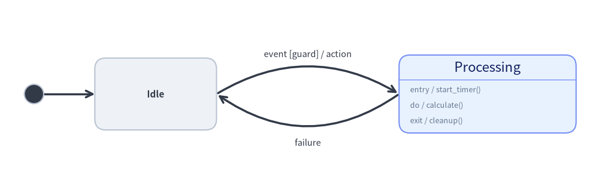
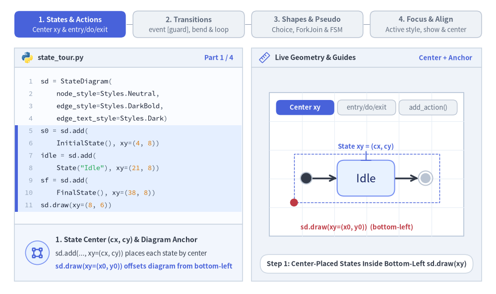
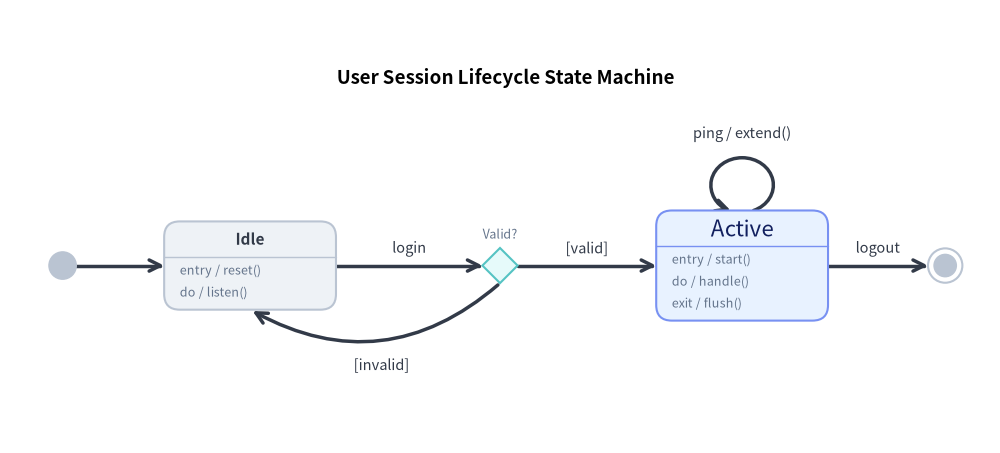
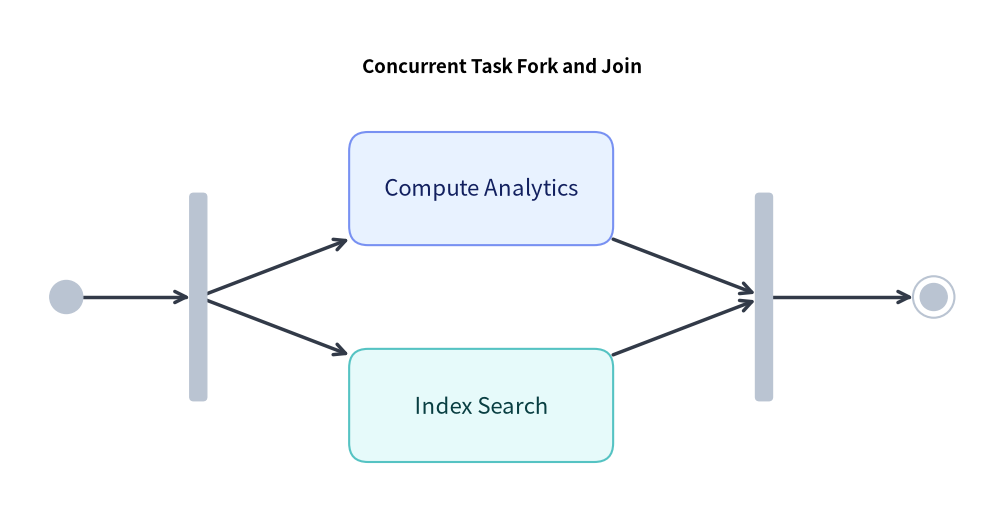
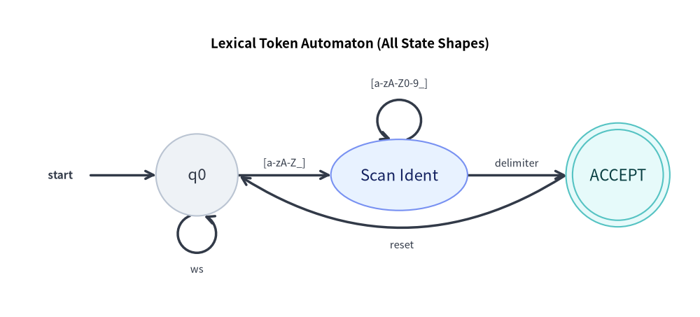

# StateDiagram: UML Statecharts, Automata & Transitions

`StateDiagram` models behavioral state transitions, Finite State Machines (FSM), and UML 2.0 Statecharts. It provides dedicated pseudo-states, internal action compartments (`entry`, `do`, `exit`), and curved arc transitions.


<figure class="drawlib-image" style="text-align: center;">
  
  <figcaption class="drawlib-caption">StateDiagram Anatomy: Initial State, Action Compartments, and Bidirectional Arcs</figcaption>
</figure>

<details class="drawlib-code-details">
<summary>Source Code</summary>

```python
from drawlib.canvas import save, setup
from drawlib.diagrams.state import InitialState, State, StateDiagram
from drawlib.styles import Styles

setup(width=108, height=34)

sd = StateDiagram(
    node_style=Styles.Neutral,
    edge_style=Styles.DarkBold,
    edge_text_style=Styles.Dark.patch(text_size=10.5),
)

init = sd.add(InitialState(style=Styles.Dark), xy=(6.0, 17.0))
idle = sd.add(State("Idle", shape="box", width=22.0, height=13.0), xy=(28.0, 17.0))
proc = sd.add(
    State(
        "Processing",
        shape="box",
        entry="start_timer()",
        do="calculate()",
        exit="cleanup()",
        width=32.0,
        style=Styles.PrimaryNeutral,
    ),
    xy=(88.0, 17.0),
)

sd.connect(init, idle)
sd.connect(
    idle,
    proc,
    event="event",
    guard="guard",
    action="action",
    bend=-0.30,
    start_side="top_right",
    end_side="top_left",
)
sd.connect(
    proc,
    idle,
    event="failure",
    bend=-0.35,
    start_side="bottom_left",
    end_side="bottom_right",
    text_style=Styles.Dark.patch(text_size=10.5, valign="top"),
)

sd.draw(xy=(0.0, 0.0))
save()
```

</details>


---

## 1. Core Concepts & Basic Usage

`StateDiagram` places states (`State`) and UML pseudo-states (`InitialState`, `FinalState`, `ChoiceState`, `ForkJoinState`) by their **Center `(cx, cy)`** coordinates inside a container anchored at **Bottom-Left `(x0, y0)`** (or `align="center"`). `State` cards support automatic UML action compartments (`entry`, `do`, `exit`, `.add_action()`), while `sd.connect(...)` formats `event [guard] / action` labels, curved `bend` arcs, and self-transition loops:


<figure class="drawlib-image" style="text-align: center;">
  
  <figcaption class="drawlib-caption">Basic Usage & Parameter Tour: State Anchors & Compartments, Transitions & Curved Arcs, Shapes & Pseudo-States, and Visibility & Center Align (APNG Animation)</figcaption>
</figure>

<details class="drawlib-code-details">
<summary>Source Code</summary>

```python
from __future__ import annotations

from drawlib.anim import Animation
from drawlib.canvas import save, setup
from drawlib.diagrams.state import (
    ChoiceState,
    FinalState,
    ForkJoinState,
    InitialState,
    State,
    StateDiagram,
)
from drawlib.icons import code as code_icons
from drawlib.icons import phosphor
from drawlib.lines import line
from drawlib.shapes import circle, rectangle
from drawlib.smartarts import SourceCode, SourceCodeStyles
from drawlib.styles import Colors, Styles
from drawlib.text import text

W, H = 138.0, 82.0
setup(width=W, height=H)
anim = Animation(fps=10.0, loop=0)

CODE_TEXT_SIZE = 10.0
PT_TO_CANVAS = W / 720.0
FONT_CANVAS = CODE_TEXT_SIZE * PT_TO_CANVAS
LINE_H = FONT_CANVAS * 1.8
PAD_Y = FONT_CANVAS * 1.2

CODE_STYLES = SourceCodeStyles.get("default", font_lang="en", text_size=CODE_TEXT_SIZE).patch(
    box_style=Styles.Neutral.patch(shape_fill_color=(0, 0, 0, 0), shape_line_width=0),
)

PANE_HEADER = Styles.Neutral.patch(
    shape_fill_color=(238, 243, 250),
    shape_line_color=(203, 213, 225),
    shape_line_width=1.2,
    shape_r=0.0,
)
EDITOR_BODY = Styles.Neutral.patch(
    shape_fill_color=(250, 252, 255),
    shape_line_color=(203, 213, 225),
    shape_line_width=1.2,
    shape_r=0.0,
)
TAKEAWAY_BODY = Styles.Neutral.patch(
    shape_fill_color=(242, 246, 253),
    shape_line_color=(203, 213, 225),
    shape_line_width=1.2,
    shape_r=0.0,
)
STUDIO_BODY = Styles.Neutral.patch(
    shape_fill_color=(239, 243, 249),
    shape_line_color=(203, 213, 225),
    shape_line_width=1.2,
    shape_r=0.0,
)

PART_ITEMS = [
    ("1. States & Actions", "Center xy & entry/do/exit"),
    ("2. Transitions", "event [guard], bend & loop"),
    ("3. Shapes & Pseudo", "Choice, ForkJoin & FSM"),
    ("4. Focus & Align", "Active style, show & center"),
]


def draw_step_bar(active_part: int) -> None:
    """Draw top 4-part progress bar (active_part is 1..4)."""
    pill_w = 31.0
    pill_h = 7.4
    gap = 2.0
    start_x = 4.0 + pill_w / 2.0
    cy = 75.2

    for idx, (label, sublabel) in enumerate(PART_ITEMS, start=1):
        cx = start_x + (idx - 1) * (pill_w + gap)
        if idx > 1:
            prev_cx = cx - (pill_w + gap)
            line(
                (prev_cx + pill_w / 2.0 + 0.2, cy),
                (cx - pill_w / 2.0 - 0.2, cy),
                style=Styles.PrimaryBold if idx <= active_part else Styles.MutedThin,
            )

        if idx == active_part:
            st = Styles.PrimaryFlat.patch(shape_r=1.4)
            tst = Styles.WhiteBold.patch(text_size=10.3)
            sub_tst = Styles.White.patch(text_size=9.5)
        elif idx < active_part:
            st = Styles.PrimaryNeutral.patch(shape_r=1.4, shape_line_width=1.1)
            tst = Styles.PrimaryBold.patch(text_size=10.3)
            sub_tst = Styles.Primary.patch(text_size=9.5)
        else:
            st = Styles.Neutral.patch(shape_r=1.4, shape_line_width=1.1)
            tst = Styles.MutedBold.patch(text_size=10.3)
            sub_tst = Styles.Muted.patch(text_size=9.5)

        rectangle((cx, cy), width=pill_w, height=pill_h, style=st)
        text((cx, cy + 1.35), label, style=tst)
        text((cx, cy - 1.55), sublabel, style=sub_tst)


def draw_left_pane(
    active_part: int,
    code_lines: list[str],
    hl_range: tuple[int, int],
    icon_fn: object,
    summary_title: str,
    summary_line1: str,
    summary_line2: str,
) -> None:
    """Draw left Python code editor + bottom concept takeaway card."""
    x0, w = 4.0, 63.5
    cx = x0 + w / 2.0
    top_y = 63.2
    header_h = 5.4
    editor_h = 43.8
    takeaway_h = 15.8

    rectangle((cx, top_y + header_h / 2.0), width=w, height=header_h, style=PANE_HEADER)
    code_icons.python((x0 + 3.6, top_y + header_h / 2.0), width=3.4, style=Styles.Neutral)
    text(
        (x0 + 6.5, top_y + header_h / 2.0),
        "state_tour.py",
        style=Styles.DarkBold.patch(text_size=10.2, halign="left"),
    )
    text(
        (x0 + w - 2.6, top_y + header_h / 2.0),
        f"Part {active_part} / 4",
        style=Styles.PrimaryBold.patch(text_size=9.8, halign="right"),
    )

    rectangle((cx, top_y - editor_h / 2.0), width=w, height=editor_h, style=EDITOR_BODY)

    hl_start, hl_end = hl_range
    hl_top = top_y - PAD_Y - hl_start * LINE_H
    hl_bot = top_y - PAD_Y - (hl_end + 1) * LINE_H
    hl_cy = (hl_top + hl_bot) / 2.0
    hl_h = hl_top - hl_bot
    rectangle(
        (cx, hl_cy),
        width=w - 0.6,
        height=hl_h,
        style=Styles.Neutral.patch(shape_fill_color=(229, 239, 255), shape_line_width=0),
    )
    rectangle(
        (x0 + 0.55, hl_cy),
        width=0.9,
        height=hl_h,
        style=Styles.PrimaryFlat.patch(shape_line_width=0),
    )

    SourceCode.draw(
        xy=(x0, top_y),
        width=w,
        code="\n".join(code_lines),
        styles=CODE_STYLES,
        code_lang="python",
        show_linenum=True,
        align="top_left",
    )

    take_cy = 3.6 + takeaway_h / 2.0
    rectangle((cx, take_cy), width=w, height=takeaway_h, style=TAKEAWAY_BODY)
    circle(
        (x0 + 6.4, take_cy),
        radius=3.3,
        style=Styles.PrimaryNeutral.patch(shape_line_width=1.2),
    )
    icon_fn((x0 + 6.4, take_cy), width=3.8, style=Styles.PrimaryBold)  # type: ignore[operator]
    text(
        (x0 + 11.4, take_cy + 3.6),
        summary_title,
        style=Styles.DarkBold.patch(text_size=10.4, halign="left"),
    )
    text(
        (x0 + 11.4, take_cy - 0.2),
        summary_line1,
        style=Styles.Dark.patch(text_size=9.7, halign="left"),
    )
    text(
        (x0 + 11.4, take_cy - 3.8),
        summary_line2,
        style=Styles.PrimaryBold.patch(text_size=9.6, halign="left"),
    )


def draw_geometry_studio(param_badge: str, footer_caption: str) -> tuple[float, float]:
    """Draw right geometry lab shell, inner coordinate sheet with subtle grid, and footer."""
    x0, w = 70.0, 64.0
    cx = x0 + w / 2.0
    top_y = 63.2
    header_h = 5.4
    body_h = 59.6

    rectangle((cx, top_y + header_h / 2.0), width=w, height=header_h, style=PANE_HEADER)
    phosphor.ruler((x0 + 3.6, top_y + header_h / 2.0), width=3.4, style=Styles.Primary)
    text(
        (x0 + 6.5, top_y + header_h / 2.0),
        "Live Geometry & Guides",
        style=Styles.DarkBold.patch(text_size=10.2, halign="left"),
    )
    text(
        (x0 + w - 2.6, top_y + header_h / 2.0),
        param_badge,
        style=Styles.PrimaryBold.patch(text_size=9.6, halign="right"),
    )

    rectangle((cx, 3.6 + body_h / 2.0), width=w, height=body_h, style=STUDIO_BODY)

    sheet_cx, sheet_cy = cx, 36.2
    sheet_w, sheet_h = 54.0, 40.0
    sx0, sy0 = sheet_cx - sheet_w / 2.0, sheet_cy - sheet_h / 2.0
    rectangle(
        (sheet_cx, sheet_cy),
        width=sheet_w,
        height=sheet_h,
        style=Styles.Neutral.patch(
            shape_fill_color=(255, 255, 255),
            shape_line_color=(180, 194, 214),
            shape_line_width=1.2,
        ),
    )
    g_st = Styles.MutedThin.patch(line_color=(232, 238, 246), line_width=0.8)
    for gx in range(1, 6):
        vx = sx0 + gx * (sheet_w / 6.0)
        line((vx, sy0), (vx, sy0 + sheet_h), style=g_st)
    for gy in range(1, 5):
        vy = sy0 + gy * (sheet_h / 5.0)
        line((sx0, vy), (sx0 + sheet_w, vy), style=g_st)

    rectangle(
        (cx, 8.4),
        width=59.2,
        height=5.2,
        style=Styles.Neutral.patch(
            shape_fill_color=(255, 255, 255),
            shape_line_color=(203, 213, 225),
            shape_line_width=1.1,
            shape_r=2.4,
        ),
        text=footer_caption,
        text_style=Styles.DarkBold.patch(text_size=9.8),
    )
    return sheet_cx, sheet_cy


def draw_sub_pills(scx: float, labels: list[str], active_idx: int) -> None:
    """Draw 3-step tracker pills near the top of the studio sheet."""
    pw, ph, pgap = 16.2, 4.2, 0.9
    p_start = scx - (3 * pw + 2 * pgap) / 2.0 + pw / 2.0
    for idx, lbl in enumerate(labels):
        px = p_start + idx * (pw + pgap)
        if idx == active_idx:
            pst = Styles.PrimaryFlat.patch(shape_r=1.2)
            ptst = Styles.WhiteBold.patch(text_size=9.5)
        elif idx < active_idx:
            pst = Styles.PrimaryNeutral.patch(shape_r=1.2, shape_line_width=1.0)
            ptst = Styles.PrimaryBold.patch(text_size=9.5)
        else:
            pst = Styles.Neutral.patch(shape_r=1.2, shape_line_width=1.0)
            ptst = Styles.Muted.patch(text_size=9.5)
        rectangle((px, 52.0), width=pw, height=ph, style=pst, text=lbl, text_style=ptst)


EDGE_TXT = Styles.Dark.patch(text_size=9.8)

# =========================================================================
# Part 1: States & Actions — Center xy, entry/do/exit & add_action()
# =========================================================================
PART1_STATES = [
    (
        "basic_anchors",
        3.3,
        [
            "sd = StateDiagram(",
            "    node_style=Styles.Neutral,",
            "    edge_style=Styles.DarkBold,",
            "    edge_text_style=Styles.Dark)",
            "s0 = sd.add(",
            "    InitialState(), xy=(4, 8))",
            "idle = sd.add(",
            '    State("Idle"), xy=(21, 8))',
            "sf = sd.add(",
            "    FinalState(), xy=(38, 8))",
            "sd.draw(xy=(8, 6))",
        ],
        (4, 10),
        "Center + Anchor",
        "Step 1: Center-Placed States Inside Bottom-Left sd.draw(xy)",
        "1. State Center (cx, cy) & Diagram Anchor",
        "sd.add(..., xy=(cx, cy)) places each state by center",
        "sd.draw(xy=(x0, y0)) offsets diagram from bottom-left",
    ),
    (
        "entry_do_exit",
        3.3,
        [
            "sd = StateDiagram(...)",
            "s0 = sd.add(",
            "    InitialState(), xy=(4, 10))",
            "run = sd.add(",
            "    State(",
            '        "Running",',
            '        entry="init()",',
            '        do="work()",',
            '        exit="stop()"),',
            "    xy=(23, 10))",
            'sd.connect(s0, run, event="run")',
        ],
        (3, 9),
        "entry / do / exit",
        "Step 2: UML Action Compartment (entry, do, exit)",
        "2. UML Internal Action Compartment",
        "Adds header divider & formats entry / do / exit rows",
        "Card height auto-expands to fit internal triggers",
    ),
    (
        "add_action",
        3.5,
        [
            "sd = StateDiagram(...)",
            "run = sd.add(",
            "    State(",
            '        "Running",',
            '        entry="init()",',
            '        do="work()",',
            '        exit="stop()"),',
            "    xy=(23, 11))",
            "# Append custom internal trigger",
            "run.add_action(",
            '    "timeout", "retry()")',
        ],
        (8, 10),
        "add_action()",
        'Step 3: Custom Trigger Row via .add_action("timeout", ...)',
        "3. Custom Internal Triggers (.add_action)",
        "Appends '{kind} / {action}' rows below standard ones",
        "Fluent method returns self for clean chaining",
    ),
]

for p1_idx, (p1_mode, dur, code_1, hl_rng, badge_txt, foot_txt, s_t, s_1, s_2) in enumerate(PART1_STATES):
    with anim.frame(duration=dur):
        draw_step_bar(1)
        draw_left_pane(1, code_1, hl_rng, phosphor.bounding_box, s_t, s_1, s_2)
        scx, scy = draw_geometry_studio(badge_txt, foot_txt)
        draw_sub_pills(scx, ["Center xy", "entry/do/exit", "add_action()"], p1_idx)

        if p1_mode == "basic_anchors":
            sd = StateDiagram(
                node_style=Styles.Neutral,
                edge_style=Styles.DarkBold,
                edge_text_style=EDGE_TXT,
                margin=1.8,
            )
            s0 = sd.add(InitialState(radius=1.6, style=Styles.Dark), xy=(3.4, 6.8))
            idle = sd.add(State("Idle", width=16.0, height=10.0, style=Styles.PrimaryNeutral), xy=(20.0, 6.8))
            sf = sd.add(FinalState(radius=2.0), xy=(36.6, 6.8))
            sd.connect(s0, idle)
            sd.connect(idle, sf)

            dx0, dy0 = 81.8, 25.5
            sd.draw(xy=(dx0, dy0))
            min_x, min_y, max_x, max_y = sd.get_bounds()
            c_min_x, c_max_x = dx0 + min_x - sd.margin, dx0 + max_x + sd.margin
            c_min_y, c_max_y = dy0 + min_y - sd.margin, dy0 + max_y + sd.margin
            rectangle(
                (0.5 * (c_min_x + c_max_x), 0.5 * (c_min_y + c_max_y)),
                width=c_max_x - c_min_x,
                height=c_max_y - c_min_y,
                style=Styles.PrimaryDashed.patch(shape_fill_color=(0, 0, 0, 0), shape_line_width=1.0),
            )
            # Center crosshair on Idle state
            icx, icy = dx0 + 20.0, dy0 + 6.8
            line((icx, icy + 5.0), (icx, icy + 7.4), style=Styles.PrimaryBold.patch(line_width=1.3))
            line((icx - 1.4, icy + 5.0), (icx + 1.4, icy + 5.0), style=Styles.PrimaryBold.patch(line_width=1.3))
            text(
                (icx, icy + 8.8),
                "State xy = (cx, cy)",
                style=Styles.PrimaryBold.patch(text_size=9.5),
            )
            # Red bottom-left dot on sd.draw(xy=(x0, y0))
            circle((c_min_x, c_min_y), radius=1.1, style=Styles.DangerFlat)
            text(
                (c_min_x + 1.8, 18.6),
                "sd.draw(xy=(x0, y0))  (bottom-left)",
                style=Styles.DangerBold.patch(text_size=9.5, halign="left"),
            )
        elif p1_mode == "entry_do_exit":
            sd = StateDiagram(
                node_style=Styles.Neutral,
                edge_style=Styles.DarkBold,
                edge_text_style=EDGE_TXT,
                margin=1.5,
            )
            s0 = sd.add(InitialState(radius=1.6, style=Styles.Dark), xy=(3.0, 9.0))
            run = sd.add(
                State(
                    "Running",
                    entry="init()",
                    do="work()",
                    exit="stop()",
                    width=22.5,
                    style=Styles.PrimaryNeutral,
                ),
                xy=(21.5, 9.0),
            )
            sf = sd.add(FinalState(radius=1.9), xy=(40.0, 9.0))
            sd.connect(s0, run, event="run")
            sd.connect(run, sf, event="done")
            sd.draw(xy=(80.5, 25.0))
            text(
                (scx, 18.4),
                "header divider + auto-sized entry / do / exit rows",
                style=Styles.PrimaryBold.patch(text_size=9.5),
            )
        else:
            sd = StateDiagram(
                node_style=Styles.Neutral,
                edge_style=Styles.DarkBold,
                edge_text_style=EDGE_TXT,
                margin=1.5,
            )
            s0 = sd.add(InitialState(radius=1.6, style=Styles.Dark), xy=(3.0, 10.0))
            run = sd.add(
                State(
                    "Running",
                    entry="init()",
                    do="work()",
                    exit="stop()",
                    width=24.0,
                    style=Styles.PrimaryNeutral,
                ),
                xy=(21.0, 10.0),
            )
            run.add_action("timeout", "retry()")
            sf = sd.add(FinalState(radius=1.9), xy=(39.5, 10.0))
            sd.connect(s0, run)
            sd.connect(run, sf)
            dx0, dy0 = 79.5, 24.2
            sd.draw(xy=(dx0, dy0))
            # Point to 4th custom row at bottom of compartment
            row4_y = dy0 + 10.0 + run.effective_height / 2.0 - 4.5 - 1.8 - 3 * 2.8
            line(
                (dx0 + 21.0 + 12.6, row4_y),
                (dx0 + 21.0 + 16.0, row4_y),
                arrow_head="<-",
                style=Styles.DangerBold.patch(line_width=1.2),
            )
            text(
                (dx0 + 21.0 + 16.5, row4_y),
                "+ custom",
                style=Styles.DangerBold.patch(text_size=9.5, halign="left"),
            )
            text(
                (scx, 18.4),
                'add_action("timeout", "retry()") -> "timeout / retry()"',
                style=Styles.PrimaryBold.patch(text_size=9.5),
            )

# =========================================================================
# Part 2: Transitions — event [guard] / action, curved bend & self-loop
# =========================================================================
PART2_STATES = [
    (
        "uml_label",
        3.3,
        [
            "sd = StateDiagram(...)",
            "idle = sd.add(",
            '    State("Idle", width=13),',
            "    xy=(8, 10))",
            "run = sd.add(",
            '    State("Running", width=15),',
            "    xy=(40, 10))",
            "sd.connect(",
            "    idle, run,",
            '    event="start", guard="ready",',
            '    action="boot()")',
        ],
        (7, 10),
        "event [guard]",
        'Step 1: Auto-Formatted "start [ready] / boot()" Label',
        "1. UML Transition Syntax (event, guard, action)",
        "Formats cleanly as 'event [guard] / action'",
        "Any subset of event, guard, or action works cleanly",
    ),
    (
        "curved_bend",
        3.3,
        [
            "sd.connect(",
            "    idle, active,",
            '    event="login", bend=-0.28,',
            '    start_side="top_right",',
            '    end_side="top_left")',
            "sd.connect(",
            "    active, idle,",
            '    event="logout", bend=-0.28,',
            '    start_side="bottom_left",',
            '    end_side="bottom_right")',
            "sd.draw(xy=(6, 6))",
        ],
        (0, 9),
        "bend = -0.28",
        "Step 2: Opposing Curved Arcs via bend & Diagonal Sides",
        "2. Bidirectional Curved Arcs (bend = -0.28)",
        "Separates forward & return transitions cleanly",
        "8 anchor sides: top_right, bottom_left, etc.",
    ),
    (
        "self_loop",
        3.5,
        [
            "sd = StateDiagram(...)",
            "idle = sd.add(",
            '    State("Idle"), xy=(10, 8))',
            "run = sd.add(",
            '    State("Running"), xy=(35, 8))',
            'sd.connect(idle, run, event="go")',
            "# Self-loop on top boundary",
            "sd.connect(",
            "    run, run,",
            '    event="tick", side="top")',
            "sd.draw(xy=(6, 6))",
        ],
        (6, 9),
        'side="top" loop',
        'Step 3: Self-Transition Loop via sd.connect(run, run, ...)',
        "3. Self-Transition Loop (source is target)",
        "Attaches elliptical loop to top/bottom/left/right",
        "Tune loop_width, loop_height & loop_ratio freely",
    ),
]

for p2_idx, (p2_mode, dur, code_2, hl_rng, badge_txt, foot_txt, s_t, s_1, s_2) in enumerate(PART2_STATES):
    with anim.frame(duration=dur):
        draw_step_bar(2)
        draw_left_pane(2, code_2, hl_rng, phosphor.arrow_bend_up_right, s_t, s_1, s_2)
        scx, scy = draw_geometry_studio(badge_txt, foot_txt)
        draw_sub_pills(scx, ["event [guard]", "bend = -0.28", "Self-Loop"], p2_idx)

        if p2_mode == "uml_label":
            sd = StateDiagram(
                node_style=Styles.Neutral,
                edge_style=Styles.PrimaryBold,
                edge_text_style=Styles.PrimaryBold.patch(text_size=9.6),
                margin=1.5,
            )
            idle = sd.add(State("Idle", width=11.8, height=9.2), xy=(6.5, 9.0))
            run = sd.add(State("Running", width=13.6, height=9.2, style=Styles.PrimaryNeutral), xy=(38.8, 9.0))
            sd.connect(idle, run, event="start", guard="ready", action="boot()")
            sd.draw(xy=(79.2, 24.5))
            text(
                (scx, 18.4),
                'event="start", guard="ready", action="boot()"',
                style=Styles.DarkBold.patch(text_size=9.5),
            )
        elif p2_mode == "curved_bend":
            sd = StateDiagram(
                node_style=Styles.Neutral,
                edge_style=Styles.DarkBold,
                edge_text_style=Styles.DarkBold.patch(text_size=9.8),
                margin=1.5,
            )
            idle = sd.add(State("Idle", width=13.5, height=9.5), xy=(8.0, 10.0))
            active = sd.add(State("Active", width=14.5, height=9.5, style=Styles.PrimaryNeutral), xy=(36.0, 10.0))
            sd.connect(
                idle,
                active,
                event="login",
                bend=-0.28,
                start_side="top_right",
                end_side="top_left",
                style=Styles.PrimaryBold,
                text_style=Styles.PrimaryBold.patch(text_size=9.8),
            )
            sd.connect(
                active,
                idle,
                event="logout",
                bend=-0.28,
                start_side="bottom_left",
                end_side="bottom_right",
                text_style=Styles.DarkBold.patch(text_size=9.8, valign="top"),
            )
            sd.draw(xy=(80.0, 24.2))
            text(
                (scx, 18.2),
                "top_right -> top_left  &  bottom_left -> bottom_right",
                style=Styles.PrimaryBold.patch(text_size=9.5),
            )
        else:
            sd = StateDiagram(
                node_style=Styles.Neutral,
                edge_style=Styles.DarkBold,
                edge_text_style=Styles.DarkBold.patch(text_size=9.8),
                margin=1.5,
            )
            idle = sd.add(State("Idle", width=13.5, height=9.0), xy=(8.5, 6.5))
            run = sd.add(State("Running", width=16.0, height=9.0, style=Styles.PrimaryNeutral), xy=(33.5, 6.5))
            sd.connect(idle, run, event="go")
            sd.connect(
                run,
                run,
                event="tick",
                side="top",
                loop_width=7.2,
                loop_height=6.0,
                style=Styles.PrimaryBold,
                text_style=Styles.PrimaryBold.patch(text_size=9.8),
            )
            sd.draw(xy=(80.5, 23.8))
            text(
                (scx, 18.4),
                'sd.connect(run, run, event="tick", side="top")',
                style=Styles.PrimaryBold.patch(text_size=9.5),
            )

# =========================================================================
# Part 3: Shapes & Pseudo — ChoiceState, ForkJoinState & FSM Circles
# =========================================================================
PART3_STATES = [
    (
        "choice",
        3.3,
        [
            "req = sd.add(",
            '    State("Verify"), xy=(9, 12))',
            "ok = sd.add(",
            '    State("Ready"), xy=(40, 18))',
            "err = sd.add(",
            '    State("Denied"), xy=(40, 6))',
            "chk = sd.add(",
            "    ChoiceState(), xy=(24, 12))",
            "sd.connect(req, chk)",
            'sd.connect(chk, ok, guard="ok")',
            'sd.connect(chk, err, guard="err")',
        ],
        (6, 10),
        "ChoiceState",
        "Step 1: Dynamic Guard Branching via ChoiceState Diamond",
        "1. Choice Diamond Pseudo-State (ChoiceState)",
        "Evaluates mutually exclusive [ok] vs [err] guards",
        "Routes cleanly from top/bottom/right diamond tips",
    ),
    (
        "fork_join",
        3.3,
        [
            "fork = sd.add(ForkJoinState(",
            '    orientation="vertical",',
            "    length=15), xy=(11, 12))",
            "join = sd.add(ForkJoinState(",
            '    orientation="vertical",',
            "    length=15), xy=(41, 12))",
            "a = sd.add(",
            '    State("Audio"), xy=(26, 18))',
            "b = sd.add(",
            '    State("Video"), xy=(26, 6))',
            "sd.connect(fork, a)  # & join",
        ],
        (0, 5),
        "ForkJoinState",
        'Step 2: Concurrent Split & Join Bars (ForkJoinState)',
        "2. Concurrent Synchronization (ForkJoinState)",
        'Solid bar ("vertical" or "horizontal") splits threads',
        "Joins parallel sub-tasks before final completion",
    ),
    (
        "fsm_shapes",
        3.5,
        [
            "s0 = sd.add(State(",
            '    "start", shape="text_only"),',
            "    xy=(6, 12))",
            "q0 = sd.add(State(",
            '    "q0", shape="circle",',
            "    width=11), xy=(22, 12))",
            "q1 = sd.add(State(",
            '    "OK", shape="double_circle",',
            "    width=12), xy=(40, 12))",
            "sd.connect(s0, q0)",
            'sd.connect(q0, q1, label="eof")',
        ],
        (3, 8),
        "FSM Circles",
        'Step 3: Classic Automaton Shapes (circle & double_circle)',
        "3. All 5 State Geometric Shapes",
        "Supports box, ellipse, circle, double_circle, text_only",
        "double_circle marks classic FSM accepting states",
    ),
]

for p3_idx, (p3_mode, dur, code_3, hl_rng, badge_txt, foot_txt, s_t, s_1, s_2) in enumerate(PART3_STATES):
    with anim.frame(duration=dur):
        draw_step_bar(3)
        draw_left_pane(3, code_3, hl_rng, phosphor.git_fork, s_t, s_1, s_2)
        scx, scy = draw_geometry_studio(badge_txt, foot_txt)
        draw_sub_pills(scx, ["ChoiceState", "ForkJoinState", "FSM Shapes"], p3_idx)

        if p3_mode == "choice":
            sd = StateDiagram(
                node_style=Styles.Neutral,
                edge_style=Styles.DarkBold,
                edge_text_style=Styles.DarkBold.patch(text_size=9.5),
                margin=1.2,
            )
            req = sd.add(State("Verify", width=13.5, height=8.2), xy=(7.5, 11.5))
            chk = sd.add(ChoiceState(size=4.6, style=Styles.PrimaryNeutral), xy=(22.5, 11.5))
            ok = sd.add(State("Ready", width=14.0, height=7.8, style=Styles.PrimaryNeutral), xy=(39.0, 17.6))
            err = sd.add(State("Denied", width=14.0, height=7.8, style=Styles.SecondaryNeutral), xy=(39.0, 5.4))
            sd.connect(req, chk)
            sd.connect(
                chk,
                ok,
                guard="ok",
                start_side="top",
                end_side="left",
                bend=-0.18,
                style=Styles.PrimaryBold,
                text_style=Styles.PrimaryBold.patch(text_size=9.5),
            )
            sd.connect(
                chk,
                err,
                guard="err",
                start_side="bottom",
                end_side="left",
                bend=0.18,
                text_style=Styles.DarkBold.patch(text_size=9.5, valign="top"),
            )
            sd.draw(xy=(78.8, 22.8))
            text(
                (scx, 18.2),
                "ChoiceState diamond branches on [ok] vs [err]",
                style=Styles.PrimaryBold.patch(text_size=9.5),
            )
        elif p3_mode == "fork_join":
            sd = StateDiagram(
                node_style=Styles.Neutral,
                edge_style=Styles.DarkBold,
                edge_text_style=EDGE_TXT,
                margin=1.2,
            )
            s0 = sd.add(InitialState(radius=1.4, style=Styles.Dark), xy=(2.2, 11.5))
            fork = sd.add(ForkJoinState(orientation="vertical", length=15.0, thickness=1.6), xy=(9.5, 11.5))
            a = sd.add(State("Audio", width=14.5, height=7.4, style=Styles.PrimaryNeutral), xy=(24.0, 17.2))
            b = sd.add(State("Video", width=14.5, height=7.4, style=Styles.SecondaryNeutral), xy=(24.0, 5.8))
            join = sd.add(ForkJoinState(orientation="vertical", length=15.0, thickness=1.6), xy=(38.5, 11.5))
            sf = sd.add(FinalState(radius=1.7), xy=(45.8, 11.5))
            sd.connect(s0, fork)
            sd.connect(fork, a)
            sd.connect(fork, b)
            sd.connect(a, join)
            sd.connect(b, join)
            sd.connect(join, sf)
            sd.draw(xy=(78.0, 22.8))
            text(
                (scx, 18.2),
                'ForkJoinState(orientation="vertical") splits & joins',
                style=Styles.PrimaryBold.patch(text_size=9.5),
            )
        else:
            sd = StateDiagram(
                node_style=Styles.Neutral,
                edge_style=Styles.DarkBold,
                edge_text_style=Styles.DarkBold.patch(text_size=9.6),
                margin=1.2,
            )
            s0 = sd.add(State("start", shape="text_only", width=9.0, height=6.0), xy=(5.0, 8.0))
            q0 = sd.add(State("q0", shape="circle", width=10.5, style=Styles.Neutral), xy=(20.5, 8.0))
            q1 = sd.add(
                State("OK", shape="double_circle", width=12.0, style=Styles.PrimaryNeutral),
                xy=(39.0, 8.0),
            )
            sd.connect(s0, q0)
            sd.connect(q0, q0, label="0..9", side="top", loop_width=5.6, loop_height=5.2)
            sd.connect(q0, q1, label="eof", style=Styles.PrimaryBold)
            sd.draw(xy=(79.0, 24.5))
            text(
                (scx, 18.2),
                'text_only -> circle ("q0") -> double_circle ("OK")',
                style=Styles.PrimaryBold.patch(text_size=9.5),
            )

# =========================================================================
# Part 4: Focus & Align — Active State Focus, show=False & align="center"
# =========================================================================
PART4_STATES = [
    (
        "active_focus",
        3.3,
        [
            'idle = sd.add(State("Idle"),',
            "    xy=(9, 12))",
            "st = Styles.PrimaryFlat.patch(",
            "    text_color=Colors.White)",
            "active = sd.add(State(",
            '    "Active", style=st),',
            "    xy=(26, 12))",
            'done = sd.add(State("Done"),',
            "    xy=(43, 12))",
            "sd.connect(idle, active)",
            "sd.connect(active, done)",
        ],
        (2, 6),
        "PrimaryFlat",
        "Step 1: Highlight Current Active State (50%+ Neutral Rule)",
        "1. Focal State Highlight (PrimaryFlat)",
        "Grounds sibling states in calm Styles.Neutral (67%)",
        "Reserves saturated PrimaryFlat for active execution",
    ),
    (
        "show_false",
        3.3,
        [
            "idle = sd.add(",
            '    State("Idle"), xy=(9, 12))',
            "active = sd.add(",
            '    State("Active"), xy=(26, 12))',
            "# Hide state & incoming edge;",
            "# diagram bounds stay locked!",
            "done = sd.add(",
            '    State("Done", show=False),',
            "    xy=(43, 12))",
            "sd.connect(idle, active)",
            "sd.connect(active, done)",
        ],
        (4, 8),
        "show=False",
        "Step 2: Hide State & Connected Edges Without Layout Jump",
        "2. Bounds-Locked Visibility (show=False)",
        "Connected transitions auto-hide when endpoint hides",
        "sd.get_bounds() stays fixed for jitter-free traces",
    ),
    (
        "center_align",
        3.5,
        [
            "s0 = sd.add(",
            "    InitialState(), xy=(10, 4))",
            "idle = sd.add(",
            '    State("Idle"), xy=(10, 16))',
            "act = sd.add(",
            '    State("Active"), xy=(35, 16))',
            "done = sd.add(",
            '    State("Done"), xy=(35, 4))',
            "sd.connect(s0, idle)  # + chain",
            "sd.draw(",
            '    xy=(34, 24), align="center")',
        ],
        (9, 10),
        'align="center"',
        'Step 3: Center Diagram Bounds on xy=(cx, cy)',
        '3. Centered Placement (align="center")',
        "Centers enclosing state bounds cleanly on xy",
        "Pairs naturally with centered slide & Studio layouts",
    ),
]

for p4_idx, (p4_mode, dur, code_4, hl_rng, badge_txt, foot_txt, s_t, s_1, s_2) in enumerate(PART4_STATES):
    with anim.frame(duration=dur):
        draw_step_bar(4)
        draw_left_pane(4, code_4, hl_rng, phosphor.crosshair, s_t, s_1, s_2)
        scx, scy = draw_geometry_studio(badge_txt, foot_txt)
        draw_sub_pills(scx, ["Active Focus", "show=False", 'align="center"'], p4_idx)

        if p4_mode == "active_focus":
            sd = StateDiagram(
                node_style=Styles.Neutral,
                edge_style=Styles.DarkBold,
                edge_text_style=EDGE_TXT,
                margin=1.6,
            )
            idle = sd.add(State("Idle", width=11.8, height=9.0, style=Styles.Neutral), xy=(7.5, 8.5))
            active = sd.add(
                State(
                    "Active",
                    width=12.6,
                    height=9.0,
                    style=Styles.PrimaryFlat.patch(text_color=Colors.White),
                ),
                xy=(23.5, 8.5),
            )
            done = sd.add(State("Done", width=11.8, height=9.0, style=Styles.Neutral), xy=(39.5, 8.5))
            sd.connect(idle, active, style=Styles.PrimaryBold)
            sd.connect(active, done)
            sd.draw(xy=(78.5, 25.0))
            text(
                (scx, 18.4),
                "2/3 Neutral baseline  +  1 PrimaryFlat focal state",
                style=Styles.PrimaryBold.patch(text_size=9.5),
            )
        elif p4_mode == "show_false":
            sd = StateDiagram(
                node_style=Styles.Neutral,
                edge_style=Styles.DarkBold,
                edge_text_style=EDGE_TXT,
                margin=1.6,
            )
            idle = sd.add(State("Idle", width=11.8, height=9.0, style=Styles.Neutral), xy=(7.5, 8.5))
            active = sd.add(
                State("Active", width=12.6, height=9.0, style=Styles.PrimaryNeutral),
                xy=(23.5, 8.5),
            )
            done = sd.add(State("Done", width=11.8, height=9.0, show=False), xy=(39.5, 8.5))
            sd.connect(idle, active, style=Styles.PrimaryBold)
            sd.connect(active, done)

            dx0, dy0 = 78.5, 25.0
            sd.draw(xy=(dx0, dy0))
            min_x, min_y, max_x, max_y = sd.get_bounds()
            c_min_x, c_max_x = dx0 + min_x - sd.margin, dx0 + max_x + sd.margin
            c_min_y, c_max_y = dy0 + min_y - sd.margin, dy0 + max_y + sd.margin
            rectangle(
                (0.5 * (c_min_x + c_max_x), 0.5 * (c_min_y + c_max_y)),
                width=c_max_x - c_min_x,
                height=c_max_y - c_min_y,
                style=Styles.PrimaryDashed.patch(shape_fill_color=(0, 0, 0, 0), shape_line_width=1.0),
            )
            # Ghost indicator where Done + edge auto-hid
            rectangle(
                (dx0 + 39.5, dy0 + 8.5),
                width=11.8,
                height=9.0,
                style=Styles.MutedDashed.patch(shape_fill_color=(248, 250, 252), shape_r=2.0),
                text="hidden",
                text_style=Styles.Muted.patch(text_size=9.5),
            )
            text(
                (scx, 18.4),
                "Done & incoming edge hidden  •  bounds stay locked!",
                style=Styles.PrimaryBold.patch(text_size=9.5),
            )
        else:
            sd = StateDiagram(
                node_style=Styles.Neutral,
                edge_style=Styles.DarkBold,
                edge_text_style=EDGE_TXT,
                margin=1.5,
            )
            s0 = sd.add(InitialState(radius=1.5, style=Styles.Dark), xy=(10.0, 3.8))
            idle = sd.add(State("Idle", width=13.5, height=7.6, style=Styles.Neutral), xy=(10.0, 15.2))
            active = sd.add(State("Active", width=14.0, height=7.6, style=Styles.PrimaryNeutral), xy=(34.5, 15.2))
            done = sd.add(State("Done", width=13.5, height=7.6, style=Styles.SecondaryNeutral), xy=(34.5, 3.8))
            sd.connect(s0, idle)
            sd.connect(idle, active, style=Styles.PrimaryBold)
            sd.connect(active, done)

            cx_a, cy_a = scx, 34.5
            dw, dh = sd.get_size()
            sd.draw(xy=(cx_a, cy_a), align="center")

            rectangle(
                (cx_a, cy_a),
                width=dw,
                height=dh,
                style=Styles.PrimaryDashed.patch(shape_fill_color=(0, 0, 0, 0), shape_line_width=1.3),
            )
            line((cx_a - dw / 2.0 - 2.2, cy_a), (cx_a - dw / 2.0, cy_a), style=Styles.DangerBold.patch(line_width=1.5))
            line((cx_a + dw / 2.0, cy_a), (cx_a + dw / 2.0 + 2.2, cy_a), style=Styles.DangerBold.patch(line_width=1.5))
            line((cx_a, cy_a + dh / 2.0), (cx_a, cy_a + dh / 2.0 + 2.1), style=Styles.DangerBold.patch(line_width=1.5))
            line((cx_a, cy_a - dh / 2.0 - 2.1), (cx_a, cy_a - dh / 2.0), style=Styles.DangerBold.patch(line_width=1.5))
            circle(
                (cx_a, cy_a),
                radius=1.6,
                style=Styles.Neutral.patch(shape_fill_color=(255, 255, 255), shape_line_width=0),
            )
            circle((cx_a, cy_a), radius=1.15, style=Styles.DangerFlat)
            text(
                (cx_a, 18.2),
                'xy = (cx, cy)  •  align="center"',
                style=Styles.DangerBold.patch(text_size=9.5),
            )

save()
```

</details>


- **5 State Shapes & Center Placement (`State`, `xy=(cx, cy)`)**: States register by center `(cx, cy)` inside `sd.draw(xy)` and support `"box"` (rounded card), `"ellipse"`, `"circle"`, `"double_circle"` (FSM accepting state), and `"text_only"`.
- **UML Action Compartments (`entry`, `do`, `exit`, `.add_action()`)**: Box states with internal triggers automatically draw a header divider and expand vertically to list `entry / ...`, `do / ...`, `exit / ...`, and custom `.add_action(kind, action)` rows.
- **UML Pseudo-States (`InitialState`, `FinalState`, `ChoiceState`, `ForkJoinState`)**: Dedicated subclasses model start dots, bullseye terminations, conditional guard diamonds, and horizontal/vertical concurrent synchronization bars.
- **Transitions, Curved Arcs & Stable Reveal (`sd.connect`, `bend`, `show=False`)**: Automatically formats `event [guard] / action` labels, routes opposing curved arcs (`bend`) or self-loops (`side="top"`), and auto-hides connected arcs when `show=False` while keeping diagram bounds fixed.

---

## 2. Constructor, Core Classes & Parameter Reference

```python
from drawlib.diagrams.state import (
    ChoiceState,
    FinalState,
    ForkJoinState,
    InitialState,
    State,
    StateAction,
    StateDiagram,
    StateNodeBase,
    StateTransition,
)
from drawlib.styles import Styles

sd = StateDiagram(
    node_style=Styles.Neutral,
    edge_style=Styles.DarkBold,
    edge_text_style=Styles.Dark,
    title="Session Lifecycle State Machine",
)

# State with action compartments + custom action
active = sd.add(
    State("Active", shape="box", entry="start_heartbeat()", do="handle_requests()", exit="flush()", style=Styles.PrimaryNeutral),
    xy=(60.0, 40.0),
)
active.add_action("on_timeout", "warn_idle()")

# Transition with guard and action
init = sd.add(InitialState(), xy=(10.0, 40.0))
sd.connect(init, active, event="login", guard="token_valid", action="init_session()")
```

### Parameter Reference Tables

#### `StateDiagram` Class
| Parameter | Type | Default | Description |
|---|---|---|---|
| `node_style` | `Style` | *(Required)* | Base `Style` object for state nodes in the diagram. |
| `edge_style` | `Style` | *(Required)* | Base `Style` object for transition edges and arrowheads. |
| `edge_text_style` | `Style` | *(Required)* | Base `Style` object for transition labels. |
| `title` | `str` | `""` | Optional title displayed above the diagram. |
| `title_style` | `Style \| None` | `None` | Optional `Style` object for the diagram title. |
| `style` | `Style \| None` | `None` | Optional `Style` overriding the overall diagram background. |
| `width` | `float \| None` | `None` | Optional fixed canvas width (auto-calculated from content if `None`). |
| `height` | `float \| None` | `None` | Optional fixed canvas height (auto-calculated from content if `None`). |
| `margin` | `float` | `5.0` | Outer margin padding surrounding all states when auto-calculating size. |

#### `State` Class (inherits `StateNodeBase`)
| Parameter | Type | Default | Description |
|---|---|---|---|
| `name` | `str` | *(Required)* | State name / label text. |
| `shape` | `Literal["box", "ellipse", "circle", "double_circle", "text_only"]` | `"box"` | Geometric shape of the state node. |
| `entry` | `str` | `""` | Optional entry action rendered as `entry / <entry>` (`shape="box"`). |
| `do` | `str` | `""` | Optional ongoing activity rendered as `do / <do>` (`shape="box"`). |
| `exit` | `str` | `""` | Optional exit action rendered as `exit / <exit>` (`shape="box"`). |
| `width` | `float \| None` | `None` | Width (or diameter for `"circle"`/`"double_circle"`). Defaults: `"box"`=`22.0`, `"ellipse"`=`24.0`, `"circle"`/`"double_circle"`/`"text_only"`=`16.0`. |
| `height` | `float \| None` | `None` | Height of the state. Defaults: `"box"`=`12.0` (auto-expands for actions), `"ellipse"`=`13.0`, `"circle"`/`"double_circle"`=`width`, `"text_only"`=`8.0`. |
| `size` | `tuple[float, float] \| None` | `None` | Optional `(width, height)` shorthand tuple overriding `width` and `height`. |
| `style` | `Style \| None` | `None` | Optional `Style` override for border, fill, text color, and `shape_r`. |
| `show` | `bool` | `True` | Visibility flag (connected `StateTransition` arcs auto-hide when `False`). |

- **`state.add_action(kind: str, action: str) -> State`**: Appends a `StateAction(kind=kind, action=action)` (rendered as `{kind} / {action}`) to `state.actions` and returns `self`.

#### Pseudo-State Classes (`StateNodeBase` Subclasses)
| Class | Constructor Signature | Default Size | Description |
|---|---|---|---|
| `InitialState` | `InitialState(name="", radius=1.75, style=None, show=True)` | Diameter `3.5` | Solid filled circle marking the initial entry point. |
| `FinalState` | `FinalState(name="", radius=2.2, style=None, show=True)` | Diameter `4.4` | Concentric bullseye marking state machine completion. |
| `ChoiceState` | `ChoiceState(name="", size=4.5, style=None, show=True)` | `4.5 × 4.5` | Diamond pseudo-state for conditional guard evaluation. |
| `ForkJoinState` | `ForkJoinState(name="", orientation="horizontal"\|"vertical", length=16.0, thickness=1.8, style=None, show=True)` | `16.0 × 1.8` (or `1.8 × 16.0`) | Solid synchronization bar for concurrent fork/join transitions. |

#### `StateTransition` & `sd.connect(...)`
| Parameter | Type | Default | Description |
|---|---|---|---|
| `source` / `start` | `StateNodeBase` | *(Required)* | Originating state or pseudo-state (`source` in `sd.connect`, `start` in `StateTransition`). |
| `target` / `end` | `StateNodeBase` | *(Required)* | Destination state or pseudo-state (`target` in `sd.connect`, `end` in `StateTransition`). |
| `label` | `str` | `""` | Explicit full transition label (overrides `event`/`guard`/`action` if non-empty). |
| `event` | `str` | `""` | Trigger event name (e.g. `"login"`, `"timeout"`). |
| `guard` | `str` | `""` | Guard condition formatted as `[{guard}]`. |
| `action` | `str` | `""` | Transition effect formatted as `/ {action}`. |
| `bend` | `float` | `0.0` | Curvature amount for `"curved"` routing (`0.0` = straight, positive/negative curves outward). |
| `start_side` | `Side` | `"auto"` | Exit anchor (`"left"`, `"right"`, `"top"`, `"bottom"`, `"auto"`, `"top_left"`, `"top_right"`, `"bottom_left"`, `"bottom_right"`). |
| `end_side` | `Side` | `"auto"` | Entry anchor (supports all 8 cardinal/diagonal sides + `"auto"`). |
| `routing` | `Literal["curved", "orthogonal", "direct"]` | `"curved"` | Transition path strategy. |
| `style` | `Style \| None` | `None` | Optional `Style` override for the transition line and arrowhead. |
| `text_style` | `Style \| None` | `None` | Optional `Style` override for the transition label text. |
| `padding` | `float \| tuple[float, float]` | `0.0` | Gap distance between state boundary and arrow endpoints. |
| `side` / `loop_side` | `LoopSide` | `"top"` | Self-loop attachment side when `source is target` (all 8 cardinal/diagonal sides). |
| `loop_width` | `float \| None` | `None` | Optional width of the self-transition loop ellipse. |
| `loop_height` | `float \| None` | `None` | Optional height of the self-transition loop ellipse. |
| `loop_ratio` | `float` | `0.88` | Arc coverage ratio along the self-loop ellipse circumference. |
| `show` | `bool` | `True` | Visibility flag for the transition. |

### Registration, Sizing & Rendering Methods
- **`sd.add(item: StateNodeBase, xy=(cx, cy), width=None, height=None, style=None, show=None) -> StateNodeBase`**: Places a state or pseudo-state centered at `(cx, cy)` (with optional `width`, `height`, `style`, and `show` overrides) and returns the mutable element. If `show=False`, the state and any transitions connected to it are skipped during `draw()` while diagram bounds stay fixed.
- **`sd.connect(source, target, *, label="", event="", guard="", action="", side="top", bend=0.0, start_side="auto", end_side="auto", routing="curved", style=None, text_style=None, padding=0.0, loop_width=None, loop_height=None, loop_ratio=0.88, show=True) -> StateTransition`** (and `sd.add_transition(trans) -> StateTransition`).
- **`sd.get_bounds() -> tuple[float, float, float, float]`**: Returns `(min_x, min_y, max_x, max_y)` enclosing all states and self-transition loops.
- **`sd.get_size() -> tuple[float, float]`**: Returns `(width, height)` of the diagram (including `margin`).
- **`sd.draw(xy=(0.0, 0.0), *, scale: float = 1.0) -> None`**: Renders the state diagram anchored at bottom-left `xy`, proportionally scaling state positions, dimensions, curved arcs, and font sizes by `scale`.

---

## 3. Session Lifecycle State Machine (`shape="box"`, `ChoiceState` & Self-Loop)

The following complete example showcases pseudo-states, choice diamonds, action compartments, a self-loop, and curved return transitions:


```python
from drawlib.canvas import save, setup
from drawlib.diagrams.state import ChoiceState, FinalState, InitialState, State, StateDiagram
from drawlib.styles import Styles

setup(width=128, height=58)

sd = StateDiagram(
    node_style=Styles.Neutral,
    edge_style=Styles.DarkBold,
    edge_text_style=Styles.Dark.patch(text_size=10.5),
    title="User Session Lifecycle State Machine",
    title_style=Styles.BlackBold.patch(text_size=13.5),
)

# 1. Pseudo-states and state nodes
init = sd.add(InitialState(), xy=(8.0, 24.0))
idle = sd.add(
    State("Idle", shape="box", entry="reset()", do="listen()", width=22.0),
    xy=(32.0, 24.0),
)
valid_check = sd.add(ChoiceState(name="Valid?", style=Styles.SecondaryNeutral), xy=(64.0, 24.0))
active = sd.add(
    State(
        "Active",
        shape="box",
        entry="start()",
        do="handle()",
        exit="flush()",
        style=Styles.PrimaryNeutral,
        width=22.0,
    ),
    xy=(95.0, 24.0),
)
final = sd.add(FinalState(), xy=(121.0, 24.0))

# 2. Connect transitions
sd.connect(init, idle)
sd.connect(idle, valid_check, event="login")

# Choice branches (success vs failure)
sd.connect(valid_check, active, guard="valid")
sd.connect(
    valid_check,
    idle,
    guard="invalid",
    bend=-0.35,
    start_side="bottom",
    end_side="bottom",
    text_style=Styles.Dark.patch(text_size=10.5, valign="top"),
)

# Self-transition heartbeat loop
sd.connect(active, active, side="top", event="ping", action="extend()", loop_width=8.0, loop_height=7.0)

# Termination
sd.connect(active, final, event="logout")

sd.draw(xy=(0.0, 0.0))
save()
```

<figure class="drawlib-image" style="text-align: center;">
  
  <figcaption class="drawlib-caption">User Session Lifecycle State Machine</figcaption>
</figure>


---

## 4. Concurrent Task Synchronization (`ForkJoinState`)

Use `ForkJoinState` to represent concurrent parallel threads:


```python
from drawlib.canvas import save, setup
from drawlib.diagrams.state import FinalState, ForkJoinState, InitialState, State, StateDiagram
from drawlib.styles import Styles

setup(width=106, height=56)

sd = StateDiagram(
    node_style=Styles.Neutral,
    edge_style=Styles.DarkBold,
    edge_text_style=Styles.Dark.patch(text_size=10.5),
    title="Concurrent Task Fork and Join",
    title_style=Styles.BlackBold.patch(text_size=13.5),
)

init = sd.add(InitialState(), xy=(7.0, 24.5))
fork = sd.add(ForkJoinState(orientation="vertical", length=22.0), xy=(21.0, 24.5))
job_a = sd.add(State("Compute Analytics", shape="box", width=28.0, style=Styles.PrimaryNeutral), xy=(51.0, 36.0))
job_b = sd.add(State("Index Search", shape="box", width=28.0, style=Styles.SecondaryNeutral), xy=(51.0, 13.0))
join = sd.add(ForkJoinState(orientation="vertical", length=22.0), xy=(81.0, 24.5))
final = sd.add(FinalState(), xy=(99.0, 24.5))

sd.connect(init, fork)
sd.connect(fork, job_a)
sd.connect(fork, job_b)
sd.connect(job_a, join)
sd.connect(job_b, join)
sd.connect(join, final)

sd.draw(xy=(0.0, 0.0))
save()
```

<figure class="drawlib-image" style="text-align: center;">
  
  <figcaption class="drawlib-caption">Concurrent Task Synchronization with Fork and Join</figcaption>
</figure>


---

## 5. Finite Automaton & All 5 `State` Geometric Shapes

Beyond UML `"box"` cards, `State` supports `"text_only"` (borderless entry/label nodes), `"circle"` (standard automaton states), `"ellipse"` (capsule states), and `"double_circle"` (accepting states), along with diagonal anchor sides (`"top_right"`, `"bottom_left"`, etc.):


```python
from drawlib.canvas import save, setup
from drawlib.diagrams.state import State, StateDiagram
from drawlib.styles import Styles

setup(width=128, height=58)

sd = StateDiagram(
    node_style=Styles.Neutral,
    edge_style=Styles.DarkBold,
    edge_text_style=Styles.Dark.patch(text_size=10.5),
    title="Lexical Token Automaton (All State Shapes)",
    title_style=Styles.BlackBold.patch(text_size=13.5),
)

# 1. text_only start indicator, circle state, ellipse state, and double_circle accepting state
start_lbl = sd.add(State("start", shape="text_only", width=11.0), xy=(11.0, 26.0))
q0 = sd.add(State("q0", shape="circle", width=15.0, style=Styles.Neutral), xy=(36.0, 26.0))
q1 = sd.add(
    State("Scan Ident", shape="ellipse", width=25.0, height=13.0, style=Styles.PrimaryNeutral),
    xy=(73.0, 26.0),
)
q_accept = sd.add(
    State("ACCEPT", shape="double_circle", width=19.0, style=Styles.SecondaryNeutral),
    xy=(113.0, 26.0),
)

# 2. Transitions with self-loops and diagonal anchors
sd.connect(start_lbl, q0)
sd.connect(q0, q0, side="bottom", label="ws", loop_width=7.0, loop_height=7.0)
sd.connect(q0, q1, label="[a-zA-Z_]")
sd.connect(q1, q1, side="top", label="[a-zA-Z0-9_]", loop_width=8.0, loop_height=7.5)
sd.connect(q1, q_accept, label="delimiter")
sd.connect(
    q_accept,
    q0,
    label="reset",
    bend=-0.32,
    start_side="bottom_left",
    end_side="bottom_right",
    text_style=Styles.Dark.patch(text_size=10.5, valign="top"),
)

sd.draw(xy=(0.0, 0.0))
save()
```

<figure class="drawlib-image" style="text-align: center;">
  
  <figcaption class="drawlib-caption">Finite Automaton Showcasing text_only, circle, ellipse, and double_circle State Shapes</figcaption>
</figure>


---

## 6. Best Practices & Guidelines

1. **Use `bend` for Opposing Transitions**: When two states transition back and forth (e.g. `Idle` ↔ `Active`), apply `bend=0.25` on one transition and `bend=-0.25` on the return so they do not overlap.
2. **Standard Label Formatting**: Prefer passing `event`, `guard`, and `action` parameters rather than writing `label="login [valid] / init"`. Drawlib guarantees standard UML typography and spacing.
3. **Choice Diamond Clarity**: Label exit branches from `ChoiceState` with explicit `guard` criteria (`guard="is_valid"` vs `guard="is_invalid"`).
