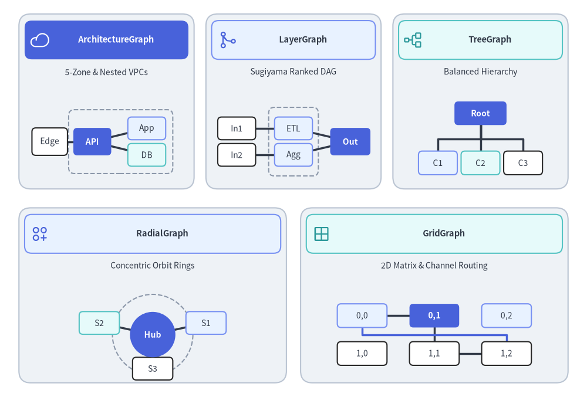
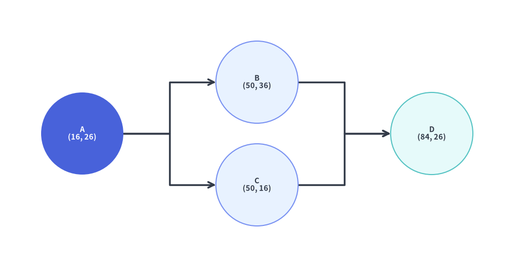
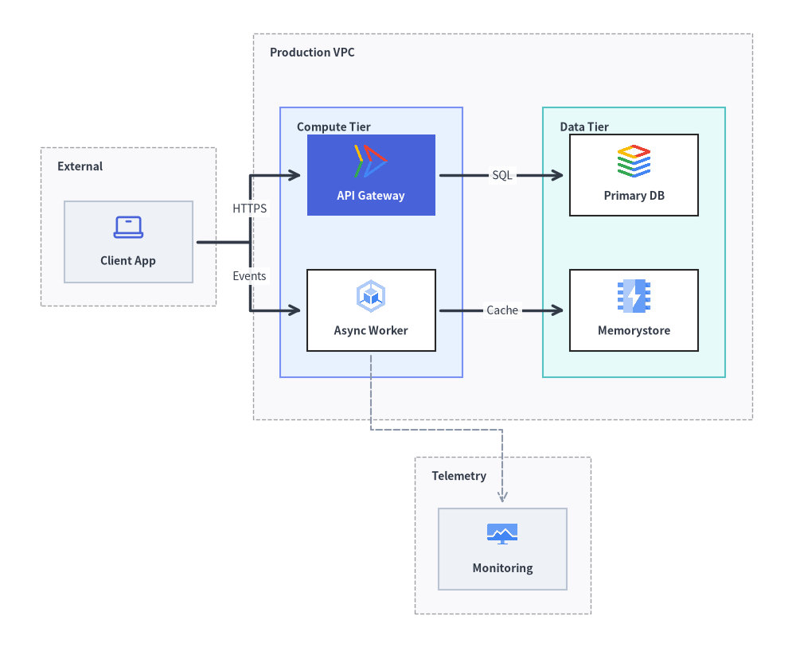
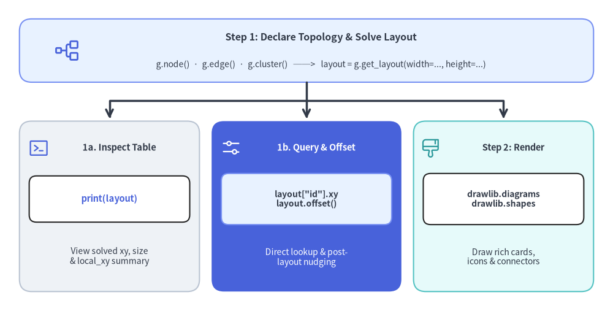
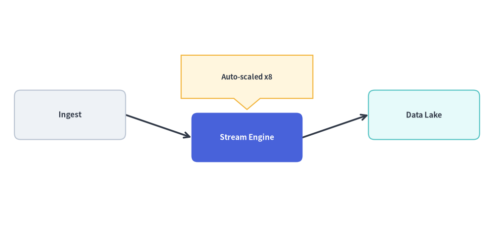

# Graph Engine Overview (`drawlib.graph`)

`drawlib.graph` is a declarative **pure coordinate and layout calculator** powered by five specialized layout solvers (`ArchitectureGraph`, `LayerGraph`, `TreeGraph`, `RadialGraph`, and `GridGraph`).

Instead of manually computing `(x, y)` coordinates for every vertex and container when drafting a complex topology, you declare **structural relationships**—nodes, edges, and clusters—and call `layout = g.get_layout(width=..., height=...)` so Drawlib's pure-Python layout algorithms calculate clean coordinates, container bounding boxes, and orthogonal or radial edge routes automatically. You then render the solved coordinates using [`drawlib.diagrams`](../05_diagrams/overview.md) or [`drawlib.shapes`](../02_drawing_primitives/shapes_overview.md) and [`drawlib.lines`](../02_drawing_primitives/lines.md).


<figure class="drawlib-image" style="text-align: center;">
  
  <figcaption class="drawlib-caption">The Five Specialized Auto-Layout Coordinate Solvers in drawlib.graph</figcaption>
</figure>

<details class="drawlib-code-details">
<summary>Source Code</summary>

```python
import math
from drawlib.canvas import save, setup
from drawlib.icons import phosphor
from drawlib.lines import line, lines
from drawlib.shapes import circle, rectangle
from drawlib.styles import Styles
from drawlib.text import text

setup(width=124, height=84)

# Row 1: 3 Cards (ArchitectureGraph, LayerGraph, TreeGraph)
row1_cards = [
    (22.5, 62.5, 37.0, "ArchitectureGraph", "5-Zone & Nested VPCs", phosphor.cloud, Styles.PrimaryFlat, Styles.WhiteBold, Styles.White),
    (62.0, 62.5, 37.0, "LayerGraph", "Sugiyama Ranked DAG", phosphor.git_merge, Styles.PrimaryNeutral, Styles.DarkBold, Styles.Primary),
    (101.5, 62.5, 37.0, "TreeGraph", "Balanced Hierarchy", phosphor.tree_structure, Styles.SecondaryNeutral, Styles.DarkBold, Styles.Secondary),
]

# Row 2: 2 Cards (RadialGraph, GridGraph)
row2_cards = [
    (32.25, 21.5, 56.5, "RadialGraph", "Concentric Orbit Rings", phosphor.circles_three_plus, Styles.PrimaryNeutral, Styles.DarkBold, Styles.Primary),
    (91.75, 21.5, 56.5, "GridGraph", "2D Matrix & Channel Routing", phosphor.grid_four, Styles.SecondaryNeutral, Styles.DarkBold, Styles.Secondary),
]

for cx, cy, cw, title, subtitle, icon_fn, hdr_style, hdr_text_style, ic_style in row1_cards + row2_cards:
    rectangle((cx, cy), width=cw, height=37.0, style=Styles.Neutral.patch(shape_r=2.5))
    rectangle((cx, cy + 13.0), width=cw - 2.4, height=8.2, style=hdr_style.patch(shape_r=1.5))
    icon_fn((cx - cw / 2.0 + 4.4, cy + 13.0), width=4.2, style=ic_style)
    text((cx + 2.0, cy + 13.0), title, style=hdr_text_style.patch(text_size=10.5))
    text((cx, cy + 6.2), subtitle, style=Styles.Dark.patch(text_size=10.0))

# 1. ArchitectureGraph miniature (cx=22.5, y=46..65)
rectangle((25.5, 54.0), width=22.0, height=13.5, style=Styles.MutedDashed.patch(shape_r=1.2))
line((10.5, 54.0), (19.5, 54.0), style=Styles.DarkBold)
line((19.5, 54.0), (31.0, 56.8), style=Styles.DarkBold)
line((19.5, 54.0), (31.0, 51.2), style=Styles.DarkBold)
rectangle((10.5, 54.0), width=7.5, height=5.8, style=Styles.White.patch(shape_r=0.8), text="Edge", text_style=Styles.Dark.patch(text_size=10.0))
rectangle((19.5, 54.0), width=8.0, height=5.8, style=Styles.PrimaryFlat.patch(shape_r=0.8), text="API", text_style=Styles.WhiteBold.patch(text_size=10.0))
rectangle((31.0, 56.8), width=8.0, height=4.8, style=Styles.PrimaryNeutral.patch(shape_r=0.8), text="App", text_style=Styles.Dark.patch(text_size=10.0))
rectangle((31.0, 51.2), width=8.0, height=4.8, style=Styles.SecondaryNeutral.patch(shape_r=0.8), text="DB", text_style=Styles.Dark.patch(text_size=10.0))

# 2. LayerGraph miniature (cx=62.0)
rectangle((62.0, 54.0), width=10.5, height=14.5, style=Styles.MutedDashed.patch(shape_r=1.2))
line((50.0, 56.8), (62.0, 56.8), style=Styles.DarkBold)
line((50.0, 51.2), (62.0, 51.2), style=Styles.DarkBold)
line((62.0, 56.8), (74.0, 54.0), style=Styles.DarkBold)
line((62.0, 51.2), (74.0, 54.0), style=Styles.DarkBold)
rectangle((50.0, 56.8), width=8.0, height=4.8, style=Styles.White.patch(shape_r=0.8), text="In1", text_style=Styles.Dark.patch(text_size=10.0))
rectangle((50.0, 51.2), width=8.0, height=4.8, style=Styles.White.patch(shape_r=0.8), text="In2", text_style=Styles.Dark.patch(text_size=10.0))
rectangle((62.0, 56.8), width=8.0, height=4.8, style=Styles.PrimaryNeutral.patch(shape_r=0.8), text="ETL", text_style=Styles.Dark.patch(text_size=10.0))
rectangle((62.0, 51.2), width=8.0, height=4.8, style=Styles.PrimaryNeutral.patch(shape_r=0.8), text="Agg", text_style=Styles.Dark.patch(text_size=10.0))
rectangle((74.0, 54.0), width=8.5, height=5.8, style=Styles.PrimaryFlat.patch(shape_r=0.8), text="Out", text_style=Styles.WhiteBold.patch(text_size=10.0))

# 3. TreeGraph miniature (cx=101.5)
lines([(101.5, 58.0), (101.5, 54.5), (92.5, 54.5), (92.5, 51.5)], style=Styles.DarkBold)
lines([(101.5, 58.0), (101.5, 54.5), (101.5, 51.5)], style=Styles.DarkBold)
lines([(101.5, 58.0), (101.5, 54.5), (110.5, 54.5), (110.5, 51.5)], style=Styles.DarkBold)
rectangle((101.5, 60.0), width=11.0, height=5.0, style=Styles.PrimaryFlat.patch(shape_r=0.8), text="Root", text_style=Styles.WhiteBold.patch(text_size=10.0))
rectangle((92.5, 49.5), width=8.2, height=5.0, style=Styles.PrimaryNeutral.patch(shape_r=0.8), text="C1", text_style=Styles.Dark.patch(text_size=10.0))
rectangle((101.5, 49.5), width=8.2, height=5.0, style=Styles.SecondaryNeutral.patch(shape_r=0.8), text="C2", text_style=Styles.Dark.patch(text_size=10.0))
rectangle((110.5, 49.5), width=8.2, height=5.0, style=Styles.White.patch(shape_r=0.8), text="C3", text_style=Styles.Dark.patch(text_size=10.0))

# 4. RadialGraph miniature (cx=32.25, cy=13.2)
rcx, rcy = 32.25, 13.2
circle((rcx, rcy), radius=8.5, style=Styles.MutedDashed)
for deg, lbl, st in [(20, "S1", Styles.PrimaryNeutral), (160, "S2", Styles.SecondaryNeutral), (270, "S3", Styles.White)]:
    rad = math.radians(deg)
    x1, y1 = rcx + 12.0 * math.cos(rad), rcy + 7.2 * math.sin(rad)
    line((rcx, rcy), (x1, y1), style=Styles.DarkBold)
    rectangle((x1, y1), width=8.5, height=4.8, style=st.patch(shape_r=0.8), text=lbl, text_style=Styles.Dark.patch(text_size=10.0))
circle((rcx, rcy), radius=4.8, style=Styles.PrimaryFlat, text="Hub", text_style=Styles.WhiteBold.patch(text_size=10.0))

# 5. GridGraph miniature (cx=91.75)
g_cols = [76.5, 91.75, 107.0]
g_rows = [17.2, 9.2]
line((76.5, 17.2), (91.75, 17.2), style=Styles.DarkBold)
line((91.75, 17.2), (91.75, 9.2), style=Styles.DarkBold)
line((91.75, 9.2), (107.0, 9.2), style=Styles.DarkBold)
lines([(76.5, 14.5), (76.5, 13.2), (107.0, 13.2), (107.0, 11.8)], style=Styles.PrimaryBold)
for r_idx, gy in enumerate(g_rows):
    for c_idx, gx in enumerate(g_cols):
        is_hero = (r_idx == 0 and c_idx == 1)
        cell_st = Styles.PrimaryFlat if is_hero else (Styles.PrimaryNeutral if r_idx == 0 else Styles.White)
        txt_st = Styles.WhiteBold.patch(text_size=10.0) if is_hero else Styles.Dark.patch(text_size=10.0)
        rectangle((gx, gy), width=10.5, height=5.0, style=cell_st.patch(shape_r=0.8), text=f"{r_idx},{c_idx}", text_style=txt_st)

save()
```

</details>


---

## 1. Division of Responsibility: `drawlib.graph` + `drawlib.diagrams`

Drawlib cleanly separates **topological coordinate calculation** (`drawlib.graph`) from **visual diagram rendering** ([`drawlib.diagrams`](../05_diagrams/overview.md) and [`drawlib.shapes`](../02_drawing_primitives/shapes_overview.md)).

### 1.1 Minimal Concept: Inspecting `get_layout()` and Connecting Circles

At its simplest, `g.get_layout()` takes your node/edge topology and returns a `GraphLayout` containing the solved `(x, y)` coordinates (`nl.xy`) for each node and the routed polyline points (`e.points`) for each edge. You can inspect these values with `print(layout)` and draw them with simple `circle()` and `lines()` calls:


```python
from drawlib.canvas import save, setup
from drawlib.graph import LayerGraph
from drawlib.lines import lines
from drawlib.shapes import circle
from drawlib.styles import Styles

setup(width=100, height=52)

# Step 1: Declare topology & solve coordinates with get_layout()
g = LayerGraph(direction="LR", default_node_width=16.0, default_node_height=16.0)
g.edge("A", "B")
g.edge("A", "C")
g.edge("B", "D")
g.edge("C", "D")

layout = g.get_layout(margin=8.0)

# print(layout) outputs:
# GraphLayout(width=100.0, height=52.0)
# Nodes:
#   A : xy=(16.0, 26.0), bottom_left=(8.0, 18.0), size=(16.0, 16.0)
#   B : xy=(50.0, 36.0), bottom_left=(42.0, 28.0), size=(16.0, 16.0)
#   C : xy=(50.0, 16.0), bottom_left=(42.0, 8.0), size=(16.0, 16.0)
#   D : xy=(84.0, 26.0), bottom_left=(76.0, 18.0), size=(16.0, 16.0)
# Edges:
#   A -> B : points=[(24.0, 26.0), (33.0, 26.0), (33.0, 36.0), (42.0, 36.0)], mid_xy=(33.0, 31.0)
#   A -> C : points=[(24.0, 26.0), (33.0, 26.0), (33.0, 16.0), (42.0, 16.0)], mid_xy=(33.0, 21.0)
#   B -> D : points=[(58.0, 36.0), (67.0, 36.0), (67.0, 26.0), (76.0, 26.0)], mid_xy=(67.0, 31.0)
#   C -> D : points=[(58.0, 16.0), (67.0, 16.0), (67.0, 26.0), (76.0, 26.0)], mid_xy=(67.0, 21.0)

# Step 2: Connect circles with lines using the solved coordinates
for e in layout.edges:
    lines(e.points, arrow_head="->", style=Styles.DarkBold)

circle(layout["A"].xy, radius=8.0, style=Styles.PrimaryFlat, text="A\n(16, 26)", text_style=Styles.WhiteBold.patch(text_size=10.5))
circle(layout["B"].xy, radius=8.0, style=Styles.PrimaryNeutral, text="B\n(50, 36)", text_style=Styles.DarkBold.patch(text_size=10.5))
circle(layout["C"].xy, radius=8.0, style=Styles.PrimaryNeutral, text="C\n(50, 16)", text_style=Styles.DarkBold.patch(text_size=10.5))
circle(layout["D"].xy, radius=8.0, style=Styles.SecondaryNeutral, text="D\n(84, 26)", text_style=Styles.DarkBold.patch(text_size=10.5))

save()
```

<figure class="drawlib-image" style="text-align: center;">
  
  <figcaption class="drawlib-caption">Minimal Concept: Solving Coordinates with get_layout() and Connecting Circles with Lines</figcaption>
</figure>


### 1.2 Full Architecture Workflow: `ArchitectureGraph` + `ArchitectureDiagram`

For production architecture diagrams with nested VPCs, subnets, and cloud icons, pair `ArchitectureGraph.get_layout()` with `ArchitectureDiagram`:


```python
from drawlib.canvas import save, setup
from drawlib.diagrams.architecture import ArchitectureDiagram, GcpIcon, Node, NodeGroup, PhosphorIcon
from drawlib.graph import ArchitectureGraph
from drawlib.styles import Styles

setup(width=118, height=96)

# Step 1: Declare topology & solve coordinates with ArchitectureGraph.get_layout()
g = ArchitectureGraph(
    direction="LR",
    container_sep=5.5,
    default_node_width=19.0,
    default_node_height=12.0,
)

g.cluster("clients", ["client"], pos="left", padding=3.5, header_height=4.5)
g.group("vpc", pos="center", padding=4.0, header_height=4.8)
g.cluster("app_tier", ["api", "worker"], parent="vpc", order=1, padding=4.0, header_height=4.5)
g.cluster("data_tier", ["db", "cache"], parent="vpc", order=2, padding=4.0, header_height=4.5)
g.cluster("obs", ["metrics"], pos="bottom", padding=3.5, header_height=4.2)

g.edge("client", "api")
g.edge("client", "worker")
g.edge("api", "db")
g.edge("worker", "cache")
g.edge("worker", "metrics")

layout = g.get_layout()

# Step 2: Render rich icon cards & boundaries using ArchitectureDiagram
d = ArchitectureDiagram(
    node_style=Styles.Primary,
    node_text_style=Styles.DarkBold.patch(text_size=10.0),
    edge_style=Styles.DarkBold,
    edge_text_style=Styles.Dark.patch(text_size=10.0),
    node_card_style=Styles.Neutral,
)
grp_hdr = Styles.DarkBold.patch(text_size=10.0, halign="left", valign="top")

c_cli = layout.clusters["clients"]
grp_cli = d.add(NodeGroup("External", width=c_cli.width, height=c_cli.height, text_style=grp_hdr), xy=c_cli.bottom_left)

c_vpc = layout.clusters["vpc"]
grp_vpc = d.add(NodeGroup("Production VPC", width=c_vpc.width, height=c_vpc.height, text_style=grp_hdr), xy=c_vpc.bottom_left)

c_app = layout.clusters["app_tier"]
grp_app = grp_vpc.add(
    NodeGroup("Compute Tier", width=c_app.width, height=c_app.height, style=Styles.PrimaryNeutral, text_style=grp_hdr),
    xy=c_app.local_bottom_left,
)

c_data = layout.clusters["data_tier"]
grp_data = grp_vpc.add(
    NodeGroup("Data Tier", width=c_data.width, height=c_data.height, style=Styles.SecondaryNeutral, text_style=grp_hdr),
    xy=c_data.local_bottom_left,
)

c_obs = layout.clusters["obs"]
grp_obs = d.add(NodeGroup("Telemetry", width=c_obs.width, height=c_obs.height, text_style=grp_hdr), xy=c_obs.bottom_left)

n_cli = grp_cli.add(Node("Client App", *layout["client"].size, icon=PhosphorIcon.LAPTOP, icon_size=5.0), xy=layout["client"].local_xy)
n_api = grp_app.add(
    Node(
        "API Gateway",
        *layout["api"].size,
        icon=GcpIcon.CLOUD_RUN,
        icon_size=5.5,
        style=Styles.White,
        text_style=Styles.WhiteBold.patch(text_size=10.0),
        card_style=Styles.PrimaryFlat,
    ),
    xy=layout["api"].local_xy,
)
n_wrk = grp_app.add(
    Node("Async Worker", *layout["worker"].size, icon=GcpIcon.GOOGLE_KUBERNETES_ENGINE, icon_size=5.5, card_style=Styles.White),
    xy=layout["worker"].local_xy,
)
n_db = grp_data.add(
    Node("Primary DB", *layout["db"].size, icon=GcpIcon.CLOUD_SQL, icon_size=5.5, card_style=Styles.White),
    xy=layout["db"].local_xy,
)
n_cache = grp_data.add(
    Node("Memorystore", *layout["cache"].size, icon=GcpIcon.MEMORYSTORE, icon_size=5.5, card_style=Styles.White),
    xy=layout["cache"].local_xy,
)
n_obs = grp_obs.add(
    Node("Monitoring", *layout["metrics"].size, icon=GcpIcon.CLOUD_MONITORING, icon_size=5.0),
    xy=layout["metrics"].local_xy,
)

d.connect(n_cli, n_api, label="HTTPS", padding=0.8)
d.connect(n_cli, n_wrk, label="Events", padding=0.8)
d.connect(n_api, n_db, label="SQL", padding=0.8)
d.connect(n_wrk, n_cache, label="Cache", padding=0.8)
d.connect(n_wrk, n_obs, style=Styles.MutedDashed, padding=0.8)

d.draw(xy=(-4.0, -5.0))
save()
```

<figure class="drawlib-image" style="text-align: center;">
  
  <figcaption class="drawlib-caption">The 2-Step Workflow: Solving Coordinates with ArchitectureGraph.get_layout() and Rendering with ArchitectureDiagram</figcaption>
</figure>


| Dimension | `drawlib.graph` (Coordinate & Layout Calculator) | [`drawlib.diagrams`](../05_diagrams/overview.md) & [`drawlib.shapes`](../02_drawing_primitives/shapes_overview.md) (Visual Renderer) |
| :--- | :--- | :--- |
| **Responsibility** | **Pure Geometry Solver**: Calculates node `(cx, cy)` centers, `.bottom_left` origins, `.local_xy` / `.local_bottom_left` container offsets, `(width, height)` bounding boxes, and edge `.points` via `g.get_layout()`. | **Rich Visual Notation**: Renders cloud icon cards (`GcpIcon`, `PhosphorIcon`), nested `NodeGroup` boundaries, ISO flowchart symbols, UML classes, Crow's Foot ER tables, or primitive shapes/lines. |
| **Primary Strength** | Solving the **Cold-Start Coordinate Problem** for nested VPCs, Sugiyama DAGs, trees, concentric rings, and 2D grids without manual arithmetic. | Full visual customization, domain-specific compartments, explicit port sides (`start_side`, `end_side`), `Junction` buses, and `show=False` visibility control. |
| **Inspection & Tuning** | Print human-readable coordinate tables via `print(layout)`, index directly via `layout["id"]`, or nudge nodes post-solve via `layout.offset(node_id, dx, dy)`. | Consume `c.bottom_left`, `c.local_bottom_left`, `n.xy`, `n.local_xy`, and `e.points` directly—or paste inspected coordinates into static scripts. |

---

## 2. The Five Specialized Layout Solvers

Rather than forcing every topology through a single generic heuristic, `drawlib.graph` provides five purpose-built coordinate solvers tailored to distinct structural patterns:

| Solver Class | Layout Algorithm | Primary Use Cases | Key Helper Methods | Guide Link |
| :--- | :--- | :--- | :--- | :--- |
| **[`ArchitectureGraph`](./architecture_graph.md)** | 2-Level Macro/Micro Packing + 5-Zone Compass | Cloud VPCs, nested subnets, multi-zone microservices | `.group()`, `.cluster(parent=..., pos=...)` | [ArchitectureGraph](./architecture_graph.md) |
| **[`LayerGraph`](./layer_graph.md)** | Sugiyama Hierarchical DAG (Cycle removal, Barycenter ordering) | CI/CD pipelines, ETL dataflows, layered dependency DAGs | `.tier(name, nodes, layer=...)`, `node(..., layer=...)` | [LayerGraph](./layer_graph.md) |
| **[`TreeGraph`](./tree_graph.md)** | Reingold-Tilford / Buchheim Compact Tree | Org charts, ASTs, decision trees, call hierarchies | `.child(parent, child_id, ...)` | [TreeGraph](./tree_graph.md) |
| **[`RadialGraph`](./radial_graph.md)** | Concentric BFS Rings & Angular Sector Allocation | Hub-and-spoke meshes, Pub/Sub topologies, dependency radars | `.spoke(parent, spoke_id, ring=...)`, `layout.ring_radii` | [RadialGraph](./radial_graph.md) |
| **[`GridGraph`](./grid_graph.md)** | 2D Matrix Assignment & Smart Channel Routing | Service catalogs, state matrices, tabular component grids | `.cell(id, row, col)`, `.cluster_row()`, `.cluster_column()` | [GridGraph](./grid_graph.md) |

---

## 3. Shared Architecture (`BaseGraph` & `GraphLayout`)

All five solvers inherit from `BaseGraph` and share a unified, geometry-only API for registering topology elements and computing a `GraphLayout`:

```python
from drawlib.graph import (
    ArchitectureGraph,
    BaseGraph,
    Cluster,
    ClusterLayout,
    Edge,
    EdgeLayout,
    GraphLayout,
    GridGraph,
    LayerGraph,
    Node,
    NodeLayout,
    RadialGraph,
    TreeGraph,
)
```

### 3.1. Building Topologies (`node`, `edge`, `cluster`, `group`)

#### `BaseGraph(*, default_node_width=20.0, default_node_height=12.0)`
Base constructor shared by all graph solvers, defining the default bounding box dimensions `(default_node_width, default_node_height)` assigned to nodes when explicit `width` or `height` is omitted.

#### `g.node(...) -> Node`
Registers a node in the graph and returns a `Node` dataclass instance carrying its structural and sizing metadata.
- **Signature**:
  ```python
  g.node(
      id: str,
      *,
      width: float | None = None,
      height: float | None = None,
      ring: int | None = None,
      row: int | None = None,
      col: int | None = None,
      layer: int | None = None,
      group: str | None = None,
      subgroup: str | None = None,
  ) -> Node
  ```

#### `g.edge(...) -> Edge`
Registers a directed topological connection between `src` and `dst` (automatically registering undeclared endpoint nodes with default dimensions).
- **Signature**:
  ```python
  g.edge(
      src: str,
      dst: str,
  ) -> Edge
  ```

#### `g.cluster(...) -> Cluster` and `g.group(...) -> Cluster`
Groups a list of nodes (or child clusters via `parent=...`) inside a container bounding box with configurable `padding` and top `header_height` clearance.
- **Signatures**:
  ```python
  g.cluster(
      id: str,
      nodes: list[str] | None = None,
      *,
      padding: float = 4.0,
      header_height: float = 3.5,
      parent: str | None = None,
      order: int | None = None,
      pos: Literal["top", "bottom", "left", "right", "center"] | None = None,
  ) -> Cluster

  g.group(
      id: str,
      *,
      nodes: list[str] | None = None,
      padding: float = 4.0,
      header_height: float = 3.5,
      parent: str | None = None,
      order: int | None = None,
      pos: Literal["top", "bottom", "left", "right", "center"] | None = None,
  ) -> Cluster
  ```

---

### 3.2. The 2-Step Workflow (`get_layout`, `print(layout)`, `offset`, and Render)


<figure class="drawlib-image" style="text-align: center;">
  
  <figcaption class="drawlib-caption">The 2-Step Workflow in drawlib.graph: Compute & Inspect Coordinates with get_layout(), Then Render with Diagrams or Shapes</figcaption>
</figure>

<details class="drawlib-code-details">
<summary>Source Code</summary>

```python
from drawlib.canvas import save, setup
from drawlib.icons import phosphor
from drawlib.lines import line, lines
from drawlib.shapes import rectangle
from drawlib.styles import Styles
from drawlib.text import text

setup(width=126, height=64)

# Top Header / Input Node
rectangle(
    (63, 53.5),
    width=118,
    height=13,
    style=Styles.PrimaryNeutral.patch(shape_r=2.5),
)
phosphor.tree_structure((14, 53.5), width=5.5, style=Styles.Primary)
text((66, 56.2), "Step 1: Declare Topology & Solve Layout", style=Styles.DarkBold.patch(text_size=11.5))
text((66, 50.6), "g.node()  ·  g.edge()  ·  g.cluster()   ──>   layout = g.get_layout(width=..., height=...)", style=Styles.Dark.patch(text_size=10.0))

# Orthogonal fan-out lines from top header into the 3 cards
line((63, 47.0), (63, 39.5), arrow_head="->", style=Styles.DarkBold)
lines([(63, 43.2), (22.5, 43.2), (22.5, 39.5)], arrow_head="->", style=Styles.DarkBold)
lines([(63, 43.2), (103.5, 43.2), (103.5, 39.5)], arrow_head="->", style=Styles.DarkBold)

# Card 1: Inspect Coordinates via print(layout)
rectangle((22.5, 21.5), width=37, height=35, style=Styles.Neutral.patch(shape_r=2.5))
phosphor.terminal_window((8.0, 33.5), width=4.4, style=Styles.Primary)
text((24.5, 33.5), "1a. Inspect Table", style=Styles.DarkBold.patch(text_size=10.5))
rectangle((22.5, 23.0), width=33, height=9.5, style=Styles.White.patch(shape_r=1.5))
text((22.5, 23.0), "print(layout)", style=Styles.PrimaryBold.patch(text_size=10.5))
text((22.5, 11.2), "View solved xy, size\n& local_xy summary", style=Styles.Dark.patch(text_size=10.0))

# Card 2: Access & Offset Coordinates (PrimaryFlat focal card)
rectangle((63, 21.5), width=39, height=35, style=Styles.PrimaryFlat.patch(shape_r=2.5))
phosphor.sliders_horizontal((47.5, 33.5), width=4.4, style=Styles.White)
text((65.0, 33.5), "1b. Query & Offset", style=Styles.WhiteBold.patch(text_size=10.5))
rectangle((63, 23.0), width=35, height=10.5, style=Styles.PrimaryNeutral.patch(shape_r=1.5))
text((63, 23.0), 'layout["id"].xy\nlayout.offset()', style=Styles.DarkBold.patch(text_size=10.0))
text((63, 11.0), "Direct lookup & post-\nlayout nudging", style=Styles.White.patch(text_size=10.0))

# Card 3: Step 2 Render with Diagrams or Shapes (SecondaryNeutral)
rectangle((103.5, 21.5), width=37, height=35, style=Styles.SecondaryNeutral.patch(shape_r=2.5))
phosphor.paint_brush_broad((88.5, 33.5), width=4.4, style=Styles.Secondary)
text((105.5, 33.5), "Step 2: Render", style=Styles.DarkBold.patch(text_size=10.5))
rectangle((103.5, 23.0), width=33, height=10.5, style=Styles.White.patch(shape_r=1.5))
text((103.5, 23.0), "drawlib.diagrams\ndrawlib.shapes", style=Styles.DarkBold.patch(text_size=10.0))
text((103.5, 11.2), "Draw rich cards,\nicons & connectors", style=Styles.Dark.patch(text_size=10.0))

save()
```

</details>


#### Step 1: Solve & Inspect Coordinates (`layout = g.get_layout(*, width=None, height=None, margin=10.0) -> GraphLayout`)
Calling `g.get_layout()` runs the layout solver and returns a `GraphLayout` object:
- **`print(layout)` (`GraphLayout.__str__()`)**: Prints a formatted coordinate table of all solved clusters, nodes, and edges—ideal for inspecting coordinates during interactive development or copying exact numbers into a static diagram script:
  ```text
  GraphLayout(width=120.0, height=80.0)
  Clusters:
    vpc : bottom_left=(18.0, 22.5), center=(38.0, 40.0), size=(40.0, 35.0)
    app : bottom_left=(22.0, 28.25), center=(38.0, 38.25), size=(32.0, 20.0), parent='vpc', local_bottom_left=(4.0, 5.75)
  Nodes:
    api    : xy=(38.0, 38.25), bottom_left=(26.0, 32.25), size=(24.0, 12.0), parent='app', local_xy=(16.0, 10.0)
    client : xy=(86.0, 38.25), bottom_left=(74.0, 32.25), size=(24.0, 12.0)
  Edges:
    client -> api : points=[(74.0, 38.25), (50.0, 38.25)], mid_xy=(62.0, 38.25)
  ```
- **Direct Lookup (`layout["id"]`)**: Indexing `layout[key]` returns the corresponding `NodeLayout` or `ClusterLayout` directly (or access `layout.nodes[id]`, `layout.clusters[id]`, `layout.edges`, and `layout.ring_radii`).
- **Post-Layout Fine-Tuning (`layout.offset(node_id, dx=0.0, dy=0.0) -> Self`)**: Shifts a specific node by `(dx, dy)` (updating both `.xy` and `.local_xy`) and automatically adjusts the attachment ports of all incident edges. Returns `self` for method chaining.

#### Step 2: Render with `drawlib.diagrams` or `drawlib.shapes`
Every geometry object in `GraphLayout` exposes convenience properties tailored for both `drawlib.diagrams` and `drawlib.shapes`:

| Layout Object | Coordinate & Geometry Properties | Primary Rendering Target |
| :--- | :--- | :--- |
| **`NodeLayout`** | `.xy` / `.center` `(cx, cy)`, `.x`, `.y`, `.bottom_left` `(left, bottom)`, `.local_xy` (center relative to parent cluster's `bottom_left`), `.local_bottom_left`, `.width`, `.height`, `.size` `(w, h)`, `.left`, `.right`, `.top`, `.bottom`, `.parent_id` | Top-level `d.add(Node(...), xy=n.xy)` or `rectangle(n.xy, ...)`; inside a `NodeGroup`: `grp.add(Node(...), xy=n.local_xy)` |
| **`ClusterLayout`** | `.bottom_left` `(left, bottom)`, `.local_bottom_left` (relative to parent cluster's `bottom_left`), `.xy` / `.center` `(cx, cy)`, `.cx`, `.cy`, `.width`, `.height`, `.size` `(w, h)`, `.bbox` `(l, b, r, t)`, `.left`, `.right`, `.top`, `.bottom`, `.parent_id` | Top-level `d.add(NodeGroup(...), xy=c.bottom_left)`; nested `parent_grp.add(NodeGroup(...), xy=c.local_bottom_left)`; or `rectangle(c.xy, width=c.width, height=c.height)` |
| **`EdgeLayout`** | `.src`, `.dst`, `.src_port`, `.dst_port`, `.waypoints`, `.points` (`[src_port, *waypoints, dst_port]`), `.mid_xy` (midpoint `(x, y)` along polyline) | `lines(e.points, arrow_head="->")` and `text(e.mid_xy, "Label")` (or use `d.connect(u, v)` in `drawlib.diagrams`) |


```python
from drawlib.canvas import save, setup
from drawlib.graph import LayerGraph
from drawlib.lines import lines
from drawlib.shapes import bubblespeech, rectangle
from drawlib.styles import Styles

setup(width=120, height=56)

# 1. Declare pipeline topology and calculate coordinates
g = LayerGraph(
    direction="LR",
    default_node_width=27.0,
    default_node_height=12.0,
)
g.node("ingest")
g.node("process")
g.node("store")

g.edge("ingest", "process")
g.edge("process", "store")

layout = g.get_layout(width=120.0, height=56.0, margin=8.0)

# 2. Fine-tune the middle node position downward
layout.offset("process", dy=-5.5)

# 3. Render edges and nodes using solved coordinates
for e in layout.edges:
    lines(e.points, arrow_head="->", style=Styles.DarkBold)

node_specs = [
    ("ingest", "Ingest", Styles.Neutral, Styles.DarkBold.patch(text_size=11.0)),
    ("process", "Stream Engine", Styles.PrimaryFlat, Styles.WhiteBold.patch(text_size=11.0)),
    ("store", "Data Lake", Styles.SecondaryNeutral, Styles.DarkBold.patch(text_size=11.0)),
]
for nid, label, box_style, txt_style in node_specs:
    n = layout.nodes[nid]
    rectangle(
        n.xy,
        width=n.width,
        height=n.height,
        style=box_style.patch(shape_r=1.5),
        text=label,
        text_style=txt_style,
    )

# 4. Overlay a custom speech callout anchored to the computed node coordinates
proc = layout.nodes["process"]
bubblespeech(
    (proc.x - 16.0, proc.top + 3.5),
    width=32.0,
    height=10.5,
    tail_edge="bottom",
    tail_start_ratio=0.4,
    tail_end_ratio=0.6,
    tail_vertex_xy=(proc.x, proc.top + 0.8),
    style=Styles.WarningNeutral,
    text="Auto-scaled x8",
    text_style=Styles.DarkBold.patch(text_size=10.5),
)

save()
```

<figure class="drawlib-image" style="text-align: center;">
  
  <figcaption class="drawlib-caption">Calculating Coordinates with get_layout(), Shifting a Node with offset(), and Rendering with Primitives & Callouts</figcaption>
</figure>


---

## 4. Best Practices & 50%+ Neutral Baseline

1. **Match Node Dimensions & `header_height` to Your Renderer**:
   - Pass `default_node_width` and `default_node_height` to the graph constructor so the solver reserves the exact card dimensions you will render in `ArchitectureDiagram`, `FlowDiagram`, or `rectangle()` (or unpack `*layout["id"].size` directly into `Node(title, *layout["id"].size, ...)`).
   - When rendering clusters as `NodeGroup`s in `ArchitectureDiagram`, set `header_height=4.5` on `g.cluster()` / `g.group()` so the solver reserves extra vertical clearance at the top of each container for the group title.
2. **Follow the 50%+ Neutral Baseline When Rendering**:
   - Ground at least 50% of rendered nodes in calm neutral or tinted-neutral styles (`Styles.Neutral`, `Styles.PrimaryNeutral`, `Styles.SecondaryNeutral`), and reserve saturated fills (`Styles.PrimaryFlat` with `Styles.WhiteBold`) strictly for **1–2 primary focal nodes**.
3. **Use `print(layout)` or `layout.offset()` to Iterate Rapidly**:
   - Start by passing `layout["id"]` coordinates directly into your rendering code. If a node or callout needs extra breathing room, chain `layout.offset("node_id", dx=..., dy=...)`—or call `print(layout)` to inspect and copy the solved coordinates.

---

## 5. Chapter Navigation

Explore each of the five graph solvers in detail:
- **[ArchitectureGraph](./architecture_graph.md)**: Multi-tier cloud topologies, nested VPC/subnet clusters, and 5-zone compass placement rendered with `ArchitectureDiagram`.
- **[LayerGraph](./layer_graph.md)**: Sugiyama hierarchical DAGs, CI/CD pipelines, and explicit rank/tier pinning rendered with `FlowDiagram` and primitives.
- **[TreeGraph](./tree_graph.md)**: Balanced parent-child trees (`TB` and `LR`) using the Reingold-Tilford / Buchheim algorithm.
- **[RadialGraph](./radial_graph.md)**: Hub-and-spoke networks and multi-ring concentric dependency radars.
- **[GridGraph](./grid_graph.md)**: 2D `(row, col)` matrix placement, row/column clusters, and smart channel routing.
