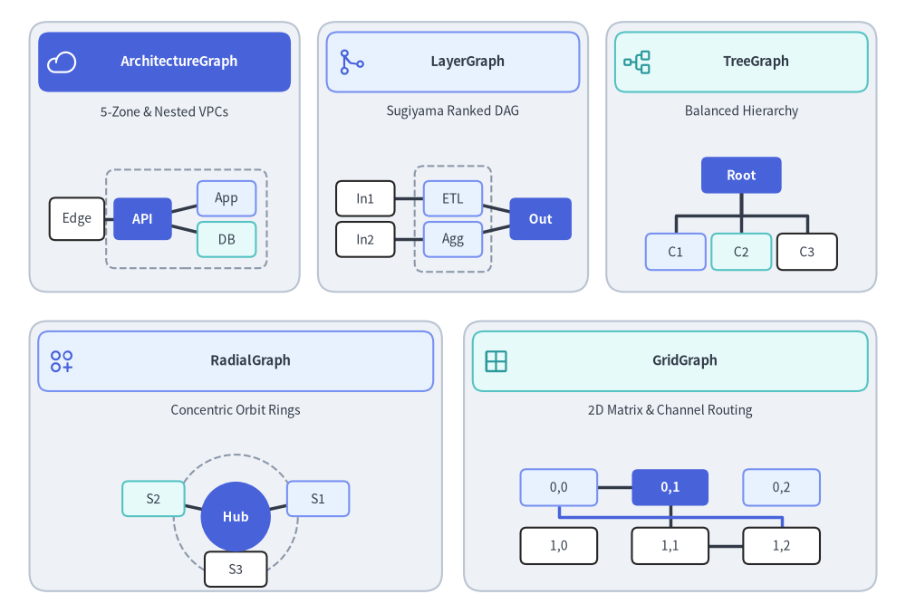
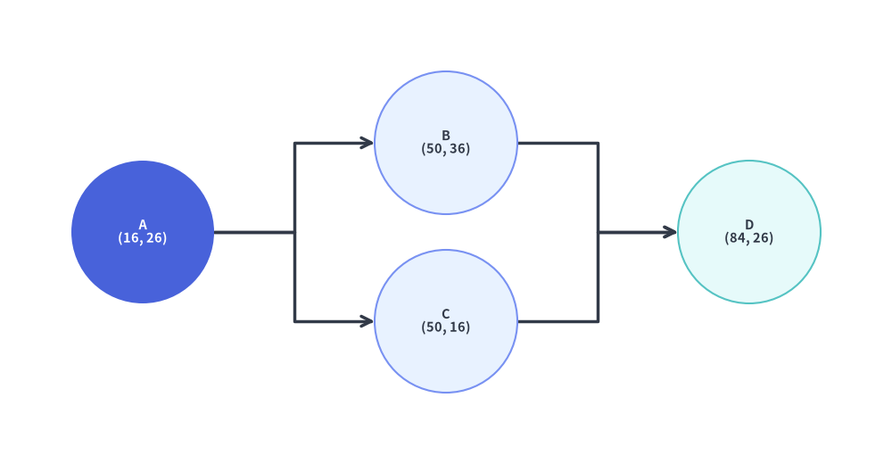
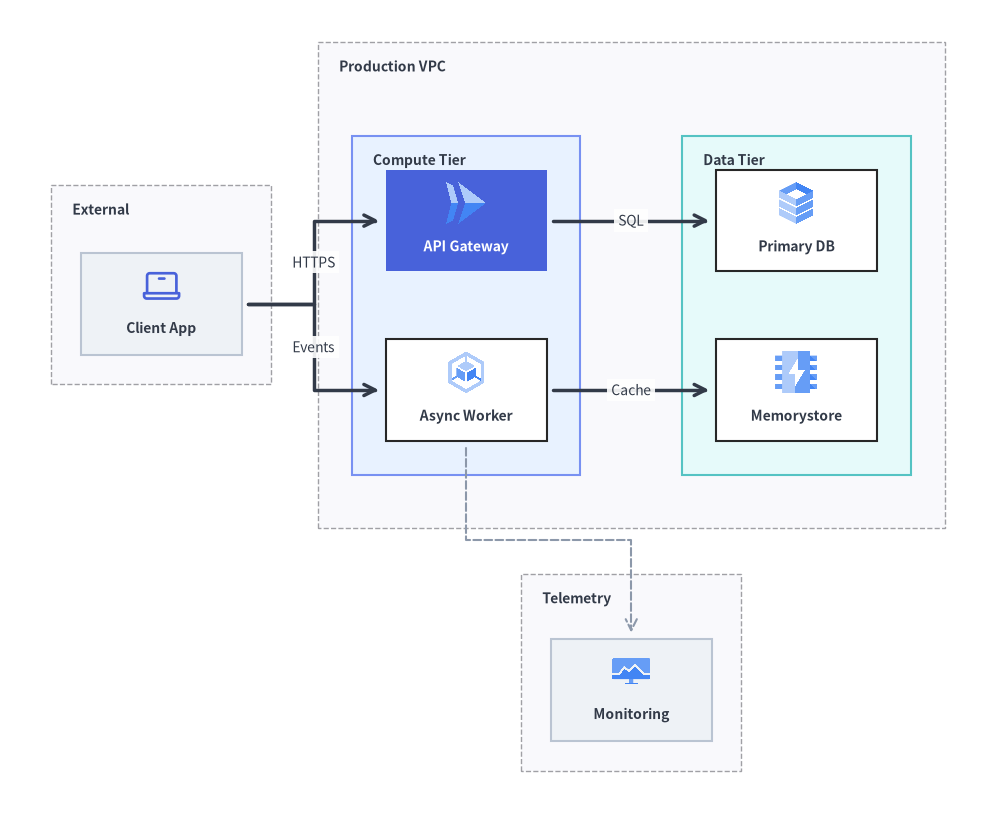
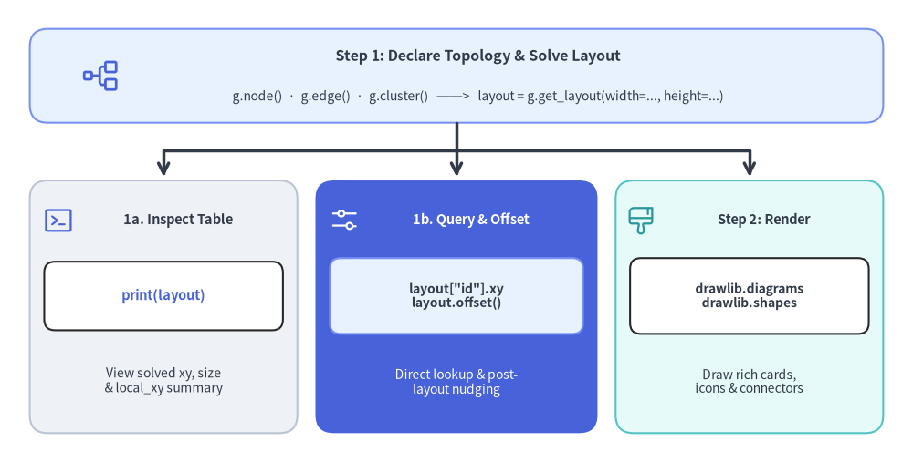
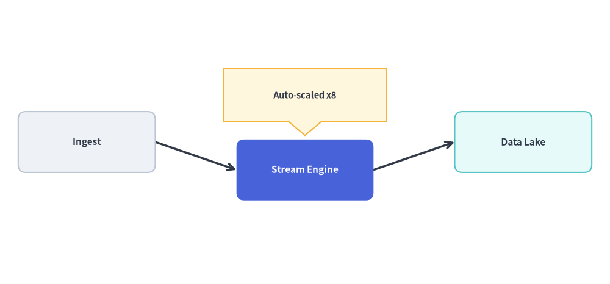

# Graph Engine Overview (`drawlib.graph`)

`drawlib.graph` is a declarative **pure coordinate and layout calculator** powered by five specialized layout solvers (`ArchitectureGraph`, `LayerGraph`, `TreeGraph`, `RadialGraph`, and `GridGraph`).

Instead of manually computing `(x, y)` coordinates for every vertex and container when drafting a complex topology, you declare **structural relationships**—nodes, edges, and clusters—and call `layout = g.get_layout(width=..., height=...)` so Drawlib's pure-Python layout algorithms calculate clean coordinates, container bounding boxes, and orthogonal or radial edge routes automatically. As shown in the step-by-step animation below, each solver sprouts outward along its own topological coordinate model—5-zone nested VPC containers, ranked DAG fan-out/merge columns, strict tree depth tiers, 360-degree concentric orbit rings, and smart-channel 2D matrix slots—before you render the solved coordinates using [`drawlib.diagrams`](../06_diagrams/overview.md) or [`drawlib.shapes`](../02_drawing_primitives/shapes_overview.md) and [`drawlib.lines`](../02_drawing_primitives/lines.md).


<figure class="drawlib-image" style="text-align: center;">
  
  <figcaption class="drawlib-caption">The Five Specialized Auto-Layout Coordinate Solvers Sprouting Along Their Topological Coordinate Models (APNG Animation)</figcaption>
</figure>

<details class="drawlib-code-details">
<summary>Source Code</summary>

```python
from __future__ import annotations

import math

from drawlib.anim import Animation
from drawlib.canvas import save, setup
from drawlib.graph import (
    ArchitectureGraph,
    GridGraph,
    LayerGraph,
    RadialGraph,
    TreeGraph,
)
from drawlib.icons import phosphor
from drawlib.lines import line, lines
from drawlib.shapes import circle, rectangle
from drawlib.styles import Style, Styles
from drawlib.text import text

W, H = 136.0, 96.0
setup(width=W, height=H)
anim = Animation(fps=10.0, loop=0)


def trim_polyline(
    pts: list[tuple[float, float]],
    frac: float,
) -> list[tuple[float, float]]:
    """Interpolate a prefix polyline covering `frac` (0..1) of total arc length."""
    if len(pts) < 2 or frac >= 1.0:
        return list(pts)
    segs: list[tuple[tuple[float, float], tuple[float, float], float]] = []
    total = 0.0
    for idx in range(len(pts) - 1):
        p0, p1 = pts[idx], pts[idx + 1]
        seg_len = math.hypot(p1[0] - p0[0], p1[1] - p0[1])
        segs.append((p0, p1, seg_len))
        total += seg_len
    if total <= 1e-6:
        return [pts[0], pts[-1]]
    target = max(0.0, min(1.0, frac)) * total
    out = [pts[0]]
    acc = 0.0
    for p0, p1, seg_len in segs:
        if acc + seg_len >= target and seg_len > 1e-6:
            t = (target - acc) / seg_len
            out.append((p0[0] + t * (p1[0] - p0[0]), p0[1] + t * (p1[1] - p0[1])))
            break
        out.append(p1)
        acc += seg_len
    return out


def draw_stem(
    pts: list[tuple[float, float]],
    frac: float,
    style: Style = Styles.DarkBold,
    bud_style: Style = Styles.PrimaryFlat,
) -> None:
    """Draw either a partial sprouting stem with a bud tip or a completed arrow."""
    if frac <= 0.0 or len(pts) < 2:
        return
    if frac >= 1.0:
        lines(pts, arrow_head="->", style=style)
    else:
        sub = trim_polyline(pts, frac)
        if len(sub) >= 2:
            lines(sub, style=style)
            circle(sub[-1], radius=0.48, style=bud_style)


# =========================================================================
# 1. Pre-Solve All 5 Topologies Using Real drawlib.graph Solvers
# =========================================================================

# (A) ArchitectureGraph: 5-Zone Compass + Nested VPC (app, data)
g_arch = ArchitectureGraph(
    direction="LR",
    container_sep=3.2,
    default_node_width=9.6,
    default_node_height=5.8,
)
g_arch.cluster("top_z", ["iam"], pos="top", padding=1.0, header_height=0.4)
g_arch.cluster("left_z", ["waf"], pos="left", padding=1.0, header_height=0.4)
g_arch.group("vpc", pos="center", padding=1.5, header_height=4.4)
g_arch.cluster("app", ["api"], parent="vpc", order=1, padding=1.1, header_height=0.5)
g_arch.cluster("data", ["db"], parent="vpc", order=2, padding=1.1, header_height=0.5)
g_arch.cluster("right_z", ["dr"], pos="right", padding=1.0, header_height=0.4)
g_arch.cluster("bot_z", ["log"], pos="bottom", padding=1.0, header_height=0.4)
g_arch.edge("waf", "api")
g_arch.edge("api", "db")
g_arch.edge("iam", "api")
g_arch.edge("db", "dr")
g_arch.edge("api", "log")
raw_arch = g_arch.get_layout(width=68.0, height=44.0, margin=1.5)

a_min_x = min(c.left for c in raw_arch.clusters.values())
a_max_x = max(c.right for c in raw_arch.clusters.values())
a_min_y = min(c.bottom for c in raw_arch.clusters.values())
a_max_y = max(c.top for c in raw_arch.clusters.values())
a_cx_raw = (a_min_x + a_max_x) / 2.0
a_cy_raw = (a_min_y + a_max_y) / 2.0
ARCH_VP_CX, ARCH_VP_CY = 24.0, 61.75
ARCH_S = min(37.4 / (a_max_x - a_min_x), 27.4 / (a_max_y - a_min_y))


def map_arch(pt: tuple[float, float]) -> tuple[float, float]:
    return (
        ARCH_VP_CX + (pt[0] - a_cx_raw) * ARCH_S,
        ARCH_VP_CY + (pt[1] - a_cy_raw) * ARCH_S,
    )


# (B) LayerGraph: 4-Rank DAG with Fan-Out & 3-into-1 Merge + Split
g_layer = LayerGraph(
    direction="LR",
    rank_sep=3.6,
    node_sep=2.7,
    default_node_width=5.8,
    default_node_height=3.5,
)
g_layer.edge("S1", "E1")
g_layer.edge("S1", "E2")
g_layer.edge("S2", "E2")
g_layer.edge("S2", "E3")
g_layer.edge("E1", "Join")
g_layer.edge("E2", "Join")
g_layer.edge("E3", "Join")
g_layer.edge("Join", "O1")
g_layer.edge("Join", "O2")
lay_layer = g_layer.get_layout(width=38.5, height=24.5, margin=1.8)
LAY_OX, LAY_OY = 68.0 - 38.5 / 2.0, 47.2


def map_layer(pt: tuple[float, float]) -> tuple[float, float]:
    return (LAY_OX + pt[0], LAY_OY + pt[1])


# (C) TreeGraph: Strict 1 -> 2 -> 4 Top-Down Hierarchy
g_tree = TreeGraph(
    root="Root",
    direction="TB",
    edge_routing="orthogonal",
    default_node_width=5.9,
    default_node_height=3.5,
    sibling_sep=1.9,
    level_sep=4.3,
)
g_tree.child("Root", "B1")
g_tree.child("Root", "B2")
g_tree.child("B1", "L1")
g_tree.child("B1", "L2")
g_tree.child("B2", "L3")
g_tree.child("B2", "L4")
lay_tree = g_tree.get_layout(width=33.6, height=27.5, margin=1.5)
TREE_OX, TREE_OY = 97.6, 48.0


def map_tree(pt: tuple[float, float]) -> tuple[float, float]:
    return (TREE_OX + pt[0], TREE_OY + pt[1])


# (D) RadialGraph: Hub -> 4 Ring-1 Spokes -> 8 Ring-2 Satellites
g_rad = RadialGraph(
    hub="Hub",
    radius_step=6.35,
    start_angle=45.0,
    default_node_width=4.2,
    default_node_height=2.8,
)
g_rad.node("Hub", width=4.6, height=4.6)
for sp_id in ["A", "B", "C", "D"]:
    g_rad.spoke("Hub", sp_id, ring=1, width=3.5, height=3.5)
for sp_id, sat_ids in [
    ("A", ["A1", "A2"]),
    ("B", ["B1", "B2"]),
    ("C", ["C1", "C2"]),
    ("D", ["D1", "D2"]),
]:
    for sat_id in sat_ids:
        g_rad.spoke(sp_id, sat_id, ring=2, width=4.2, height=2.75)
lay_rad = g_rad.get_layout(width=30.0, height=28.5, margin=1.5)
RAD_OX, RAD_OY = 35.0 - 15.0, 19.05 - 14.25


def map_rad(pt: tuple[float, float]) -> tuple[float, float]:
    return (RAD_OX + pt[0], RAD_OY + pt[1])


# (E) GridGraph: 3x2 Matrix + Smart Inter-Row Corridor Highway
g_grid = GridGraph(
    columns=3,
    rows=2,
    edge_routing="smart",
    default_node_width=11.4,
    default_node_height=5.0,
)
for r_i in range(2):
    for c_i in range(3):
        g_grid.cell(f"{r_i},{c_i}", row=r_i, col=c_i)
g_grid.edge("0,0", "0,1")
g_grid.edge("0,1", "0,2")
g_grid.edge("0,0", "1,0")
g_grid.edge("1,0", "1,1")
g_grid.edge("1,1", "1,2")
g_grid.edge("0,0", "1,2")
lay_grid = g_grid.get_layout(width=52.0, height=23.2, margin=2.0)
GRID_OX, GRID_OY = 77.2, 4.9


def map_grid(pt: tuple[float, float]) -> tuple[float, float]:
    return (GRID_OX + pt[0], GRID_OY + pt[1])


# =========================================================================
# 2. Shared Banner & 5-Card Chrome Helpers
# =========================================================================

STAGE_LABELS = [
    "1. Seed Anchor",
    "2. Inner Growth",
    "3. Outer Structure",
    "4. Cross Routing",
    "5. Full Topologies",
]

GUIDE_DASH = Styles.MutedDashed.patch(
    line_color=(194, 206, 222),
    line_width=0.85,
    shape_line_color=(198, 210, 226),
    shape_line_width=0.85,
    shape_fill_color=(0, 0, 0, 0),
)
GUIDE_TXT = Styles.MutedBold.patch(text_size=9.5)
PULSE_RING = Styles.PrimaryDashed.patch(shape_fill_color=(0, 0, 0, 0), shape_line_width=1.2)


def draw_banner(active_stage: int) -> None:
    """Draw top 5-stage connected growth progress banner."""
    pill_w, pill_h, gap = 24.4, 5.2, 2.0
    start_x = 3.0 + pill_w / 2.0
    cy = 91.2
    for idx, label in enumerate(STAGE_LABELS, start=1):
        cx = start_x + (idx - 1) * (pill_w + gap)
        if idx > 1:
            prev_cx = cx - (pill_w + gap)
            line(
                (prev_cx + pill_w / 2.0 + 0.15, cy),
                (cx - pill_w / 2.0 - 0.15, cy),
                style=Styles.PrimaryBold if idx <= active_stage else Styles.MutedThin,
            )
        if idx == active_stage:
            st = Styles.PrimaryFlat.patch(shape_r=1.3)
            tst = Styles.WhiteBold.patch(text_size=9.9)
        elif idx < active_stage:
            st = Styles.PrimaryNeutral.patch(shape_r=1.3, shape_line_width=1.1)
            tst = Styles.PrimaryBold.patch(text_size=9.9)
        else:
            st = Styles.Neutral.patch(shape_r=1.3, shape_line_width=1.1)
            tst = Styles.MutedBold.patch(text_size=9.9)
        rectangle((cx, cy), width=pill_w, height=pill_h, style=st, text=label, text_style=tst)


def draw_card_shell(
    cx: float,
    cy: float,
    cw: float,
    ch: float,
    title: str,
    subtitle: str,
    icon_fn: object,
    hdr_style: Style,
    icon_style: Style,
) -> tuple[float, float, float, float]:
    """Draw card container, header bar with title + rule subtitle, and white inner viewport."""
    rectangle(
        (cx, cy),
        width=cw,
        height=ch,
        style=Styles.Neutral.patch(shape_r=2.0, shape_line_width=1.2),
    )
    top_y = cy + ch / 2.0
    bot_y = cy - ch / 2.0
    hdr_h = 6.6
    hdr_cy = top_y - 0.65 - hdr_h / 2.0
    hdr_w = cw - 1.6
    rectangle((cx, hdr_cy), width=hdr_w, height=hdr_h, style=hdr_style.patch(shape_r=1.4))

    ix = cx - hdr_w / 2.0 + 3.2
    icon_fn((ix, hdr_cy), width=3.8, style=icon_style)  # type: ignore[operator]
    tx = ix + 2.8
    text(
        (tx, hdr_cy + 1.35),
        title,
        style=Styles.DarkBold.patch(text_size=10.2, halign="left"),
    )
    text(
        (tx, hdr_cy - 1.45),
        subtitle,
        style=Styles.Dark.patch(text_size=9.5, halign="left"),
    )

    vp_top = hdr_cy - hdr_h / 2.0 - 0.55
    vp_bot = bot_y + 0.85
    vp_h = vp_top - vp_bot
    vp_cy = (vp_top + vp_bot) / 2.0
    vp_w = cw - 2.2
    rectangle(
        (cx, vp_cy),
        width=vp_w,
        height=vp_h,
        style=Styles.White.patch(
            shape_r=1.2,
            shape_line_color=(206, 216, 230),
            shape_line_width=1.0,
        ),
    )
    return cx, vp_cy, vp_w, vp_h


# =========================================================================
# 3. Per-Card Coordinate Guides & Sprouting Renderers (Frames 0..7)
# =========================================================================


def render_arch_card(f_idx: int) -> None:
    """Card 1: ArchitectureGraph (5-Zone Compass + Nested VPC)."""
    draw_card_shell(
        24.0,
        65.5,
        42.0,
        39.5,
        "ArchitectureGraph",
        "5-Zone Compass & Nested VPC",
        phosphor.cloud,
        Styles.PrimaryNeutral,
        Styles.PrimaryBold,
    )
    # Faint 5-zone compass crosshairs & blueprint zone slots
    line((6.0, ARCH_VP_CY), (42.0, ARCH_VP_CY), style=GUIDE_DASH)
    line((ARCH_VP_CX, 48.0), (ARCH_VP_CX, 75.5), style=GUIDE_DASH)
    for cid in ["top_z", "left_z", "vpc", "right_z", "bot_z"]:
        cl = raw_arch.clusters[cid]
        rectangle(
            map_arch(cl.xy),
            width=cl.width * ARCH_S,
            height=cl.height * ARCH_S,
            style=GUIDE_DASH.patch(shape_r=0.9),
        )
    c_top = raw_arch.clusters["top_z"]
    c_bot = raw_arch.clusters["bot_z"]
    c_left = raw_arch.clusters["left_z"]
    c_right = raw_arch.clusters["right_z"]
    text((map_arch(c_top.xy)[0] + 6.4, map_arch(c_top.xy)[1]), "top", style=GUIDE_TXT)
    text((map_arch(c_bot.xy)[0] + 6.8, map_arch(c_bot.xy)[1]), "bot", style=GUIDE_TXT)
    text((map_arch(c_left.xy)[0], map_arch(c_left.xy)[1] + 4.3), "left", style=GUIDE_TXT)
    text((map_arch(c_right.xy)[0], map_arch(c_right.xy)[1] + 4.3), "right", style=GUIDE_TXT)

    # Stage 1+: Center VPC macro shell
    c_vpc = raw_arch.clusters["vpc"]
    vpc_xy = map_arch(c_vpc.xy)
    vpc_w, vpc_h = c_vpc.width * ARCH_S, c_vpc.height * ARCH_S
    vpc_st = (
        Styles.PrimaryNeutral.patch(shape_r=1.0, shape_line_width=1.5)
        if f_idx == 0
        else Styles.Neutral.patch(shape_r=1.0, shape_line_width=1.15)
    )
    rectangle(vpc_xy, width=vpc_w, height=vpc_h, style=vpc_st)
    text(
        (vpc_xy[0] + vpc_w / 2.0 - 0.95, vpc_xy[1] + vpc_h / 2.0 - 1.5),
        "VPC",
        style=Styles.DarkBold.patch(text_size=9.5, halign="right"),
    )
    if f_idx == 0:
        rectangle(vpc_xy, width=vpc_w + 1.3, height=vpc_h + 1.3, style=PULSE_RING.patch(shape_r=1.2))

    # Stage 2+: Nested App & Data subnets + internal stem api -> db
    e_map = {(e.src, e.dst): [map_arch(p) for p in e.points] for e in raw_arch.edges}
    if f_idx >= 1:
        for sub_id, sub_st in [("app", Styles.PrimaryNeutral), ("data", Styles.SecondaryNeutral)]:
            cs = raw_arch.clusters[sub_id]
            rectangle(
                map_arch(cs.xy),
                width=cs.width * ARCH_S,
                height=cs.height * ARCH_S,
                style=(GUIDE_DASH if f_idx == 1 else sub_st).patch(shape_r=0.8),
            )
        draw_stem(e_map[("api", "db")], 0.55 if f_idx == 1 else 1.0, Styles.DarkBold)

    if f_idx >= 2:
        for nid, lbl, is_hero in [("api", "API", True), ("db", "DB", False)]:
            nl = raw_arch.nodes[nid]
            nst = Styles.PrimaryFlat if is_hero else Styles.White
            ntxt = Styles.WhiteBold.patch(text_size=9.5) if is_hero else Styles.DarkBold.patch(text_size=9.5)
            rectangle(
                map_arch(nl.xy),
                width=nl.width * ARCH_S,
                height=nl.height * ARCH_S,
                style=nst.patch(shape_r=0.7),
                text=lbl,
                text_style=ntxt,
            )

    # Stage 3+: 4 peripheral compass zones sprout around VPC
    if f_idx >= 3:
        for zid in ["top_z", "left_z", "right_z", "bot_z"]:
            cz = raw_arch.clusters[zid]
            zst = GUIDE_DASH if f_idx == 3 else Styles.Neutral.patch(shape_r=0.9, shape_line_width=1.05)
            rectangle(map_arch(cz.xy), width=cz.width * ARCH_S, height=cz.height * ARCH_S, style=zst)

    # Stage 4+: Cross-boundary compass edges snake across zone gaps
    if f_idx >= 5:
        c_frac = 0.55 if f_idx == 5 else 1.0
        draw_stem(e_map[("waf", "api")], c_frac, Styles.DarkBold)
        draw_stem(e_map[("db", "dr")], c_frac, Styles.DarkBold)
        draw_stem(e_map[("iam", "api")], c_frac, Styles.PrimaryBold)
        draw_stem(e_map[("api", "log")], c_frac, Styles.PrimaryBold)

    if f_idx >= 4:
        for nid, lbl in [("iam", "IAM"), ("waf", "WAF"), ("dr", "DR"), ("log", "Log")]:
            nl = raw_arch.nodes[nid]
            hi = f_idx == 4
            nst = Styles.PrimaryNeutral if hi else Styles.White
            rectangle(
                map_arch(nl.xy),
                width=nl.width * ARCH_S,
                height=nl.height * ARCH_S,
                style=nst.patch(shape_r=0.7),
                text=lbl,
                text_style=Styles.DarkBold.patch(text_size=9.5),
            )


def render_layer_card(f_idx: int) -> None:
    """Card 2: LayerGraph (4-Rank DAG with Fan-Out & 3-into-1 Merge)."""
    draw_card_shell(
        68.0,
        65.5,
        42.0,
        39.5,
        "LayerGraph",
        "Ranked DAG (Fan-Out & Merge)",
        phosphor.git_merge,
        Styles.SecondaryNeutral,
        Styles.SecondaryBold,
    )
    rank_reps = [("R0", "S1"), ("R1", "E1"), ("R2", "Join"), ("R3", "O1")]
    for r_lbl, rep_id in rank_reps:
        rx = map_layer(lay_layer.nodes[rep_id].xy)[0]
        line((rx, 48.6), (rx, 71.6), style=GUIDE_DASH)
        text((rx, 73.7), r_lbl, style=GUIDE_TXT)

    e_map = {(e.src, e.dst): [map_layer(p) for p in e.points] for e in lay_layer.edges}

    # Stems by stage
    if f_idx >= 1:
        f1 = 0.55 if f_idx == 1 else 1.0
        for pair in [("S1", "E1"), ("S1", "E2"), ("S2", "E2"), ("S2", "E3")]:
            draw_stem(e_map[pair], f1, Styles.DarkBold)
    if f_idx >= 3:
        f2 = 0.55 if f_idx == 3 else 1.0
        for pair in [("E1", "Join"), ("E2", "Join"), ("E3", "Join")]:
            draw_stem(e_map[pair], f2, Styles.PrimaryBold if f_idx in {3, 4} else Styles.DarkBold)
    if f_idx >= 5:
        f3 = 0.55 if f_idx == 5 else 1.0
        for pair in [("Join", "O1"), ("Join", "O2")]:
            draw_stem(e_map[pair], f3, Styles.DarkBold)

    def draw_lnode(nid: str, st: Style, tst: Style, pulse: bool = False) -> None:
        nl = lay_layer.nodes[nid]
        cxy = map_layer(nl.xy)
        rectangle(cxy, width=nl.width, height=nl.height, style=st.patch(shape_r=0.8), text=nid, text_style=tst)
        if pulse:
            rectangle(cxy, width=nl.width + 1.2, height=nl.height + 1.2, style=PULSE_RING.patch(shape_r=1.0))

    dark_t = Styles.DarkBold.patch(text_size=9.5)
    white_t = Styles.WhiteBold.patch(text_size=9.5)

    # R0 seeds (Frame 0+)
    r0_st = Styles.PrimaryFlat if f_idx == 0 else Styles.White
    r0_t = white_t if f_idx == 0 else dark_t
    for nid in ["S1", "S2"]:
        draw_lnode(nid, r0_st, r0_t, pulse=(f_idx == 0))

    # R1 fan-out column (Frame 2+)
    if f_idx >= 2:
        for nid in ["E1", "E2", "E3"]:
            st = Styles.PrimaryNeutral if nid == "E2" or f_idx == 2 else Styles.Neutral
            draw_lnode(nid, st, dark_t)

    # R2 3-into-1 DAG merge focal node (Frame 4+)
    if f_idx >= 4:
        draw_lnode("Join", Styles.PrimaryFlat, white_t, pulse=(f_idx == 4))

    # R3 output split (Frame 6+)
    if f_idx >= 6:
        for nid in ["O1", "O2"]:
            draw_lnode(nid, Styles.SecondaryNeutral, dark_t)


def render_tree_card(f_idx: int) -> None:
    """Card 3: TreeGraph (1 -> 2 -> 4 Symmetric Buchheim Hierarchy)."""
    draw_card_shell(
        112.0,
        65.5,
        42.0,
        39.5,
        "TreeGraph",
        "1 -> 2 -> 4 Strict Hierarchy",
        phosphor.tree_structure,
        Styles.PrimaryNeutral,
        Styles.PrimaryBold,
    )
    for d_lbl, rep_id in [("d0", "Root"), ("d1", "B1"), ("d2", "L1")]:
        dy = map_tree(lay_tree.nodes[rep_id].xy)[1]
        line((98.2, dy), (130.6, dy), style=GUIDE_DASH)
        text((95.4, dy), d_lbl, style=GUIDE_TXT)

    e_map = {(e.src, e.dst): [map_tree(p) for p in e.points] for e in lay_tree.edges}
    if f_idx >= 1:
        f1 = 0.55 if f_idx == 1 else 1.0
        for pair in [("Root", "B1"), ("Root", "B2")]:
            draw_stem(e_map[pair], f1, Styles.DarkBold)
    if f_idx >= 3:
        f2 = 0.55 if f_idx == 3 else 1.0
        for pair in [("B1", "L1"), ("B1", "L2"), ("B2", "L3"), ("B2", "L4")]:
            draw_stem(e_map[pair], f2, Styles.DarkBold)

    dark_t = Styles.DarkBold.patch(text_size=9.5)
    white_t = Styles.WhiteBold.patch(text_size=9.5)

    # d0 Root (Frame 0+)
    nl_r = lay_tree.nodes["Root"]
    r_xy = map_tree(nl_r.xy)
    rectangle(
        r_xy,
        width=nl_r.width,
        height=nl_r.height,
        style=Styles.PrimaryFlat.patch(shape_r=0.8),
        text="Root",
        text_style=white_t,
    )
    if f_idx == 0:
        rectangle(r_xy, width=nl_r.width + 1.2, height=nl_r.height + 1.2, style=PULSE_RING.patch(shape_r=1.0))

    # d1 Branches (Frame 2+)
    if f_idx >= 2:
        for nid in ["B1", "B2"]:
            nl = lay_tree.nodes[nid]
            rectangle(
                map_tree(nl.xy),
                width=nl.width,
                height=nl.height,
                style=Styles.PrimaryNeutral.patch(shape_r=0.8),
                text=nid,
                text_style=dark_t,
            )

    # d2 Leaves (Frame 4+)
    if f_idx >= 4:
        for idx_l, nid in enumerate(["L1", "L2", "L3", "L4"]):
            nl = lay_tree.nodes[nid]
            st = Styles.SecondaryNeutral if idx_l % 2 == 0 else Styles.White
            rectangle(
                map_tree(nl.xy),
                width=nl.width,
                height=nl.height,
                style=st.patch(shape_r=0.8),
                text=nid,
                text_style=dark_t,
            )


def render_radial_card(f_idx: int) -> None:
    """Card 4: RadialGraph (Concentric Orbit Rings r=0, r=1, r=2)."""
    draw_card_shell(
        35.0,
        22.8,
        64.0,
        40.5,
        "RadialGraph",
        "360 deg Concentric Orbit Rings",
        phosphor.circles_three_plus,
        Styles.PrimaryNeutral,
        Styles.PrimaryBold,
    )
    hub_xy = map_rad(lay_rad.nodes["Hub"].xy)
    r1 = lay_rad.ring_radii[1]
    r2 = lay_rad.ring_radii[2]

    # Always-visible concentric orbit guides from layout.ring_radii
    circle(hub_xy, radius=r1, style=GUIDE_DASH)
    circle(hub_xy, radius=r2, style=GUIDE_DASH)
    line((hub_xy[0] - r2 - 1.2, hub_xy[1]), (hub_xy[0] + r2 + 1.2, hub_xy[1]), style=GUIDE_DASH)
    line((hub_xy[0], hub_xy[1] - r2 - 1.2), (hub_xy[0], hub_xy[1] + r2 + 1.2), style=GUIDE_DASH)

    # Left flank ring-tier tracker pills + Right flank polar geometry tags
    ring_badges = [
        (25.8, "r=0  Hub", f_idx >= 0, f_idx == 0),
        (19.05, "r=1  (4)", f_idx >= 2, f_idx in {1, 2}),
        (12.3, "r=2  (8)", f_idx >= 4, f_idx in {3, 4}),
    ]
    for by, b_lbl, done, active in ring_badges:
        if active:
            bst = Styles.PrimaryFlat.patch(shape_r=1.1)
            btst = Styles.WhiteBold.patch(text_size=9.5)
        elif done:
            bst = Styles.PrimaryNeutral.patch(shape_r=1.1, shape_line_width=1.0)
            btst = Styles.PrimaryBold.patch(text_size=9.5)
        else:
            bst = Styles.Neutral.patch(shape_r=1.1, shape_line_width=1.0)
            btst = Styles.Muted.patch(text_size=9.5)
        rectangle((12.4, by), width=13.2, height=4.4, style=bst, text=b_lbl, text_style=btst)

    rectangle(
        (57.6, 22.8),
        width=13.2,
        height=4.4,
        style=Styles.Neutral.patch(shape_r=1.1),
        text="360 deg",
        text_style=Styles.DarkBold.patch(text_size=9.5),
    )
    rectangle(
        (57.6, 15.3),
        width=13.2,
        height=4.4,
        style=Styles.SecondaryNeutral.patch(shape_r=1.1),
        text="ring_radii",
        text_style=Styles.DarkBold.patch(text_size=9.5),
    )

    e_map = {(e.src, e.dst): [map_rad(p) for p in e.points] for e in lay_rad.edges}
    if f_idx >= 1:
        f1 = 0.55 if f_idx == 1 else 1.0
        for sp_id in ["A", "B", "C", "D"]:
            draw_stem(e_map[("Hub", sp_id)], f1, Styles.DarkBold)
    if f_idx >= 3:
        f2 = 0.55 if f_idx == 3 else 1.0
        for sp_id, sat_ids in [
            ("A", ["A1", "A2"]),
            ("B", ["B1", "B2"]),
            ("C", ["C1", "C2"]),
            ("D", ["D1", "D2"]),
        ]:
            for sat_id in sat_ids:
                draw_stem(e_map[(sp_id, sat_id)], f2, Styles.PrimaryBold if f_idx in {3, 4} else Styles.DarkBold)

    # r=0 Hub
    circle(
        hub_xy,
        radius=2.30,
        style=Styles.PrimaryFlat,
        text="Hub",
        text_style=Styles.WhiteBold.patch(text_size=9.5),
    )
    if f_idx == 0:
        circle(hub_xy, radius=2.95, style=PULSE_RING)

    # r=1 Inner spokes (Frame 2+)
    if f_idx >= 2:
        for sp_id in ["A", "B", "C", "D"]:
            circle(
                map_rad(lay_rad.nodes[sp_id].xy),
                radius=1.75,
                style=Styles.PrimaryNeutral,
                text=sp_id,
                text_style=Styles.DarkBold.patch(text_size=9.5),
            )

    # r=2 Outer satellites (Frame 4+)
    if f_idx >= 4:
        for idx_s, sat_id in enumerate(["A1", "A2", "B1", "B2", "C1", "C2", "D1", "D2"]):
            nl = lay_rad.nodes[sat_id]
            st = Styles.SecondaryNeutral if idx_s % 2 == 0 else Styles.White
            rectangle(
                map_rad(nl.xy),
                width=nl.width,
                height=nl.height,
                style=st.patch(shape_r=1.1),
                text=sat_id,
                text_style=Styles.DarkBold.patch(text_size=9.5),
            )


def render_grid_card(f_idx: int) -> None:
    """Card 5: GridGraph ((row, col) Matrix & Smart Inter-Row Corridor)."""
    draw_card_shell(
        101.0,
        22.8,
        64.0,
        40.5,
        "GridGraph",
        "(row, col) Matrix & Smart Channel",
        phosphor.grid_four,
        Styles.SecondaryNeutral,
        Styles.SecondaryBold,
    )
    # Faint matrix slot outlines & row/col index headers
    for c_i in range(3):
        cx_slot = map_grid(lay_grid.nodes[f"0,{c_i}"].xy)[0]
        text((cx_slot, 31.3), f"c{c_i}", style=GUIDE_TXT)
    for r_i in range(2):
        cy_slot = map_grid(lay_grid.nodes[f"{r_i},0"].xy)[1]
        text((74.2, cy_slot), f"r{r_i}", style=GUIDE_TXT)
    for r_i in range(2):
        for c_i in range(3):
            nl = lay_grid.nodes[f"{r_i},{c_i}"]
            rectangle(
                map_grid(nl.xy),
                width=nl.width,
                height=nl.height,
                style=GUIDE_DASH.patch(shape_r=0.9),
            )

    # Faint smart corridor lane between r0 and r1
    corridor_y = (map_grid(lay_grid.nodes["0,0"].xy)[1] + map_grid(lay_grid.nodes["1,0"].xy)[1]) / 2.0
    line((78.0, corridor_y), (129.0, corridor_y), style=GUIDE_DASH)

    e_map = {(e.src, e.dst): [map_grid(p) for p in e.points] for e in lay_grid.edges}

    # Orthogonal neighbor stems
    if f_idx >= 1:
        f1 = 0.55 if f_idx == 1 else 1.0
        draw_stem(e_map[("0,0", "0,1")], f1, Styles.DarkBold)
        draw_stem(e_map[("0,0", "1,0")], f1, Styles.DarkBold)
    if f_idx >= 2:
        draw_stem(e_map[("0,1", "0,2")], 1.0, Styles.DarkBold)
    if f_idx >= 3:
        f2 = 0.55 if f_idx == 3 else 1.0
        draw_stem(e_map[("1,0", "1,1")], f2, Styles.DarkBold)
    if f_idx >= 4:
        draw_stem(e_map[("1,1", "1,2")], 1.0, Styles.DarkBold)

    # Stage 4+: Smart corridor cross-edge (0,0) -> (1,2)
    if f_idx >= 5:
        fc = 0.55 if f_idx == 5 else 1.0
        draw_stem(e_map[("0,0", "1,2")], fc, Styles.PrimaryBold.patch(line_width=1.9))
    if f_idx >= 6:
        text(
            (103.2, corridor_y + 1.85),
            "smart channel",
            style=Styles.PrimaryBold.patch(text_size=9.5),
        )

    def draw_cell(cid: str, st: Style, tst: Style, pulse: bool = False) -> None:
        nl = lay_grid.nodes[cid]
        cxy = map_grid(nl.xy)
        rectangle(cxy, width=nl.width, height=nl.height, style=st.patch(shape_r=0.9), text=f"({cid})", text_style=tst)
        if pulse:
            rectangle(cxy, width=nl.width + 1.3, height=nl.height + 1.3, style=PULSE_RING.patch(shape_r=1.1))

    dark_t = Styles.DarkBold.patch(text_size=9.6)
    white_t = Styles.WhiteBold.patch(text_size=9.6)

    # Seed (0,0)
    draw_cell("0,0", Styles.PrimaryFlat, white_t, pulse=(f_idx == 0))

    # Stage 2 neighbors: (0,1), (0,2), (1,0)
    if f_idx >= 2:
        draw_cell("0,1", Styles.PrimaryNeutral, dark_t)
        draw_cell("0,2", Styles.PrimaryNeutral, dark_t)
        draw_cell("1,0", Styles.White, dark_t)

    # Stage 3 remaining matrix cells: (1,1), (1,2)
    if f_idx >= 4:
        draw_cell("1,1", Styles.White, dark_t)
        c12_st = Styles.PrimaryNeutral if f_idx >= 6 else Styles.SecondaryNeutral
        draw_cell("1,2", c12_st, dark_t, pulse=(f_idx == 6))


# =========================================================================
# 4. Capture 8 Organic Sprouting Frames + 4.2s Comparison Hold
# =========================================================================

FRAME_SPECS = [
    (0, 0.85, 1),  # Frame 0: Seed anchors appear
    (1, 0.45, 2),  # Frame 1: First sprout stems (55%)
    (2, 0.85, 2),  # Frame 2: Inner tier blooms (100% + Stage-2 nodes)
    (3, 0.45, 3),  # Frame 3: Second sprout stems (55%)
    (4, 0.85, 3),  # Frame 4: Outer structure blooms
    (5, 0.50, 4),  # Frame 5: Cross-zone & smart corridor stems (55%)
    (6, 0.95, 4),  # Frame 6: Cross-zone & smart corridor complete (100%)
    (7, 4.20, 5),  # Frame 7: Settled full-overview comparison hold
]

for frame_idx, dur_sec, banner_stage in FRAME_SPECS:
    with anim.frame(duration=dur_sec):
        draw_banner(banner_stage)
        render_arch_card(frame_idx)
        render_layer_card(frame_idx)
        render_tree_card(frame_idx)
        render_radial_card(frame_idx)
        render_grid_card(frame_idx)

save()
```

</details>


---

## 1. Division of Responsibility: `drawlib.graph` + `drawlib.diagrams`

Drawlib cleanly separates **topological coordinate calculation** (`drawlib.graph`) from **visual diagram rendering** ([`drawlib.diagrams`](../06_diagrams/overview.md) and [`drawlib.shapes`](../02_drawing_primitives/shapes_overview.md)).

### 1.1 Minimal Concept: Inspecting `get_layout()` and Connecting Circles

At its simplest, `g.get_layout()` takes your node/edge topology and returns a `GraphLayout` containing the solved `(x, y)` coordinates (`nl.xy`) for each node and the routed polyline points (`e.points`) for each edge. You can inspect these values with `print(layout)` and draw them with simple `circle()` and `lines()` calls:


```python
from drawlib.canvas import save, setup
from drawlib.graph import LayerGraph
from drawlib.lines import lines
from drawlib.shapes import circle
from drawlib.styles import Styles

setup(width=100, height=52)

# Step 1: Declare topology & solve coordinates with get_layout()
g = LayerGraph(direction="LR", default_node_width=16.0, default_node_height=16.0)
g.edge("A", "B")
g.edge("A", "C")
g.edge("B", "D")
g.edge("C", "D")

layout = g.get_layout(margin=8.0)

# print(layout) outputs:
# GraphLayout(width=100.0, height=52.0)
# Nodes:
#   A : xy=(16.0, 26.0), bottom_left=(8.0, 18.0), size=(16.0, 16.0)
#   B : xy=(50.0, 36.0), bottom_left=(42.0, 28.0), size=(16.0, 16.0)
#   C : xy=(50.0, 16.0), bottom_left=(42.0, 8.0), size=(16.0, 16.0)
#   D : xy=(84.0, 26.0), bottom_left=(76.0, 18.0), size=(16.0, 16.0)
# Edges:
#   A -> B : points=[(24.0, 26.0), (33.0, 26.0), (33.0, 36.0), (42.0, 36.0)], mid_xy=(33.0, 31.0)
#   A -> C : points=[(24.0, 26.0), (33.0, 26.0), (33.0, 16.0), (42.0, 16.0)], mid_xy=(33.0, 21.0)
#   B -> D : points=[(58.0, 36.0), (67.0, 36.0), (67.0, 26.0), (76.0, 26.0)], mid_xy=(67.0, 31.0)
#   C -> D : points=[(58.0, 16.0), (67.0, 16.0), (67.0, 26.0), (76.0, 26.0)], mid_xy=(67.0, 21.0)

# Step 2: Connect circles with lines using the solved coordinates
for e in layout.edges:
    lines(e.points, arrow_head="->", style=Styles.DarkBold)

circle(layout["A"].xy, radius=8.0, style=Styles.PrimaryFlat, text="A\n(16, 26)", text_style=Styles.WhiteBold.patch(text_size=10.5))
circle(layout["B"].xy, radius=8.0, style=Styles.PrimaryNeutral, text="B\n(50, 36)", text_style=Styles.DarkBold.patch(text_size=10.5))
circle(layout["C"].xy, radius=8.0, style=Styles.PrimaryNeutral, text="C\n(50, 16)", text_style=Styles.DarkBold.patch(text_size=10.5))
circle(layout["D"].xy, radius=8.0, style=Styles.SecondaryNeutral, text="D\n(84, 26)", text_style=Styles.DarkBold.patch(text_size=10.5))

save()
```

<figure class="drawlib-image" style="text-align: center;">
  
  <figcaption class="drawlib-caption">Minimal Concept: Solving Coordinates with get_layout() and Connecting Circles with Lines</figcaption>
</figure>


### 1.2 Full Architecture Workflow: `ArchitectureGraph` + `ArchitectureDiagram`

For production architecture diagrams with nested VPCs, subnets, and cloud icons, pair `ArchitectureGraph.get_layout()` with `ArchitectureDiagram`:


```python
from drawlib.canvas import save, setup
from drawlib.diagrams.architecture import ArchitectureDiagram, GcpIcon, Node, NodeGroup, PhosphorIcon
from drawlib.graph import ArchitectureGraph
from drawlib.styles import Styles

setup(width=118, height=96)

# Step 1: Declare topology & solve coordinates with ArchitectureGraph.get_layout()
g = ArchitectureGraph(
    direction="LR",
    container_sep=5.5,
    default_node_width=19.0,
    default_node_height=12.0,
)

g.cluster("clients", ["client"], pos="left", padding=3.5, header_height=4.5)
g.group("vpc", pos="center", padding=4.0, header_height=4.8)
g.cluster("app_tier", ["api", "worker"], parent="vpc", order=1, padding=4.0, header_height=4.5)
g.cluster("data_tier", ["db", "cache"], parent="vpc", order=2, padding=4.0, header_height=4.5)
g.cluster("obs", ["metrics"], pos="bottom", padding=3.5, header_height=4.2)

g.edge("client", "api")
g.edge("client", "worker")
g.edge("api", "db")
g.edge("worker", "cache")
g.edge("worker", "metrics")

layout = g.get_layout()

# Step 2: Render rich icon cards & boundaries using ArchitectureDiagram
d = ArchitectureDiagram(
    node_style=Styles.Primary,
    node_text_style=Styles.DarkBold.patch(text_size=10.0),
    edge_style=Styles.DarkBold,
    edge_text_style=Styles.Dark.patch(text_size=10.0),
    node_card_style=Styles.Neutral,
)
grp_hdr = Styles.DarkBold.patch(text_size=10.0, halign="left", valign="top")

c_cli = layout.clusters["clients"]
grp_cli = d.add(NodeGroup("External", width=c_cli.width, height=c_cli.height, text_style=grp_hdr), xy=c_cli.bottom_left)

c_vpc = layout.clusters["vpc"]
grp_vpc = d.add(NodeGroup("Production VPC", width=c_vpc.width, height=c_vpc.height, text_style=grp_hdr), xy=c_vpc.bottom_left)

c_app = layout.clusters["app_tier"]
grp_app = grp_vpc.add(
    NodeGroup("Compute Tier", width=c_app.width, height=c_app.height, style=Styles.PrimaryNeutral, text_style=grp_hdr),
    xy=c_app.local_bottom_left,
)

c_data = layout.clusters["data_tier"]
grp_data = grp_vpc.add(
    NodeGroup("Data Tier", width=c_data.width, height=c_data.height, style=Styles.SecondaryNeutral, text_style=grp_hdr),
    xy=c_data.local_bottom_left,
)

c_obs = layout.clusters["obs"]
grp_obs = d.add(NodeGroup("Telemetry", width=c_obs.width, height=c_obs.height, text_style=grp_hdr), xy=c_obs.bottom_left)

n_cli = grp_cli.add(Node("Client App", *layout["client"].size, icon=PhosphorIcon.LAPTOP, icon_size=5.0), xy=layout["client"].local_xy)
n_api = grp_app.add(
    Node(
        "API Gateway",
        *layout["api"].size,
        icon=GcpIcon.CLOUD_RUN,
        icon_size=5.5,
        style=Styles.White,
        text_style=Styles.WhiteBold.patch(text_size=10.0),
        card_style=Styles.PrimaryFlat,
    ),
    xy=layout["api"].local_xy,
)
n_wrk = grp_app.add(
    Node("Async Worker", *layout["worker"].size, icon=GcpIcon.GOOGLE_KUBERNETES_ENGINE, icon_size=5.5, card_style=Styles.White),
    xy=layout["worker"].local_xy,
)
n_db = grp_data.add(
    Node("Primary DB", *layout["db"].size, icon=GcpIcon.CLOUD_SQL, icon_size=5.5, card_style=Styles.White),
    xy=layout["db"].local_xy,
)
n_cache = grp_data.add(
    Node("Memorystore", *layout["cache"].size, icon=GcpIcon.MEMORYSTORE, icon_size=5.5, card_style=Styles.White),
    xy=layout["cache"].local_xy,
)
n_obs = grp_obs.add(
    Node("Monitoring", *layout["metrics"].size, icon=GcpIcon.CLOUD_MONITORING, icon_size=5.0),
    xy=layout["metrics"].local_xy,
)

d.connect(n_cli, n_api, label="HTTPS", padding=0.8)
d.connect(n_cli, n_wrk, label="Events", padding=0.8)
d.connect(n_api, n_db, label="SQL", padding=0.8)
d.connect(n_wrk, n_cache, label="Cache", padding=0.8)
d.connect(n_wrk, n_obs, style=Styles.MutedDashed, padding=0.8)

d.draw(xy=(-4.0, -5.0))
save()
```

<figure class="drawlib-image" style="text-align: center;">
  
  <figcaption class="drawlib-caption">The 2-Step Workflow: Solving Coordinates with ArchitectureGraph.get_layout() and Rendering with ArchitectureDiagram</figcaption>
</figure>


| Dimension | `drawlib.graph` (Coordinate & Layout Calculator) | [`drawlib.diagrams`](../06_diagrams/overview.md) & [`drawlib.shapes`](../02_drawing_primitives/shapes_overview.md) (Visual Renderer) |
| :--- | :--- | :--- |
| **Responsibility** | **Pure Geometry Solver**: Calculates node `(cx, cy)` centers, `.bottom_left` origins, `.local_xy` / `.local_bottom_left` container offsets, `(width, height)` bounding boxes, and edge `.points` via `g.get_layout()`. | **Rich Visual Notation**: Renders cloud icon cards (`GcpIcon`, `PhosphorIcon`), nested `NodeGroup` boundaries, ISO flowchart symbols, UML classes, Crow's Foot ER tables, or primitive shapes/lines. |
| **Primary Strength** | Solving the **Cold-Start Coordinate Problem** for nested VPCs, Sugiyama DAGs, trees, concentric rings, and 2D grids without manual arithmetic. | Full visual customization, domain-specific compartments, explicit port sides (`start_side`, `end_side`), `Junction` buses, and `show=False` visibility control. |
| **Inspection & Tuning** | Print human-readable coordinate tables via `print(layout)`, index directly via `layout["id"]`, or nudge nodes post-solve via `layout.offset(node_id, dx, dy)`. | Consume `c.bottom_left`, `c.local_bottom_left`, `n.xy`, `n.local_xy`, and `e.points` directly—or paste inspected coordinates into static scripts. |

---

## 2. The Five Specialized Layout Solvers

Rather than forcing every topology through a single generic heuristic, `drawlib.graph` provides five purpose-built coordinate solvers tailored to distinct structural patterns:

| Solver Class | Layout Algorithm | Primary Use Cases | Key Helper Methods | Guide Link |
| :--- | :--- | :--- | :--- | :--- |
| **[`ArchitectureGraph`](./architecture_graph.md)** | 2-Level Macro/Micro Packing + 5-Zone Compass | Cloud VPCs, nested subnets, multi-zone microservices | `.group()`, `.cluster(parent=..., pos=...)` | [ArchitectureGraph](./architecture_graph.md) |
| **[`LayerGraph`](./layer_graph.md)** | Sugiyama Hierarchical DAG (Cycle removal, Barycenter ordering) | CI/CD pipelines, ETL dataflows, layered dependency DAGs | `.tier(name, nodes, layer=...)`, `node(..., layer=...)` | [LayerGraph](./layer_graph.md) |
| **[`TreeGraph`](./tree_graph.md)** | Reingold-Tilford / Buchheim Compact Tree | Org charts, ASTs, decision trees, call hierarchies | `.child(parent, child_id, ...)` | [TreeGraph](./tree_graph.md) |
| **[`RadialGraph`](./radial_graph.md)** | Concentric BFS Rings & Angular Sector Allocation | Hub-and-spoke meshes, Pub/Sub topologies, dependency radars | `.spoke(parent, spoke_id, ring=...)`, `layout.ring_radii` | [RadialGraph](./radial_graph.md) |
| **[`GridGraph`](./grid_graph.md)** | 2D Matrix Assignment & Smart Channel Routing | Service catalogs, state matrices, tabular component grids | `.cell(id, row, col)`, `.cluster_row()`, `.cluster_column()` | [GridGraph](./grid_graph.md) |

---

## 3. Shared Architecture (`BaseGraph` & `GraphLayout`)

All five solvers inherit from `BaseGraph` and share a unified, geometry-only API for registering topology elements and computing a `GraphLayout`:

```python
from drawlib.graph import (
    ArchitectureGraph,
    BaseGraph,
    Cluster,
    ClusterLayout,
    Edge,
    EdgeLayout,
    GraphLayout,
    GridGraph,
    LayerGraph,
    Node,
    NodeLayout,
    RadialGraph,
    TreeGraph,
)
```

### 3.1. Building Topologies (`node`, `edge`, `cluster`, `group`)

#### `BaseGraph(*, default_node_width=20.0, default_node_height=12.0)`
Base constructor shared by all graph solvers, defining the default bounding box dimensions `(default_node_width, default_node_height)` assigned to nodes when explicit `width` or `height` is omitted.

#### `g.node(...) -> Node`
Registers a node in the graph and returns a `Node` dataclass instance carrying its structural and sizing metadata.
- **Signature**:
  ```python
  g.node(
      id: str,
      *,
      width: float | None = None,
      height: float | None = None,
      ring: int | None = None,
      row: int | None = None,
      col: int | None = None,
      layer: int | None = None,
      group: str | None = None,
      subgroup: str | None = None,
  ) -> Node
  ```

#### `g.edge(...) -> Edge`
Registers a directed topological connection between `src` and `dst` (automatically registering undeclared endpoint nodes with default dimensions).
- **Signature**:
  ```python
  g.edge(
      src: str,
      dst: str,
  ) -> Edge
  ```

#### `g.cluster(...) -> Cluster` and `g.group(...) -> Cluster`
Groups a list of nodes (or child clusters via `parent=...`) inside a container bounding box with configurable `padding` and top `header_height` clearance.
- **Signatures**:
  ```python
  g.cluster(
      id: str,
      nodes: list[str] | None = None,
      *,
      padding: float = 4.0,
      header_height: float = 3.5,
      parent: str | None = None,
      order: int | None = None,
      pos: Literal["top", "bottom", "left", "right", "center"] | None = None,
  ) -> Cluster

  g.group(
      id: str,
      *,
      nodes: list[str] | None = None,
      padding: float = 4.0,
      header_height: float = 3.5,
      parent: str | None = None,
      order: int | None = None,
      pos: Literal["top", "bottom", "left", "right", "center"] | None = None,
  ) -> Cluster
  ```

---

### 3.2. The 2-Step Workflow (`get_layout`, `print(layout)`, `offset`, and Render)


<figure class="drawlib-image" style="text-align: center;">
  
  <figcaption class="drawlib-caption">The 2-Step Workflow in drawlib.graph: Compute & Inspect Coordinates with get_layout(), Then Render with Diagrams or Shapes</figcaption>
</figure>

<details class="drawlib-code-details">
<summary>Source Code</summary>

```python
from drawlib.canvas import save, setup
from drawlib.icons import phosphor
from drawlib.lines import line, lines
from drawlib.shapes import rectangle
from drawlib.styles import Styles
from drawlib.text import text

setup(width=126, height=64)

# Top Header / Input Node
rectangle(
    (63, 53.5),
    width=118,
    height=13,
    style=Styles.PrimaryNeutral.patch(shape_r=2.5),
)
phosphor.tree_structure((14, 53.5), width=5.5, style=Styles.Primary)
text((66, 56.2), "Step 1: Declare Topology & Solve Layout", style=Styles.DarkBold.patch(text_size=11.5))
text((66, 50.6), "g.node()  ·  g.edge()  ·  g.cluster()   ──>   layout = g.get_layout(width=..., height=...)", style=Styles.Dark.patch(text_size=10.0))

# Orthogonal fan-out lines from top header into the 3 cards
line((63, 47.0), (63, 39.5), arrow_head="->", style=Styles.DarkBold)
lines([(63, 43.2), (22.5, 43.2), (22.5, 39.5)], arrow_head="->", style=Styles.DarkBold)
lines([(63, 43.2), (103.5, 43.2), (103.5, 39.5)], arrow_head="->", style=Styles.DarkBold)

# Card 1: Inspect Coordinates via print(layout)
rectangle((22.5, 21.5), width=37, height=35, style=Styles.Neutral.patch(shape_r=2.5))
phosphor.terminal_window((8.0, 33.5), width=4.4, style=Styles.Primary)
text((24.5, 33.5), "1a. Inspect Table", style=Styles.DarkBold.patch(text_size=10.5))
rectangle((22.5, 23.0), width=33, height=9.5, style=Styles.White.patch(shape_r=1.5))
text((22.5, 23.0), "print(layout)", style=Styles.PrimaryBold.patch(text_size=10.5))
text((22.5, 11.2), "View solved xy, size\n& local_xy summary", style=Styles.Dark.patch(text_size=10.0))

# Card 2: Access & Offset Coordinates (PrimaryFlat focal card)
rectangle((63, 21.5), width=39, height=35, style=Styles.PrimaryFlat.patch(shape_r=2.5))
phosphor.sliders_horizontal((47.5, 33.5), width=4.4, style=Styles.White)
text((65.0, 33.5), "1b. Query & Offset", style=Styles.WhiteBold.patch(text_size=10.5))
rectangle((63, 23.0), width=35, height=10.5, style=Styles.PrimaryNeutral.patch(shape_r=1.5))
text((63, 23.0), 'layout["id"].xy\nlayout.offset()', style=Styles.DarkBold.patch(text_size=10.0))
text((63, 11.0), "Direct lookup & post-\nlayout nudging", style=Styles.White.patch(text_size=10.0))

# Card 3: Step 2 Render with Diagrams or Shapes (SecondaryNeutral)
rectangle((103.5, 21.5), width=37, height=35, style=Styles.SecondaryNeutral.patch(shape_r=2.5))
phosphor.paint_brush_broad((88.5, 33.5), width=4.4, style=Styles.Secondary)
text((105.5, 33.5), "Step 2: Render", style=Styles.DarkBold.patch(text_size=10.5))
rectangle((103.5, 23.0), width=33, height=10.5, style=Styles.White.patch(shape_r=1.5))
text((103.5, 23.0), "drawlib.diagrams\ndrawlib.shapes", style=Styles.DarkBold.patch(text_size=10.0))
text((103.5, 11.2), "Draw rich cards,\nicons & connectors", style=Styles.Dark.patch(text_size=10.0))

save()
```

</details>


#### Step 1: Solve & Inspect Coordinates (`layout = g.get_layout(*, width=None, height=None, margin=10.0) -> GraphLayout`)
Calling `g.get_layout()` runs the layout solver and returns a `GraphLayout` object:
- **`print(layout)` (`GraphLayout.__str__()`)**: Prints a formatted coordinate table of all solved clusters, nodes, and edges—ideal for inspecting coordinates during interactive development or copying exact numbers into a static diagram script:
  ```text
  GraphLayout(width=120.0, height=80.0)
  Clusters:
    vpc : bottom_left=(18.0, 22.5), center=(38.0, 40.0), size=(40.0, 35.0)
    app : bottom_left=(22.0, 28.25), center=(38.0, 38.25), size=(32.0, 20.0), parent='vpc', local_bottom_left=(4.0, 5.75)
  Nodes:
    api    : xy=(38.0, 38.25), bottom_left=(26.0, 32.25), size=(24.0, 12.0), parent='app', local_xy=(16.0, 10.0)
    client : xy=(86.0, 38.25), bottom_left=(74.0, 32.25), size=(24.0, 12.0)
  Edges:
    client -> api : points=[(74.0, 38.25), (50.0, 38.25)], mid_xy=(62.0, 38.25)
  ```
- **Direct Lookup (`layout["id"]`)**: Indexing `layout[key]` returns the corresponding `NodeLayout` or `ClusterLayout` directly (or access `layout.nodes[id]`, `layout.clusters[id]`, `layout.edges`, and `layout.ring_radii`).
- **Post-Layout Fine-Tuning (`layout.offset(node_id, dx=0.0, dy=0.0) -> Self`)**: Shifts a specific node by `(dx, dy)` (updating both `.xy` and `.local_xy`) and automatically adjusts the attachment ports of all incident edges. Returns `self` for method chaining.

#### Step 2: Render with `drawlib.diagrams` or `drawlib.shapes`
Every geometry object in `GraphLayout` exposes convenience properties tailored for both `drawlib.diagrams` and `drawlib.shapes`:

| Layout Object | Coordinate & Geometry Properties | Primary Rendering Target |
| :--- | :--- | :--- |
| **`NodeLayout`** | `.xy` / `.center` `(cx, cy)`, `.x`, `.y`, `.bottom_left` `(left, bottom)`, `.local_xy` (center relative to parent cluster's `bottom_left`), `.local_bottom_left`, `.width`, `.height`, `.size` `(w, h)`, `.left`, `.right`, `.top`, `.bottom`, `.parent_id` | Top-level `d.add(Node(...), xy=n.xy)` or `rectangle(n.xy, ...)`; inside a `NodeGroup`: `grp.add(Node(...), xy=n.local_xy)` |
| **`ClusterLayout`** | `.bottom_left` `(left, bottom)`, `.local_bottom_left` (relative to parent cluster's `bottom_left`), `.xy` / `.center` `(cx, cy)`, `.cx`, `.cy`, `.width`, `.height`, `.size` `(w, h)`, `.bbox` `(l, b, r, t)`, `.left`, `.right`, `.top`, `.bottom`, `.parent_id` | Top-level `d.add(NodeGroup(...), xy=c.bottom_left)`; nested `parent_grp.add(NodeGroup(...), xy=c.local_bottom_left)`; or `rectangle(c.xy, width=c.width, height=c.height)` |
| **`EdgeLayout`** | `.src`, `.dst`, `.src_port`, `.dst_port`, `.waypoints`, `.points` (`[src_port, *waypoints, dst_port]`), `.mid_xy` (midpoint `(x, y)` along polyline) | `lines(e.points, arrow_head="->")` and `text(e.mid_xy, "Label")` (or use `d.connect(u, v)` in `drawlib.diagrams`) |


```python
from drawlib.canvas import save, setup
from drawlib.graph import LayerGraph
from drawlib.lines import lines
from drawlib.shapes import bubblespeech, rectangle
from drawlib.styles import Styles

setup(width=120, height=56)

# 1. Declare pipeline topology and calculate coordinates
g = LayerGraph(
    direction="LR",
    default_node_width=27.0,
    default_node_height=12.0,
)
g.node("ingest")
g.node("process")
g.node("store")

g.edge("ingest", "process")
g.edge("process", "store")

layout = g.get_layout(width=120.0, height=56.0, margin=8.0)

# 2. Fine-tune the middle node position downward
layout.offset("process", dy=-5.5)

# 3. Render edges and nodes using solved coordinates
for e in layout.edges:
    lines(e.points, arrow_head="->", style=Styles.DarkBold)

node_specs = [
    ("ingest", "Ingest", Styles.Neutral, Styles.DarkBold.patch(text_size=11.0)),
    ("process", "Stream Engine", Styles.PrimaryFlat, Styles.WhiteBold.patch(text_size=11.0)),
    ("store", "Data Lake", Styles.SecondaryNeutral, Styles.DarkBold.patch(text_size=11.0)),
]
for nid, label, box_style, txt_style in node_specs:
    n = layout.nodes[nid]
    rectangle(
        n.xy,
        width=n.width,
        height=n.height,
        style=box_style.patch(shape_r=1.5),
        text=label,
        text_style=txt_style,
    )

# 4. Overlay a custom speech callout anchored to the computed node coordinates
proc = layout.nodes["process"]
bubblespeech(
    (proc.x - 16.0, proc.top + 3.5),
    width=32.0,
    height=10.5,
    tail_edge="bottom",
    tail_start_ratio=0.4,
    tail_end_ratio=0.6,
    tail_vertex_xy=(proc.x, proc.top + 0.8),
    style=Styles.WarningNeutral,
    text="Auto-scaled x8",
    text_style=Styles.DarkBold.patch(text_size=10.5),
)

save()
```

<figure class="drawlib-image" style="text-align: center;">
  
  <figcaption class="drawlib-caption">Calculating Coordinates with get_layout(), Shifting a Node with offset(), and Rendering with Primitives & Callouts</figcaption>
</figure>


---

## 4. Best Practices & 50%+ Neutral Baseline

1. **Match Node Dimensions & `header_height` to Your Renderer**:
   - Pass `default_node_width` and `default_node_height` to the graph constructor so the solver reserves the exact card dimensions you will render in `ArchitectureDiagram`, `FlowDiagram`, or `rectangle()` (or unpack `*layout["id"].size` directly into `Node(title, *layout["id"].size, ...)`).
   - When rendering clusters as `NodeGroup`s in `ArchitectureDiagram`, set `header_height=4.5` on `g.cluster()` / `g.group()` so the solver reserves extra vertical clearance at the top of each container for the group title.
2. **Follow the 50%+ Neutral Baseline When Rendering**:
   - Ground at least 50% of rendered nodes in calm neutral or tinted-neutral styles (`Styles.Neutral`, `Styles.PrimaryNeutral`, `Styles.SecondaryNeutral`), and reserve saturated fills (`Styles.PrimaryFlat` with `Styles.WhiteBold`) strictly for **1–2 primary focal nodes**.
3. **Use `print(layout)` or `layout.offset()` to Iterate Rapidly**:
   - Start by passing `layout["id"]` coordinates directly into your rendering code. If a node or callout needs extra breathing room, chain `layout.offset("node_id", dx=..., dy=...)`—or call `print(layout)` to inspect and copy the solved coordinates.

---

## 5. Chapter Navigation

Explore each of the five graph solvers in detail:
- **[ArchitectureGraph](./architecture_graph.md)**: Multi-tier cloud topologies, nested VPC/subnet clusters, and 5-zone compass placement rendered with `ArchitectureDiagram`.
- **[LayerGraph](./layer_graph.md)**: Sugiyama hierarchical DAGs, CI/CD pipelines, and explicit rank/tier pinning rendered with `FlowDiagram` and primitives.
- **[TreeGraph](./tree_graph.md)**: Balanced parent-child trees (`TB` and `LR`) using the Reingold-Tilford / Buchheim algorithm.
- **[RadialGraph](./radial_graph.md)**: Hub-and-spoke networks and multi-ring concentric dependency radars.
- **[GridGraph](./grid_graph.md)**: 2D `(row, col)` matrix placement, row/column clusters, and smart channel routing.
