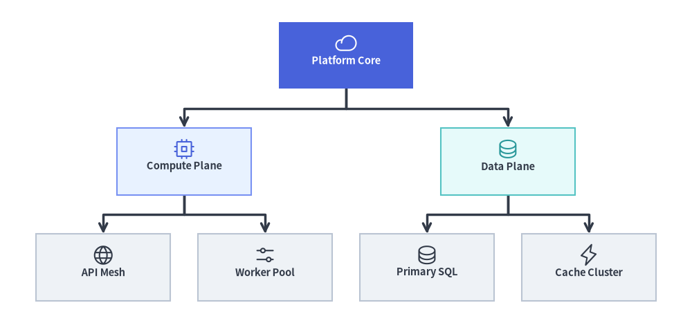
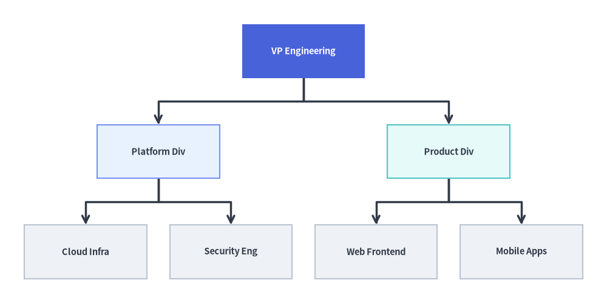
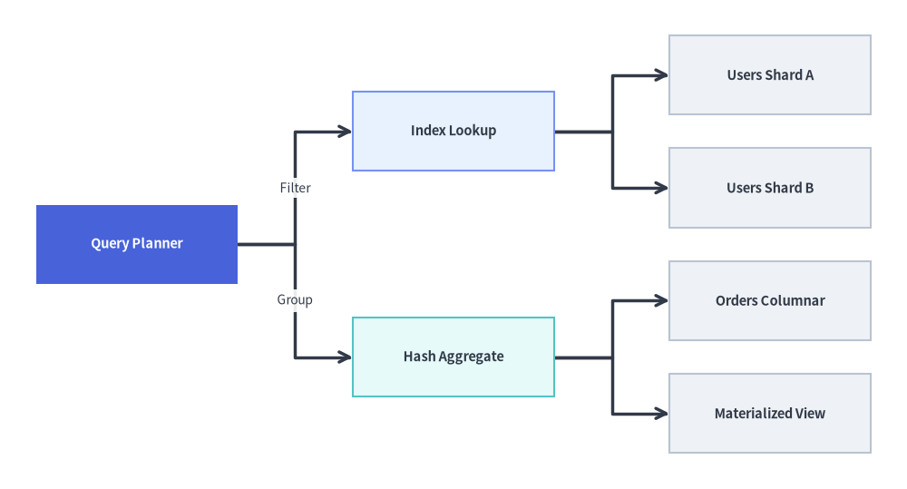
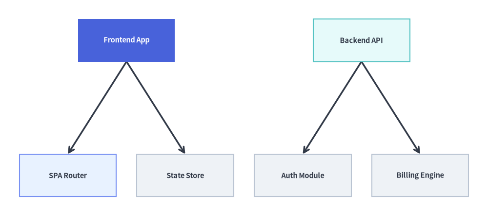

# TreeGraph: Balanced Hierarchies & Decomposition Trees

`TreeGraph` implements the **Reingold-Tilford / Buchheim compact tree layout algorithm**, computing balanced `(cx, cy)` node centers and branch waypoints so that every parent node is symmetrically centered over (or beside) its children while sibling subtrees are packed tightly without ever colliding.

Use `TreeGraph` whenever your topology is a strict tree (every node has at most one parent), such as organization charts, Abstract Syntax Trees (ASTs), call hierarchies, taxonomy breakdowns, or fault trees. Call `layout = g.get_layout(margin=...)` to solve coordinates and render with [`FlowDiagram`](../06_diagrams/flow.md), [`ArchitectureDiagram`](../06_diagrams/architecture.md), or [`drawlib.shapes`](../02_drawing_primitives/shapes_overview.md) and [`drawlib.lines`](../02_drawing_primitives/lines.md).


<figure class="drawlib-image" style="text-align: center;">
  
  <figcaption class="drawlib-caption">TreeGraph Overview: Balanced Buchheim Tree Coordinates Rendered with Orthogonal Branch Polylines and Icons</figcaption>
</figure>

<details class="drawlib-code-details">
<summary>Source Code</summary>

```python
from drawlib.canvas import save, setup
from drawlib.graph import TreeGraph
from drawlib.icons import phosphor
from drawlib.lines import lines
from drawlib.shapes import rectangle
from drawlib.styles import Styles

setup(width=124, height=58)

g = TreeGraph(
    root="core",
    direction="TB",
    level_sep=7.0,
    sibling_sep=5.0,
    edge_routing="orthogonal",
    default_node_width=24.0,
    default_node_height=12.0,
)

# Level 0: Root Node
g.node("core")

# Level 1: Division Branches
g.child("core", "compute")
g.child("core", "data")

# Level 2: Leaf Subsystems
g.child("compute", "api")
g.child("compute", "workers")
g.child("data", "sql")
g.child("data", "cache")

# 1. Compute balanced tree coordinates & orthogonal branch waypoints
layout = g.get_layout(margin=4.5)

# 2. Render orthogonal tree branches from layout.edges
for e in layout.edges:
    lines(e.points, arrow_head="->", style=Styles.DarkBold)

# 3. Render node cards & Phosphor icons at solved (cx, cy) coordinates
node_meta = {
    "core": ("\nPlatform Core", Styles.PrimaryFlat, Styles.WhiteBold, phosphor.cloud, Styles.White),
    "compute": ("\nCompute Plane", Styles.PrimaryNeutral, Styles.DarkBold, phosphor.cpu, Styles.Primary),
    "data": ("\nData Plane", Styles.SecondaryNeutral, Styles.DarkBold, phosphor.database, Styles.Secondary),
    "api": ("\nAPI Mesh", Styles.Neutral, Styles.DarkBold, phosphor.globe, Styles.Dark),
    "workers": ("\nWorker Pool", Styles.Neutral, Styles.DarkBold, phosphor.sliders_horizontal, Styles.Dark),
    "sql": ("\nPrimary SQL", Styles.Neutral, Styles.DarkBold, phosphor.database, Styles.Dark),
    "cache": ("\nCache Cluster", Styles.Neutral, Styles.DarkBold, phosphor.lightning, Styles.Dark),
}

for nid, (label, box_st, txt_st, icon_fn, ic_st) in node_meta.items():
    n = layout[nid]
    rectangle(
        n.xy,
        width=n.width,
        height=n.height,
        style=box_st,
        text=label,
        text_style=txt_st.patch(text_size=10.5),
    )
    icon_fn((n.x, n.y + 2.2), width=4.0, style=ic_st)

save()
```

</details>


---

## 1. Constructor, `.child()`, & `get_layout()` API

```python
from drawlib.graph import TreeGraph

g = TreeGraph(
    root="vp",                       # Explicit root node ID (auto-detected if None)
    direction="TB",                  # "TB" (Top-to-Bottom) or "LR" (Left-to-Right)
    level_sep=12.0,                  # Fixed gap between tree depths (auto-scales if None)
    sibling_sep=6.0,                 # Minimum gap between sibling nodes (auto-scales if None)
    edge_routing="orthogonal",       # "orthogonal" or "straight"
    default_node_width=24.0,
    default_node_height=11.0,
)

layout = g.get_layout(margin=5.0)
print(layout)                        # Inspect solved node centers & branch waypoints
```

### Parameter Reference

| Parameter | Type | Default | Description |
| :--- | :--- | :--- | :--- |
| `root` | `str \| None` | `None` | Explicit root node ID. If `None`, automatically detects all nodes with in-degree `0` and lays out multi-root forests side-by-side. |
| `direction` | `Literal["TB", "LR"]` | `"TB"` | Tree growth orientation (`"TB"` top-to-bottom or `"LR"` left-to-right). |
| `level_sep` | `float \| None` | `None` | Fixed distance between successive tree depths. Auto-scales to canvas if `None`. |
| `sibling_sep` | `float \| None` | `None` | Fixed minimum separation between adjacent siblings. Auto-scales to canvas if `None`. |
| `edge_routing` | `Literal["orthogonal", "straight"]` | `"orthogonal"` | Edge path routing (`"orthogonal"` right-angled tree branches or `"straight"` Euclidean segments) stored in `edge_layout.points`. |
| `default_node_width` | `float` | `22.0` | Default node width in canvas units. |
| `default_node_height` | `float` | `12.0` | Default node height in canvas units. |

### Concise Tree Construction with `g.child(...)`

In addition to `g.node(id, *, width=None, height=None)` and `g.edge(src, dst)`, `TreeGraph` provides a single-call `.child()` helper that registers a child node and connects it from `parent` in one step:

```python
g.child(
    parent: str,
    child_id: str,
    *,
    width: float | None = None,
    height: float | None = None,
) -> Node
```

> **Note**:
> - **Multi-Root Forests (`root=None`)**: When `root=None` and multiple nodes have in-degree `0` (no incoming edges), `TreeGraph` automatically creates a virtual super-root during layout calculation and arranges the independent trees side-by-side as a balanced forest.
> - **Strict Tree Validation**: `TreeGraph` validates that the graph is a strict acyclic tree (at most one parent per node). If a node has multiple parents (a diamond DAG), use [`LayerGraph`](./layer_graph.md) or [`ArchitectureGraph`](./architecture_graph.md) instead.

---

## 2. Top-Down (`TB`) Engineering Organization Hierarchy with `FlowDiagram`

A top-down (`direction="TB"`) tree is ideal for organizational structures, class taxonomies, and ASTs. Notice how the Buchheim contour solver (`g.get_layout()`) centers `VP Engineering` over the two division heads and evenly spaces the four leaf teams, while `FlowDiagram` (`Process` + `fork()`) renders the styled cards and orthogonal tree forks:


```python
from drawlib.canvas import save, setup
from drawlib.diagrams.flow import FlowDiagram, Process
from drawlib.graph import TreeGraph
from drawlib.styles import Styles

setup(width=124, height=62)

# Step 1: Declare tree topology & solve coordinates
g = TreeGraph(
    root="vp",
    direction="TB",
    default_node_width=25.0,
    default_node_height=11.0,
)
g.node("vp")
g.child("vp", "plat")
g.child("vp", "prod")
g.child("plat", "infra")
g.child("plat", "sec")
g.child("prod", "web")
g.child("prod", "mob")

layout = g.get_layout(margin=5.0)

# Step 2: Place Process nodes at solved layout[id].xy centers in FlowDiagram
fd = FlowDiagram(
    node_style=Styles.Neutral.patch(text_size=10.5),
    edge_style=Styles.DarkBold,
    edge_text_style=Styles.Dark.patch(text_size=10.0),
)

nodes = {}
for nid, label, st, tst in [
    ("vp", "VP Engineering", Styles.PrimaryFlat, Styles.WhiteBold),
    ("plat", "Platform Div", Styles.PrimaryNeutral, Styles.DarkBold),
    ("prod", "Product Div", Styles.SecondaryNeutral, Styles.DarkBold),
    ("infra", "Cloud Infra", Styles.Neutral, Styles.DarkBold),
    ("sec", "Security Eng", Styles.Neutral, Styles.DarkBold),
    ("web", "Web Frontend", Styles.Neutral, Styles.DarkBold),
    ("mob", "Mobile Apps", Styles.Neutral, Styles.DarkBold),
]:
    nl = layout[nid]
    nodes[nid] = fd.add(
        Process(
            label,
            width=nl.width,
            height=nl.height,
            style=st,
            text_style=tst.patch(text_size=10.5),
        ),
        xy=nl.xy,
    )

for e in layout.edges:
    fd.connect(nodes[e.src], nodes[e.dst], start_side="bottom", end_side="top")

fd.draw()
save()
```

<figure class="drawlib-image" style="text-align: center;">
  
  <figcaption class="drawlib-caption">Top-Down (TB) Engineering Organization Hierarchy Solved with TreeGraph and Rendered with FlowDiagram</figcaption>
</figure>


---

## 3. Left-to-Right (`LR`) Service Decomposition & Call Tree

Switching to `direction="LR"` grows the hierarchy horizontally from left to right. This layout works exceptionally well for API request fan-out trees, work breakdown structures (WBS), and query execution plans where labels are wider than they are tall:


```python
from drawlib.canvas import save, setup
from drawlib.diagrams.flow import FlowDiagram, Process
from drawlib.graph import TreeGraph
from drawlib.styles import Styles

setup(width=126, height=68)

# Step 1: Solve Left-to-Right tree coordinates
g = TreeGraph(
    root="query_plan",
    direction="LR",
    default_node_width=28.0,
    default_node_height=11.0,
)
g.node("query_plan")
g.child("query_plan", "index_scan")
g.child("query_plan", "agg_stage")
g.child("index_scan", "shard_1")
g.child("index_scan", "shard_2")
g.child("agg_stage", "col_store")
g.child("agg_stage", "cache_hit")

layout = g.get_layout(margin=5.0)

# Step 2: Render with FlowDiagram and labeled branch connectors
fd = FlowDiagram(
    node_style=Styles.Neutral.patch(text_size=10.5),
    edge_style=Styles.DarkBold,
    edge_text_style=Styles.Dark.patch(text_size=10.0),
)

nodes = {}
for nid, label, st, tst in [
    ("query_plan", "Query Planner", Styles.PrimaryFlat, Styles.WhiteBold),
    ("index_scan", "Index Lookup", Styles.PrimaryNeutral, Styles.DarkBold),
    ("agg_stage", "Hash Aggregate", Styles.SecondaryNeutral, Styles.DarkBold),
    ("shard_1", "Users Shard A", Styles.Neutral, Styles.DarkBold),
    ("shard_2", "Users Shard B", Styles.Neutral, Styles.DarkBold),
    ("col_store", "Orders Columnar", Styles.Neutral, Styles.DarkBold),
    ("cache_hit", "Materialized View", Styles.Neutral, Styles.DarkBold),
]:
    nl = layout[nid]
    nodes[nid] = fd.add(
        Process(
            label,
            width=nl.width,
            height=nl.height,
            style=st,
            text_style=tst.patch(text_size=10.5),
        ),
        xy=nl.xy,
    )

fd.connect(nodes["query_plan"], nodes["index_scan"], label="Filter", start_side="right", end_side="left")
fd.connect(nodes["query_plan"], nodes["agg_stage"], label="Group", start_side="right", end_side="left")
fd.connect(nodes["index_scan"], nodes["shard_1"], start_side="right", end_side="left")
fd.connect(nodes["index_scan"], nodes["shard_2"], start_side="right", end_side="left")
fd.connect(nodes["agg_stage"], nodes["col_store"], start_side="right", end_side="left")
fd.connect(nodes["agg_stage"], nodes["cache_hit"], start_side="right", end_side="left")

fd.draw()
save()
```

<figure class="drawlib-image" style="text-align: center;">
  
  <figcaption class="drawlib-caption">Left-to-Right (LR) Query Execution Decomposition Tree Rendered with FlowDiagram</figcaption>
</figure>


---

## 4. Automatic Multi-Root Forest (`root=None`) & Straight Edge Routing

When `root=None`, `TreeGraph` automatically identifies all nodes with in-degree `0` and arranges multiple independent trees side-by-side as a balanced forest. Passing `edge_routing="straight"` populates `edge_layout.points` with direct Euclidean line segments between parent and child ports:


```python
from drawlib.canvas import save, setup
from drawlib.graph import TreeGraph
from drawlib.lines import lines
from drawlib.shapes import rectangle
from drawlib.styles import Styles

setup(width=126, height=56)

g = TreeGraph(
    direction="TB",
    root=None,
    edge_routing="straight",
    default_node_width=25.0,
    default_node_height=11.0,
)

# Tree 1: Frontend App Hierarchy (Root 1)
g.node("fe_app")
g.child("fe_app", "fe_router")
g.child("fe_app", "fe_store")

# Tree 2: Backend API Hierarchy (Root 2)
g.node("be_api")
g.child("be_api", "be_auth")
g.child("be_api", "be_billing")

layout = g.get_layout(margin=5.0)

for e in layout.edges:
    lines(e.points, arrow_head="->", style=Styles.DarkBold)

for nid, label, st, tst in [
    ("fe_app", "Frontend App", Styles.PrimaryFlat, Styles.WhiteBold),
    ("fe_router", "SPA Router", Styles.PrimaryNeutral, Styles.DarkBold),
    ("fe_store", "State Store", Styles.Neutral, Styles.DarkBold),
    ("be_api", "Backend API", Styles.SecondaryNeutral, Styles.DarkBold),
    ("be_auth", "Auth Module", Styles.Neutral, Styles.DarkBold),
    ("be_billing", "Billing Engine", Styles.Neutral, Styles.DarkBold),
]:
    nl = layout[nid]
    rectangle(
        nl.xy,
        width=nl.width,
        height=nl.height,
        style=st,
        text=label,
        text_style=tst.patch(text_size=10.5),
    )

save()
```

<figure class="drawlib-image" style="text-align: center;">
  
  <figcaption class="drawlib-caption">Automatic Multi-Root Forest (root=None) with Straight Edge Routing via layout.edges</figcaption>
</figure>


---

## 5. Best Practices

1. **Choose `TreeGraph` vs. `SmartArts.TreeNode`**:
   - Use `TreeGraph` (`drawlib.graph`) when you want balanced node-and-edge graph coordinates (`layout = g.get_layout()`) to render with `FlowDiagram`, `ArchitectureDiagram`, or custom primitives.
   - Use [`TreeNode`](../04_smartarts/tree.md) (`drawlib.smartarts`) when you want a compact file-explorer / indented directory tree list.
2. **Use `direction="LR"` for Wide Trees**: When a tree has many leaf nodes (`6+` leaves), `direction="LR"` stacks leaves vertically so labels never crowd horizontally.
