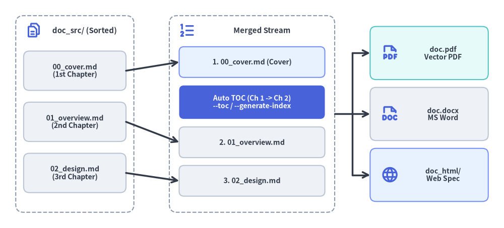
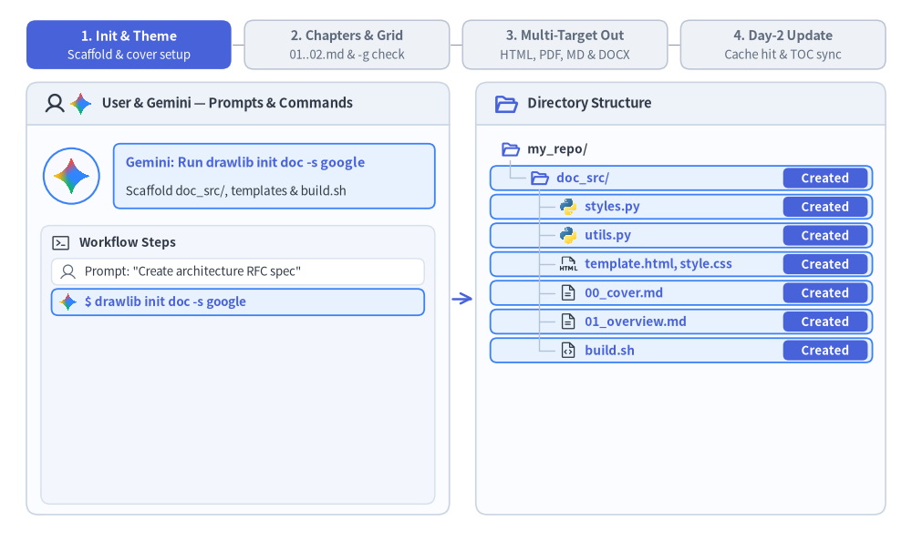

# Linear Document Project Guide (`drawlib init doc`)

The `doc` starter template is designed for authoring linear technical documents — such as specifications, Request for Comments (RFCs), system architecture proposals, whitepapers, thesis papers, and formal engineering reports.

By unifying single-page specs and multi-chapter reports into a single archetype, Drawlib allows you to compile **HTML, vector PDF, editable MS Word (`.docx`), Markdown, and standalone images** from the same Markdown source files.


<figure class="drawlib-image" style="text-align: center;">
  
  <figcaption class="drawlib-caption">Lexicographical Chapter Merging and Automatic Table of Contents (--toc / --generate-index) Injection</figcaption>
</figure>

<details class="drawlib-code-details">
<summary>Source Code</summary>

```python
from drawlib.canvas import save, setup
from drawlib.icons import phosphor
from drawlib.lines import line
from drawlib.shapes import rectangle
from drawlib.styles import Styles
from drawlib.text import text

setup(width=128, height=58)

# Left Container: doc_src/ Lexicographical Source Chapters
rectangle((19, 29), width=30, height=50, style=Styles.MutedDashed.patch(shape_r=2.0))
phosphor.files((8.5, 50.2), width=4.2, style=Styles.PrimaryBold)
text((21.5, 50.2), "doc_src/ (Sorted)", style=Styles.DarkBold.patch(text_size=10.8))

src_chapters = [
    (40.0, "00_cover.md\n(1st Chapter)"),
    (27.0, "01_overview.md\n(2nd Chapter)"),
    (14.0, "02_design.md\n(3rd Chapter)"),
]
for sy, label in src_chapters:
    rectangle(
        (19, sy),
        width=26,
        height=10.0,
        style=Styles.Neutral.patch(shape_r=1.5),
        text=label,
        text_style=Styles.DarkBold.patch(text_size=10.2),
    )

# Center Container: Merged Linear Document Stream (--page-break)
rectangle((64, 29), width=42, height=50, style=Styles.MutedDashed.patch(shape_r=2.0))
phosphor.list_numbers((47.5, 50.2), width=4.4, style=Styles.PrimaryBold)
text((66.5, 50.2), "Merged Stream", style=Styles.DarkBold.patch(text_size=10.8))

rectangle(
    (64, 42.2),
    width=37,
    height=7.8,
    style=Styles.PrimaryNeutral.patch(shape_r=1.2),
    text="1. 00_cover.md (Cover)",
    text_style=Styles.DarkBold.patch(text_size=10.2),
)
rectangle(
    (64, 32.0),
    width=37,
    height=8.5,
    style=Styles.PrimaryFlat.patch(shape_r=1.2),
    text="Auto TOC (Ch 1 -> Ch 2)\n--toc / --generate-index",
    text_style=Styles.WhiteBold.patch(text_size=10.0),
)
rectangle(
    (64, 21.8),
    width=37,
    height=7.8,
    style=Styles.Neutral.patch(shape_r=1.2),
    text="2. 01_overview.md",
    text_style=Styles.DarkBold.patch(text_size=10.2),
)
rectangle(
    (64, 12.0),
    width=37,
    height=7.8,
    style=Styles.Neutral.patch(shape_r=1.2),
    text="3. 02_design.md",
    text_style=Styles.DarkBold.patch(text_size=10.2),
)

# Arrows: Source -> Merged Stream
line((32, 40.0), (45.5, 42.2), arrow_head="->", style=Styles.DarkBold)
line((32, 27.0), (45.5, 21.8), arrow_head="->", style=Styles.DarkBold)
line((32, 14.0), (45.5, 12.0), arrow_head="->", style=Styles.DarkBold)

# Right: Exported Linear Deliverables
rectangle((109, 44.5), width=30, height=13.5, style=Styles.SecondaryNeutral.patch(shape_r=1.5))
phosphor.file_pdf((99.0, 44.5), width=4.6, style=Styles.PrimaryBold)
text((112.5, 44.5), "doc.pdf\nVector PDF", style=Styles.DarkBold.patch(text_size=10.0))

rectangle((109, 29.0), width=30, height=13.5, style=Styles.Neutral.patch(shape_r=1.5))
phosphor.file_doc((99.0, 29.0), width=4.6, style=Styles.PrimaryBold)
text((112.5, 29.0), "doc.docx\nMS Word", style=Styles.DarkBold.patch(text_size=10.0))

rectangle((109, 13.5), width=30, height=13.5, style=Styles.PrimaryNeutral.patch(shape_r=1.5))
phosphor.globe((99.0, 13.5), width=4.6, style=Styles.PrimaryBold)
text((112.5, 13.5), "doc_html/\nWeb Spec", style=Styles.DarkBold.patch(text_size=10.0))

# Connectors: Merged Stream -> Deliverables
line((85, 29.0), (89.5, 29.0), style=Styles.DarkBold)
line((89.5, 13.5), (89.5, 44.5), style=Styles.DarkBold)
line((89.5, 44.5), (94.0, 44.5), arrow_head="->", style=Styles.DarkBold)
line((89.5, 29.0), (94.0, 29.0), arrow_head="->", style=Styles.DarkBold)
line((89.5, 13.5), (94.0, 13.5), arrow_head="->", style=Styles.DarkBold)

save()
```

</details>


---

## 1. End-to-End Project Workflow

A `doc` project walks through four phases: scaffold `doc_src/` and configure shared theme/cover metadata, author numbered Markdown chapters verified with `-g` grid previews, compile multi-target deliverables (HTML, vector PDF, Markdown, plus optional on-demand MS Word `.docx`), and perform incremental Day-2 updates backed by `.drawlib/cache.db`.


<figure class="drawlib-image" style="text-align: center;">
  
  <figcaption class="drawlib-caption">Linear Document Project Lifecycle: Scaffolding, Multi-Chapter Authoring, 5-Target Export, and Day-2 Incremental Build (APNG Animation)</figcaption>
</figure>

<details class="drawlib-code-details">
<summary>Source Code</summary>

```python
from __future__ import annotations

from drawlib.anim import Animation
from drawlib.canvas import save, setup
from drawlib.icons import ai, code, devops, phosphor, workspace
from drawlib.lines import line
from drawlib.shapes import circle, rectangle
from drawlib.styles import Styles
from drawlib.text import text

W, H = 138.0, 82.0
setup(width=W, height=H)
anim = Animation(fps=10.0, loop=0)

PANE_BG = Styles.Neutral.patch(
    shape_fill_color=(250, 252, 255),
    shape_line_width=0,
    shape_r=1.8,
)
PANE_HEADER_TOP = Styles.Neutral.patch(
    shape_fill_color=(238, 243, 250),
    shape_line_width=0,
    shape_r=1.8,
)
PANE_HEADER_FLAT = Styles.Neutral.patch(
    shape_fill_color=(238, 243, 250),
    shape_line_width=0,
    shape_r=0.0,
)
PANE_BORDER = Styles.Neutral.patch(
    shape_fill_color=(0, 0, 0, 0),
    shape_line_color=(203, 213, 225),
    shape_line_width=1.2,
    shape_r=1.8,
)
SUBPANEL_BG = Styles.Neutral.patch(
    shape_fill_color=(243, 246, 252),
    shape_line_color=(214, 223, 236),
    shape_line_width=1.0,
    shape_r=1.4,
)
ROW_ACTIVE = Styles.PrimaryNeutral.patch(
    shape_fill_color=(232, 242, 255),
    shape_line_color=(59, 130, 246),
    shape_line_width=1.3,
    shape_r=1.0,
)
ROW_USER = Styles.Neutral.patch(
    shape_fill_color=(241, 245, 251),
    shape_line_color=(51, 65, 85),
    shape_line_width=1.4,
    shape_r=1.0,
)
ROW_OPTIONAL = Styles.PrimaryDashed.patch(
    shape_fill_color=(242, 247, 255),
    shape_line_color=(59, 130, 246),
    shape_line_width=1.2,
    shape_r=1.0,
)
ROW_OPTIONAL_DONE = Styles.MutedDashed.patch(
    shape_fill_color=(255, 255, 255),
    shape_line_color=(196, 208, 224),
    shape_line_width=1.0,
    shape_r=1.0,
)
ROW_CACHED = Styles.PrimaryNeutral.patch(
    shape_fill_color=(240, 246, 255),
    shape_line_color=(147, 197, 253),
    shape_line_width=1.1,
    shape_r=1.0,
)
ROW_OUTPUT = Styles.SecondaryNeutral.patch(
    shape_fill_color=(236, 250, 244),
    shape_line_color=(34, 160, 107),
    shape_line_width=1.2,
    shape_r=1.0,
)
ROW_DONE = Styles.Neutral.patch(
    shape_fill_color=(255, 255, 255),
    shape_line_color=(218, 226, 238),
    shape_line_width=1.0,
    shape_r=1.0,
)

PART_ITEMS = [
    ("1. Init & Theme", "Scaffold & cover setup"),
    ("2. Chapters & Grid", "01..02.md & -g check"),
    ("3. Multi-Target Out", "HTML, PDF, MD & DOCX"),
    ("4. Day-2 Update", "Cache hit & TOC sync"),
]


def draw_step_bar(active_part: int) -> None:
    """Draw top 4-phase progress bar (active_part is 1..4)."""
    pill_w = 31.0
    pill_h = 7.4
    gap = 2.0
    start_x = 4.0 + pill_w / 2.0
    cy = 75.2

    for idx, (label, sublabel) in enumerate(PART_ITEMS, start=1):
        cx = start_x + (idx - 1) * (pill_w + gap)
        if idx > 1:
            prev_cx = cx - (pill_w + gap)
            line(
                (prev_cx + pill_w / 2.0 + 0.2, cy),
                (cx - pill_w / 2.0 - 0.2, cy),
                style=Styles.PrimaryBold if idx <= active_part else Styles.MutedThin,
            )

        if idx == active_part:
            st = Styles.PrimaryFlat.patch(shape_r=1.4)
            tst = Styles.WhiteBold.patch(text_size=10.3)
            sub_tst = Styles.White.patch(text_size=9.5)
        elif idx < active_part:
            st = Styles.PrimaryNeutral.patch(shape_r=1.4, shape_line_width=1.1)
            tst = Styles.PrimaryBold.patch(text_size=10.3)
            sub_tst = Styles.Primary.patch(text_size=9.5)
        else:
            st = Styles.Neutral.patch(shape_r=1.4, shape_line_width=1.1)
            tst = Styles.MutedBold.patch(text_size=10.3)
            sub_tst = Styles.Muted.patch(text_size=9.5)

        rectangle((cx, cy), width=pill_w, height=pill_h, style=st)
        text((cx, cy + 1.35), label, style=tst)
        text((cx, cy - 1.55), sublabel, style=sub_tst)


def draw_pane_shell(cx: float, width: float) -> None:
    """Draw a rounded pane container with a top header bar."""
    rectangle((cx, 36.75), width=width, height=65.5, style=PANE_BG)
    rectangle((cx, 66.25), width=width, height=6.5, style=PANE_HEADER_TOP)
    rectangle((cx, 64.60), width=width, height=3.2, style=PANE_HEADER_FLAT)
    line(
        (cx - width / 2.0, 63.0),
        (cx + width / 2.0, 63.0),
        style=Styles.Neutral.patch(line_color=(203, 213, 225), line_width=1.2),
    )
    rectangle((cx, 36.75), width=width, height=65.5, style=PANE_BORDER)


def draw_user_avatar(xy: tuple[float, float], radius: float = 4.2) -> None:
    """Draw circular User avatar badge."""
    circle(
        xy,
        radius=radius,
        style=Styles.Neutral.patch(
            shape_fill_color=(241, 245, 250),
            shape_line_color=(51, 65, 85),
            shape_line_width=1.6,
        ),
    )
    phosphor.user(xy, width=radius * 1.25, style=Styles.DarkBold)


def draw_gemini_avatar(xy: tuple[float, float], radius: float = 4.2) -> None:
    """Draw circular Gemini AI Agent avatar badge."""
    circle(
        xy,
        radius=radius,
        style=Styles.Neutral.patch(
            shape_fill_color=(248, 250, 255),
            shape_line_color=(59, 130, 246),
            shape_line_width=1.5,
        ),
    )
    ai.gemini(xy, width=radius * 1.42, style=Styles.Neutral)


def draw_actor_row_icon(
    actor_kind: str,
    xy: tuple[float, float],
    *,
    muted: bool = False,
) -> None:
    """Draw mini User or Gemini icon at the start of an operation row."""
    if actor_kind == "user":
        phosphor.user(xy, width=2.8, style=Styles.Muted if muted else Styles.DarkBold)
    elif actor_kind == "user_git":
        phosphor.user(xy, width=2.8, style=Styles.Muted if muted else Styles.DarkBold)
        devops.git((xy[0] + 2.8, xy[1]), width=2.6, style=Styles.Neutral)
    else:
        ai.gemini(xy, width=2.9, style=Styles.Neutral)


def draw_tree_icon(kind: str, xy: tuple[float, float], *, muted: bool = False) -> None:
    """Draw file or folder icon in the right-side directory tree."""
    if kind == "folder_open":
        phosphor.folder_open(
            xy,
            width=3.0,
            style=Styles.Muted if muted else Styles.PrimaryBold,
        )
    elif kind == "folder_out":
        phosphor.folder(
            xy,
            width=3.0,
            style=Styles.Muted if muted else Styles.SecondaryBold,
        )
    elif kind == "py":
        code.python(xy, width=2.8, style=Styles.Neutral)
    elif kind == "html":
        phosphor.file_html(
            xy,
            width=2.9,
            style=Styles.Muted if muted else Styles.Dark,
        )
    elif kind == "md":
        phosphor.file_text(
            xy,
            width=2.9,
            style=Styles.Muted if muted else Styles.Dark,
        )
    elif kind == "sh":
        phosphor.file_code(
            xy,
            width=2.9,
            style=Styles.Muted if muted else Styles.Dark,
        )
    elif kind == "globe":
        phosphor.globe(
            xy,
            width=2.9,
            style=Styles.Muted if muted else Styles.PrimaryBold,
        )
    elif kind == "pdf":
        phosphor.file_pdf(
            xy,
            width=2.9,
            style=Styles.Muted if muted else Styles.Danger,
        )
    elif kind == "word":
        workspace.word(xy, width=2.8, style=Styles.Neutral)
    elif kind == "grid":
        phosphor.grid_four(
            xy,
            width=2.9,
            style=Styles.Muted if muted else Styles.PrimaryBold,
        )


def draw_workspace_frame(
    *,
    active_phase: int,
    actor: str,
    actor_title: str,
    actor_sub: str,
    actor_optional: bool,
    ops: list[tuple[str, str, str]],
    show_day2_note: bool,
    tree_items: list[tuple[str, int, str, str]],
    row_states: dict[str, tuple[str, str]],
    committed: bool,
    pulse_arrow: bool,
) -> None:
    """Render one frame of the 2-pane split workspace."""
    draw_step_bar(active_phase)

    # Left Pane
    draw_pane_shell(36.0, 64.0)
    phosphor.user((8.3, 66.25), width=3.4, style=Styles.DarkBold)
    ai.gemini((12.2, 66.25), width=3.7, style=Styles.Neutral)
    text(
        (15.4, 66.25),
        "User & Gemini — Prompts & Commands",
        style=Styles.DarkBold.patch(text_size=10.5, halign="left"),
    )

    if actor == "user":
        draw_user_avatar((10.8, 55.3), radius=4.2)
        bubble_st = ROW_USER
        title_st = Styles.DarkBold.patch(text_size=10.3, halign="left")
    else:
        draw_gemini_avatar((10.8, 55.3), radius=4.2)
        bubble_st = ROW_OPTIONAL if actor_optional else ROW_ACTIVE
        title_st = Styles.PrimaryBold.patch(text_size=10.3, halign="left")

    rectangle((41.5, 55.3), width=48.6, height=9.8, style=bubble_st)
    text((19.0, 57.3), actor_title, style=title_st)
    text((19.0, 53.0), actor_sub, style=Styles.Dark.patch(text_size=9.7, halign="left"))

    rectangle((36.0, 26.7), width=59.6, height=42.2, style=SUBPANEL_BG)
    phosphor.terminal_window((9.2, 45.2), width=3.1, style=Styles.Dark)
    text(
        (12.0, 45.2),
        "Workflow Steps",
        style=Styles.DarkBold.patch(text_size=9.8, halign="left"),
    )

    op_ys = [40.8, 36.2, 31.6, 27.0, 22.4, 17.8, 13.2, 8.6]
    for (akind, label, state), oy in zip(ops, op_ys):
        is_done_like = state in {"done", "optional_done"}
        if state == "active_user":
            ost = ROW_USER
            otxt = Styles.DarkBold.patch(text_size=9.7, halign="left")
        elif state == "active_gemini":
            ost = ROW_ACTIVE
            otxt = Styles.PrimaryBold.patch(text_size=9.7, halign="left")
        elif state == "optional":
            ost = ROW_OPTIONAL
            otxt = Styles.PrimaryBold.patch(text_size=9.7, halign="left")
        elif state == "optional_done":
            ost = ROW_OPTIONAL_DONE
            otxt = Styles.Dark.patch(text_size=9.5, halign="left")
        else:
            ost = ROW_DONE
            otxt = Styles.Dark.patch(text_size=9.5, halign="left")

        rectangle((36.0, oy), width=56.4, height=4.0, style=ost)
        draw_actor_row_icon(akind, (10.3, oy), muted=is_done_like)
        text((15.5 if akind == "user_git" else 12.8, oy), label, style=otxt)

        if state in {"optional", "optional_done"}:
            opt_pill_st = (
                Styles.PrimaryNeutral.patch(shape_r=0.8)
                if state == "optional"
                else Styles.Neutral.patch(
                    shape_fill_color=(244, 247, 252),
                    shape_line_color=(196, 208, 224),
                    shape_line_width=1.0,
                    shape_r=0.8,
                )
            )
            opt_txt_st = (
                Styles.PrimaryBold.patch(text_size=9.5)
                if state == "optional"
                else Styles.MutedBold.patch(text_size=9.5)
            )
            rectangle(
                (58.6, oy),
                width=10.0,
                height=3.1,
                style=opt_pill_st,
                text="Optional",
                text_style=opt_txt_st,
            )

    if show_day2_note:
        rectangle(
            (36.0, 11.4),
            width=55.6,
            height=7.6,
            style=Styles.Neutral.patch(
                shape_fill_color=(255, 255, 255),
                shape_line_color=(210, 220, 234),
                shape_line_width=1.0,
                shape_r=1.1,
            ),
        )
        text(
            (36.0, 13.2),
            "1 day later — 00_cover.md & 01_overview.md untouched",
            style=Styles.MutedBold.patch(text_size=9.6),
        )
        text(
            (36.0, 9.6),
            "Unchanged diagrams hit .drawlib/cache.db (<1ms)",
            style=Styles.Muted.patch(text_size=9.5),
        )

    # Center connector arrow
    line(
        (68.4, 36.75),
        (71.6, 36.75),
        arrow_head="->",
        style=(
            Styles.PrimaryBold.patch(line_width=1.8)
            if pulse_arrow
            else Styles.MutedThin.patch(line_width=1.2)
        ),
    )

    # Right Pane
    draw_pane_shell(103.0, 62.0)
    phosphor.folder_open((76.6, 66.25), width=3.8, style=Styles.PrimaryBold)
    text(
        (79.8, 66.25),
        "Directory Structure",
        style=Styles.DarkBold.patch(text_size=10.6, halign="left"),
    )

    if committed:
        rectangle((123.2, 66.25), width=17.6, height=4.4, style=ROW_OUTPUT)
        devops.git((116.8, 66.25), width=2.8, style=Styles.Neutral)
        text(
            (119.0, 66.25),
            "Committed",
            style=Styles.SecondaryBold.patch(text_size=9.5, halign="left"),
        )

    tree_rows = [
        (key, lvl, ik, lbl, 59.35 - idx * 4.35)
        for idx, (key, lvl, ik, lbl) in enumerate(tree_items)
    ]

    # Row highlight pills & status badges
    for key, _lvl, _ik, _lbl, ry in tree_rows:
        if key not in row_states:
            continue
        rstate, badge_txt = row_states[key]
        if rstate in {"new", "active"}:
            rst = ROW_ACTIVE
            b_st = Styles.PrimaryFlat.patch(shape_r=0.8)
            b_txt = Styles.WhiteBold.patch(text_size=9.5)
        elif rstate == "optional":
            rst = ROW_OPTIONAL
            b_st = Styles.PrimaryNeutral.patch(shape_r=0.8)
            b_txt = Styles.PrimaryBold.patch(text_size=9.5)
        elif rstate == "cached":
            rst = ROW_CACHED
            b_st = Styles.PrimaryNeutral.patch(shape_r=0.8)
            b_txt = Styles.PrimaryBold.patch(text_size=9.5)
        elif rstate in {"output", "verified"}:
            rst = ROW_OUTPUT
            b_st = Styles.SecondaryFlat.patch(shape_r=0.8)
            b_txt = Styles.WhiteBold.patch(text_size=9.5)
        else:
            rst = None
            b_st = None
            b_txt = None

        if rst is not None:
            rectangle((103.1, ry), width=57.8, height=3.68, style=rst)
        if badge_txt and b_st is not None and b_txt is not None:
            bw = 15.8 if len(badge_txt) >= 9 else 12.8
            bx = 131.3 - bw / 2.0
            rectangle(
                (bx, ry),
                width=bw,
                height=3.05,
                style=b_st,
                text=badge_txt,
                text_style=b_txt,
            )

    # Geometric tree guide lines
    guide_st = Styles.MutedThin.patch(line_color=(180, 194, 212), line_width=1.0)
    lvl1_ys = [ry for _k, lvl, _ik, _lb, ry in tree_rows if lvl == 1]
    if lvl1_ys:
        line((77.2, tree_rows[0][4] - 1.7), (77.2, min(lvl1_ys)), style=guide_st)

    idx_r = 0
    while idx_r < len(tree_rows):
        _k, lvl, _ik, _lb, ry = tree_rows[idx_r]
        if lvl == 1:
            j = idx_r + 1
            last_child_y = None
            while j < len(tree_rows) and tree_rows[j][1] == 2:
                last_child_y = tree_rows[j][4]
                j += 1
            if last_child_y is not None:
                line((81.6, ry - 1.7), (81.6, last_child_y), style=guide_st)
            idx_r = j
        else:
            idx_r += 1

    for key, lvl, ik, lbl, ry in tree_rows:
        rstate = row_states.get(key, ("normal", ""))[0]
        is_muted = rstate == "muted"
        if lvl == 0:
            ix, lx = 77.2, 79.8
        elif lvl == 1:
            line((77.2, ry), (79.5, ry), style=guide_st)
            ix, lx = 81.6, 84.2
        else:
            line((81.6, ry), (83.9, ry), style=guide_st)
            ix, lx = 86.0, 88.5

        draw_tree_icon(ik, (ix, ry), muted=is_muted)

        if rstate in {"new", "active", "optional", "cached"}:
            t_st = Styles.PrimaryBold.patch(text_size=9.8, halign="left")
        elif rstate in {"output", "verified"}:
            t_st = Styles.SecondaryBold.patch(text_size=9.8, halign="left")
        elif is_muted:
            t_st = Styles.Muted.patch(text_size=9.6, halign="left")
        elif lvl <= 1:
            t_st = Styles.DarkBold.patch(text_size=9.8, halign="left")
        else:
            t_st = Styles.Dark.patch(text_size=9.7, halign="left")

        text((lx, ry), lbl, style=t_st)


TREE_STARTER = [
    ("root", 0, "folder_open", "my_repo/"),
    ("doc_src", 1, "folder_open", "doc_src/"),
    ("styles", 2, "py", "styles.py"),
    ("utils", 2, "py", "utils.py"),
    ("template", 2, "html", "template.html, style.css"),
    ("cover", 2, "md", "00_cover.md"),
    ("overview", 2, "md", "01_overview.md"),
    ("build_sh", 2, "sh", "build.sh"),
]

TREE_CHAPTERS = [
    ("root", 0, "folder_open", "my_repo/"),
    ("doc_src", 1, "folder_open", "doc_src/"),
    ("styles", 2, "py", "styles.py"),
    ("utils", 2, "py", "utils.py"),
    ("template", 2, "html", "template.html, style.css"),
    ("cover", 2, "md", "00_cover.md"),
    ("overview", 2, "md", "01_overview.md"),
    ("design", 2, "md", "02_design.md"),
    ("build_sh", 2, "sh", "build.sh"),
]

TREE_GRID_PREVIEW = [
    *TREE_CHAPTERS,
    ("scratch", 1, "folder_out", ".drawlib/scratch/"),
    ("grid_png", 2, "grid", "grid.png"),
]

TREE_FULL = [
    *TREE_CHAPTERS,
    ("out_html", 1, "globe", "doc_html/"),
    ("out_pdf", 1, "pdf", "doc.pdf"),
    ("out_md", 1, "folder_out", "doc_markdown/"),
    ("out_docx", 1, "word", "doc.docx"),
]

DURATIONS = [3.1, 3.1, 3.3] * 4

# =====================================================================
# Phase 1: 1. Init & Theme (f0, f1, f2)
# =====================================================================
with anim.frame(duration=DURATIONS[0]):
    draw_workspace_frame(
        active_phase=1,
        actor="gemini",
        actor_title="Gemini: Run drawlib init doc -s google",
        actor_sub="Scaffold doc_src/, templates & build.sh",
        actor_optional=False,
        ops=[
            ("user", 'Prompt: "Create architecture RFC spec"', "done"),
            ("gemini", "$ drawlib init doc -s google", "active_gemini"),
        ],
        show_day2_note=False,
        tree_items=TREE_STARTER,
        row_states={
            "doc_src": ("new", "Created"),
            "styles": ("new", "Created"),
            "utils": ("new", "Created"),
            "template": ("new", "Created"),
            "cover": ("new", "Created"),
            "overview": ("new", "Created"),
            "build_sh": ("new", "Created"),
        },
        committed=False,
        pulse_arrow=True,
    )

with anim.frame(duration=DURATIONS[1]):
    draw_workspace_frame(
        active_phase=1,
        actor="gemini",
        actor_title="Gemini: Configure styles.py typography",
        actor_sub="Set shared brand palette & document fonts",
        actor_optional=False,
        ops=[
            ("user", 'Prompt: "Create architecture RFC spec"', "done"),
            ("gemini", "$ drawlib init doc -s google", "done"),
            ("gemini", "Edit doc_src/styles.py & utils.py", "active_gemini"),
        ],
        show_day2_note=False,
        tree_items=TREE_STARTER,
        row_states={
            "styles": ("active", "Updated"),
            "utils": ("active", "Updated"),
        },
        committed=False,
        pulse_arrow=True,
    )

with anim.frame(duration=DURATIONS[2]):
    draw_workspace_frame(
        active_phase=1,
        actor="gemini",
        actor_title="Gemini: Customize 00_cover.md metadata",
        actor_sub="Set document title, abstract & cover hero",
        actor_optional=False,
        ops=[
            ("user", 'Prompt: "Create architecture RFC spec"', "done"),
            ("gemini", "$ drawlib init doc -s google", "done"),
            ("gemini", "Edit doc_src/styles.py & utils.py", "done"),
            ("gemini", "Edit doc_src/00_cover.md", "active_gemini"),
        ],
        show_day2_note=False,
        tree_items=TREE_STARTER,
        row_states={
            "cover": ("active", "Updated"),
        },
        committed=False,
        pulse_arrow=True,
    )

# =====================================================================
# Phase 2: 2. Chapters & Grid (f3, f4, f5)
# =====================================================================
with anim.frame(duration=DURATIONS[3]):
    draw_workspace_frame(
        active_phase=2,
        actor="gemini",
        actor_title="Gemini: Author 01_overview & 02_design",
        actor_sub="Numbered chapters with ```drawlib blocks",
        actor_optional=False,
        ops=[
            ("gemini", "$ drawlib init doc -s google", "done"),
            ("gemini", "Edit doc_src/styles.py & 00_cover.md", "done"),
            ("gemini", "Write 01_overview.md & 02_design.md", "active_gemini"),
        ],
        show_day2_note=False,
        tree_items=TREE_CHAPTERS,
        row_states={
            "overview": ("active", "Updated"),
            "design": ("new", "Created"),
        },
        committed=False,
        pulse_arrow=True,
    )

with anim.frame(duration=DURATIONS[4]):
    draw_workspace_frame(
        active_phase=2,
        actor="gemini",
        actor_title="Gemini: Stage 2 -g coordinate grid check",
        actor_sub="Preview 02_design.md arch.png with grid",
        actor_optional=False,
        ops=[
            ("gemini", "$ drawlib init doc -s google", "done"),
            ("gemini", "Edit doc_src/styles.py & 00_cover.md", "done"),
            ("gemini", "Write 01_overview.md & 02_design.md", "done"),
            ("gemini", "$ drawlib show 02_design.md arch.png -g", "active_gemini"),
        ],
        show_day2_note=False,
        tree_items=TREE_GRID_PREVIEW,
        row_states={
            "design": ("active", "Preview"),
            "grid_png": ("active", "Grid -g"),
        },
        committed=False,
        pulse_arrow=True,
    )

with anim.frame(duration=DURATIONS[5]):
    draw_workspace_frame(
        active_phase=2,
        actor="gemini",
        actor_title="Gemini: Verify typography & zero clipping",
        actor_sub="Labels match 16px body prose; margins clean",
        actor_optional=False,
        ops=[
            ("gemini", "$ drawlib init doc -s google", "done"),
            ("gemini", "Edit doc_src/styles.py & 00_cover.md", "done"),
            ("gemini", "Write 01_overview.md & 02_design.md", "done"),
            ("gemini", "$ drawlib show 02_design.md arch.png -g", "done"),
            ("gemini", "Verify chapter diagrams & anchors", "active_gemini"),
        ],
        show_day2_note=False,
        tree_items=TREE_CHAPTERS,
        row_states={
            "overview": ("verified", "Verified"),
            "design": ("verified", "Verified"),
        },
        committed=False,
        pulse_arrow=True,
    )

# =====================================================================
# Phase 3: 3. Multi-Target Out (f6, f7, f8)
# =====================================================================
with anim.frame(duration=DURATIONS[6]):
    draw_workspace_frame(
        active_phase=3,
        actor="gemini",
        actor_title="Gemini: Run ./doc_src/build.sh",
        actor_sub="Compiles doc_html/, doc.pdf (--toc) & MD",
        actor_optional=False,
        ops=[
            ("gemini", "$ drawlib init doc -s google", "done"),
            ("gemini", "Write 01_overview.md & 02_design.md", "done"),
            ("gemini", "$ drawlib show 02_design.md arch.png -g", "done"),
            ("gemini", "$ ./doc_src/build.sh  (HTML, PDF, MD)", "active_gemini"),
        ],
        show_day2_note=False,
        tree_items=TREE_FULL,
        row_states={
            "out_html": ("output", "Output"),
            "out_pdf": ("output", "Output"),
            "out_md": ("output", "Output"),
            "out_docx": ("optional", "Optional"),
        },
        committed=False,
        pulse_arrow=True,
    )

with anim.frame(duration=DURATIONS[7]):
    draw_workspace_frame(
        active_phase=3,
        actor="gemini",
        actor_title="Gemini: On-demand MS Word (.docx) export",
        actor_sub="Editable Word doc with Cover, TOC & 200 DPI",
        actor_optional=True,
        ops=[
            ("gemini", "$ drawlib init doc -s google", "done"),
            ("gemini", "Write 01_overview.md & 02_design.md", "done"),
            ("gemini", "$ drawlib show 02_design.md arch.png -g", "done"),
            ("gemini", "$ ./doc_src/build.sh  (HTML, PDF, MD)", "done"),
            ("gemini", "$ drawlib build docx -o doc.docx", "optional"),
        ],
        show_day2_note=False,
        tree_items=TREE_FULL,
        row_states={
            "out_html": ("output", "Output"),
            "out_pdf": ("output", "Output"),
            "out_md": ("output", "Output"),
            "out_docx": ("output", "Output"),
        },
        committed=False,
        pulse_arrow=True,
    )

with anim.frame(duration=DURATIONS[8]):
    draw_workspace_frame(
        active_phase=3,
        actor="user",
        actor_title="User: Review deliverables & git commit",
        actor_sub="Source chapters & all exports committed",
        actor_optional=False,
        ops=[
            ("gemini", "$ drawlib init doc -s google", "done"),
            ("gemini", "Write 01_overview.md & 02_design.md", "done"),
            ("gemini", "$ ./doc_src/build.sh  (HTML, PDF, MD)", "done"),
            ("gemini", "$ drawlib build docx -o doc.docx", "optional_done"),
            ("user_git", '$ git add . && git commit -m "Add RFC"', "active_user"),
        ],
        show_day2_note=False,
        tree_items=TREE_FULL,
        row_states={},
        committed=True,
        pulse_arrow=False,
    )

# =====================================================================
# Phase 4: 4. Day-2 Update (f9, f10, f11)
# =====================================================================
with anim.frame(duration=DURATIONS[9]):
    draw_workspace_frame(
        active_phase=4,
        actor="user",
        actor_title='1 day later — "Update 02_design.md"',
        actor_sub="00_cover.md & 01_overview.md stay untouched",
        actor_optional=False,
        ops=[
            ("user", 'Prompt: "Add caching section to Ch 2"', "done"),
            ("gemini", "Edit doc_src/02_design.md", "active_gemini"),
        ],
        show_day2_note=True,
        tree_items=TREE_FULL,
        row_states={
            "styles": ("muted", ""),
            "utils": ("muted", ""),
            "template": ("muted", ""),
            "cover": ("muted", ""),
            "overview": ("muted", ""),
            "design": ("active", "Modified"),
            "out_html": ("muted", ""),
            "out_pdf": ("muted", ""),
            "out_md": ("muted", ""),
            "out_docx": ("muted", ""),
        },
        committed=False,
        pulse_arrow=True,
    )

with anim.frame(duration=DURATIONS[10]):
    draw_workspace_frame(
        active_phase=4,
        actor="gemini",
        actor_title="Gemini: Incremental rebuild & TOC sync",
        actor_sub="01_overview cached (<1ms); HTML & PDF update",
        actor_optional=False,
        ops=[
            ("user", 'Prompt: "Add caching section to Ch 2"', "done"),
            ("gemini", "Edit doc_src/02_design.md", "done"),
            ("gemini", "$ ./doc_src/build.sh  (cache.db hit)", "active_gemini"),
        ],
        show_day2_note=True,
        tree_items=TREE_FULL,
        row_states={
            "styles": ("muted", ""),
            "utils": ("muted", ""),
            "template": ("muted", ""),
            "cover": ("muted", ""),
            "overview": ("cached", "Cached <1ms"),
            "design": ("verified", "Rebuilt"),
            "out_html": ("output", "Updated"),
            "out_pdf": ("output", "Updated"),
            "out_md": ("output", "Updated"),
            "out_docx": ("muted", ""),
        },
        committed=False,
        pulse_arrow=True,
    )

with anim.frame(duration=DURATIONS[11]):
    draw_workspace_frame(
        active_phase=4,
        actor="user",
        actor_title="User: Verified & committed to Git",
        actor_sub="Merged TOC, HTML & vector PDF stay in sync",
        actor_optional=False,
        ops=[
            ("user", 'Prompt: "Add caching section to Ch 2"', "done"),
            ("gemini", "Edit doc_src/02_design.md", "done"),
            ("gemini", "$ ./doc_src/build.sh  (cache.db hit)", "done"),
            ("user_git", '$ git commit -am "Update Ch 2 design"', "active_user"),
        ],
        show_day2_note=True,
        tree_items=TREE_FULL,
        row_states={},
        committed=True,
        pulse_arrow=False,
    )

save()
```

</details>


---

## 2. Project Initialization

Scaffold a linear document project using `drawlib init`:

```bash
# Scaffold standard doc project in current directory (creates 'doc_src/'):
drawlib init doc

# With custom target name, theme, and language (creates 'my_report_src/'):
drawlib init doc my_report -s google -l en
```

---

## 3. Directory Layout & Anatomy

### Editable Source Directory (`doc_src/`)
- **`00_cover.md`, `01_overview.md`, `02_design.md`, ...**: Numbered Markdown chapter files containing prose and embedded ````drawlib```` blocks, merged in sorted lexicographical order.
- **`styles.py` & `utils.py`**: Shared Python styling configuration (`Colors`, `Styles`, language fonts) and reusable diagram helper functions.
- **`template.html` & `style.css`**: Jinja2 single-page HTML layout and print-aware CSS (`@media print` / `@page A4`) for browser preview and vector PDF generation.
- **`_assets/`**: Static logos, raster screenshots, or custom `.ttf` fonts referenced via relative paths.
- **`build.sh` & Target Scripts**: Master orchestrator (`build.sh`) alongside modular scripts (`build_html.sh`, `build_pdf.sh`, `build_markdown.sh`, `build_image.sh`, and `serve.sh`).

### Generated Output Artifacts
- **`doc_html/`**: Merged single-page HTML document (`doc_html/index.html`) for fast browser preview and internal web hosting.
- **`doc.pdf`**: Print-ready A4 vector PDF rendered via headless Chromium with cover page, Table of Contents (`--toc`), and chapter page breaks (`--page-break`).
- **`doc.docx`** *(On-Demand)*: Native editable Microsoft Word document exported via `drawlib build docx` with cover page, Table of Contents (`--generate-index`), and high-DPI PNG figures.
- **`doc_markdown/`**: GitHub-ready Markdown chapters with ````drawlib```` fences replaced by rendered image links.
- **`doc_images/`**: Extracted standalone diagram images organized per chapter (`doc_images/<chapter>_images/`).

> **Note (`No navbar.md` in `doc` Projects):** Never create a `navbar.md` file inside `doc_src/`. Drawlib uses the absence of `navbar.md` to compile `doc_src/` as a merged linear document rather than a multi-page sidebar site. Files prefixed with `_` (such as `_outline.md`) and `README.md` are automatically excluded from compilation.

---

## 4. Five Target Outputs from One Source

A `doc` project compiles into 5 distinct target artifacts:

| Output Target | Target Audience | Primary Use Case | Build Script / Command |
| :--- | :--- | :--- | :--- |
| **`doc_html/`** | Web Browsers | Fast local preview, web publishing, internal documentation wikis | `build_html.sh` |
| **`doc.pdf`** | Print & Distribution | Formal whitepapers, client deliverables, printable reports with Table of Contents | `build_pdf.sh` |
| **`doc.docx`** | Collaborative Editing & Review | Native editable MS Word documents (headings, lists, tables, syntax-highlighted code blocks, cover + TOC, high-DPI PNG diagrams) | `drawlib build docx` |
| **`doc_markdown/`** | GitHub & Version Control | Direct viewing in GitHub/GitLab repositories with rendered image links | `build_markdown.sh` |
| **`doc_images/`** | Presentations & Messaging | Drag-and-drop into Google Slides, Keynote, PowerPoint, Slack, or PRs | `build_image.sh` |

---

## 5. Chapter Ordering, Cover Page & Table of Contents Mechanics

Because a `doc` project does not use a `navbar.md` sidebar file, Drawlib merges all `.md` files in `doc_src/` (excluding `README.md` and `_`-prefixed files) into a single linear document for `doc_html/index.html`, `doc.pdf`, and `doc.docx`:
1. **Lexicographical Chapter Sorting**: Name your chapter files with numeric prefixes (`00_cover.md`, `01_overview.md`, `02_design.md`, `03_benchmarks.md`) so they are merged in deterministic reading order.
2. **Cover Page Convention (`00_cover.md`)**: The first file in sorted order acts as the document cover page. When `--toc` (`--generate-index`) is passed to `drawlib build pdf` or `--generate-index` is passed to `drawlib build docx`, the automated Table of Contents is inserted cleanly **between the 1st document (`00_cover.md`) and the 2nd document (`01_overview.md`)**.
3. **Chapter Page Breaks (`--page-break`)**: By default in both PDF and Word (`.docx`) compilation (`--page-break`), each merged `.md` file begins on a new page. Pass `--no-page-break` if you prefer continuous flow without forced page breaks between files.

---

## 6. Modular Build Scripts Architecture

Each project contains specialized scripts alongside a master orchestrator:

1. **`build_html.sh`**:
   Compiles and merges Markdown chapters into a standalone HTML document (`doc_html/index.html`). Extremely fast for local verification.
2. **`build_pdf.sh`**:
   Renders the merged document into an A4 vector PDF via headless Chromium (`page.pdf()`). Supports automatic Table of Contents (`--toc`) and clean chapter page breaks (`--page-break`).
3. **`build_markdown.sh`**:
   Converts inline ````drawlib```` blocks into standard Markdown image tags pointing to rendered diagrams in `doc_markdown/<chapter>_images/`.
4. **`build_image.sh`**:
   Scans all Markdown files, extracts embedded ````drawlib```` blocks, and renders them cleanly into `doc_images/<chapter>_images/` without risk of name collisions.
5. **`build.sh` (Master Script)**:
   Runs all of the above target builds in sequence to produce a complete set of release artifacts.

---

## 7. Direct CLI Commands (Including MS Word `.docx`)

You can run any build target—including native MS Word (`.docx`) export—directly from the terminal:

```bash
# 1. Compile to HTML:
drawlib build html doc_src/ -o doc_html/

# 2. Compile to PDF with Cover and Table of Contents:
drawlib build pdf doc_src/ -o doc.pdf --toc --page-break

# 3. Compile to editable MS Word (.docx) with Cover, TOC, and 200 DPI diagram PNGs:
drawlib build docx doc_src/ -o doc.docx --generate-index --page-break --dpi 200

# 4. Compile to GitHub-ready Markdown:
drawlib build markdown doc_src/ -o doc_markdown/

# 5. Extract diagram images from Markdown:
drawlib build image doc_src/ -o doc_images/
```

---

## 8. Parallel Multi-Agent Chapter Authoring

Because a `doc` project separates chapters into numbered Markdown files (`00_cover.md`, `01_overview.md`, `02_architecture.md`, `03_security.md`, etc.), AI coding agents can author multi-chapter whitepapers and specifications in parallel:
1. **Phase 1 (Parent Setup)**: Scaffold `doc_src/` (`drawlib init doc`), finalize `styles.py`, `utils.py`, and `00_cover.md`, and establish the numbered chapter filenames.
2. **Phase 2 (Parallel Subagents)**: Delegate individual chapters (`doc_src/0N_<topic>.md`) to parallel subagents. Each subagent authors its assigned chapter (`2+` diagrams, Chapter Hero at `Lines 5–15`) and verifies its diagrams with unique grid preview paths (`-o .drawlib/scratch/0N_<diagram>_grid.png`).
3. **Phase 3 (Unified Compilation)**: After all subagents complete their chapters, the parent agent runs `./doc_src/build.sh` (and `drawlib build docx` when needed) once to merge all chapters into `doc_html/index.html`, `doc.pdf`, and `doc.docx`.
