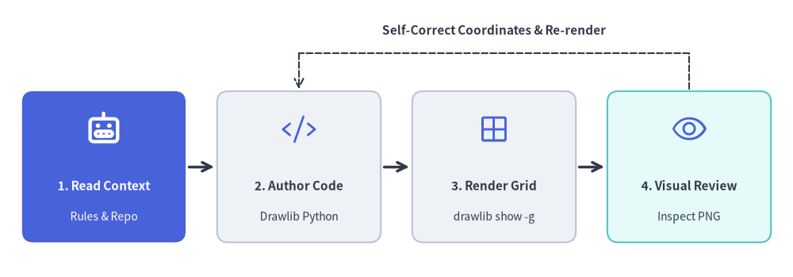

# AI-Driven Workflow & Agent Setup

Drawlib v0.3 is engineered from the ground up for **autonomous AI coding agents** (such as Claude Code, Cursor, Gemini, and GitHub Copilot). Instead of requiring human engineers to manually craft technical specifications and draw architecture diagrams, Drawlib makes it possible to delegate the **entire documentation lifecycle** to AI agents.


<figure class="drawlib-image" style="text-align: center;">
  
  <figcaption class="drawlib-caption">Autonomous AI Documentation Lifecycle: Repo & Rules Lookup, Markdown Authoring & Inner/Outer Loops (APNG Animation)</figcaption>
</figure>


<div class="drawlib-source-link">
  <a href="https://github.com/yuichi110/drawlib/blob/main/docs/docs_src/en/01_getting_started/agent_quicklook.md" target="_blank" rel="noopener noreferrer">View animation source code on GitHub &rarr;</a>
</div>

---

## The AI-Native Collaboration Model

Drawlib orchestrates two complementary loops: an **AI Inner Loop** (where the coding agent inspects real repository code, queries `drawlib rules` on demand, authors Markdown prose + Drawlib Python blocks in a single file, and visually self-repairs layout overlaps via `drawlib show -g`) and a **Human Outer Loop** (where developers focus purely on high-level prompts, iterative review requests such as adding benchmark charts, and final approval).

### Why Drawlib is Ideal for AI Agents

When tasked with generating technical illustrations, AI agents typically struggle with raw SVG generation or GUI design tools:
- **Raw SVGs are brittle**: LLMs frequently miscalculate coordinate bounds, leading to clipped text and misaligned arrows.
- **Low-level Matplotlib requires boilerplate**: Matplotlib is designed for statistical plots, not clean software architecture schemas.
- **GUI tools cannot be driven by agents**: AI agents cannot drag and drop shapes in Visio or Figma.
- **High-Level Declarative Abstractions**: Instead of drawing raw boxes and wires, an agent simply writes `ArchitectureDiagram`, `ERDiagram`, or `FlowDiagram`. The library handles orthogonal routing, padding, and marker styling automatically.
- **Built-in Visual Harmony**: Predefined semantic styles (`Styles.PrimaryFlat`, `Styles.AccentFlat`) ensure that AI-generated diagrams look publication-ready without fine-tuning color codes.

### Why Agents Don't Hallucinate Drawlib Code
Unlike traditional libraries where agents often hallucinate outdated APIs or struggle with deprecated options, Drawlib eliminates hallucinations through **active command-line guidance**:
1. **On-Demand Rule Injection**: Rather than stuffing thousands of tokens of API documentation into the agent's prompt context, the agent simply queries `drawlib rules show <topic>` when it needs exact signatures.
2. **Deterministic Geometry**: Agents do not have to guess rendering outcomes; they run `drawlib show -g` to render images with absolute millimeter grids and verify their work visually.

To enable your AI agent to author Drawlib illustrations and documentation, configure your environment with Drawlib's core guidelines.

### 1. Configure Workspace Rules (`drawlib init agent`)
Generate Drawlib's official AI agent rule files directly into your workspace using `drawlib init agent` (`antigravity`, `claude`, `cursor`, `copilot`, `windsurf`, `cline`, `roo`, `codex`, `gemini`, or `all`):

- **Antigravity**: Generates `.agents/rules/drawlib.md`.
- **Claude Code / Cursor / GitHub Copilot**: Generates `.claude/rules/drawlib.md`, `.cursor/rules/drawlib.mdc`, or `.github/instructions/drawlib.instructions.md`.
- **Codex / Gemini (`AGENTS.md` / `GEMINI.md`)**: Non-destructively merges a Drawlib rule section into `AGENTS.md` or `GEMINI.md`.

```bash
# List supported AI coding agents and target rule paths
$ uv run drawlib init agent list

# Auto-detect configured AI agents in your repository (or specify targets explicitly)
$ uv run drawlib init agent --detect
$ uv run drawlib init agent antigravity
$ uv run drawlib init agent claude cursor copilot

# Display the bootstrap agent manual directly in stdout
$ uv run drawlib rules show agent-instruction
```

### 2. Project-First Rule (`drawlib init project`)
Teach your agent to **never create bare `.py` files in an uninitialized directory** or build project folders manually. Always scaffold a Drawlib project first so `drawlib.toml`, `styles.py` (theme & language fonts), `utils.py`, `_assets/`, and `build.sh` are properly configured:

```bash
# Standalone diagram image(s) only -> images_src/*.py -> images/*.png
$ uv run drawlib init project images [-l <lang>] [-s <style>]

# Linear technical document / RFC / PDF / Word -> doc_src/<lang>/*.md
$ uv run drawlib init project doc [target] [-l <langs>] [-s <style>]

# Multi-page documentation website -> docs_src/<lang>/**/*.md
$ uv run drawlib init project site [target] [-l <langs>] [-s <style>]

# 16:9 presentation slide deck / PowerPoint -> slide_src/<lang>/*.md
$ uv run drawlib init project slide [target] [-l <langs>] [-s <style>]
```

### 3. Essential Commands & On-Demand Rules Catalog
Ensure your agent knows how to query on-demand rule topics and preview drawings with a coordinate grid:

| Purpose | Command |
| :--- | :--- |
| **List Available Rule Topics** | `uv run drawlib rules list` |
| **Canvas & Lifecycle Overview** | `uv run drawlib rules show overview` |
| **Style Guide & 50%+ Neutral Rule** | `uv run drawlib rules show style-guide` |
| **Animation Loop & Idioms** | `uv run drawlib rules show anim-guide` |
| **Autonomous 3-Stage Review & Font Math** | `uv run drawlib rules show review-guide` |
| **Project Overview (4 Archetypes)** | `uv run drawlib rules show project-overview` |
| **Project Guides (`images`, `doc`, `site`, `slide`)** | `uv run drawlib rules show project-<images\|doc\|site\|slide>` |
| **CLI Reference (`build`, `init`, `show`, `cache`)** | `uv run drawlib rules show cli` |
| **Unified API Cheat Sheet** | `uv run drawlib rules show api` |
| **Auto-Layout Graphs (`drawlib.graph`)** | `uv run drawlib rules show lib-graph-overview` |
| **Domain Diagrams (`drawlib.diagrams`)** | `uv run drawlib rules show lib-diagrams-overview` |
| **SmartArts & GeoMap (`drawlib.smartarts`)** | `uv run drawlib rules show lib-smartarts-overview` |
| **Quantitative Charts (`drawlib.charts`)** | `uv run drawlib rules show lib-charts-overview` |
| **Render Named Markdown Block Preview** | `uv run drawlib show <md_path> <diagram.png> -g -o .drawlib/scratch/preview.png` |
| **Render Standalone Script Preview** | `uv run drawlib show <script.py> -g -o .drawlib/scratch/preview.png` |
| **Build Full Project** | `./<target>_src/build.sh` or `uv run drawlib build html docs_src/ -o docs_html/` |

---

## The Autonomous Verification Loop

Teach your agent to follow Drawlib's autonomous self-correction loop when creating diagrams:


<figure class="drawlib-image" style="text-align: center;">
  
  <figcaption class="drawlib-caption">Autonomous AI Visual Self-Correction Loop</figcaption>
</figure>

<details class="drawlib-code-details">
<summary>Source Code</summary>

```python
from drawlib.canvas import save, setup
from drawlib.icons import phosphor
from drawlib.lines import line
from drawlib.shapes import rectangle
from drawlib.styles import Styles
from drawlib.text import text

setup(width=126, height=44)

# 1. Read Context (Hero node)
rectangle((16.5, 17.5), width=26.0, height=24.0, style=Styles.PrimaryFlat.patch(shape_r=1.8))
phosphor.robot((16.5, 23.5), width=5.6, style=Styles.WhiteBold)
text((16.5, 14.5), "1. Read Context", style=Styles.WhiteBold.patch(text_size=11.0))
text((16.5, 9.5), "Rules & Repo", style=Styles.White.patch(text_size=10.0))

# 2. Author Code
rectangle((47.5, 17.5), width=26.0, height=24.0, style=Styles.Neutral.patch(shape_r=1.8))
phosphor.code((47.5, 23.5), width=5.6, style=Styles.Primary)
text((47.5, 14.5), "2. Author Code", style=Styles.DarkBold.patch(text_size=11.0))
text((47.5, 9.5), "Drawlib Python", style=Styles.Dark.patch(text_size=10.0))

# 3. Render Grid
rectangle((78.5, 17.5), width=26.0, height=24.0, style=Styles.Neutral.patch(shape_r=1.8))
phosphor.grid_four((78.5, 23.5), width=5.6, style=Styles.Primary)
text((78.5, 14.5), "3. Render Grid", style=Styles.DarkBold.patch(text_size=11.0))
text((78.5, 9.5), "drawlib show -g", style=Styles.Dark.patch(text_size=10.0))

# 4. Visual Review
rectangle((109.5, 17.5), width=26.0, height=24.0, style=Styles.SecondaryNeutral.patch(shape_r=1.8))
phosphor.eye((109.5, 23.5), width=5.6, style=Styles.Primary)
text((109.5, 14.5), "4. Visual Review", style=Styles.DarkBold.patch(text_size=11.0))
text((109.5, 9.5), "Inspect PNG", style=Styles.Dark.patch(text_size=10.0))

# Forward arrows
line((30.0, 17.5), (34.0, 17.5), arrow_head="->", style=Styles.DarkBold)
line((61.0, 17.5), (65.0, 17.5), arrow_head="->", style=Styles.DarkBold)
line((92.0, 17.5), (96.0, 17.5), arrow_head="->", style=Styles.DarkBold)

# Feedback loop
line((109.5, 29.8), (109.5, 35.5), style=Styles.DarkDashed)
line((109.5, 35.5), (47.5, 35.5), style=Styles.DarkDashed)
line((47.5, 35.5), (47.5, 29.8), arrow_head="->", style=Styles.DarkDashed)
text((78.5, 39.2), "Self-Correct Coordinates & Re-render", style=Styles.DarkBold.patch(text_size=11.0))
save()
```

</details>


1. **Inspect Context**: The agent inspects actual repository files (models, API routers, database schemas) to understand the architecture.
2. **Draft Illustration**: The agent scaffolds a project via `drawlib init project` (if not already present) and authors the drawing code in `images_src/<name>.py` or an embedded ````drawlib```` Markdown block with `file=<diagram.png>`.
3. **Render Image with Grid (`-g`)**:  
   `uv run drawlib show <md_path> <diagram.png> -g -o .drawlib/scratch/preview.png` (or `uv run drawlib show images_src/<name>.py -g -o .drawlib/scratch/preview.png`).
4. **Multimodal Self-Review**: The agent inspects the rendered PNG with its vision/file viewing tool, checking for:
   - Label overflow or text clipping outside boxes.
   - Overlapping arrow lines or awkward elbow routings.
   - Missing perimeter margins around canvas borders.
5. **Auto-Adjust & Finalize**: The agent adjusts coordinates, re-renders until clean, and builds the final project outputs.

---

> [!TIP]
> For complete system prompts, rule topic catalogues, and advanced automated CI/CD integration, proceed to **[Chapter 9: AI Agents & Advanced Integration](../10_ai_agents_and_advanced/ai_agent_instructions.md)**.
