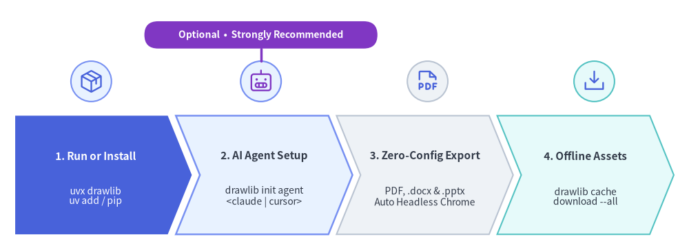
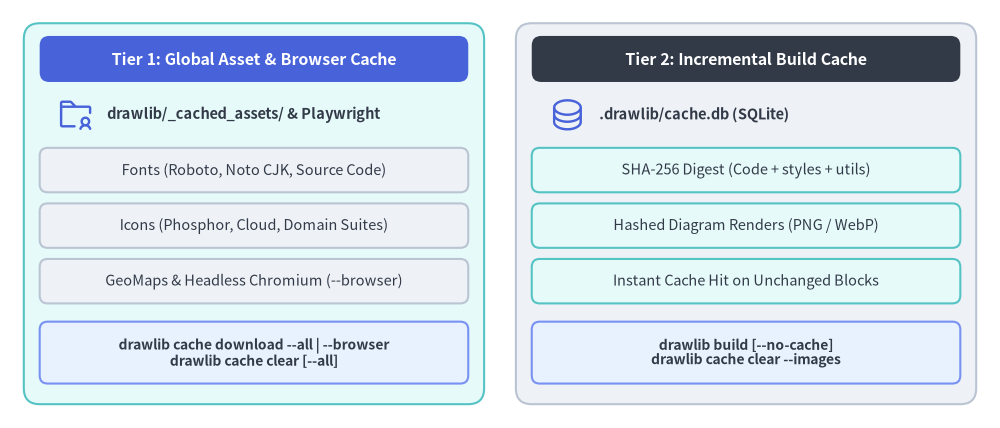

# Installation Guide

Drawlib is published on PyPI and can be run instantly with zero installation via `uvx drawlib`, or installed using `uv` (recommended) or standard `pip`.
A single `drawlib` package includes one-command AI agent rule setup (`drawlib init agent`), built-in HTML, Markdown, vector PDF, MS Word (`.docx`), and MS PowerPoint (`.pptx`) exporters, automatic headless Chromium provisioning, and offline asset caching.


<figure class="drawlib-image" style="text-align: center;">
  
  <figcaption class="drawlib-caption">Drawlib Environment & AI Agent Setup Workflow</figcaption>
</figure>

<details class="drawlib-code-details">
<summary>Source Code</summary>

```python
from drawlib.canvas import save, setup
from drawlib.icons import phosphor
from drawlib.lines import line
from drawlib.shapes import circle, rectangle
from drawlib.smartarts import ChevronProcess
from drawlib.styles import Styles

setup(width=136, height=50)

workflow = ChevronProcess(
    style=Styles.Neutral,
    text_style=Styles.DarkBold.patch(text_size=11.0),
    description_style=Styles.Dark.patch(text_size=10.0),
    corner_angle=68.0,
    spacing=1.6,
    flat_left_end=True,
)
workflow.add(
    "1. Run or Install",
    description="uvx drawlib\nuv add / pip",
    style=Styles.PrimaryFlat,
    text_style=Styles.WhiteBold.patch(text_size=11.0),
    description_style=Styles.White.patch(text_size=10.0),
)
workflow.add(
    "2. AI Agent Setup",
    description="drawlib init agent\n<claude | cursor>",
    style=Styles.PrimaryNeutral.patch(shape_line_width=1.8),
)
workflow.add(
    "3. Zero-Config Export",
    description="PDF, .docx & .pptx\nAuto Headless Chrome",
    style=Styles.Neutral,
)
workflow.add(
    "4. Offline Assets",
    description="drawlib cache\ndownload --all",
    style=Styles.SecondaryNeutral,
)
workflow.draw(xy=(3.0, 3.5), width=130.0, height=23.5)

# Step icons above each chevron stage
circle((18.0, 33.8), radius=4.0, style=Styles.PrimaryNeutral)
phosphor.package((18.0, 33.8), width=5.0, style=Styles.Primary)

circle((51.5, 33.8), radius=4.0, style=Styles.PrimaryNeutral.patch(shape_line_width=1.6))
phosphor.robot((51.5, 33.8), width=5.0, style=Styles.Accent)

# Optional / Strongly Recommended callout badge above Step 2
line((51.5, 37.8), (51.5, 40.3), style=Styles.AccentBold)
rectangle(
    (51.5, 43.0),
    width=46.0,
    height=5.4,
    style=Styles.AccentFlat.patch(shape_r=2.7),
    text="Optional  •  Strongly Recommended",
    text_style=Styles.WhiteBold.patch(text_size=10.0),
)

circle((84.4, 33.8), radius=4.0, style=Styles.Neutral)
phosphor.file_pdf((84.4, 33.8), width=5.0, style=Styles.Primary)

circle((117.3, 33.8), radius=4.0, style=Styles.SecondaryNeutral)
phosphor.download_simple((117.3, 33.8), width=5.0, style=Styles.Primary)

save()
```

</details>


---

## Requirements

- **Python**: Version 3.11 or higher (automatically managed when using [`uv` / `uvx`](https://docs.astral.sh/uv/)).
- **Operating System**: Linux, macOS, or Windows.

---

## 1. Using `uv` & Zero-Install `uvx` (Recommended)

### 1.1 Zero-Install CLI & Non-Python Repositories (`uvx drawlib`)

If [`uv`](https://docs.astral.sh/uv/) is installed, you can scaffold, preview, and compile Drawlib documentation sites, technical specs, and 16:9 slide decks immediately via `uvx drawlib`—with **no `pyproject.toml`, virtual environment, or project dependency required**. Every generated `./<target>_src/build.sh` and `serve.sh` script automatically falls back to `uvx drawlib`, making this ideal both for 30-second evaluation and for polyglot repositories (**Go, Rust, TypeScript, Java, Terraform**):

```bash
# Scaffold a bilingual documentation site and AI agent rules with zero install
$ uvx drawlib init project site -l en,ja
$ uvx drawlib init agent claude

# Generated build & preview scripts automatically detect and run `uvx drawlib`
$ ./docs_src/build.sh
$ uvx drawlib serve docs_html/ --check
```

### 1.2 Python Project Dependency (`uv add drawlib`)

When authoring standalone `.py` scripts with IDE autocomplete or importing `drawlib.*` inside an existing Python `uv` workspace, add `drawlib` to your project dependencies:

```bash
# Add to active Python project (includes PDF, .docx, and .pptx export out of the box)
$ uv add drawlib

# Verify installation and CLI version
$ uv run drawlib --version
```

### 1.3 Persistent Global CLI Tool (`uv tool install drawlib`)

If you author documentation or slides across multiple repositories every day, install `drawlib` once into an isolated global `uv` tool environment so the `drawlib` command is always available on your `PATH`:

```bash
# Install `drawlib` globally in an isolated uv tool environment
$ uv tool install drawlib
$ drawlib --version
```

---

## 2. Using `pip`

Install Drawlib into your Python virtual environment:

```bash
$ pip install drawlib

# Verify installation
$ drawlib --version
```

---

## 3. Configure AI Agent Instructions *(Optional — Strongly Recommended)*

Drawlib works out of the box as a standalone Python library and CLI without any AI assistant. However, if you author code or documentation with an AI coding agent (**Claude Code**, **Cursor**, **Antigravity**, **GitHub Copilot**, **Windsurf**, **Cline**, **Roo Code**, **OpenAI Codex**, or **Gemini CLI**), initializing workspace agent instructions right after setup is **strongly recommended**.

Running `drawlib init agent` generates the native rule file for your IDE or CLI agent so it automatically follows Drawlib's bottom-left `(0, 0)` coordinate space, `50%+` neutral style discipline, `drawlib init project` scaffolding workflow, and 3-stage visual self-correction loop:

```bash
# List all supported AI agents (use `uvx drawlib ...` in zero-install / non-Python repos)
$ uv run drawlib init agent list

# Generate workspace instructions for your AI coding agent
$ uv run drawlib init agent claude        # -> .claude/rules/drawlib.md
$ uv run drawlib init agent cursor        # -> .cursor/rules/drawlib.mdc
$ uv run drawlib init agent antigravity   # -> .agents/rules/drawlib.md

# Or initialize multiple agents at once (pass 'all' for all 7 modular agents)
$ uv run drawlib init agent claude cursor copilot

# Optional: switch frontmatter-capable agents from contextual 'auto' (default) to 'always'
$ uv run drawlib init agent antigravity --mode always
```

See [AI Agent Quicklook](./agent_quicklook.md) and [AI Agent Instructions](../10_ai_agents_and_advanced/ai_agent_instructions.md) for full details on supported agents and trigger modes.

---

## 4. Built-In PDF, Word (`.docx`) & PowerPoint (`.pptx`) Export

Drawlib includes `playwright`, `python-docx`, and `python-pptx` as standard dependencies—no optional package extras or manual browser installation steps are required:

- **MS Word (`drawlib build docx`)**: Runs in pure Python with zero browser dependencies.
- **Vector PDF (`drawlib build pdf`) & MS PowerPoint (`drawlib build pptx`)**: Automatically downloads Playwright's lightweight `chromium-headless-shell` on first run (or pre-fetches it ahead of time via `drawlib cache download --browser`).

> [!NOTE]
> **Minimal Linux Containers & Slim CI Runners**: Standard desktop macOS, Windows, and Ubuntu/Debian environments work with zero setup. In minimal Linux container images (such as `python:3.12-slim`) that omit system GUI shared libraries (`libnss3`, `libgbm1`, `libasound2`), install the OS-level shared libraries once:
> ```bash
> $ uv run playwright install-deps chromium
> ```

---

## 5. Asset & Build Cache Management (`drawlib cache`)

To maintain a minimal PyPI package size, high-resolution icon sets (Phosphor, FontAwesome, and official cloud/domain icons), multilingual fonts, geographic map datasets, and headless Chromium are downloaded on demand upon first use (or pre-fetched via `drawlib cache download`). Meanwhile, project-local incremental diagram builds are cached separately in `.drawlib/cache.db`.


<figure class="drawlib-image" style="text-align: center;">
  
  <figcaption class="drawlib-caption">Two-Tier Asset and Incremental Build Cache Architecture</figcaption>
</figure>

<details class="drawlib-code-details">
<summary>Source Code</summary>

```python
from drawlib.canvas import save, setup
from drawlib.icons import phosphor
from drawlib.shapes import rectangle
from drawlib.styles import Styles
from drawlib.text import text

setup(width=126, height=54)

hdr_ts = Styles.WhiteBold.patch(text_size=11.5)
path_ts = Styles.DarkBold.patch(text_size=10.5, halign="left")
row_ts = Styles.Dark.patch(text_size=10.5)
cmd_ts = Styles.DarkBold.patch(text_size=10.0)

# Left container: Tier 1 Global Asset Cache
rectangle((32.0, 27.0), width=58.0, height=48.0, style=Styles.SecondaryNeutral.patch(shape_r=2.0))
rectangle((32.0, 46.5), width=54.0, height=5.8, style=Styles.PrimaryFlat.patch(shape_r=1.2), text="Tier 1: Global Asset & Browser Cache", text_style=hdr_ts)

phosphor.folder_user((9.5, 39.5), width=4.8, style=Styles.Primary)
text((13.5, 39.5), "drawlib/_cached_assets/ & Playwright", style=path_ts)

rectangle((32.0, 32.5), width=54.0, height=5.6, style=Styles.Neutral.patch(shape_r=1.0), text="Fonts (Roboto, Noto CJK, Source Code)", text_style=row_ts)
rectangle((32.0, 25.5), width=54.0, height=5.6, style=Styles.Neutral.patch(shape_r=1.0), text="Icons (Phosphor, Cloud, Domain Suites)", text_style=row_ts)
rectangle((32.0, 18.5), width=54.0, height=5.6, style=Styles.Neutral.patch(shape_r=1.0), text="GeoMaps & Headless Chromium (--browser)", text_style=row_ts)
rectangle((32.0, 9.5), width=54.0, height=7.8, style=Styles.PrimaryNeutral.patch(shape_r=1.0), text="drawlib cache download --all | --browser\ndrawlib cache clear [--all]", text_style=cmd_ts)

# Right container: Tier 2 Project Incremental Build Cache
rectangle((94.0, 27.0), width=58.0, height=48.0, style=Styles.Neutral.patch(shape_r=2.0))
rectangle((94.0, 46.5), width=54.0, height=5.8, style=Styles.DarkFlat.patch(shape_r=1.2), text="Tier 2: Incremental Build Cache", text_style=hdr_ts)

phosphor.database((71.5, 39.5), width=4.8, style=Styles.Primary)
text((75.5, 39.5), ".drawlib/cache.db (SQLite)", style=path_ts)

rectangle((94.0, 32.5), width=54.0, height=5.6, style=Styles.SecondaryNeutral.patch(shape_r=1.0), text="SHA-256 Digest (Code + styles + utils)", text_style=row_ts)
rectangle((94.0, 25.5), width=54.0, height=5.6, style=Styles.SecondaryNeutral.patch(shape_r=1.0), text="Hashed Diagram Renders (PNG / WebP)", text_style=row_ts)
rectangle((94.0, 18.5), width=54.0, height=5.6, style=Styles.SecondaryNeutral.patch(shape_r=1.0), text="Instant Cache Hit on Unchanged Blocks", text_style=row_ts)
rectangle((94.0, 9.5), width=54.0, height=7.8, style=Styles.PrimaryNeutral.patch(shape_r=1.0), text="drawlib build [--no-cache]\ndrawlib cache clear --images", text_style=cmd_ts)

save()
```

</details>


You can inspect, pre-fetch (e.g. for offline builds, Docker images, or CI/CD pipelines), and clear both caches via `drawlib cache`:

```bash
# Inspect cached font, icon, and map packages
$ uv run drawlib cache list

# Pre-download all font, icon, map, and headless Chromium assets
$ uv run drawlib cache download --all

# Or pre-download specific asset categories selectively
$ uv run drawlib cache download --fonts
$ uv run drawlib cache download --icons
$ uv run drawlib cache download --maps
$ uv run drawlib cache download --browser

# Clear project-local incremental diagram build cache (.drawlib/cache.db)
$ uv run drawlib cache clear --images

# Clear all caches (downloaded font/icon/map assets + SQLite image build cache)
$ uv run drawlib cache clear --all
```

---

## 6. Verifying Installation

Verify that the Drawlib CLI commands, project templates, and rule guides are accessible:

```bash
$ uv run drawlib --help
$ uv run drawlib init project list
$ uv run drawlib init agent list
$ uv run drawlib rules list
```
