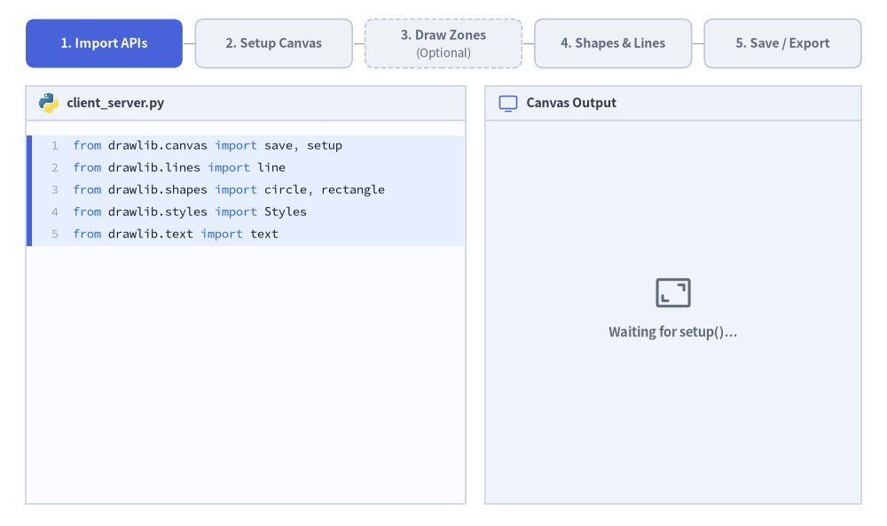
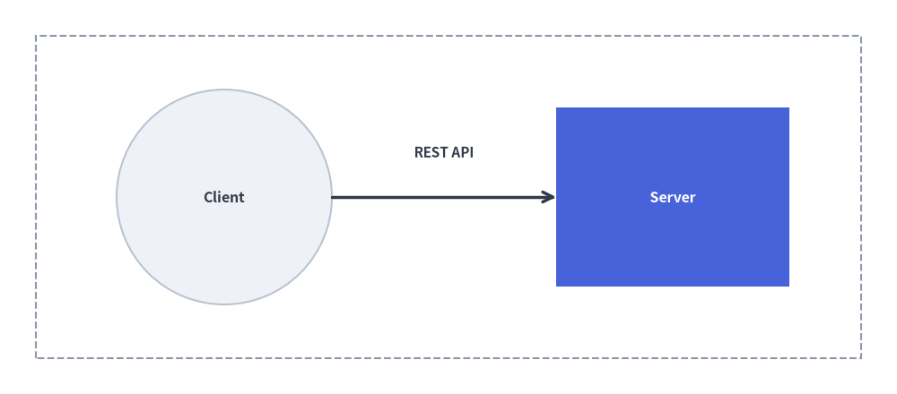

# Quick Start Guide

Drawlib makes creating publication-ready technical diagrams intuitive and reproducible—whether authored as **standalone Python scripts** (`.py`) or **embedded Markdown blocks** (` ```drawlib `). Every illustration follows a predictable **5-step lifecycle**:


<figure class="drawlib-image" style="text-align: center;">
  
  <figcaption class="drawlib-caption">The Standard 5-Step Drawlib Drawing Workflow: Code to Canvas (APNG Animation)</figcaption>
</figure>


<div class="drawlib-source-link">
  <a href="https://github.com/yuichi110/drawlib/blob/main/docs/docs_src/en/01_getting_started/quick_start.md" target="_blank" rel="noopener noreferrer">View animation source code on GitHub &rarr;</a>
</div>

1. **Import APIs**: Import canvas management, drawing primitives, and styling presets.
2. **Setup Canvas**: Initialize canvas dimensions (`width`, `height`) via `setup()`.
3. **Draw Structural Zones *(Optional)***: Create boundary boxes, cloud regions, or grouping containers when needed.
4. **Draw Entities & Connectors**: Add shapes, icons, and lines with semantic styles and labels.
5. **Save / Export**: Save the drawing to an image file via `save()`, or let the Document Builder render it inline automatically.

---

## 1. Standalone Python Script (`images` Project)

> [!IMPORTANT]
> **Project-First Rule (`drawlib init project`)**:  
> Rather than creating bare `.py` files in an uninitialized directory, always scaffold a Drawlib project first so `styles.py` (theme & language fonts), `utils.py`, `_assets/`, and `build.sh` are properly configured:
> ```bash
> # Scaffold a standalone illustration project (creates images_src/ -> images/)
> $ uv run drawlib init project images
> ```

Create a Python script named `images_src/client_server.py`:

```python
from drawlib.canvas import save, setup
from drawlib.lines import line
from drawlib.shapes import circle, rectangle
from drawlib.styles import Styles
from drawlib.text import text

# Step 2: Setup canvas dimensions (Cartesian space: 100 wide x 44 high)
setup(width=100, height=44)

# Step 3 (Optional): Draw background boundary container
rectangle((50, 22), width=92, height=36, style=Styles.MutedDashed)

# Step 4: Draw main entities and connectors (50%+ Neutral-Grounded)
circle((25, 22), radius=12, style=Styles.Neutral, text="Client", text_style=Styles.DarkBold.patch(text_size=11.5))
rectangle((75, 22), width=26, height=20, style=Styles.PrimaryFlat, text="Server", text_style=Styles.WhiteBold.patch(text_size=11.5))

# Connection line with arrowhead
line((37, 22), (62, 22), arrow_head="->", style=Styles.DarkBold)
text((49.5, 27), "REST API", style=Styles.DarkBold.patch(text_size=11.0))

# Step 5: Save image (defaults to client_server.png)
save()
```

### Running and Previewing

Build all scripts in `images_src/` using the generated build script, or run a single script directly:

```bash
# Batch-compile all scripts in images_src/ to images/
$ ./images_src/build.sh

# Or run a single script directly with Python
$ uv run python images_src/client_server.py
```

Use the unified `drawlib show` CLI command to export headless previews or inspect coordinate overlays:

```bash
# Export directly to a specified output file
$ uv run drawlib show images_src/client_server.py -o .drawlib/scratch/output.png

# Overlay a visual coordinate grid (-g) to check element spacing
$ uv run drawlib show images_src/client_server.py -g -o .drawlib/scratch/output_grid.png
```

---

## 2. Embedded Markdown Document

Inside any Markdown document (such as `doc.md` in a `doc` or `site` project), simply embed the code block with ````drawlib````:

````markdown
# Architecture Overview

Here is our primary service flow:

```drawlib align=center file=client_server_communication.png caption="Client-Server REST Communication"
from drawlib.canvas import save, setup
from drawlib.shapes import rectangle, circle
from drawlib.lines import line
from drawlib.text import text
from drawlib.styles import Styles

setup(width=100, height=44)

rectangle((50, 22), width=92, height=36, style=Styles.MutedDashed)
circle((25, 22), radius=12, style=Styles.Neutral, text="Client", text_style=Styles.DarkBold.patch(text_size=11.5))
rectangle((75, 22), width=26, height=20, style=Styles.PrimaryFlat, text="Server", text_style=Styles.WhiteBold.patch(text_size=11.5))
line((37, 22), (62, 22), arrow_head="->", style=Styles.DarkBold)
text((49.5, 27), "REST API", style=Styles.DarkBold.patch(text_size=11.0))
save()
```
````

You can preview a specific named block inside a Markdown file with a coordinate grid before building the full site:

```bash
# Preview a specific named diagram block with a coordinate grid (-g)
$ uv run drawlib show doc.md client_server_communication.png -g -o .drawlib/scratch/preview.png
```

When compiled with `drawlib build html` or `drawlib build markdown`, the code fence is executed and replaced with the rendered image:


<figure class="drawlib-image" style="text-align: center;">
  
  <figcaption class="drawlib-caption">Client-Server REST Communication</figcaption>
</figure>

<details class="drawlib-code-details">
<summary>Source Code</summary>

```python
from drawlib.canvas import save, setup
from drawlib.shapes import rectangle, circle
from drawlib.lines import line
from drawlib.text import text
from drawlib.styles import Styles

setup(width=100, height=44)

rectangle((50, 22), width=92, height=36, style=Styles.MutedDashed)
circle((25, 22), radius=12, style=Styles.Neutral, text="Client", text_style=Styles.DarkBold.patch(text_size=11.5))
rectangle((75, 22), width=26, height=20, style=Styles.PrimaryFlat, text="Server", text_style=Styles.WhiteBold.patch(text_size=11.5))
line((37, 22), (62, 22), arrow_head="->", style=Styles.DarkBold)
text((49.5, 27), "REST API", style=Styles.DarkBold.patch(text_size=11.0))
save()
```

</details>


---

## 3. Key Rules for Smooth Drawing

1. **`setup()` is Mandatory**: Always call `setup(width=..., height=...)` at the start of your drawing block.
2. **Handling `save()` in Markdown Blocks**: In Markdown embedded blocks, calling `save()` is optional because Drawlib captures the canvas automatically (and calls to `save()` are safely treated as no-ops). However, writing `save()` (without arguments) in complete examples is recommended for 100% copy-paste compatibility with standalone `.py` scripts.
3. **Color Discipline (50%+ Neutral-Grounded Architecture)**: Avoid rainbow chaos. Ground 50% or more of nodes in calm neutral cards (`Styles.Neutral`, `Styles.PrimaryNeutral`, `Styles.SecondaryNeutral`), reserve saturated hero styles (`Styles.PrimaryFlat`) for 1–2 primary focal points, and use `Styles.DarkBold` for connectors.
