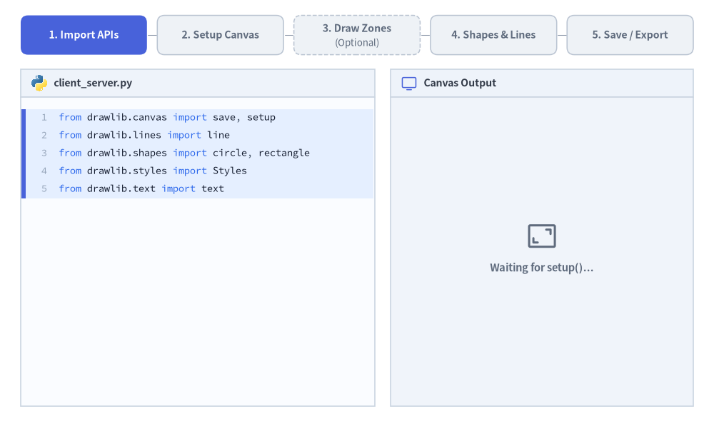
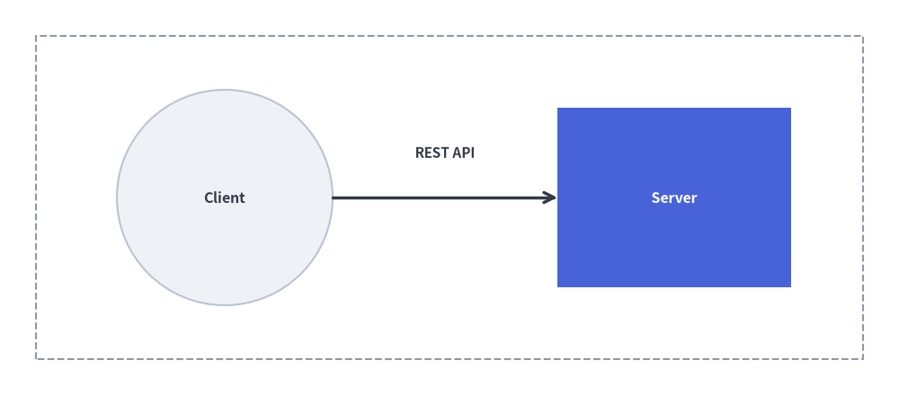

# Quick Start Guide

Drawlib makes creating publication-ready technical diagrams intuitive and reproducible—whether authored as **standalone Python scripts** (`.py`) or **embedded Markdown blocks** (` ```drawlib `). Every illustration follows a predictable **5-step lifecycle**:


<figure class="drawlib-image" style="text-align: center;">
  
  <figcaption class="drawlib-caption">The Standard 5-Step Drawlib Drawing Workflow: Code to Canvas (APNG Animation)</figcaption>
</figure>

<details class="drawlib-code-details">
<summary>Source Code</summary>

```python
from __future__ import annotations

from drawlib.anim import Animation
from drawlib.canvas import save, setup
from drawlib.icons import code as code_icons
from drawlib.icons import phosphor
from drawlib.lines import line
from drawlib.shapes import circle, rectangle
from drawlib.smartarts import SourceCode, SourceCodeStyles
from drawlib.styles import Styles
from drawlib.text import text

W, H = 138.0, 82.0
setup(width=W, height=H)
anim = Animation(fps=10.0, loop=0)

# Typography & container styles
CODE_TEXT_SIZE = 10.0
PT_TO_CANVAS = W / 720.0
FONT_CANVAS = CODE_TEXT_SIZE * PT_TO_CANVAS
LINE_H = FONT_CANVAS * 1.8
PAD_Y = FONT_CANVAS * 1.2

CODE_STYLES = SourceCodeStyles.get("default", font_lang="en", text_size=CODE_TEXT_SIZE).patch(
    box_style=Styles.Neutral.patch(shape_fill_color=(0, 0, 0, 0), shape_line_width=0),
)

PANE_HEADER = Styles.Neutral.patch(
    shape_fill_color=(238, 243, 250),
    shape_line_color=(203, 213, 225),
    shape_line_width=1.2,
    shape_r=0.0,
)
EDITOR_BODY = Styles.Neutral.patch(
    shape_fill_color=(250, 252, 255),
    shape_line_color=(203, 213, 225),
    shape_line_width=1.2,
    shape_r=0.0,
)
STUDIO_BODY = Styles.Neutral.patch(
    shape_fill_color=(240, 244, 250),
    shape_line_color=(203, 213, 225),
    shape_line_width=1.2,
    shape_r=0.0,
)

CODE_CHUNKS = [
    # Step 1 (lines 0..4)
    [
        "from drawlib.canvas import save, setup",
        "from drawlib.lines import line",
        "from drawlib.shapes import circle, rectangle",
        "from drawlib.styles import Styles",
        "from drawlib.text import text",
    ],
    # Step 2 (line 5)
    [
        "setup(width=100, height=44)",
    ],
    # Step 3 (lines 6..7) - Optional
    [
        "# Optional: boundary zone",
        "rectangle((50, 22), 92, 36, style=Styles.MutedDashed)",
    ],
    # Step 4 (lines 8..14)
    [
        "circle((25, 22), 12,",
        '       style=Styles.Neutral, text="Client")',
        "rectangle((75, 22), 26, 20,",
        '          style=Styles.PrimaryFlat, text="Server")',
        "line((37, 22), (62, 22),",
        '     arrow_head="->", style=Styles.DarkBold)',
        'text((49.5, 27), "REST API", style=Styles.DarkBold)',
    ],
    # Step 5 (line 15)
    [
        "save()",
    ],
]

STEP_TITLES = [
    ("1. Import APIs", ""),
    ("2. Setup Canvas", ""),
    ("3. Draw Zones", "(Optional)"),
    ("4. Shapes & Lines", ""),
    ("5. Save / Export", ""),
]


def draw_step_bar(active_step: int) -> None:
    """Draw top 5-step progress indicator bar (active_step is 1..5)."""
    pill_w = 24.4
    gap = 2.0
    start_x = 4.0 + pill_w / 2.0
    cy = 75.2
    pill_h = 7.6

    for idx, (label, sublabel) in enumerate(STEP_TITLES, start=1):
        cx = start_x + (idx - 1) * (pill_w + gap)
        is_optional = bool(sublabel)

        if idx > 1:
            prev_cx = cx - (pill_w + gap)
            line(
                (prev_cx + pill_w / 2.0 + 0.2, cy),
                (cx - pill_w / 2.0 - 0.2, cy),
                style=Styles.PrimaryBold if idx <= active_step else Styles.MutedThin,
            )

        if idx == active_step:
            st = Styles.PrimaryFlat.patch(shape_r=1.4)
            tst = Styles.WhiteBold.patch(text_size=10.2)
            sub_tst = Styles.White.patch(text_size=9.5)
        elif idx < active_step:
            st = Styles.PrimaryNeutral.patch(
                shape_r=1.4,
                shape_line_width=1.1,
                shape_line_style="dashed" if is_optional else "solid",
            )
            tst = Styles.PrimaryBold.patch(text_size=10.2)
            sub_tst = Styles.Primary.patch(text_size=9.5)
        else:
            st = Styles.Neutral.patch(
                shape_r=1.4,
                shape_line_width=1.1,
                shape_line_style="dashed" if is_optional else "solid",
            )
            tst = Styles.MutedBold.patch(text_size=10.2)
            sub_tst = Styles.Muted.patch(text_size=9.5)

        if is_optional:
            rectangle((cx, cy), width=pill_w, height=pill_h, style=st)
            text((cx, cy + 1.35), label, style=tst)
            text((cx, cy - 1.55), sublabel, style=sub_tst)
        else:
            rectangle((cx, cy), width=pill_w, height=pill_h, style=st, text=label, text_style=tst)


def draw_code_pane(active_step: int, *, sub_step_4_only_shapes: bool = False) -> None:
    """Draw left Python editor pane with active-step highlight and syntax highlighting."""
    x0, w = 4.0, 68.5
    cx = x0 + w / 2.0
    top_y = 63.2
    body_h = 59.8
    header_h = 5.4

    # Header bar (y = 63.2 .. 68.6)
    rectangle((cx, top_y + header_h / 2.0), width=w, height=header_h, style=PANE_HEADER)
    code_icons.python((x0 + 3.6, top_y + header_h / 2.0), width=3.4, style=Styles.Neutral)
    text(
        (x0 + 6.4, top_y + header_h / 2.0),
        "client_server.py",
        style=Styles.DarkBold.patch(text_size=10.2, halign="left"),
    )

    # Fixed-height editor body (y = 3.4 .. 63.2)
    rectangle((cx, top_y - body_h / 2.0), width=w, height=body_h, style=EDITOR_BODY)

    # Assemble visible lines up to active_step
    lines_so_far: list[str] = []
    active_start = 0
    for s_idx in range(active_step):
        chunk = CODE_CHUNKS[s_idx]
        if s_idx == 3 and sub_step_4_only_shapes:
            chunk = chunk[:4]
        if s_idx == active_step - 1:
            active_start = len(lines_so_far)
            if s_idx == 3 and not sub_step_4_only_shapes:
                active_start += 4
        lines_so_far.extend(chunk)
    active_end = len(lines_so_far) - 1

    # Highlight band behind newly added lines
    hl_top = top_y - PAD_Y - active_start * LINE_H
    hl_bot = top_y - PAD_Y - (active_end + 1) * LINE_H
    hl_cy = (hl_top + hl_bot) / 2.0
    hl_h = hl_top - hl_bot
    rectangle(
        (cx, hl_cy),
        width=w - 0.6,
        height=hl_h,
        style=Styles.Neutral.patch(shape_fill_color=(229, 239, 255), shape_line_width=0),
    )
    rectangle(
        (x0 + 0.55, hl_cy),
        width=0.9,
        height=hl_h,
        style=Styles.PrimaryFlat.patch(shape_line_width=0),
    )

    SourceCode.draw(
        xy=(x0, top_y),
        width=w,
        code="\n".join(lines_so_far),
        styles=CODE_STYLES,
        code_lang="python",
        show_linenum=True,
        align="top_left",
    )


def draw_preview_pane(active_step: int, *, sub_step_4_only_shapes: bool = False) -> None:
    """Draw right live canvas preview pane across Steps 1..5."""
    x0, w = 75.5, 58.5
    cx = x0 + w / 2.0
    top_y = 63.2
    body_h = 59.8
    header_h = 5.4

    # Header bar
    rectangle((cx, top_y + header_h / 2.0), width=w, height=header_h, style=PANE_HEADER)
    phosphor.monitor((x0 + 3.6, top_y + header_h / 2.0), width=3.4, style=Styles.Primary)
    text(
        (x0 + 6.4, top_y + header_h / 2.0),
        "Canvas Output",
        style=Styles.DarkBold.patch(text_size=10.2, halign="left"),
    )

    # Studio grey workspace
    body_cy = top_y - body_h / 2.0
    rectangle((cx, body_cy), width=w, height=body_h, style=STUDIO_BODY)

    if active_step == 1:
        # Before setup(): no canvas exists yet
        phosphor.frame_corners((cx, body_cy + 3.0), width=6.5, style=Styles.Muted)
        text(
            (cx, body_cy - 3.2),
            "Waiting for setup()...",
            style=Styles.MutedBold.patch(text_size=10.5),
        )
        return

    # Miniature 100 x 44 canvas mapped to 51.0 x 22.44 (scale = 0.51)
    scale = 0.51
    can_w = 100.0 * scale
    can_h = 44.0 * scale
    can_cx, can_cy = cx, body_cy + 4.2
    can_x0 = can_cx - can_w / 2.0
    can_y0 = can_cy - can_h / 2.0

    # Step 2+: Blank white canvas sheet
    rectangle(
        (can_cx, can_cy),
        width=can_w,
        height=can_h,
        style=Styles.Neutral.patch(
            shape_fill_color=(255, 255, 255),
            shape_line_color=(148, 163, 184),
            shape_line_width=1.3,
        ),
    )
    if active_step < 5:
        text(
            (can_cx, can_y0 - 3.6),
            "Canvas (100 × 44)",
            style=Styles.MutedBold.patch(text_size=10.0),
        )

    # Step 3+: Boundary dashed container (Optional)
    if active_step >= 3:
        rectangle(
            (can_x0 + 50.0 * scale, can_y0 + 22.0 * scale),
            width=92.0 * scale,
            height=36.0 * scale,
            style=Styles.MutedDashed.patch(shape_line_width=1.2),
        )

    # Step 4+: Entities, Connector & Label
    if active_step >= 4:
        circle(
            (can_x0 + 25.0 * scale, can_y0 + 22.0 * scale),
            radius=12.0 * scale,
            style=Styles.Neutral,
            text="Client",
            text_style=Styles.DarkBold.patch(text_size=10.2),
        )
        rectangle(
            (can_x0 + 75.0 * scale, can_y0 + 22.0 * scale),
            width=26.0 * scale,
            height=20.0 * scale,
            style=Styles.PrimaryFlat,
            text="Server",
            text_style=Styles.WhiteBold.patch(text_size=10.2),
        )
        if not sub_step_4_only_shapes:
            line(
                (can_x0 + 37.0 * scale, can_y0 + 22.0 * scale),
                (can_x0 + 62.0 * scale, can_y0 + 22.0 * scale),
                arrow_head="->",
                style=Styles.DarkBold.patch(line_width=1.4),
            )
            text(
                (can_x0 + 49.5 * scale, can_y0 + 28.5 * scale),
                "REST API",
                style=Styles.DarkBold.patch(text_size=9.8),
            )

    # Step 5: Save / Download overlay badge overlapping lower canvas edge
    if active_step == 5:
        card_w, card_h = 39.5, 11.8
        card_cy = can_y0 - 1.2
        rectangle(
            (can_cx, card_cy),
            width=card_w,
            height=card_h,
            style=Styles.Neutral.patch(
                shape_fill_color=(255, 255, 255, 0.97),
                shape_line_color=(59, 102, 212),
                shape_line_width=1.6,
                shape_r=1.8,
            ),
        )
        circle(
            (can_cx - 13.0, card_cy),
            radius=3.5,
            style=Styles.PrimaryFlat,
        )
        phosphor.download_simple((can_cx - 13.0, card_cy), width=4.1, style=Styles.White)
        text(
            (can_cx - 7.5, card_cy + 1.9),
            "client_server.png",
            style=Styles.PrimaryBold.patch(text_size=10.8, halign="left"),
        )
        text(
            (can_cx - 7.5, card_cy - 2.1),
            "Saved via save()",
            style=Styles.Dark.patch(text_size=10.0, halign="left"),
        )


def render_step(step: int, *, sub_step_4_only_shapes: bool = False) -> None:
    """Render full split-screen frame for a given step."""
    draw_step_bar(step)
    draw_code_pane(step, sub_step_4_only_shapes=sub_step_4_only_shapes)
    draw_preview_pane(step, sub_step_4_only_shapes=sub_step_4_only_shapes)


with anim.frame(duration=1.15):
    render_step(1)

with anim.frame(duration=1.25):
    render_step(2)

with anim.frame(duration=1.25):
    render_step(3)

with anim.frame(duration=0.95):
    render_step(4, sub_step_4_only_shapes=True)

with anim.frame(duration=1.40):
    render_step(4, sub_step_4_only_shapes=False)

with anim.frame(duration=2.80):
    render_step(5)

save()
```

</details>


1. **Import APIs**: Import canvas management, drawing primitives, and styling presets.
2. **Setup Canvas**: Initialize canvas dimensions (`width`, `height`) via `setup()`.
3. **Draw Structural Zones *(Optional)***: Create boundary boxes, cloud regions, or grouping containers when needed.
4. **Draw Entities & Connectors**: Add shapes, icons, and lines with semantic styles and labels.
5. **Save / Export**: Save the drawing to an image file via `save()`, or let the Document Builder render it inline automatically.

---

## 1. Standalone Python Script (`images` Project)

> [!IMPORTANT]
> **Project-First Rule (`drawlib init`)**:  
> Rather than creating bare `.py` files in an uninitialized directory, always scaffold a Drawlib project first so `styles.py` (theme & language fonts), `utils.py`, `_assets/`, and `build.sh` are properly configured:
> ```bash
> # Scaffold a standalone illustration project (creates images_src/ -> images/)
> $ uv run drawlib init images
> ```

Create a Python script named `images_src/client_server.py`:

```python
from drawlib.canvas import save, setup
from drawlib.lines import line
from drawlib.shapes import circle, rectangle
from drawlib.styles import Styles
from drawlib.text import text

# Step 2: Setup canvas dimensions (Cartesian space: 100 wide x 44 high)
setup(width=100, height=44)

# Step 3 (Optional): Draw background boundary container
rectangle((50, 22), width=92, height=36, style=Styles.MutedDashed)

# Step 4: Draw main entities and connectors (50%+ Neutral-Grounded)
circle((25, 22), radius=12, style=Styles.Neutral, text="Client", text_style=Styles.DarkBold.patch(text_size=11.5))
rectangle((75, 22), width=26, height=20, style=Styles.PrimaryFlat, text="Server", text_style=Styles.WhiteBold.patch(text_size=11.5))

# Connection line with arrowhead
line((37, 22), (62, 22), arrow_head="->", style=Styles.DarkBold)
text((49.5, 27), "REST API", style=Styles.DarkBold.patch(text_size=11.0))

# Step 5: Save image (defaults to client_server.png)
save()
```

### Running and Previewing

Build all scripts in `images_src/` using the generated build script, or run a single script directly:

```bash
# Batch-compile all scripts in images_src/ to images/
$ ./images_src/build.sh

# Or run a single script directly with Python
$ uv run python images_src/client_server.py
```

Use the unified `drawlib show` CLI command to export headless previews or inspect coordinate overlays:

```bash
# Export directly to a specified output file
$ uv run drawlib show images_src/client_server.py -o .drawlib/scratch/output.png

# Overlay a visual coordinate grid (-g) to check element spacing
$ uv run drawlib show images_src/client_server.py -g -o .drawlib/scratch/output_grid.png
```

---

## 2. Embedded Markdown Document

Inside any Markdown document (such as `doc.md` in a `doc` or `site` project), simply embed the code block with ````drawlib````:

````markdown
# Architecture Overview

Here is our primary service flow:

```drawlib align=center file=client_server_communication.png caption="Client-Server REST Communication"
from drawlib.canvas import save, setup
from drawlib.shapes import rectangle, circle
from drawlib.lines import line
from drawlib.text import text
from drawlib.styles import Styles

setup(width=100, height=44)

rectangle((50, 22), width=92, height=36, style=Styles.MutedDashed)
circle((25, 22), radius=12, style=Styles.Neutral, text="Client", text_style=Styles.DarkBold.patch(text_size=11.5))
rectangle((75, 22), width=26, height=20, style=Styles.PrimaryFlat, text="Server", text_style=Styles.WhiteBold.patch(text_size=11.5))
line((37, 22), (62, 22), arrow_head="->", style=Styles.DarkBold)
text((49.5, 27), "REST API", style=Styles.DarkBold.patch(text_size=11.0))
save()
```
````

You can preview a specific named block inside a Markdown file with a coordinate grid before building the full site:

```bash
# Preview a specific named diagram block with a coordinate grid (-g)
$ uv run drawlib show doc.md client_server_communication.png -g -o .drawlib/scratch/preview.png
```

When compiled with `drawlib build html` or `drawlib build markdown`, the code fence is executed and replaced with the rendered image:


<figure class="drawlib-image" style="text-align: center;">
  
  <figcaption class="drawlib-caption">Client-Server REST Communication</figcaption>
</figure>

<details class="drawlib-code-details">
<summary>Source Code</summary>

```python
from drawlib.canvas import save, setup
from drawlib.shapes import rectangle, circle
from drawlib.lines import line
from drawlib.text import text
from drawlib.styles import Styles

setup(width=100, height=44)

rectangle((50, 22), width=92, height=36, style=Styles.MutedDashed)
circle((25, 22), radius=12, style=Styles.Neutral, text="Client", text_style=Styles.DarkBold.patch(text_size=11.5))
rectangle((75, 22), width=26, height=20, style=Styles.PrimaryFlat, text="Server", text_style=Styles.WhiteBold.patch(text_size=11.5))
line((37, 22), (62, 22), arrow_head="->", style=Styles.DarkBold)
text((49.5, 27), "REST API", style=Styles.DarkBold.patch(text_size=11.0))
save()
```

</details>


---

## 3. Key Rules for Smooth Drawing

1. **`setup()` is Mandatory**: Always call `setup(width=..., height=...)` at the start of your drawing block.
2. **Handling `save()` in Markdown Blocks**: In Markdown embedded blocks, calling `save()` is optional because Drawlib captures the canvas automatically (and calls to `save()` are safely treated as no-ops). However, writing `save()` (without arguments) in complete examples is recommended for 100% copy-paste compatibility with standalone `.py` scripts.
3. **Color Discipline (50%+ Neutral-Grounded Architecture)**: Avoid rainbow chaos. Ground 50% or more of nodes in calm neutral cards (`Styles.Neutral`, `Styles.PrimaryNeutral`, `Styles.SecondaryNeutral`), reserve saturated hero styles (`Styles.PrimaryFlat`) for 1–2 primary focal points, and use `Styles.DarkBold` for connectors.
