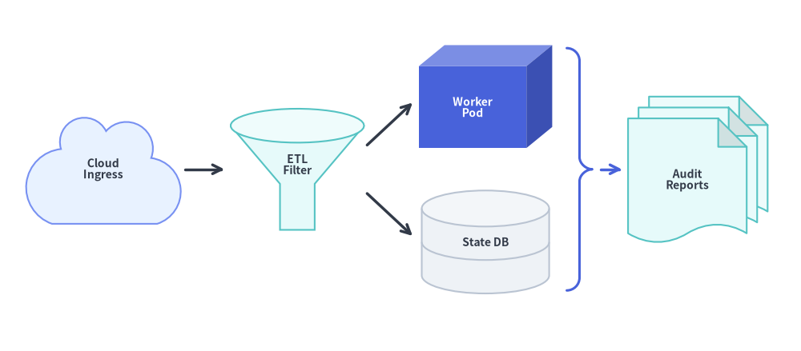
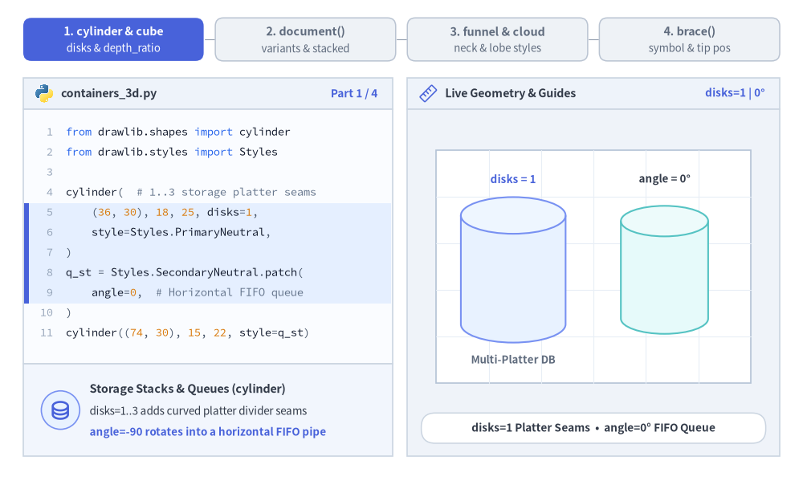
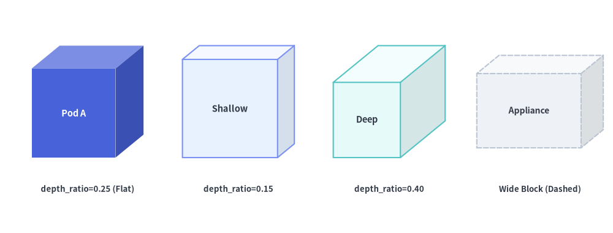
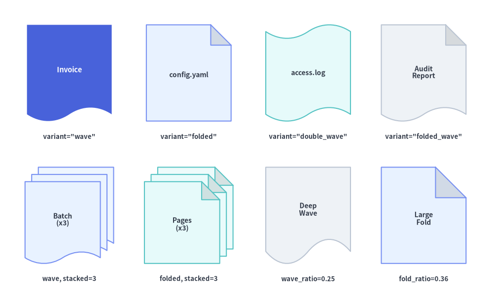
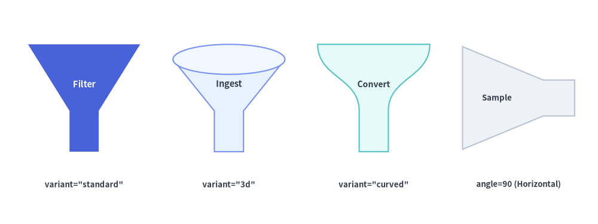
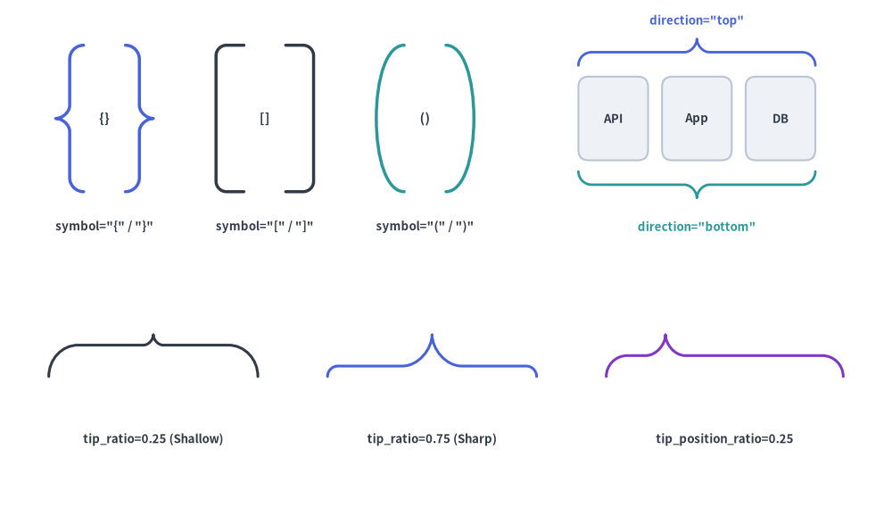

# 3D Containers, Flow & Grouping

The **3D Containers, Flow & Grouping** category of `drawlib.shapes` provides **6 architectural and pipeline primitives**: 3D multi-disk storage cylinders (`cylinder`), 3D shaded isometric cubes (`cube`), single or stacked document/file cards (`document`), data filtering and conversion funnels (`funnel`), cubic-Bézier cloud nodes and VPC boundaries (`cloud`), and curly/square/round grouping brackets (`brace`).


<figure class="drawlib-image" style="text-align: center;">
  
  <figcaption class="drawlib-caption">Combining Cloud Ingress, 3D Filtering Funnels, Cubes, Database Cylinders, Braces, and Stacked Documents</figcaption>
</figure>

<details class="drawlib-code-details">
<summary>Source Code</summary>

```python
from drawlib.canvas import save, setup
from drawlib.lines import line
from drawlib.shapes import brace, cloud, cube, cylinder, document, funnel
from drawlib.styles import Styles
from drawlib.text import text

setup(width=132, height=58)

lbl_dark = Styles.DarkBold.patch(text_size=10.0)
lbl_white = Styles.WhiteBold.patch(text_size=10.0)

# 1. Cloud Ingress
cloud(
    (17, 30),
    width=26,
    height=18,
    variant="flat",
    style=Styles.PrimaryNeutral,
    text="Cloud\nIngress",
    text_style=lbl_dark,
)

# 2. 3D Filtering Funnel
funnel(
    (49, 30),
    width=22,
    height=20,
    variant="3d",
    style=Styles.SecondaryNeutral,
    text="ETL\nFilter",
    text_style=lbl_dark.patch(xy_shift=(0, -1.8)),
)

# 3. 3D Worker Cube & 2-Disk State DB Cylinder
cube(
    (80, 42),
    width=22,
    height=17,
    depth_ratio=0.25,
    style=Styles.PrimaryFlat,
    text="Worker\nPod",
    text_style=lbl_white,
)
cylinder(
    (80, 18),
    width=21,
    height=17,
    disks=2,
    style=Styles.Neutral,
    text="State DB",
    text_style=lbl_dark,
)

# 4. Curly Brace + Stacked Audit Documents
brace(
    (95.5, 30),
    width=4.2,
    height=40,
    symbol="}",
    style=Styles.PrimaryBold.patch(line_width=2.2),
)
document(
    (115, 30),
    width=23,
    height=24,
    variant="folded_wave",
    stacked=3,
    style=Styles.SecondaryNeutral,
    text="Audit\nReports",
    text_style=lbl_dark,
)

line((30.5, 30), (37, 30), arrow_head="->", style=Styles.DarkBold)
line((60.5, 34), (68, 41), arrow_head="->", style=Styles.DarkBold)
line((60.5, 26), (68, 19), arrow_head="->", style=Styles.DarkBold)
line((99, 30), (102.5, 30), arrow_head="->", style=Styles.PrimaryBold)

save()
```

</details>


---

## 1. Core Geometric Concepts

All 6 primitives in this category anchor at their bounding-box center `xy` and normalize their 3D projections, waves, lobes, and bracket spines strictly inside `(width, height)`. Watch how multi-platter `disks` and `angle=-90` rotation, 3-face `depth_ratio` shading, `document` variants and sheet stacking, `funnel` neck ratios, normalized `cloud` lobes, and sliding `brace` tips reshape each component:


<figure class="drawlib-image" style="text-align: center;">
  
  <figcaption class="drawlib-caption">Parameter & Geometry Tour: Live Morphing of cylinder, cube, document, funnel, cloud, and brace (APNG Animation)</figcaption>
</figure>

<details class="drawlib-code-details">
<summary>Source Code</summary>

```python
from __future__ import annotations

from drawlib.anim import Animation
from drawlib.canvas import save, setup
from drawlib.icons import code as code_icons
from drawlib.icons import phosphor
from drawlib.lines import line
from drawlib.shapes import brace, circle, cloud, cube, cylinder, document, funnel, rectangle
from drawlib.smartarts import SourceCode, SourceCodeStyles
from drawlib.styles import Styles
from drawlib.text import text

W, H = 138.0, 82.0
setup(width=W, height=H)
anim = Animation(fps=10.0, loop=0)

CODE_TEXT_SIZE = 10.0
PT_TO_CANVAS = W / 720.0
FONT_CANVAS = CODE_TEXT_SIZE * PT_TO_CANVAS
LINE_H = FONT_CANVAS * 1.8
PAD_Y = FONT_CANVAS * 1.2

CODE_STYLES = SourceCodeStyles.get("default", font_lang="en", text_size=CODE_TEXT_SIZE).patch(
    box_style=Styles.Neutral.patch(shape_fill_color=(0, 0, 0, 0), shape_line_width=0),
)

PANE_HEADER = Styles.Neutral.patch(
    shape_fill_color=(238, 243, 250),
    shape_line_color=(203, 213, 225),
    shape_line_width=1.2,
    shape_r=0.0,
)
EDITOR_BODY = Styles.Neutral.patch(
    shape_fill_color=(250, 252, 255),
    shape_line_color=(203, 213, 225),
    shape_line_width=1.2,
    shape_r=0.0,
)
TAKEAWAY_BODY = Styles.Neutral.patch(
    shape_fill_color=(242, 246, 253),
    shape_line_color=(203, 213, 225),
    shape_line_width=1.2,
    shape_r=0.0,
)
STUDIO_BODY = Styles.Neutral.patch(
    shape_fill_color=(239, 243, 249),
    shape_line_color=(203, 213, 225),
    shape_line_width=1.2,
    shape_r=0.0,
)

PART_ITEMS = [
    ("1. cylinder & cube", "disks & depth_ratio"),
    ("2. document()", "variants & stacked"),
    ("3. funnel & cloud", "neck & lobe styles"),
    ("4. brace()", "symbol & tip pos"),
]


def draw_step_bar(active_part: int) -> None:
    """Draw top 4-part progress bar (active_part is 1..4)."""
    pill_w = 31.0
    pill_h = 7.4
    gap = 2.0
    start_x = 4.0 + pill_w / 2.0
    cy = 75.2

    for idx, (label, sublabel) in enumerate(PART_ITEMS, start=1):
        cx = start_x + (idx - 1) * (pill_w + gap)
        if idx > 1:
            prev_cx = cx - (pill_w + gap)
            line(
                (prev_cx + pill_w / 2.0 + 0.2, cy),
                (cx - pill_w / 2.0 - 0.2, cy),
                style=Styles.PrimaryBold if idx <= active_part else Styles.MutedThin,
            )

        if idx == active_part:
            st = Styles.PrimaryFlat.patch(shape_r=1.4)
            tst = Styles.WhiteBold.patch(text_size=10.3)
            sub_tst = Styles.White.patch(text_size=9.5)
        elif idx < active_part:
            st = Styles.PrimaryNeutral.patch(shape_r=1.4, shape_line_width=1.1)
            tst = Styles.PrimaryBold.patch(text_size=10.3)
            sub_tst = Styles.Primary.patch(text_size=9.5)
        else:
            st = Styles.Neutral.patch(shape_r=1.4, shape_line_width=1.1)
            tst = Styles.MutedBold.patch(text_size=10.3)
            sub_tst = Styles.Muted.patch(text_size=9.5)

        rectangle((cx, cy), width=pill_w, height=pill_h, style=st)
        text((cx, cy + 1.35), label, style=tst)
        text((cx, cy - 1.55), sublabel, style=sub_tst)


def draw_left_pane(
    active_part: int,
    code_lines: list[str],
    hl_range: tuple[int, int],
    icon_fn: object,
    summary_title: str,
    summary_line1: str,
    summary_line2: str,
) -> None:
    """Draw left Python code editor + bottom geometric concept note."""
    x0, w = 4.0, 63.5
    cx = x0 + w / 2.0
    top_y = 63.2
    header_h = 5.4
    editor_h = 43.8
    takeaway_h = 15.8

    rectangle((cx, top_y + header_h / 2.0), width=w, height=header_h, style=PANE_HEADER)
    code_icons.python((x0 + 3.6, top_y + header_h / 2.0), width=3.4, style=Styles.Neutral)
    text(
        (x0 + 6.5, top_y + header_h / 2.0),
        "containers_3d.py",
        style=Styles.DarkBold.patch(text_size=10.2, halign="left"),
    )
    text(
        (x0 + w - 2.6, top_y + header_h / 2.0),
        f"Part {active_part} / 4",
        style=Styles.PrimaryBold.patch(text_size=9.8, halign="right"),
    )

    rectangle((cx, top_y - editor_h / 2.0), width=w, height=editor_h, style=EDITOR_BODY)

    hl_start, hl_end = hl_range
    hl_top = top_y - PAD_Y - hl_start * LINE_H
    hl_bot = top_y - PAD_Y - (hl_end + 1) * LINE_H
    hl_cy = (hl_top + hl_bot) / 2.0
    hl_h = hl_top - hl_bot
    rectangle(
        (cx, hl_cy),
        width=w - 0.6,
        height=hl_h,
        style=Styles.Neutral.patch(shape_fill_color=(229, 239, 255), shape_line_width=0),
    )
    rectangle(
        (x0 + 0.55, hl_cy),
        width=0.9,
        height=hl_h,
        style=Styles.PrimaryFlat.patch(shape_line_width=0),
    )

    SourceCode.draw(
        xy=(x0, top_y),
        width=w,
        code="\n".join(code_lines),
        styles=CODE_STYLES,
        code_lang="python",
        show_linenum=True,
        align="top_left",
    )

    take_cy = 3.6 + takeaway_h / 2.0
    rectangle((cx, take_cy), width=w, height=takeaway_h, style=TAKEAWAY_BODY)
    circle(
        (x0 + 6.4, take_cy),
        radius=3.3,
        style=Styles.PrimaryNeutral.patch(shape_line_width=1.2),
    )
    icon_fn((x0 + 6.4, take_cy), width=3.8, style=Styles.PrimaryBold)  # type: ignore[operator]
    text(
        (x0 + 11.4, take_cy + 3.6),
        summary_title,
        style=Styles.DarkBold.patch(text_size=10.4, halign="left"),
    )
    text(
        (x0 + 11.4, take_cy - 0.2),
        summary_line1,
        style=Styles.Dark.patch(text_size=9.7, halign="left"),
    )
    text(
        (x0 + 11.4, take_cy - 3.8),
        summary_line2,
        style=Styles.PrimaryBold.patch(text_size=9.6, halign="left"),
    )


def draw_geometry_studio(param_badge: str, footer_caption: str) -> tuple[float, float]:
    """Draw right geometry lab shell, inner coordinate sheet with subtle grid, and footer."""
    x0, w = 70.0, 64.0
    cx = x0 + w / 2.0
    top_y = 63.2
    header_h = 5.4
    body_h = 59.6

    rectangle((cx, top_y + header_h / 2.0), width=w, height=header_h, style=PANE_HEADER)
    phosphor.ruler((x0 + 3.6, top_y + header_h / 2.0), width=3.4, style=Styles.Primary)
    text(
        (x0 + 6.5, top_y + header_h / 2.0),
        "Live Geometry & Guides",
        style=Styles.DarkBold.patch(text_size=10.2, halign="left"),
    )
    text(
        (x0 + w - 2.6, top_y + header_h / 2.0),
        param_badge,
        style=Styles.PrimaryBold.patch(text_size=9.6, halign="right"),
    )

    rectangle((cx, 3.6 + body_h / 2.0), width=w, height=body_h, style=STUDIO_BODY)

    # Inner coordinate sheet (54 x 40) with subtle grid lines
    sheet_cx, sheet_cy = cx, 36.2
    sheet_w, sheet_h = 54.0, 40.0
    sx0, sy0 = sheet_cx - sheet_w / 2.0, sheet_cy - sheet_h / 2.0
    rectangle(
        (sheet_cx, sheet_cy),
        width=sheet_w,
        height=sheet_h,
        style=Styles.Neutral.patch(
            shape_fill_color=(255, 255, 255),
            shape_line_color=(180, 194, 214),
            shape_line_width=1.2,
        ),
    )
    g_st = Styles.MutedThin.patch(line_color=(232, 238, 246), line_width=0.8)
    for gx in range(1, 6):
        vx = sx0 + gx * (sheet_w / 6.0)
        line((vx, sy0), (vx, sy0 + sheet_h), style=g_st)
    for gy in range(1, 5):
        vy = sy0 + gy * (sheet_h / 5.0)
        line((sx0, vy), (sx0 + sheet_w, vy), style=g_st)

    rectangle(
        (cx, 8.4),
        width=59.2,
        height=5.2,
        style=Styles.Neutral.patch(
            shape_fill_color=(255, 255, 255),
            shape_line_color=(203, 213, 225),
            shape_line_width=1.1,
            shape_r=2.4,
        ),
        text=footer_caption,
        text_style=Styles.DarkBold.patch(text_size=9.8),
    )
    return sheet_cx, sheet_cy


GHOST_BOX = Styles.MutedDashed.patch(
    shape_fill_color=(0, 0, 0, 0),
    shape_line_color=(176, 192, 214),
    shape_line_width=1.1,
)

# =========================================================================
# Part 1: cylinder (disks & angle=-90 FIFO queue) and cube (depth_ratio)
# =========================================================================
for d_cnt, ang, dur in ((1, 0, 0.50), (2, -45, 0.50), (3, -90, 3.3)):
    code_cyl = [
        "from drawlib.shapes import cylinder",
        "from drawlib.styles import Styles",
        "",
        "cylinder(  # 1..3 storage platter seams",
        f"    (36, 30), 18, 25, disks={d_cnt},",
        "    style=Styles.PrimaryNeutral,",
        ")",
        "q_st = Styles.SecondaryNeutral.patch(",
        f"    angle={ang},  # Horizontal FIFO queue",
        ")",
        "cylinder((74, 30), 15, 22, style=q_st)",
    ]
    with anim.frame(duration=dur):
        draw_step_bar(1)
        draw_left_pane(
            1,
            code_cyl,
            (4, 8),
            phosphor.database,
            "Storage Stacks & Queues (cylinder)",
            "disks=1..3 adds curved platter divider seams",
            "angle=-90 rotates into a horizontal FIFO pipe",
        )
        scx, scy = draw_geometry_studio(
            f"disks={d_cnt} | {ang}°",
            f"disks={d_cnt} Platter Seams  •  angle={ang}° FIFO Queue",
        )
        cy_c = scy - 0.6
        lx, rx = scx - 13.8, scx + 12.2

        cylinder(
            (lx, cy_c),
            width=18.0,
            height=25.0,
            disks=d_cnt,
            style=Styles.PrimaryNeutral,
        )
        text((lx, cy_c + 15.6), f"disks = {d_cnt}", style=Styles.PrimaryBold.patch(text_size=9.6))
        text((lx, cy_c - 15.4), "Multi-Platter DB", style=Styles.MutedBold.patch(text_size=9.5))

        cylinder(
            (rx, cy_c),
            width=15.0,
            height=22.0,
            style=Styles.SecondaryNeutral.patch(angle=ang),
        )
        text((rx, cy_c + 15.6), f"angle = {ang}°", style=Styles.DarkBold.patch(text_size=9.6))
        if ang == -90:
            line(
                (rx - 9.0, cy_c - 11.6),
                (rx + 9.0, cy_c - 11.6),
                arrow_head="->",
                style=Styles.PrimaryBold.patch(line_width=1.5),
            )
            text((rx, cy_c - 15.4), "Left → Right FIFO", style=Styles.PrimaryBold.patch(text_size=9.5))

for dr, dur in ((0.15, 0.50), (0.28, 0.50), (0.40, 3.3)):
    code_cube = [
        "from drawlib.shapes import cube",
        "from drawlib.styles import Styles",
        "",
        "# Auto 3-face isometric shading",
        "cube(",
        "    (50, 30), width=28, height=24,",
        f"    depth_ratio={dr:.2f},",
        "    style=Styles.PrimaryFlat,",
        '    text="Worker",',
        ")",
    ]
    with anim.frame(duration=dur):
        draw_step_bar(1)
        draw_left_pane(
            1,
            code_cube,
            (6, 6),
            phosphor.cube,
            "3-Face Shaded Block (cube)",
            "Fits full 3D projection inside width × height",
            "Auto-shades front, +light top, and -dark side",
        )
        scx, scy = draw_geometry_studio(
            f"depth_ratio = {dr:.2f}",
            f"cube(depth_ratio={dr:.2f})  •  Auto 3-Face Shading",
        )
        cy_b = scy - 0.8
        rectangle((scx, cy_b), width=28.0, height=24.0, style=GHOST_BOX)
        cube(
            (scx, cy_b),
            width=28.0,
            height=24.0,
            depth_ratio=dr,
            style=Styles.PrimaryFlat,
            text="Worker",
            text_style=Styles.WhiteBold.patch(text_size=10.5),
        )
        if dr >= 0.40:
            text((scx, cy_b + 15.2), "Top Face (+28% Light)", style=Styles.PrimaryBold.patch(text_size=9.6))
            text(
                (scx + 15.6, cy_b + 1.0),
                "Right\n(×0.82)",
                style=Styles.DarkBold.patch(text_size=9.5, halign="left"),
            )
            text((scx, cy_b - 15.2), "Dashed = Exact 28 × 24 Box", style=Styles.MutedBold.patch(text_size=9.5))

# =========================================================================
# Part 2: document — variant ("wave" -> "folded" -> "folded_wave") & stacked
# =========================================================================
DOC_STATES = [
    ("wave", 1, "PrimaryNeutral", "Invoice", 3.2),
    ("folded", 2, "PrimaryNeutral", "Configs", 0.50),
    ("folded_wave", 3, "SecondaryNeutral", "Reports", 3.3),
]
for d_var, stk, st_name, d_lbl, dur in DOC_STATES:
    code_doc = [
        "from drawlib.shapes import document",
        "from drawlib.styles import Styles",
        "",
        "document(",
        "    (50, 30), width=25, height=27,",
        f'    variant="{d_var}",',
        f"    stacked={stk},",
        f"    style=Styles.{st_name},",
        f'    text="{d_lbl}",',
        ")",
    ]
    with anim.frame(duration=dur):
        draw_step_bar(2)
        draw_left_pane(
            2,
            code_doc,
            (5, 6),
            phosphor.files if stk > 1 else phosphor.file_text,
            "Silhouettes & Stacks (document)",
            "Variants mix bottom S-waves & dog-ear folds",
            "stacked=1..3 cascades lightened back sheets",
        )
        scx, scy = draw_geometry_studio(
            f'"{d_var}", ×{stk}',
            f'variant="{d_var}", stacked={stk}  •  Bounded Stack',
        )
        cy_d = scy - 0.6
        rectangle((scx, cy_d), width=25.0, height=27.0, style=GHOST_BOX)
        document(
            (scx, cy_d),
            width=25.0,
            height=27.0,
            variant=d_var,
            stacked=stk,
            style=getattr(Styles, st_name),
            text=d_lbl,
            text_style=Styles.DarkBold.patch(text_size=10.2),
        )
        if d_var == "wave":
            text((scx, cy_d + 16.0), "Straight Top Edge", style=Styles.MutedBold.patch(text_size=9.5))
            text((scx, cy_d - 16.2), "Cubic-Bézier S-Wave Base", style=Styles.PrimaryBold.patch(text_size=9.6))
        elif stk == 3:
            text((scx, cy_d + 16.0), "3 Cascading Sheets + Dog-Ear Flap", style=Styles.PrimaryBold.patch(text_size=9.6))
            text((scx, cy_d - 16.2), "All 3 Sheets Fit Exact 25 × 27 Box", style=Styles.DarkBold.patch(text_size=9.5))

# =========================================================================
# Part 3: funnel (neck ratios) & cloud (normalized lobe variants)
# =========================================================================
for nw_r, nh_r, dur in ((0.45, 0.25, 0.50), (0.22, 0.42, 3.3)):
    code_fun = [
        "from drawlib.shapes import funnel",
        "from drawlib.styles import Styles",
        "",
        "funnel(",
        "    (50, 30), width=30, height=25,",
        '    variant="3d",',
        f"    neck_width_ratio={nw_r:.2f},",
        f"    neck_height_ratio={nh_r:.2f},",
        "    style=Styles.PrimaryNeutral,",
        '    text="Ingest",',
        ")",
    ]
    with anim.frame(duration=dur):
        draw_step_bar(3)
        draw_left_pane(
            3,
            code_fun,
            (6, 7),
            phosphor.funnel,
            "3D Rim & Spout Ratios (funnel)",
            'variant="3d" adds a shaded elliptical top rim',
            "neck_width/height_ratio tune the lower spout",
        )
        scx, scy = draw_geometry_studio(
            f"neck_w = {nw_r:.2f}",
            f'funnel("3d")  •  neck_w={nw_r:.2f}, neck_h={nh_r:.2f}',
        )
        cy_f = scy + 0.8
        fw, fh = 30.0, 25.0
        funnel(
            (scx, cy_f),
            width=fw,
            height=fh,
            variant="3d",
            neck_width_ratio=nw_r,
            neck_height_ratio=nh_r,
            style=Styles.PrimaryNeutral,
            text="Ingest",
            text_style=Styles.DarkBold.patch(text_size=10.0, xy_shift=(0, -1.8)),
        )
        nw_half = 0.5 * fw * nw_r
        y_bot = cy_f - fh / 2.0
        y_neck = y_bot + fh * nh_r
        line(
            (scx - nw_half, y_bot - 2.4),
            (scx + nw_half, y_bot - 2.4),
            arrow_head="<->",
            style=Styles.DangerBold.patch(line_width=1.5),
        )
        text(
            (scx, y_bot - 5.4),
            f"neck_width_ratio = {nw_r:.2f}",
            style=Styles.DangerBold.patch(text_size=9.6),
        )
        line(
            (scx + nw_half + 2.8, y_bot),
            (scx + nw_half + 2.8, y_neck),
            arrow_head="<->",
            style=Styles.PrimaryBold.patch(line_width=1.5),
        )
        text(
            (scx + nw_half + 4.4, 0.5 * (y_bot + y_neck)),
            f"h×{nh_r:.2f}",
            style=Styles.PrimaryBold.patch(text_size=9.5, halign="left"),
        )

for c_var, dur in (("standard", 0.50), ("flat", 3.2), ("fluffy", 3.3)):
    code_cld = [
        "from drawlib.shapes import cloud",
        "from drawlib.styles import Styles",
        "",
        "# Normalized strictly to width × height",
        "cloud(",
        "    (50, 30), width=38, height=22,",
        f'    variant="{c_var}",',
        "    style=Styles.SecondaryNeutral,",
        f'    text="{c_var}",',
        ")",
    ]
    with anim.frame(duration=dur):
        draw_step_bar(3)
        draw_left_pane(
            3,
            code_cld,
            (6, 6),
            phosphor.cloud,
            "Normalized Bézier Lobes (cloud)",
            "standard (8), flat (grounded), fluffy (12)",
            "Every variant normalizes to exact width×height",
        )
        scx, scy = draw_geometry_studio(
            f'variant="{c_var}"',
            f'cloud(variant="{c_var}")  •  Normalized to 38 × 22',
        )
        cy_cl = scy - 0.8
        rectangle((scx, cy_cl), width=38.0, height=22.0, style=GHOST_BOX)
        cloud(
            (scx, cy_cl),
            width=38.0,
            height=22.0,
            variant=c_var,
            style=Styles.SecondaryNeutral,
            text=c_var,
            text_style=Styles.DarkBold.patch(text_size=10.5),
        )
        line(
            (scx - 19.0, cy_cl + 13.0),
            (scx + 19.0, cy_cl + 13.0),
            arrow_head="<->",
            style=Styles.PrimaryBold.patch(line_width=1.4),
        )
        text((scx, cy_cl + 16.0), "width = 38 (Exact Span)", style=Styles.PrimaryBold.patch(text_size=9.6))
        text((scx, cy_cl - 15.0), "Dashed = 38 × 22 Bounding Box", style=Styles.MutedBold.patch(text_size=9.5))

# =========================================================================
# Part 4: brace — symbol ("}" -> "]" -> ")") & tip_position_ratio
# =========================================================================
BRACE_STATES: list[tuple[str, float | None, float, tuple[int, int]]] = [
    ("}", 0.50, 3.2, (6, 6)),
    ("]", None, 0.50, (6, 6)),
    (")", None, 3.2, (6, 6)),
    ("}", 0.25, 3.2, (6, 7)),
    ("}", 0.75, 3.3, (6, 7)),
]
for sym, tpr, dur, hl in BRACE_STATES:
    tpr_line = f"    tip_position_ratio={tpr:.2f}," if tpr is not None else "    tip_position_ratio=None,"
    code_brc = [
        "from drawlib.shapes import brace",
        "from drawlib.styles import Styles",
        "",
        "# Wraps left stack; tip points right",
        "brace(",
        "    (50, 30), width=4.8, height=26.4,",
        f'    symbol="{sym}",',
        tpr_line,
        "    style=Styles.PrimaryBold,",
        ")",
    ]
    is_sliding = hl == (6, 7)
    with anim.frame(duration=dur):
        draw_step_bar(4)
        draw_left_pane(
            4,
            code_brc,
            hl,
            phosphor.brackets_curly,
            "Sliding Tip Position (brace)" if is_sliding else "Grouping Brackets (brace)",
            "tip_position_ratio moves tip bottom→top (0..1)"
            if is_sliding
            else '"}" curly, "]" square, and ")" round families',
            "0.25 targets bottom node; 0.75 targets top"
            if is_sliding
            else "Stroke uses style.line_color & style.line_width",
        )
        badge = f"tip_pos = {tpr:.2f}" if is_sliding and tpr is not None else f'symbol = "{sym}"'
        foot = (
            f'brace("}}", tip_position_ratio={tpr:.2f})  •  Aimed Tip'
            if tpr is not None
            else f'brace(symbol="{sym}")  •  Wraps Stacked Node Cards'
        )
        scx, scy = draw_geometry_studio(badge, foot)
        cy_br = scy - 0.8
        bh = 26.4

        # 3 stacked source node cards on the left
        for idx_c, c_lbl in enumerate(("Pod 1", "Pod 2", "Pod 3")):
            yc = cy_br + (1 - idx_c) * 7.6
            rectangle(
                (scx - 14.0, yc),
                width=14.8,
                height=5.8,
                style=Styles.Neutral.patch(shape_r=1.3),
                text=c_lbl,
                text_style=Styles.DarkBold.patch(text_size=9.6),
            )

        # Central grouping brace
        bx = scx - 1.5
        brace(
            (bx, cy_br),
            width=4.8,
            height=bh,
            symbol=sym,  # type: ignore[arg-type]
            tip_position_ratio=tpr,
            style=Styles.PrimaryBold,
        )

        # 3 target route nodes on the right (at +6.6, 0.0, -6.6 = exact 0.75, 0.50, 0.25 tip positions)
        targets = (("Node A", 0.75, 6.6), ("Node B", 0.50, 0.0), ("Node C", 0.25, -6.6))
        for t_lbl, t_ratio, dy in targets:
            yt = cy_br + dy
            is_hit = sym == "}" and tpr == t_ratio
            t_st = Styles.PrimaryFlat.patch(shape_r=1.3) if is_hit else Styles.PrimaryNeutral.patch(shape_r=1.3)
            t_tst = Styles.WhiteBold.patch(text_size=9.6) if is_hit else Styles.DarkBold.patch(text_size=9.6)
            rectangle((scx + 14.2, yt), width=15.4, height=5.2, style=t_st, text=t_lbl, text_style=t_tst)
            if is_hit:
                line(
                    (bx + 2.9, yt),
                    (scx + 6.0, yt),
                    arrow_head="->",
                    style=Styles.PrimaryBold.patch(line_width=1.8),
                )

        top_note = (
            f"tip_position_ratio = {tpr:.2f}"
            if tpr is not None
            else ('Square Bracket "]"' if sym == "]" else 'Round Parenthesis ")"')
        )
        text((scx, cy_br + 16.0), top_note, style=Styles.PrimaryBold.patch(text_size=9.6))

save()
```

</details>


- **3D Depth & Platter Tiers (`cylinder`, `cube`)**: `cylinder` adds curved platter seams via `disks` (and rotates into a horizontal queue via `angle=-90`), while `cube` auto-shades 3 faces across `depth_ratio`.
- **Document Variants & Sheet Cascading (`document`)**: Combines wavy bases and darkened top-right dog-ear flaps (`"wave"`, `"folded"`, `"folded_wave"`), cascading lightened background sheets when `stacked > 1`.
- **Spout Ratios & Normalized Cloud Lobes (`funnel`, `cloud`)**: `funnel` tunes lower spout dimensions via `neck_width_ratio` and `neck_height_ratio`, while every `cloud` variant normalizes its cubic-Bézier lobes strictly inside `(width, height)`.
- **Grouping Brackets & Sliding Tips (`brace`)**: Supports curly (`"{}"`), square (`"[]"` with `shape_r` `90°` corner rounding), and round (`"()"`) strokes, plus `tip_position_ratio` (`0.0`..`1.0`) to aim curly tips at a specific target node.

---

## 2. Quick Comparison of 3D Container, Flow & Grouping Primitives

Use the summary matrix below to compare anchoring, architectural roles, geometry arguments, and automatic shading across all 6 functions:

| Function | Default Anchor | Primary Architectural Role | Variants & Key Geometry Arguments | Shading & Text Placement |
| :--- | :--- | :--- | :--- | :--- |
| **`cylinder`** | Center `(cx, cy)` | Relational DBs, disk arrays, object stores, FIFO queues | `disks: int = 1`, `style.patch(angle=-90)` | Top elliptical cap automatically lightened; text centered on body. |
| **`cube`** | Center `(cx, cy)` | 3D compute nodes, containers, hardware appliances | `depth_ratio: float \| None = None` (default `0.25`) | 3-face automatic shading (front, lightened top, darkened right); text centered on front face. |
| **`document`** | Center `(cx, cy)` | Printouts, config files, log snippets, report stacks | `variant` (`"wave"`, `"folded"`, `"double_wave"`, `"folded_wave"`), `stacked: int = 1`, `wave_ratio`, `fold_ratio` | Darkened corner fold flap & lightened background stack sheets; text centered on front sheet. |
| **`funnel`** | Center `(cx, cy)` | Data filtering stages, event reducers, conversion funnels | `variant` (`"standard"`, `"3d"`, `"curved"`), `neck_width_ratio`, `neck_height_ratio` | `"3d"` variant renders a shaded elliptical top rim; text centered in upper cone. |
| **`cloud`** | Center `(cx, cy)` | External cloud/SaaS nodes, VPC/WAN dashed boundaries | `variant` (`"standard"`, `"flat"`, `"fluffy"`, `"simple"`), `bump_ratio` | Smooth cubic-Bézier lobes strictly normalized to `(width, height)`. |
| **`brace`** | Center `(cx, cy)` | Curly, square, and round grouping brackets/braces | `symbol` (`"{}"`, `"[]"`, `"()"`), `direction` (`"left"`, `"right"`, `"top"`, `"bottom"`), `tip_ratio`, `tip_position_ratio` | Open vector stroke controlled by `style.line_width` and `style.line_color`. |

---

## 3. 3D Cylinders & Database Stacks (`cylinder`)

For relational databases, object storage buckets, disk arrays, and message queues, `cylinder` renders a 3D cylindrical container with an automatically lightened elliptical top cap:

```python
cylinder(
    xy: tuple[float, float],
    width: float,
    height: float,
    *,
    style: Style,
    disks: int = 1,
    text: str = "",
    text_style: Style | None = None,
) -> None
```

### Parameter Reference

| Parameter | Type | Default | Description |
| :--- | :--- | :--- | :--- |
| `xy` | `tuple[float, float]` | *Required* | Center coordinate `(x, y)` of the outer cylinder bounding box. |
| `width` | `float` | *Required* | Total horizontal width of the cylinder (`> 0`). |
| `height` | `float` | *Required* | Total vertical height of the cylinder, including top and bottom elliptical caps (`> 0`). |
| `disks` | `int` | `1` | Number of stacked storage disk tiers (`>= 1`). When `disks >= 2`, curved horizontal divider seams are drawn along the cylinder body to represent multi-platter database storage. |
| `style` | `Style` | *Required* | Shape fill and border style. The top elliptical cap is automatically lightened from `style.shape_fill_color`. Set `style.patch(angle=-90)` to rotate the cylinder horizontally for FIFO message queues or pipelines. |
| `text` / `text_style` | `str` / `Style \| None` | `""` / `None` | Centered text label and optional typography override. |


```python
from drawlib.canvas import save, setup
from drawlib.shapes import cylinder
from drawlib.styles import Styles

setup(width=118, height=48)

# 1. Single-tier cache cylinder
cylinder(
    (22, 24),
    width=26,
    height=34,
    style=Styles.Neutral,
    text="Cache",
    text_style=Styles.DarkBold.patch(text_size=11.5),
)

# 2. 3-disk database stack (disks=3)
cylinder(
    (60, 24),
    width=28,
    height=36,
    disks=3,
    style=Styles.PrimaryFlat,
    text="Primary\nDB",
    text_style=Styles.WhiteBold.patch(text_size=11.5),
)

# 3. Horizontal rotated cylinder (angle=-90 for message queue)
cylinder(
    (97, 24),
    width=20,
    height=32,
    style=Styles.SecondaryNeutral.patch(angle=-90),
    text="Queue",
    text_style=Styles.DarkBold.patch(text_size=11.5),
)

save()
```

<figure class="drawlib-image" style="text-align: center;">
  
  <figcaption class="drawlib-caption">Single Cylinder, 3-Disk Database Stack, and Horizontal Queue</figcaption>
</figure>


---

## 4. 3D Cubes & Rectangular Blocks (`cube`)

Complementing `cylinder`, `cube` renders an oblique 3D cube or rectangular box strictly fitted within the `(width, height)` bounding box centered at `xy`:

```python
cube(
    xy: tuple[float, float],
    width: float,
    height: float,
    *,
    depth_ratio: float | None = None,
    style: Style,
    text: str = "",
    text_style: Style | None = None,
) -> None
```

### Parameter Reference

| Parameter | Type | Default | Description |
| :--- | :--- | :--- | :--- |
| `xy` | `tuple[float, float]` | *Required* | Center coordinate `(x, y)` of the outer 3D bounding box. |
| `width` | `float` | *Required* | Exact outer horizontal width of the 3D box, including the right-side oblique projection (`> 0`). |
| `height` | `float` | *Required* | Exact outer vertical height of the 3D box, including the top-face oblique projection (`> 0`). |
| `depth_ratio` | `float \| None` | `None` | 3D oblique depth fraction in `(0.0, 1.0)` relative to `min(width, height)`. Defaults to `0.25` when `None`. Smaller values (`0.15`) produce a shallow 3D card; larger values (`0.40`) produce a deep isometric block. |
| `style` | `Style` | *Required* | Fill, border (`shape_line_color`, `shape_line_width`, `shape_line_style`), and rotation (`angle`) style. |
| `text` / `text_style` | `str` / `Style \| None` | `""` / `None` | Label automatically centered on the **front face** (rather than the outer bounding box) so text never collides with the 3D seam lines. |

### 3-Face Automatic Shading & Stroke Mechanics
- **Automatic Face Shading**: From `style.shape_fill_color`, Drawlib automatically computes three distinct face shades:
  1. **Front Face**: Base `style.shape_fill_color`.
  2. **Top Face**: Lightened toward white (`+28%` on standard fills, `+55%` on high-luminance neutral fills) to simulate overhead lighting.
  3. **Right Side Face**: Darkened (`×0.82` on standard fills, `×0.92` on neutral fills) to create natural depth shadow.
- **Unified Stroke Path**: The outer perimeter and the three internal Y-seams are drawn in a single unified `PathPatch`, ensuring that `Dashed` or `Dotted` line styles never double-overlap on shared edges.


```python
from drawlib.canvas import save, setup
from drawlib.shapes import cube
from drawlib.styles import Styles
from drawlib.text import text

setup(width=126, height=48)

# 1. Standard Flat Cube (depth_ratio=0.25 default)
cube(
    (18, 27),
    width=23,
    height=23,
    style=Styles.PrimaryFlat,
    text="Pod A",
    text_style=Styles.WhiteBold.patch(text_size=10.5),
)
text((18, 9), "depth_ratio=0.25 (Flat)", style=Styles.DarkBold.patch(text_size=9.5))

# 2. Shallow 3D Block (depth_ratio=0.15)
cube(
    (49, 27),
    width=23,
    height=23,
    depth_ratio=0.15,
    style=Styles.PrimaryNeutral,
    text="Shallow",
    text_style=Styles.DarkBold.patch(text_size=10.5),
)
text((49, 9), "depth_ratio=0.15", style=Styles.DarkBold.patch(text_size=9.5))

# 3. Deep 3D Cube (depth_ratio=0.40)
cube(
    (80, 27),
    width=23,
    height=23,
    depth_ratio=0.40,
    style=Styles.SecondaryNeutral,
    text="Deep",
    text_style=Styles.DarkBold.patch(text_size=10.5),
)
text((80, 9), "depth_ratio=0.40", style=Styles.DarkBold.patch(text_size=9.5))

# 4. Wide Hardware Appliance Block (26x19, dashed)
cube(
    (111, 27),
    width=26,
    height=19,
    depth_ratio=0.24,
    style=Styles.Neutral.patch(shape_line_style="dashed"),
    text="Appliance",
    text_style=Styles.DarkBold.patch(text_size=10.0),
)
text((111, 9), "Wide Block (Dashed)", style=Styles.DarkBold.patch(text_size=9.5))

save()
```

<figure class="drawlib-image" style="text-align: center;">
  
  <figcaption class="drawlib-caption">3D Cubes and Rectangular Blocks Across Styles and depth_ratio Values</figcaption>
</figure>


---

## 5. Documents, Files & Multi-Sheet Stacks (`document`)

For flowchart output steps, configuration/source files, log stream snippets, and multi-page report stacks, `document` provides four `variant` silhouettes and multi-sheet cascading (`stacked >= 1`):

```python
document(
    xy: tuple[float, float],
    width: float,
    height: float,
    *,
    variant: Literal[
        "wave", "standard",
        "folded", "page", "note",
        "double_wave", "snippet",
        "folded_wave", "report",
    ] = "wave",
    stacked: int = 1,
    wave_ratio: float | None = None,
    fold_ratio: float | None = None,
    style: Style,
    text: str = "",
    text_style: Style | None = None,
) -> None
```

### Parameter Reference

| Parameter | Type | Default | Description |
| :--- | :--- | :--- | :--- |
| `xy` | `tuple[float, float]` | *Required* | Center coordinate `(x, y)` of the outer document bounding box (including all stacked sheets). |
| `width` | `float` | *Required* | Total horizontal width of the document bounding box (`> 0`). |
| `height` | `float` | *Required* | Total vertical height of the document bounding box (`> 0`). |
| `variant` | `DocumentVariant` | `"wave"` | Silhouette style of the document sheet (see **Document `variant` Reference** below). |
| `stacked` | `int` | `1` | Number of overlapping document sheets (`>= 1`). When `stacked > 1` (e.g. `2` or `3`), sheets cascade from back-top-right to front-bottom-left inside `(width, height)`, with background sheets automatically lightened. |
| `wave_ratio` | `float \| None` | `None` | Wave peak-to-trough amplitude fraction in `(0.0, 1.0)` relative to sheet height. Defaults to `0.14`. Effective on `"wave"`, `"double_wave"`, and `"folded_wave"`. |
| `fold_ratio` | `float \| None` | `None` | Top-right dog-ear corner fold size fraction in `(0.0, 1.0)` relative to `min(sheet_w, sheet_h)`. Defaults to `0.24`. Effective on `"folded"` and `"folded_wave"`. |
| `style` | `Style` | *Required* | Fill, border, and rotation (`angle`) style. On folded variants, the triangular corner flap is automatically darkened for 3D contrast. |
| `text` / `text_style` | `str` / `Style \| None` | `""` / `None` | Text label optically centered on the **front-most sheet** (automatically shifted away from bottom waves and top-right corner folds). |

### Document `variant` Reference

| `variant` | Accepted Aliases | Top Edge | Bottom Edge | Active Ratio Args | Typical Use Cases |
| :--- | :--- | :--- | :--- | :--- | :--- |
| **`"wave"`** *(default)* | `"standard"` | Straight | Cubic-Bézier S-wave | `wave_ratio` | Classic ISO flowchart document/printout symbol, invoices, generated artifacts. |
| **`"folded"`** | `"page"`, `"note"` | Top-right dog-ear fold | Straight | `fold_ratio` | Configuration files (`config.yaml`), source code files, Markdown/PDF pages, UML notes. |
| **`"double_wave"`** | `"snippet"` | Cubic-Bézier S-wave | Cubic-Bézier S-wave | `wave_ratio` | Continuous log streams (`access.log`), truncated text excerpts, data stream chunks. |
| **`"folded_wave"`** | `"report"` | Top-right dog-ear fold | Cubic-Bézier S-wave | `wave_ratio`, `fold_ratio` | Multi-page technical reports, specifications, and audit logs combining file and wave cues. |


```python
from drawlib.canvas import save, setup
from drawlib.shapes import document
from drawlib.styles import Styles
from drawlib.text import text

setup(width=128, height=78)

# Row 1: The 4 Document Variants (stacked=1)
row1 = [
    ("wave", "Invoice", 18, Styles.PrimaryFlat, Styles.WhiteBold.patch(text_size=10.5), 'variant="wave"'),
    ("folded", "config.yaml", 49, Styles.PrimaryNeutral, Styles.DarkBold.patch(text_size=10.0), 'variant="folded"'),
    ("double_wave", "access.log", 80, Styles.SecondaryNeutral, Styles.DarkBold.patch(text_size=10.0), 'variant="double_wave"'),
    ("folded_wave", "Audit\nReport", 110, Styles.Neutral, Styles.DarkBold.patch(text_size=10.0), 'variant="folded_wave"'),
]
for var, lbl, cx, st, tst, cap in row1:
    document((cx, 59), width=22, height=25, variant=var, style=st, text=lbl, text_style=tst)
    text((cx, 42.5), cap, style=Styles.DarkBold.patch(text_size=9.5))

# Row 2: Multi-sheet stacking (stacked=3) and wave_ratio / fold_ratio customization
document(
    (18, 22),
    width=23,
    height=25,
    variant="wave",
    stacked=3,
    style=Styles.PrimaryNeutral,
    text="Batch\n(x3)",
    text_style=Styles.DarkBold.patch(text_size=10.0),
)
text((18, 5.5), "wave, stacked=3", style=Styles.DarkBold.patch(text_size=9.5))

document(
    (49, 22),
    width=23,
    height=25,
    variant="folded",
    stacked=3,
    style=Styles.SecondaryNeutral,
    text="Pages\n(x3)",
    text_style=Styles.DarkBold.patch(text_size=10.0),
)
text((49, 5.5), "folded, stacked=3", style=Styles.DarkBold.patch(text_size=9.5))

document(
    (80, 22),
    width=22,
    height=25,
    variant="wave",
    wave_ratio=0.25,
    style=Styles.Neutral,
    text="Deep\nWave",
    text_style=Styles.DarkBold.patch(text_size=10.0),
)
text((80, 5.5), "wave_ratio=0.25", style=Styles.DarkBold.patch(text_size=9.5))

document(
    (110, 22),
    width=22,
    height=25,
    variant="folded",
    fold_ratio=0.36,
    style=Styles.PrimaryNeutral,
    text="Large\nFold",
    text_style=Styles.DarkBold.patch(text_size=10.0),
)
text((110, 5.5), "fold_ratio=0.36", style=Styles.DarkBold.patch(text_size=9.5))

save()
```

<figure class="drawlib-image" style="text-align: center;">
  
  <figcaption class="drawlib-caption">The Four Document Variants (Row 1) and Multi-Sheet Stacking & Ratio Customizations (Row 2)</figcaption>
</figure>


---

## 6. Data Filtering & Conversion Funnels (`funnel`)

For ETL data filtering pipelines, event deduplication stages, rate limiters, and conversion funnels, `funnel` renders a wide upper cone tapering into a narrow lower spout:

```python
funnel(
    xy: tuple[float, float],
    width: float,
    height: float,
    *,
    variant: Literal[
        "standard", "flat",
        "3d", "cylinder",
        "curved",
    ] = "standard",
    neck_width_ratio: float | None = None,
    neck_height_ratio: float | None = None,
    style: Style,
    text: str = "",
    text_style: Style | None = None,
) -> None
```

### Parameter & `variant` Reference

| Parameter | Type | Default | Description |
| :--- | :--- | :--- | :--- |
| `xy` | `tuple[float, float]` | *Required* | Center coordinate `(x, y)` of the funnel bounding box. |
| `width` / `height` | `float` | *Required* | Total top rim width (`> 0`) and total vertical height (`> 0`). |
| `variant` | `FunnelVariant` | `"standard"` | Funnel silhouette and shading style (see **Funnel `variant` Comparison** below). |
| `neck_width_ratio` | `float \| None` | `None` | Spout neck width as a fraction of `width` in `[0.08, 0.85]`. Defaults to `0.28` when `None`. |
| `neck_height_ratio` | `float \| None` | `None` | Spout neck height as a fraction of `height` in `[0.05, 0.75]`. Defaults to `0.36` when `None`. |
| `style` | `Style` | *Required* | Fill, border, and rotation (`angle`, e.g. `angle=-90` for a horizontal left-to-right filter). |
| `text` / `text_style` | `str` / `Style \| None` | `""` / `None` | Label automatically centered in the wide upper cone section. |

| `variant` | Accepted Aliases | Geometry & Shading | Typical Use Cases |
| :--- | :--- | :--- | :--- |
| **`"standard"`** *(default)* | `"flat"` | Flat 2D trapezoidal upper cone + vertical rectangular spout | Clean 2D flowchart filtering gates, SQL `WHERE` filters, and horizontal pipeline reducers. |
| **`"3d"`** | `"cylinder"` | 3D funnel with a darkened elliptical top opening rim | Data lake ingestion funnels, telemetry collectors, and 3D architecture diagrams alongside `cylinder` and `cube`. |
| **`"curved"`** | — | Smooth cubic-Bézier S-curve walls tapering seamlessly into the neck | Marketing/analytics conversion funnels and smooth stream aggregators. |


```python
from drawlib.canvas import save, setup
from drawlib.shapes import funnel
from drawlib.styles import Styles
from drawlib.text import text

setup(width=128, height=48)

lbl = Styles.DarkBold.patch(text_size=9.5)

# 1. Standard 2D funnel
funnel(
    (18, 27),
    width=24,
    height=23,
    variant="standard",
    style=Styles.PrimaryFlat,
    text="Filter",
    text_style=Styles.WhiteBold.patch(text_size=10.5),
)
text((18, 8.5), 'variant="standard"', style=lbl)

# 2. 3D shaded elliptical-top funnel
funnel(
    (49, 27),
    width=24,
    height=23,
    variant="3d",
    style=Styles.PrimaryNeutral,
    text="Ingest",
    text_style=Styles.DarkBold.patch(text_size=10.5),
)
text((49, 8.5), 'variant="3d"', style=lbl)

# 3. Smooth cubic-Bézier curved funnel
funnel(
    (80, 27),
    width=24,
    height=23,
    variant="curved",
    style=Styles.SecondaryNeutral,
    text="Convert",
    text_style=Styles.DarkBold.patch(text_size=10.0),
)
text((80, 8.5), 'variant="curved"', style=lbl)

# 4. Horizontal rotated funnel (angle=90 -> left-to-right reducer)
funnel(
    (111, 27),
    width=22,
    height=24,
    variant="standard",
    neck_width_ratio=0.35,
    neck_height_ratio=0.28,
    style=Styles.Neutral.patch(angle=90),
    text="Sample",
    text_style=Styles.DarkBold.patch(text_size=9.5, angle=0, xy_shift=(0, 1.5)),
)
text((111, 8.5), "angle=90 (Horizontal)", style=lbl)

save()
```

<figure class="drawlib-image" style="text-align: center;">
  
  <figcaption class="drawlib-caption">The Three Funnel Variants (standard, 3d, curved), Custom Neck Ratios, and Horizontal Rotation</figcaption>
</figure>


---

## 7. Cloud Nodes & Boundaries (`cloud`)

`cloud` renders a smooth cubic-Bézier cloud silhouette normalized to fit its exact `(width, height)` bounding box centered at `xy`:

```python
cloud(
    xy: tuple[float, float],
    width: float,
    height: float,
    *,
    variant: Literal[
        "standard",
        "flat", "flat_bottom",
        "fluffy", "dense",
        "simple", "minimal",
    ] = "standard",
    bump_ratio: float | None = None,
    style: Style,
    text: str = "",
    text_style: Style | None = None,
) -> None
```

### Parameter Reference

| Parameter | Type | Default | Description |
| :--- | :--- | :--- | :--- |
| `xy` | `tuple[float, float]` | *Required* | Center coordinate `(x, y)` of the cloud bounding box. |
| `width` | `float` | *Required* | Exact outer horizontal width of the cloud (`> 0`). |
| `height` | `float` | *Required* | Exact outer vertical height of the cloud (`> 0`). |
| `variant` | `CloudVariant` | `"standard"` | Cloud silhouette style (see **Cloud `variant` Reference** below). |
| `bump_ratio` | `float \| None` | `None` | Outward lobe bulge depth ratio in `(0.0, 1.0)`. When `None`, uses the optimal default for the selected `variant` (`0.20`–`0.24`). Lower values (`0.12`) create a subtle, shallow cloud; higher values (`0.34`) create deep, pronounced lobes. |
| `style` | `Style` | *Required* | Fill, border (`Dashed` is ideal for VPC/subnet enclosures), and rotation (`angle`) style. |
| `text` / `text_style` | `str` / `Style \| None` | `""` / `None` | Centered text label and optional typography override. |

### Cloud `variant` Reference

| `variant` | Accepted Aliases | Lobe Structure | Default `bump_ratio` | Typical Use Cases |
| :--- | :--- | :--- | :---: | :--- |
| **`"standard"`** *(default)* | — | 8 asymmetric lobes around the full perimeter | `0.22` | General-purpose "Internet", SaaS, or external network nodes. |
| **`"flat"`** | `"flat_bottom"` | Flat horizontal base + 4 upper domes | `0.24` | Standalone cloud service cards and gateway nodes with strong visual grounding for internal text/icons. |
| **`"fluffy"`** | `"dense"` | 12 fine lobes around the full perimeter | `0.20` | Large VPC, WAN, or multi-node cluster boundary enclosures (especially with `shape_line_style="dashed"`). |
| **`"simple"`** | `"minimal"` | 6 wide, symmetric lobes | `0.24` | Compact cloud badges, small icons, or thought bubbles. |


```python
from drawlib.canvas import save, setup
from drawlib.shapes import cloud, rectangle
from drawlib.styles import Styles
from drawlib.text import text

setup(width=126, height=74)

# Row 1: The 4 Cloud Variants
variants = [
    ("standard", 18, Styles.PrimaryFlat, Styles.WhiteBold.patch(text_size=10.5)),
    ("flat", 48, Styles.PrimaryNeutral, Styles.DarkBold.patch(text_size=10.5)),
    ("fluffy", 78, Styles.SecondaryNeutral, Styles.DarkBold.patch(text_size=10.5)),
    ("simple", 108, Styles.Neutral, Styles.DarkBold.patch(text_size=10.5)),
]
for v_name, cx, st, tst in variants:
    cloud((cx, 57), width=26, height=17, variant=v_name, style=st, text=v_name, text_style=tst)
    text((cx, 43), f'variant="{v_name}"', style=Styles.DarkBold.patch(text_size=9.5))

# Row 2 Left: Shallow vs Deep bump_ratio
cloud(
    (20, 22),
    width=26,
    height=17,
    variant="standard",
    bump_ratio=0.12,
    style=Styles.Neutral,
    text="Shallow",
    text_style=Styles.DarkBold.patch(text_size=10.0),
)
text((20, 7.5), "bump_ratio=0.12", style=Styles.DarkBold.patch(text_size=9.5))

cloud(
    (52, 22),
    width=26,
    height=17,
    variant="standard",
    bump_ratio=0.35,
    style=Styles.PrimaryNeutral,
    text="Deep Lobes",
    text_style=Styles.DarkBold.patch(text_size=10.0),
)
text((52, 7.5), "bump_ratio=0.35", style=Styles.DarkBold.patch(text_size=9.5))

# Row 2 Right: Large fluffy dashed VPC enclosure containing service cards
cloud((96, 22), width=50, height=24, variant="fluffy", style=Styles.SecondaryNeutral.patch(shape_line_style="dashed"))
rectangle((86, 21), width=14, height=10, style=Styles.Neutral.patch(shape_r=1.5), text="API", text_style=Styles.DarkBold.patch(text_size=9.5))
rectangle((106, 21), width=14, height=10, style=Styles.PrimaryFlat.patch(shape_r=1.5), text="App", text_style=Styles.WhiteBold.patch(text_size=9.5))
text((96, 7.5), 'variant="fluffy" (Dashed VPC Boundary)', style=Styles.DarkBold.patch(text_size=9.5))

save()
```

<figure class="drawlib-image" style="text-align: center;">
  
  <figcaption class="drawlib-caption">Four Cloud Variants (Row 1) and bump_ratio Comparison & VPC Boundary Usage (Row 2)</figcaption>
</figure>


---

## 8. Grouping Braces & Brackets (`brace`)

`brace` renders a curly (`{`, `}`), square (`[`, `]`), or round (`(`, `)`) grouping bracket in any of four directions (`"left"`, `"right"`, `"top"`, `"bottom"`), with stroke thickness controlled via `style.line_width`:

```python
brace(
    xy: tuple[float, float],
    width: float,
    height: float,
    *,
    symbol: Literal[
        "{", "}", "{}", "curly",
        "[", "]", "[]", "square",
        "(", ")", "()", "round",
    ] = "{",
    direction: Literal["left", "right", "top", "bottom"] | None = None,
    tip_ratio: float | None = None,
    tip_position_ratio: float | None = None,
    style: Style,
    text: str = "",
    text_style: Style | None = None,
) -> None
```

### Parameter Reference

| Parameter | Type | Default | Description |
| :--- | :--- | :--- | :--- |
| `xy` | `tuple[float, float]` | *Required* | Center coordinate `(x, y)` of the brace bounding box. |
| `width` | `float` | *Required* | Horizontal width of the brace bounding box (`> 0`). For vertical braces (`"left"` / `"right"`), `width` is the bracket depth; for horizontal braces (`"top"` / `"bottom"`), `width` is the span length. |
| `height` | `float` | *Required* | Vertical height of the brace bounding box (`> 0`). For vertical braces (`"left"` / `"right"`), `height` is the span length; for horizontal braces (`"top"` / `"bottom"`), `height` is the bracket depth. |
| `symbol` | `BraceSymbol` | `"{"` | Bracket family and default orientation (see **`symbol` Variants** below). |
| `direction` | `BraceDirection \| None` | `None` | Which side of a grouped region the bracket is placed on (the direction the outer spine/tip points toward): `"left"`, `"right"`, `"top"`, or `"bottom"` (see **`direction` Variants** below). |
| `tip_ratio` | `float \| None` | `None` | **Curly brace (`{}`) only**: Fraction of the bracket depth occupied by the central outward tip in `(0.0, 1.0)`. Defaults to `0.50`. Higher values (`0.70`) create a sharp protruding tip; lower values (`0.25`) create a subtle tip. |
| `tip_position_ratio` | `float \| None` | `None` | **Curly brace (`{}`) only**: Position of the central tip along the span axis in `(0.0, 1.0)` (measured bottom-to-top for `"left"`/`"right"`, or left-to-right for `"top"`/`"bottom"`). Defaults to `0.50` (symmetric center). |
| `style` | `Style` | *Required* | Stroke thickness is controlled via `style.line_width` (or `style.shape_line_width`), color via `style.line_color` (or `style.shape_line_color`), line pattern via `style.line_style`, and rotation via `style.angle`. On `"square"` brackets (`[`, `]`), `style.shape_r` rounds the two `90°` corners. |
| `text` / `text_style` | `str` / `Style \| None` | `""` / `None` | Optional text label centered at `xy` and typography override. |

### `symbol` & `direction` Variants

| `symbol` Values | Bracket Family | Auto `direction` (when `direction=None`) | Supported Geometry Modifiers |
| :--- | :--- | :--- | :--- |
| **`"{"`**, **`"{}"`**, **`"curly"`** | Curly brace `{` | `"left"` (tip points left, ends curl right) | `tip_ratio`, `tip_position_ratio` |
| **`"}"`** | Curly brace `}` | `"right"` (tip points right, ends curl left) | `tip_ratio`, `tip_position_ratio` |
| **`"["`**, **`"[]"`**, **`"square"`** | Square bracket `[` | `"left"` (spine on left, ends point right) | `style.patch(shape_r=...)` corner rounding |
| **`"]"`** | Square bracket `]` | `"right"` (spine on right, ends point left) | `style.patch(shape_r=...)` corner rounding |
| **`"("`**, **`"()"`**, **`"round"`** | Round parenthesis `(` | `"left"` (arc bows left, ends point right) | Smooth cubic-Bézier arch |
| **`")"`** | Round parenthesis `)` | `"right"` (arc bows right, ends point left) | Smooth cubic-Bézier arch |

| `direction` Value | Orientation | Spine / Tip Points Toward | Open Ends Point Toward |
| :--- | :--- | :--- | :--- |
| **`"left"`** | Vertical (`span = height`) | Left (`-X`) | Right (`+X`, wrapping items to its right) |
| **`"right"`** | Vertical (`span = height`) | Right (`+X`) | Left (`-X`, wrapping items to its left) |
| **`"top"`** | Horizontal (`span = width`) | Top (`+Y`) | Bottom (`-Y`, wrapping items below it) |
| **`"bottom"`** | Horizontal (`span = width`) | Bottom (`-Y`) | Top (`+Y`, wrapping items above it) |


```python
from drawlib.canvas import save, setup
from drawlib.shapes import brace, rectangle
from drawlib.styles import Styles
from drawlib.text import text

setup(width=128, height=74)

# Row 1 Left: Three Bracket Families: { } , [ ] , ( )
families = [
    ("{}", "{", "}", 15, Styles.PrimaryBold.patch(line_width=2.5)),
    ("[]", "[", "]", 38, Styles.DarkBold.patch(line_width=2.5, shape_r=1.5)),
    ("()", "(", ")", 61, Styles.SecondaryBold.patch(line_width=2.5)),
]
for label, sym_l, sym_r, cx, st in families:
    brace((cx - 5, 57), width=4.0, height=21, symbol=sym_l, style=st)
    brace((cx + 5, 57), width=4.0, height=21, symbol=sym_r, style=st)
    text((cx, 57), label, style=Styles.DarkBold.patch(text_size=10.5))
    text((cx, 41.5), f'symbol="{sym_l}" / "{sym_r}"', style=Styles.DarkBold.patch(text_size=9.5))

# Row 1 Right: All 4 Directions (top, bottom, left, right) around a card group
for idx, name in enumerate(("API", "App", "DB")):
    rx = 88 + idx * 12
    rectangle((rx, 57), width=10, height=12, style=Styles.Neutral.patch(shape_r=1.5), text=name, text_style=Styles.DarkBold.patch(text_size=9.5))

brace((100, 66.5), width=34, height=3.8, symbol="{", direction="top", style=Styles.PrimaryBold.patch(line_width=2.0))
text((100, 71.0), 'direction="top"', style=Styles.PrimaryBold.patch(text_size=9.5))

brace((100, 47.5), width=34, height=3.8, symbol="{", direction="bottom", style=Styles.SecondaryBold.patch(line_width=2.0))
text((100, 41.5), 'direction="bottom"', style=Styles.SecondaryBold.patch(text_size=9.5))

# Row 2: Curly brace tip_ratio & tip_position_ratio variations
brace((22, 23), width=30, height=6.0, symbol="{", direction="top", tip_ratio=0.25, style=Styles.DarkBold.patch(line_width=2.2))
text((22, 11), "tip_ratio=0.25 (Shallow)", style=Styles.DarkBold.patch(text_size=9.5))

brace((62, 23), width=30, height=6.0, symbol="{", direction="top", tip_ratio=0.75, style=Styles.PrimaryBold.patch(line_width=2.2))
text((62, 11), "tip_ratio=0.75 (Sharp)", style=Styles.DarkBold.patch(text_size=9.5))

brace((104, 23), width=34, height=6.0, symbol="{", direction="top", tip_position_ratio=0.25, style=Styles.AccentBold.patch(line_width=2.2))
text((104, 11), "tip_position_ratio=0.25", style=Styles.DarkBold.patch(text_size=9.5))

save()
```

<figure class="drawlib-image" style="text-align: center;">
  
  <figcaption class="drawlib-caption">Bracket Families ({}, [], ()), All 4 Directions (left, right, top, bottom), and Curly Tip Ratios</figcaption>
</figure>


