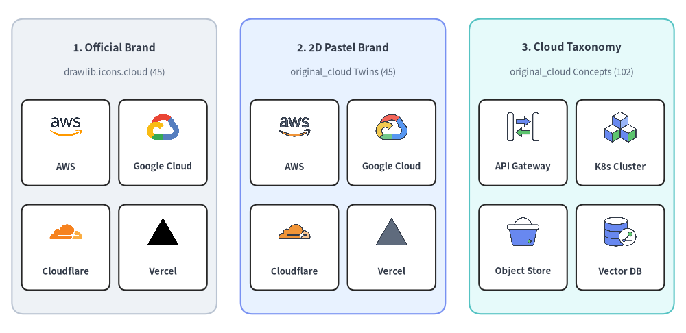
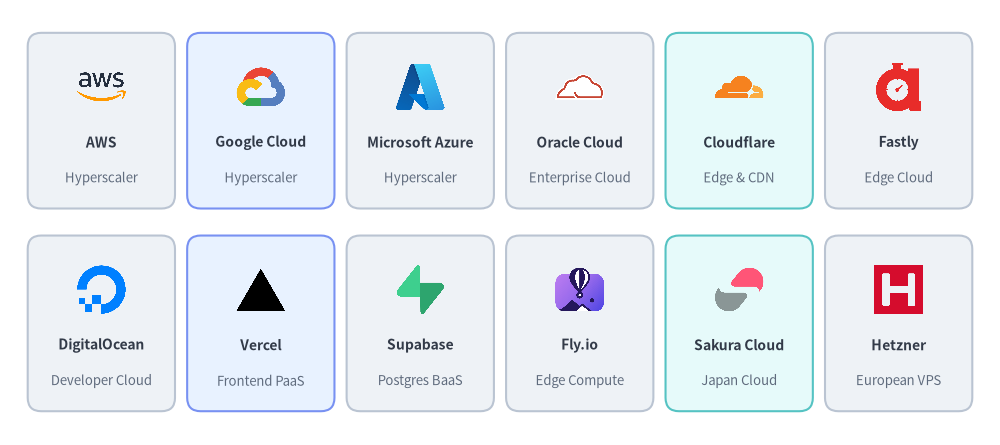
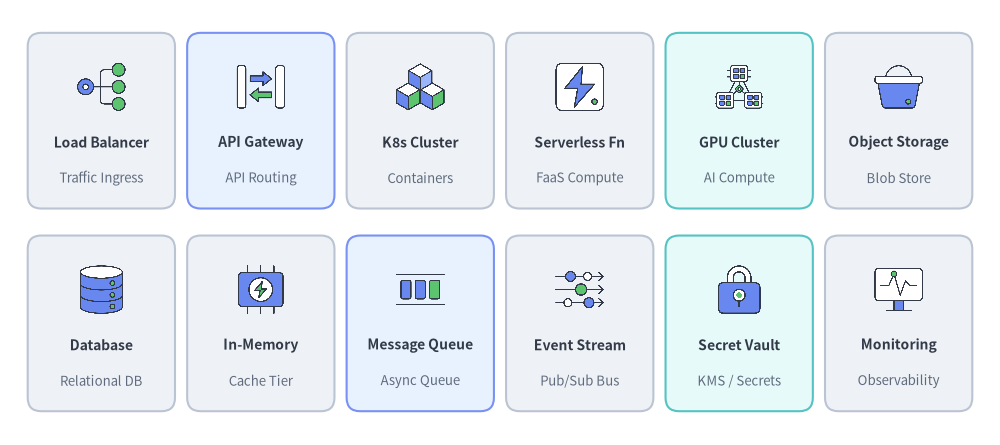
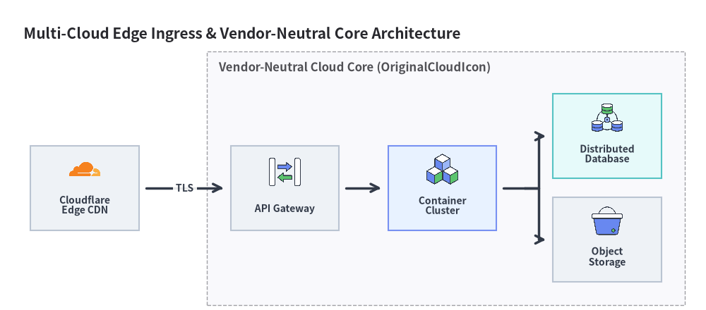

# Cloud & Original Cloud Icons

Drawlib provides a twin pair of cloud icon modules: `drawlib.icons.cloud` (`CloudIcon` — **45 official** cloud provider, PaaS, edge, and hosting brand logos) and `drawlib.icons.original_cloud` (`OriginalCloudIcon` — **147 original 2D pastel** icons comprising **45 brand twins** + **102 vendor-neutral** cloud service taxonomy icons). See also [Icons Overview](./overview.md) and [Architecture Diagrams](../06_diagrams/architecture.md).


<figure class="drawlib-image" style="text-align: center;">
  
  <figcaption class="drawlib-caption">Comparing Official Brand (cloud), 2D Pastel Brand (original_cloud), and Vendor-Neutral Taxonomy (original_cloud)</figcaption>
</figure>

<details class="drawlib-code-details">
<summary>Source Code</summary>

```python
from drawlib.canvas import save, setup
from drawlib.icons import cloud, original_cloud
from drawlib.shapes import rectangle
from drawlib.styles import Styles
from drawlib.text import text

setup(width=144, height=70)

columns = [
    (
        24.0,
        "1. Official Brand",
        "drawlib.icons.cloud (45)",
        Styles.Neutral,
        [
            ("AWS", cloud.aws),
            ("Google Cloud", cloud.google_cloud),
            ("Cloudflare", cloud.cloudflare),
            ("Vercel", cloud.vercel),
        ],
    ),
    (
        72.0,
        "2. 2D Pastel Brand",
        "original_cloud Twins (45)",
        Styles.PrimaryNeutral,
        [
            ("AWS", original_cloud.aws),
            ("Google Cloud", original_cloud.google_cloud),
            ("Cloudflare", original_cloud.cloudflare),
            ("Vercel", original_cloud.vercel),
        ],
    ),
    (
        120.0,
        "3. Cloud Taxonomy",
        "original_cloud Concepts (102)",
        Styles.SecondaryNeutral,
        [
            ("API Gateway", original_cloud.api_gateway),
            ("K8s Cluster", original_cloud.container_cluster),
            ("Object Store", original_cloud.object_storage),
            ("Vector DB", original_cloud.vector_database),
        ],
    ),
]

for cx, title, subtitle, card_st, items in columns:
    rectangle((cx, 35.0), width=43.0, height=62.0, style=card_st.patch(shape_r=2.5))
    text((cx, 60.0), title, style=Styles.DarkBold.patch(text_size=11.0))
    text((cx, 54.8), subtitle, style=Styles.Muted.patch(text_size=9.5))

    offsets = [(-10.2, 41.5), (10.2, 41.5), (-10.2, 19.5), (10.2, 19.5)]
    sub_card = Styles.White.patch(shape_r=1.5, line_width=0.6)
    for (dx, iy), (lbl, fn) in zip(offsets, items, strict=True):
        ix = cx + dx
        rectangle((ix, iy - 1.5), width=18.5, height=18.0, style=sub_card)
        fn((ix, iy + 1.8), width=7.5, style=Styles.Primary)
        text((ix, iy - 6.5), lbl, style=Styles.DarkBold.patch(text_size=9.5))

save()
```

</details>


---

## 1. Twin Module API (`cloud` vs. `original_cloud`)

Both `drawlib.icons.cloud` and `drawlib.icons.original_cloud` use the exact same `(xy, width, *, style, variant="default")` signature. For the 45 brand icons (`aws`, `google_cloud`, `azure`, `cloudflare`, `vercel`, etc.), you can switch between official vendor marks and Drawlib's cohesive 2D pastel aesthetic simply by changing the module or Enum prefix:

```python
from drawlib.diagrams.architecture import CloudIcon, Node, OriginalCloudIcon
from drawlib.icons import cloud, original_cloud
from drawlib.styles import Styles

# 1. Official brand logo vs. 2D pastel brand twin (same canonical function name)
cloud.cloudflare((30, 25), width=10.0, style=Styles.Primary)
original_cloud.cloudflare((60, 25), width=10.0, style=Styles.Primary)

# 2. Vendor-neutral cloud taxonomy concept icon (exclusive to original_cloud)
original_cloud.api_gateway((90, 25), width=10.0, style=Styles.Primary)

# 3. Corresponding ArchitectureDiagram Enums
edge_node = Node("Cloudflare Edge", icon=CloudIcon.CLOUDFLARE)
gw_node = Node("API Gateway", icon=OriginalCloudIcon.API_GATEWAY)
```

| Module / Enum | Canonical Count | Composition | Primary Use Case |
| :--- | :---: | :--- | :--- |
| `drawlib.icons.cloud` (`CloudIcon`) | **45** | 45 official cloud, PaaS, edge & hosting brand logos | Multi-cloud comparison matrices, DNS/CDN edge diagrams, and production hosting topologies. |
| `drawlib.icons.original_cloud` (`OriginalCloudIcon`) | **147** | **45** 2D pastel brand twins + **102** vendor-neutral cloud service taxonomy icons | Vendor-neutral reference architectures, RFC blueprints, and calm 2D pastel diagrams. |

---

## 2. Cloud Provider & PaaS Brand Icons (45 Shared Canonical Icons)

All 45 brand icons exist with identical canonical names in both `drawlib.icons.cloud` (official logos) and `drawlib.icons.original_cloud` (2D pastel twins):


<figure class="drawlib-image" style="text-align: center;">
  
  <figcaption class="drawlib-caption">12 Cloud Provider, Edge CDN, PaaS, and Regional Hosting Brand Icons (drawlib.icons.cloud)</figcaption>
</figure>

<details class="drawlib-code-details">
<summary>Source Code</summary>

```python
from drawlib.canvas import save, setup
from drawlib.icons import cloud
from drawlib.shapes import rectangle
from drawlib.styles import Styles
from drawlib.text import text

setup(width=148, height=66)

row1 = [
    ("AWS", "Hyperscaler", cloud.aws, Styles.Neutral),
    ("Google Cloud", "Hyperscaler", cloud.google_cloud, Styles.PrimaryNeutral),
    ("Microsoft Azure", "Hyperscaler", cloud.azure, Styles.Neutral),
    ("Oracle Cloud", "Enterprise Cloud", cloud.oracle_cloud, Styles.Neutral),
    ("Cloudflare", "Edge & CDN", cloud.cloudflare, Styles.SecondaryNeutral),
    ("Fastly", "Edge Cloud", cloud.fastly, Styles.Neutral),
]

row2 = [
    ("DigitalOcean", "Developer Cloud", cloud.digitalocean, Styles.Neutral),
    ("Vercel", "Frontend PaaS", cloud.vercel, Styles.PrimaryNeutral),
    ("Supabase", "Postgres BaaS", cloud.supabase, Styles.Neutral),
    ("Fly.io", "Edge Compute", cloud.fly_io, Styles.Neutral),
    ("Sakura Cloud", "Japan Cloud", cloud.sakura, Styles.SecondaryNeutral),
    ("Hetzner", "European VPS", cloud.hetzner, Styles.Neutral),
]

for row_idx, items in enumerate([row1, row2]):
    cy = 48.0 if row_idx == 0 else 18.0
    for col_idx, (title, sub, icon_fn, card_st) in enumerate(items):
        cx = 15.0 + col_idx * 23.6
        rectangle((cx, cy), width=21.8, height=26.0, style=card_st.patch(shape_r=2))
        icon_fn((cx, cy + 5.0), width=8.0, style=Styles.Primary)
        text((cx, cy - 3.2), title, style=Styles.DarkBold.patch(text_size=10.0))
        text((cx, cy - 8.5), sub, style=Styles.Muted.patch(text_size=9.5))

save()
```

</details>


### 2.1. Complete Reference Table of All 45 Brand Icons (`cloud` & `original_cloud`)

| Brand Category | Count | Canonical `<module>.<name>` Functions (`CloudIcon.<NAME>` / `OriginalCloudIcon.<NAME>`) |
| :--- | :---: | :--- |
| **Hyperscale Cloud Providers & Parent Companies** | 16 | `alibaba`, `alibaba_cloud`, `amazon`, `aws`, `azure`, `google`, `google_cloud`, `huawei`, `huawei_cloud`, `ibm`, `ibm_cloud`, `microsoft`, `oracle`, `oracle_cloud`, `tencent`, `tencent_cloud` |
| **Global VPS, Bare-Metal, Edge & Object Storage** | 12 | `akamai`, `backblaze`, `cloudflare`, `digitalocean`, `fastly`, `hetzner`, `ionos`, `linode`, `ovhcloud`, `scaleway`, `vultr`, `wasabi` |
| **Modern PaaS, Serverless & BaaS Platforms** | 11 | `coolify`, `deno_deploy`, `firebase`, `fly_io`, `heroku`, `netlify`, `railway`, `render`, `supabase`, `upstash`, `vercel` |
| **Japan Cloud & Hosting Providers** | 6 | `conoha`, `idcf`, `kagoya`, `nifcloud`, `sakura`, `xserver` |

---

## 3. Vendor-Neutral Cloud Taxonomy Icons (102 `original_cloud` Icons)

Beyond the 45 brand twins, `drawlib.icons.original_cloud` provides **102 vendor-neutral cloud taxonomy icons** for designing cloud-agnostic system architectures without locking diagrams to a single hyperscaler's product names:


<figure class="drawlib-image" style="text-align: center;">
  
  <figcaption class="drawlib-caption">12 Vendor-Neutral Cloud Taxonomy Icons from drawlib.icons.original_cloud</figcaption>
</figure>

<details class="drawlib-code-details">
<summary>Source Code</summary>

```python
from drawlib.canvas import save, setup
from drawlib.icons import original_cloud
from drawlib.shapes import rectangle
from drawlib.styles import Styles
from drawlib.text import text

setup(width=148, height=66)

row1 = [
    ("Load Balancer", "Traffic Ingress", original_cloud.load_balancer, Styles.Neutral),
    ("API Gateway", "API Routing", original_cloud.api_gateway, Styles.PrimaryNeutral),
    ("K8s Cluster", "Containers", original_cloud.container_cluster, Styles.Neutral),
    ("Serverless Fn", "FaaS Compute", original_cloud.serverless_function, Styles.Neutral),
    ("GPU Cluster", "AI Compute", original_cloud.gpu_cluster, Styles.SecondaryNeutral),
    ("Object Storage", "Blob Store", original_cloud.object_storage, Styles.Neutral),
]

row2 = [
    ("Database", "Relational DB", original_cloud.database, Styles.Neutral),
    ("In-Memory", "Cache Tier", original_cloud.in_memory_cache, Styles.Neutral),
    ("Message Queue", "Async Queue", original_cloud.message_queue, Styles.PrimaryNeutral),
    ("Event Stream", "Pub/Sub Bus", original_cloud.event_stream, Styles.Neutral),
    ("Secret Vault", "KMS / Secrets", original_cloud.secret_vault, Styles.SecondaryNeutral),
    ("Monitoring", "Observability", original_cloud.monitoring, Styles.Neutral),
]

for row_idx, items in enumerate([row1, row2]):
    cy = 48.0 if row_idx == 0 else 18.0
    for col_idx, (title, sub, icon_fn, card_st) in enumerate(items):
        cx = 15.0 + col_idx * 23.6
        rectangle((cx, cy), width=21.8, height=26.0, style=card_st.patch(shape_r=2))
        icon_fn((cx, cy + 5.0), width=8.0, style=Styles.Primary)
        text((cx, cy - 3.2), title, style=Styles.DarkBold.patch(text_size=10.0))
        text((cx, cy - 8.5), sub, style=Styles.Muted.patch(text_size=9.5))

save()
```

</details>


### 3.1. Complete Categorized Reference Table of All 102 Vendor-Neutral Icons

| Taxonomy Category | Count | Canonical `drawlib.icons.original_cloud.<name>` Functions (`OriginalCloudIcon.<NAME>`) |
| :--- | :---: | :--- |
| **Cloud Topologies, Environments & Accounts** | 8 | `cloud`, `external_saas`, `hybrid_cloud`, `multi_cloud`, `on_premises`, `organization_account`, `private_cloud`, `public_cloud` |
| **Compute, Containers, Serverless & Virtualization** | 16 | `app_service`, `autoscaling`, `bare_metal`, `batch_job`, `compute`, `container`, `container_cluster`, `gpu_cluster`, `gpu_node`, `npu_node`, `serverless_function`, `virtual_desktop`, `virtual_machine`, `virtualization_cluster`, `virtualization_controller`, `virtualization_host` |
| **Storage, Backup & Disaster Recovery** | 6 | `backup_archive`, `block_storage`, `data_migration`, `disaster_recovery`, `file_storage`, `object_storage` |
| **Databases, Caching & Search** | 9 | `database`, `db_replica`, `distributed_database`, `graph_database`, `in_memory_cache`, `nosql_database`, `search_engine`, `time_series_database`, `vector_database` |
| **Networking, Edge, Gateways & Service Mesh** | 19 | `api_gateway`, `bastion_host`, `cdn`, `dedicated_interconnect`, `dns`, `edge_location`, `internet_gateway`, `load_balancer`, `nat_gateway`, `network_peering`, `private_endpoint`, `reverse_proxy`, `router`, `service_discovery`, `service_mesh`, `switch`, `transit_hub`, `virtual_network`, `vpn_tunnel` |
| **Security, Identity, Zero-Trust & Governance** | 14 | `audit_compliance`, `certificate_tls`, `ddos_protection`, `directory_service`, `firewall`, `identity_auth`, `ids_ips`, `key_management`, `secret_vault`, `security_center`, `user`, `user_group`, `waf`, `zero_trust_proxy` |
| **Data Analytics, Streaming, Messaging & AI** | 17 | `ai_agent`, `analytics_engine`, `bi_dashboard`, `blockchain_ledger`, `data_catalog`, `data_lake`, `data_warehouse`, `email_service`, `etl_pipeline`, `event_stream`, `llm_model`, `media_streaming`, `message_queue`, `notification`, `scheduler`, `webhook`, `workflow_orchestrator` |
| **DevOps, Observability, FinOps, IoT & Clients** | 13 | `artifact_registry`, `billing`, `cicd_pipeline`, `cost_management`, `desktop_app`, `digital_twin`, `git_repository`, `iot_device`, `iot_hub`, `logging`, `mobile_app`, `monitoring`, `web_browser` |

---

## 4. Vendor-Neutral & Multi-Cloud Architecture Example

Combine `CloudIcon` and `OriginalCloudIcon` inside [`ArchitectureDiagram`](../06_diagrams/architecture.md) to illustrate multi-cloud edge routing and vendor-neutral backend microservices:


```python
from drawlib.canvas import save, setup
from drawlib.diagrams.architecture import (
    ArchitectureDiagram,
    CloudIcon,
    Node,
    NodeGroup,
    OriginalCloudIcon,
)
from drawlib.styles import Styles

setup(width=150, height=66)

d = ArchitectureDiagram(
    node_style=Styles.Primary,
    node_text_style=Styles.DarkBold.patch(text_size=10.0),
    edge_style=Styles.DarkBold,
    edge_text_style=Styles.DarkBold.patch(text_size=10.0),
    node_card_style=Styles.Neutral,
    title="Multi-Cloud Edge Ingress & Vendor-Neutral Core Architecture",
)

cf = d.add(
    Node("Cloudflare\nEdge CDN", width=23, height=18, icon=CloudIcon.CLOUDFLARE, icon_size=7.5),
    xy=(14.0, 22.0),
)

vpc = d.add(NodeGroup(title="Vendor-Neutral Cloud Core (OriginalCloudIcon)", padding=5.0), xy=(40.0, 4.0))
gw = vpc.add(
    Node("API Gateway", width=23, height=18, icon=OriginalCloudIcon.API_GATEWAY, icon_size=7.5),
    xy=(16.5, 18.0),
)
k8s = vpc.add(
    Node(
        "Container\nCluster",
        width=23,
        height=18,
        icon=OriginalCloudIcon.CONTAINER_CLUSTER,
        icon_size=7.5,
        card_style=Styles.PrimaryNeutral,
    ),
    xy=(50.0, 18.0),
)
db = vpc.add(
    Node(
        "Distributed\nDatabase",
        width=23,
        height=18,
        icon=OriginalCloudIcon.DISTRIBUTED_DATABASE,
        icon_size=7.5,
        card_style=Styles.SecondaryNeutral,
    ),
    xy=(85.0, 29.0),
)
obj = vpc.add(
    Node("Object\nStorage", width=23, height=18, icon=OriginalCloudIcon.OBJECT_STORAGE, icon_size=7.5),
    xy=(85.0, 7.0),
)

d.connect(cf, gw, label="TLS", padding=1.5)
d.connect(gw, k8s, padding=1.5)
k8s.fork([db, obj], at_x=107.5, padding=1.5)

d.draw(xy=(4.0, 4.0))
save()
```

<figure class="drawlib-image" style="text-align: center;">
  
  <figcaption class="drawlib-caption">Multi-Cloud Edge & Vendor-Neutral Backend Topology Using CloudIcon and OriginalCloudIcon</figcaption>
</figure>


