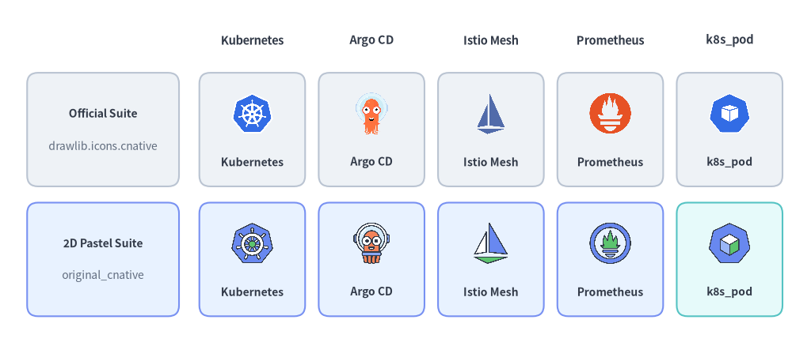
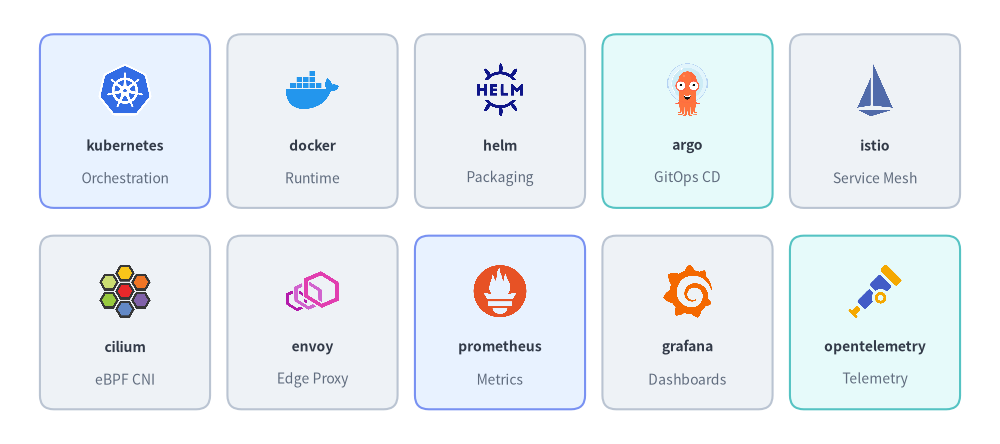
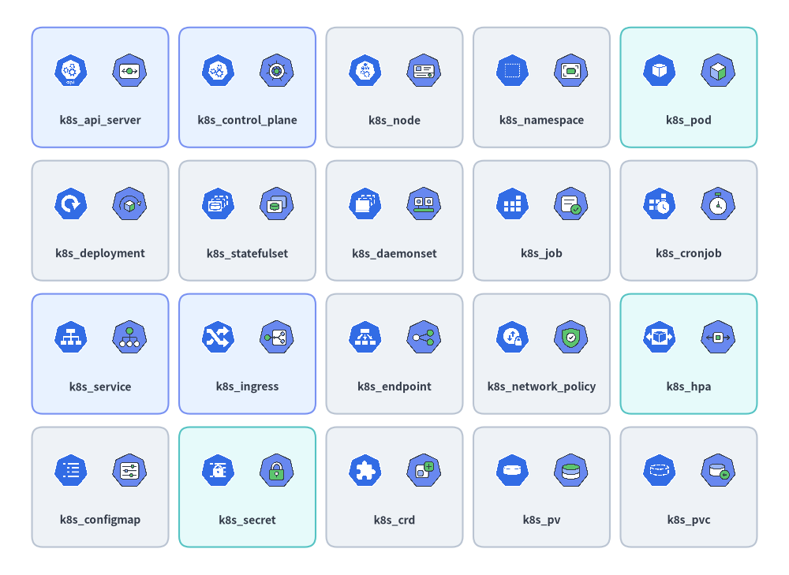
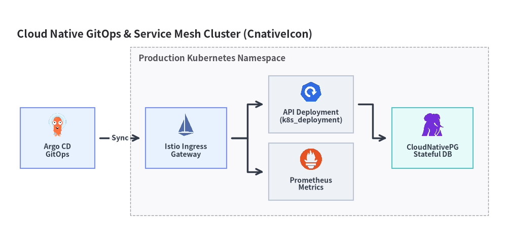

# Cloud Native (K8s) Icons

Drawlib provides **73 official CNCF & Kubernetes icons** in `drawlib.icons.cnative` (`CnativeIcon`) and **73 matching 2D pastel twin icons** in `drawlib.icons.original_cnative` (`OriginalCnativeIcon`). Both suites include 53 Cloud Native project brands and 20 `k8s_*` Kubernetes workload, networking, and storage resource icons for use in standalone illustrations or **[Architecture Diagrams](../06_diagrams/architecture.md)** (see **[Icons Overview](./overview.md)**).


<figure class="drawlib-image" style="text-align: center;">
  
  <figcaption class="drawlib-caption">Comparing Official Cloud Native Icons (drawlib.icons.cnative) and Original 2D Pastel Twins (drawlib.icons.original_cnative)</figcaption>
</figure>

<details class="drawlib-code-details">
<summary>Source Code</summary>

```python
from drawlib.canvas import save, setup
from drawlib.icons import cnative, original_cnative
from drawlib.shapes import rectangle
from drawlib.styles import Styles
from drawlib.text import text

setup(width=146, height=64)

columns = [
    ("Kubernetes", cnative.kubernetes, original_cnative.kubernetes),
    ("Argo CD", cnative.argo, original_cnative.argo),
    ("Istio Mesh", cnative.istio, original_cnative.istio),
    ("Prometheus", cnative.prometheus, original_cnative.prometheus),
    ("k8s_pod", cnative.k8s_pod, original_cnative.k8s_pod),
]

rows = [
    (40.0, "Official Suite", "drawlib.icons.cnative", Styles.Neutral),
    (16.0, "2D Pastel Suite", "original_cnative", Styles.PrimaryNeutral),
]

for col_idx, (col_title, _, _) in enumerate(columns):
    cx = 46.5 + col_idx * 22.0
    text((cx, 56.5), col_title, style=Styles.DarkBold.patch(text_size=10.5))

for row_idx, (cy, row_title, row_sub, card_st) in enumerate(rows):
    rectangle((19.0, cy), width=28.0, height=21.0, style=card_st.patch(shape_r=2))
    text((19.0, cy + 3.0), row_title, style=Styles.DarkBold.patch(text_size=10.0))
    text((19.0, cy - 3.0), row_sub, style=Styles.Muted.patch(text_size=10.0))

    for col_idx, (lbl, fn_off, fn_orig) in enumerate(columns):
        cx = 46.5 + col_idx * 22.0
        cell_st = Styles.SecondaryNeutral if (row_idx == 1 and col_idx == 4) else card_st
        rectangle((cx, cy), width=19.5, height=21.0, style=cell_st.patch(shape_r=2))
        fn = fn_off if row_idx == 0 else fn_orig
        fn((cx, cy + 3.0), width=8.5, style=Styles.Primary)
        text((cx, cy - 6.0), lbl, style=Styles.DarkBold.patch(text_size=10.0))

save()
```

</details>


---

## 1. API Signature & Twin Module Structure

Every icon in `drawlib.icons.cnative` has an exact 1-to-1 twin with the same function name in `drawlib.icons.original_cnative`. Both modules use Drawlib's standard center-anchored `(cx, cy)` signature:

```python
from drawlib.diagrams.architecture import CnativeIcon, Node, OriginalCnativeIcon
from drawlib.icons import cnative, original_cnative
from drawlib.styles import Styles

# 1. Direct canvas rendering (anchored at center xy)
cnative.kubernetes((30, 25), width=10.0, style=Styles.Primary)
original_cnative.kubernetes((60, 25), width=10.0, style=Styles.Primary)

# 2. High-level ArchitectureDiagram Node integration via Enum
k8s_node = Node("Prod Cluster", icon=CnativeIcon.KUBERNETES, icon_size=8.0)
pod_node = Node("Worker Pod", icon=OriginalCnativeIcon.K8S_POD, icon_size=8.0)
```

| Feature | Official Suite (`cnative`) | Original 2D Pastel Suite (`original_cnative`) |
| :--- | :--- | :--- |
| **Module Import** | `from drawlib.icons import cnative` | `from drawlib.icons import original_cnative` |
| **Function Signature** | `cnative.<name>(xy, width, *, style, variant="default")` | `original_cnative.<name>(xy, width, *, style, variant="default")` |
| **Architecture Enum** | `CnativeIcon.<NAME>` | `OriginalCnativeIcon.<NAME>` |
| **Canonical Count** | **73** (`53` CNCF/project brands + `20` `k8s_*` resources) | **73** (`53` 2D pastel brand twins + `20` `k8s_*` resources) |
| **Asset Archive** | `icon_cnative` (`512×512` RGBA PNGs) | `icon_original_cnative` (`512×512` RGBA PNGs) |

---

## 2. Cloud Native Brand & CNCF Project Icons (53 Icons)

The 53 project icons cover container runtimes, Kubernetes distributions, GitOps controllers, service meshes, CNI plugins, cloud-native storage operators, and observability/policy engines:


<figure class="drawlib-image" style="text-align: center;">
  
  <figcaption class="drawlib-caption">Representative Cloud Native & CNCF Project Icons (drawlib.icons.cnative)</figcaption>
</figure>

<details class="drawlib-code-details">
<summary>Source Code</summary>

```python
from drawlib.canvas import save, setup
from drawlib.icons import cnative
from drawlib.shapes import rectangle
from drawlib.styles import Styles
from drawlib.text import text

setup(width=144, height=64)

row1 = [
    ("kubernetes", "Orchestration", cnative.kubernetes, Styles.PrimaryNeutral),
    ("docker", "Runtime", cnative.docker, Styles.Neutral),
    ("helm", "Packaging", cnative.helm, Styles.Neutral),
    ("argo", "GitOps CD", cnative.argo, Styles.SecondaryNeutral),
    ("istio", "Service Mesh", cnative.istio, Styles.Neutral),
]

row2 = [
    ("cilium", "eBPF CNI", cnative.cilium, Styles.Neutral),
    ("envoy", "Edge Proxy", cnative.envoy, Styles.Neutral),
    ("prometheus", "Metrics", cnative.prometheus, Styles.PrimaryNeutral),
    ("grafana", "Dashboards", cnative.grafana, Styles.Neutral),
    ("opentelemetry", "Telemetry", cnative.opentelemetry, Styles.SecondaryNeutral),
]

for row_idx, items in enumerate([row1, row2]):
    cy = 46.5 if row_idx == 0 else 17.5
    for col_idx, (title, cat, icon_fn, card_st) in enumerate(items):
        cx = 18.0 + col_idx * 27.0
        rectangle((cx, cy), width=24.5, height=25.0, style=card_st.patch(shape_r=2))
        icon_fn((cx, cy + 4.5), width=8.5, style=Styles.Primary)
        text((cx, cy - 3.5), title, style=Styles.DarkBold.patch(text_size=10.0))
        text((cx, cy - 8.2), cat, style=Styles.Muted.patch(text_size=10.0))

save()
```

</details>


### 2.1. Complete Brand & Project Icons Reference (53 Canonical Names)

All 53 canonical project names below are available in both `cnative.<name>` (`CnativeIcon.<NAME>`) and `original_cnative.<name>` (`OriginalCnativeIcon.<NAME>`):

| Category | Count | Canonical Icon Names (`cnative.*` & `original_cnative.*`) |
| :--- | :---: | :--- |
| **Kubernetes Distributions, Runtimes & Cluster Management** | 14 | `containerd`, `docker`, `k0s`, `k3s`, `kind`, `kubernetes`, `microk8s`, `minikube`, `okd`, `openshift`, `rancher`, `talos`, `tanzu`, `vcluster` |
| **GitOps, Packaging, Autoscaling & Platform Engineering** | 11 | `argo`, `backstage`, `crossplane`, `flux`, `helm`, `karpenter`, `keda`, `knative`, `kubevirt`, `kustomize`, `temporal` |
| **Service Mesh, CNI Networking & Edge Proxies** | 7 | `calico`, `cilium`, `coredns`, `envoy`, `istio`, `linkerd`, `metallb` |
| **Cloud Native Storage, Databases & Messaging Operators** | 8 | `ceph`, `cloudnative_pg`, `etcd`, `longhorn`, `rook`, `strimzi`, `velero`, `vitess` |
| **Observability, Security, Identity & Policy Engines** | 13 | `cert_manager`, `dapr`, `external_secrets`, `falco`, `fluentd`, `grafana`, `harbor`, `jaeger`, `kyverno`, `opa`, `opentelemetry`, `prometheus`, `spiffe` |

---

## 3. Kubernetes Resource Icons (`k8s_*` — 20 Icons)

In addition to project logos, both `cnative` and `original_cnative` provide **20 dedicated Kubernetes resource icons** prefixed with `k8s_*` for modeling internal cluster topologies. Every card below renders the official `cnative.k8s_*` icon on the left and its `original_cnative.k8s_*` 2D pastel twin on the right:


<figure class="drawlib-image" style="text-align: center;">
  
  <figcaption class="drawlib-caption">All 20 Kubernetes Resource Icons (k8s_*): Official (Left) vs. Original 2D Pastel (Right)</figcaption>
</figure>

<details class="drawlib-code-details">
<summary>Source Code</summary>

```python
from drawlib.canvas import save, setup
from drawlib.icons import cnative, original_cnative
from drawlib.shapes import rectangle
from drawlib.styles import Styles
from drawlib.text import text

setup(width=148, height=108)

k8s_items = [
    ("k8s_api_server", cnative.k8s_api_server, original_cnative.k8s_api_server, Styles.PrimaryNeutral),
    ("k8s_control_plane", cnative.k8s_control_plane, original_cnative.k8s_control_plane, Styles.PrimaryNeutral),
    ("k8s_node", cnative.k8s_node, original_cnative.k8s_node, Styles.Neutral),
    ("k8s_namespace", cnative.k8s_namespace, original_cnative.k8s_namespace, Styles.Neutral),
    ("k8s_pod", cnative.k8s_pod, original_cnative.k8s_pod, Styles.SecondaryNeutral),
    ("k8s_deployment", cnative.k8s_deployment, original_cnative.k8s_deployment, Styles.Neutral),
    ("k8s_statefulset", cnative.k8s_statefulset, original_cnative.k8s_statefulset, Styles.Neutral),
    ("k8s_daemonset", cnative.k8s_daemonset, original_cnative.k8s_daemonset, Styles.Neutral),
    ("k8s_job", cnative.k8s_job, original_cnative.k8s_job, Styles.Neutral),
    ("k8s_cronjob", cnative.k8s_cronjob, original_cnative.k8s_cronjob, Styles.Neutral),
    ("k8s_service", cnative.k8s_service, original_cnative.k8s_service, Styles.PrimaryNeutral),
    ("k8s_ingress", cnative.k8s_ingress, original_cnative.k8s_ingress, Styles.PrimaryNeutral),
    ("k8s_endpoint", cnative.k8s_endpoint, original_cnative.k8s_endpoint, Styles.Neutral),
    ("k8s_network_policy", cnative.k8s_network_policy, original_cnative.k8s_network_policy, Styles.Neutral),
    ("k8s_hpa", cnative.k8s_hpa, original_cnative.k8s_hpa, Styles.SecondaryNeutral),
    ("k8s_configmap", cnative.k8s_configmap, original_cnative.k8s_configmap, Styles.Neutral),
    ("k8s_secret", cnative.k8s_secret, original_cnative.k8s_secret, Styles.SecondaryNeutral),
    ("k8s_crd", cnative.k8s_crd, original_cnative.k8s_crd, Styles.Neutral),
    ("k8s_pv", cnative.k8s_pv, original_cnative.k8s_pv, Styles.Neutral),
    ("k8s_pvc", cnative.k8s_pvc, original_cnative.k8s_pvc, Styles.Neutral),
]

for idx, (label, fn_off, fn_orig, card_st) in enumerate(k8s_items):
    row = idx // 5
    col = idx % 5
    cx = 18.8 + col * 27.6
    cy = 91.5 - row * 25.0
    rectangle((cx, cy), width=25.6, height=22.5, style=card_st.patch(shape_r=2))
    fn_off((cx - 5.5, cy + 3.2), width=7.2, style=Styles.Primary)
    fn_orig((cx + 5.5, cy + 3.2), width=7.2, style=Styles.Primary)
    text((cx, cy - 6.2), label, style=Styles.DarkBold.patch(text_size=10.0))

save()
```

</details>


### 3.1. Complete `k8s_*` Resource Icons Reference (20 Canonical Names)

| Canonical Name | Official Call (`cnative`) | 2D Pastel Call (`original_cnative`) | `CnativeIcon` / `OriginalCnativeIcon` Enum | Kubernetes Resource Kind & Architectural Role |
| :--- | :--- | :--- | :--- | :--- |
| `k8s_api_server` | `cnative.k8s_api_server` | `original_cnative.k8s_api_server` | `K8S_API_SERVER` | `kube-apiserver` control plane gateway |
| `k8s_configmap` | `cnative.k8s_configmap` | `original_cnative.k8s_configmap` | `K8S_CONFIGMAP` | `ConfigMap` non-confidential configuration data |
| `k8s_control_plane` | `cnative.k8s_control_plane` | `original_cnative.k8s_control_plane` | `K8S_CONTROL_PLANE` | Kubernetes control plane (`scheduler`, `controller-manager`) |
| `k8s_crd` | `cnative.k8s_crd` | `original_cnative.k8s_crd` | `K8S_CRD` | `CustomResourceDefinition` operator API extension |
| `k8s_cronjob` | `cnative.k8s_cronjob` | `original_cnative.k8s_cronjob` | `K8S_CRONJOB` | `CronJob` time-scheduled batch workload |
| `k8s_daemonset` | `cnative.k8s_daemonset` | `original_cnative.k8s_daemonset` | `K8S_DAEMONSET` | `DaemonSet` node-level background agent |
| `k8s_deployment` | `cnative.k8s_deployment` | `original_cnative.k8s_deployment` | `K8S_DEPLOYMENT` | `Deployment` stateless replica controller |
| `k8s_endpoint` | `cnative.k8s_endpoint` | `original_cnative.k8s_endpoint` | `K8S_ENDPOINT` | `Endpoints` / `EndpointSlice` network target IP list |
| `k8s_hpa` | `cnative.k8s_hpa` | `original_cnative.k8s_hpa` | `K8S_HPA` | `HorizontalPodAutoscaler` dynamic replica scaling |
| `k8s_ingress` | `cnative.k8s_ingress` | `original_cnative.k8s_ingress` | `K8S_INGRESS` | `Ingress` L7 HTTP/HTTPS routing rules |
| `k8s_job` | `cnative.k8s_job` | `original_cnative.k8s_job` | `K8S_JOB` | `Job` run-to-completion batch task |
| `k8s_namespace` | `cnative.k8s_namespace` | `original_cnative.k8s_namespace` | `K8S_NAMESPACE` | `Namespace` virtual cluster boundary |
| `k8s_network_policy` | `cnative.k8s_network_policy` | `original_cnative.k8s_network_policy` | `K8S_NETWORK_POLICY` | `NetworkPolicy` L3/L4 pod firewall rules |
| `k8s_node` | `cnative.k8s_node` | `original_cnative.k8s_node` | `K8S_NODE` | `Node` worker VM or bare-metal kubelet host |
| `k8s_pod` | `cnative.k8s_pod` | `original_cnative.k8s_pod` | `K8S_POD` | `Pod` atomic co-located container group |
| `k8s_pv` | `cnative.k8s_pv` | `original_cnative.k8s_pv` | `K8S_PV` | `PersistentVolume` cluster storage volume |
| `k8s_pvc` | `cnative.k8s_pvc` | `original_cnative.k8s_pvc` | `K8S_PVC` | `PersistentVolumeClaim` pod storage mount request |
| `k8s_secret` | `cnative.k8s_secret` | `original_cnative.k8s_secret` | `K8S_SECRET` | `Secret` encrypted credentials, TLS keys, and tokens |
| `k8s_service` | `cnative.k8s_service` | `original_cnative.k8s_service` | `K8S_SERVICE` | `Service` stable ClusterIP / LoadBalancer virtual IP |
| `k8s_statefulset` | `cnative.k8s_statefulset` | `original_cnative.k8s_statefulset` | `K8S_STATEFULSET` | `StatefulSet` ordered stateful workload controller |

---

## 4. Practical Architecture Diagram (`CnativeIcon` & `OriginalCnativeIcon`)

The following **[`ArchitectureDiagram`](../06_diagrams/architecture.md)** combines CNCF project icons (`Argo`, `Istio`, `CloudNativePG`, `Prometheus`) with Kubernetes resource icons (`K8S_INGRESS`, `K8S_SERVICE`, `K8S_DEPLOYMENT`, `K8S_PVC`) inside a production cluster boundary:


```python
from drawlib.canvas import save, setup
from drawlib.diagrams.architecture import ArchitectureDiagram, CnativeIcon, Node, NodeGroup
from drawlib.styles import Styles

setup(width=150, height=68)

d = ArchitectureDiagram(
    node_style=Styles.Primary,
    node_text_style=Styles.DarkBold.patch(text_size=10.0),
    edge_style=Styles.DarkBold,
    edge_text_style=Styles.DarkBold.patch(text_size=10.0),
    node_card_style=Styles.Neutral,
    title="Cloud Native GitOps & Service Mesh Cluster (CnativeIcon)",
)

argo = d.add(
    Node(
        "Argo CD\nGitOps",
        width=22,
        height=18,
        icon=CnativeIcon.ARGO,
        icon_size=7.5,
        card_style=Styles.PrimaryNeutral,
    ),
    xy=(13.0, 23.0),
)

cluster = d.add(NodeGroup(title="Production Kubernetes Namespace", padding=4.5), xy=(36.0, 4.0))
ing = cluster.add(
    Node(
        "Istio Ingress\nGateway",
        width=24,
        height=18,
        icon=CnativeIcon.ISTIO,
        icon_size=7.5,
        card_style=Styles.PrimaryNeutral,
    ),
    xy=(15.0, 19.0),
)
deploy = cluster.add(
    Node(
        "API Deployment\n(k8s_deployment)",
        width=25,
        height=17,
        icon=CnativeIcon.K8S_DEPLOYMENT,
        icon_size=7.2,
    ),
    xy=(52.0, 29.0),
)
prom = cluster.add(
    Node(
        "Prometheus\nMetrics",
        width=25,
        height=17,
        icon=CnativeIcon.PROMETHEUS,
        icon_size=7.2,
    ),
    xy=(52.0, 9.0),
)
cnpg = cluster.add(
    Node(
        "CloudNativePG\nStateful DB",
        width=24,
        height=18,
        icon=CnativeIcon.CLOUDNATIVE_PG,
        icon_size=7.5,
        card_style=Styles.SecondaryNeutral,
    ),
    xy=(88.0, 19.0),
)

d.connect(argo, ing, label="Sync", padding=1.5)
d.connect(ing, deploy, padding=1.5)
d.connect(ing, prom, padding=1.5)
d.connect(deploy, cnpg, padding=1.5)

d.draw(xy=(4.0, 4.0))
save()
```

<figure class="drawlib-image" style="text-align: center;">
  
  <figcaption class="drawlib-caption">GitOps Kubernetes Cluster Topology Using CnativeIcon</figcaption>
</figure>


> [!TIP]
> For CI/CD pipelines, Infrastructure as Code (Terraform, OpenTofu, Ansible), and APM platforms, see **[DevOps & Observability Icons](./devops.md)**. For physical/virtual routers, firewalls, and L2/L3 switches, see **[Network & Cisco Topology Icons](./network.md)**.
