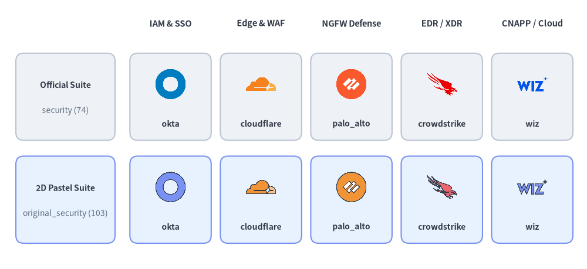
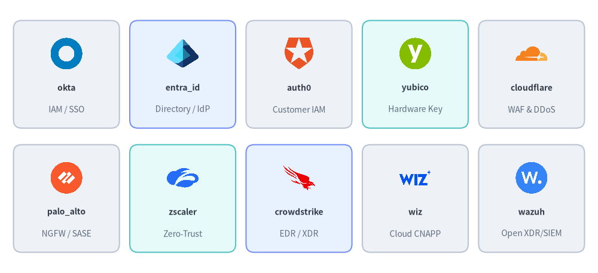
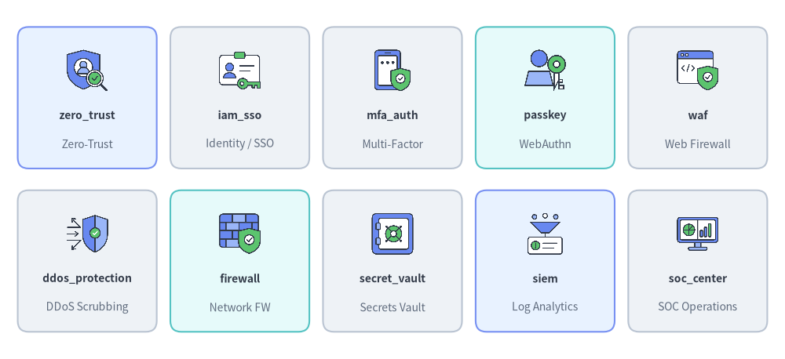
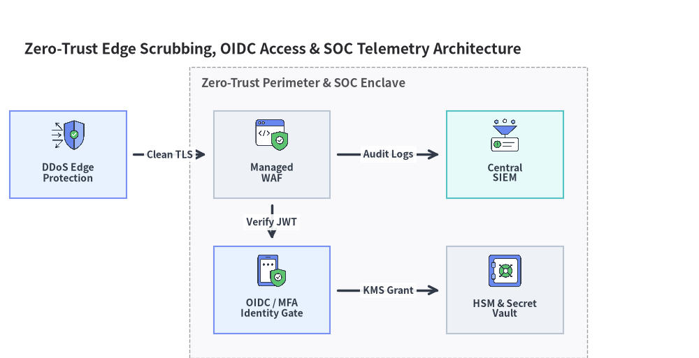

# Security & Zero-Trust Icons (`security` & `original_security`)

Drawlib provides two paired icon modules for cybersecurity, identity and access management (IAM/SSO), network defense, endpoint protection (EDR/XDR), and SIEM/SOAR operations: **`drawlib.icons.security`** (`SecurityIcon`, **74** official security vendor and open-source tool logos) and **`drawlib.icons.original_security`** (`OriginalSecurityIcon`, **103** flat 2D pastel icons comprising all **74** brand twins plus **29** vendor-neutral security & zero-trust concept icons). Both modules follow the unified API documented in **[Icons Overview](./overview.md)** and integrate seamlessly with **[Architecture Diagrams](../06_diagrams/architecture.md)**.


<figure class="drawlib-image" style="text-align: center;">
  
  <figcaption class="drawlib-caption">Official Security Vendor Logos (security) vs. Original 2D Pastel Icons (original_security)</figcaption>
</figure>

<details class="drawlib-code-details">
<summary>Source Code</summary>

```python
from drawlib.canvas import save, setup
from drawlib.icons import original_security, security
from drawlib.shapes import rectangle
from drawlib.styles import Styles
from drawlib.text import text

setup(width=148, height=68)

columns = [
    ("IAM & SSO", "okta", security.okta, original_security.okta),
    ("Edge & WAF", "cloudflare", security.cloudflare, original_security.cloudflare),
    ("NGFW Defense", "palo_alto", security.palo_alto, original_security.palo_alto),
    ("EDR / XDR", "crowdstrike", security.crowdstrike, original_security.crowdstrike),
    ("CNAPP / Cloud", "wiz", security.wiz, original_security.wiz),
]

for col_idx, (cat_label, _, _, _) in enumerate(columns):
    cx = 43.0 + col_idx * 22.8
    text((cx, 62.0), cat_label, style=Styles.DarkBold.patch(text_size=10.5))

rows = [
    (43.5, "Official Suite", "security (74)", Styles.Neutral),
    (17.5, "2D Pastel Suite", "original_security (103)", Styles.PrimaryNeutral),
]

for row_idx, (cy, row_title, row_sub, row_style) in enumerate(rows):
    rectangle((16.5, cy), width=25.0, height=22.0, style=row_style.patch(shape_r=2))
    text((16.5, cy + 3.0), row_title, style=Styles.DarkBold.patch(text_size=10.0))
    text((16.5, cy - 3.5), row_sub, style=Styles.Muted.patch(text_size=10.0))

    for col_idx, (_, fn_name, fn_off, fn_orig) in enumerate(columns):
        cx = 43.0 + col_idx * 22.8
        rectangle((cx, cy), width=20.5, height=22.0, style=row_style.patch(shape_r=2))
        icon_fn = fn_off if row_idx == 0 else fn_orig
        icon_fn((cx, cy + 3.2), width=8.5, style=Styles.Primary)
        text((cx, cy - 6.8), fn_name, style=Styles.DarkBold.patch(text_size=10.0))

save()
```

</details>


---

## 1. API Signature & Twin Module Structure

All icon functions in `drawlib.icons.security` and `drawlib.icons.original_security` accept a center coordinate `xy=(cx, cy)`, a horizontal `width` in canvas units (`1:1` square aspect ratio), and a required `style`:

```python
from drawlib.diagrams.architecture import Node, OriginalSecurityIcon, SecurityIcon
from drawlib.icons import (
    original_security,
    original_security_icon,
    security,
    security_icon,
)
from drawlib.styles import Styles

# 1. Direct module function calls (74 shared brand icons + 29 concept icons in original_security)
security.okta((30, 25), width=10.0, style=Styles.Primary)
original_security.okta((55, 25), width=10.0, style=Styles.Primary)
original_security.zero_trust((80, 25), width=10.0, style=Styles.Primary)
original_security.waf((105, 25), width=10.0, style=Styles.Primary)

# 2. Dynamic string lookup helpers
security_icon((30, 10), width=9.0, name="crowdstrike", style=Styles.Primary)
original_security_icon((55, 10), width=9.0, name="ddos_protection", style=Styles.Primary)

# 3. Strongly typed Enums for ArchitectureDiagram & SequenceDiagram
idp_node = Node("Okta IdP", icon=SecurityIcon.OKTA)
waf_node = Node("Edge WAF", icon=OriginalSecurityIcon.WAF)
```

| Feature | `drawlib.icons.security` | `drawlib.icons.original_security` |
| :--- | :--- | :--- |
| **Visual Style** | Official security vendor & open-source project logos | Cohesive 2D pastel brand twins + vendor-neutral security concept icons |
| **Total Canonical Icons** | **74** official brand icons | **103** (`74` brand twins + `29` security concept icons) |
| **Diagram Enum** | `SecurityIcon.<NAME>` | `OriginalSecurityIcon.<NAME>` |
| **Dynamic Dispatcher** | `security_icon(xy, width, name=..., style=...)` | `original_security_icon(xy, width, name=..., style=...)` |
| **Asset Package** | `icon_security` | `icon_original_security` |

---

## 2. Brand & Vendor Security Icons (`74` Icons in Both Modules)

Both `security` and `original_security` share **74 canonical brand and open-source tool names** covering identity providers, hardware keys, next-generation firewalls (NGFW), SASE/ZTNA gateways, endpoint detection and response (EDR), cloud security (CNAPP), and application security testing (SAST/DAST):


<figure class="drawlib-image" style="text-align: center;">
  
  <figcaption class="drawlib-caption">10 Representative Brand & OSS Security Icons Available in Both security and original_security</figcaption>
</figure>

<details class="drawlib-code-details">
<summary>Source Code</summary>

```python
from drawlib.canvas import save, setup
from drawlib.icons import security
from drawlib.shapes import rectangle
from drawlib.styles import Styles
from drawlib.text import text

setup(width=144, height=66)

row1 = [
    ("okta", "IAM / SSO", security.okta, Styles.Neutral),
    ("entra_id", "Directory / IdP", security.entra_id, Styles.PrimaryNeutral),
    ("auth0", "Customer IAM", security.auth0, Styles.Neutral),
    ("yubico", "Hardware Key", security.yubico, Styles.SecondaryNeutral),
    ("cloudflare", "WAF & DDoS", security.cloudflare, Styles.Neutral),
]

row2 = [
    ("palo_alto", "NGFW / SASE", security.palo_alto, Styles.Neutral),
    ("zscaler", "Zero-Trust", security.zscaler, Styles.SecondaryNeutral),
    ("crowdstrike", "EDR / XDR", security.crowdstrike, Styles.PrimaryNeutral),
    ("wiz", "Cloud CNAPP", security.wiz, Styles.Neutral),
    ("wazuh", "Open XDR/SIEM", security.wazuh, Styles.Neutral),
]

for row_idx, items in enumerate([row1, row2]):
    cy = 48.0 if row_idx == 0 else 18.0
    for col_idx, (fn_name, cat, icon_fn, card_st) in enumerate(items):
        cx = 16.0 + col_idx * 28.0
        rectangle((cx, cy), width=25.5, height=26.0, style=card_st.patch(shape_r=2))
        icon_fn((cx, cy + 5.0), width=8.5, style=Styles.Primary)
        text((cx, cy - 3.2), fn_name, style=Styles.DarkBold.patch(text_size=10.0))
        text((cx, cy - 8.5), cat, style=Styles.Muted.patch(text_size=10.0))

save()
```

</details>


### 2.1. Complete Shared Brand Icon Reference (`74` Canonical Names)

Every function name below is available identically as `security.<name>()` (`SecurityIcon.<NAME>`) and `original_security.<name>()` (`OriginalSecurityIcon.<NAME>`):

| Category | Count | Canonical Function Names (`security.*` & `original_security.*`) |
| :--- | :---: | :--- |
| **Identity, SSO, MFA & Authorization** | 16 | `auth0`, `authelia`, `authentik`, `cerbos`, `clerk`, `duo`, `entra_id`, `okta`, `onelogin`, `openfga`, `ory`, `permit_io`, `ping_identity`, `stytch`, `supertokens`, `workos` |
| **Password Managers, PAM, Bastion & Hardware Keys** | 5 | `bitwarden`, `cyberark`, `onepassword`, `teleport`, `yubico` |
| **PKI, TLS Certificates & Cryptography** | 5 | `digicert`, `gnupg`, `lets_encrypt`, `sectigo`, `venafi` |
| **Network Security, NGFW, WAF, SASE & VPN** | 9 | `checkpoint`, `cloudflare`, `f5`, `fortinet`, `imperva`, `netskope`, `palo_alto`, `wireguard`, `zscaler` |
| **Endpoint Protection (EDR/XDR) & Antivirus** | 10 | `crowdstrike`, `kaspersky`, `malwarebytes`, `microsoft_defender`, `osquery`, `sentinelone`, `sophos`, `symantec`, `trellix`, `trend_micro` |
| **Cloud Security (CNAPP), Vulnerability & VM** | 8 | `aqua_security`, `lacework`, `prisma_cloud`, `qualys`, `rapid7`, `sysdig`, `tenable`, `wiz` |
| **SIEM, SOAR, NDR, IDS/IPS & Email Security** | 12 | `crowdsec`, `darktrace`, `google_secops`, `graylog`, `proofpoint`, `qradar`, `snort`, `sumo_logic`, `suricata`, `vectra_ai`, `wazuh`, `zeek` |
| **AppSec (SAST/DAST), Pentesting & Packet Analysis** | 9 | `burp_suite`, `checkmarx`, `gitleaks`, `metasploit`, `nmap`, `owasp`, `semgrep`, `veracode`, `wireshark` |

---

## 3. Vendor-Neutral Security Concept Icons (`29` Icons in `original_security`)

When designing vendor-neutral security architectures, threat models, OAuth2/OIDC authentication flows, or SOC playbooks, `drawlib.icons.original_security` (`OriginalSecurityIcon`) provides **29 purpose-built security concept icons**:


<figure class="drawlib-image" style="text-align: center;">
  
  <figcaption class="drawlib-caption">10 Representative Vendor-Neutral Security Concept Icons in drawlib.icons.original_security</figcaption>
</figure>

<details class="drawlib-code-details">
<summary>Source Code</summary>

```python
from drawlib.canvas import save, setup
from drawlib.icons import original_security
from drawlib.shapes import rectangle
from drawlib.styles import Styles
from drawlib.text import text

setup(width=144, height=66)

row1 = [
    ("zero_trust", "Zero-Trust", original_security.zero_trust, Styles.PrimaryNeutral),
    ("iam_sso", "Identity / SSO", original_security.iam_sso, Styles.Neutral),
    ("mfa_auth", "Multi-Factor", original_security.mfa_auth, Styles.Neutral),
    ("passkey", "WebAuthn", original_security.passkey, Styles.SecondaryNeutral),
    ("waf", "Web Firewall", original_security.waf, Styles.Neutral),
]

row2 = [
    ("ddos_protection", "DDoS Scrubbing", original_security.ddos_protection, Styles.Neutral),
    ("firewall", "Network FW", original_security.firewall, Styles.SecondaryNeutral),
    ("secret_vault", "Secrets Vault", original_security.secret_vault, Styles.Neutral),
    ("siem", "Log Analytics", original_security.siem, Styles.PrimaryNeutral),
    ("soc_center", "SOC Operations", original_security.soc_center, Styles.Neutral),
]

for row_idx, items in enumerate([row1, row2]):
    cy = 48.0 if row_idx == 0 else 18.0
    for col_idx, (fn_name, cat, icon_fn, card_st) in enumerate(items):
        cx = 16.0 + col_idx * 28.0
        rectangle((cx, cy), width=25.5, height=26.0, style=card_st.patch(shape_r=2))
        icon_fn((cx, cy + 5.0), width=8.5, style=Styles.Primary)
        text((cx, cy - 3.2), fn_name, style=Styles.DarkBold.patch(text_size=10.0))
        text((cx, cy - 8.5), cat, style=Styles.Muted.patch(text_size=10.0))

save()
```

</details>


### 3.1. Complete Vendor-Neutral Security Concept Reference (`29` Canonical Names)

| Category | Count | Canonical Function Names (`original_security.*` / `OriginalSecurityIcon.*`) |
| :--- | :---: | :--- |
| **Identity, Auth Protocols & Tokens** | 8 | `directory_service`, `iam_sso`, `jwt`, `mfa_auth`, `oauth2`, `oidc`, `passkey`, `saml` |
| **Zero-Trust, Perimeter & Network Defense** | 9 | `casb`, `ddos_protection`, `firewall`, `honeypot`, `ids_ips`, `pam_bastion`, `vpn_gateway`, `waf`, `zero_trust` |
| **Data Protection, Cryptography & Secrets** | 5 | `dlp`, `encryption`, `hsm_kms`, `pki_ca`, `secret_vault` |
| **SOC, Endpoint & Threat Operations** | 7 | `edr_xdr`, `email_security`, `siem`, `soar`, `soc_center`, `threat_intel`, `vulnerability_scan` |

---

## 4. Practical Architecture Diagram

The following diagram illustrates a Zero-Trust edge and SOC telemetry pipeline using **[`ArchitectureDiagram`](../06_diagrams/architecture.md)** with `OriginalSecurityIcon`:


```python
from drawlib.canvas import clear, save, setup
from drawlib.diagrams.architecture import (
    ArchitectureDiagram,
    Node,
    NodeGroup,
    OriginalSecurityIcon,
)
from drawlib.styles import Styles

clear()
setup(width=144, height=74)

d = ArchitectureDiagram(
    node_style=Styles.Primary,
    node_text_style=Styles.DarkBold.patch(text_size=10.0),
    edge_style=Styles.DarkBold,
    edge_text_style=Styles.DarkBold.patch(text_size=10.0),
    node_card_style=Styles.Neutral,
    title="Zero-Trust Edge Scrubbing, OIDC Access & SOC Telemetry Architecture",
)

ddos = d.add(
    Node(
        "DDoS Edge\nProtection",
        width=24,
        height=18,
        icon=OriginalSecurityIcon.DDOS_PROTECTION,
        icon_size=7.5,
        card_style=Styles.PrimaryNeutral,
    ),
    xy=(10.0, 38.0),
)

perimeter = d.add(NodeGroup(title="Zero-Trust Perimeter & SOC Enclave", padding=5.0), xy=(40.0, 4.0))

waf = perimeter.add(
    Node(
        "Managed\nWAF",
        width=24,
        height=18,
        icon=OriginalSecurityIcon.WAF,
        icon_size=7.5,
    ),
    xy=(12.0, 34.0),
)
sso = perimeter.add(
    Node(
        "OIDC / MFA\nIdentity Gate",
        width=24,
        height=18,
        icon=OriginalSecurityIcon.MFA_AUTH,
        icon_size=7.5,
        card_style=Styles.PrimaryNeutral,
    ),
    xy=(12.0, 6.0),
)
siem = perimeter.add(
    Node(
        "Central\nSIEM",
        width=24,
        height=18,
        icon=OriginalSecurityIcon.SIEM,
        icon_size=7.5,
        card_style=Styles.SecondaryNeutral,
    ),
    xy=(60.0, 34.0),
)
vault = perimeter.add(
    Node(
        "HSM & Secret\nVault",
        width=24,
        height=18,
        icon=OriginalSecurityIcon.SECRET_VAULT,
        icon_size=7.5,
    ),
    xy=(60.0, 6.0),
)

d.connect(ddos, waf, label="Clean TLS", padding=1.5)
d.connect(waf, sso, label="Verify JWT", padding=1.5)
d.connect(waf, siem, label="Audit Logs", padding=1.5)
d.connect(sso, vault, label="KMS Grant", padding=1.5)

d.draw(xy=(4.0, 4.0))
save()
```

<figure class="drawlib-image" style="text-align: center;">
  
  <figcaption class="drawlib-caption">Zero-Trust Edge Defense & SOC Pipeline Using ArchitectureDiagram and OriginalSecurityIcon</figcaption>
</figure>


> [!TIP]
> For physical security gates and surveillance cameras, see **[Data Center & Facility Icons (`facility` & `original_facility`)](./facility.md)**. For DevSecOps and CI/CD pipeline tooling (`vault`, `trivy`, `sonarqube`), see **[DevOps & Observability Icons (`devops` & `original_devops`)](./devops.md)**.
