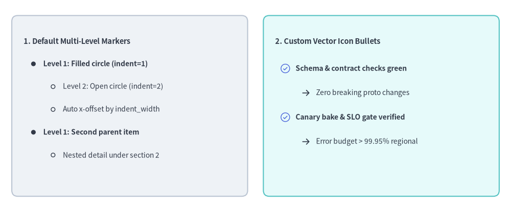
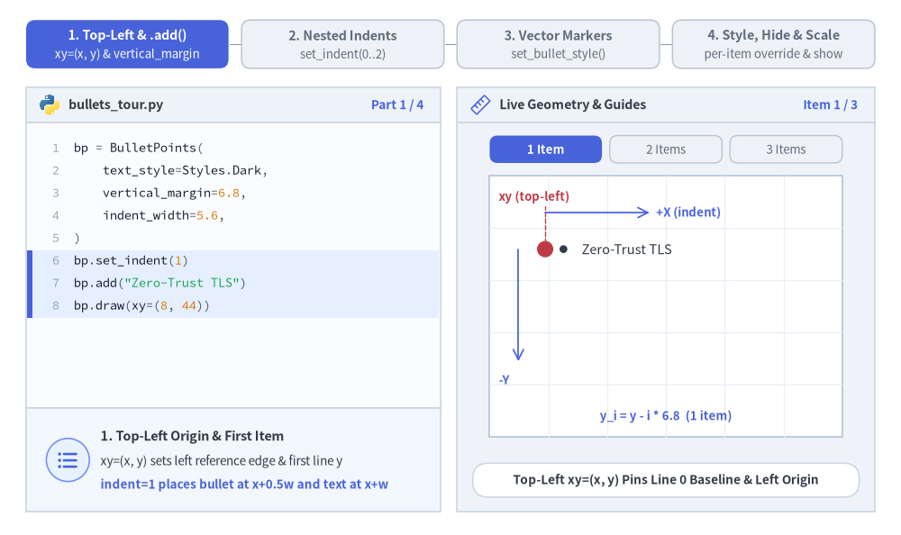
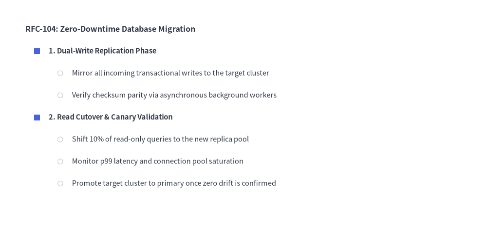
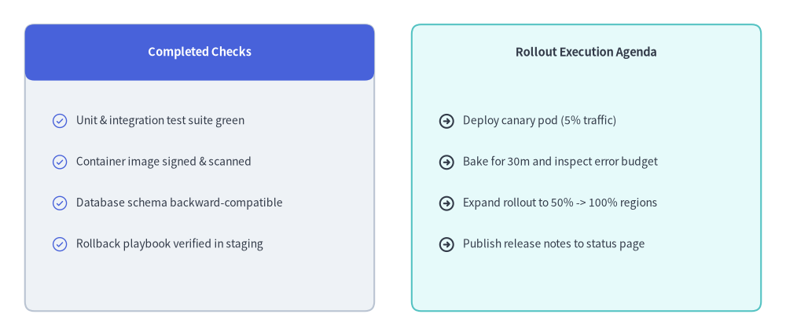

# BulletPoints

The `BulletPoints` component renders multi-level nested bullet lists starting from a top-left anchor `(x, y)`.
It supports customizable indentation widths, line spacing, per-level shape or icon markers, and layout-preserving visibility toggling.


<figure class="drawlib-image" style="text-align: center;">
  
  <figcaption class="drawlib-caption">Overview of BulletPoints: Default Multi-Level Markers vs. Custom Icon Checklists</figcaption>
</figure>

<details class="drawlib-code-details">
<summary>Source Code</summary>

```python
from drawlib.canvas import save, setup
from drawlib.icons import phosphor
from drawlib.shapes import rectangle
from drawlib.smartarts import BulletPoints
from drawlib.styles import Styles
from drawlib.text import text

setup(width=130, height=54)

# 1. Left Card: Built-in Default Multi-Level Bullet Markers (indent=0, 1, 2)
rectangle((33, 27), width=60, height=46, style=Styles.Neutral.patch(shape_r=1.5))

bp_default = BulletPoints(
    text_style=Styles.Dark.patch(text_size=10.0),
    vertical_margin=5.8,
    indent_width=5.0,
)
bp_default.set_indent(0)
bp_default.add("1. Default Multi-Level Markers", text_style=Styles.DarkBold.patch(text_size=10.5))
bp_default.set_indent(1)
bp_default.add("Level 1: Filled circle (indent=1)", text_style=Styles.DarkBold.patch(text_size=10.0))
bp_default.set_indent(2)
bp_default.add("Level 2: Open circle (indent=2)")
bp_default.add("Auto x-offset by indent_width")
bp_default.set_indent(1)
bp_default.add("Level 1: Second parent item", text_style=Styles.DarkBold.patch(text_size=10.0))
bp_default.set_indent(2)
bp_default.add("Nested detail under section 2")
bp_default.draw(xy=(6, 43.5))

# 2. Right Card: Custom Vector Icon Bullets (set_bullet_style with Phosphor Icons)
rectangle((97, 27), width=60, height=46, style=Styles.SecondaryNeutral.patch(shape_r=1.5))
text((70, 43.5), "2. Custom Vector Icon Bullets", style=Styles.DarkBold.patch(text_size=10.5, halign="left"))

bp_icons = BulletPoints(
    text_style=Styles.Dark.patch(text_size=10.0),
    vertical_margin=6.2,
    indent_width=5.2,
)
bp_icons.set_bullet_style(
    indent_level=1,
    function=phosphor.check_circle,
    style=Styles.PrimaryFlat,
    args={"width": 2.8},
)
bp_icons.set_bullet_style(
    indent_level=2,
    function=phosphor.arrow_right,
    style=Styles.DarkBold,
    args={"width": 2.4},
)
bp_icons.set_indent(1)
bp_icons.add("Schema & contract checks green", text_style=Styles.DarkBold.patch(text_size=10.0))
bp_icons.set_indent(2)
bp_icons.add("Zero breaking proto changes")
bp_icons.set_indent(1)
bp_icons.add("Canary bake & SLO gate verified", text_style=Styles.DarkBold.patch(text_size=10.0))
bp_icons.set_indent(2)
bp_icons.add("Error budget > 99.95% regional")
bp_icons.draw(xy=(70, 36.5))

save()
```

</details>


---

## 1. Core Concepts & Basic Usage

`BulletPoints` builds multi-level lists starting from a **Top-Left `xy=(x, y)`** origin, stepping subsequent lines downward along `-Y` by `vertical_margin` and indenting nested levels rightward along `+X` by `indent_width * indent`. You can switch active nesting depth via `set_indent(0..2)`, swap geometric bullets for vector icons via `set_bullet_style(...)`, and mutate individual `BulletPointItem` styles or layout-preserving visibility (`show=False`) before calling `draw(...)`:


<figure class="drawlib-image" style="text-align: center;">
  
  <figcaption class="drawlib-caption">Basic Usage & Parameter Tour: Top-Left Anchor, Nested Indentation, Vector Icon Markers, and Item Mutation (APNG Animation)</figcaption>
</figure>

<details class="drawlib-code-details">
<summary>Source Code</summary>

```python
from __future__ import annotations

from drawlib.anim import Animation
from drawlib.canvas import save, setup
from drawlib.icons import code as code_icons
from drawlib.icons import phosphor
from drawlib.lines import line
from drawlib.shapes import circle, rectangle
from drawlib.smartarts import BulletPoints, SourceCode, SourceCodeStyles
from drawlib.styles import Styles
from drawlib.text import text

W, H = 138.0, 82.0
setup(width=W, height=H)
anim = Animation(fps=10.0, loop=0)

CODE_TEXT_SIZE = 10.0
PT_TO_CANVAS = W / 720.0
FONT_CANVAS = CODE_TEXT_SIZE * PT_TO_CANVAS
LINE_H = FONT_CANVAS * 1.8
PAD_Y = FONT_CANVAS * 1.2

CODE_STYLES = SourceCodeStyles.get("default", font_lang="en", text_size=CODE_TEXT_SIZE).patch(
    box_style=Styles.Neutral.patch(shape_fill_color=(0, 0, 0, 0), shape_line_width=0),
)

PANE_HEADER = Styles.Neutral.patch(
    shape_fill_color=(238, 243, 250),
    shape_line_color=(203, 213, 225),
    shape_line_width=1.2,
    shape_r=0.0,
)
EDITOR_BODY = Styles.Neutral.patch(
    shape_fill_color=(250, 252, 255),
    shape_line_color=(203, 213, 225),
    shape_line_width=1.2,
    shape_r=0.0,
)
TAKEAWAY_BODY = Styles.Neutral.patch(
    shape_fill_color=(242, 246, 253),
    shape_line_color=(203, 213, 225),
    shape_line_width=1.2,
    shape_r=0.0,
)
STUDIO_BODY = Styles.Neutral.patch(
    shape_fill_color=(239, 243, 249),
    shape_line_color=(203, 213, 225),
    shape_line_width=1.2,
    shape_r=0.0,
)

PART_ITEMS = [
    ("1. Top-Left & .add()", "xy=(x, y) & vertical_margin"),
    ("2. Nested Indents", "set_indent(0..2)"),
    ("3. Vector Markers", "set_bullet_style()"),
    ("4. Style, Hide & Scale", "per-item override & show"),
]


def draw_step_bar(active_part: int) -> None:
    """Draw top 4-part progress bar (active_part is 1..4)."""
    pill_w = 31.0
    pill_h = 7.4
    gap = 2.0
    start_x = 4.0 + pill_w / 2.0
    cy = 75.2

    for idx, (label, sublabel) in enumerate(PART_ITEMS, start=1):
        cx = start_x + (idx - 1) * (pill_w + gap)
        if idx > 1:
            prev_cx = cx - (pill_w + gap)
            line(
                (prev_cx + pill_w / 2.0 + 0.2, cy),
                (cx - pill_w / 2.0 - 0.2, cy),
                style=Styles.PrimaryBold if idx <= active_part else Styles.MutedThin,
            )

        if idx == active_part:
            st = Styles.PrimaryFlat.patch(shape_r=1.4)
            tst = Styles.WhiteBold.patch(text_size=10.3)
            sub_tst = Styles.White.patch(text_size=9.5)
        elif idx < active_part:
            st = Styles.PrimaryNeutral.patch(shape_r=1.4, shape_line_width=1.1)
            tst = Styles.PrimaryBold.patch(text_size=10.3)
            sub_tst = Styles.Primary.patch(text_size=9.5)
        else:
            st = Styles.Neutral.patch(shape_r=1.4, shape_line_width=1.1)
            tst = Styles.MutedBold.patch(text_size=10.3)
            sub_tst = Styles.Muted.patch(text_size=9.5)

        rectangle((cx, cy), width=pill_w, height=pill_h, style=st)
        text((cx, cy + 1.35), label, style=tst)
        text((cx, cy - 1.55), sublabel, style=sub_tst)


def draw_left_pane(
    active_part: int,
    code_lines: list[str],
    hl_range: tuple[int, int],
    icon_fn: object,
    summary_title: str,
    summary_line1: str,
    summary_line2: str,
) -> None:
    """Draw left Python code editor + bottom concept takeaway card."""
    x0, w = 4.0, 63.5
    cx = x0 + w / 2.0
    top_y = 63.2
    header_h = 5.4
    editor_h = 43.8
    takeaway_h = 15.8

    rectangle((cx, top_y + header_h / 2.0), width=w, height=header_h, style=PANE_HEADER)
    code_icons.python((x0 + 3.6, top_y + header_h / 2.0), width=3.4, style=Styles.Neutral)
    text(
        (x0 + 6.5, top_y + header_h / 2.0),
        "bullets_tour.py",
        style=Styles.DarkBold.patch(text_size=10.2, halign="left"),
    )
    text(
        (x0 + w - 2.6, top_y + header_h / 2.0),
        f"Part {active_part} / 4",
        style=Styles.PrimaryBold.patch(text_size=9.8, halign="right"),
    )

    rectangle((cx, top_y - editor_h / 2.0), width=w, height=editor_h, style=EDITOR_BODY)

    hl_start, hl_end = hl_range
    hl_top = top_y - PAD_Y - hl_start * LINE_H
    hl_bot = top_y - PAD_Y - (hl_end + 1) * LINE_H
    hl_cy = (hl_top + hl_bot) / 2.0
    hl_h = hl_top - hl_bot
    rectangle(
        (cx, hl_cy),
        width=w - 0.6,
        height=hl_h,
        style=Styles.Neutral.patch(shape_fill_color=(229, 239, 255), shape_line_width=0),
    )
    rectangle(
        (x0 + 0.55, hl_cy),
        width=0.9,
        height=hl_h,
        style=Styles.PrimaryFlat.patch(shape_line_width=0),
    )

    SourceCode.draw(
        xy=(x0, top_y),
        width=w,
        code="\n".join(code_lines),
        styles=CODE_STYLES,
        code_lang="python",
        show_linenum=True,
        align="top_left",
    )

    take_cy = 3.6 + takeaway_h / 2.0
    rectangle((cx, take_cy), width=w, height=takeaway_h, style=TAKEAWAY_BODY)
    circle(
        (x0 + 6.4, take_cy),
        radius=3.3,
        style=Styles.PrimaryNeutral.patch(shape_line_width=1.2),
    )
    icon_fn((x0 + 6.4, take_cy), width=3.8, style=Styles.PrimaryBold)  # type: ignore[operator]
    text(
        (x0 + 11.4, take_cy + 3.6),
        summary_title,
        style=Styles.DarkBold.patch(text_size=10.4, halign="left"),
    )
    text(
        (x0 + 11.4, take_cy - 0.2),
        summary_line1,
        style=Styles.Dark.patch(text_size=9.7, halign="left"),
    )
    text(
        (x0 + 11.4, take_cy - 3.8),
        summary_line2,
        style=Styles.PrimaryBold.patch(text_size=9.6, halign="left"),
    )


def draw_geometry_studio(param_badge: str, footer_caption: str) -> tuple[float, float]:
    """Draw right geometry lab shell, inner coordinate sheet with subtle grid, and footer."""
    x0, w = 70.0, 64.0
    cx = x0 + w / 2.0
    top_y = 63.2
    header_h = 5.4
    body_h = 59.6

    rectangle((cx, top_y + header_h / 2.0), width=w, height=header_h, style=PANE_HEADER)
    phosphor.ruler((x0 + 3.6, top_y + header_h / 2.0), width=3.4, style=Styles.Primary)
    text(
        (x0 + 6.5, top_y + header_h / 2.0),
        "Live Geometry & Guides",
        style=Styles.DarkBold.patch(text_size=10.2, halign="left"),
    )
    text(
        (x0 + w - 2.6, top_y + header_h / 2.0),
        param_badge,
        style=Styles.PrimaryBold.patch(text_size=9.6, halign="right"),
    )

    rectangle((cx, 3.6 + body_h / 2.0), width=w, height=body_h, style=STUDIO_BODY)

    sheet_cx, sheet_cy = cx, 35.0
    sheet_w, sheet_h = 54.0, 40.0
    sx0, sy0 = sheet_cx - sheet_w / 2.0, sheet_cy - sheet_h / 2.0
    rectangle(
        (sheet_cx, sheet_cy),
        width=sheet_w,
        height=sheet_h,
        style=Styles.Neutral.patch(
            shape_fill_color=(255, 255, 255),
            shape_line_color=(180, 194, 214),
            shape_line_width=1.2,
        ),
    )
    g_st = Styles.MutedThin.patch(line_color=(232, 238, 246), line_width=0.8)
    for gx in range(1, 6):
        vx = sx0 + gx * (sheet_w / 6.0)
        line((vx, sy0), (vx, sy0 + sheet_h), style=g_st)
    for gy in range(1, 5):
        vy = sy0 + gy * (sheet_h / 5.0)
        line((sx0, vy), (sx0 + sheet_w, vy), style=g_st)

    rectangle(
        (cx, 8.4),
        width=59.2,
        height=5.2,
        style=Styles.Neutral.patch(
            shape_fill_color=(255, 255, 255),
            shape_line_color=(203, 213, 225),
            shape_line_width=1.1,
            shape_r=2.4,
        ),
        text=footer_caption,
        text_style=Styles.DarkBold.patch(text_size=9.8),
    )
    return sheet_cx, sheet_cy


def draw_sub_pills(scx: float, labels: list[str], active_idx: int) -> None:
    """Draw 3-pill sub-step indicator above the 54.0x40.0 coordinate sheet."""
    pw, ph, pgap = 17.2, 4.2, 1.2
    p_start = scx - (3 * pw + 2 * pgap) / 2.0 + pw / 2.0
    for idx, lbl in enumerate(labels):
        px = p_start + idx * (pw + pgap)
        if idx == active_idx:
            pst = Styles.PrimaryFlat.patch(shape_r=1.2)
            ptst = Styles.WhiteBold.patch(text_size=9.5)
        elif idx < active_idx:
            pst = Styles.PrimaryNeutral.patch(shape_r=1.2, shape_line_width=1.0)
            ptst = Styles.PrimaryBold.patch(text_size=9.5)
        else:
            pst = Styles.Neutral.patch(shape_r=1.2, shape_line_width=1.0)
            ptst = Styles.Muted.patch(text_size=9.5)
        rectangle((px, 59.1), width=pw, height=ph, style=pst, text=lbl, text_style=ptst)


BODY_DARK = Styles.Dark.patch(text_size=10.6)
HDR_DARK = Styles.DarkBold.patch(text_size=10.8)

# =========================================================================
# Part 1: Top-Left Anchor & Progressive .add() with vertical_margin (3 frames)
# =========================================================================
P1_ITEMS = ["Zero-Trust TLS", "Rate Limiting", "Audit Logs"]
P1_STATES = [
    (
        1,
        3.3,
        (5, 7),
        [
            "bp = BulletPoints(",
            "    text_style=Styles.Dark,",
            "    vertical_margin=6.8,",
            "    indent_width=5.6,",
            ")",
            "bp.set_indent(1)",
            'bp.add("Zero-Trust TLS")',
            "bp.draw(xy=(8, 44))",
        ],
        "Item 1 / 3",
        "Top-Left xy=(x, y) Pins Line 0 Baseline & Left Origin",
        "1. Top-Left Origin & First Item",
        "xy=(x, y) sets left reference edge & first line y",
        "indent=1 places bullet at x+0.5w and text at x+w",
    ),
    (
        2,
        3.3,
        (7, 7),
        [
            "bp = BulletPoints(",
            "    text_style=Styles.Dark,",
            "    vertical_margin=6.8,",
            "    indent_width=5.6,",
            ")",
            "bp.set_indent(1)",
            'bp.add("Zero-Trust TLS")',
            'bp.add("Rate Limiting")',
            "bp.draw(xy=(8, 44))",
        ],
        "Item 2 / 3",
        "Second .add() Steps Downward Along -Y by vertical_margin",
        "2. Vertical Step (-Y by vertical_margin)",
        "Each added item steps downward: y_1 = y - 6.8",
        "Top-Left xy anchor stays fixed as list grows down",
    ),
    (
        3,
        3.4,
        (8, 9),
        [
            "bp = BulletPoints(",
            "    text_style=Styles.Dark,",
            "    vertical_margin=6.8,",
            "    indent_width=5.6,",
            ")",
            "bp.set_indent(1)",
            'bp.add("Zero-Trust TLS")',
            'bp.add("Rate Limiting")',
            'bp.add("Audit Logs")',
            "bp.draw(xy=(8, 44))",
        ],
        "vertical_margin = 6.8",
        "3 Items Equally Spaced by vertical_margin=6.8 Along -Y",
        "3. Uniform Line Pitch (vertical_margin)",
        "Line i renders at y_i = y - i * vertical_margin",
        "Clean predictable spacing for 1..N bullet items",
    ),
]

for p1_idx, (n_items, dur, hl_rng, c_lines, badge, foot, s_t, s_1, s_2) in enumerate(P1_STATES):
    with anim.frame(duration=dur):
        draw_step_bar(1)
        draw_left_pane(1, c_lines, hl_rng, phosphor.list_bullets, s_t, s_1, s_2)
        scx, _ = draw_geometry_studio(badge, foot)
        draw_sub_pills(scx, ["1 Item", "2 Items", "3 Items"], p1_idx)

        bx, by = 83.5, 43.8
        v_m, ind_w = 6.8, 5.6
        bp = BulletPoints(text_style=BODY_DARK, vertical_margin=v_m, indent_width=ind_w)
        bp.set_indent(1)
        for txt_item in P1_ITEMS[:n_items]:
            bp.add(txt_item)
        bp.draw(xy=(bx, by))

        # Top-Left xy anchor dot + +X / -Y growth axes
        line(
            (bx, by),
            (bx + 15.5, by + 5.2),
            style=Styles.MutedThin.patch(line_width=0.0),
        )
        line(
            (bx, 49.4),
            (bx + 16.0, 49.4),
            arrow_head="->",
            style=Styles.PrimaryBold.patch(line_width=1.25),
        )
        text(
            (bx + 17.0, 49.4),
            "+X (indent)",
            style=Styles.PrimaryBold.patch(text_size=9.5, halign="left"),
        )
        line(
            (79.4, by),
            (79.4, by - 2.0 * v_m - 3.6),
            arrow_head="->",
            style=Styles.PrimaryBold.patch(line_width=1.25),
        )
        text(
            (76.4, 23.8),
            "-Y",
            style=Styles.PrimaryBold.patch(text_size=9.6, halign="left"),
        )
        line((bx, by), (bx, 50.4), style=Styles.DangerDashed.patch(line_width=1.0))
        circle((bx, by), radius=1.25, style=Styles.DangerFlat)
        text(
            (76.4, 51.8),
            "xy (top-left)",
            style=Styles.DangerBold.patch(text_size=9.5, halign="left"),
        )

        # Right-side vertical_margin calipers
        cal_x = 117.8
        if n_items > 1:
            line((cal_x - 2.2, by), (cal_x + 2.2, by), style=Styles.MutedThin)
        for i_step in range(1, n_items):
            y_prev = by - (i_step - 1) * v_m
            y_curr = by - i_step * v_m
            line((cal_x - 2.2, y_curr), (cal_x + 2.2, y_curr), style=Styles.MutedThin)
            line(
                (cal_x, y_prev - 0.3),
                (cal_x, y_curr + 0.3),
                arrow_head="<->",
                style=Styles.PrimaryBold.patch(line_width=1.25),
            )
            text(
                (cal_x + 1.6, (y_prev + y_curr) / 2.0),
                "6.8",
                style=Styles.PrimaryBold.patch(text_size=9.6, halign="left"),
            )

        text(
            (scx, 18.2),
            f"y_i = y - i * 6.8  ({n_items} item{'s' if n_items > 1 else ''})",
            style=Styles.PrimaryBold.patch(text_size=9.5),
        )

# =========================================================================
# Part 2: Nested Indentation Levels — set_indent(0..2) (3 frames)
# =========================================================================
P2_STATES = [
    (
        0,
        3.3,
        (5, 7),
        [
            "hdr = Styles.DarkBold",
            "bp = BulletPoints(",
            "    text_style=Styles.Dark,",
            "    vertical_margin=5.4,",
            "    indent_width=5.8)",
            "bp.set_indent(0)",
            'bp.add("API Security Gate",',
            "       text_style=hdr)",
            "bp.draw(xy=(8, 46))",
        ],
        "set_indent(0)",
        "Level 0: Unbulleted Section Header Flush at x + 0*w",
        "Level 0 Header (set_indent(0))",
        "indent=0 omits the bullet marker for clean section titles",
        "Text aligns flush with left origin x_text = x",
        "indent=0 -> no marker (x_text = x)",
    ),
    (
        1,
        3.3,
        (6, 8),
        [
            "bp = BulletPoints(",
            "    text_style=Styles.Dark,",
            "    vertical_margin=5.4,",
            "    indent_width=5.8)",
            "bp.set_indent(0)",
            'bp.add("API Security Gate", ...)',
            "bp.set_indent(1)",
            'bp.add("Zero-Trust TLS")',
            'bp.add("Rate Limiting")',
            "bp.draw(xy=(8, 46))",
        ],
        "set_indent(1)",
        "Level 1: Auto Filled-Circle Markers & +1*indent_width",
        "Level 1 Bullets (set_indent(1))",
        "Auto-draws filled circle at x_marker = x + 0.5*w",
        "Shifts item text rightward to x_text = x + 1.0*w",
        "indent=1 -> filled circle (x_text = x + w)",
    ),
    (
        2,
        3.4,
        (4, 9),
        [
            "bp.set_indent(0)",
            'bp.add("API Security Gate", ...)',
            "bp.set_indent(1)",
            'bp.add("Zero-Trust TLS")',
            "bp.set_indent(2)",
            'bp.add("mTLS 1.3 client certs")',
            "bp.set_indent(1)",
            'bp.add("Rate Limiting")',
            "bp.set_indent(2)",
            'bp.add("1000 req/s burst cap")',
            "bp.draw(xy=(8, 46))",
        ],
        "set_indent(2)",
        "Level 2: Auto Open-Circle Markers & +2*indent_width",
        "Level 2 Sub-Bullets (set_indent(2))",
        "Auto-cycles to open outline circle at x + 1.5*w",
        "Shifts nested text rightward to x_text = x + 2.0*w",
        "indent=2 -> open circle (x_text = x + 2w)",
    ),
]

for p2_idx, (max_lvl, dur, hl_rng, c_lines, badge, foot, s_t, s_1, s_2, b_note) in enumerate(P2_STATES):
    with anim.frame(duration=dur):
        draw_step_bar(2)
        draw_left_pane(2, c_lines, hl_rng, phosphor.text_indent, s_t, s_1, s_2)
        scx, _ = draw_geometry_studio(badge, foot)
        draw_sub_pills(scx, ["indent = 0", "indent = 1", "indent = 2"], p2_idx)

        bx, by = 79.5, 45.0
        v_m, ind_w = 5.4, 5.8

        # Crisp top caliper ticks + subtle background guide rails for levels 0..2
        for lvl_i in range(max_lvl + 1):
            gx_rail = bx + lvl_i * ind_w
            rail_st = Styles.PrimaryDashed if lvl_i == max_lvl else Styles.MutedDashed
            line(
                (gx_rail, 48.2),
                (gx_rail, 51.8),
                style=rail_st.patch(line_width=1.15),
            )
            line(
                (gx_rail, 21.8),
                (gx_rail, 48.2),
                style=rail_st.patch(line_width=0.9, alpha=0.32),
            )
            if lvl_i > 0:
                prev_rail = gx_rail - ind_w
                line(
                    (prev_rail + 0.25, 50.6),
                    (gx_rail - 0.25, 50.6),
                    arrow_head="<->",
                    style=Styles.PrimaryBold.patch(line_width=1.15),
                )
                text(
                    ((prev_rail + gx_rail) / 2.0, 52.8),
                    "5.8",
                    style=Styles.PrimaryBold.patch(text_size=9.5),
                )

        bp = BulletPoints(text_style=BODY_DARK, vertical_margin=v_m, indent_width=ind_w)
        bp.set_indent(0)
        bp.add("API Security Gate", text_style=HDR_DARK)
        if max_lvl >= 1:
            bp.set_indent(1)
            bp.add("Zero-Trust TLS")
            if max_lvl >= 2:
                bp.set_indent(2)
                bp.add("mTLS 1.3 client certs")
            bp.set_indent(1)
            bp.add("Rate Limiting")
            if max_lvl >= 2:
                bp.set_indent(2)
                bp.add("1000 req/s burst cap")
        bp.draw(xy=(bx, by))

        text((scx, 18.2), b_note, style=Styles.PrimaryBold.patch(text_size=9.5))

# =========================================================================
# Part 3: Vector Icon Markers — set_bullet_style() in Card (3 frames)
# =========================================================================
P3_STATES = [
    (
        0,
        3.3,
        (0, 4),
        [
            "# Neutral checklist card",
            "rectangle(",
            "    (32, 35), width=47,",
            "    height=30,",
            "    style=Styles.Neutral)",
            "bp.set_indent(0)",
            'bp.add("Release Checklist",',
            "       text_style=hdr)",
            "bp.set_indent(1)",
            'bp.add("Zero-Trust TLS")',
            "bp.draw(xy=(11, 46))",
        ],
        "Neutral Card + Circles",
        "Checklist Card Shell + Built-In Geometric Circle Markers",
        "Checklist Card Baseline",
        "Wrap BulletPoints inside a calm Styles.Neutral card",
        "Before set_bullet_style(), levels 1 & 2 draw circles",
        "Default geometric circles on levels 1 & 2",
    ),
    (
        1,
        3.3,
        (1, 6),
        [
            "# Level 1 -> Phosphor check",
            "bp.set_bullet_style(",
            "    1,",
            "    phosphor.check_circle,",
            "    Styles.PrimaryBold,",
            '    {"width": 3.0},',
            ")",
            "bp.set_indent(1)",
            'bp.add("Zero-Trust TLS")',
            'bp.add("Rate Limiting")',
            "bp.draw(xy=(11, 46))",
        ],
        "phosphor.check_circle",
        "Level 1 Swapped to Vector phosphor.check_circle Icons",
        "Vector Icon Bullets (Level 1)",
        "Pass any Phosphor icon function to set_bullet_style()",
        '{"width": 3.0} & Styles.PrimaryBold style each marker',
        "Level 1 -> phosphor.check_circle (width=3.0)",
    ),
    (
        2,
        3.4,
        (4, 7),
        [
            "bp.set_bullet_style(",
            "    1, phosphor.check_circle,",
            "    Styles.PrimaryBold,",
            '    {"width": 3.0})',
            "bp.set_bullet_style(",
            "    2, phosphor.caret_right,",
            "    Styles.SecondaryBold,",
            '    {"width": 2.4})',
            "bp.set_indent(2)",
            'bp.add("mTLS 1.3 client certs")',
            "bp.draw(xy=(11, 46))",
        ],
        "phosphor.caret_right",
        "Multi-Level Vector Checklist: check_circle + caret_right",
        "Nested Vector Markers (Levels 1 & 2)",
        "Combine PrimaryBold check_circle with caret_right",
        "Builds crisp checklist cards without manual offsets",
        "Lvl 1: check_circle  •  Lvl 2: caret_right",
    ),
]

for p3_idx, (icon_mode, dur, hl_rng, c_lines, badge, foot, s_t, s_1, s_2, b_note) in enumerate(P3_STATES):
    with anim.frame(duration=dur):
        draw_step_bar(3)
        draw_left_pane(3, c_lines, hl_rng, phosphor.list_checks, s_t, s_1, s_2)
        scx, _ = draw_geometry_studio(badge, foot)
        draw_sub_pills(scx, ["Default Circles", "Lvl 1 Check", "Lvl 2 Caret"], p3_idx)

        # Clean Neutral checklist container card
        rectangle(
            (scx, 37.0),
            width=47.0,
            height=30.6,
            style=Styles.Neutral.patch(shape_r=1.6, shape_line_width=1.2),
        )
        line((80.5, 45.4), (123.5, 45.4), style=Styles.MutedThin)

        bx, by = 81.2, 48.2
        bp = BulletPoints(text_style=BODY_DARK, vertical_margin=5.1, indent_width=5.8)
        if icon_mode >= 1:
            bp.set_bullet_style(1, phosphor.check_circle, Styles.PrimaryBold, {"width": 3.0})
        if icon_mode >= 2:
            bp.set_bullet_style(2, phosphor.caret_right, Styles.SecondaryBold, {"width": 2.4})

        bp.set_indent(0)
        bp.add("Release Checklist", text_style=HDR_DARK)
        bp.set_indent(1)
        bp.add("Zero-Trust TLS")
        bp.set_indent(2)
        bp.add("mTLS 1.3 client certs")
        bp.set_indent(1)
        bp.add("Rate Limiting")
        bp.set_indent(2)
        bp.add("1000 req/s burst cap")
        bp.draw(xy=(bx, by))

        text((scx, 18.2), b_note, style=Styles.PrimaryBold.patch(text_size=9.5))

# =========================================================================
# Part 4: Per-Item Style Override, show=False Slot & scale (3 frames)
# =========================================================================
P4_STATES = [
    (
        "focal",
        3.3,
        (5, 8),
        [
            "bp.set_indent(0)",
            'bp.add("Release Checklist",',
            "       text_style=hdr)",
            "bp.set_indent(1)",
            'bp.add("Zero-Trust TLS")',
            "bp.add(",
            '    "Rate Limiting (Active)",',
            "    text_style=Styles.PrimaryBold",
            ")",
            'bp.add("Canary Bake (30m)")',
            "bp.draw(xy=(11, 47))",
        ],
        "text_style Override",
        "Per-Item text_style=Styles.PrimaryBold Highlights Focal Line",
        "Per-Item Focal Style Override",
        "Pass text_style=... in .add() or mutate bp.items[i]",
        "Highlights 1 active item while peers stay calm Dark",
    ),
    (
        "hide",
        3.4,
        (4, 6),
        [
            "# bp.items exposes mutable items",
            "bp.items[2].text_style = (",
            "    Styles.PrimaryBold",
            ")",
            "# Hide item while keeping slot!",
            "bp.items[3].show = False",
            "# Lower items do NOT shift up",
            "bp.draw(xy=(11, 47))",
        ],
        "items[3].show = False",
        "show=False Hides Item 3 While Preserving Vertical Slot",
        "Layout-Preserving Visibility (show=False)",
        "Toggling bp.items[i].show = False skips rendering",
        "Reserves vertical_margin so lower items never jump",
    ),
    (
        "scale",
        3.5,
        (3, 6),
        [
            "# Restore hidden item",
            "bp.items[3].show = True",
            "# Proportional scaling from xy",
            "bp.draw(",
            "    xy=(11, 47),",
            "    scale=0.88,",
            ")",
        ],
        "scale = 0.88",
        "Proportional Scaling (scale=0.88) Anchored at Top-Left xy",
        "Proportional Scaling (draw(xy, scale=0.88))",
        "Scales fonts, markers, indents & margins uniformly",
        "Top-Left xy=(x, y) anchor stays pinned in place",
    ),
]

for p4_idx, (mode, dur, hl_rng, c_lines, badge, foot, s_t, s_1, s_2) in enumerate(P4_STATES):
    with anim.frame(duration=dur):
        draw_step_bar(4)
        draw_left_pane(4, c_lines, hl_rng, phosphor.sliders, s_t, s_1, s_2)
        scx, _ = draw_geometry_studio(badge, foot)
        draw_sub_pills(scx, ["Focal Style", "show = False", "scale = 0.88"], p4_idx)

        bx, by = 81.2, 48.0
        v_m, ind_w = 5.6, 5.6
        base_txt = Styles.Dark.patch(text_size=10.9)
        focal_txt = Styles.PrimaryBold.patch(text_size=10.9)
        hdr_txt = Styles.DarkBold.patch(text_size=11.0)

        bp = BulletPoints(text_style=base_txt, vertical_margin=v_m, indent_width=ind_w)
        bp.set_bullet_style(1, phosphor.check_circle, Styles.PrimaryBold, {"width": 2.9})
        bp.set_indent(0)
        bp.add("Release Checklist", text_style=hdr_txt)
        bp.set_indent(1)
        bp.add("Zero-Trust TLS")
        bp.add("Rate Limiting (Active)", text_style=focal_txt)
        bp.add("Canary Bake (30m)")
        bp.add("Audit Logs")

        if mode == "focal":
            bp.draw(xy=(bx, by))
            y_focal = by - 2 * v_m
            rectangle(
                (102.4, y_focal),
                width=43.8,
                height=4.5,
                style=Styles.PrimaryDashed.patch(
                    shape_fill_color=(0, 0, 0, 0),
                    shape_line_width=1.2,
                    shape_r=1.0,
                ),
            )
            text(
                (scx, 18.2),
                "bp.items[2].text_style = Styles.PrimaryBold",
                style=Styles.PrimaryBold.patch(text_size=9.5),
            )
        elif mode == "hide":
            bp.items[3].show = False
            bp.draw(xy=(bx, by))
            y_slot = by - 3 * v_m
            rectangle(
                (102.4, y_slot),
                width=43.8,
                height=4.4,
                style=Styles.DangerDashed.patch(
                    shape_fill_color=(255, 244, 244),
                    shape_line_width=1.2,
                    shape_r=1.0,
                ),
            )
            text(
                (102.4, y_slot),
                "items[3].show = False  (slot reserved)",
                style=Styles.DangerBold.patch(text_size=9.5),
            )
            text(
                (scx, 18.2),
                "Item 4 ('Audit Logs') stays pinned at y - 4*5.6",
                style=Styles.DangerBold.patch(text_size=9.5),
            )
        else:
            # 1.0x reference box vs 0.88x scaled box anchored at (bx, by)
            w1, h1 = 43.0, 26.2
            x_box0, y_box_top = bx - 1.4, by + 2.3
            rectangle(
                (x_box0 + w1 / 2.0, y_box_top - h1 / 2.0),
                width=w1,
                height=h1,
                style=Styles.MutedDashed.patch(
                    shape_fill_color=(0, 0, 0, 0),
                    shape_line_width=1.1,
                ),
            )
            text(
                (x_box0 + w1 - 0.6, y_box_top + 1.8),
                "1.0x",
                style=Styles.MutedBold.patch(text_size=9.5, halign="right"),
            )

            sc_f = 0.88
            w2, h2 = w1 * sc_f, h1 * sc_f
            sx_box0 = bx + (x_box0 - bx) * sc_f
            sy_box_top = by + (y_box_top - by) * sc_f
            rectangle(
                (sx_box0 + w2 / 2.0, sy_box_top - h2 / 2.0),
                width=w2,
                height=h2,
                style=Styles.PrimaryDashed.patch(
                    shape_fill_color=(0, 0, 0, 0),
                    shape_line_width=1.3,
                ),
            )
            text(
                (sx_box0 + w2 - 0.6, sy_box_top + 1.8),
                "0.88x",
                style=Styles.PrimaryBold.patch(text_size=9.5, halign="right"),
            )
            bp.draw(xy=(bx, by), scale=sc_f)
            circle((bx - 1.4, by), radius=1.05, style=Styles.DangerFlat)
            text(
                (77.2, by + 2.8),
                "xy",
                style=Styles.DangerBold.patch(text_size=9.5, halign="left"),
            )
            line(
                (x_box0 + w1 - 0.5, y_box_top - h1 + 0.5),
                (sx_box0 + w2 + 0.4, sy_box_top - h2 - 0.4),
                arrow_head="->",
                style=Styles.PrimaryBold.patch(line_width=1.2),
            )
            text(
                (scx, 18.2),
                "draw(xy, scale=0.88)  •  Pinned at Top-Left xy",
                style=Styles.PrimaryBold.patch(text_size=9.5),
            )

save()
```

</details>


- **Top-Left Origin & Vertical Pitch (`xy`, `vertical_margin`)**: Pins the first item's vertical baseline and level-`0` left edge at `xy=(x, y)`, stepping subsequent items downward along `-Y` by `vertical_margin`.
- **Multi-Level Indentation (`set_indent`, `indent_width`)**: Shifts item text rightward to `x + indent_width * indent` with built-in markers (`0` = unbulleted header, `1` = filled circle, `2` = open circle).
- **Custom Vector Markers (`set_bullet_style`)**: Replaces default geometric shapes at any positive `indent_level` with `phosphor.*` icons or shape primitives centered at `x + indent_width * (indent - 0.5)`.
- **Item Overrides, Slot Hiding & Scaling (`items`, `show`, `scale`)**: Mutates per-item `text_style` or sets `bp.items[i].show = False` to hide lines without shifting lower items, and scales proportionally around `xy` via `draw(xy, scale=...)`.

---

## 2. Multi-Level Nested Bullet Hierarchy

By default, `indent=0` renders unbulleted section titles, `indent=1` renders filled circle bullets, and `indent=2` renders open outline circle bullets. You can also customize any indentation level's bullet marker using `set_bullet_style(...)`.


```python
from drawlib.canvas import save, setup
from drawlib.shapes import circle, rectangle
from drawlib.smartarts import BulletPoints
from drawlib.styles import Colors, Styles

setup(width=115, height=56)

bp = BulletPoints(
    text_style=Styles.Dark.patch(text_size=10.5),
    vertical_margin=5.2,
    indent_width=5.5,
)

# Customize level-1 marker to a Primary square and level-2 to a Muted circle
bp.set_bullet_style(
    indent_level=1,
    function=rectangle,
    style=Styles.PrimaryFlat.patch(shape_line_width=0),
    args={"width": 1.4, "height": 1.4},
)
bp.set_bullet_style(
    indent_level=2,
    function=circle,
    style=Styles.DarkThin.patch(shape_fill_color=Colors.White),
    args={"radius": 0.6},
)

bp.set_indent(0)
bp.add("RFC-104: Zero-Downtime Database Migration", text_style=Styles.DarkBold.patch(text_size=11.5))

bp.set_indent(1)
bp.add("1. Dual-Write Replication Phase", text_style=Styles.DarkBold.patch(text_size=10.5))
bp.set_indent(2)
bp.add("Mirror all incoming transactional writes to the target cluster")
bp.add("Verify checksum parity via asynchronous background workers")

bp.set_indent(1)
bp.add("2. Read Cutover & Canary Validation", text_style=Styles.DarkBold.patch(text_size=10.5))
bp.set_indent(2)
bp.add("Shift 10% of read-only queries to the new replica pool")
bp.add("Monitor p99 latency and connection pool saturation")
bp.add("Promote target cluster to primary once zero drift is confirmed")

bp.draw(xy=(6, 49))
save()
```

<figure class="drawlib-image" style="text-align: center;">
  
  <figcaption class="drawlib-caption">Multi-Level Nested Architecture Requirements with BulletPoints</figcaption>
</figure>


---

## 3. Checklist & Agenda Cards with Vector Icon Markers

By passing Phosphor icon functions (such as `phosphor.check_circle` or `phosphor.arrow_right`) to `set_bullet_style(...)` and placing `BulletPoints` inside rectangular cards, you can create rich release checklists, feature comparison cards, and sprint agendas.


```python
from drawlib.canvas import save, setup
from drawlib.icons import phosphor
from drawlib.shapes import rectangle
from drawlib.smartarts import BulletPoints
from drawlib.styles import Styles
from drawlib.text import text

setup(width=126, height=54)

# Left Card: Completed Pre-Flight Checks (Neutral card + Primary header)
rectangle((32, 27), width=56, height=46, style=Styles.Neutral.patch(shape_r=1.5))
rectangle(
    (32, 45.5),
    width=56,
    height=9,
    style=Styles.PrimaryFlat.patch(shape_r=1.5),
    text="Completed Checks",
    text_style=Styles.WhiteBold.patch(text_size=10.5),
)

done_list = BulletPoints(
    text_style=Styles.Dark.patch(text_size=10.0),
    vertical_margin=6.6,
    indent_width=5.2,
)
done_list.set_bullet_style(
    indent_level=1,
    function=phosphor.check_circle,
    style=Styles.PrimaryFlat,
    args={"width": 2.8},
)
done_list.set_indent(1)
done_list.add("Unit & integration test suite green")
done_list.add("Container image signed & scanned")
done_list.add("Database schema backward-compatible")
done_list.add("Rollback playbook verified in staging")
done_list.draw(xy=(7, 34.5))

# Right Card: Rollout Execution Steps (SecondaryNeutral card)
rectangle((94, 27), width=56, height=46, style=Styles.SecondaryNeutral.patch(shape_r=1.5))
text((94, 45.5), "Rollout Execution Agenda", style=Styles.DarkBold.patch(text_size=10.5))

agenda_list = BulletPoints(
    text_style=Styles.Dark.patch(text_size=10.0),
    vertical_margin=6.6,
    indent_width=5.2,
)
agenda_list.set_bullet_style(
    indent_level=1,
    function=phosphor.arrow_circle_right,
    style=Styles.DarkBold,
    args={"width": 2.8},
)
agenda_list.set_indent(1)
agenda_list.add("Deploy canary pod (5% traffic)")
agenda_list.add("Bake for 30m and inspect error budget")
agenda_list.add("Expand rollout to 50% -> 100% regions")
agenda_list.add("Publish release notes to status page")
agenda_list.draw(xy=(69, 34.5))
save()
```

<figure class="drawlib-image" style="text-align: center;">
  
  <figcaption class="drawlib-caption">Release Readiness Checklist Cards Using BulletPoints and Phosphor Icons</figcaption>
</figure>


---

## 4. Coordinate & Indentation Mechanics

- **Top-Left Anchor `(x, y)`**: The `xy` coordinate passed to `bp.draw(xy=...)` specifies the **left edge and vertical center** of the first line (`y`). Subsequent items step downward by `vertical_margin` (`y - i * vertical_margin`).
- **Indentation Geometry**:
  - Text for an item at indentation level `indent` starts at `x_text = x + indent_width * indent`.
  - When `indent != 0` and a bullet style is registered for `indent`, the marker is centered at `x_marker = x + indent_width * (indent - 0.5)`.
- **Default Bullet Markers**:
  - `indent = 0`: No bullet marker (ideal for list titles and section headers).
  - `indent = 1`: Filled circle (`radius=0.5`) matching `text_style.text_color`.
  - `indent = 2`: Open outline circle (`radius=0.5`) matching `text_style.text_color`.

---

## 5. API Reference

### Constructor
```python
BulletPoints(
    *,
    text_style: Style,
    vertical_margin: float,
    indent_width: float,
)
```

### Methods & Properties
- **`set_indent(level: int) -> None`**:
  Sets the active indentation level (`0`, `1`, `2`, ...) applied to subsequent `add()` calls.
- **`set_bullet_style(indent_level: int, function: Callable, style: Style, args: dict) -> None`**:
  Registers a custom drawing callable (such as `rectangle`, `circle`, or any `phosphor.*` icon function) for `indent_level`. At draw time, `function(xy=(x_marker, y), style=style, **args)` is invoked.
- **`add(text: str, *, text_style: Style | None = None, show: bool = True) -> BulletPointItem`**:
  Appends a bullet item at the current indentation level and returns a mutable `BulletPointItem` (`indent: int`, `text: str`, `text_style: Style`, `show: bool`). Note that `BulletPointItem.style` is also provided as a mutable property alias for `BulletPointItem.text_style`. Setting `show=False` hides the bullet and text while keeping the vertical spacing reserved for subsequent lines.
- **`bp.items -> list[BulletPointItem]`**:
  Returns the list of all registered `BulletPointItem` instances, allowing deferred mutation of `.text`, `.text_style` (or `.style`), `.indent`, and `.show` before or between `draw()` calls.
- **`draw(xy: tuple[float, float], scale: float = 1.0) -> None`**:
  Renders all visible bullet items starting at `xy`, with optional proportional scaling via `scale`.

