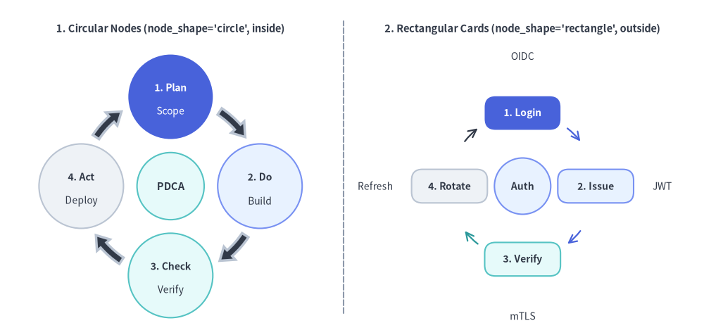
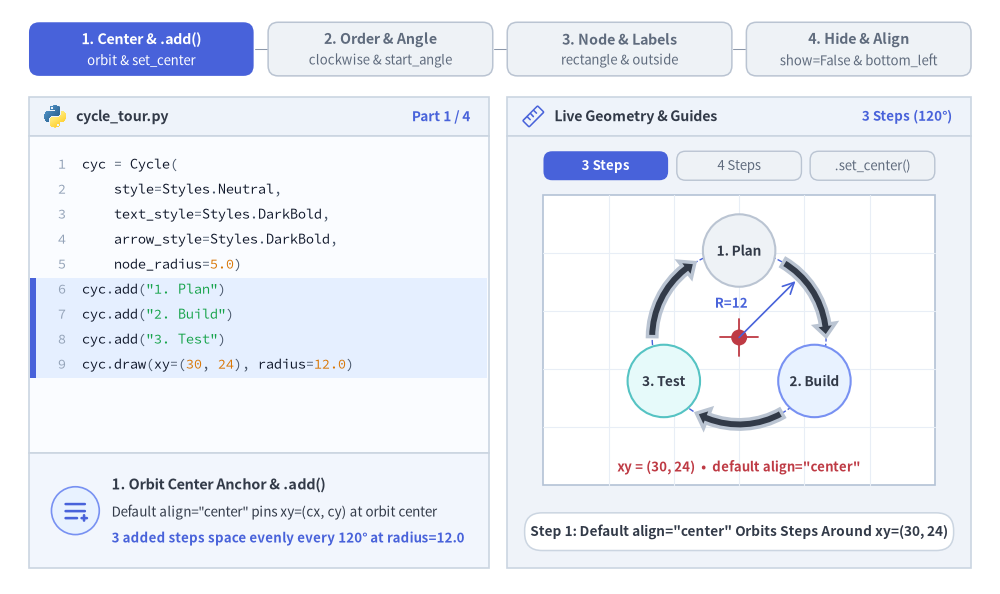
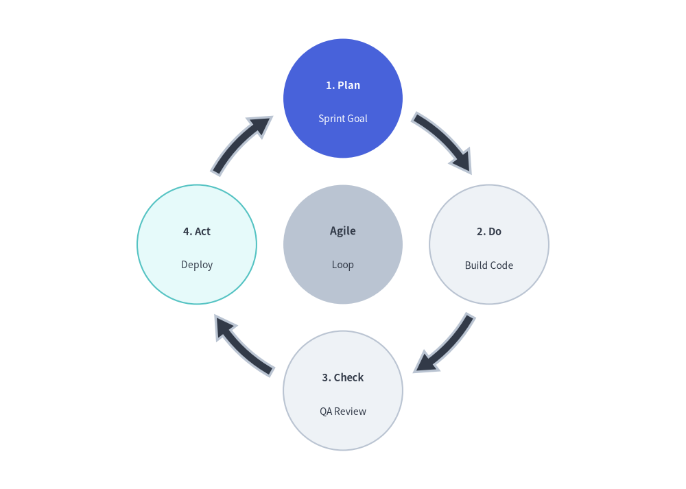
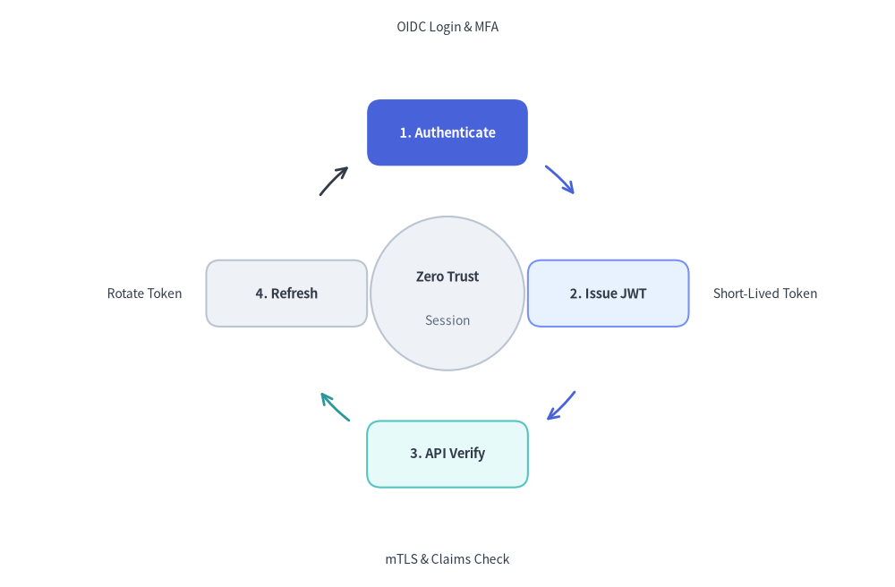

# Cycle Component

The `Cycle` component draws circular, repeating process diagrams and continuous feedback loops. 
It is ideally suited for Agile/Scrum iterations, PDCA DevOps lifecycles, incident response loops, and token refresh mechanisms.


<figure class="drawlib-image" style="text-align: center;">
  
  <figcaption class="drawlib-caption">Overview of Cycle: Circular Node Orbits and Rectangular Card Loops</figcaption>
</figure>

<details class="drawlib-code-details">
<summary>Source Code</summary>

```python
from drawlib.canvas import save, setup
from drawlib.lines import line
from drawlib.smartarts import Cycle
from drawlib.styles import Styles
from drawlib.text import text

setup(width=130, height=62)

# Left Panel: Circular Node Orbit (node_shape="circle", description_placement="inside")
text((31.5, 56.5), "1. Circular Nodes (node_shape='circle', inside)", style=Styles.DarkBold.patch(text_size=10.5))

c_left = Cycle(
    style=Styles.Neutral,
    text_style=Styles.DarkBold.patch(text_size=10.0),
    description_style=Styles.Dark.patch(text_size=10.0),
    arrow_style=Styles.DarkBold,
    node_shape="circle",
    node_radius=7.8,
    description_placement="inside",
    arrow_type="arc",
    arrow_width=1.4,
    arrow_head_width=3.2,
    arrow_color_mode="monochrome",
    arrow_gap=1.8,
)
c_left.add(
    "1. Plan",
    description="Scope",
    style=Styles.PrimaryFlat,
    text_style=Styles.WhiteBold.patch(text_size=10.0),
    description_style=Styles.White.patch(text_size=10.0),
)
c_left.add(
    "2. Do",
    description="Build",
    style=Styles.PrimaryNeutral,
    text_style=Styles.DarkBold.patch(text_size=10.0),
    description_style=Styles.Dark.patch(text_size=10.0),
)
c_left.add(
    "3. Check",
    description="Verify",
    style=Styles.SecondaryNeutral,
    text_style=Styles.DarkBold.patch(text_size=10.0),
    description_style=Styles.Dark.patch(text_size=10.0),
)
c_left.add(
    "4. Act",
    description="Deploy",
    style=Styles.Neutral,
    text_style=Styles.DarkBold.patch(text_size=10.0),
    description_style=Styles.Dark.patch(text_size=10.0),
)
c_left.set_center(
    "PDCA",
    radius=6.2,
    style=Styles.SecondaryNeutral,
    text_style=Styles.DarkBold.patch(text_size=10.5),
)
c_left.draw(xy=(31.5, 27.5), radius=16.5)

# Center Divider
line((63.5, 4), (63.5, 58), style=Styles.MutedDashed)

# Right Panel: Rectangular Card Loop (node_shape="rectangle", description_placement="outside")
text((96.5, 56.5), "2. Rectangular Cards (node_shape='rectangle', outside)", style=Styles.DarkBold.patch(text_size=10.5))

c_right = Cycle(
    style=Styles.Neutral,
    text_style=Styles.DarkBold.patch(text_size=10.0),
    description_style=Styles.Dark.patch(text_size=10.0),
    node_shape="rectangle",
    node_width=14.0,
    node_height=6.2,
    description_placement="outside",
    arrow_type="line",
    arrow_width=1.6,
    arrow_color_mode="match_source",
    arrow_gap=1.8,
)
c_right.add(
    "1. Login",
    description="OIDC",
    style=Styles.PrimaryFlat,
    text_style=Styles.WhiteBold.patch(text_size=10.0),
    description_style=Styles.Dark.patch(text_size=10.0),
)
c_right.add(
    "2. Issue",
    description="JWT",
    style=Styles.PrimaryNeutral,
    text_style=Styles.DarkBold.patch(text_size=10.0),
    description_style=Styles.Dark.patch(text_size=10.0, halign="left"),
    arrow_style=Styles.PrimaryBold,
)
c_right.add(
    "3. Verify",
    description="mTLS",
    style=Styles.SecondaryNeutral,
    text_style=Styles.DarkBold.patch(text_size=10.0),
    description_style=Styles.Dark.patch(text_size=10.0),
    arrow_style=Styles.SecondaryBold,
)
c_right.add(
    "4. Rotate",
    description="Refresh",
    style=Styles.Neutral,
    text_style=Styles.DarkBold.patch(text_size=10.0),
    description_style=Styles.Dark.patch(text_size=10.0, halign="right"),
    arrow_style=Styles.DarkBold,
)
c_right.set_center(
    "Auth",
    radius=5.2,
    style=Styles.PrimaryNeutral,
    text_style=Styles.DarkBold.patch(text_size=10.0),
)
c_right.draw(xy=(96.5, 27.5), radius=13.5)

save()
```

</details>


---

## 1. Core Concepts & Basic Usage

`Cycle` arranges perimeter steps evenly around an orbit circle via `.add(...)`, anchoring by default at the **Orbit Center `xy=(cx, cy)`** (`align="center"`, with optional `.set_center(...)` hub) or at the outer bounding corner when `align="bottom_left"`. You can control rotational flow (`clockwise`, `start_angle`), switch between circular nodes and rectangular cards with `inside` or `outside` descriptions, and customize arrow coloring or hide `.items[i]` steps while preserving sibling orbit angles:


<figure class="drawlib-image" style="text-align: center;">
  
  <figcaption class="drawlib-caption">Basic Usage & Parameter Tour: Orbit Center & Hub, Angular Direction, Node & Label Modes, and Live Item Visibility (APNG Animation)</figcaption>
</figure>

<details class="drawlib-code-details">
<summary>Source Code</summary>

```python
from __future__ import annotations

import math
from drawlib.anim import Animation
from drawlib.canvas import save, setup
from drawlib.icons import code as code_icons
from drawlib.icons import phosphor
from drawlib.lines import line
from drawlib.shapes import circle, rectangle
from drawlib.smartarts import Cycle, SourceCode, SourceCodeStyles
from drawlib.styles import Styles
from drawlib.text import text

W, H = 138.0, 82.0
setup(width=W, height=H)
anim = Animation(fps=10.0, loop=0)

CODE_TEXT_SIZE = 10.0
PT_TO_CANVAS = W / 720.0
FONT_CANVAS = CODE_TEXT_SIZE * PT_TO_CANVAS
LINE_H = FONT_CANVAS * 1.8
PAD_Y = FONT_CANVAS * 1.2

CODE_STYLES = SourceCodeStyles.get("default", font_lang="en", text_size=CODE_TEXT_SIZE).patch(
    box_style=Styles.Neutral.patch(shape_fill_color=(0, 0, 0, 0), shape_line_width=0),
)

PANE_HEADER = Styles.Neutral.patch(
    shape_fill_color=(238, 243, 250),
    shape_line_color=(203, 213, 225),
    shape_line_width=1.2,
    shape_r=0.0,
)
EDITOR_BODY = Styles.Neutral.patch(
    shape_fill_color=(250, 252, 255),
    shape_line_color=(203, 213, 225),
    shape_line_width=1.2,
    shape_r=0.0,
)
TAKEAWAY_BODY = Styles.Neutral.patch(
    shape_fill_color=(242, 246, 253),
    shape_line_color=(203, 213, 225),
    shape_line_width=1.2,
    shape_r=0.0,
)
STUDIO_BODY = Styles.Neutral.patch(
    shape_fill_color=(239, 243, 249),
    shape_line_color=(203, 213, 225),
    shape_line_width=1.2,
    shape_r=0.0,
)

PART_ITEMS = [
    ("1. Center & .add()", "orbit & set_center"),
    ("2. Order & Angle", "clockwise & start_angle"),
    ("3. Node & Labels", "rectangle & outside"),
    ("4. Hide & Align", "show=False & bottom_left"),
]


def draw_step_bar(active_part: int) -> None:
    """Draw top 4-part progress bar (active_part is 1..4)."""
    pill_w = 31.0
    pill_h = 7.4
    gap = 2.0
    start_x = 4.0 + pill_w / 2.0
    cy = 75.2

    for idx, (label, sublabel) in enumerate(PART_ITEMS, start=1):
        cx = start_x + (idx - 1) * (pill_w + gap)
        if idx > 1:
            prev_cx = cx - (pill_w + gap)
            line(
                (prev_cx + pill_w / 2.0 + 0.2, cy),
                (cx - pill_w / 2.0 - 0.2, cy),
                style=Styles.PrimaryBold if idx <= active_part else Styles.MutedThin,
            )

        if idx == active_part:
            st = Styles.PrimaryFlat.patch(shape_r=1.4)
            tst = Styles.WhiteBold.patch(text_size=10.3)
            sub_tst = Styles.White.patch(text_size=9.5)
        elif idx < active_part:
            st = Styles.PrimaryNeutral.patch(shape_r=1.4, shape_line_width=1.1)
            tst = Styles.PrimaryBold.patch(text_size=10.3)
            sub_tst = Styles.Primary.patch(text_size=9.5)
        else:
            st = Styles.Neutral.patch(shape_r=1.4, shape_line_width=1.1)
            tst = Styles.MutedBold.patch(text_size=10.3)
            sub_tst = Styles.Muted.patch(text_size=9.5)

        rectangle((cx, cy), width=pill_w, height=pill_h, style=st)
        text((cx, cy + 1.35), label, style=tst)
        text((cx, cy - 1.55), sublabel, style=sub_tst)


def draw_left_pane(
    active_part: int,
    code_lines: list[str],
    hl_range: tuple[int, int],
    icon_fn: object,
    summary_title: str,
    summary_line1: str,
    summary_line2: str,
) -> None:
    """Draw left Python code editor + bottom concept takeaway card."""
    x0, w = 4.0, 63.5
    cx = x0 + w / 2.0
    top_y = 63.2
    header_h = 5.4
    editor_h = 43.8
    takeaway_h = 15.8

    rectangle((cx, top_y + header_h / 2.0), width=w, height=header_h, style=PANE_HEADER)
    code_icons.python((x0 + 3.6, top_y + header_h / 2.0), width=3.4, style=Styles.Neutral)
    text(
        (x0 + 6.5, top_y + header_h / 2.0),
        "cycle_tour.py",
        style=Styles.DarkBold.patch(text_size=10.2, halign="left"),
    )
    text(
        (x0 + w - 2.6, top_y + header_h / 2.0),
        f"Part {active_part} / 4",
        style=Styles.PrimaryBold.patch(text_size=9.8, halign="right"),
    )

    rectangle((cx, top_y - editor_h / 2.0), width=w, height=editor_h, style=EDITOR_BODY)

    hl_start, hl_end = hl_range
    hl_top = top_y - PAD_Y - hl_start * LINE_H
    hl_bot = top_y - PAD_Y - (hl_end + 1) * LINE_H
    hl_cy = (hl_top + hl_bot) / 2.0
    hl_h = hl_top - hl_bot
    rectangle(
        (cx, hl_cy),
        width=w - 0.6,
        height=hl_h,
        style=Styles.Neutral.patch(shape_fill_color=(229, 239, 255), shape_line_width=0),
    )
    rectangle(
        (x0 + 0.55, hl_cy),
        width=0.9,
        height=hl_h,
        style=Styles.PrimaryFlat.patch(shape_line_width=0),
    )

    SourceCode.draw(
        xy=(x0, top_y),
        width=w,
        code="\n".join(code_lines),
        styles=CODE_STYLES,
        code_lang="python",
        show_linenum=True,
        align="top_left",
    )

    take_cy = 3.6 + takeaway_h / 2.0
    rectangle((cx, take_cy), width=w, height=takeaway_h, style=TAKEAWAY_BODY)
    circle(
        (x0 + 6.4, take_cy),
        radius=3.3,
        style=Styles.PrimaryNeutral.patch(shape_line_width=1.2),
    )
    icon_fn((x0 + 6.4, take_cy), width=3.8, style=Styles.PrimaryBold)  # type: ignore[operator]
    text(
        (x0 + 11.4, take_cy + 3.6),
        summary_title,
        style=Styles.DarkBold.patch(text_size=10.4, halign="left"),
    )
    text(
        (x0 + 11.4, take_cy - 0.2),
        summary_line1,
        style=Styles.Dark.patch(text_size=9.7, halign="left"),
    )
    text(
        (x0 + 11.4, take_cy - 3.8),
        summary_line2,
        style=Styles.PrimaryBold.patch(text_size=9.6, halign="left"),
    )


def draw_geometry_studio(param_badge: str, footer_caption: str) -> tuple[float, float]:
    """Draw right geometry lab shell, inner 54x40 coordinate sheet, and footer."""
    x0, w = 70.0, 64.0
    cx = x0 + w / 2.0
    top_y = 63.2
    header_h = 5.4
    body_h = 59.6

    rectangle((cx, top_y + header_h / 2.0), width=w, height=header_h, style=PANE_HEADER)
    phosphor.ruler((x0 + 3.6, top_y + header_h / 2.0), width=3.4, style=Styles.Primary)
    text(
        (x0 + 6.5, top_y + header_h / 2.0),
        "Live Geometry & Guides",
        style=Styles.DarkBold.patch(text_size=10.2, halign="left"),
    )
    text(
        (x0 + w - 2.6, top_y + header_h / 2.0),
        param_badge,
        style=Styles.PrimaryBold.patch(text_size=9.6, halign="right"),
    )

    rectangle((cx, 3.6 + body_h / 2.0), width=w, height=body_h, style=STUDIO_BODY)

    sheet_cx, sheet_cy = cx, 35.0
    sheet_w, sheet_h = 54.0, 40.0
    sx0, sy0 = sheet_cx - sheet_w / 2.0, sheet_cy - sheet_h / 2.0
    rectangle(
        (sheet_cx, sheet_cy),
        width=sheet_w,
        height=sheet_h,
        style=Styles.Neutral.patch(
            shape_fill_color=(255, 255, 255),
            shape_line_color=(180, 194, 214),
            shape_line_width=1.2,
        ),
    )
    g_st = Styles.MutedThin.patch(line_color=(232, 238, 246), line_width=0.8)
    for gx in range(1, 6):
        vx = sx0 + gx * (sheet_w / 6.0)
        line((vx, sy0), (vx, sy0 + sheet_h), style=g_st)
    for gy in range(1, 5):
        vy = sy0 + gy * (sheet_h / 5.0)
        line((sx0, vy), (sx0 + sheet_w, vy), style=g_st)

    rectangle(
        (cx, 8.6),
        width=59.2,
        height=5.2,
        style=Styles.Neutral.patch(
            shape_fill_color=(255, 255, 255),
            shape_line_color=(203, 213, 225),
            shape_line_width=1.1,
            shape_r=2.4,
        ),
        text=footer_caption,
        text_style=Styles.DarkBold.patch(text_size=9.8),
    )
    return sheet_cx, sheet_cy


def draw_sub_pills(scx: float, labels: list[str], active_idx: int) -> None:
    """Draw 3-step tracker pills above the studio coordinate sheet."""
    pw, ph, pgap = 17.2, 4.0, 1.2
    p_start = scx - (3 * pw + 2 * pgap) / 2.0 + pw / 2.0
    for idx, lbl in enumerate(labels):
        px = p_start + idx * (pw + pgap)
        if idx == active_idx:
            pst = Styles.PrimaryFlat.patch(shape_r=1.2)
            ptst = Styles.WhiteBold.patch(text_size=9.5)
        elif idx < active_idx:
            pst = Styles.PrimaryNeutral.patch(shape_r=1.2, shape_line_width=1.0)
            ptst = Styles.PrimaryBold.patch(text_size=9.5)
        else:
            pst = Styles.Neutral.patch(shape_r=1.2, shape_line_width=1.0)
            ptst = Styles.Muted.patch(text_size=9.5)
        rectangle((px, 59.1), width=pw, height=ph, style=pst, text=lbl, text_style=ptst)


TITLE_DARK = Styles.DarkBold.patch(text_size=9.8)
DESC_DARK = Styles.Dark.patch(text_size=9.5)
TITLE_WHITE = Styles.WhiteBold.patch(text_size=9.8)
DESC_WHITE = Styles.White.patch(text_size=9.5)

# =========================================================================
# Part 1: Center & .add() — Default Orbit Center & .set_center() Hub
# =========================================================================
PART1_STATES = [
    (
        3,
        False,
        3.3,
        [
            "cyc = Cycle(",
            "    style=Styles.Neutral,",
            "    text_style=Styles.DarkBold,",
            "    arrow_style=Styles.DarkBold,",
            "    node_radius=5.0)",
            'cyc.add("1. Plan")',
            'cyc.add("2. Build")',
            'cyc.add("3. Test")',
            "cyc.draw(xy=(30, 24), radius=12.0)",
        ],
        (5, 8),
        "3 Steps (120°)",
        'Step 1: Default align="center" Orbits Steps Around xy=(30, 24)',
        "1. Orbit Center Anchor & .add()",
        'Default align="center" pins xy=(cx, cy) at orbit center',
        "3 added steps space evenly every 120° at radius=12.0",
    ),
    (
        4,
        False,
        3.3,
        [
            "cyc = Cycle(",
            "    style=Styles.Neutral,",
            "    ..., node_radius=5.0)",
            'cyc.add("1. Plan")',
            'cyc.add("2. Build")',
            'cyc.add("3. Test")',
            'cyc.add("4. Ship")',
            "# Auto-spaces 4 steps at 90 deg",
            "cyc.draw(",
            '    (30, 24), 12.0, "center")',
        ],
        (6, 9),
        "4 Steps (90°)",
        "Step 2: Appending 4th Node Re-Spaces Orbit to 90° Intervals",
        "2. Automatic Equi-Angular Reflow",
        "Appending a 4th step re-spaces all nodes to 360° / 4",
        "Curved block arrows adapt arc span automatically",
    ),
    (
        4,
        True,
        3.5,
        [
            "cyc = Cycle(",
            "    style=Styles.Neutral, ...)",
            'cyc.add("1. Plan")  # .. 4. Ship',
            "",
            "cyc.set_center(",
            '    "Core",',
            '    description="Loop",',
            "    radius=4.6,",
            "    style=Styles.PrimaryFlat,",
            "    text_style=Styles.WhiteBold)",
            "cyc.draw(xy=(30, 24), radius=12.0)",
        ],
        (4, 9),
        ".set_center()",
        "Step 3: .set_center() Places a Focal Hub Right at Orbit Center",
        "3. Central Hub (.set_center())",
        "Renders an optional central circle at orbit center xy",
        "Great for naming the shared lifecycle or state loop",
    ),
]

for p1_idx, (n_nodes, has_hub, dur, code_p1, hl_rng, badge_txt, foot_txt, s_t, s_1, s_2) in enumerate(PART1_STATES):
    with anim.frame(duration=dur):
        draw_step_bar(1)
        draw_left_pane(1, code_p1, hl_rng, phosphor.list_plus, s_t, s_1, s_2)
        scx, scy = draw_geometry_studio(badge_txt, foot_txt)
        draw_sub_pills(scx, ["3 Steps", "4 Steps", ".set_center()"], p1_idx)

        ocx, ocy, orb_r = scx, 35.4, 12.0
        circle(
            (ocx, ocy),
            radius=orb_r,
            style=Styles.PrimaryDashed.patch(shape_fill_color=(0, 0, 0, 0), shape_line_width=1.0),
        )

        cyc = Cycle(
            style=Styles.Neutral,
            text_style=TITLE_DARK,
            description_style=DESC_DARK,
            arrow_style=Styles.DarkBold,
            node_radius=5.0,
            arrow_width=1.3,
            arrow_head_width=2.9,
            arrow_color_mode="monochrome",
            arrow_gap=1.4,
        )
        cyc.add("1. Plan", style=Styles.Neutral)
        cyc.add("2. Build", style=Styles.PrimaryNeutral)
        cyc.add("3. Test", style=Styles.SecondaryNeutral)
        if n_nodes >= 4:
            cyc.add("4. Ship", style=Styles.Neutral)
        if has_hub:
            cyc.set_center(
                "Core",
                description="Loop",
                radius=4.6,
                style=Styles.PrimaryFlat,
                text_style=TITLE_WHITE,
                description_style=DESC_WHITE,
            )
        cyc.draw(xy=(ocx, ocy), radius=orb_r)

        if not has_hub:
            line((ocx - 2.6, ocy), (ocx + 2.6, ocy), style=Styles.DangerBold.patch(line_width=1.3))
            line((ocx, ocy - 2.6), (ocx, ocy + 2.6), style=Styles.DangerBold.patch(line_width=1.3))
            circle((ocx, ocy), radius=1.1, style=Styles.DangerFlat)
            ang_r = math.radians(45.0)
            line(
                (ocx, ocy),
                (ocx + (orb_r - 1.0) * math.cos(ang_r), ocy + (orb_r - 1.0) * math.sin(ang_r)),
                arrow_head="->",
                style=Styles.PrimaryBold.patch(line_width=1.2),
            )
            text(
                (ocx + 1.2, ocy + 4.8),
                "R=12",
                style=Styles.PrimaryBold.patch(text_size=9.5, halign="right"),
            )
            if p1_idx == 0:
                text(
                    (ocx, 17.5),
                    'xy = (30, 24)  •  default align="center"',
                    style=Styles.DangerBold.patch(text_size=9.5),
                )
            else:
                text(
                    (76.8, 51.8),
                    "360° / 4 = 90°",
                    style=Styles.PrimaryBold.patch(text_size=9.5, halign="left"),
                )
        else:
            line((ocx - 3.3, ocy - 3.3), (86.5, 20.5), style=Styles.PrimaryBold.patch(line_width=1.1))
            text(
                (76.8, 18.2),
                "hub at xy=(30, 24)",
                style=Styles.PrimaryBold.patch(text_size=9.5, halign="left"),
            )

# =========================================================================
# Part 2: Order & Angle — clockwise & start_angle
# =========================================================================
PART2_STATES = [
    (
        True,
        90.0,
        3.3,
        "90° CW",
        "start_angle=90.0, clockwise=True: Top 12-O'Clock Start",
        "Default 12-O'Clock Clockwise",
        "start_angle=90.0 places Step 1 at top (12 o'clock)",
        "clockwise=True advances 90° -> 0° -> 270° -> 180°",
    ),
    (
        True,
        180.0,
        3.3,
        "180° CW",
        "start_angle=180.0, clockwise=True: Left 9-O'Clock Start",
        "Rotated Start Angle (start_angle=180.0)",
        "Shifts Step 1 to 180° (left) while keeping CW flow",
        "Any degree angle (0°=right, 90°=top, 180°=left) works",
    ),
    (
        False,
        90.0,
        3.4,
        "90° CCW",
        "clockwise=False: Reverses Orbit Counter-Clockwise",
        "Counter-Clockwise Orbit (clockwise=False)",
        "Reverses node progression (90° -> 180° -> 270° -> 0°)",
        "Flips all curved connector arrowheads automatically",
    ),
]

for p2_idx, (cw_flag, st_ang, dur, badge_txt, foot_txt, s_t, s_1, s_2) in enumerate(PART2_STATES):
    code_p2 = [
        "cyc = Cycle(",
        "    style=Styles.Neutral,",
        "    text_style=Styles.DarkBold,",
        "    arrow_style=Styles.DarkBold,",
        f"    clockwise={cw_flag},",
        f"    start_angle={st_ang},",
        "    node_radius=5.0)",
        'cyc.add("1. Plan",',
        "        style=Styles.PrimaryFlat)",
        'cyc.add("2. Do")  # + Check, Act',
        "cyc.draw(xy=(30, 24), radius=12.0)",
    ]
    with anim.frame(duration=dur):
        draw_step_bar(2)
        draw_left_pane(2, code_p2, (4, 5), phosphor.arrows_clockwise, s_t, s_1, s_2)
        scx, scy = draw_geometry_studio(badge_txt, foot_txt)
        draw_sub_pills(scx, ["90° CW", "180° CW", "90° CCW"], p2_idx)

        ocx, ocy, orb_r = scx, 35.2, 12.0
        cyc = Cycle(
            style=Styles.Neutral,
            text_style=TITLE_DARK,
            arrow_style=Styles.DarkBold,
            clockwise=cw_flag,
            start_angle=st_ang,
            node_radius=5.0,
            arrow_width=1.3,
            arrow_head_width=2.9,
            arrow_color_mode="monochrome",
            arrow_gap=1.4,
        )
        cyc.add("1. Plan", style=Styles.PrimaryFlat, text_style=TITLE_WHITE)
        cyc.add("2. Do", style=Styles.PrimaryNeutral)
        cyc.add("3. Check", style=Styles.SecondaryNeutral)
        cyc.add("4. Act", style=Styles.Neutral)
        cyc.draw(xy=(ocx, ocy), radius=orb_r)

        rad_st = math.radians(st_ang)
        line(
            (ocx, ocy),
            (ocx + 6.4 * math.cos(rad_st), ocy + 6.4 * math.sin(rad_st)),
            arrow_head="->",
            style=Styles.DangerBold.patch(line_width=1.5),
        )
        circle((ocx, ocy), radius=0.95, style=Styles.DangerFlat)
        text(
            (ocx, ocy - 3.0 if st_ang == 90.0 else ocy + 3.0),
            "CW" if cw_flag else "CCW",
            style=(Styles.PrimaryBold if cw_flag else Styles.DangerBold).patch(text_size=10.0),
        )
        text(
            (76.8, 51.8),
            f"start = {int(st_ang)}°",
            style=Styles.DangerBold.patch(text_size=9.5, halign="left"),
        )
        if not cw_flag:
            text(
                (76.8, 18.0),
                "2. Do moves to 180°",
                style=Styles.DangerBold.patch(text_size=9.5, halign="left"),
            )

# =========================================================================
# Part 3: Node & Labels — circle vs. rectangle & outside + line arrows
# =========================================================================
PART3_STATES = [
    (
        "circle_in",
        3.3,
        [
            "cyc = Cycle(",
            "    style=Styles.Neutral,",
            "    text_style=Styles.DarkBold,",
            "    description_style=Styles.Dark,",
            '    node_shape="circle",',
            "    node_radius=5.2,",
            '    description_placement="inside"',
            ")",
            'cyc.add("Plan", description="RFC")',
            'cyc.add("Build", ...)  # + 2 more',
            "cyc.draw(xy=(30, 24), radius=11.8)",
        ],
        (4, 6),
        '"circle" + inside',
        'node_shape="circle": Stacks Title & Description Inside',
        'Circular Nodes (node_shape="circle")',
        "Stacks title & description inside node_radius=5.2",
        'Default arrow_type="arc" draws curved block arrows',
    ),
    (
        "rect_in",
        3.3,
        [
            "cyc = Cycle(",
            "    style=Styles.Neutral,",
            "    text_style=Styles.DarkBold,",
            "    description_style=Styles.Dark,",
            '    node_shape="rectangle",',
            "    node_width=11.6,",
            "    node_height=6.0,",
            ")",
            'cyc.add("Plan", description="RFC")',
            'cyc.add("Build", ...)  # + 2 more',
            "cyc.draw(xy=(30, 24), radius=12.0)",
        ],
        (4, 6),
        '"rectangle"',
        'node_shape="rectangle": Cards Sized by width & height',
        'Rectangular Cards (node_shape="rectangle")',
        "Sizes rounded step cards via node_width & node_height",
        "Great for multi-word service or auth state labels",
    ),
    (
        "rect_out",
        3.5,
        [
            "cyc = Cycle(",
            "    style=Styles.Neutral, ...,",
            '    node_shape="rectangle",',
            "    node_width=9.6,",
            "    node_height=4.8,",
            "    description_placement=(",
            '        "outside"),',
            '    arrow_type="line")',
            'cyc.add("Plan", description="RFC")',
            'cyc.add("Build", ...)  # + 2 more',
            "cyc.draw(xy=(30, 24), radius=9.5)",
        ],
        (5, 7),
        '"outside" + line',
        'description_placement="outside" & arrow_type="line"',
        'Outside Labels & Line Arrows ("outside")',
        "Radiates descriptions outward along each node angle",
        'Pair with arrow_type="line" and compact radius=9.5',
    ),
]

for p3_idx, (n_mode, dur, code_p3, hl_rng, badge_txt, foot_txt, s_t, s_1, s_2) in enumerate(PART3_STATES):
    with anim.frame(duration=dur):
        draw_step_bar(3)
        draw_left_pane(3, code_p3, hl_rng, phosphor.squares_four, s_t, s_1, s_2)
        scx, scy = draw_geometry_studio(badge_txt, foot_txt)
        draw_sub_pills(scx, ['"circle" in', '"rectangle"', '"outside"+line'], p3_idx)

        ocx, ocy = scx, 35.0
        if n_mode == "circle_in":
            cyc = Cycle(
                style=Styles.Neutral,
                text_style=TITLE_DARK,
                description_style=DESC_DARK,
                arrow_style=Styles.DarkBold,
                node_shape="circle",
                node_radius=5.2,
                description_placement="inside",
                arrow_type="arc",
                arrow_width=1.3,
                arrow_head_width=2.8,
                arrow_color_mode="monochrome",
                arrow_gap=1.3,
            )
            cyc.add("Plan", description="RFC", style=Styles.PrimaryFlat, text_style=TITLE_WHITE, description_style=DESC_WHITE)
            cyc.add("Build", description="Code", style=Styles.PrimaryNeutral)
            cyc.add("Test", description="QA", style=Styles.SecondaryNeutral)
            cyc.add("Ship", description="Prod", style=Styles.Neutral)
            cyc.draw(xy=(ocx, ocy), radius=11.8)
            text((76.8, 51.8), "inside node", style=Styles.PrimaryBold.patch(text_size=9.5, halign="left"))
        elif n_mode == "rect_in":
            cyc = Cycle(
                style=Styles.Neutral,
                text_style=TITLE_DARK,
                description_style=DESC_DARK,
                arrow_style=Styles.DarkBold,
                node_shape="rectangle",
                node_width=11.6,
                node_height=6.0,
                description_placement="inside",
                arrow_type="arc",
                arrow_width=1.2,
                arrow_head_width=2.6,
                arrow_color_mode="monochrome",
                arrow_gap=1.1,
            )
            cyc.add("Plan", description="RFC", style=Styles.PrimaryFlat, text_style=TITLE_WHITE, description_style=DESC_WHITE)
            cyc.add("Build", description="Code", style=Styles.PrimaryNeutral)
            cyc.add("Test", description="QA", style=Styles.SecondaryNeutral)
            cyc.add("Ship", description="Prod", style=Styles.Neutral)
            cyc.draw(xy=(ocx, ocy - 0.6), radius=12.0)
            top_ry = (ocy - 0.6) + 12.0 + 3.0
            line((ocx - 5.8, top_ry + 1.4), (ocx + 5.8, top_ry + 1.4), arrow_head="<->", style=Styles.PrimaryBold.patch(line_width=1.2))
            text((ocx, top_ry + 3.4), "11.6 × 6.0", style=Styles.PrimaryBold.patch(text_size=9.5))
        else:
            cyc = Cycle(
                style=Styles.Neutral,
                text_style=TITLE_DARK,
                description_style=DESC_DARK,
                arrow_style=Styles.DarkBold,
                node_shape="rectangle",
                node_width=9.6,
                node_height=4.8,
                description_placement="outside",
                arrow_type="line",
                arrow_width=1.5,
                arrow_color_mode="monochrome",
                arrow_gap=1.1,
            )
            cyc.add("Plan", description="RFC", style=Styles.PrimaryFlat, text_style=TITLE_WHITE, description_style=DESC_DARK)
            cyc.add("Build", description="Code", style=Styles.PrimaryNeutral, description_style=DESC_DARK.patch(halign="left"))
            cyc.add("Test", description="QA", style=Styles.SecondaryNeutral, description_style=DESC_DARK)
            cyc.add("Ship", description="Prod", style=Styles.Neutral, description_style=DESC_DARK.patch(halign="right"))
            cyc.draw(xy=(ocx, ocy), radius=9.5)
            text((ocx, ocy), "R = 9.5", style=Styles.PrimaryBold.patch(text_size=9.5))
            text((76.8, 51.8), "outside labels", style=Styles.PrimaryBold.patch(text_size=9.5, halign="left"))

# =========================================================================
# Part 4: Hide & Align — match_source, .show=False & align="bottom_left"
# =========================================================================
PART4_STATES = [
    (
        "match_src",
        3.3,
        [
            "cyc = Cycle(",
            "    style=Styles.Neutral, ...,",
            "    arrow_color_mode=(",
            '        "match_source"))',
            'cyc.add("1. Plan",',
            "        style=Styles.PrimaryFlat)",
            'cyc.add("2. Do",',
            "        style=Styles.Muted)",
            's3 = cyc.add("3. Check")',
            "s3.arrow_style = Styles.DarkBold",
            "cyc.draw(xy=(30, 24), radius=11.5)",
        ],
        (2, 3),
        '"match_source"',
        'arrow_color_mode="match_source": Source-Colored Arcs',
        'Source-Matched Arrows ("match_source")',
        "Each arrow adopts its source node fill color by default",
        "Override individual steps via item.arrow_style",
    ),
    (
        "hide_step",
        3.4,
        [
            "cyc = Cycle(",
            "    style=Styles.Neutral, ...)",
            'cyc.add("1. Plan", ...)',
            'cyc.add("2. Do", ...)',
            'cyc.add("3. Check")',
            'cyc.add("4. Act")',
            "# Hide step; orbit angles stay!",
            "cyc.items[1].show = False",
            "",
            "cyc.draw(xy=(30, 24), radius=11.5)",
        ],
        (6, 7),
        "items[1].show=False",
        "items[1].show = False: Hides Step & Adjacent Arrows",
        "Slot-Preserving Visibility (.show = False)",
        "Hides items[1] and its incoming/outgoing arrows",
        "Remaining 3 steps hold their exact 90° orbit slots",
    ),
    (
        "bottom_left",
        3.6,
        [
            "cyc = Cycle(",
            "    style=Styles.Neutral, ...,",
            "    node_radius=4.6)",
            'cyc.add("1. Plan", ...)',
            'cyc.add("2. Do")  # + Check, Act',
            "",
            "# Pin outer bottom-left corner",
            "cyc.draw(",
            "    xy=(12, 16), radius=11.5,",
            '    align="bottom_left")',
        ],
        (7, 9),
        'align="bottom_left"',
        'align="bottom_left": Pins Outer Corner at xy=(x, y)',
        'Bottom-Left Anchor (align="bottom_left")',
        "Offsets orbit center by radius + node_half + margin",
        "Ideal when aligning cycles to grid margins & cards",
    ),
]

for p4_idx, (p4_mode, dur, code_p4, hl_rng, badge_txt, foot_txt, s_t, s_1, s_2) in enumerate(PART4_STATES):
    with anim.frame(duration=dur):
        draw_step_bar(4)
        draw_left_pane(4, code_p4, hl_rng, phosphor.sliders_horizontal, s_t, s_1, s_2)
        scx, scy = draw_geometry_studio(badge_txt, foot_txt)
        draw_sub_pills(scx, ['"match_source"', ".show = False", '"bottom_left"'], p4_idx)

        if p4_mode in ("match_src", "hide_step"):
            ocx, ocy, orb_r = scx, 35.2, 11.5
            cyc = Cycle(
                style=Styles.Neutral,
                text_style=TITLE_DARK,
                node_radius=4.8,
                arrow_width=1.4,
                arrow_head_width=3.0,
                arrow_color_mode="match_source",
                arrow_gap=1.4,
            )
            cyc.add("1. Plan", style=Styles.PrimaryFlat, text_style=TITLE_WHITE)
            cyc.add("2. Do", style=Styles.Muted, text_style=TITLE_DARK)
            cyc.add(
                "3. Check",
                style=Styles.SecondaryNeutral,
                arrow_style=Styles.SecondaryFlat.patch(shape_line_width=0),
            )
            cyc.add(
                "4. Act",
                style=Styles.Neutral,
                arrow_style=Styles.DarkBold.patch(shape_line_width=0),
            )
            if p4_mode == "hide_step":
                cyc.items[1].show = False
            cyc.draw(xy=(ocx, ocy), radius=orb_r)

            if p4_mode == "match_src":
                text(
                    (127.2, 51.8),
                    "source-colored arc",
                    style=Styles.PrimaryBold.patch(text_size=9.5, halign="right"),
                )
            else:
                gx = ocx + orb_r
                circle(
                    (gx, ocy),
                    radius=4.8,
                    style=Styles.MutedDashed.patch(
                        shape_fill_color=(248, 250, 252),
                        shape_line_color=(148, 163, 184),
                        shape_line_width=1.2,
                    ),
                )
                text((gx, ocy), "slot\nkept", style=Styles.MutedBold.patch(text_size=9.5))
                text(
                    (76.8, 18.2),
                    "90° slots kept",
                    style=Styles.PrimaryBold.patch(text_size=9.5, halign="left"),
                )
        else:
            bx0, by0, orb_r, nr = 88.0, 17.2, 11.5, 4.6
            box_span = 2.0 * (orb_r + nr + 2.0)
            cyc = Cycle(
                style=Styles.Neutral,
                text_style=TITLE_DARK,
                arrow_style=Styles.DarkBold,
                node_radius=nr,
                arrow_width=1.3,
                arrow_head_width=2.8,
                arrow_color_mode="monochrome",
                arrow_gap=1.3,
            )
            cyc.add("1. Plan", style=Styles.PrimaryFlat, text_style=TITLE_WHITE)
            cyc.add("2. Do", style=Styles.PrimaryNeutral)
            cyc.add("3. Check", style=Styles.SecondaryNeutral)
            cyc.add("4. Act", style=Styles.Neutral)
            cyc.draw(xy=(bx0, by0), radius=orb_r, align="bottom_left")

            rectangle(
                (bx0 + box_span / 2.0, by0 + box_span / 2.0),
                width=box_span,
                height=box_span,
                style=Styles.PrimaryDashed.patch(shape_fill_color=(0, 0, 0, 0), shape_line_width=1.1),
            )
            line((bx0, by0), (bx0, by0 + 11.5), arrow_head="->", style=Styles.DangerBold.patch(line_width=1.4))
            text((bx0 - 1.4, by0 + 11.5), "+Y", style=Styles.DangerBold.patch(text_size=9.5, halign="right"))
            line((bx0, by0), (bx0 + 11.5, by0), arrow_head="->", style=Styles.DangerBold.patch(line_width=1.4))
            text((bx0 + 12.2, by0 + 1.8), "+X", style=Styles.DangerBold.patch(text_size=9.5, halign="left"))
            circle((bx0, by0), radius=1.2, style=Styles.DangerFlat)
            text((76.2, 20.8), "xy=(12, 16)", style=Styles.DangerBold.patch(text_size=9.5, halign="left"))
            text((76.2, 17.5), "bottom-left", style=Styles.DangerBold.patch(text_size=9.5, halign="left"))

save()
```

</details>


- **Orbit Center Anchor & Central Hub (`xy`, `align="center"`, `.set_center()`)**: Append perimeter steps via `.add(text, description=..., style=...)` around `xy=(cx, cy)` (`align="center"` default), and optionally place a central hub circle via `.set_center(...)`.
- **Rotational Order & Start Angle (`clockwise`, `start_angle`)**: Default `clockwise=True, start_angle=90.0` starts Step 1 at 12 o'clock and rotates clockwise; adjust `start_angle` (e.g. `180.0`) or set `clockwise=False` for counter-clockwise loops.
- **Node Shapes, Label Placement & Connectors (`node_shape`, `description_placement`, `arrow_type`)**: Choose `"circle"` (`node_radius`) or `"rectangle"` (`node_width`, `node_height`), stack descriptions `"inside"` or radiate them `"outside"`, and connect steps with `"arc"` block arrows or `"line"` strokes.
- **Arrow Coloring, Visibility & Bottom-Left Alignment (`arrow_color_mode`, `.show`, `align="bottom_left"`)**: Switch between `"match_source"` and `"monochrome"` arrows, set `cycle.items[i].show = False` to hide a step without shifting sibling angles, or pass `align="bottom_left"` to pin the outer bounding corner.

---

## 2. Quick Example: Agile Development Cycle


```python
from drawlib.canvas import setup
from drawlib.smartarts import Cycle
from drawlib.styles import Styles

setup(width=115, height=82)

cycle = Cycle(
    style=Styles.Neutral,
    text_style=Styles.DarkBold.patch(text_size=10.5),
    description_style=Styles.Dark.patch(text_size=10.0),
    arrow_style=Styles.DarkBold,
    clockwise=True,
    start_angle=90.0,
    node_shape="circle",
    node_radius=10.0,
    arrow_type="arc",
    arrow_width=1.6,
    arrow_head_width=4.0,
    arrow_color_mode="monochrome",
    description_placement="inside",
)
cycle.add(
    "1. Plan",
    description="Sprint Goal",
    style=Styles.PrimaryFlat,
    text_style=Styles.WhiteBold.patch(text_size=10.5),
    description_style=Styles.White.patch(text_size=10.0),
)
cycle.add(
    "2. Do",
    description="Build Code",
    text_style=Styles.DarkBold.patch(text_size=10.5),
    description_style=Styles.Dark.patch(text_size=10.0),
)
cycle.add(
    "3. Check",
    description="QA Review",
    text_style=Styles.DarkBold.patch(text_size=10.5),
    description_style=Styles.Dark.patch(text_size=10.0),
)
cycle.add(
    "4. Act",
    description="Deploy",
    style=Styles.SecondaryNeutral,
    text_style=Styles.DarkBold.patch(text_size=10.5),
    description_style=Styles.Dark.patch(text_size=10.0),
)

cycle.set_center(
    text="Agile",
    description="Loop",
    radius=10.0,
    style=Styles.MutedFlat,
    text_style=Styles.DarkBold.patch(text_size=11.0),
    description_style=Styles.Dark.patch(text_size=10.0),
)

cycle.draw(xy=(57.5, 41.0), radius=24.5)
```

<figure class="drawlib-image" style="text-align: center;">
  
  <figcaption class="drawlib-caption">Continuous Agile Lifecycle with Cycle</figcaption>
</figure>


---

## 3. Rectangular Nodes with Outside Descriptions & Line Arrows

By setting `node_shape="rectangle"` with `node_width` and `node_height`, `description_placement="outside"`, `arrow_type="line"`, and `arrow_color_mode="match_source"`, you can build architectural state loops where rounded rectangular cards are connected by thin arc lines colored after each source stage, with descriptions radiating outward around the perimeter.


```python
from drawlib.canvas import save, setup
from drawlib.smartarts import Cycle
from drawlib.styles import Styles

setup(width=128, height=84)

auth_cycle = Cycle(
    style=Styles.Neutral,
    text_style=Styles.DarkBold.patch(text_size=10.5),
    description_style=Styles.Dark.patch(text_size=10.0),
    clockwise=True,
    start_angle=90.0,
    node_shape="rectangle",
    node_width=23.0,
    node_height=9.5,
    description_placement="outside",
    arrow_type="line",
    arrow_width=2.0,
    arrow_color_mode="match_source",
    arrow_gap=3.0,
)

# Top (90 deg) - Hero focal step
auth_cycle.add(
    "1. Authenticate",
    description="OIDC Login & MFA",
    style=Styles.PrimaryFlat,
    text_style=Styles.WhiteBold.patch(text_size=10.5),
    description_style=Styles.Dark.patch(text_size=10.0),
)
# Right (0 deg) - left-align outside description so it extends cleanly rightward
auth_cycle.add(
    "2. Issue JWT",
    description="Short-Lived Token",
    style=Styles.PrimaryNeutral,
    text_style=Styles.DarkBold.patch(text_size=10.5),
    description_style=Styles.Dark.patch(text_size=10.0, halign="left"),
    arrow_style=Styles.PrimaryBold,
)
# Bottom (270 deg)
auth_cycle.add(
    "3. API Verify",
    description="mTLS & Claims Check",
    style=Styles.SecondaryNeutral,
    text_style=Styles.DarkBold.patch(text_size=10.5),
    description_style=Styles.Dark.patch(text_size=10.0),
    arrow_style=Styles.SecondaryBold,
)
# Left (180 deg) - right-align outside description so it extends cleanly leftward
rotate_step = auth_cycle.add(
    "4. Refresh",
    description="Rotate Token",
    style=Styles.Neutral,
    text_style=Styles.DarkBold.patch(text_size=10.5),
    description_style=Styles.Dark.patch(text_size=10.0, halign="right"),
)
# Customize outgoing arrow style on the neutral step via CycleItem mutation
rotate_step.arrow_style = Styles.DarkBold

auth_cycle.set_center(
    text="Zero Trust",
    description="Session",
    radius=11.0,
    style=Styles.Neutral,
    text_style=Styles.DarkBold.patch(text_size=10.5),
    description_style=Styles.Muted.patch(text_size=10.0),
)

auth_cycle.draw(xy=(64, 42), radius=23.0, align="center")
save()
```

<figure class="drawlib-image" style="text-align: center;">
  
  <figcaption class="drawlib-caption">Rectangular Cycle with Outside Descriptions (node_shape='rectangle', arrow_type='line', arrow_color_mode='match_source')</figcaption>
</figure>


---

## 4. Geometry & Coordinate Mechanics

- **Anchor Modes (`align="center"` vs. `align="bottom_left"`)**:
  - `align="center"` *(default)*: `xy=(cx, cy)` specifies the **exact center hub** of the orbit circle.
  - `align="bottom_left"`: `xy=(x, y)` specifies the **bottom-left corner** of the cycle's outer bounding box (automatically offsetting the orbit center by `radius + node_half_extent + margin`).
- **Equi-Angular Distribution**: Steps are spaced evenly along the orbit circumference of radius `R` (`-` when `clockwise=True`, `+` when `clockwise=False`):

  ```text
  angle_i = (start_angle -/+ i * (360 / N)) mod 360
  ```

- **Node Shapes & Sizing (`node_shape`, `node_radius`, `node_width`, `node_height`)**:
  - `"circle"` *(default)*: Circular step nodes sized by `node_radius` (default `8.0`).
  - `"rectangle"`: Rounded rectangular cards sized by `node_width` and `node_height` (default `18.0` and `10.0`, with default corner radius `shape_r=2.0` unless overridden on `style`).
  - `"none"`: Floating text labels without a background shape.
- **Description Placement (`description_placement`)**:
  - `"inside"` *(default)*: Renders both title and description stacked inside the node boundary.
  - `"outside"`: Renders the title centered inside the node and places the description radially outside the node along its orbit angle.
- **Connector Arrow Types & Coloring (`arrow_type`, `arrow_color_mode`)**:
  - `arrow_type`: `"arc"` *(default, curved block arrows)*, `"line"` *(curved stroke lines with arrowheads)*, or `"none"`.
  - `arrow_color_mode`:
    - `"match_source"` *(default)*: Each connector arrow adopts `shape_fill_color` from its originating step (unless overridden by `arrow_style`).
    - `"match_target"`: Each connector arrow matches the destination step's `shape_fill_color`.
    - `"monochrome"`: All connector arrows use `arrow_style` (requires `arrow_style` to be set on `Cycle` or each item).

---

## 5. API Reference

### Constructor (`Cycle`)
```python
Cycle(
    *,
    style: Style,
    text_style: Style,
    description_style: Style | None = None,
    arrow_style: Style | None = None,
    clockwise: bool = True,
    start_angle: float = 90.0,
    node_shape: Literal["circle", "rectangle", "none"] = "circle",
    node_radius: float = 8.0,
    node_width: float = 18.0,
    node_height: float = 10.0,
    description_placement: Literal["inside", "outside"] = "inside",
    arrow_type: Literal["arc", "line", "none"] = "arc",
    arrow_width: float = 2.0,
    arrow_head_width: float = 4.5,
    arrow_color_mode: Literal["monochrome", "match_source", "match_target"] = "match_source",
    arrow_gap: float = 2.5,
    center_text: str = "",
    center_description: str = "",
    center_radius: float = 10.0,
    center_style: Style | None = None,
    center_text_style: Style | None = None,
    center_description_style: Style | None = None,
)
```

| Parameter | Type | Default | Description |
| :--- | :--- | :--- | :--- |
| **`style`** | `Style` | *(Required)* | Default shape style for perimeter step nodes. |
| **`text_style`** | `Style` | *(Required)* | Default text style for primary step titles. |
| **`description_style`** | `Style \| None` | `None` | Default text style for secondary descriptions (required when items have `description`). |
| **`arrow_style`** | `Style \| None` | `None` | Default style for connecting arrows (required when `arrow_color_mode="monochrome"`). |
| **`clockwise`** | `bool` | `True` | If `True`, steps and arrows progress clockwise; if `False`, counter-clockwise. |
| **`start_angle`** | `float` | `90.0` | Angle in degrees for the first step (`90.0` is top, `0.0` is right). |
| **`node_shape`** | `Literal["circle", "rectangle", "none"]` | `"circle"` | Shape of perimeter step nodes. |
| **`node_radius`** | `float` | `8.0` | Radius of perimeter nodes when `node_shape="circle"`. |
| **`node_width`** | `float` | `18.0` | Width of perimeter nodes when `node_shape="rectangle"`. |
| **`node_height`** | `float` | `10.0` | Height of perimeter nodes when `node_shape="rectangle"`. |
| **`description_placement`** | `Literal["inside", "outside"]` | `"inside"` | Whether descriptions render inside the node or radially outside. |
| **`arrow_type`** | `Literal["arc", "line", "none"]` | `"arc"` | Connector type: curved block arrow (`"arc"`), curved line (`"line"`), or `"none"`. |
| **`arrow_width`** | `float` | `2.0` | Tail thickness (for `"arc"`) or stroke width (for `"line"`). |
| **`arrow_head_width`** | `float` | `4.5` | Arrowhead width when `arrow_type="arc"`. |
| **`arrow_color_mode`** | `Literal["monochrome", "match_source", "match_target"]` | `"match_source"` | Automatic arrow coloring strategy when `arrow_style` is not explicitly provided. |
| **`arrow_gap`** | `float` | `2.5` | Clearance margin between node boundaries and arrow endpoints. |
| **`center_text`** | `str` | `""` | Optional title for the central hub circle (can also be configured via `set_center()`). |
| **`center_description`** | `str` | `""` | Optional description for the central hub circle. |
| **`center_radius`** | `float` | `10.0` | Radius of the central hub circle. |
| **`center_style`** | `Style \| None` | `None` | Shape style for the central hub circle (required if `center_text` is non-empty). |
| **`center_text_style`** | `Style \| None` | `None` | Text style for the central hub title (falls back to `text_style`). |
| **`center_description_style`** | `Style \| None` | `None` | Text style for the central hub description (falls back to `description_style`). |

### Adding Steps & Configuring Center Hub (`.add()`, `.set_center()`, `.items`, `.center`)
```python
cycle.add(
    text: str,
    *,
    style: Style | None = None,
    description: str = "",
    text_style: Style | None = None,
    description_style: Style | None = None,
    arrow_style: Style | None = None,
    show: bool = True,
) -> CycleItem
```

| Parameter | Type | Default | Description |
| :--- | :--- | :--- | :--- |
| **`text`** | `str` | *(Required)* | Primary step title text. |
| **`style`** | `Style \| None` | `None` | Custom node shape style (falls back to constructor `style`). |
| **`description`** | `str` | `""` | Optional secondary description text. |
| **`text_style`** | `Style \| None` | `None` | Custom title text style (falls back to constructor `text_style`). |
| **`description_style`** | `Style \| None` | `None` | Custom description text style (falls back to constructor `description_style`). |
| **`arrow_style`** | `Style \| None` | `None` | Custom style for the connector arrow departing from this step. |
| **`show`** | `bool` | `True` | Whether to render this step and its adjacent arrows. Preserves angular positions of all other steps when `False`. |

- **`cycle.set_center(text, *, style=None, description="", radius=None, text_style=None, description_style=None, show=True) -> CycleCenter`**: Configures the central hub circle and returns the mutable `CycleCenter` model.
- **`cycle.items -> list[CycleItem]`**: Returns all registered `CycleItem` instances (`text`, `style`, `description`, `text_style`, `description_style`, `arrow_style`, `show`).
- **`cycle.center -> CycleCenter`**: Returns the mutable `CycleCenter` model (`text`, `description`, `radius`, `style`, `text_style`, `description_style`, `show`).

### Drawing (`.draw()`)
```python
cycle.draw(
    xy: tuple[float, float],
    radius: float = 35.0,
    align: Literal["center", "bottom_left"] = "center",
    scale: float = 1.0,
) -> None
```

| Parameter | Type | Default | Description |
| :--- | :--- | :--- | :--- |
| **`xy`** | `tuple[float, float]` | *(Required)* | Anchor coordinate `(x, y)` (orbit center or bottom-left corner depending on `align`). |
| **`radius`** | `float` | `35.0` | Orbit radius from the cycle center to each perimeter node center (`> 0`). |
| **`align`** | `Literal["center", "bottom_left"]` | `"center"` | Anchor alignment mode (`"center"` or `"bottom_left"`). |
| **`scale`** | `float` | `1.0` | Proportional scale factor around `xy` (`> 0`). |

