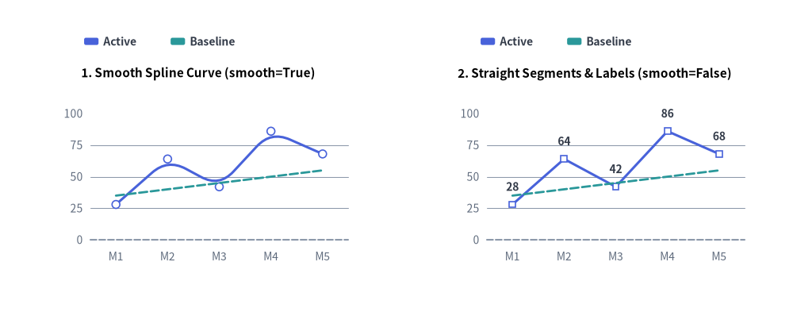
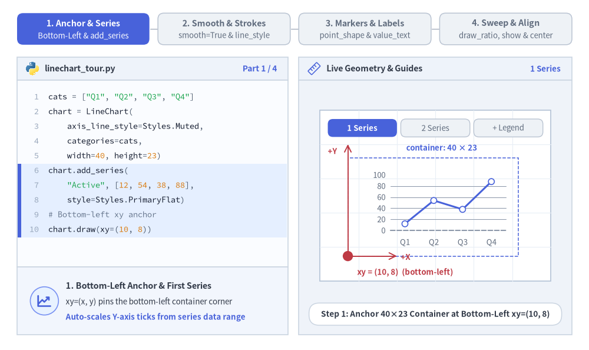
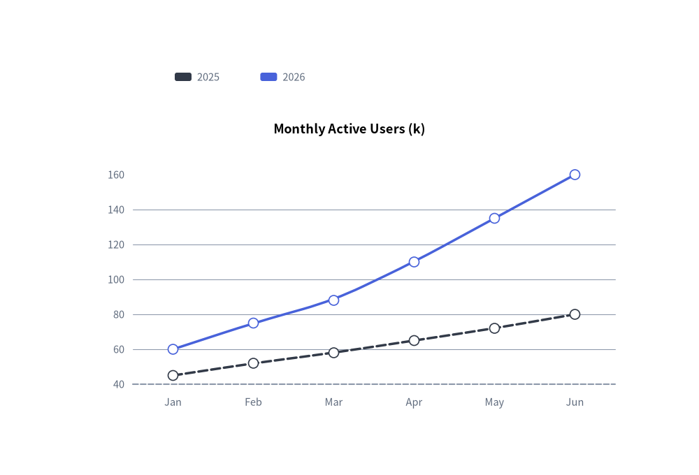
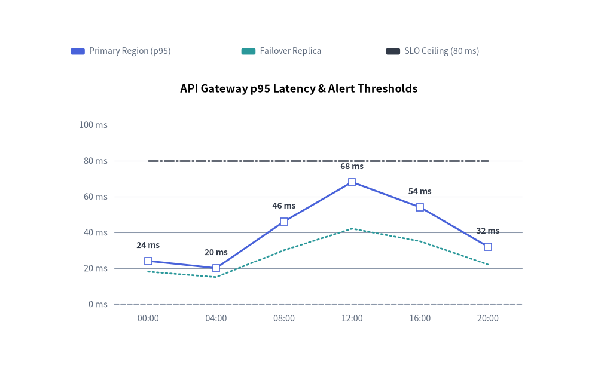

# LineChart: Continuous Trends, Markers & Splines

The `LineChart` component (`drawlib.charts.line`) visualizes numerical trends over ordered categories or time intervals. It supports straight polygonal segments (`smooth=False`), smoothed spline curves (`smooth=True`), per-series vertex marker shapes (`"circle"`, `"square"`, `"none"`), configurable stroke patterns (`"solid"`, `"dashed"`, `"dotted"`, `"dashdot"`), inline vertex value labels, and decoupled legend rendering.


<figure class="drawlib-image" style="text-align: center;">
  
  <figcaption class="drawlib-caption">LineChart Modes: Smooth Cubic Spline Interpolation (smooth=True) vs. Straight Polygonal Segments (smooth=False)</figcaption>
</figure>

<details class="drawlib-code-details">
<summary>Source Code</summary>

```python
from drawlib.canvas import save, setup
from drawlib.charts.line import LineChart
from drawlib.styles import Styles

setup(width=132, height=52)

categories = ["M1", "M2", "M3", "M4", "M5"]
active_vals = [28.0, 64.0, 42.0, 86.0, 68.0]
baseline_vals = [35.0, 40.0, 45.0, 50.0, 55.0]

# Left: Smooth Spline Curve (smooth=True)
smooth_chart = LineChart(
    axis_line_style=Styles.MutedDashed,
    categories=categories,
    axis_text_style=Styles.Muted.patch(text_size=10.0),
    grid_style=Styles.MutedThin,
    width=56.0,
    height=36.0,
    smooth=True,
    show_points=True,
    point_size=0.65,
    title="1. Smooth Spline Curve (smooth=True)",
    title_style=Styles.BlackBold.patch(text_size=11.0),
)
smooth_chart.add_series("Active", active_vals, style=Styles.PrimaryFlat, line_width=2.2)
smooth_chart.add_series("Baseline", baseline_vals, style=Styles.SecondaryFlat, line_style="dashed", point_shape="none")
smooth_chart.configure_y_axis(min_value=0.0, max_value=100.0, tick_step=25.0)
smooth_chart.draw(xy=(5.0, 6.0))
smooth_chart.draw_legend(xy=(14.0, 45.0), text_style=Styles.DarkBold.patch(text_size=10.0), orientation="horizontal")

# Right: Straight Segments & Value Labels (smooth=False)
straight_chart = LineChart(
    axis_line_style=Styles.MutedDashed,
    categories=categories,
    axis_text_style=Styles.Muted.patch(text_size=10.0),
    grid_style=Styles.MutedThin,
    value_text_style=Styles.DarkBold.patch(text_size=10.0),
    width=56.0,
    height=36.0,
    smooth=False,
    show_points=True,
    point_shape="square",
    point_size=0.65,
    title="2. Straight Segments & Labels (smooth=False)",
    title_style=Styles.BlackBold.patch(text_size=11.0),
)
straight_chart.add_series("Active", active_vals, style=Styles.PrimaryFlat, line_width=2.2)
straight_chart.add_series("Baseline", baseline_vals, style=Styles.SecondaryFlat, line_style="dashed", point_shape="none")
straight_chart.configure_y_axis(min_value=0.0, max_value=100.0, tick_step=25.0)
straight_chart.draw(xy=(71.0, 6.0))
straight_chart.draw_legend(xy=(80.0, 45.0), text_style=Styles.DarkBold.patch(text_size=10.0), orientation="horizontal")

save()
```

</details>


---

## 1. Core Concepts & Basic Usage

`LineChart` constructs multi-series categorical trends step-by-step via `.add_series(...)`, anchoring by default at the **Bottom-Left `(x, y)`** corner of its `(width, height)` container (or centered via `align="center"`). You can switch between straight polygonal segments (`smooth=False`) and cubic splines (`smooth=True`), customize stroke patterns, vertex markers, and inline value labels, and sweep or hide series in place while keeping Y-axis bounds locked:


<figure class="drawlib-image" style="text-align: center;">
  
  <figcaption class="drawlib-caption">Basic Usage & Parameter Tour: Anchor & Series, Smooth Splines & Strokes, Vertex Markers & Labels, and Sweep/Align Controls (APNG Animation)</figcaption>
</figure>

<details class="drawlib-code-details">
<summary>Source Code</summary>

```python
from __future__ import annotations

from drawlib.anim import Animation
from drawlib.canvas import save, setup
from drawlib.charts.line import LineChart
from drawlib.icons import code as code_icons
from drawlib.icons import phosphor
from drawlib.lines import line, lines
from drawlib.shapes import circle, rectangle
from drawlib.smartarts import SourceCode, SourceCodeStyles
from drawlib.styles import Styles
from drawlib.text import text

W, H = 138.0, 82.0
setup(width=W, height=H)
anim = Animation(fps=10.0, loop=0)

CODE_TEXT_SIZE = 10.0
PT_TO_CANVAS = W / 720.0
FONT_CANVAS = CODE_TEXT_SIZE * PT_TO_CANVAS
LINE_H = FONT_CANVAS * 1.8
PAD_Y = FONT_CANVAS * 1.2

CODE_STYLES = SourceCodeStyles.get("default", font_lang="en", text_size=CODE_TEXT_SIZE).patch(
    box_style=Styles.Neutral.patch(shape_fill_color=(0, 0, 0, 0), shape_line_width=0),
)

PANE_HEADER = Styles.Neutral.patch(
    shape_fill_color=(238, 243, 250),
    shape_line_color=(203, 213, 225),
    shape_line_width=1.2,
    shape_r=0.0,
)
EDITOR_BODY = Styles.Neutral.patch(
    shape_fill_color=(250, 252, 255),
    shape_line_color=(203, 213, 225),
    shape_line_width=1.2,
    shape_r=0.0,
)
TAKEAWAY_BODY = Styles.Neutral.patch(
    shape_fill_color=(242, 246, 253),
    shape_line_color=(203, 213, 225),
    shape_line_width=1.2,
    shape_r=0.0,
)
STUDIO_BODY = Styles.Neutral.patch(
    shape_fill_color=(239, 243, 249),
    shape_line_color=(203, 213, 225),
    shape_line_width=1.2,
    shape_r=0.0,
)

PART_ITEMS = [
    ("1. Anchor & Series", "Bottom-Left & add_series"),
    ("2. Smooth & Strokes", "smooth=True & line_style"),
    ("3. Markers & Labels", "point_shape & value_text"),
    ("4. Sweep & Align", "draw_ratio, show & center"),
]


def draw_step_bar(active_part: int) -> None:
    """Draw top 4-part progress bar (active_part is 1..4)."""
    pill_w = 31.0
    pill_h = 7.4
    gap = 2.0
    start_x = 4.0 + pill_w / 2.0
    cy = 75.2

    for idx, (label, sublabel) in enumerate(PART_ITEMS, start=1):
        cx = start_x + (idx - 1) * (pill_w + gap)
        if idx > 1:
            prev_cx = cx - (pill_w + gap)
            line(
                (prev_cx + pill_w / 2.0 + 0.2, cy),
                (cx - pill_w / 2.0 - 0.2, cy),
                style=Styles.PrimaryBold if idx <= active_part else Styles.MutedThin,
            )

        if idx == active_part:
            st = Styles.PrimaryFlat.patch(shape_r=1.4)
            tst = Styles.WhiteBold.patch(text_size=10.3)
            sub_tst = Styles.White.patch(text_size=9.5)
        elif idx < active_part:
            st = Styles.PrimaryNeutral.patch(shape_r=1.4, shape_line_width=1.1)
            tst = Styles.PrimaryBold.patch(text_size=10.3)
            sub_tst = Styles.Primary.patch(text_size=9.5)
        else:
            st = Styles.Neutral.patch(shape_r=1.4, shape_line_width=1.1)
            tst = Styles.MutedBold.patch(text_size=10.3)
            sub_tst = Styles.Muted.patch(text_size=9.5)

        rectangle((cx, cy), width=pill_w, height=pill_h, style=st)
        text((cx, cy + 1.35), label, style=tst)
        text((cx, cy - 1.55), sublabel, style=sub_tst)


def draw_left_pane(
    active_part: int,
    code_lines: list[str],
    hl_range: tuple[int, int],
    icon_fn: object,
    summary_title: str,
    summary_line1: str,
    summary_line2: str,
) -> None:
    """Draw left Python code editor + bottom concept takeaway card."""
    x0, w = 4.0, 63.5
    cx = x0 + w / 2.0
    top_y = 63.2
    header_h = 5.4
    editor_h = 43.8
    takeaway_h = 15.8

    rectangle((cx, top_y + header_h / 2.0), width=w, height=header_h, style=PANE_HEADER)
    code_icons.python((x0 + 3.6, top_y + header_h / 2.0), width=3.4, style=Styles.Neutral)
    text(
        (x0 + 6.5, top_y + header_h / 2.0),
        "linechart_tour.py",
        style=Styles.DarkBold.patch(text_size=10.2, halign="left"),
    )
    text(
        (x0 + w - 2.6, top_y + header_h / 2.0),
        f"Part {active_part} / 4",
        style=Styles.PrimaryBold.patch(text_size=9.8, halign="right"),
    )

    rectangle((cx, top_y - editor_h / 2.0), width=w, height=editor_h, style=EDITOR_BODY)

    hl_start, hl_end = hl_range
    hl_top = top_y - PAD_Y - hl_start * LINE_H
    hl_bot = top_y - PAD_Y - (hl_end + 1) * LINE_H
    hl_cy = (hl_top + hl_bot) / 2.0
    hl_h = hl_top - hl_bot
    rectangle(
        (cx, hl_cy),
        width=w - 0.6,
        height=hl_h,
        style=Styles.Neutral.patch(shape_fill_color=(229, 239, 255), shape_line_width=0),
    )
    rectangle(
        (x0 + 0.55, hl_cy),
        width=0.9,
        height=hl_h,
        style=Styles.PrimaryFlat.patch(shape_line_width=0),
    )

    SourceCode.draw(
        xy=(x0, top_y),
        width=w,
        code="\n".join(code_lines),
        styles=CODE_STYLES,
        code_lang="python",
        show_linenum=True,
        align="top_left",
    )

    take_cy = 3.6 + takeaway_h / 2.0
    rectangle((cx, take_cy), width=w, height=takeaway_h, style=TAKEAWAY_BODY)
    circle(
        (x0 + 6.4, take_cy),
        radius=3.3,
        style=Styles.PrimaryNeutral.patch(shape_line_width=1.2),
    )
    icon_fn((x0 + 6.4, take_cy), width=3.8, style=Styles.PrimaryBold)  # type: ignore[operator]
    text(
        (x0 + 11.4, take_cy + 3.6),
        summary_title,
        style=Styles.DarkBold.patch(text_size=10.4, halign="left"),
    )
    text(
        (x0 + 11.4, take_cy - 0.2),
        summary_line1,
        style=Styles.Dark.patch(text_size=9.7, halign="left"),
    )
    text(
        (x0 + 11.4, take_cy - 3.8),
        summary_line2,
        style=Styles.PrimaryBold.patch(text_size=9.6, halign="left"),
    )


def draw_geometry_studio(param_badge: str, footer_caption: str) -> tuple[float, float]:
    """Draw right geometry lab shell, inner coordinate sheet with subtle grid, and footer."""
    x0, w = 70.0, 64.0
    cx = x0 + w / 2.0
    top_y = 63.2
    header_h = 5.4
    body_h = 59.6

    rectangle((cx, top_y + header_h / 2.0), width=w, height=header_h, style=PANE_HEADER)
    phosphor.ruler((x0 + 3.6, top_y + header_h / 2.0), width=3.4, style=Styles.Primary)
    text(
        (x0 + 6.5, top_y + header_h / 2.0),
        "Live Geometry & Guides",
        style=Styles.DarkBold.patch(text_size=10.2, halign="left"),
    )
    text(
        (x0 + w - 2.6, top_y + header_h / 2.0),
        param_badge,
        style=Styles.PrimaryBold.patch(text_size=9.6, halign="right"),
    )

    rectangle((cx, 3.6 + body_h / 2.0), width=w, height=body_h, style=STUDIO_BODY)

    sheet_cx, sheet_cy = cx, 36.2
    sheet_w, sheet_h = 54.0, 40.0
    sx0, sy0 = sheet_cx - sheet_w / 2.0, sheet_cy - sheet_h / 2.0
    rectangle(
        (sheet_cx, sheet_cy),
        width=sheet_w,
        height=sheet_h,
        style=Styles.Neutral.patch(
            shape_fill_color=(255, 255, 255),
            shape_line_color=(180, 194, 214),
            shape_line_width=1.2,
        ),
    )
    g_st = Styles.MutedThin.patch(line_color=(232, 238, 246), line_width=0.8)
    for gx in range(1, 6):
        vx = sx0 + gx * (sheet_w / 6.0)
        line((vx, sy0), (vx, sy0 + sheet_h), style=g_st)
    for gy in range(1, 5):
        vy = sy0 + gy * (sheet_h / 5.0)
        line((sx0, vy), (sx0 + sheet_w, vy), style=g_st)

    rectangle(
        (cx, 8.4),
        width=59.2,
        height=5.2,
        style=Styles.Neutral.patch(
            shape_fill_color=(255, 255, 255),
            shape_line_color=(203, 213, 225),
            shape_line_width=1.1,
            shape_r=2.4,
        ),
        text=footer_caption,
        text_style=Styles.DarkBold.patch(text_size=9.8),
    )
    return sheet_cx, sheet_cy


def draw_sub_pills(scx: float, labels: list[str], active_idx: int) -> None:
    """Draw 3-step tracker pills near the top of the studio sheet."""
    pw, ph, pgap = 16.2, 4.2, 0.9
    p_start = scx - (3 * pw + 2 * pgap) / 2.0 + pw / 2.0
    for idx, lbl in enumerate(labels):
        px = p_start + idx * (pw + pgap)
        if idx == active_idx:
            pst = Styles.PrimaryFlat.patch(shape_r=1.2)
            ptst = Styles.WhiteBold.patch(text_size=9.5)
        elif idx < active_idx:
            pst = Styles.PrimaryNeutral.patch(shape_r=1.2, shape_line_width=1.0)
            ptst = Styles.PrimaryBold.patch(text_size=9.5)
        else:
            pst = Styles.Neutral.patch(shape_r=1.2, shape_line_width=1.0)
            ptst = Styles.Muted.patch(text_size=9.5)
        rectangle((px, 52.0), width=pw, height=ph, style=pst, text=lbl, text_style=ptst)


CATS = ["Q1", "Q2", "Q3", "Q4"]
AXIS_TXT = Styles.Muted.patch(text_size=9.5)

# =========================================================================
# Part 1: Anchor & Series — Bottom-Left xy, add_series & draw_legend
# =========================================================================
ANCHOR_STATES = [
    (
        1,
        3.3,
        [
            'cats = ["Q1", "Q2", "Q3", "Q4"]',
            "chart = LineChart(",
            "    axis_line_style=Styles.Muted,",
            "    categories=cats,",
            "    width=40, height=23)",
            "chart.add_series(",
            '    "Active", [12, 54, 38, 88],',
            "    style=Styles.PrimaryFlat)",
            "# Bottom-left xy anchor",
            "chart.draw(xy=(10, 8))",
        ],
        (5, 9),
        "1 Series",
        "Step 1: Anchor 40×23 Container at Bottom-Left xy=(10, 8)",
        "1. Bottom-Left Anchor & First Series",
        "xy=(x, y) pins the bottom-left container corner",
        "Auto-scales Y-axis ticks from series data range",
    ),
    (
        2,
        3.3,
        [
            'cats = ["Q1", "Q2", "Q3", "Q4"]',
            "chart = LineChart(",
            "    axis_line_style=Styles.Muted,",
            "    categories=cats,",
            "    width=40, height=23)",
            'chart.add_series("Active", ...)',
            "chart.add_series(",
            '    "Target", [22, 36, 56, 68],',
            "    style=Styles.SecondaryFlat)",
            "chart.draw(xy=(10, 8))",
        ],
        (6, 8),
        "2 Series",
        "Step 2: Register Multiple Trend Series on Shared Axes",
        "2. Multi-Series Trend Overlay (.add_series)",
        "Each .add_series() plots on the shared X/Y frame",
        "Y-axis bounds automatically cover all series",
    ),
    (
        3,
        3.5,
        [
            "chart = LineChart(",
            "    axis_line_style=Styles.Muted,",
            "    categories=cats,",
            "    width=40, height=23)",
            'chart.add_series("Active", ...)',
            'chart.add_series("Target", ...)',
            "chart.draw(xy=(10, 8))",
            "chart.draw_legend(",
            "    xy=(18, 33),",
            "    text_style=Styles.DarkBold,",
            '    orientation="horizontal")',
        ],
        (7, 10),
        "draw_legend()",
        "Step 3: Place Decoupled Legend Freely via draw_legend()",
        "3. Decoupled Legend Placement (draw_legend)",
        "Renders series color swatches at any canvas xy",
        'Supports "horizontal" or "vertical" orientation',
    ),
]

for a_idx, (step_n, dur, code_a, hl_rng, badge_txt, foot_txt, s_t, s_1, s_2) in enumerate(ANCHOR_STATES):
    with anim.frame(duration=dur):
        draw_step_bar(1)
        draw_left_pane(1, code_a, hl_rng, phosphor.chart_line_up, s_t, s_1, s_2)
        scx, _ = draw_geometry_studio(badge_txt, foot_txt)
        draw_sub_pills(scx, ["1 Series", "2 Series", "+ Legend"], a_idx)

        cx0, cy0, cw, ch = 81.5, 22.0, 40.0, 23.0
        chart = LineChart(
            axis_line_style=Styles.MutedDashed,
            categories=CATS,
            axis_text_style=AXIS_TXT,
            grid_style=Styles.MutedThin,
            width=cw,
            height=ch,
            point_size=0.7,
        )
        chart.add_series("Active", [12.0, 54.0, 38.0, 88.0], style=Styles.PrimaryFlat, line_width=2.2)
        if step_n >= 2:
            chart.add_series("Target", [22.0, 36.0, 56.0, 68.0], style=Styles.SecondaryFlat, line_width=2.0)
        chart.draw(xy=(cx0, cy0))

        # Dashed container bounding box
        rectangle(
            (cx0 + cw / 2.0, cy0 + ch / 2.0),
            width=cw,
            height=ch,
            style=Styles.PrimaryDashed.patch(shape_fill_color=(0, 0, 0, 0), shape_line_width=1.1),
        )

        if step_n < 3:
            text(
                (cx0 + cw / 2.0 + 2.0, cy0 + ch + 2.4),
                "container: 40 × 23",
                style=Styles.PrimaryBold.patch(text_size=9.5),
            )
        else:
            chart.draw_legend(
                xy=(91.5, 46.6),
                text_style=Styles.DarkBold.patch(text_size=9.5),
                orientation="horizontal",
                item_gap=4.2,
            )

        # Bottom-Left xy anchor dot + +X / +Y Cartesian axes
        line(
            (cx0, cy0),
            (cx0, cy0 + ch + 3.2),
            arrow_head="->",
            style=Styles.DangerBold.patch(line_width=1.4),
        )
        text(
            (cx0 - 3.6, cy0 + ch + 1.6),
            "+Y",
            style=Styles.DangerBold.patch(text_size=9.5),
        )
        line(
            (cx0, cy0),
            (cx0 + 11.5, cy0),
            arrow_head="->",
            style=Styles.DangerBold.patch(line_width=1.4),
        )
        text(
            (cx0 + 12.4, cy0 - 0.2),
            "+X",
            style=Styles.DangerBold.patch(text_size=9.5, halign="left"),
        )
        circle((cx0, cy0), radius=1.2, style=Styles.DangerFlat)
        text(
            (cx0 + 2.2, 18.2),
            "xy = (10, 8)  (bottom-left)",
            style=Styles.DangerBold.patch(text_size=9.5, halign="left"),
        )

# =========================================================================
# Part 2: Smooth & Strokes — smooth=False vs True & line_style
# =========================================================================
SMOOTH_STATES = [
    (
        "straight",
        3.3,
        [
            "chart = LineChart(",
            "    axis_line_style=Styles.Muted,",
            "    categories=cats,",
            "    width=40, height=23,",
            "    smooth=False,",
            "    show_points=True)",
            "chart.add_series(",
            '    "Active", [12, 66, 30, 88],',
            "    style=Styles.PrimaryFlat)",
            'chart.add_series("Target", ...)',
            "chart.draw(xy=(10, 8))",
        ],
        (4, 5),
        "smooth=False",
        "smooth=False (Default): Crisp Polygonal Line Segments",
        "Straight Segments (smooth=False)",
        "Connects category vertices with direct straight lines",
        "Ideal for discrete intervals & exact slope changes",
    ),
    (
        "spline",
        3.3,
        [
            "chart = LineChart(",
            "    axis_line_style=Styles.Muted,",
            "    categories=cats,",
            "    width=40, height=23,",
            "    smooth=True,",
            "    show_points=True)",
            "chart.add_series(",
            '    "Active", [12, 66, 30, 88],',
            "    style=Styles.PrimaryFlat)",
            'chart.add_series("Target", ...)',
            "chart.draw(xy=(10, 8))",
        ],
        (4, 4),
        "smooth=True",
        "smooth=True: Rounded Spline Curves Across 3+ Vertices",
        "Smooth Curves (smooth=True)",
        "Interpolates rounded curved transitions at vertices",
        "Great for organic growth & continuous telemetry",
    ),
    (
        "strokes",
        3.5,
        [
            "chart = LineChart(",
            "    ..., smooth=True)",
            'chart.add_series("Active", vals,',
            "    style=Styles.PrimaryFlat,",
            "    line_width=2.6)",
            'chart.add_series("Target", t_v,',
            "    style=Styles.SecondaryFlat,",
            '    line_style="dashed")',
            'chart.add_series("SLO", [85]*4,',
            "    style=Styles.DarkFlat,",
            '    line_style="dotted")',
        ],
        (4, 10),
        "line_style",
        'Per-Series Stroke Patterns: "solid", "dashed" & "dotted"',
        "Stroke Styles (line_style & line_width)",
        'Supports "solid", "dashed", "dotted" & "dashdot"',
        "Distinguishes primary metrics from SLA ceilings",
    ),
]

for sm_idx, (sm_mode, dur, code_sm, hl_rng, badge_txt, foot_txt, s_t, s_1, s_2) in enumerate(SMOOTH_STATES):
    with anim.frame(duration=dur):
        draw_step_bar(2)
        draw_left_pane(2, code_sm, hl_rng, phosphor.bezier_curve, s_t, s_1, s_2)
        scx, _ = draw_geometry_studio(badge_txt, foot_txt)
        draw_sub_pills(scx, ["smooth=False", "smooth=True", "Stroke Styles"], sm_idx)

        cx0, cy0, cw, ch = 81.5, 21.6, 40.0, 23.0
        is_smooth = sm_mode in ("spline", "strokes")
        chart = LineChart(
            axis_line_style=Styles.MutedDashed,
            categories=CATS,
            axis_text_style=AXIS_TXT,
            grid_style=Styles.MutedThin,
            width=cw,
            height=ch,
            smooth=is_smooth,
            show_points=True,
            point_size=0.68,
        )
        chart.add_series(
            "Active",
            [12.0, 66.0, 30.0, 88.0],
            style=Styles.PrimaryFlat,
            line_width=2.6 if sm_mode == "strokes" else 2.2,
        )
        chart.add_series(
            "Target",
            [18.0, 34.0, 52.0, 62.0],
            style=Styles.SecondaryFlat,
            line_width=2.0,
            line_style="dashed" if sm_mode == "strokes" else "solid",
        )
        if sm_mode == "strokes":
            chart.add_series(
                "SLO",
                [85.0, 85.0, 85.0, 85.0],
                style=Styles.DarkFlat,
                line_width=1.8,
                line_style="dotted",
                point_shape="none",
            )
        chart.draw(xy=(cx0, cy0))
        chart.draw_legend(
            xy=(88.0 if sm_mode == "strokes" else 91.5, 46.5),
            text_style=Styles.DarkBold.patch(text_size=9.5),
            orientation="horizontal",
            item_gap=3.4 if sm_mode == "strokes" else 4.2,
        )

        if sm_mode == "straight":
            text(
                (scx, 18.2),
                "sharp polygonal corners at Q2 & Q3",
                style=Styles.DarkBold.patch(text_size=9.5),
            )
        elif sm_mode == "spline":
            text(
                (scx, 18.2),
                "rounded spline arcs through Q2 & Q3",
                style=Styles.PrimaryBold.patch(text_size=9.5),
            )
        else:
            text(
                (scx, 18.2),
                'line_style: "solid" + "dashed" + "dotted"',
                style=Styles.PrimaryBold.patch(text_size=9.5),
            )

# =========================================================================
# Part 3: Markers & Labels — show_points, point_shape & value_text_style
# =========================================================================
MARKER_STATES = [
    (
        "no_pts",
        3.3,
        [
            "chart = LineChart(",
            "    axis_line_style=Styles.Muted,",
            "    categories=cats,",
            "    width=40, height=23,",
            "    smooth=False,",
            "    show_points=False)",
            "chart.add_series(",
            '    "Active", [10, 60, 38, 86],',
            "    style=Styles.PrimaryFlat)",
            'chart.add_series("Target", ...)',
            "chart.draw(xy=(10, 8))",
        ],
        (5, 5),
        "show_points=False",
        "show_points=False: Clean Unadorned Trend Polylines",
        "Markerless Polylines (show_points=False)",
        "Suppresses vertex symbols across all series",
        "Best for dense multi-series or high-frequency data",
    ),
    (
        "shapes",
        3.3,
        [
            "chart = LineChart(",
            "    ..., show_points=True,",
            '    point_shape="circle",',
            "    point_size=0.9)",
            "chart.add_series(",
            '    "Active", [10, 60, 38, 86],',
            "    style=Styles.PrimaryFlat)",
            "chart.add_series(",
            '    "Target", [20, 34, 50, 62],',
            "    style=Styles.SecondaryFlat,",
            '    point_shape="square")',
        ],
        (1, 3),
        "point_shape",
        'Marker Shapes: "circle" vs. "square" (size=0.9)',
        "Custom Vertex Markers (point_shape)",
        'Choose "circle", "square", or "none" per series',
        "White-filled markers keep overlapping lines crisp",
    ),
    (
        "labels",
        3.5,
        [
            "chart = LineChart(",
            "    ..., show_points=True,",
            '    point_shape="square",',
            "    point_size=0.9,",
            "    value_text_style=(",
            "        Styles.DarkBold))",
            'chart.add_series("Active", vals,',
            "    style=Styles.PrimaryFlat)",
            'chart.add_series("Target", t_v,',
            "    style=Styles.SecondaryFlat,",
            '    point_shape="none")',
        ],
        (4, 5),
        "value_text_style",
        'value_text_style + point_shape="none" on Target',
        "Inline Vertex Value Labels (value_text_style)",
        "Prints y_axis-formatted numbers above each marker",
        'point_shape="none" suppresses labels on Target',
    ),
]

for mk_idx, (mk_mode, dur, code_mk, hl_rng, badge_txt, foot_txt, s_t, s_1, s_2) in enumerate(MARKER_STATES):
    with anim.frame(duration=dur):
        draw_step_bar(3)
        draw_left_pane(3, code_mk, hl_rng, phosphor.tag, s_t, s_1, s_2)
        scx, _ = draw_geometry_studio(badge_txt, foot_txt)
        draw_sub_pills(scx, ["No Markers", "circle / square", "value_text"], mk_idx)

        cx0, cy0, cw, ch = 81.5, 21.6, 40.0, 23.0
        chart = LineChart(
            axis_line_style=Styles.MutedDashed,
            categories=CATS,
            axis_text_style=AXIS_TXT,
            grid_style=Styles.MutedThin,
            value_text_style=Styles.DarkBold.patch(text_size=9.5) if mk_mode == "labels" else None,
            width=cw,
            height=ch,
            smooth=False,
            show_points=(mk_mode != "no_pts"),
            point_shape="square" if mk_mode == "labels" else "circle",
            point_size=0.9,
        )
        chart.add_series("Active", [10.0, 60.0, 38.0, 86.0], style=Styles.PrimaryFlat, line_width=2.2)
        chart.add_series(
            "Target",
            [20.0, 34.0, 50.0, 62.0],
            style=Styles.SecondaryFlat,
            line_width=2.0,
            line_style="dashed" if mk_mode == "labels" else "solid",
            point_shape="square" if mk_mode == "shapes" else ("none" if mk_mode == "labels" else None),
        )
        chart.draw(xy=(cx0, cy0))
        chart.draw_legend(
            xy=(91.5, 46.6),
            text_style=Styles.DarkBold.patch(text_size=9.5),
            orientation="horizontal",
            item_gap=4.2,
        )

        if mk_mode == "no_pts":
            text((scx, 18.2), "show_points = False  (strokes only)", style=Styles.DarkBold.patch(text_size=9.5))
        elif mk_mode == "shapes":
            text(
                (scx, 18.2),
                'Active: "circle"  •  Target: "square"',
                style=Styles.PrimaryBold.patch(text_size=9.5),
            )
        else:
            text(
                (scx, 18.2),
                'numeric labels on Active (Target: "none")',
                style=Styles.PrimaryBold.patch(text_size=9.5),
            )

# =========================================================================
# Part 4: Sweep & Align — draw_ratio, s2.show=False & align="center"
# =========================================================================
SWEEP_STATES = [
    (
        "sweep",
        3.3,
        [
            "chart = LineChart(..., width=40,",
            "                  height=23)",
            "s1 = chart.add_series(",
            '    "Active", [15, 52, 38, 72],',
            "    style=Styles.PrimaryFlat,",
            "    draw_ratio=0.6)",
            "s2 = chart.add_series(",
            '    "Peak", [40, 120, 95, 168],',
            "    style=Styles.SecondaryFlat,",
            "    draw_ratio=0.6)",
            "chart.draw(xy=(10, 8))",
        ],
        (5, 9),
        "draw_ratio = 0.6",
        "draw_ratio=0.6: Progressive Left-to-Right Sweep",
        "Progressive Sweep (draw_ratio=0.6)",
        "Clips polylines & markers at 60% horizontal span",
        "Animate smooth timeline reveals from 0.0 to 1.0",
    ),
    (
        "hide_s2",
        3.4,
        [
            "chart = LineChart(..., width=40,",
            "                  height=23)",
            "s1 = chart.add_series(",
            '    "Active", [15, 52, 38, 72],',
            "    style=Styles.PrimaryFlat)",
            "s2 = chart.add_series(",
            '    "Peak", [40, 120, 95, 168],',
            "    style=Styles.SecondaryFlat)",
            "# Hide s2; Y-axis stays at 200!",
            "s2.show = False",
            "chart.draw(xy=(10, 8))",
        ],
        (8, 9),
        "s2.show = False",
        "s2.show = False: Hides Peak & Locks Y-Axis at 200",
        "Fixed-Scale Visibility (.show = False)",
        "Hides Peak (max 168) without rescaling Y-axis",
        "Prevents jarring axis jumps between slide frames",
    ),
    (
        "center",
        3.5,
        [
            "chart = LineChart(",
            "    axis_line_style=Styles.Muted,",
            "    categories=cats,",
            "    width=40, height=23)",
            'chart.add_series("Active", ...)',
            'chart.add_series("Peak", ...)',
            "",
            "# Center chart box on (cx, cy)",
            "chart.draw(",
            "    xy=(27, 20),",
            '    align="center")',
        ],
        (7, 10),
        'align = "center"',
        'align="center": Centers 40×23 Chart Box on xy=(cx, cy)',
        'Centered Anchor (align="center")',
        "Centers total (width, height) container on xy",
        "Matches centered layout anchors across SmartArts",
    ),
]

for sw_idx, (sw_mode, dur, code_sw, hl_rng, badge_txt, foot_txt, s_t, s_1, s_2) in enumerate(SWEEP_STATES):
    with anim.frame(duration=dur):
        draw_step_bar(4)
        draw_left_pane(4, code_sw, hl_rng, phosphor.sliders_horizontal, s_t, s_1, s_2)
        scx, _ = draw_geometry_studio(badge_txt, foot_txt)
        draw_sub_pills(scx, ["draw_ratio=0.6", "s2.show = False", 'align="center"'], sw_idx)

        cw, ch = 40.0, 23.0
        chart = LineChart(
            axis_line_style=Styles.MutedDashed,
            categories=CATS,
            axis_text_style=AXIS_TXT,
            grid_style=Styles.MutedThin,
            width=cw,
            height=ch,
            point_size=0.7,
        )
        dr = 0.6 if sw_mode == "sweep" else 1.0
        chart.add_series("Active", [15.0, 52.0, 38.0, 72.0], style=Styles.PrimaryFlat, line_width=2.2, draw_ratio=dr)
        s2 = chart.add_series(
            "Peak",
            [40.0, 120.0, 95.0, 168.0],
            style=Styles.SecondaryFlat,
            line_width=2.0,
            draw_ratio=dr,
        )
        if sw_mode == "hide_s2":
            s2.show = False

        if sw_mode == "center":
            cx_a, cy_a = scx, 33.8
            chart.draw(xy=(cx_a, cy_a), align="center")
            rectangle(
                (cx_a, cy_a),
                width=cw,
                height=ch,
                style=Styles.PrimaryDashed.patch(shape_fill_color=(0, 0, 0, 0), shape_line_width=1.2),
            )
            # Red center crosshair extending outside 40x23 box
            line((cx_a - 22.8, cy_a), (cx_a - 20.0, cy_a), style=Styles.DangerBold.patch(line_width=1.5))
            line((cx_a + 20.0, cy_a), (cx_a + 22.8, cy_a), style=Styles.DangerBold.patch(line_width=1.5))
            line((cx_a, cy_a + 11.5), (cx_a, cy_a + 14.3), style=Styles.DangerBold.patch(line_width=1.5))
            line((cx_a, cy_a - 14.0), (cx_a, cy_a - 11.5), style=Styles.DangerBold.patch(line_width=1.5))
            circle(
                (cx_a, cy_a),
                radius=1.55,
                style=Styles.Neutral.patch(shape_fill_color=(255, 255, 255), shape_line_width=0),
            )
            circle((cx_a, cy_a), radius=1.1, style=Styles.DangerFlat)
            text(
                (cx_a, 18.0),
                'xy = (27, 20)  •  align="center"',
                style=Styles.DangerBold.patch(text_size=9.5),
            )
        else:
            cx0, cy0 = 81.5, 21.6
            chart.draw(xy=(cx0, cy0))
            p_min_x = cx0 + 10.0
            p_min_y = cy0 + 6.0
            plot_w = cw - 13.0
            plot_h = ch - 10.0
            slot_w = plot_w / 4.0

            if sw_mode == "sweep":
                # Exact 60% sweep frontier (pos = 0.6 * 3 = 1.8)
                fx = p_min_x + (0.5 + 1.8) * slot_w
                line(
                    (fx, p_min_y - 0.6),
                    (fx, p_min_y + plot_h + 1.8),
                    style=Styles.DangerBold.patch(line_width=1.3, line_style="dashed"),
                )
                text(
                    (fx, p_min_y + plot_h + 3.2),
                    "draw_ratio = 0.6",
                    style=Styles.DangerBold.patch(text_size=9.5),
                )
                text(
                    (scx, 18.2),
                    "60% horizontal reveal along X categories",
                    style=Styles.PrimaryBold.patch(text_size=9.5),
                )
            else:
                # Ghost dashed polyline where hidden s2 ("Peak") was
                ghost_pts = [
                    (p_min_x + (i + 0.5) * slot_w, p_min_y + (v / 200.0) * plot_h)
                    for i, v in enumerate([40.0, 120.0, 95.0, 168.0])
                ]
                lines(xys=ghost_pts, style=Styles.MutedDashed.patch(line_width=1.2))
                text(
                    (cx0 + cw / 2.0 + 3.0, 46.2),
                    "Y-axis stays fixed at 200!",
                    style=Styles.PrimaryBold.patch(text_size=9.5),
                )
                text(
                    (scx, 18.2),
                    "s2 hidden, yet Y-axis scale stays locked",
                    style=Styles.DarkBold.patch(text_size=9.5),
                )

save()
```

</details>


- **Bottom-Left Anchor, Series & Legend (`xy`, `add_series`, `draw_legend`)**: Anchors the `(width, height)` chart container at bottom-left `xy` by default (`align="bottom_left"`) and pairs `.add_series(...)` trend lines with a freely positioned `draw_legend(...)`.
- **Straight Segments vs. Smooth Splines & Strokes (`smooth`, `line_style`, `line_width`)**: Switch between crisp polygonal segments (`smooth=False`) and rounded cubic splines (`smooth=True`, for 3+ points), with per-series `"solid"`, `"dashed"`, `"dotted"`, or `"dashdot"` stroke patterns.
- **Vertex Markers & Inline Value Labels (`show_points`, `point_shape`, `value_text_style`)**: Configure `"circle"`, `"square"`, or `"none"` markers (`point_size`) per series (`point_shape="none"` suppresses both vertex markers and `value_text_style` numbers on flat target lines).
- **Horizontal Sweep, Fixed-Scale `.show`, & Center Align (`draw_ratio`, `align`)**: Animate progressive left-to-right reveals via `draw_ratio`, set `series.show = False` without rescaling Y-axis auto-bounds, or center the chart box on `(cx, cy)` via `align="center"`.

---

## 2. Quick Example: Smooth Spline User Growth Trends


```python
from drawlib.canvas import save, setup
from drawlib.charts.line import LineChart
from drawlib.styles import Styles

setup(width=100, height=68)

chart = LineChart(
    axis_line_style=Styles.MutedDashed,
    categories=["Jan", "Feb", "Mar", "Apr", "May", "Jun"],
    axis_text_style=Styles.Muted.patch(text_size=10.5),
    grid_style=Styles.MutedThin,
    width=82,
    height=45,
    title="Monthly Active Users (k)",
    title_style=Styles.BlackBold.patch(text_size=13.0),
    smooth=True,
    show_points=True,
)
chart.add_series("2025", [45, 52, 58, 65, 72, 80], style=Styles.DarkFlat, line_width=2.5, line_style="dashed")
chart.add_series("2026", [60, 75, 88, 110, 135, 160], style=Styles.PrimaryFlat, line_width=2.5)

chart.draw(xy=(9, 7))
chart.draw_legend(xy=(25, 57), text_style=Styles.Muted.patch(text_size=10.5), orientation="horizontal")
save()
```

<figure class="drawlib-image" style="text-align: center;">
  
  <figcaption class="drawlib-caption">User Growth Trends with LineChart</figcaption>
</figure>


---

## 3. Straight Segments, Custom Markers, Stroke Styles & Vertex Labels

By combining `smooth=False` (straight segments) with `value_text_style`, per-series `point_shape` (`"square"`, `"circle"`, `"none"`), and distinct `line_style` patterns (`"solid"`, `"dotted"`, `"dashdot"`), you can plot telemetry metrics alongside SLA thresholds:


```python
from drawlib.canvas import save, setup
from drawlib.charts.line import LineChart
from drawlib.styles import Styles

setup(width=110, height=70)

chart = LineChart(
    axis_line_style=Styles.MutedDashed,
    categories=["00:00", "04:00", "08:00", "12:00", "16:00", "20:00"],
    width=88.0,
    height=48.0,
    title="API Gateway p95 Latency & Alert Thresholds",
    title_style=Styles.BlackBold.patch(text_size=13.0),
    smooth=False,
    show_points=True,
    axis_text_style=Styles.Muted.patch(text_size=10.5),
    grid_style=Styles.MutedThin,
    value_text_style=Styles.DarkBold.patch(text_size=10.0),
)
chart.add_series(
    "Primary Region (p95)",
    [24.0, 20.0, 46.0, 68.0, 54.0, 32.0],
    style=Styles.PrimaryFlat,
    line_width=2.2,
    point_shape="square",
    point_size=0.8,
)
chart.add_series(
    "Failover Replica",
    [18.0, 15.0, 30.0, 42.0, 35.0, 22.0],
    style=Styles.SecondaryFlat,
    line_width=2.0,
    line_style="dotted",
    point_shape="none",
)
chart.add_series(
    "SLO Ceiling (80 ms)",
    [80.0, 80.0, 80.0, 80.0, 80.0, 80.0],
    style=Styles.DarkFlat,
    line_width=1.8,
    line_style="dashdot",
    point_shape="none",
)

chart.configure_y_axis(min_value=0.0, max_value=100.0, tick_step=20.0, format="{:.0f}", unit="ms")
chart.draw(xy=(11.0, 8.0))
chart.draw_legend(
    xy=(13.0, 60.5),
    text_style=Styles.Muted.patch(text_size=10.0),
    orientation="horizontal",
    swatch_width=2.6,
    swatch_height=1.2,
    item_gap=4.0,
)
save()
```

<figure class="drawlib-image" style="text-align: center;">
  
  <figcaption class="drawlib-caption">Straight Line Segments with Square Vertex Markers, Value Labels, and Dashdot/Dotted Thresholds</figcaption>
</figure>


---

## 4. API Reference

### Constructor (`LineChart`)

All constructor arguments are **keyword-only** (`*`):

```python
from drawlib.charts.line import Axis, DrawDirection, FormatterType, LineChart, LineStyle, PointShape, Series

chart = LineChart(
    *,
    axis_line_style: Style,
    categories: list[str],
    width: float = 80.0,
    height: float = 50.0,
    show_points: bool = True,
    point_shape: PointShape = "circle",
    point_size: float = 0.7,
    smooth: bool = False,
    axis_text_style: Style | None = None,
    grid_style: Style | None = None,
    value_text_style: Style | None = None,
    background_style: Style | None = None,
    title: str = "",
    title_style: Style | None = None,
)
```

| Parameter | Type | Default | Description |
| :--- | :--- | :--- | :--- |
| **`axis_line_style`** | `Style` | **Required** | Mandatory style anchor for the coordinate baseline stroke. |
| **`categories`** | `list[str]` | **Required** | Ordered category labels along the horizontal X-axis. |
| `width` / `height` | `float` | `80.0` / `50.0` | Total bounding box dimensions of the chart in canvas units. |
| `show_points` | `bool` | `True` | Whether to render markers at vertex coordinates. |
| `point_shape` | `"circle"` \| `"square"` \| `"none"` | `"circle"` | Default vertex marker shape (`PointShape`). |
| `point_size` | `float` | `0.7` | Default marker radius (or half-width for squares) in canvas units. |
| `smooth` | `bool` | `False` | When `True`, interpolates smooth curved segments through vertices. |
| `axis_text_style` | `Style \| None` | `None` | Style for Y-axis tick labels and X-axis category names. If `None`, labels are omitted. |
| `grid_style` | `Style \| None` | `None` | Style for horizontal Y-axis gridlines. If `None`, gridlines are omitted. |
| `value_text_style` | `Style \| None` | `None` | Style for numeric labels drawn above vertex markers. If `None`, value labels are omitted. |
| `background_style` | `Style \| None` | `None` | Style for the outer chart background card. If `None`, card is omitted. |
| `title` | `str` | `""` | Chart title text rendered at the top of the container. |
| `title_style` | `Style \| None` | `None` | Typography style for `title`. Required for the title to render. |

### Methods & Properties

- **`add_series(name: str, values: list[float], style: Style, line_width: float = 2.0, line_style: LineStyle = "solid", point_shape: PointShape | None = None, point_size: float | None = None, legend_text_style: Style | None = None, *, show: bool = True, draw_ratio: float = 1.0, draw_direction: DrawDirection = "left_to_right") -> Series`**:
  Registers a line series and returns the mutable `Series` instance. `line_style` accepts `"solid"`, `"dashed"`, `"dotted"`, or `"dashdot"`. `point_shape` and `point_size` override chart-level defaults for that series.
- **`configure_y_axis(...) -> Axis`** / **`configure_x_axis(...) -> Axis`**:
  Configures the vertical value axis (`scale`, `min_value`, `max_value`, `ticks`, `tick_step`, `format`, `unit`, `label`) or horizontal category axis (`show_axis_line`, `line_style`, `tick_label_style`). See **[Axes, Scales & Legends](./axes_and_legends.md)**.
- **`get_size() -> tuple[float, float]`**:
  Returns `(width, height)` of the chart container.
- **`draw(xy: tuple[float, float] = (0.0, 0.0), *, width: float | None = None, height: float | None = None, align: Literal["bottom_left", "center"] = "bottom_left", scale: float = 1.0) -> None`**:
  Renders the chart anchored at `xy` (`"bottom_left"` by default or `"center"`), with optional temporary size overrides and proportional `scale`.
- **`draw_legend(xy: tuple[float, float], text_style: Style, orientation: Literal["vertical", "horizontal"] = "vertical", swatch_width: float = 2.4, swatch_height: float = 1.2, item_gap: float = 4.0, *, scale: float = 1.0) -> None`**:
  Renders the decoupled series legend at `xy`.
- **Properties**:
  - **`chart.series -> list[Series]`**: Returns a copy of registered `Series` objects.
  - **`chart.x_axis -> Axis`** / **`chart.y_axis -> Axis`**: Direct access to the horizontal and vertical `Axis` instances.

