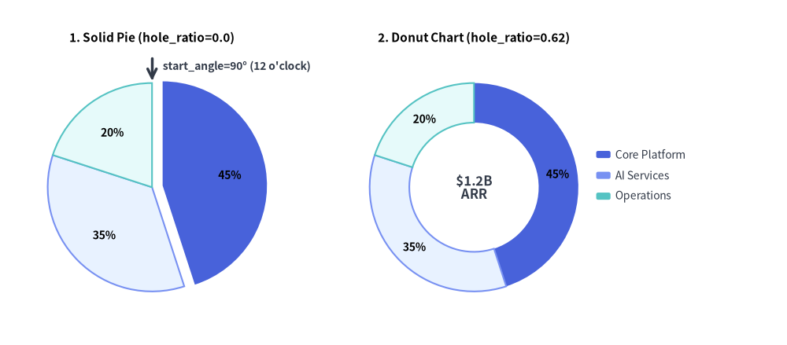
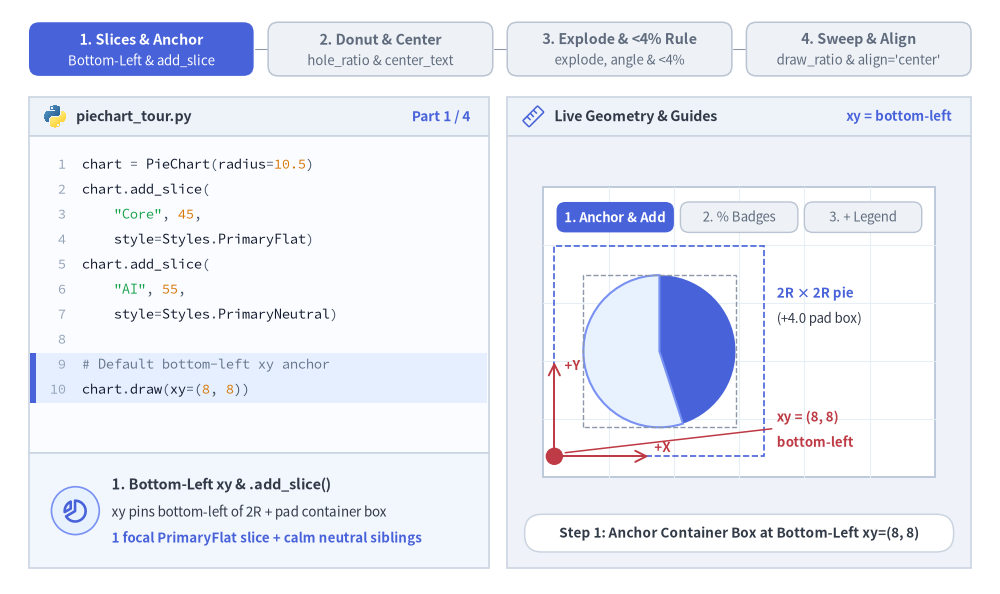
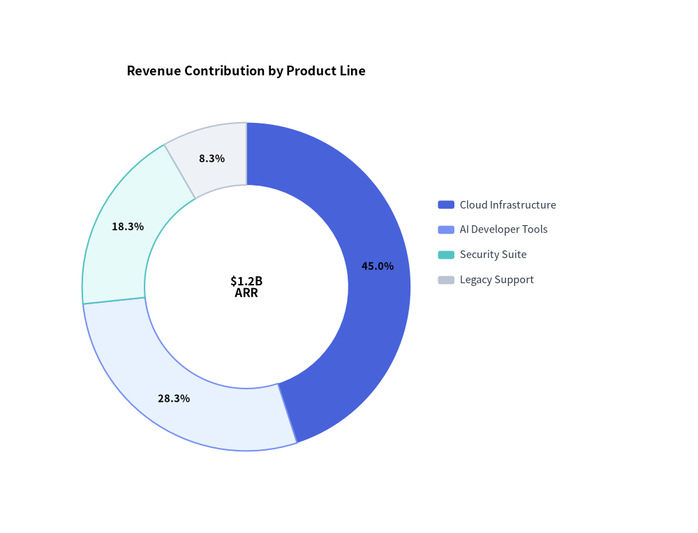
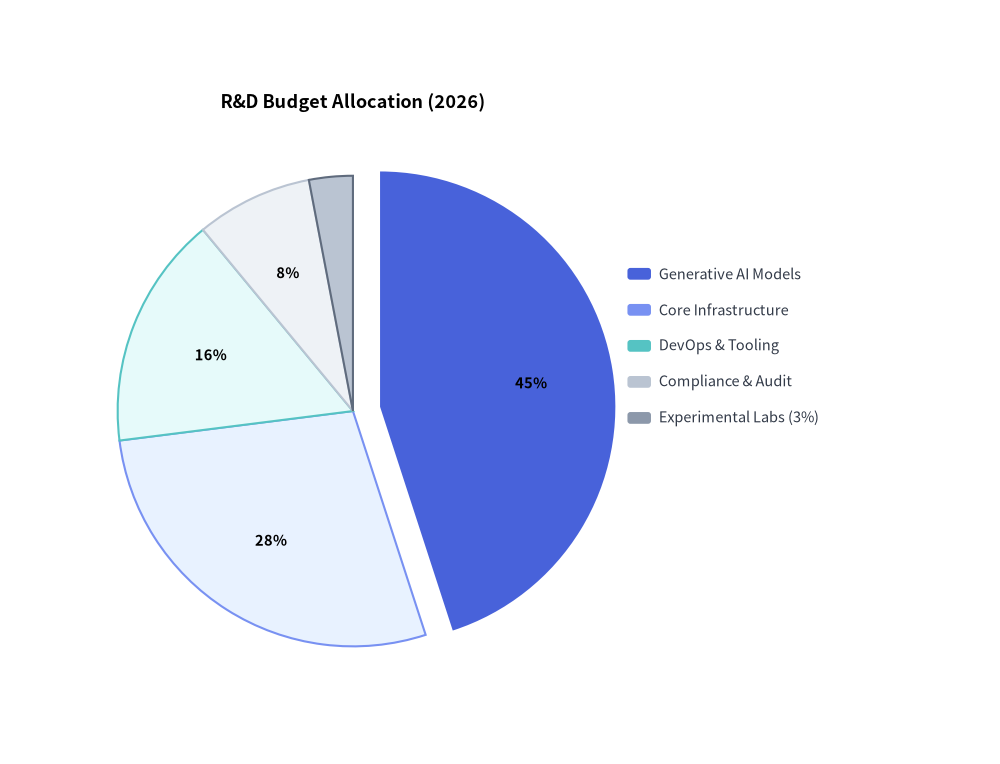

# PieChart: Proportional Compositions & Donut Badges

`PieChart` (`drawlib.charts.pie`) visualizes proportional compositions where slices represent parts of a whole (100%). It supports classic solid pie charts, modern donut rings with center KPI badges, outward slice explosion, custom angular orientations, and decoupled legend rendering.


<figure class="drawlib-image" style="text-align: center;">
  
  <figcaption class="drawlib-caption">Standard Solid Pie Chart vs. Donut Chart with Center KPI</figcaption>
</figure>

<details class="drawlib-code-details">
<summary>Source Code</summary>

```python
from drawlib.canvas import save, setup
from drawlib.charts.pie import PieChart
from drawlib.lines import line
from drawlib.styles import Styles
from drawlib.text import text

setup(width=132, height=58)

# Left: Solid Pie Chart (hole_ratio=0.0) with Exploded Slice
solid_pie = PieChart(
    radius=17.5,
    hole_ratio=0.0,
    start_angle=90.0,
    title="1. Solid Pie (hole_ratio=0.0)",
    title_style=Styles.BlackBold.patch(text_size=11.0),
    value_text_style=Styles.BlackBold.patch(text_size=10.0),
    value_format="{:.0f}%",
)
solid_pie.add_slice("Core Platform", 45.0, style=Styles.PrimaryFlat, explode=1.8)
solid_pie.add_slice("AI Services", 35.0, style=Styles.PrimaryNeutral)
solid_pie.add_slice("Operations", 20.0, style=Styles.SecondaryNeutral)
solid_pie.draw(xy=(4.0, 5.0))

# Callout for start_angle=90° (12 o'clock)
pie_w, pie_h = solid_pie.get_size()
pie_cx = 4.0 + pie_w / 2.0
pie_top_y = 5.0 + (pie_h - 6.0) / 2.0 + 17.5
line((pie_cx, pie_top_y + 4.2), (pie_cx, pie_top_y + 0.4), arrow_head="->", style=Styles.DarkBold)
text(
    (pie_cx + 1.8, pie_top_y + 2.8),
    "start_angle=90° (12 o'clock)",
    style=Styles.DarkBold.patch(text_size=10.0, halign="left"),
)

# Right: Donut Chart (hole_ratio=0.62) with Center KPI
donut_pie = PieChart(
    radius=17.5,
    hole_ratio=0.62,
    center_text="$1.2B\nARR",
    center_text_style=Styles.DarkBold.patch(text_size=12.0),
    title="2. Donut Chart (hole_ratio=0.62)",
    title_style=Styles.BlackBold.patch(text_size=11.0),
    value_text_style=Styles.BlackBold.patch(text_size=10.0),
    value_format="{:.0f}%",
)
donut_pie.add_slice("Core Platform", 45.0, style=Styles.PrimaryFlat)
donut_pie.add_slice("AI Services", 35.0, style=Styles.PrimaryNeutral)
donut_pie.add_slice("Operations", 20.0, style=Styles.SecondaryNeutral)
donut_pie.draw(xy=(58.0, 5.0))
donut_pie.draw_legend(xy=(100.0, 32.0), text_style=Styles.Dark.patch(text_size=10.0))

save()
```

</details>


---

## 1. Core Concepts & Basic Usage

`PieChart` builds proportional sector compositions via `.add_slice(...)`, anchoring by default at the **Bottom-Left `(x, y)`** corner of its container box (or directly on the pie center when `align="center"`). You can morph solid pies into hollow donut rings (`hole_ratio`, `center_text`), radially offset focal wedges (`explode`) while automatically suppressing cramped `< 4%` inline labels, and animate angular sweeps (`draw_ratio`) or slot-preserving visibility (`show=False`):


<figure class="drawlib-image" style="text-align: center;">
  
  <figcaption class="drawlib-caption">Basic Usage & Parameter Tour: Slices & Anchor, Donut Center KPI, Explode & <4% Rule, and Sweep & Align (APNG Animation)</figcaption>
</figure>

<details class="drawlib-code-details">
<summary>Source Code</summary>

```python
from __future__ import annotations

import math
from drawlib.anim import Animation
from drawlib.canvas import save, setup
from drawlib.charts.pie import PieChart
from drawlib.icons import code as code_icons
from drawlib.icons import phosphor
from drawlib.lines import line, line_arc
from drawlib.shapes import circle, rectangle, wedge
from drawlib.smartarts import SourceCode, SourceCodeStyles
from drawlib.styles import Styles
from drawlib.text import text

W, H = 138.0, 82.0
setup(width=W, height=H)
anim = Animation(fps=10.0, loop=0)

CODE_TEXT_SIZE = 10.0
PT_TO_CANVAS = W / 720.0
FONT_CANVAS = CODE_TEXT_SIZE * PT_TO_CANVAS
LINE_H = FONT_CANVAS * 1.8
PAD_Y = FONT_CANVAS * 1.2

CODE_STYLES = SourceCodeStyles.get("default", font_lang="en", text_size=CODE_TEXT_SIZE).patch(
    box_style=Styles.Neutral.patch(shape_fill_color=(0, 0, 0, 0), shape_line_width=0),
)

PANE_HEADER = Styles.Neutral.patch(
    shape_fill_color=(238, 243, 250),
    shape_line_color=(203, 213, 225),
    shape_line_width=1.2,
    shape_r=0.0,
)
EDITOR_BODY = Styles.Neutral.patch(
    shape_fill_color=(250, 252, 255),
    shape_line_color=(203, 213, 225),
    shape_line_width=1.2,
    shape_r=0.0,
)
TAKEAWAY_BODY = Styles.Neutral.patch(
    shape_fill_color=(242, 246, 253),
    shape_line_color=(203, 213, 225),
    shape_line_width=1.2,
    shape_r=0.0,
)
STUDIO_BODY = Styles.Neutral.patch(
    shape_fill_color=(239, 243, 249),
    shape_line_color=(203, 213, 225),
    shape_line_width=1.2,
    shape_r=0.0,
)

PART_ITEMS = [
    ("1. Slices & Anchor", "Bottom-Left & add_slice"),
    ("2. Donut & Center", "hole_ratio & center_text"),
    ("3. Explode & <4% Rule", "explode, angle & <4%"),
    ("4. Sweep & Align", "draw_ratio & align='center'"),
]


def draw_step_bar(active_part: int) -> None:
    """Draw top 4-part progress bar (active_part is 1..4)."""
    pill_w = 31.0
    pill_h = 7.4
    gap = 2.0
    start_x = 4.0 + pill_w / 2.0
    cy = 75.2

    for idx, (label, sublabel) in enumerate(PART_ITEMS, start=1):
        cx = start_x + (idx - 1) * (pill_w + gap)
        if idx > 1:
            prev_cx = cx - (pill_w + gap)
            line(
                (prev_cx + pill_w / 2.0 + 0.2, cy),
                (cx - pill_w / 2.0 - 0.2, cy),
                style=Styles.PrimaryBold if idx <= active_part else Styles.MutedThin,
            )

        if idx == active_part:
            st = Styles.PrimaryFlat.patch(shape_r=1.4)
            tst = Styles.WhiteBold.patch(text_size=10.3)
            sub_tst = Styles.White.patch(text_size=9.5)
        elif idx < active_part:
            st = Styles.PrimaryNeutral.patch(shape_r=1.4, shape_line_width=1.1)
            tst = Styles.PrimaryBold.patch(text_size=10.3)
            sub_tst = Styles.Primary.patch(text_size=9.5)
        else:
            st = Styles.Neutral.patch(shape_r=1.4, shape_line_width=1.1)
            tst = Styles.MutedBold.patch(text_size=10.3)
            sub_tst = Styles.Muted.patch(text_size=9.5)

        rectangle((cx, cy), width=pill_w, height=pill_h, style=st)
        text((cx, cy + 1.35), label, style=tst)
        text((cx, cy - 1.55), sublabel, style=sub_tst)


def draw_left_pane(
    active_part: int,
    code_lines: list[str],
    hl_range: tuple[int, int],
    icon_fn: object,
    summary_title: str,
    summary_line1: str,
    summary_line2: str,
) -> None:
    """Draw left Python code editor + bottom concept takeaway card."""
    x0, w = 4.0, 63.5
    cx = x0 + w / 2.0
    top_y = 63.2
    header_h = 5.4
    editor_h = 43.8
    takeaway_h = 15.8

    rectangle((cx, top_y + header_h / 2.0), width=w, height=header_h, style=PANE_HEADER)
    code_icons.python((x0 + 3.6, top_y + header_h / 2.0), width=3.4, style=Styles.Neutral)
    text(
        (x0 + 6.5, top_y + header_h / 2.0),
        "piechart_tour.py",
        style=Styles.DarkBold.patch(text_size=10.2, halign="left"),
    )
    text(
        (x0 + w - 2.6, top_y + header_h / 2.0),
        f"Part {active_part} / 4",
        style=Styles.PrimaryBold.patch(text_size=9.8, halign="right"),
    )

    rectangle((cx, top_y - editor_h / 2.0), width=w, height=editor_h, style=EDITOR_BODY)

    hl_start, hl_end = hl_range
    hl_top = top_y - PAD_Y - hl_start * LINE_H
    hl_bot = top_y - PAD_Y - (hl_end + 1) * LINE_H
    hl_cy = (hl_top + hl_bot) / 2.0
    hl_h = hl_top - hl_bot
    rectangle(
        (cx, hl_cy),
        width=w - 0.6,
        height=hl_h,
        style=Styles.Neutral.patch(shape_fill_color=(229, 239, 255), shape_line_width=0),
    )
    rectangle(
        (x0 + 0.55, hl_cy),
        width=0.9,
        height=hl_h,
        style=Styles.PrimaryFlat.patch(shape_line_width=0),
    )

    SourceCode.draw(
        xy=(x0, top_y),
        width=w,
        code="\n".join(code_lines),
        styles=CODE_STYLES,
        code_lang="python",
        show_linenum=True,
        align="top_left",
    )

    take_cy = 3.6 + takeaway_h / 2.0
    rectangle((cx, take_cy), width=w, height=takeaway_h, style=TAKEAWAY_BODY)
    circle(
        (x0 + 6.4, take_cy),
        radius=3.3,
        style=Styles.PrimaryNeutral.patch(shape_line_width=1.2),
    )
    icon_fn((x0 + 6.4, take_cy), width=3.8, style=Styles.PrimaryBold)  # type: ignore[operator]
    text(
        (x0 + 11.4, take_cy + 3.6),
        summary_title,
        style=Styles.DarkBold.patch(text_size=10.4, halign="left"),
    )
    text(
        (x0 + 11.4, take_cy - 0.2),
        summary_line1,
        style=Styles.Dark.patch(text_size=9.7, halign="left"),
    )
    text(
        (x0 + 11.4, take_cy - 3.8),
        summary_line2,
        style=Styles.PrimaryBold.patch(text_size=9.6, halign="left"),
    )


def draw_geometry_studio(param_badge: str, footer_caption: str) -> tuple[float, float]:
    """Draw right geometry lab shell, inner coordinate sheet with subtle grid, and footer."""
    x0, w = 70.0, 64.0
    cx = x0 + w / 2.0
    top_y = 63.2
    header_h = 5.4
    body_h = 59.6

    rectangle((cx, top_y + header_h / 2.0), width=w, height=header_h, style=PANE_HEADER)
    phosphor.ruler((x0 + 3.6, top_y + header_h / 2.0), width=3.4, style=Styles.Primary)
    text(
        (x0 + 6.5, top_y + header_h / 2.0),
        "Live Geometry & Guides",
        style=Styles.DarkBold.patch(text_size=10.2, halign="left"),
    )
    text(
        (x0 + w - 2.6, top_y + header_h / 2.0),
        param_badge,
        style=Styles.PrimaryBold.patch(text_size=9.6, halign="right"),
    )

    rectangle((cx, 3.6 + body_h / 2.0), width=w, height=body_h, style=STUDIO_BODY)

    sheet_cx, sheet_cy = cx, 36.2
    sheet_w, sheet_h = 54.0, 40.0
    sx0, sy0 = sheet_cx - sheet_w / 2.0, sheet_cy - sheet_h / 2.0
    rectangle(
        (sheet_cx, sheet_cy),
        width=sheet_w,
        height=sheet_h,
        style=Styles.Neutral.patch(
            shape_fill_color=(255, 255, 255),
            shape_line_color=(180, 194, 214),
            shape_line_width=1.2,
        ),
    )
    g_st = Styles.MutedThin.patch(line_color=(232, 238, 246), line_width=0.8)
    for gx in range(1, 6):
        vx = sx0 + gx * (sheet_w / 6.0)
        line((vx, sy0), (vx, sy0 + sheet_h), style=g_st)
    for gy in range(1, 5):
        vy = sy0 + gy * (sheet_h / 5.0)
        line((sx0, vy), (sx0 + sheet_w, vy), style=g_st)

    rectangle(
        (cx, 8.4),
        width=59.2,
        height=5.2,
        style=Styles.Neutral.patch(
            shape_fill_color=(255, 255, 255),
            shape_line_color=(203, 213, 225),
            shape_line_width=1.1,
            shape_r=2.4,
        ),
        text=footer_caption,
        text_style=Styles.DarkBold.patch(text_size=9.8),
    )
    return sheet_cx, sheet_cy


def draw_sub_pills(scx: float, labels: list[str], active_idx: int) -> None:
    """Draw 3-step tracker pills near the top of the studio sheet."""
    pw, ph, pgap = 16.2, 4.2, 0.9
    p_start = scx - (3 * pw + 2 * pgap) / 2.0 + pw / 2.0
    for idx, lbl in enumerate(labels):
        px = p_start + idx * (pw + pgap)
        if idx == active_idx:
            pst = Styles.PrimaryFlat.patch(shape_r=1.2)
            ptst = Styles.WhiteBold.patch(text_size=9.5)
        elif idx < active_idx:
            pst = Styles.PrimaryNeutral.patch(shape_r=1.2, shape_line_width=1.0)
            ptst = Styles.PrimaryBold.patch(text_size=9.5)
        else:
            pst = Styles.Neutral.patch(shape_r=1.2, shape_line_width=1.0)
            ptst = Styles.Muted.patch(text_size=9.5)
        rectangle((px, 52.0), width=pw, height=ph, style=pst, text=lbl, text_style=ptst)


VAL_STYLE = Styles.BlackBold.patch(text_size=9.8)
LEG_STYLE = Styles.Dark.patch(text_size=9.6)
PX0, PY0, R_PIE = 76.5, 19.0, 10.5
LEG_XY = (107.2, 43.2)

# =========================================================================
# Part 1: Slices & Anchor — Bottom-Left xy, .add_slice(), % Badges & Legend
# =========================================================================
PART1_STATES = [
    (
        "anchor_2slices",
        3.3,
        [
            "chart = PieChart(radius=10.5)",
            "chart.add_slice(",
            '    "Core", 45,',
            "    style=Styles.PrimaryFlat)",
            "chart.add_slice(",
            '    "AI", 55,',
            "    style=Styles.PrimaryNeutral)",
            "",
            "# Default bottom-left xy anchor",
            "chart.draw(xy=(8, 8))",
        ],
        (8, 9),
        "xy = bottom-left",
        "Step 1: Anchor Container Box at Bottom-Left xy=(8, 8)",
        "1. Bottom-Left xy & .add_slice()",
        "xy pins bottom-left of 2R + pad container box",
        "1 focal PrimaryFlat slice + calm neutral siblings",
    ),
    (
        "badges_3slices",
        3.3,
        [
            "chart = PieChart(",
            "    radius=10.5,",
            "    value_text_style=VAL_STYLE,",
            '    value_format="{:.0f}%",',
            ")",
            'chart.add_slice("Core", 45,',
            "    style=Styles.PrimaryFlat)",
            'chart.add_slice("AI", 30,',
            "    style=Styles.PrimaryNeutral)",
            'chart.add_slice("Ops", 25,',
            "    style=Styles.Neutral)",
        ],
        (2, 3),
        "value_text_style",
        'Step 2: Render Inline % Badges via value_format="{:.0f}%"',
        "2. Proportional Slices & % Badges",
        "Values auto-normalize to 100% across all slices",
        "value_text_style enables inline wedge % badges",
    ),
    (
        "with_legend",
        3.4,
        [
            "chart = PieChart(",
            "    radius=10.5,",
            "    value_text_style=VAL_STYLE,",
            '    value_format="{:.0f}%")',
            'chart.add_slice("Core", 45, ...)',
            'chart.add_slice("AI", 30, ...)',
            'chart.add_slice("Ops", 25, ...)',
            "chart.draw(xy=(8, 8))",
            "chart.draw_legend(",
            "    xy=(39, 32),",
            "    text_style=Styles.Dark)",
        ],
        (8, 10),
        "draw_legend()",
        "Step 3: Pair PieChart with Decoupled chart.draw_legend()",
        "3. Decoupled Legend Placement",
        "draw_legend(xy=...) places color swatches anywhere",
        "55% neutral baseline keeps focal Core slice crisp",
    ),
]

for p1_idx, (p1_mode, dur, code_1, hl_rng, badge_txt, foot_txt, s_t, s_1, s_2) in enumerate(PART1_STATES):
    with anim.frame(duration=dur):
        draw_step_bar(1)
        draw_left_pane(1, code_1, hl_rng, phosphor.chart_pie_slice, s_t, s_1, s_2)
        scx, scy = draw_geometry_studio(badge_txt, foot_txt)
        draw_sub_pills(scx, ["1. Anchor & Add", "2. % Badges", "3. + Legend"], p1_idx)

        chart = PieChart(
            radius=R_PIE,
            value_text_style=None if p1_mode == "anchor_2slices" else VAL_STYLE,
            value_format="{:.0f}%",
        )
        if p1_mode == "anchor_2slices":
            chart.add_slice("Core", 45.0, style=Styles.PrimaryFlat)
            chart.add_slice("AI", 55.0, style=Styles.PrimaryNeutral)
        else:
            chart.add_slice("Core", 45.0, style=Styles.PrimaryFlat)
            chart.add_slice("AI", 30.0, style=Styles.PrimaryNeutral)
            chart.add_slice("Ops", 25.0, style=Styles.Neutral)

        cw, ch = chart.get_size()
        pcx, pcy = PX0 + cw / 2.0, PY0 + ch / 2.0
        chart.draw(xy=(PX0, PY0))

        if p1_mode == "anchor_2slices":
            # Outer container box + inner 2R x 2R guide
            rectangle(
                (pcx, pcy),
                width=cw,
                height=ch,
                style=Styles.PrimaryDashed.patch(shape_fill_color=(0, 0, 0, 0), shape_line_width=1.2),
            )
            rectangle(
                (pcx, pcy),
                width=2.0 * R_PIE,
                height=2.0 * R_PIE,
                style=Styles.MutedDashed.patch(shape_fill_color=(0, 0, 0, 0), shape_line_width=1.0),
            )
            line(
                (PX0, PY0),
                (PX0, PY0 + 13.0),
                arrow_head="->",
                style=Styles.DangerBold.patch(line_width=1.4),
            )
            text((PX0 + 1.4, PY0 + 12.6), "+Y", style=Styles.DangerBold.patch(text_size=9.5, halign="left"))
            line(
                (PX0, PY0),
                (PX0 + 13.0, PY0),
                arrow_head="->",
                style=Styles.DangerBold.patch(line_width=1.4),
            )
            text((PX0 + 13.8, PY0 + 1.3), "+X", style=Styles.DangerBold.patch(text_size=9.5, halign="left"))
            circle((PX0, PY0), radius=1.2, style=Styles.DangerFlat)

            text(
                (107.2, 41.5),
                "2R × 2R pie",
                style=Styles.PrimaryBold.patch(text_size=9.6, halign="left"),
            )
            text(
                (107.2, 38.0),
                "(+4.0 pad box)",
                style=Styles.Dark.patch(text_size=9.5, halign="left"),
            )
            line(
                (106.5, 22.8),
                (PX0 + 1.5, PY0 + 0.5),
                style=Styles.DangerBold.patch(line_width=1.1),
            )
            text(
                (107.2, 24.4),
                "xy = (8, 8)",
                style=Styles.DangerBold.patch(text_size=9.6, halign="left"),
            )
            text(
                (107.2, 21.0),
                "bottom-left",
                style=Styles.DangerBold.patch(text_size=9.5, halign="left"),
            )
        elif p1_mode == "badges_3slices":
            circle((PX0, PY0), radius=1.0, style=Styles.DangerFlat)
            mid_rad = math.radians(9.0)
            bx = pcx + (R_PIE * 0.65) * math.cos(mid_rad)
            by = pcy + (R_PIE * 0.65) * math.sin(mid_rad)
            line(
                (107.0, 35.5),
                (bx + 3.2, by + 0.3),
                arrow_head="->",
                style=Styles.PrimaryBold.patch(line_width=1.3),
            )
            text(
                (107.6, 37.2),
                "inline % badge",
                style=Styles.PrimaryBold.patch(text_size=9.6, halign="left"),
            )
            text(
                (107.6, 33.6),
                '"{:.0f}%" format',
                style=Styles.Dark.patch(text_size=9.5, halign="left"),
            )
        else:
            chart.draw_legend(xy=LEG_XY, text_style=LEG_STYLE)
            rectangle(
                (112.2, 39.7),
                width=12.4,
                height=10.6,
                style=Styles.PrimaryDashed.patch(shape_fill_color=(0, 0, 0, 0), shape_line_width=1.1, shape_r=1.0),
            )
            text(
                (107.2, 25.5),
                "draw_legend(xy)",
                style=Styles.PrimaryBold.patch(text_size=9.6, halign="left"),
            )
            text(
                (107.2, 22.0),
                "decoupled top-left",
                style=Styles.Dark.patch(text_size=9.5, halign="left"),
            )

# =========================================================================
# Part 2: Donut & Center — hole_ratio (0.0 -> 0.58) & center_text KPI
# =========================================================================
PART2_STATES = [
    (
        0.0,
        "",
        3.3,
        [
            "chart = PieChart(",
            "    radius=11.0,",
            "    hole_ratio=0.0,",
            "    value_text_style=VAL_STYLE,",
            '    value_format="{:.0f}%")',
            'chart.add_slice("Core", 45, ...)',
            'chart.add_slice("AI", 30, ...)',
            'chart.add_slice("Ops", 25, ...)',
            "chart.draw(xy=(8, 8))",
            "chart.draw_legend(",
            "    (39, 32), Styles.Dark)",
        ],
        (2, 2),
        "hole_ratio = 0.0",
        "Solid Pie (hole_ratio=0.0): Wedges Meet at Center Origin",
        "Solid Pie Baseline (hole_ratio=0.0)",
        "Default 0.0 renders full circular sectors to center",
        "Percentage badges sit at 0.65 * radius",
    ),
    (
        0.58,
        "",
        3.3,
        [
            "chart = PieChart(",
            "    radius=11.0,",
            "    hole_ratio=0.58,",
            "    value_text_style=VAL_STYLE,",
            '    value_format="{:.0f}%")',
            'chart.add_slice("Core", 45, ...)',
            'chart.add_slice("AI", 30, ...)',
            'chart.add_slice("Ops", 25, ...)',
            "chart.draw(xy=(8, 8))",
            "chart.draw_legend(",
            "    (39, 32), Styles.Dark)",
        ],
        (2, 2),
        "hole_ratio = 0.58",
        "Donut Ring (hole_ratio=0.58): Opens Hollow Inner Circle",
        "Donut Ring Topology (hole_ratio=0.58)",
        "Inner hole radius = hole_ratio * radius (0.0..0.9)",
        "% badges center cleanly inside the ring band",
    ),
    (
        0.58,
        "99.9%\nSLO",
        3.5,
        [
            "chart = PieChart(",
            "    radius=11.0,",
            "    hole_ratio=0.58,",
            '    center_text="99.9%\\nSLO",',
            "    center_text_style=(",
            "        Styles.DarkBold),",
            "    value_text_style=VAL_STYLE)",
            'chart.add_slice("Core", 45, ...)',
            'chart.add_slice("AI", 30, ...)',
            'chart.add_slice("Ops", 25, ...)',
            "chart.draw(xy=(8, 8))",
        ],
        (3, 5),
        "center_text KPI",
        'center_text="99.9%\\nSLO": Multiline Executive KPI Badge',
        "Donut Center KPI (center_text)",
        "Renders multiline \\n headline metrics inside hole",
        "Requires hole_ratio > 0 and center_text_style",
    ),
]

for p2_idx, (h_ratio, c_txt, dur, code_2, hl_rng, badge_txt, foot_txt, s_t, s_1, s_2) in enumerate(PART2_STATES):
    with anim.frame(duration=dur):
        draw_step_bar(2)
        draw_left_pane(2, code_2, hl_rng, phosphor.chart_donut, s_t, s_1, s_2)
        scx, scy = draw_geometry_studio(badge_txt, foot_txt)
        draw_sub_pills(scx, ["hole_ratio=0.0", "hole_ratio=0.58", "center_text KPI"], p2_idx)

        r2 = 11.0
        px2, py2 = 76.2, 18.5
        chart = PieChart(
            radius=r2,
            hole_ratio=h_ratio,
            center_text=c_txt,
            center_text_style=Styles.DarkBold.patch(text_size=10.6) if c_txt else None,
            value_text_style=Styles.BlackBold.patch(text_size=9.5),
            value_format="{:.0f}%",
        )
        chart.add_slice("Core", 45.0, style=Styles.PrimaryFlat)
        chart.add_slice("AI", 30.0, style=Styles.PrimaryNeutral)
        chart.add_slice("Ops", 25.0, style=Styles.Neutral)

        cw2, ch2 = chart.get_size()
        pcx2, pcy2 = px2 + cw2 / 2.0, py2 + ch2 / 2.0
        chart.draw(xy=(px2, py2))
        chart.draw_legend(xy=(107.6, 43.2), text_style=LEG_STYLE)

        if p2_idx == 0:
            circle((pcx2, pcy2), radius=1.05, style=Styles.DangerFlat)
            text(
                (107.6, 25.4),
                "hole_ratio = 0.0",
                style=Styles.PrimaryBold.patch(text_size=9.6, halign="left"),
            )
            text(
                (107.6, 21.8),
                "solid center hub",
                style=Styles.Dark.patch(text_size=9.5, halign="left"),
            )
        elif p2_idx == 1:
            in_r = r2 * h_ratio
            line(
                (pcx2 - in_r + 0.4, pcy2),
                (pcx2 + in_r - 0.4, pcy2),
                arrow_head="<->",
                style=Styles.PrimaryBold.patch(line_width=1.3),
            )
            text(
                (pcx2, pcy2 + 2.1),
                "0.58 R",
                style=Styles.PrimaryBold.patch(text_size=9.5),
            )
            text(
                (107.6, 25.4),
                "hole_ratio = 0.58",
                style=Styles.PrimaryBold.patch(text_size=9.6, halign="left"),
            )
            text(
                (107.6, 21.8),
                "clamped [0.0, 0.9]",
                style=Styles.Dark.patch(text_size=9.5, halign="left"),
            )
        else:
            text(
                (107.6, 25.4),
                "center_text KPI",
                style=Styles.PrimaryBold.patch(text_size=9.6, halign="left"),
            )
            text(
                (107.6, 21.8),
                "supports \\n lines",
                style=Styles.Dark.patch(text_size=9.5, halign="left"),
            )

# =========================================================================
# Part 3: Explode & <4% Rule — explode, start_angle/clockwise & <4% Rule
# =========================================================================
PART3_STATES = [
    (
        "explode_18",
        3.3,
        [
            "chart = PieChart(",
            "    radius=10.5,",
            "    value_text_style=VAL_STYLE,",
            '    value_format="{:.0f}%")',
            "chart.add_slice(",
            '    "Core", 45,',
            "    style=Styles.PrimaryFlat,",
            "    explode=1.8)",
            'chart.add_slice("AI", 30, ...)',
            'chart.add_slice("Ops", 25, ...)',
            "chart.draw(xy=(8, 8))",
        ],
        (4, 7),
        "explode = 1.8",
        "explode=1.8: Offsets Focal Wedge Outward Along Bisector",
        "Radial Wedge Offset (explode=1.8)",
        "Displaces slice outward along its mid-angle ray",
        "Spotlights hero share without distorting angles",
    ),
    (
        "angle_ccw",
        3.3,
        [
            "chart = PieChart(",
            "    radius=10.5,",
            "    start_angle=180.0,",
            "    clockwise=False,",
            "    value_text_style=VAL_STYLE,",
            '    value_format="{:.0f}%")',
            "chart.add_slice(",
            '    "Core", 45, ..., explode=1.8)',
            'chart.add_slice("AI", 30, ...)',
            'chart.add_slice("Ops", 25, ...)',
            "chart.draw(xy=(8, 8))",
        ],
        (2, 3),
        "180° & CCW",
        "start_angle=180, clockwise=False: 9 o'Clock CCW Sweep",
        "Custom Orientation (start_angle, clockwise)",
        "start_angle=180° starts at 9 o'clock (90° = top)",
        "clockwise=False sweeps wedges counter-clockwise",
    ),
    (
        "under_4pct",
        3.5,
        [
            "chart = PieChart(",
            "    radius=10.5,",
            "    value_text_style=VAL_STYLE,",
            '    value_format="{:.0f}%")',
            'chart.add_slice("Core", 44, ...)',
            'chart.add_slice("AI", 30, ...)',
            'chart.add_slice("Ops", 23, ...)',
            "# < 4% hides inline % label!",
            'chart.add_slice("Labs (3%)", 3,',
            "    style=Styles.SecondaryNeutral)",
            "chart.draw_legend((39, 33), ...)",
        ],
        (7, 9),
        "< 4% auto-hide",
        "3% Minor Slice: Inline % Auto-Suppressed (< 4%), Legend Kept!",
        "Automatic < 4% Inline Suppression",
        "Hides inline % on narrow < 4% wedges to stop overlap",
        "Minor slices stay clearly listed in draw_legend()",
    ),
]

for p3_idx, (p3_mode, dur, code_3, hl_rng, badge_txt, foot_txt, s_t, s_1, s_2) in enumerate(PART3_STATES):
    with anim.frame(duration=dur):
        draw_step_bar(3)
        draw_left_pane(3, code_3, hl_rng, phosphor.arrows_out, s_t, s_1, s_2)
        scx, scy = draw_geometry_studio(badge_txt, foot_txt)
        draw_sub_pills(scx, ["explode = 1.8", "180° & CCW", "< 4% Rule (3%)"], p3_idx)

        st_ang = 180.0 if p3_mode == "angle_ccw" else 90.0
        cw_dir = False if p3_mode == "angle_ccw" else True
        chart = PieChart(
            radius=R_PIE,
            start_angle=st_ang,
            clockwise=cw_dir,
            value_text_style=VAL_STYLE,
            value_format="{:.0f}%",
        )
        if p3_mode == "under_4pct":
            chart.add_slice("Core", 44.0, style=Styles.PrimaryFlat)
            chart.add_slice("AI", 30.0, style=Styles.PrimaryNeutral)
            chart.add_slice("Ops", 23.0, style=Styles.Neutral)
            chart.add_slice("Labs (3%)", 3.0, style=Styles.SecondaryNeutral)
        else:
            chart.add_slice("Core", 45.0, style=Styles.PrimaryFlat, explode=1.8)
            chart.add_slice("AI", 30.0, style=Styles.PrimaryNeutral)
            chart.add_slice("Ops", 25.0, style=Styles.Neutral)

        cw3, ch3 = chart.get_size()
        pcx3, pcy3 = PX0 + cw3 / 2.0, PY0 + ch3 / 2.0
        chart.draw(xy=(PX0, PY0))
        chart.draw_legend(xy=(107.2, 43.8 if p3_mode == "under_4pct" else 43.2), text_style=LEG_STYLE)

        if p3_mode == "explode_18":
            text(
                (107.2, 25.8),
                "explode = 1.8",
                style=Styles.DangerBold.patch(text_size=9.6, halign="left"),
            )
            text(
                (107.2, 22.2),
                "radial bisector shift",
                style=Styles.Dark.patch(text_size=9.5, halign="left"),
            )
            mid_r = math.radians(9.0)
            tip_x = pcx3 + (R_PIE + 1.8) * math.cos(mid_r)
            tip_y = pcy3 + (R_PIE + 1.8) * math.sin(mid_r)
            line(
                (106.6, 25.8),
                (tip_x + 0.5, tip_y - 1.2),
                arrow_head="->",
                style=Styles.DangerBold.patch(line_width=1.2),
            )
        elif p3_mode == "angle_ccw":
            line(
                (pcx3 - R_PIE - 3.2, pcy3),
                (pcx3 - R_PIE - 0.3, pcy3),
                arrow_head="->",
                style=Styles.DangerBold.patch(line_width=1.5),
            )
            text(
                (pcx3 - R_PIE + 1.0, pcy3 + 12.2),
                "180° start (CCW)",
                style=Styles.DangerBold.patch(text_size=9.5, halign="left"),
            )
            line_arc(
                xy=(pcx3, pcy3),
                width=2.0 * (R_PIE + 2.2),
                height=2.0 * (R_PIE + 2.2),
                angle_start=192.0,
                angle_end=248.0,
                arrow_head="->",
                style=Styles.PrimaryBold.patch(line_width=1.3),
            )
            text(
                (107.2, 25.4),
                "start_angle=180°",
                style=Styles.PrimaryBold.patch(text_size=9.6, halign="left"),
            )
            text(
                (107.2, 21.8),
                "clockwise=False",
                style=Styles.Dark.patch(text_size=9.5, halign="left"),
            )
        else:
            # 3% slice sits right beside 12 o'clock (90°..100.8°)
            w_rad = math.radians(95.4)
            wx = pcx3 + R_PIE * math.cos(w_rad)
            wy = pcy3 + R_PIE * math.sin(w_rad)
            text(
                (75.8, 47.4),
                "3% (<4%: no inline %)",
                style=Styles.DangerBold.patch(text_size=9.5, halign="left"),
            )
            line(
                (88.5, 45.7),
                (wx, wy + 0.3),
                arrow_head="->",
                style=Styles.DangerBold.patch(line_width=1.4),
            )
            rectangle(
                (115.6, 33.3),
                width=18.2,
                height=3.4,
                style=Styles.PrimaryDashed.patch(shape_fill_color=(0, 0, 0, 0), shape_line_width=1.2),
            )
            text(
                (107.2, 25.0),
                "< 4% inline hidden",
                style=Styles.DangerBold.patch(text_size=9.6, halign="left"),
            )
            text(
                (107.2, 21.4),
                "kept in legend!",
                style=Styles.PrimaryBold.patch(text_size=9.5, halign="left"),
            )

# =========================================================================
# Part 4: Sweep & Align — draw_ratio=0.65, s2.show=False & align="center"
# =========================================================================
PART4_STATES = [
    (
        "sweep_65",
        3.3,
        [
            "chart = PieChart(",
            "    radius=10.5,",
            "    value_text_style=VAL_STYLE,",
            '    value_format="{:.0f}%")',
            "chart.add_slice(",
            '    "Core", 45,',
            "    style=Styles.PrimaryFlat,",
            "    draw_ratio=0.65)",
            "s2 = chart.add_slice(",
            '    "AI", 30, style=AI_STYLE)',
            'chart.add_slice("Ops", 25, ...)',
        ],
        (4, 7),
        "draw_ratio = 0.65",
        "draw_ratio=0.65: Partial Angular Sweep Within Fixed Sector",
        "Partial Angular Sweep (draw_ratio)",
        "Sweeps span * draw_ratio (0.0..1.0) per slice",
        "Sibling wedges stay anchored at final angles",
    ),
    (
        "hide_s2",
        3.3,
        [
            "chart = PieChart(",
            "    radius=10.5,",
            "    value_text_style=VAL_STYLE,",
            '    value_format="{:.0f}%")',
            'chart.add_slice("Core", 45, ...)',
            "s2 = chart.add_slice(",
            '    "AI", 30, style=AI_STYLE)',
            'chart.add_slice("Ops", 25, ...)',
            "# Preserves 100% pie angles!",
            "s2.show = False",
            "chart.draw(xy=(8, 8))",
        ],
        (8, 9),
        "s2.show = False",
        "s2.show = False: Hides Slice Without Rescaling Sibling Angles",
        "Slot-Preserving Visibility (.show = False)",
        "Skips wedge & legend item while keeping total sum",
        "Core (45%) & Ops (25%) keep exact sector spans",
    ),
    (
        "align_center",
        3.5,
        [
            "chart = PieChart(",
            "    radius=10.5,",
            "    hole_ratio=0.52,",
            "    value_text_style=VAL_STYLE,",
            '    value_format="{:.0f}%")',
            'chart.add_slice("Core", 45, ...)',
            'chart.add_slice("AI", 30, ...)',
            'chart.add_slice("Ops", 25, ...)',
            "# Pin (cx, cy) at pie center!",
            "chart.draw(",
            '    xy=(34, 27), align="center")',
        ],
        (8, 10),
        'align = "center"',
        'align="center": Pins xy=(cx, cy) Directly at Pie Center!',
        'Centered Hub Anchor (align="center")',
        "Places pie center directly on xy=(cx, cy)",
        "Ideal for centering radial charts on grid midlines",
    ),
]

for p4_idx, (p4_mode, dur, code_4, hl_rng, badge_txt, foot_txt, s_t, s_1, s_2) in enumerate(PART4_STATES):
    with anim.frame(duration=dur):
        draw_step_bar(4)
        draw_left_pane(4, code_4, hl_rng, phosphor.crosshair, s_t, s_1, s_2)
        scx, scy = draw_geometry_studio(badge_txt, foot_txt)
        draw_sub_pills(scx, ["draw_ratio=0.65", "s2.show = False", 'align="center"'], p4_idx)

        if p4_mode == "sweep_65":
            chart = PieChart(radius=R_PIE, value_text_style=VAL_STYLE, value_format="{:.0f}%")
            chart.add_slice("Core", 45.0, style=Styles.PrimaryFlat, draw_ratio=0.65)
            chart.add_slice("AI", 30.0, style=Styles.PrimaryNeutral)
            chart.add_slice("Ops", 25.0, style=Styles.Neutral)
            cw4, ch4 = chart.get_size()
            pcx4, pcy4 = PX0 + cw4 / 2.0, PY0 + ch4 / 2.0
            chart.draw(xy=(PX0, PY0))
            chart.draw_legend(xy=LEG_XY, text_style=LEG_STYLE)
            # Ghost wedge for remaining 35% of Core slice (-72° to -15.3°)
            wedge(
                xy=(pcx4, pcy4),
                radius=R_PIE,
                angle_start=288.0,
                angle_end=344.7,
                style=Styles.PrimaryDashed.patch(shape_fill_color=(0, 0, 0, 0), shape_line_width=1.3),
            )
            text(
                (107.2, 25.4),
                "draw_ratio = 0.65",
                style=Styles.PrimaryBold.patch(text_size=9.6, halign="left"),
            )
            text(
                (107.2, 21.8),
                "65% angular sweep",
                style=Styles.Dark.patch(text_size=9.5, halign="left"),
            )
        elif p4_mode == "hide_s2":
            chart = PieChart(radius=R_PIE, value_text_style=VAL_STYLE, value_format="{:.0f}%")
            chart.add_slice("Core", 45.0, style=Styles.PrimaryFlat)
            s2 = chart.add_slice("AI", 30.0, style=Styles.PrimaryNeutral)
            chart.add_slice("Ops", 25.0, style=Styles.Neutral)
            s2.show = False
            cw4, ch4 = chart.get_size()
            pcx4, pcy4 = PX0 + cw4 / 2.0, PY0 + ch4 / 2.0
            chart.draw(xy=(PX0, PY0))
            chart.draw_legend(xy=LEG_XY, text_style=LEG_STYLE)
            # Ghost wedge in preserved AI 30% sector (180°..288°)
            wedge(
                xy=(pcx4, pcy4),
                radius=R_PIE,
                angle_start=180.0,
                angle_end=288.0,
                style=Styles.MutedDashed.patch(shape_fill_color=(0, 0, 0, 0), shape_line_width=1.3),
            )
            text(
                (pcx4 - 3.8, pcy4 - 5.2),
                "slot\nkept",
                style=Styles.MutedBold.patch(text_size=9.5),
            )
            text(
                (107.2, 25.4),
                "s2.show = False",
                style=Styles.PrimaryBold.patch(text_size=9.6, halign="left"),
            )
            text(
                (107.2, 21.8),
                "100% sum preserved",
                style=Styles.Dark.patch(text_size=9.5, halign="left"),
            )
        else:
            cx_a, cy_a = scx, 34.8
            chart = PieChart(
                radius=10.5,
                hole_ratio=0.52,
                value_text_style=Styles.BlackBold.patch(text_size=9.5),
                value_format="{:.0f}%",
            )
            chart.add_slice("Core", 45.0, style=Styles.PrimaryFlat)
            chart.add_slice("AI", 30.0, style=Styles.PrimaryNeutral)
            chart.add_slice("Ops", 25.0, style=Styles.Neutral)
            cw4, ch4 = chart.get_size()
            chart.draw(xy=(cx_a, cy_a), align="center")

            rectangle(
                (cx_a, cy_a),
                width=cw4,
                height=ch4,
                style=Styles.PrimaryDashed.patch(shape_fill_color=(0, 0, 0, 0), shape_line_width=1.2),
            )
            line((cx_a - 17.0, cy_a), (cx_a - 14.5, cy_a), style=Styles.DangerBold.patch(line_width=1.5))
            line((cx_a + 14.5, cy_a), (cx_a + 17.0, cy_a), style=Styles.DangerBold.patch(line_width=1.5))
            line((cx_a, cy_a - 3.6), (cx_a, cy_a + 3.6), style=Styles.DangerBold.patch(line_width=1.3))
            line((cx_a - 3.6, cy_a), (cx_a + 3.6, cy_a), style=Styles.DangerBold.patch(line_width=1.3))
            circle(
                (cx_a, cy_a),
                radius=1.6,
                style=Styles.Neutral.patch(shape_fill_color=(255, 255, 255), shape_line_width=0),
            )
            circle((cx_a, cy_a), radius=1.15, style=Styles.DangerFlat)
            text(
                (cx_a, 18.0),
                'xy = (34, 27)  •  align="center"',
                style=Styles.DangerBold.patch(text_size=9.6),
            )

save()
```

</details>


- **Slices, Anchor & Legend (`xy`, `add_slice`, `draw_legend`)**: Register proportional wedges via `.add_slice(name, value, style=...)`, render inline percentage badges (`value_text_style`, `value_format`), and pair `chart.draw(xy=...)` (default `align="bottom_left"`) with `chart.draw_legend(...)`.
- **Solid Pie vs. Donut Center KPI (`hole_ratio`, `center_text`)**: Keep `hole_ratio=0.0` for full sectors or set `hole_ratio` in `(0.0, 0.9]` (typically `0.5`–`0.7`) to open a donut ring for multiline `center_text` + `center_text_style` KPI badges.
- **Radial Explode, Orientation & `< 4%` Rule (`explode`, `start_angle`, `clockwise`)**: Offset focal wedges radially via `explode > 0.0`, customize radial orientation (`start_angle`, `clockwise`), and rely on automatic **< 4% inline label suppression** (while keeping minor slices visible in `draw_legend()`).
- **Partial Sweep, Visibility & Center Pinning (`draw_ratio`, `show`, `align="center"`)**: Animate angular or radial progress via `draw_ratio` (`draw_direction`), toggle `slice.show = False` without rescaling sibling angles, or pass `align="center"` to pin `xy=(cx, cy)` directly at the pie center.

---

## 2. Donut Chart with Center KPI Badge

Donut charts are ideal for executive dashboards. Ground supporting slices in calm neutral tokens (`Styles.PrimaryNeutral`, `Styles.SecondaryNeutral`, `Styles.Neutral`) while reserving `Styles.PrimaryFlat` for the primary focal slice:


```python
from drawlib.canvas import save, setup
from drawlib.charts.pie import PieChart
from drawlib.styles import Styles

setup(width=102, height=78)

chart = PieChart(
    radius=24.0,
    hole_ratio=0.62,
    center_text="$1.2B\nARR",
    center_text_style=Styles.BlackBold.patch(text_size=12.0),
    title="Revenue Contribution by Product Line",
    title_style=Styles.BlackBold.patch(text_size=13.0),
    value_text_style=Styles.BlackBold.patch(text_size=10.5),
)
chart.add_slice("Cloud Infrastructure", 540.0, style=Styles.PrimaryFlat)
chart.add_slice("AI Developer Tools", 340.0, style=Styles.PrimaryNeutral)
chart.add_slice("Security Suite", 220.0, style=Styles.SecondaryNeutral)
chart.add_slice("Legacy Support", 100.0, style=Styles.Neutral)

chart.draw(xy=(8.0, 8.0))
chart.draw_legend(xy=(64.0, 48.0), text_style=Styles.Dark.patch(text_size=10.5))
save()
```

<figure class="drawlib-image" style="text-align: center;">
  
  <figcaption class="drawlib-caption">Revenue Contribution Donut Chart</figcaption>
</figure>


---

## 3. Exploded Slice Allocation & Callable Formatter

Setting `explode > 0.0` radially displaces a slice away from the center origin. Here we also pass a callable `value_format` and include a minor 3% slice whose inline label is automatically suppressed by the `< 4%` threshold rule while remaining visible in the legend:


```python
from drawlib.canvas import save, setup
from drawlib.charts.pie import PieChart
from drawlib.styles import Styles

setup(width=102, height=78)

chart = PieChart(
    radius=24.0,
    title="R&D Budget Allocation (2026)",
    title_style=Styles.BlackBold.patch(text_size=13.0),
    value_text_style=Styles.BlackBold.patch(text_size=10.5),
    value_format=lambda pct: f"{pct:.0f}%",
)
chart.add_slice("Generative AI Models", 45.0, style=Styles.PrimaryFlat, explode=2.8)
chart.add_slice("Core Infrastructure", 28.0, style=Styles.PrimaryNeutral)
chart.add_slice("DevOps & Tooling", 16.0, style=Styles.SecondaryNeutral)
chart.add_slice("Compliance & Audit", 8.0, style=Styles.Neutral)
chart.add_slice("Experimental Labs (3%)", 3.0, style=Styles.Muted)

chart.draw(xy=(8.0, 8.0))
chart.draw_legend(xy=(64.0, 50.0), text_style=Styles.Dark.patch(text_size=10.5))
save()
```

<figure class="drawlib-image" style="text-align: center;">
  
  <figcaption class="drawlib-caption">Budget Allocation with Exploded Hero Slice and Callable Formatter</figcaption>
</figure>


---

## 4. API Reference

### Constructor (`PieChart`)

All constructor arguments are **keyword-only** (`*`):

```python
from drawlib.charts.pie import DrawDirection, FormatterType, PieChart, Slice

chart = PieChart(
    *,
    radius: float = 20.0,
    hole_ratio: float = 0.0,
    start_angle: float = 90.0,
    clockwise: bool = True,
    value_text_style: Style | None = None,
    value_format: FormatterType = "{:.1f}%",
    center_text: str = "",
    center_text_style: Style | None = None,
    background_style: Style | None = None,
    title: str = "",
    title_style: Style | None = None,
    width: float | None = None,
    height: float | None = None,
)
```

| Parameter | Type | Default | Description |
| :--- | :--- | :--- | :--- |
| `radius` | `float` | `20.0` | Outer radius of the pie circle in canvas units. |
| `hole_ratio` | `float` | `0.0` | Inner hole radius ratio (`0.0` for solid pie; clamped to `[0.0, 0.9]` for donut rings). |
| `start_angle` | `float` | `90.0` | Starting radial angle in degrees (`90.0` is 12 o'clock, `0.0` is 3 o'clock). |
| `clockwise` | `bool` | `True` | When `True`, slices progress clockwise from `start_angle`; when `False`, counter-clockwise. |
| `value_text_style` | `Style \| None` | `None` | Style for percentage badges drawn inside wedges (>= 4% share). If `None`, badges are omitted. |
| `value_format` | `FormatterType` | `"{:.1f}%"` | Format string or `Callable[[float], str]` receiving the slice's percentage (`0.0`–`100.0`). |
| `center_text` | `str` | `""` | Text rendered inside the donut hole (supports `\n` multiline strings; requires `hole_ratio > 0`). |
| `center_text_style` | `Style \| None` | `None` | Typography style for `center_text`. Required for center badge text to render. |
| `background_style` | `Style \| None` | `None` | Style for the outer chart background card. If `None`, card is omitted. |
| `title` | `str` | `""` | Chart title text rendered at the top of the container. |
| `title_style` | `Style \| None` | `None` | Typography style for `title`. Required for the title to render. |
| `width` / `height` | `float \| None` | `None` | Explicit container dimensions. If `None`, computed automatically from `radius` and `title`. |

### Methods & Properties

- **`add_slice(name: str, value: float, style: Style, explode: float = 0.0, legend_text_style: Style | None = None, *, show: bool = True, draw_ratio: float = 1.0, draw_direction: DrawDirection = "left_to_right") -> Slice`**:
  Registers a proportional wedge and returns the mutable `Slice` instance.
  - `explode`: Outward radial offset distance along the slice's mid-angle (`0.0` = flush with center).
  - `legend_text_style`: Optional custom `Style` for this slice's label in `draw_legend()`.
  - `show`: Toggles slice visibility while preserving the total pie sum across all slices so remaining wedges do not rescale.
  - `draw_ratio` & `draw_direction`: Partial spatial rendering (`"left_to_right"` sweeps angularly across `span * draw_ratio`; `"bottom_to_top"` grows radially outward from the inner edge toward `radius`).
- **`get_size() -> tuple[float, float]`**:
  Returns the computed `(width, height)` bounding box of the chart container.
- **`draw(xy: tuple[float, float] = (0.0, 0.0), *, radius: float | None = None, width: float | None = None, height: float | None = None, align: Literal["bottom_left", "center"] = "bottom_left", scale: float = 1.0) -> None`**:
  Renders the chart anchored at `xy` (`"bottom_left"` by default or `"center"`), with optional temporary `radius`/`width`/`height` overrides and uniform `scale`.
- **`draw_legend(xy: tuple[float, float], text_style: Style, orientation: Literal["vertical", "horizontal"] = "vertical", swatch_width: float = 2.4, swatch_height: float = 1.2, item_gap: float = 4.0, *, scale: float = 1.0) -> None`**:
  Renders the decoupled slice legend at `xy`.
- **Properties**:
  - **`chart.slices -> list[Slice]`**: Returns a copy of registered `Slice` objects.
