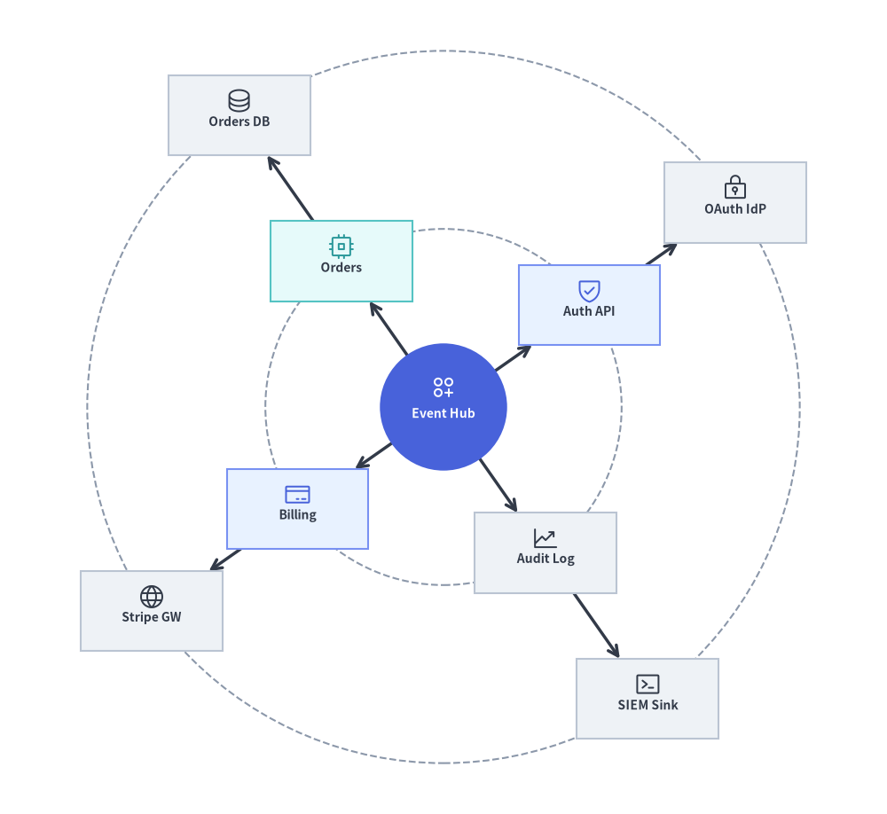
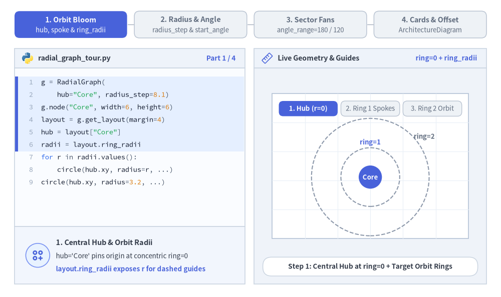
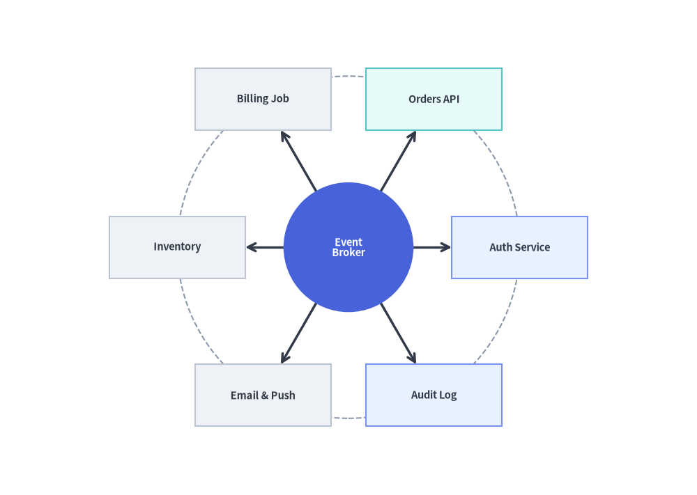
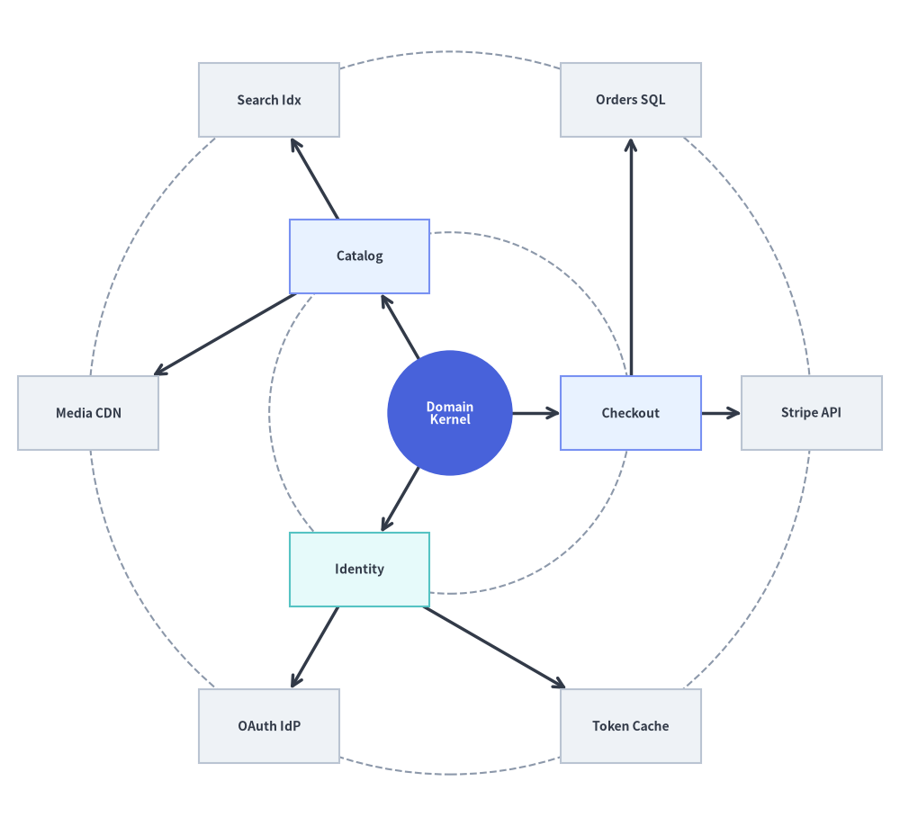
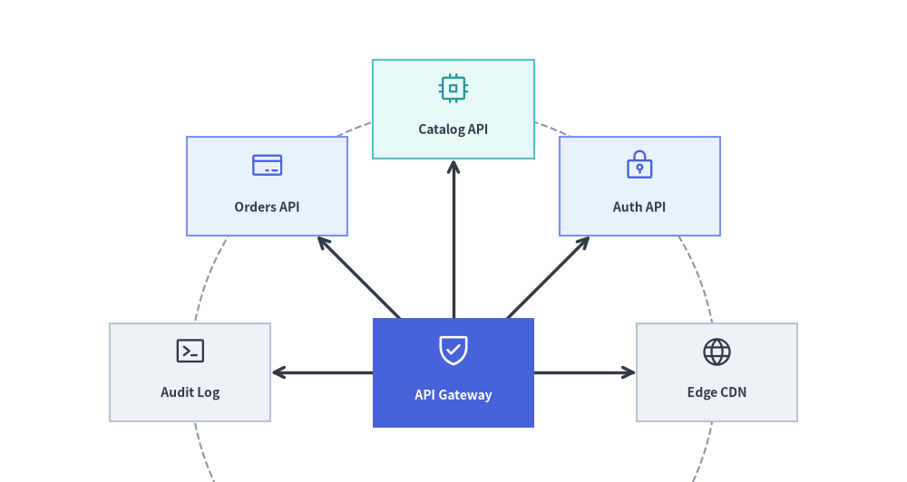

# RadialGraph: Concentric Orbits & Hub-and-Spoke Topologies

`RadialGraph` places a central hub node at the origin (`ring=0`) and arranges connected nodes on **concentric orbital rings** (`ring=1, 2, ...`). Angular sectors are allocated proportionally to subtree sizes so multi-hop spokes radiate outward without crossing lines.

It is purpose-built for event-driven message meshes, Pub/Sub broker topologies, microservice hub-and-spoke networks, and concentric dependency radars. Call `layout = g.get_layout(margin=...)` to obtain node centers (`layout[id].xy`), radial spoke polylines (`layout.edges`), and concentric orbit radii (`layout.ring_radii`).


<figure class="drawlib-image" style="text-align: center;">
  
  <figcaption class="drawlib-caption">RadialGraph Overview: Concentric BFS Orbit Rings, layout.ring_radii Guides, and Spoke Icons</figcaption>
</figure>

<details class="drawlib-code-details">
<summary>Source Code</summary>

```python
from drawlib.canvas import save, setup
from drawlib.graph import RadialGraph
from drawlib.icons import phosphor
from drawlib.lines import lines
from drawlib.shapes import circle, rectangle
from drawlib.styles import Styles

setup(width=122, height=112)

g = RadialGraph(
    hub="core",
    radius_step=24.5,
    start_angle=35.0,
    default_node_width=19.5,
    default_node_height=11.0,
)

# Ring 0: Central Hub
g.node("core", width=17.5, height=17.5)

# Ring 1: Core Services
g.spoke("core", "auth", ring=1)
g.spoke("core", "orders", ring=1)
g.spoke("core", "billing", ring=1)
g.spoke("core", "audit", ring=1)

# Ring 2: Outer Adapters
g.spoke("auth", "idp", ring=2)
g.spoke("orders", "db", ring=2)
g.spoke("billing", "stripe", ring=2)
g.spoke("audit", "siem", ring=2)

# 1. Solve concentric coordinates & orbit ring radii
layout = g.get_layout(margin=5.0)
hub_n = layout["core"]

# 2. Draw dashed circular orbit guides from layout.ring_radii
for r in layout.ring_radii.values():
    circle(hub_n.xy, radius=r, style=Styles.MutedDashed)

# 3. Draw radial spoke edges (from hub center for ring 0->1 so lines meet the circular hub perimeter)
for e in layout.edges:
    pts = [hub_n.xy, e.dst_port] if e.src == "core" else e.points
    lines(pts, arrow_head="->", style=Styles.DarkBold)

# 4. Draw central circular hub and satellite cards with Phosphor icons
circle(
    hub_n.xy,
    radius=hub_n.width / 2,
    style=Styles.PrimaryFlat,
    text="\nEvent Hub",
    text_style=Styles.WhiteBold.patch(text_size=10.0),
)
phosphor.circles_three_plus((hub_n.x, hub_n.y + 2.7), width=3.8, style=Styles.White)

spokes = {
    "auth": ("\nAuth API", Styles.PrimaryNeutral, phosphor.shield_check, Styles.Primary),
    "orders": ("\nOrders", Styles.SecondaryNeutral, phosphor.cpu, Styles.Secondary),
    "billing": ("\nBilling", Styles.PrimaryNeutral, phosphor.credit_card, Styles.Primary),
    "audit": ("\nAudit Log", Styles.Neutral, phosphor.chart_line_up, Styles.Dark),
    "idp": ("\nOAuth IdP", Styles.Neutral, phosphor.lock_key, Styles.Dark),
    "db": ("\nOrders DB", Styles.Neutral, phosphor.database, Styles.Dark),
    "stripe": ("\nStripe GW", Styles.Neutral, phosphor.globe, Styles.Dark),
    "siem": ("\nSIEM Sink", Styles.Neutral, phosphor.terminal_window, Styles.Dark),
}

for nid, (label, box_st, icon_fn, ic_st) in spokes.items():
    n = layout[nid]
    rectangle(
        n.xy,
        width=n.width,
        height=n.height,
        style=box_st,
        text=label,
        text_style=Styles.DarkBold.patch(text_size=10.0),
    )
    icon_fn((n.x, n.y + 2.0), width=3.8, style=ic_st)

save()
```

</details>


---

## 1. Core Concepts & Basic Usage

`RadialGraph` solves polar hub-and-spoke coordinates without manual trigonometry: place a central hub at `ring=0`, attach satellites via `g.spoke(parent, child, ring=...)`, and call `g.get_layout(margin=...)` to obtain card centers (`layout[id].xy`), radial boundary-clipped edges (`layout.edges`), and concentric orbit guide radii (`layout.ring_radii`). Tune `radius_step` and `start_angle` to control ring spacing and angular orientation, narrow `angle_range` (`180.0` or `110.0`) for directional arc fans, and pass solved coordinates directly into `ArchitectureDiagram` with optional `layout.offset(...)` fine-tuning:


<figure class="drawlib-image" style="text-align: center;">
  
  <figcaption class="drawlib-caption">Basic Usage & Parameter Tour: Concentric Orbit Blooming, Radius Step & Start Angle, Semicircular Arc Fans, and ArchitectureDiagram Integration (APNG Animation)</figcaption>
</figure>

<details class="drawlib-code-details">
<summary>Source Code</summary>

```python
from __future__ import annotations

import math

from drawlib.anim import Animation
from drawlib.canvas import save, setup
from drawlib.diagrams.architecture import ArchitectureDiagram, Node, PhosphorIcon
from drawlib.graph import GraphLayout, RadialGraph
from drawlib.icons import code as code_icons
from drawlib.icons import phosphor
from drawlib.lines import line, lines
from drawlib.shapes import circle, rectangle
from drawlib.smartarts import SourceCode, SourceCodeStyles
from drawlib.styles import Styles
from drawlib.text import text

W, H = 138.0, 82.0
setup(width=W, height=H)
anim = Animation(fps=10.0, loop=0)

CODE_TEXT_SIZE = 10.0
PT_TO_CANVAS = W / 720.0
FONT_CANVAS = CODE_TEXT_SIZE * PT_TO_CANVAS
LINE_H = FONT_CANVAS * 1.8
PAD_Y = FONT_CANVAS * 1.2

CODE_STYLES = SourceCodeStyles.get("default", font_lang="en", text_size=CODE_TEXT_SIZE).patch(
    box_style=Styles.Neutral.patch(shape_fill_color=(0, 0, 0, 0), shape_line_width=0),
)

PANE_HEADER = Styles.Neutral.patch(
    shape_fill_color=(238, 243, 250),
    shape_line_color=(203, 213, 225),
    shape_line_width=1.2,
    shape_r=0.0,
)
EDITOR_BODY = Styles.Neutral.patch(
    shape_fill_color=(250, 252, 255),
    shape_line_color=(203, 213, 225),
    shape_line_width=1.2,
    shape_r=0.0,
)
TAKEAWAY_BODY = Styles.Neutral.patch(
    shape_fill_color=(242, 246, 253),
    shape_line_color=(203, 213, 225),
    shape_line_width=1.2,
    shape_r=0.0,
)
STUDIO_BODY = Styles.Neutral.patch(
    shape_fill_color=(239, 243, 249),
    shape_line_color=(203, 213, 225),
    shape_line_width=1.2,
    shape_r=0.0,
)

PART_ITEMS = [
    ("1. Orbit Bloom", "hub, spoke & ring_radii"),
    ("2. Radius & Angle", "radius_step & start_angle"),
    ("3. Sector Fans", "angle_range=180 / 120"),
    ("4. Cards & Offset", "ArchitectureDiagram"),
]


def shift_layout(layout: GraphLayout, dx: float, dy: float) -> GraphLayout:
    """Translate a solved GraphLayout into the right studio coordinate sheet."""
    for nl in layout.nodes.values():
        nl.xy = (round(nl.x + dx, 2), round(nl.y + dy, 2))
        if nl.parent_id is None:
            nl.local_xy = nl.xy
    for cl in layout.clusters.values():
        cl.bbox = (round(cl.cx + dx, 2), round(cl.cy + dy, 2), cl.width, cl.height)
        if cl.parent_id is None:
            cl.local_bottom_left = cl.bottom_left
    for el in layout.edges:
        el.src_port = (round(el.src_port[0] + dx, 2), round(el.src_port[1] + dy, 2))
        el.dst_port = (round(el.dst_port[0] + dx, 2), round(el.dst_port[1] + dy, 2))
        el.waypoints = [(round(wx + dx, 2), round(wy + dy, 2)) for wx, wy in el.waypoints]
    return layout


def draw_arc_guide(
    center_xy: tuple[float, float],
    radius: float,
    deg_start: float,
    deg_end: float,
    style: object,
    steps: int = 36,
) -> None:
    """Draw a circular arc polyline within the studio sheet."""
    cx, cy = center_xy
    pts = []
    for idx in range(steps + 1):
        deg = deg_start + (deg_end - deg_start) * (idx / steps)
        rad = math.radians(deg)
        pts.append((cx + radius * math.cos(rad), cy + radius * math.sin(rad)))
    lines(pts, style=style)  # type: ignore[arg-type]


def draw_step_bar(active_part: int) -> None:
    """Draw top 4-part progress bar (active_part is 1..4)."""
    pill_w = 31.0
    pill_h = 7.4
    gap = 2.0
    start_x = 4.0 + pill_w / 2.0
    cy = 75.2

    for idx, (label, sublabel) in enumerate(PART_ITEMS, start=1):
        cx = start_x + (idx - 1) * (pill_w + gap)
        if idx > 1:
            prev_cx = cx - (pill_w + gap)
            line(
                (prev_cx + pill_w / 2.0 + 0.2, cy),
                (cx - pill_w / 2.0 - 0.2, cy),
                style=Styles.PrimaryBold if idx <= active_part else Styles.MutedThin,
            )

        if idx == active_part:
            st = Styles.PrimaryFlat.patch(shape_r=1.4)
            tst = Styles.WhiteBold.patch(text_size=10.3)
            sub_tst = Styles.White.patch(text_size=9.5)
        elif idx < active_part:
            st = Styles.PrimaryNeutral.patch(shape_r=1.4, shape_line_width=1.1)
            tst = Styles.PrimaryBold.patch(text_size=10.3)
            sub_tst = Styles.Primary.patch(text_size=9.5)
        else:
            st = Styles.Neutral.patch(shape_r=1.4, shape_line_width=1.1)
            tst = Styles.MutedBold.patch(text_size=10.3)
            sub_tst = Styles.Muted.patch(text_size=9.5)

        rectangle((cx, cy), width=pill_w, height=pill_h, style=st)
        text((cx, cy + 1.35), label, style=tst)
        text((cx, cy - 1.55), sublabel, style=sub_tst)


def draw_left_pane(
    active_part: int,
    code_lines: list[str],
    hl_range: tuple[int, int],
    icon_fn: object,
    summary_title: str,
    summary_line1: str,
    summary_line2: str,
) -> None:
    """Draw left Python code editor + bottom concept takeaway card."""
    x0, w = 4.0, 63.5
    cx = x0 + w / 2.0
    top_y = 63.2
    header_h = 5.4
    editor_h = 43.8
    takeaway_h = 15.8

    rectangle((cx, top_y + header_h / 2.0), width=w, height=header_h, style=PANE_HEADER)
    code_icons.python((x0 + 3.6, top_y + header_h / 2.0), width=3.4, style=Styles.Neutral)
    text(
        (x0 + 6.5, top_y + header_h / 2.0),
        "radial_graph_tour.py",
        style=Styles.DarkBold.patch(text_size=10.2, halign="left"),
    )
    text(
        (x0 + w - 2.6, top_y + header_h / 2.0),
        f"Part {active_part} / 4",
        style=Styles.PrimaryBold.patch(text_size=9.8, halign="right"),
    )

    rectangle((cx, top_y - editor_h / 2.0), width=w, height=editor_h, style=EDITOR_BODY)

    hl_start, hl_end = hl_range
    hl_top = top_y - PAD_Y - hl_start * LINE_H
    hl_bot = top_y - PAD_Y - (hl_end + 1) * LINE_H
    hl_cy = (hl_top + hl_bot) / 2.0
    hl_h = hl_top - hl_bot
    rectangle(
        (cx, hl_cy),
        width=w - 0.6,
        height=hl_h,
        style=Styles.Neutral.patch(shape_fill_color=(229, 239, 255), shape_line_width=0),
    )
    rectangle(
        (x0 + 0.55, hl_cy),
        width=0.9,
        height=hl_h,
        style=Styles.PrimaryFlat.patch(shape_line_width=0),
    )

    SourceCode.draw(
        xy=(x0, top_y),
        width=w,
        code="\n".join(code_lines),
        styles=CODE_STYLES,
        code_lang="python",
        show_linenum=True,
        align="top_left",
    )

    take_cy = 3.6 + takeaway_h / 2.0
    rectangle((cx, take_cy), width=w, height=takeaway_h, style=TAKEAWAY_BODY)
    circle(
        (x0 + 6.4, take_cy),
        radius=3.3,
        style=Styles.PrimaryNeutral.patch(shape_line_width=1.2),
    )
    icon_fn((x0 + 6.4, take_cy), width=3.8, style=Styles.PrimaryBold)  # type: ignore[operator]
    text(
        (x0 + 11.4, take_cy + 3.6),
        summary_title,
        style=Styles.DarkBold.patch(text_size=10.4, halign="left"),
    )
    text(
        (x0 + 11.4, take_cy - 0.2),
        summary_line1,
        style=Styles.Dark.patch(text_size=9.7, halign="left"),
    )
    text(
        (x0 + 11.4, take_cy - 3.8),
        summary_line2,
        style=Styles.PrimaryBold.patch(text_size=9.6, halign="left"),
    )


def draw_geometry_studio(param_badge: str, footer_caption: str) -> tuple[float, float]:
    """Draw right geometry lab shell, inner coordinate sheet with subtle grid, and footer."""
    x0, w = 70.0, 64.0
    cx = x0 + w / 2.0
    top_y = 63.2
    header_h = 5.4
    body_h = 59.6

    rectangle((cx, top_y + header_h / 2.0), width=w, height=header_h, style=PANE_HEADER)
    phosphor.ruler((x0 + 3.6, top_y + header_h / 2.0), width=3.4, style=Styles.Primary)
    text(
        (x0 + 6.5, top_y + header_h / 2.0),
        "Live Geometry & Guides",
        style=Styles.DarkBold.patch(text_size=10.2, halign="left"),
    )
    text(
        (x0 + w - 2.6, top_y + header_h / 2.0),
        param_badge,
        style=Styles.PrimaryBold.patch(text_size=9.6, halign="right"),
    )

    rectangle((cx, 3.6 + body_h / 2.0), width=w, height=body_h, style=STUDIO_BODY)

    sheet_cx, sheet_cy = cx, 36.2
    sheet_w, sheet_h = 54.0, 40.0
    sx0, sy0 = sheet_cx - sheet_w / 2.0, sheet_cy - sheet_h / 2.0
    rectangle(
        (sheet_cx, sheet_cy),
        width=sheet_w,
        height=sheet_h,
        style=Styles.Neutral.patch(
            shape_fill_color=(255, 255, 255),
            shape_line_color=(180, 194, 214),
            shape_line_width=1.2,
        ),
    )
    g_st = Styles.MutedThin.patch(line_color=(232, 238, 246), line_width=0.8)
    for gx in range(1, 6):
        vx = sx0 + gx * (sheet_w / 6.0)
        line((vx, sy0), (vx, sy0 + sheet_h), style=g_st)
    for gy in range(1, 5):
        vy = sy0 + gy * (sheet_h / 5.0)
        line((sx0, vy), (sx0 + sheet_w, vy), style=g_st)

    rectangle(
        (cx, 8.4),
        width=59.2,
        height=5.2,
        style=Styles.Neutral.patch(
            shape_fill_color=(255, 255, 255),
            shape_line_color=(203, 213, 225),
            shape_line_width=1.1,
            shape_r=2.4,
        ),
        text=footer_caption,
        text_style=Styles.DarkBold.patch(text_size=9.8),
    )
    return sheet_cx, sheet_cy


def draw_sub_pills(scx: float, labels: list[str], active_idx: int) -> None:
    """Draw 3-step tracker pills near the top of the studio sheet."""
    pw, ph, pgap = 16.2, 4.2, 0.9
    p_start = scx - (3 * pw + 2 * pgap) / 2.0 + pw / 2.0
    for idx, lbl in enumerate(labels):
        px = p_start + idx * (pw + pgap)
        if idx == active_idx:
            pst = Styles.PrimaryFlat.patch(shape_r=1.2)
            ptst = Styles.WhiteBold.patch(text_size=9.5)
        elif idx < active_idx:
            pst = Styles.PrimaryNeutral.patch(shape_r=1.2, shape_line_width=1.0)
            ptst = Styles.PrimaryBold.patch(text_size=9.5)
        else:
            pst = Styles.Neutral.patch(shape_r=1.2, shape_line_width=1.0)
            ptst = Styles.Muted.patch(text_size=9.5)
        rectangle((px, 52.0), width=pw, height=ph, style=pst, text=lbl, text_style=ptst)


# =========================================================================
# Part 1: Orbit Bloom — hub, spoke & ring_radii solved once via RadialGraph
# =========================================================================
def build_part1_layout() -> GraphLayout:
    g = RadialGraph(
        hub="Core",
        radius_step=8.1,
        start_angle=0.0,
        default_node_width=5.6,
        default_node_height=3.6,
    )
    g.node("Core", width=6.4, height=6.4)
    for s1 in ["Auth", "API", "Bus"]:
        g.spoke("Core", s1, ring=1)
    for parent, c1, c2 in [
        ("Auth", "IdP", "KMS"),
        ("API", "SQL", "CDN"),
        ("Bus", "DLQ", "Log"),
    ]:
        g.spoke(parent, c1, ring=2)
        g.spoke(parent, c2, ring=2)
    raw = g.get_layout(width=33.4, height=33.4, margin=3.8)
    return shift_layout(raw, 102.0 - 16.7, 33.1 - 16.7)


P1_LAYOUT = build_part1_layout()

PART1_STATES = [
    (
        "hub_only",
        3.3,
        [
            "g = RadialGraph(",
            '    hub="Core", radius_step=8.1)',
            'g.node("Core", width=6, height=6)',
            "layout = g.get_layout(margin=4)",
            'hub = layout["Core"]',
            "radii = layout.ring_radii",
            "for r in radii.values():",
            "    circle(hub.xy, radius=r, ...)",
            "circle(hub.xy, radius=3.2, ...)",
        ],
        (0, 5),
        "ring=0 + ring_radii",
        "Step 1: Central Hub at ring=0 + Target Orbit Rings",
        "1. Central Hub & Orbit Radii",
        "hub='Core' pins origin at concentric ring=0",
        "layout.ring_radii exposes r for dashed guides",
    ),
    (
        "ring1",
        3.3,
        [
            'g = RadialGraph(hub="Core", ...)',
            "# Ring 1: 3 spokes (120 deg step)",
            'g.spoke("Core", "Auth", ring=1)',
            'g.spoke("Core", "API", ring=1)',
            'g.spoke("Core", "Bus", ring=1)',
            "layout = g.get_layout(margin=4)",
            "for e in layout.edges:",
            "    lines(e.points, ...)",
            "for nid in ['Auth','API','Bus']:",
            "    rectangle(layout[nid].xy, ...)",
        ],
        (1, 4),
        "g.spoke(..., ring=1)",
        "Step 2: Three Domain Spokes Bloom Evenly (120 deg)",
        "2. Inner Domain Ring (ring=1)",
        "g.spoke(parent, id) registers node + radial edge",
        "3 inner spokes space 120 deg apart on ring=1",
    ),
    (
        "ring2",
        3.5,
        [
            'g = RadialGraph(hub="Core", ...)',
            'g.spoke("Core", "Auth", ring=1)',
            'g.spoke("Core", "API", ring=1)',
            'g.spoke("Core", "Bus", ring=1)',
            "# Ring 2: 2 adapters per spoke",
            'g.spoke("Auth", "IdP", ring=2)',
            'g.spoke("Auth", "KMS", ring=2)',
            'g.spoke("API", "SQL", ring=2)',
            'g.spoke("API", "CDN", ring=2)',
            'g.spoke("Bus", "DLQ", ring=2)',
            'g.spoke("Bus", "Log", ring=2)',
        ],
        (4, 10),
        "ring=2 Sectors",
        "Step 3: Six Outer Adapters Radiate Without Crossings",
        "3. Multi-Hop Concentric Radar",
        "Children sort by parent angle to prevent crossings",
        "BFS hop distance sets ring=1, 2 automatically",
    ),
]

R1_NODES = [
    ("Auth", Styles.PrimaryNeutral),
    ("API", Styles.SecondaryNeutral),
    ("Bus", Styles.Neutral),
]
R2_NODES = ["IdP", "KMS", "SQL", "CDN", "DLQ", "Log"]

for p1_idx, (mode_1, dur, code_1, hl_rng, badge_txt, foot_txt, s_t, s_1, s_2) in enumerate(PART1_STATES):
    with anim.frame(duration=dur):
        draw_step_bar(1)
        draw_left_pane(1, code_1, hl_rng, phosphor.circles_three_plus, s_t, s_1, s_2)
        scx, _scy = draw_geometry_studio(badge_txt, foot_txt)
        draw_sub_pills(scx, ["1. Hub (r=0)", "2. Ring 1 Spokes", "3. Ring 2 Orbit"], p1_idx)

        hub_n = P1_LAYOUT["Core"]
        r1 = P1_LAYOUT.ring_radii[1]
        r2 = P1_LAYOUT.ring_radii[2]

        circle(
            hub_n.xy,
            radius=r1,
            style=Styles.PrimaryDashed if mode_1 != "hub_only" else Styles.MutedDashed,
        )
        circle(
            hub_n.xy,
            radius=r2,
            style=Styles.PrimaryDashed if mode_1 == "ring2" else Styles.MutedDashed,
        )

        if mode_1 == "hub_only":
            text(
                (hub_n.x, hub_n.y + r1 + 1.5),
                "ring=1",
                style=Styles.PrimaryBold.patch(text_size=9.5),
            )
            text(
                (hub_n.x + r2 * 0.72 + 3.2, hub_n.y + r2 * 0.69),
                "ring=2",
                style=Styles.MutedBold.patch(text_size=9.5),
            )

        if mode_1 in {"ring1", "ring2"}:
            for e in P1_LAYOUT.edges:
                if e.src == "Core":
                    lines([hub_n.xy, e.dst_port], arrow_head="->", style=Styles.DarkBold)
                elif mode_1 == "ring2":
                    lines(e.points, arrow_head="->", style=Styles.DarkBold)

        circle(
            hub_n.xy,
            radius=hub_n.width / 2.0,
            style=Styles.PrimaryFlat,
            text="Core",
            text_style=Styles.WhiteBold.patch(text_size=9.5),
        )

        if mode_1 in {"ring1", "ring2"}:
            for nid, st in R1_NODES:
                nl = P1_LAYOUT[nid]
                rectangle(
                    nl.xy,
                    width=nl.width,
                    height=nl.height,
                    style=st.patch(shape_r=0.9),
                    text=nid,
                    text_style=Styles.DarkBold.patch(text_size=9.5),
                )

        if mode_1 == "ring2":
            for nid in R2_NODES:
                nl = P1_LAYOUT[nid]
                rectangle(
                    nl.xy,
                    width=nl.width,
                    height=nl.height,
                    style=Styles.White.patch(shape_r=0.9),
                    text=nid,
                    text_style=Styles.DarkBold.patch(text_size=9.5),
                )


# =========================================================================
# Part 2: Radius & Angle — start_angle rotation & radius_step spacing
# =========================================================================
PART2_STATES = [
    (
        "angle0",
        3.3,
        [
            "g = RadialGraph(",
            '    hub="Core",',
            "    radius_step=10.5,",
            "    start_angle=0.0,  # +X East",
            ")",
            'for s in ["S1","S2","S3","S4"]:',
            '    g.spoke("Core", s)',
            "layout = g.get_layout(margin=4)",
            "# Spokes at 0, 90, 180, 270 deg",
        ],
        (2, 3),
        "start_angle=0.0",
        "start_angle=0.0 Places First Spoke on +X Axis (0 deg)",
        "Axis-Aligned Orientation (0 deg)",
        "0 deg points East (+X), 90 deg points North (+Y)",
        "4 spokes land cleanly at 0, 90, 180, 270 deg",
    ),
    (
        "angle45",
        3.3,
        [
            "g = RadialGraph(",
            '    hub="Core",',
            "    radius_step=10.8,",
            "    start_angle=45.0, # diagonals",
            ")",
            'for s in ["S1","S2","S3","S4"]:',
            '    g.spoke("Core", s)',
            "layout = g.get_layout(margin=4)",
            "# Spokes at 45, 135, 225, 315 deg",
        ],
        (2, 3),
        "start_angle=45.0",
        "start_angle=45.0 Rotates Spokes Into Diagonal Quadrants",
        "Diagonal Quadrant Rotation",
        "Rotates entire ring counter-clockwise by 45 deg",
        "Keeps top/bottom center lanes clear for labels",
    ),
    (
        "rstep",
        3.5,
        [
            "g = RadialGraph(",
            '    hub="Core",',
            "    radius_step=11.6, # vs 8.0",
            "    start_angle=45.0,",
            ")",
            'for s in ["S1","S2","S3","S4"]:',
            '    g.spoke("Core", s)',
            "layout = g.get_layout(margin=4)",
            "r1 = layout.ring_radii[1] # 11.6",
        ],
        (2, 3),
        "radius_step=11.6",
        "radius_step Controls Radial Gap (8.0 Compact vs 11.6)",
        "Orbit Spacing (radius_step)",
        "Fixed radial step sets ring_radii[r] = r * step",
        "Omit radius_step=None to auto-scale to margin",
    ),
]

for p2_idx, (mode_2, dur, code_2, hl_rng, badge_txt, foot_txt, s_t, s_1, s_2) in enumerate(PART2_STATES):
    with anim.frame(duration=dur):
        draw_step_bar(2)
        draw_left_pane(2, code_2, hl_rng, phosphor.ruler, s_t, s_1, s_2)
        scx, _scy = draw_geometry_studio(badge_txt, foot_txt)
        draw_sub_pills(scx, ["start_angle=0", "start_angle=45", "radius_step"], p2_idx)

        s_ang = 0.0 if mode_2 == "angle0" else 45.0
        r_stp = 10.5 if mode_2 == "angle0" else (10.8 if mode_2 == "angle45" else 11.6)

        g2 = RadialGraph(
            hub="Core",
            radius_step=r_stp,
            start_angle=s_ang,
            default_node_width=6.6,
            default_node_height=3.8,
        )
        g2.node("Core", width=6.4, height=6.4)
        for s_id in ["S1", "S2", "S3", "S4"]:
            g2.spoke("Core", s_id)
        lay2 = shift_layout(g2.get_layout(width=33.4, height=33.4, margin=3.8), 102.0 - 16.7, 34.0 - 16.7)
        hub2 = lay2["Core"]

        if mode_2 == "rstep":
            circle(hub2.xy, radius=8.0, style=Styles.MutedDashed)
            text((hub2.x, hub2.y - 8.0 + 1.6), "r=8.0", style=Styles.MutedBold.patch(text_size=9.5))

        circle(hub2.xy, radius=lay2.ring_radii[1], style=Styles.PrimaryDashed)

        if mode_2 == "angle45":
            line((hub2.x, hub2.y), (hub2.x + 13.5, hub2.y), style=Styles.MutedDashed)
            draw_arc_guide(hub2.xy, 6.2, 0.0, 45.0, Styles.DangerBold.patch(line_width=1.3), steps=12)
            text((hub2.x + 9.2, hub2.y + 1.3), "+45°", style=Styles.DangerBold.patch(text_size=9.5))

        if mode_2 == "rstep":
            line(
                (hub2.x + 8.0, hub2.y),
                (hub2.x + 11.6, hub2.y),
                arrow_head="<->",
                style=Styles.DangerBold.patch(line_width=1.3),
            )
            text(
                (hub2.x + 12.3, hub2.y),
                "r=11.6",
                style=Styles.DangerBold.patch(text_size=9.5, halign="left"),
            )

        for e in lay2.edges:
            lines([hub2.xy, e.dst_port], arrow_head="->", style=Styles.DarkBold)

        circle(
            hub2.xy,
            radius=hub2.width / 2.0,
            style=Styles.PrimaryFlat,
            text="Core",
            text_style=Styles.WhiteBold.patch(text_size=9.5),
        )

        spoke_styles = [Styles.PrimaryNeutral, Styles.SecondaryNeutral, Styles.Neutral, Styles.White]
        deg_labels = (
            [("0°", 5.4, 0.0), ("90°", 6.2, 1.0), ("180°", -5.8, 0.0), ("270°", 6.4, -1.0)]
            if mode_2 == "angle0"
            else [("45°", 5.4, 0.4), ("135°", -5.6, 0.4), ("225°", -5.8, -0.4), ("315°", 5.6, -0.4)]
        )
        for idx, s_id in enumerate(["S1", "S2", "S3", "S4"]):
            nl = lay2[s_id]
            rectangle(
                nl.xy,
                width=nl.width,
                height=nl.height,
                style=spoke_styles[idx].patch(shape_r=0.9),
                text=s_id,
                text_style=Styles.DarkBold.patch(text_size=9.6),
            )
            if mode_2 != "rstep":
                dlbl, dx_l, dy_l = deg_labels[idx]
                text((nl.x + dx_l, nl.y + dy_l), dlbl, style=Styles.PrimaryBold.patch(text_size=9.5))

        bottom_msg = (
            "0° = East (+X)  •  90° = North (+Y)"
            if mode_2 == "angle0"
            else (
                "diagonal 45° quadrants avoid axis crowding"
                if mode_2 == "angle45"
                else "compact r=8.0 vs expanded radius_step=11.6"
            )
        )
        text((scx, 18.0), bottom_msg, style=Styles.DarkBold.patch(text_size=9.5))


# =========================================================================
# Part 3: Sector Fans — 360 full orbit, 180 top semicircle & 110 cone
# =========================================================================
PART3_STATES = [
    (
        "fan360",
        3.3,
        [
            "g = RadialGraph(",
            '    hub="GW", radius_step=11.0,',
            "    start_angle=18.0,",
            "    angle_range=360.0, # full",
            ")",
            "for s in ['CDN','Auth','API',",
            "          'Pay','Log']:",
            '    g.spoke("GW", s)',
            "layout = g.get_layout(margin=4)",
        ],
        (2, 3),
        "angle_range=360",
        "Default angle_range=360.0 Surrounds Hub on All Sides",
        "Full 360-Degree Orbit",
        "Spokes divide 360 deg into equal 360 / N steps",
        "Ideal for symmetric broker & mesh topologies",
    ),
    (
        "fan180",
        3.3,
        [
            "g = RadialGraph(",
            '    hub="GW", center=(25, 6.8),',
            "    radius_step=16.8,",
            "    start_angle=0.0,",
            "    angle_range=180.0, # top arc",
            ")",
            "for s in ['CDN','Auth','API',",
            "          'Pay','Log']:",
            '    g.spoke("GW", s)',
            "layout = g.get_layout(margin=4)",
        ],
        (1, 4),
        "angle_range=180",
        "angle_range=180.0 Fans 5 Services Across Upper Semicircle",
        "Semicircular Upper Fan (0..180 deg)",
        "Pin center=(cx, cy) near bottom of diagram",
        "Endpoints land cleanly on 0 deg and 180 deg",
    ),
    (
        "fan120",
        3.5,
        [
            "g = RadialGraph(",
            '    hub="GW", center=(25, 6.4),',
            "    radius_step=18.2,",
            "    start_angle=30.0,",
            "    angle_range=120.0, # cone!",
            ")",
            "for s in ['CDN','Auth','API',",
            "          'Pay']:",
            '    g.spoke("GW", s)',
            "layout = g.get_layout(margin=4)",
        ],
        (3, 4),
        "angle_range=120",
        "start_angle=30, angle_range=120 Focused Radar Cone",
        "Directional Radar Sector Cone",
        "Combine start_angle + angle_range for tight fans",
        "Focuses downstream tree in a single direction",
    ),
]

for p3_idx, (mode_3, dur, code_3, hl_rng, badge_txt, foot_txt, s_t, s_1, s_2) in enumerate(PART3_STATES):
    with anim.frame(duration=dur):
        draw_step_bar(3)
        draw_left_pane(3, code_3, hl_rng, phosphor.globe, s_t, s_1, s_2)
        scx, _scy = draw_geometry_studio(badge_txt, foot_txt)
        draw_sub_pills(scx, ["360 Full Orbit", "180 Top Fan", "120 Radar Cone"], p3_idx)

        if mode_3 == "fan360":
            g3 = RadialGraph(
                hub="GW",
                radius_step=10.8,
                start_angle=18.0,
                angle_range=360.0,
                default_node_width=7.4,
                default_node_height=3.8,
            )
            g3.node("GW", width=6.4, height=6.4)
            spokes_3 = ["CDN", "Auth", "API", "Pay", "Log"]
            for s_id in spokes_3:
                g3.spoke("GW", s_id)
            lay3 = shift_layout(g3.get_layout(width=33.4, height=33.4, margin=3.8), 102.0 - 16.7, 34.5 - 16.7)
            hub3 = lay3["GW"]
            circle(hub3.xy, radius=lay3.ring_radii[1], style=Styles.PrimaryDashed)
            note_3 = "angle_range=360.0  •  5 spokes at 72° steps"
        elif mode_3 == "fan180":
            g3 = RadialGraph(
                hub="GW",
                center=(25.0, 6.8),
                radius_step=16.8,
                start_angle=0.0,
                angle_range=180.0,
                default_node_width=7.4,
                default_node_height=3.8,
            )
            g3.node("GW", width=6.4, height=6.4)
            spokes_3 = ["CDN", "Auth", "API", "Pay", "Log"]
            for s_id in spokes_3:
                g3.spoke("GW", s_id)
            lay3 = shift_layout(g3.get_layout(width=50.0, height=30.0, margin=3.5), 77.0, 18.6)
            hub3 = lay3["GW"]
            r_fan = lay3.ring_radii[1]
            line((hub3.x - r_fan - 2.0, hub3.y), (hub3.x + r_fan + 2.0, hub3.y), style=Styles.MutedDashed)
            draw_arc_guide(hub3.xy, r_fan, 0.0, 180.0, Styles.PrimaryDashed)
            note_3 = "start_angle=0.0, angle_range=180.0 (upper arc)"
        else:
            g3 = RadialGraph(
                hub="GW",
                center=(25.0, 6.4),
                radius_step=18.2,
                start_angle=30.0,
                angle_range=120.0,
                default_node_width=7.4,
                default_node_height=3.8,
            )
            g3.node("GW", width=6.4, height=6.4)
            spokes_3 = ["CDN", "Auth", "API", "Pay"]
            for s_id in spokes_3:
                g3.spoke("GW", s_id)
            lay3 = shift_layout(g3.get_layout(width=50.0, height=30.0, margin=3.5), 77.0, 18.8)
            hub3 = lay3["GW"]
            r_fan = lay3.ring_radii[1]
            for ray_deg in (30.0, 150.0):
                rad = math.radians(ray_deg)
                line(
                    hub3.xy,
                    (hub3.x + (r_fan + 2.5) * math.cos(rad), hub3.y + (r_fan + 2.5) * math.sin(rad)),
                    style=Styles.MutedDashed,
                )
            draw_arc_guide(hub3.xy, r_fan, 30.0, 150.0, Styles.PrimaryDashed)
            note_3 = "start_angle=30.0, angle_range=120.0 (radar cone)"

        for e in lay3.edges:
            lines([hub3.xy, e.dst_port], arrow_head="->", style=Styles.DarkBold)

        circle(
            hub3.xy,
            radius=hub3.width / 2.0,
            style=Styles.PrimaryFlat,
            text="GW",
            text_style=Styles.WhiteBold.patch(text_size=9.6),
        )

        fan_styles = [
            Styles.PrimaryNeutral,
            Styles.SecondaryNeutral,
            Styles.PrimaryNeutral,
            Styles.Neutral,
            Styles.White,
        ]
        for idx, s_id in enumerate(spokes_3):
            nl = lay3[s_id]
            rectangle(
                nl.xy,
                width=nl.width,
                height=nl.height,
                style=fan_styles[idx].patch(shape_r=0.9),
                text=s_id,
                text_style=Styles.DarkBold.patch(text_size=9.5),
            )

        text((scx, 18.0), note_3, style=Styles.PrimaryBold.patch(text_size=9.5))


# =========================================================================
# Part 4: Cards & Offset — ArchitectureDiagram Node cards & layout.offset()
# =========================================================================
PART4_STATES = [
    (
        "cards",
        3.3,
        [
            "layout = g.get_layout(margin=4)",
            "d = ArchitectureDiagram(...)",
            "for nid, ic in SPOKES:",
            "    nl = layout[nid]",
            "    d.add(Node(",
            "        nid, width=nl.width,",
            "        height=nl.height,",
            "        icon=ic),",
            "        xy=nl.xy)  # spoke center",
            "d.draw()",
        ],
        (3, 8),
        "Node(xy=nl.xy)",
        "Place ArchitectureDiagram Cards at Solved Spoke Centers",
        "ArchitectureDiagram Integration",
        "Node(xy=nl.xy) snaps directly to solved centers",
        "Pair PhosphorIcon / GcpIcon with calm card styles",
    ),
    (
        "guides",
        3.3,
        [
            'hub = layout["Hub"]',
            "radii = layout.ring_radii.values()",
            "for r in radii:",
            "    circle(hub.xy, radius=r,",
            "        style=Styles.MutedDashed)",
            "for e in layout.edges:",
            "    lines(e.points, ...)",
            "d.draw()  # renders Node cards",
        ],
        (1, 4),
        "circle(ring_radii)",
        "Layer Orbit Guide Circles Underneath Diagram Connectors",
        "Layered Orbit Guides",
        "Draw circle(hub.xy, radius=r) first in Z-order",
        "Render radial arrows + ArchitectureDiagram on top",
    ),
    (
        "offset",
        3.5,
        [
            "layout = g.get_layout(margin=4)",
            "# Nudge spoke & update edge ports",
            "layout.offset(",
            '    "Auth", dx=5.0, dy=0.8)',
            'nl = layout["Auth"]',
            "d.add(Node(",
            '    "Auth", width=nl.width,',
            "    icon=PhosphorIcon.LOCK_KEY,",
            "), xy=nl.xy)",
            "d.draw()",
        ],
        (1, 3),
        "layout.offset()",
        "layout.offset('Auth', dx, dy) Nudges Spoke + Edge Ports",
        "Post-Solve Fine-Tuning (.offset)",
        "layout.offset() shifts node.xy & incident ports",
        "Make room for callout badges without re-solving",
    ),
]

SPOKE_META = [
    ("Auth", PhosphorIcon.LOCK_KEY, Styles.Primary, Styles.PrimaryNeutral),
    ("API", PhosphorIcon.CPU, Styles.Secondary, Styles.SecondaryNeutral),
    ("Pay", PhosphorIcon.CREDIT_CARD, Styles.Primary, Styles.Neutral),
    ("SQL", PhosphorIcon.DATABASE, Styles.Dark, Styles.White),
]

for p4_idx, (mode_4, dur, code_4, hl_rng, badge_txt, foot_txt, s_t, s_1, s_2) in enumerate(PART4_STATES):
    with anim.frame(duration=dur):
        draw_step_bar(4)
        draw_left_pane(4, code_4, hl_rng, phosphor.squares_four, s_t, s_1, s_2)
        scx, _scy = draw_geometry_studio(badge_txt, foot_txt)
        draw_sub_pills(scx, ["Diagram Nodes", "Ring Guides", "layout.offset()"], p4_idx)

        g4 = RadialGraph(
            hub="Hub",
            radius_step=12.6,
            start_angle=45.0,
            default_node_width=9.2,
            default_node_height=6.6,
        )
        g4.node("Hub", width=9.0, height=6.6)
        for s_id, _, _, _ in SPOKE_META:
            g4.spoke("Hub", s_id)
        lay4 = shift_layout(g4.get_layout(width=33.4, height=33.4, margin=3.8), 101.0 - 16.7, 34.4 - 16.7)
        hub4 = lay4["Hub"]
        r_guide = lay4.ring_radii[1]

        old_auth_xy = lay4["Auth"].xy
        if mode_4 == "offset":
            lay4.offset("Auth", dx=5.0, dy=0.8)

        if mode_4 in {"guides", "offset"}:
            circle(hub4.xy, radius=r_guide, style=Styles.PrimaryDashed)

        if mode_4 == "offset":
            rectangle(
                old_auth_xy,
                width=9.2,
                height=6.6,
                style=Styles.MutedDashed.patch(shape_fill_color=(0, 0, 0, 0), shape_line_width=1.0),
            )

        for e in lay4.edges:
            is_hi = mode_4 == "offset" and e.dst == "Auth"
            lines(
                e.points,
                arrow_head="->",
                style=Styles.PrimaryBold if is_hi else Styles.DarkBold,
            )

        d4 = ArchitectureDiagram(
            node_style=Styles.Primary,
            node_text_style=Styles.DarkBold.patch(text_size=9.5),
            edge_style=Styles.DarkBold,
            edge_text_style=Styles.DarkBold.patch(text_size=9.5),
            node_card_style=Styles.Neutral,
        )
        d4.add(
            Node(
                "Hub",
                width=hub4.width,
                height=hub4.height,
                icon=PhosphorIcon.SHIELD_CHECK,
                icon_size=3.2,
                style=Styles.White,
                text_style=Styles.WhiteBold.patch(text_size=9.5),
                card_style=Styles.PrimaryFlat,
            ),
            xy=hub4.xy,
        )
        for s_id, ic_enum, ic_st, c_st in SPOKE_META:
            nl = lay4[s_id]
            d4.add(
                Node(
                    s_id,
                    width=nl.width,
                    height=nl.height,
                    icon=ic_enum,
                    icon_size=3.2,
                    style=ic_st,
                    card_style=c_st,
                ),
                xy=nl.xy,
            )
        d4.draw()

        if mode_4 == "guides":
            line(
                (hub4.x + r_guide, hub4.y),
                (hub4.x + r_guide + 1.4, hub4.y),
                style=Styles.PrimaryBold,
            )
            text(
                (hub4.x + r_guide + 1.8, hub4.y),
                "ring_radii[1]",
                style=Styles.PrimaryBold.patch(text_size=9.5, halign="left"),
            )
            text(
                (scx, 18.0),
                "circle(hub.xy, radius=r) layered beneath cards",
                style=Styles.PrimaryBold.patch(text_size=9.5),
            )
        elif mode_4 == "offset":
            new_auth = lay4["Auth"]
            rectangle(
                (new_auth.x + 1.2, 36.2),
                width=9.2,
                height=2.8,
                style=Styles.AccentFlat.patch(shape_r=1.0),
                text="+5.0, +0.8",
                text_style=Styles.WhiteBold.patch(text_size=9.5),
            )
            line(
                (new_auth.x + 1.2, 37.6),
                (new_auth.x + 1.2, new_auth.bottom - 0.3),
                arrow_head="->",
                style=Styles.DangerBold.patch(line_width=1.2),
            )
            text(
                (scx, 18.0),
                "layout.offset() shifts spoke & incident edge port",
                style=Styles.PrimaryBold.patch(text_size=9.5),
            )
        else:
            text(
                (scx, 18.0),
                "ArchitectureDiagram Nodes placed at layout[id].xy",
                style=Styles.DarkBold.patch(text_size=9.5),
            )

save()
```

</details>


- **Concentric Ring Blooming (`hub`, `g.spoke`, `ring_radii`)**: `RadialGraph(hub=...)` places the central hub at `ring=0` and assigns satellites to `ring=1, 2, ...` via BFS hop distance (or explicit `ring=`), exposing exact orbit radii in `layout.ring_radii`.
- **Orientation & Ring Spacing (`start_angle`, `radius_step`)**: Rotate spokes into axis-aligned (`0.0`) or diagonal (`45.0`) quadrants with `start_angle`, and control compact vs. expanded ring separation with `radius_step`.
- **Directional Arc Fans (`angle_range`)**: Narrow `angle_range` from `360.0` (full surround) to `180.0` (semicircular fan) or smaller directional radar cones anchored at an explicit `center=(cx, cy)`.
- **`ArchitectureDiagram` Cards & `layout.offset()`**: Pass `layout[id].xy` directly to `Node` cards with `PhosphorIcon` / `GcpIcon` badges, layer `circle()` orbit guides underneath, and nudge individual spokes with `layout.offset(id, dx, dy)`.

---

## 2. Constructor, `.spoke()`, & `get_layout()` API

```python
from drawlib.graph import RadialGraph

g = RadialGraph(
    hub="core",                      # Central hub node ID (auto-detects highest degree if None)
    center=None,                     # Explicit (cx, cy) origin (defaults to canvas center)
    radius_step=36.0,                # Radial distance between rings (auto-scales if None)
    start_angle=0.0,                 # Starting angle in degrees (0.0 = East, 90.0 = North)
    angle_range=360.0,               # Total angular sweep (e.g. 360.0 full circle, 180.0 arc)
    default_node_width=22.0,
    default_node_height=11.0,
)

layout = g.get_layout(margin=8.0)
print(layout)                        # Inspect solved node coordinates & layout.ring_radii
```

### Parameter Reference

| Parameter | Type | Default | Description |
| :--- | :--- | :--- | :--- |
| `hub` | `str \| None` | `None` | ID of the central `ring=0` hub node. If `None`, selects the node with highest connectivity. |
| `center` | `tuple[float, float] \| None` | `None` | Center `(cx, cy)` of the concentric rings. Defaults to `(width / 2, height / 2)`. |
| `radius_step` | `float \| None` | `None` | Fixed radial gap between successive rings. Auto-scales to canvas if `None`. |
| `start_angle` | `float` | `0.0` | Starting angle in degrees (`0.0` = right/east, `90.0` = top/north). |
| `angle_range` | `float` | `360.0` | Total angular sweep in degrees (`360.0` for full orbit, `180.0` for semicircular fan). |
| `default_node_width` | `float` | `20.0` | Default node width in canvas units. |
| `default_node_height` | `float` | `12.0` | Default node height in canvas units. |

### Assigning Orbits with `g.spoke(...)`, `ring=`, and `layout.ring_radii`

In addition to `g.node(id, *, ring=None, width=None, height=None)` and `g.edge(src, dst)`, `RadialGraph` provides `.spoke()` to register a satellite node and connect it from `parent` in a single call:

```python
g.spoke(
    parent: str,
    spoke_id: str,
    *,
    ring: int | None = None,
    width: float | None = None,
    height: float | None = None,
) -> Node
```

- **Automatic BFS Ring Assignment**: By default (`ring=None`), each node's ring index equals its shortest hop distance from `hub` (`ring=0` for the hub, `ring=1` for direct neighbors, `ring=2` for second-hop neighbors).
- **Explicit Ring Assignment (`ring=int`)**: Pass `ring=1` or `ring=2` to `g.node(id, ring=...)` or `g.spoke(parent, spoke_id, ring=...)` to pin a node to a specific concentric orbit.
- **Orbit Guide Circles (`layout.ring_radii`)**: `GraphLayout.ring_radii` (`dict[int, float]`) maps each ring index (`1, 2, ...`) to its computed radial distance from the hub center, making it trivial to draw dashed guide circles via `circle(layout[hub].xy, radius=r, style=Styles.MutedDashed)`.

---

## 3. Single-Ring Hub-and-Spoke Microservice Mesh

A single-ring `RadialGraph` arranges satellite services evenly around a central broker or API gateway:


```python
from drawlib.canvas import save, setup
from drawlib.graph import RadialGraph
from drawlib.lines import lines
from drawlib.shapes import circle, rectangle
from drawlib.styles import Styles

setup(width=118, height=84)

g = RadialGraph(
    hub="broker",
    radius_step=29.0,
    default_node_width=23.0,
    default_node_height=10.5,
)

# Central Hub (ring=0)
g.node("broker", width=22.0, height=22.0)

# 6 Spoke Microservices on Ring 1
for sid in ["auth", "orders", "billing", "inventory", "notify", "audit"]:
    g.spoke("broker", sid)

layout = g.get_layout(margin=8.0)
hub = layout["broker"]

# Draw dashed orbit guide circle
for r in layout.ring_radii.values():
    circle(hub.xy, radius=r, style=Styles.MutedDashed)

# Draw spoke edges
for e in layout.edges:
    lines([hub.xy, e.dst_port], arrow_head="->", style=Styles.DarkBold)

# Draw central hub circle
circle(
    hub.xy,
    radius=hub.width / 2,
    style=Styles.PrimaryFlat,
    text="Event\nBroker",
    text_style=Styles.WhiteBold.patch(text_size=10.5),
)

# Draw Ring 1 spoke cards (calm Neutral & Tinted-Neutral baseline)
for sid, label, st in [
    ("auth", "Auth Service", Styles.PrimaryNeutral),
    ("orders", "Orders API", Styles.SecondaryNeutral),
    ("billing", "Billing Job", Styles.Neutral),
    ("inventory", "Inventory", Styles.Neutral),
    ("notify", "Email & Push", Styles.Neutral),
    ("audit", "Audit Log", Styles.PrimaryNeutral),
]:
    nl = layout[sid]
    rectangle(
        nl.xy,
        width=nl.width,
        height=nl.height,
        style=st,
        text=label,
        text_style=Styles.DarkBold.patch(text_size=10.5),
    )

save()
```

<figure class="drawlib-image" style="text-align: center;">
  
  <figcaption class="drawlib-caption">Single-Ring Hub-and-Spoke Microservice Mesh Around an Event Broker</figcaption>
</figure>


---

## 4. Multi-Ring Concentric Dependency Radar (`ring=0, 1, 2`)

By connecting second-hop spokes or explicitly passing `ring=2`, `RadialGraph` constructs multi-ring concentric architectures where inner rings represent core domain services (`ring=1`) and outer rings represent external adapters or storage engines (`ring=2`):


```python
from drawlib.canvas import save, setup
from drawlib.graph import RadialGraph
from drawlib.lines import lines
from drawlib.shapes import circle, rectangle
from drawlib.styles import Styles

setup(width=122, height=112)

g = RadialGraph(
    hub="domain_core",
    radius_step=24.5,
    default_node_width=19.0,
    default_node_height=10.0,
)

# Ring 0: Central Domain Kernel
g.node("domain_core", width=17.0, height=17.0)

# Ring 1: Application Services
g.spoke("domain_core", "checkout", ring=1)
g.spoke("domain_core", "catalog", ring=1)
g.spoke("domain_core", "identity", ring=1)

# Ring 2: External Infrastructure Adapters
g.spoke("checkout", "stripe", ring=2)
g.spoke("checkout", "orders_db", ring=2)
g.spoke("catalog", "elastic", ring=2)
g.spoke("catalog", "cdn", ring=2)
g.spoke("identity", "oauth", ring=2)
g.spoke("identity", "redis", ring=2)

layout = g.get_layout(margin=5.0)
hub = layout["domain_core"]

for r in layout.ring_radii.values():
    circle(hub.xy, radius=r, style=Styles.MutedDashed)

for e in layout.edges:
    pts = [hub.xy, e.dst_port] if e.src == "domain_core" else e.points
    lines(pts, arrow_head="->", style=Styles.DarkBold)

circle(
    hub.xy,
    radius=hub.width / 2,
    style=Styles.PrimaryFlat,
    text="Domain\nKernel",
    text_style=Styles.WhiteBold.patch(text_size=10.0),
)

for nid, label, st in [
    ("checkout", "Checkout", Styles.PrimaryNeutral),
    ("catalog", "Catalog", Styles.PrimaryNeutral),
    ("identity", "Identity", Styles.SecondaryNeutral),
    ("stripe", "Stripe API", Styles.Neutral),
    ("orders_db", "Orders SQL", Styles.Neutral),
    ("elastic", "Search Idx", Styles.Neutral),
    ("cdn", "Media CDN", Styles.Neutral),
    ("oauth", "OAuth IdP", Styles.Neutral),
    ("redis", "Token Cache", Styles.Neutral),
]:
    nl = layout[nid]
    rectangle(
        nl.xy,
        width=nl.width,
        height=nl.height,
        style=st,
        text=label,
        text_style=Styles.DarkBold.patch(text_size=10.0),
    )

save()
```

<figure class="drawlib-image" style="text-align: center;">
  
  <figcaption class="drawlib-caption">Multi-Ring Concentric Dependency Radar (Ring 0 Core, Ring 1 Domain, Ring 2 Adapters)</figcaption>
</figure>


---

## 5. Semicircular Dependency Fan (`angle_range=180.0`) with `ArchitectureDiagram`

Instead of a full `360.0` degree orbit, you can restrict spokes to a semicircular or quadrant fan using `start_angle` and `angle_range` (along with an explicit `center=(cx, cy)` and `radius_step`), and render the resulting coordinates using `ArchitectureDiagram` (`Node` + `PhosphorIcon`) and `circle()`:


```python
from drawlib.canvas import save, setup
from drawlib.diagrams.architecture import ArchitectureDiagram, Node, PhosphorIcon
from drawlib.graph import RadialGraph
from drawlib.lines import lines
from drawlib.shapes import circle
from drawlib.styles import Styles

setup(width=124, height=66)

g = RadialGraph(
    hub="gateway",
    center=(62.0, 15.0),
    radius_step=36.0,
    start_angle=0.0,
    angle_range=180.0,
    default_node_width=22.0,
    default_node_height=13.5,
)

# Hub anchored near the bottom center
g.node("gateway", width=22.0, height=15.0)

# 5 downstream services fanned across the upper 0°..180° arc
for sid in ["cdn", "auth", "catalog", "orders", "audit"]:
    g.spoke("gateway", sid)

layout = g.get_layout(margin=6.0)
hub = layout["gateway"]

# 1. Draw dashed orbit guide circle and radial spoke lines from layout
for r in layout.ring_radii.values():
    circle(hub.xy, radius=r, style=Styles.MutedDashed)

for e in layout.edges:
    lines([hub.xy, e.dst_port], arrow_head="->", style=Styles.DarkBold)

# 2. Place styled ArchitectureDiagram nodes at solved radial coordinates
d = ArchitectureDiagram(
    node_style=Styles.PrimaryFlat,
    node_text_style=Styles.DarkBold.patch(text_size=10.0),
    edge_style=Styles.DarkBold,
    edge_text_style=Styles.Dark.patch(text_size=9.5),
    node_card_style=Styles.Neutral,
)

d.add(
    Node(
        "API Gateway",
        width=hub.width,
        height=hub.height,
        icon=PhosphorIcon.SHIELD_CHECK,
        icon_size=5.0,
        style=Styles.White,
        text_style=Styles.WhiteBold.patch(text_size=10.0),
        card_style=Styles.PrimaryFlat,
    ),
    xy=hub.xy,
)

for sid, label, icon_enum, ic_st, card_st in [
    ("cdn", "Edge CDN", PhosphorIcon.GLOBE, Styles.Dark, Styles.Neutral),
    ("auth", "Auth API", PhosphorIcon.LOCK_KEY, Styles.Primary, Styles.PrimaryNeutral),
    ("catalog", "Catalog API", PhosphorIcon.CPU, Styles.Secondary, Styles.SecondaryNeutral),
    ("orders", "Orders API", PhosphorIcon.CREDIT_CARD, Styles.Primary, Styles.PrimaryNeutral),
    ("audit", "Audit Log", PhosphorIcon.TERMINAL_WINDOW, Styles.Dark, Styles.Neutral),
]:
    nl = layout[sid]
    d.add(
        Node(
            label,
            width=nl.width,
            height=nl.height,
            icon=icon_enum,
            icon_size=4.5,
            style=ic_st,
            card_style=card_st,
        ),
        xy=nl.xy,
    )

d.draw()
save()
```

<figure class="drawlib-image" style="text-align: center;">
  
  <figcaption class="drawlib-caption">Semicircular Dependency Fan (angle_range=180.0) Rendered with ArchitectureDiagram and Ring Guide</figcaption>
</figure>


---

## 6. Best Practices

1. **Draw Orbit Ring Guides via `layout.ring_radii`**: Iterate over `layout.ring_radii.values()` and draw `circle(layout[hub].xy, radius=r, style=Styles.MutedDashed)` before drawing edges and nodes to make concentric hierarchy levels (`ring=1` vs. `ring=2`) immediately legible.
2. **Use `circle()` for the Central Hub**: Rendering the center hub as a circle (`circle(hub.xy, radius=hub.width / 2, style=Styles.PrimaryFlat, ...)`) creates a natural visual anchor for radial spokes.
3. **Give Outer Rings Generous Canvas Margin**: Pass `margin=8.0` (or higher) to `g.get_layout(margin=8.0)` so rectangular cards at the top, bottom, left, and right extremes of the outer ring have comfortable breathing room.
