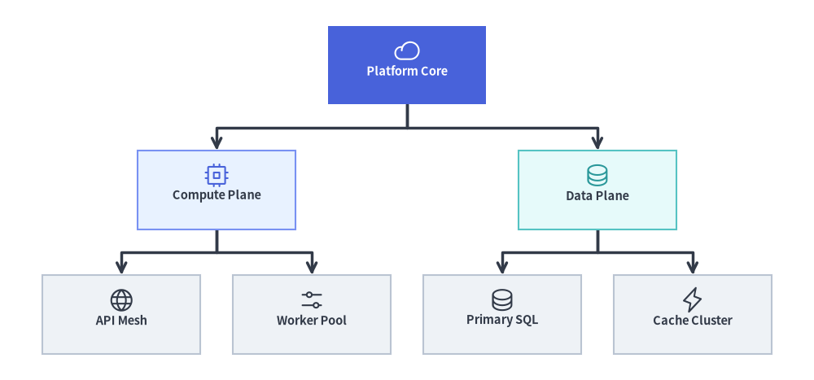
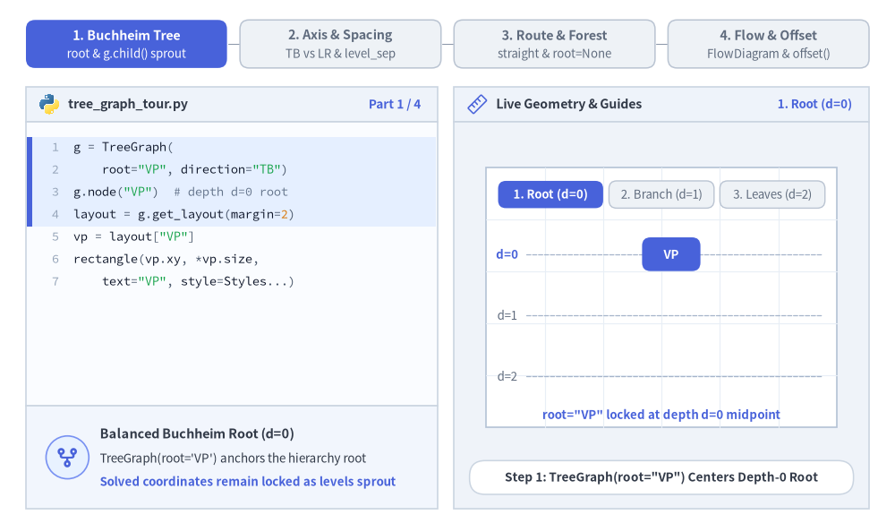
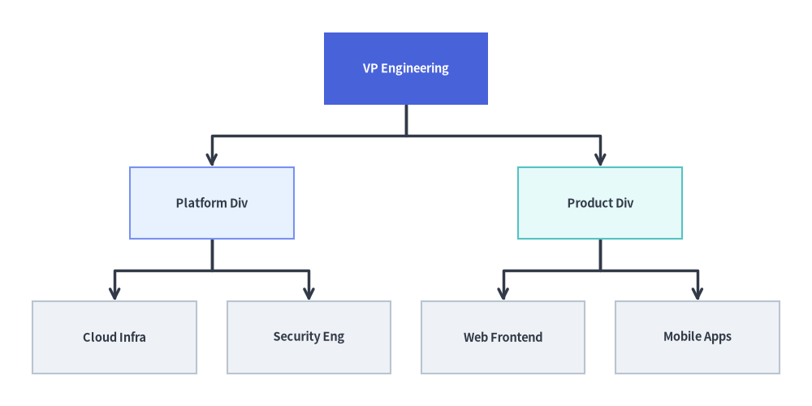
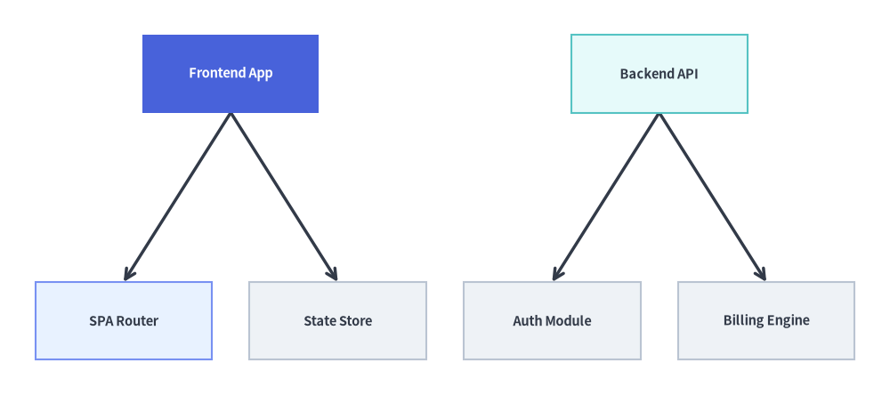

# TreeGraph: Balanced Hierarchies & Decomposition Trees

`TreeGraph` implements the **Reingold-Tilford / Buchheim compact tree layout algorithm**, computing balanced `(cx, cy)` node centers and branch waypoints so that every parent node is symmetrically centered over (or beside) its children while sibling subtrees are packed tightly without ever colliding.

Use `TreeGraph` whenever your topology is a strict tree (every node has at most one parent), such as organization charts, Abstract Syntax Trees (ASTs), call hierarchies, taxonomy breakdowns, or fault trees. Call `layout = g.get_layout(margin=...)` to solve coordinates and render with [`FlowDiagram`](../06_diagrams/flow.md), [`ArchitectureDiagram`](../06_diagrams/architecture.md), or [`drawlib.shapes`](../02_drawing_primitives/shapes_overview.md) and [`drawlib.lines`](../02_drawing_primitives/lines.md).


<figure class="drawlib-image" style="text-align: center;">
  
  <figcaption class="drawlib-caption">TreeGraph Overview: Balanced Buchheim Tree Coordinates Rendered with Orthogonal Branch Polylines and Icons</figcaption>
</figure>

<details class="drawlib-code-details">
<summary>Source Code</summary>

```python
from drawlib.canvas import save, setup
from drawlib.graph import TreeGraph
from drawlib.icons import phosphor
from drawlib.lines import lines
from drawlib.shapes import rectangle
from drawlib.styles import Styles

setup(width=124, height=58)

g = TreeGraph(
    root="core",
    direction="TB",
    level_sep=7.0,
    sibling_sep=5.0,
    edge_routing="orthogonal",
    default_node_width=24.0,
    default_node_height=12.0,
)

# Level 0: Root Node
g.node("core")

# Level 1: Division Branches
g.child("core", "compute")
g.child("core", "data")

# Level 2: Leaf Subsystems
g.child("compute", "api")
g.child("compute", "workers")
g.child("data", "sql")
g.child("data", "cache")

# 1. Compute balanced tree coordinates & orthogonal branch waypoints
layout = g.get_layout(margin=4.5)

# 2. Render orthogonal tree branches from layout.edges
for e in layout.edges:
    lines(e.points, arrow_head="->", style=Styles.DarkBold)

# 3. Render node cards & Phosphor icons at solved (cx, cy) coordinates
node_meta = {
    "core": ("\nPlatform Core", Styles.PrimaryFlat, Styles.WhiteBold, phosphor.cloud, Styles.White),
    "compute": ("\nCompute Plane", Styles.PrimaryNeutral, Styles.DarkBold, phosphor.cpu, Styles.Primary),
    "data": ("\nData Plane", Styles.SecondaryNeutral, Styles.DarkBold, phosphor.database, Styles.Secondary),
    "api": ("\nAPI Mesh", Styles.Neutral, Styles.DarkBold, phosphor.globe, Styles.Dark),
    "workers": ("\nWorker Pool", Styles.Neutral, Styles.DarkBold, phosphor.sliders_horizontal, Styles.Dark),
    "sql": ("\nPrimary SQL", Styles.Neutral, Styles.DarkBold, phosphor.database, Styles.Dark),
    "cache": ("\nCache Cluster", Styles.Neutral, Styles.DarkBold, phosphor.lightning, Styles.Dark),
}

for nid, (label, box_st, txt_st, icon_fn, ic_st) in node_meta.items():
    n = layout[nid]
    rectangle(
        n.xy,
        width=n.width,
        height=n.height,
        style=box_st,
        text=label,
        text_style=txt_st.patch(text_size=10.5),
    )
    icon_fn((n.x, n.y + 2.2), width=4.0, style=ic_st)

save()
```

</details>


---

## 1. Core Concepts & Basic Usage

`TreeGraph` computes **balanced Reingold-Tilford / Buchheim tree coordinates** via `layout = g.get_layout()`: declare a hierarchy concisely with `g.child(parent, child_id)`, tune `direction` (`"TB"` or `"LR"`), `level_sep`, and `sibling_sep`, switch `edge_routing` between `"orthogonal"` forks and `"straight"` diagonals (or pass `root=None` to arrange independent multi-root forests side-by-side), and render the solved `layout[id].xy` centers with primitives or [`FlowDiagram`](../06_diagrams/flow.md) plus `layout.offset()`:


<figure class="drawlib-image" style="text-align: center;">
  
  <figcaption class="drawlib-caption">Basic Usage & Parameter Tour: Buchheim Balanced Sprouting, Direction & Subtree Spacing, Orthogonal vs. Multi-Root Forests, and FlowDiagram Rendering (APNG Animation)</figcaption>
</figure>

<details class="drawlib-code-details">
<summary>Source Code</summary>

```python
from __future__ import annotations

from drawlib.anim import Animation
from drawlib.canvas import save, setup
from drawlib.diagrams.flow import FlowDiagram, Process
from drawlib.graph import GraphLayout, TreeGraph
from drawlib.icons import code as code_icons
from drawlib.icons import phosphor
from drawlib.lines import line, lines
from drawlib.shapes import circle, rectangle
from drawlib.smartarts import SourceCode, SourceCodeStyles
from drawlib.styles import Styles
from drawlib.text import text

W, H = 138.0, 82.0
setup(width=W, height=H)
anim = Animation(fps=10.0, loop=0)

CODE_TEXT_SIZE = 10.0
PT_TO_CANVAS = W / 720.0
FONT_CANVAS = CODE_TEXT_SIZE * PT_TO_CANVAS
LINE_H = FONT_CANVAS * 1.8
PAD_Y = FONT_CANVAS * 1.2

CODE_STYLES = SourceCodeStyles.get("default", font_lang="en", text_size=CODE_TEXT_SIZE).patch(
    box_style=Styles.Neutral.patch(shape_fill_color=(0, 0, 0, 0), shape_line_width=0),
)

PANE_HEADER = Styles.Neutral.patch(
    shape_fill_color=(238, 243, 250),
    shape_line_color=(203, 213, 225),
    shape_line_width=1.2,
    shape_r=0.0,
)
EDITOR_BODY = Styles.Neutral.patch(
    shape_fill_color=(250, 252, 255),
    shape_line_color=(203, 213, 225),
    shape_line_width=1.2,
    shape_r=0.0,
)
TAKEAWAY_BODY = Styles.Neutral.patch(
    shape_fill_color=(242, 246, 253),
    shape_line_color=(203, 213, 225),
    shape_line_width=1.2,
    shape_r=0.0,
)
STUDIO_BODY = Styles.Neutral.patch(
    shape_fill_color=(239, 243, 249),
    shape_line_color=(203, 213, 225),
    shape_line_width=1.2,
    shape_r=0.0,
)

PART_ITEMS = [
    ("1. Buchheim Tree", "root & g.child() sprout"),
    ("2. Axis & Spacing", "TB vs LR & level_sep"),
    ("3. Route & Forest", "straight & root=None"),
    ("4. Flow & Offset", "FlowDiagram & offset()"),
]


def draw_step_bar(active_part: int) -> None:
    """Draw top 4-part progress bar (active_part is 1..4)."""
    pill_w = 31.0
    pill_h = 7.4
    gap = 2.0
    start_x = 4.0 + pill_w / 2.0
    cy = 75.2

    for idx, (label, sublabel) in enumerate(PART_ITEMS, start=1):
        cx = start_x + (idx - 1) * (pill_w + gap)
        if idx > 1:
            prev_cx = cx - (pill_w + gap)
            line(
                (prev_cx + pill_w / 2.0 + 0.2, cy),
                (cx - pill_w / 2.0 - 0.2, cy),
                style=Styles.PrimaryBold if idx <= active_part else Styles.MutedThin,
            )

        if idx == active_part:
            st = Styles.PrimaryFlat.patch(shape_r=1.4)
            tst = Styles.WhiteBold.patch(text_size=10.3)
            sub_tst = Styles.White.patch(text_size=9.5)
        elif idx < active_part:
            st = Styles.PrimaryNeutral.patch(shape_r=1.4, shape_line_width=1.1)
            tst = Styles.PrimaryBold.patch(text_size=10.3)
            sub_tst = Styles.Primary.patch(text_size=9.5)
        else:
            st = Styles.Neutral.patch(shape_r=1.4, shape_line_width=1.1)
            tst = Styles.MutedBold.patch(text_size=10.3)
            sub_tst = Styles.Muted.patch(text_size=9.5)

        rectangle((cx, cy), width=pill_w, height=pill_h, style=st)
        text((cx, cy + 1.35), label, style=tst)
        text((cx, cy - 1.55), sublabel, style=sub_tst)


def draw_left_pane(
    active_part: int,
    code_lines: list[str],
    hl_range: tuple[int, int],
    icon_fn: object,
    summary_title: str,
    summary_line1: str,
    summary_line2: str,
) -> None:
    """Draw left Python code editor + bottom concept takeaway card."""
    x0, w = 4.0, 63.5
    cx = x0 + w / 2.0
    top_y = 63.2
    header_h = 5.4
    editor_h = 43.8
    takeaway_h = 15.8

    rectangle((cx, top_y + header_h / 2.0), width=w, height=header_h, style=PANE_HEADER)
    code_icons.python((x0 + 3.6, top_y + header_h / 2.0), width=3.4, style=Styles.Neutral)
    text(
        (x0 + 6.5, top_y + header_h / 2.0),
        "tree_graph_tour.py",
        style=Styles.DarkBold.patch(text_size=10.2, halign="left"),
    )
    text(
        (x0 + w - 2.6, top_y + header_h / 2.0),
        f"Part {active_part} / 4",
        style=Styles.PrimaryBold.patch(text_size=9.8, halign="right"),
    )

    rectangle((cx, top_y - editor_h / 2.0), width=w, height=editor_h, style=EDITOR_BODY)

    hl_start, hl_end = hl_range
    hl_top = top_y - PAD_Y - hl_start * LINE_H
    hl_bot = top_y - PAD_Y - (hl_end + 1) * LINE_H
    hl_cy = (hl_top + hl_bot) / 2.0
    hl_h = hl_top - hl_bot
    rectangle(
        (cx, hl_cy),
        width=w - 0.6,
        height=hl_h,
        style=Styles.Neutral.patch(shape_fill_color=(229, 239, 255), shape_line_width=0),
    )
    rectangle(
        (x0 + 0.55, hl_cy),
        width=0.9,
        height=hl_h,
        style=Styles.PrimaryFlat.patch(shape_line_width=0),
    )

    SourceCode.draw(
        xy=(x0, top_y),
        width=w,
        code="\n".join(code_lines),
        styles=CODE_STYLES,
        code_lang="python",
        show_linenum=True,
        align="top_left",
    )

    take_cy = 3.6 + takeaway_h / 2.0
    rectangle((cx, take_cy), width=w, height=takeaway_h, style=TAKEAWAY_BODY)
    circle(
        (x0 + 6.4, take_cy),
        radius=3.3,
        style=Styles.PrimaryNeutral.patch(shape_line_width=1.2),
    )
    icon_fn((x0 + 6.4, take_cy), width=3.8, style=Styles.PrimaryBold)  # type: ignore[operator]
    text(
        (x0 + 11.4, take_cy + 3.6),
        summary_title,
        style=Styles.DarkBold.patch(text_size=10.4, halign="left"),
    )
    text(
        (x0 + 11.4, take_cy - 0.2),
        summary_line1,
        style=Styles.Dark.patch(text_size=9.7, halign="left"),
    )
    text(
        (x0 + 11.4, take_cy - 3.8),
        summary_line2,
        style=Styles.PrimaryBold.patch(text_size=9.6, halign="left"),
    )


def draw_geometry_studio(param_badge: str, footer_caption: str) -> tuple[float, float]:
    """Draw right geometry lab shell, inner coordinate sheet with subtle grid, and footer."""
    x0, w = 70.0, 64.0
    cx = x0 + w / 2.0
    top_y = 63.2
    header_h = 5.4
    body_h = 59.6

    rectangle((cx, top_y + header_h / 2.0), width=w, height=header_h, style=PANE_HEADER)
    phosphor.ruler((x0 + 3.6, top_y + header_h / 2.0), width=3.4, style=Styles.Primary)
    text(
        (x0 + 6.5, top_y + header_h / 2.0),
        "Live Geometry & Guides",
        style=Styles.DarkBold.patch(text_size=10.2, halign="left"),
    )
    text(
        (x0 + w - 2.6, top_y + header_h / 2.0),
        param_badge,
        style=Styles.PrimaryBold.patch(text_size=9.6, halign="right"),
    )

    rectangle((cx, 3.6 + body_h / 2.0), width=w, height=body_h, style=STUDIO_BODY)

    sheet_cx, sheet_cy = cx, 36.2
    sheet_w, sheet_h = 54.0, 40.0
    sx0, sy0 = sheet_cx - sheet_w / 2.0, sheet_cy - sheet_h / 2.0
    rectangle(
        (sheet_cx, sheet_cy),
        width=sheet_w,
        height=sheet_h,
        style=Styles.Neutral.patch(
            shape_fill_color=(255, 255, 255),
            shape_line_color=(180, 194, 214),
            shape_line_width=1.2,
        ),
    )
    g_st = Styles.MutedThin.patch(line_color=(232, 238, 246), line_width=0.8)
    for gx in range(1, 6):
        vx = sx0 + gx * (sheet_w / 6.0)
        line((vx, sy0), (vx, sy0 + sheet_h), style=g_st)
    for gy in range(1, 5):
        vy = sy0 + gy * (sheet_h / 5.0)
        line((sx0, vy), (sx0 + sheet_w, vy), style=g_st)

    rectangle(
        (cx, 8.4),
        width=59.2,
        height=5.2,
        style=Styles.Neutral.patch(
            shape_fill_color=(255, 255, 255),
            shape_line_color=(203, 213, 225),
            shape_line_width=1.1,
            shape_r=2.4,
        ),
        text=footer_caption,
        text_style=Styles.DarkBold.patch(text_size=9.8),
    )
    return sheet_cx, sheet_cy


def draw_sub_pills(scx: float, labels: list[str], active_idx: int) -> None:
    """Draw 3-step tracker pills near the top of the studio sheet."""
    pw, ph, pgap = 16.2, 4.2, 0.9
    p_start = scx - (3 * pw + 2 * pgap) / 2.0 + pw / 2.0
    for idx, lbl in enumerate(labels):
        px = p_start + idx * (pw + pgap)
        if idx == active_idx:
            pst = Styles.PrimaryFlat.patch(shape_r=1.2)
            ptst = Styles.WhiteBold.patch(text_size=9.5)
        elif idx < active_idx:
            pst = Styles.PrimaryNeutral.patch(shape_r=1.2, shape_line_width=1.0)
            ptst = Styles.PrimaryBold.patch(text_size=9.5)
        else:
            pst = Styles.Neutral.patch(shape_r=1.2, shape_line_width=1.0)
            ptst = Styles.Muted.patch(text_size=9.5)
        rectangle((px, 52.0), width=pw, height=ph, style=pst, text=lbl, text_style=ptst)


OX, OY = 76.5, 19.8
GW, GH = 51.0, 27.0

TXT_DARK = Styles.DarkBold.patch(text_size=9.6)
TXT_WHITE = Styles.WhiteBold.patch(text_size=9.6)
GUIDE_DASH = Styles.MutedDashed.patch(line_width=0.9, line_color=(165, 180, 202))


def render_tree_cards(
    lay: GraphLayout,
    ox: float,
    oy: float,
    visible_nodes: set[str],
    focal_nodes: set[str],
    sec_nodes: set[str],
) -> None:
    """Render edges and cards of a solved TreeGraph layout shifted by (ox, oy)."""
    for e in lay.edges:
        if e.src in visible_nodes and e.dst in visible_nodes:
            pts = [(px + ox, py + oy) for px, py in e.points]
            lines(pts, arrow_head="->", style=Styles.DarkBold.patch(line_width=1.2))

    for nid in lay.nodes:
        if nid not in visible_nodes:
            continue
        nl = lay.nodes[nid]
        if nid in focal_nodes:
            bst = Styles.PrimaryFlat.patch(shape_r=1.3)
            tst = TXT_WHITE
        elif nid in sec_nodes:
            bst = Styles.PrimaryNeutral.patch(shape_r=1.3)
            tst = TXT_DARK
        else:
            bst = Styles.Neutral.patch(shape_r=1.3)
            tst = TXT_DARK
        rectangle(
            (nl.x + ox, nl.y + oy),
            width=nl.width,
            height=nl.height,
            style=bst,
            text=nid,
            text_style=tst,
        )


# =========================================================================
# Part 1: Buchheim Tree — Balanced 1 -> 2 -> 4 Top-Down Sprouting
# =========================================================================
g_p1 = TreeGraph(
    root="VP",
    direction="TB",
    level_sep=4.2,
    sibling_sep=2.0,
    default_node_width=9.0,
    default_node_height=5.2,
)
g_p1.node("VP")
g_p1.child("VP", "App")
g_p1.child("VP", "Infra")
g_p1.child("App", "Web")
g_p1.child("App", "API")
g_p1.child("Infra", "K8s")
g_p1.child("Infra", "DB")

OX_P1, OY_P1 = 80.2, 20.0
lay_p1 = g_p1.get_layout(width=46.6, height=26.8, margin=1.2)
p1_depth_ys = [lay_p1["VP"].y, lay_p1["App"].y, lay_p1["Web"].y]

PART1_STATES = [
    (
        "d0_root",
        3.3,
        [
            "g = TreeGraph(",
            '    root="VP", direction="TB")',
            'g.node("VP")  # depth d=0 root',
            "layout = g.get_layout(margin=2)",
            'vp = layout["VP"]',
            "rectangle(vp.xy, *vp.size,",
            '    text="VP", style=Styles...)',
        ],
        (0, 3),
        "1. Root (d=0)",
        'Step 1: TreeGraph(root="VP") Centers Depth-0 Root',
        "Balanced Buchheim Root (d=0)",
        "TreeGraph(root='VP') anchors the hierarchy root",
        "Solved coordinates remain locked as levels sprout",
    ),
    (
        "d1_branches",
        3.3,
        [
            "g = TreeGraph(",
            '    root="VP", direction="TB")',
            "# Register + connect in 1 call:",
            'g.child("VP", "App")',
            'g.child("VP", "Infra")',
            "layout = g.get_layout(margin=2)",
            "# VP centered over App & Infra!",
        ],
        (2, 4),
        "2. Branches (d=1)",
        'Step 2: g.child("VP", ...) Sprouts Symmetric d=1 Pair',
        "Single-Call g.child() Helper",
        "g.child(parent, id) registers & connects in 1 call",
        "Buchheim solver centers VP midway above App & Infra",
    ),
    (
        "d2_leaves",
        3.5,
        [
            'g = TreeGraph(root="VP", ...)',
            'g.child("VP", "App")',
            'g.child("VP", "Infra")',
            'g.child("App", "Web")',
            'g.child("App", "API")',
            'g.child("Infra", "K8s")',
            'g.child("Infra", "DB")',
            "layout = g.get_layout(margin=2)",
        ],
        (3, 6),
        "3. Leaves (d=2)",
        "Step 3: 4 Leaf Teams Sprout With Parents Centered",
        "Symmetric Subtree Centering",
        "App centers over Web/API; Infra over K8s/DB",
        "Zero sibling subtree collisions at every depth",
    ),
]

for p1_idx, (m1, dur, code_1, hl_rng, badge_txt, foot_txt, s_t, s_1, s_2) in enumerate(PART1_STATES):
    with anim.frame(duration=dur):
        draw_step_bar(1)
        draw_left_pane(1, code_1, hl_rng, phosphor.git_fork, s_t, s_1, s_2)
        scx, _ = draw_geometry_studio(badge_txt, foot_txt)
        draw_sub_pills(scx, ["1. Root (d=0)", "2. Branch (d=1)", "3. Leaves (d=2)"], p1_idx)

        for d_idx, dy in enumerate(p1_depth_ys):
            gy = OY_P1 + dy
            line((81.2, gy), (126.8, gy), style=GUIDE_DASH)
            tst = (
                Styles.PrimaryBold.patch(text_size=9.5)
                if d_idx <= p1_idx
                else Styles.Muted.patch(text_size=9.5)
            )
            text((78.2, gy), f"d={d_idx}", style=tst)

        if m1 == "d0_root":
            render_tree_cards(lay_p1, OX_P1, OY_P1, {"VP"}, {"VP"}, set())
            text(
                (scx, 18.0),
                'root="VP" locked at depth d=0 midpoint',
                style=Styles.PrimaryBold.patch(text_size=9.5),
            )
        elif m1 == "d1_branches":
            render_tree_cards(
                lay_p1,
                OX_P1,
                OY_P1,
                {"VP", "App", "Infra"},
                {"VP"},
                {"App", "Infra"},
            )
            text(
                (scx, 18.0),
                "g.child() sprouts d=1  •  VP centered over branches",
                style=Styles.PrimaryBold.patch(text_size=9.5),
            )
        else:
            render_tree_cards(
                lay_p1,
                OX_P1,
                OY_P1,
                set(lay_p1.nodes.keys()),
                {"VP"},
                {"App", "Infra"},
            )
            text(
                (scx, 18.0),
                "balanced 1 -> 2 -> 4 Buchheim hierarchy solved",
                style=Styles.PrimaryBold.patch(text_size=9.5),
            )

# =========================================================================
# Part 2: Axis & Spacing — Compact TB, Wider Asymmetric, and direction="LR"
# =========================================================================
PART2_STATES = [
    (
        "tb_compact",
        3.3,
        [
            "g = TreeGraph(",
            '    root="VP", direction="TB",',
            "    level_sep=3.4,",
            "    sibling_sep=1.6)",
            "# 3 leaves under App (Web/API/Mob)",
            "# 1 leaf under Ops (SRE)",
            "layout = g.get_layout(margin=2)",
        ],
        (1, 3),
        'direction="TB"',
        "Compact Top-Down Asymmetric Subtrees (3 vs 1 Leaf)",
        "Compact Subtree Contour Packing",
        "Buchheim contours pack 3-leaf App & 1-leaf Ops",
        "Parents stay centered over unequal child counts",
    ),
    (
        "tb_wider",
        3.3,
        [
            "g = TreeGraph(",
            '    root="VP", direction="TB",',
            "    level_sep=5.2,",
            "    sibling_sep=3.6)",
            "# Buchheim contour solver packs",
            "# 3-leaf & 1-leaf subtrees cleanly",
            "layout = g.get_layout(margin=2)",
        ],
        (2, 3),
        "Wider Spacing",
        "Tuning level_sep=5.2 & sibling_sep=3.6 Cleanly",
        "Generational & Sibling Gaps",
        "level_sep expands vertical depth-to-depth spacing",
        "sibling_sep widens horizontal leaf & branch gaps",
    ),
    (
        "lr_tree",
        3.5,
        [
            "g = TreeGraph(",
            '    root="VP",',
            '    direction="LR",',
            "    level_sep=6.8, sibling_sep=1.6",
            ")",
            "# Horizontal decomposition tree:",
            "# Root (left) -> Leaves (right)",
            "layout = g.get_layout(margin=2)",
        ],
        (1, 3),
        'direction="LR"',
        'direction="LR": Left-to-Right Call / WBS Tree',
        "Horizontal Left-to-Right Growth",
        "direction='LR' places Root on left, leaves on right",
        "Ideal for wide labels & call/query fan-out trees",
    ),
]

for p2_idx, (m2, dur, code_2, hl_rng, badge_txt, foot_txt, s_t, s_1, s_2) in enumerate(PART2_STATES):
    with anim.frame(duration=dur):
        draw_step_bar(2)
        draw_left_pane(2, code_2, hl_rng, phosphor.sliders_horizontal, s_t, s_1, s_2)
        scx, _ = draw_geometry_studio(badge_txt, foot_txt)
        draw_sub_pills(scx, ["direction='TB'", "Wider Spacing", "direction='LR'"], p2_idx)

        if m2 in ("tb_compact", "tb_wider"):
            wide = m2 == "tb_wider"
            g_p2 = TreeGraph(
                root="VP",
                direction="TB",
                level_sep=5.0 if wide else 3.2,
                sibling_sep=3.6 if wide else 1.5,
                default_node_width=8.6,
                default_node_height=4.9,
            )
            for p_id, c_id in [
                ("VP", "App"),
                ("VP", "Ops"),
                ("App", "Web"),
                ("App", "API"),
                ("App", "Mob"),
                ("Ops", "SRE"),
            ]:
                g_p2.child(p_id, c_id)
            lay_p2 = g_p2.get_layout(width=GW, height=GH, margin=1.2)
            render_tree_cards(
                lay_p2,
                OX,
                OY,
                set(lay_p2.nodes.keys()),
                {"VP"},
                {"App", "Ops"},
            )
            if wide:
                x1 = lay_p2["App"].right + OX + 0.3
                x2 = lay_p2["Ops"].left + OX - 0.3
                y_br = lay_p2["App"].y + OY
                line((x1, y_br), (x2, y_br), arrow_head="<->", style=Styles.DangerBold.patch(line_width=1.2))
                rx_sep = lay_p2["Ops"].right + OX + 1.6
                line(
                    (rx_sep, lay_p2["Ops"].bottom + OY),
                    (rx_sep, lay_p2["SRE"].top + OY),
                    arrow_head="<->",
                    style=Styles.DangerBold.patch(line_width=1.2),
                )
                text(
                    (scx, 18.0),
                    "level_sep=5.2 & sibling_sep=3.6  •  zero collision",
                    style=Styles.DangerBold.patch(text_size=9.5),
                )
            else:
                text(
                    (scx, 18.0),
                    "asymmetric 3-leaf App + 1-leaf Ops packed tightly",
                    style=Styles.DarkBold.patch(text_size=9.5),
                )
        else:
            g_lr = TreeGraph(
                root="VP",
                direction="LR",
                level_sep=6.8,
                sibling_sep=1.5,
                default_node_width=9.6,
                default_node_height=4.7,
            )
            for p_id, c_id in [
                ("VP", "App"),
                ("VP", "Ops"),
                ("App", "Web"),
                ("App", "API"),
                ("App", "Mob"),
                ("Ops", "SRE"),
            ]:
                g_lr.child(p_id, c_id)
            lay_lr = g_lr.get_layout(width=GW, height=GH, margin=1.2)
            render_tree_cards(
                lay_lr,
                OX,
                OY,
                set(lay_lr.nodes.keys()),
                {"VP"},
                {"App", "Ops"},
            )
            text(
                (scx, 18.0),
                'direction="LR" fans out left-to-right across 3 depths',
                style=Styles.PrimaryBold.patch(text_size=9.5),
            )

# =========================================================================
# Part 3: Route & Forest — orthogonal vs. straight & Multi-Root Forest
# =========================================================================
PART3_STATES = [
    (
        "ortho_route",
        3.3,
        [
            "g = TreeGraph(",
            '    root="VP", direction="TB",',
            '    edge_routing="orthogonal")',
            "layout = g.get_layout(margin=2)",
            "for e in layout.edges:",
            "    # 4-point right-angle forks",
            '    lines(e.points, "->")',
        ],
        (1, 3),
        "orthogonal",
        'edge_routing="orthogonal": Crisp Right-Angle Forks',
        "Orthogonal Tree Branches",
        "Default edge_routing='orthogonal' builds 90-deg forks",
        "Shared horizontal rail splits cleanly above children",
    ),
    (
        "straight_route",
        3.3,
        [
            "g = TreeGraph(",
            '    root="VP", direction="TB",',
            '    edge_routing="straight")',
            "layout = g.get_layout(margin=2)",
            "for e in layout.edges:",
            "    # Direct 2-point segments",
            '    lines(e.points, "->")',
        ],
        (1, 3),
        "straight",
        'edge_routing="straight": Direct Diagonal Segments',
        "Direct Euclidean Tree Edges",
        "edge_routing='straight' connects parent -> child ports",
        "Ideal for ASTs, parse trees & compact taxonomies",
    ),
    (
        "forest_roots",
        3.5,
        [
            "g = TreeGraph(",
            '    root=None, direction="TB")',
            '# Tree 1 (in-degree 0 root "App")',
            'g.child("App", "Web")',
            'g.child("App", "API")',
            '# Tree 2 (in-degree 0 root "Ops")',
            'g.child("Ops", "K8s")',
            'g.child("Ops", "DB")',
            "layout = g.get_layout(margin=2)",
        ],
        (1, 6),
        "root=None Forest",
        "root=None Auto-Detects Roots & Packs Forest Trees",
        "Automatic Multi-Root Forest",
        "Omitting root=None finds all in-degree 0 roots",
        "Arranges independent App & Ops trees side-by-side",
    ),
]

for p3_idx, (m3, dur, code_3, hl_rng, badge_txt, foot_txt, s_t, s_1, s_2) in enumerate(PART3_STATES):
    with anim.frame(duration=dur):
        draw_step_bar(3)
        draw_left_pane(3, code_3, hl_rng, phosphor.path, s_t, s_1, s_2)
        scx, _ = draw_geometry_studio(badge_txt, foot_txt)
        draw_sub_pills(scx, ["orthogonal", "straight", "root=None Forest"], p3_idx)

        if m3 in ("ortho_route", "straight_route"):
            g_p3 = TreeGraph(
                root="VP",
                direction="TB",
                edge_routing="straight" if m3 == "straight_route" else "orthogonal",
                level_sep=4.4,
                sibling_sep=2.2,
                default_node_width=9.2,
                default_node_height=5.2,
            )
            for p_id, c_id in [
                ("VP", "App"),
                ("VP", "Ops"),
                ("App", "Web"),
                ("App", "API"),
                ("Ops", "K8s"),
                ("Ops", "DB"),
            ]:
                g_p3.child(p_id, c_id)
            lay_p3 = g_p3.get_layout(width=GW, height=GH, margin=1.5)
            render_tree_cards(
                lay_p3,
                OX,
                OY,
                set(lay_p3.nodes.keys()),
                {"VP"},
                {"App", "Ops"},
            )
            text(
                (scx, 18.0),
                (
                    'edge_routing="straight"  •  direct diagonal segments'
                    if m3 == "straight_route"
                    else 'edge_routing="orthogonal"  •  90-deg branch forks'
                ),
                style=(Styles.PrimaryBold if m3 == "straight_route" else Styles.DarkBold).patch(
                    text_size=9.5
                ),
            )
        else:
            g_for = TreeGraph(
                root=None,
                direction="TB",
                edge_routing="orthogonal",
                level_sep=6.2,
                sibling_sep=2.2,
                default_node_width=9.4,
                default_node_height=5.4,
            )
            g_for.child("App", "Web")
            g_for.child("App", "API")
            g_for.child("Ops", "K8s")
            g_for.child("Ops", "DB")
            lay_for = g_for.get_layout(width=GW, height=GH, margin=1.5)

            mid_div_x = OX + (lay_for["API"].right + lay_for["K8s"].left) / 2.0
            line((mid_div_x, 21.6), (mid_div_x, 45.8), style=GUIDE_DASH)
            text(
                (OX + lay_for["App"].x, 45.2),
                "Tree 1 (root='App')",
                style=Styles.PrimaryBold.patch(text_size=9.5),
            )
            text(
                (OX + lay_for["Ops"].x, 45.2),
                "Tree 2 (root='Ops')",
                style=Styles.PrimaryBold.patch(text_size=9.5),
            )

            render_tree_cards(
                lay_for,
                OX,
                OY - 1.2,
                set(lay_for.nodes.keys()),
                {"App"},
                {"Ops"},
            )
            text(
                (scx, 18.0),
                "root=None auto-detects both roots as a balanced forest",
                style=Styles.PrimaryBold.patch(text_size=9.5),
            )

# =========================================================================
# Part 4: Flow & Offset — FlowDiagram Cards, Branch Reveal & layout.offset()
# =========================================================================
PART4_STATES = [
    (
        "flow_cards",
        3.3,
        [
            "layout = g.get_layout(margin=2)",
            "fd = FlowDiagram(...)",
            "for nid in layout.nodes:",
            "    nl = layout[nid]",
            "    fd.add(Process(nid, *nl.size),",
            "        xy=nl.xy)",
            "# Connect bottom -> top ports",
            "fd.draw(xy=(OX, OY))",
        ],
        (2, 5),
        "FlowDiagram",
        "Render Solved layout[id].xy Centers With FlowDiagram",
        "Pairing TreeGraph + FlowDiagram",
        "Place Process cards directly at solved nl.xy centers",
        "fd.connect(..., start_side='bottom', end_side='top')",
    ),
    (
        "branch_reveal",
        3.3,
        [
            "layout = g.get_layout(margin=2)",
            "fd = FlowDiagram(...)",
            'crit = {"VP", "Infra", "K8s"}',
            "# Highlight critical subtree path",
            "# while siblings stay Neutral!",
            "fd.connect(vp, infra,",
            "    style=Styles.PrimaryBold)",
            "fd.draw(xy=(OX, OY))",
        ],
        (2, 6),
        "Branch Reveal",
        "Highlight Critical Subtree Path (VP -> Infra -> K8s)",
        "Focal Critical-Path Highlighting",
        "Emphasize VP -> Infra -> K8s with Primary accents",
        "70%+ sibling cards stay calm Neutral for clarity",
    ),
    (
        "offset_k8s",
        3.5,
        [
            "layout = g.get_layout(margin=2)",
            "# Fine post-solve leaf adjustment:",
            'layout.offset("K8s", dx=2.0)',
            "# Shifts node + incident ports!",
            'k8s = fd.add(Process("K8s", ...),',
            '    xy=layout["K8s"].xy)',
            "fd.draw(xy=(OX, OY))",
        ],
        (1, 3),
        "layout.offset()",
        'layout.offset("K8s", dx=2.0): Post-Solve Leaf Shift',
        "Fine Post-Solve Adjustment (.offset)",
        "layout.offset('K8s', dx=2.0) nudges leaf horizontally",
        "FlowDiagram orthogonal connector adapts automatically",
    ),
]

for p4_idx, (m4, dur, code_4, hl_rng, badge_txt, foot_txt, s_t, s_1, s_2) in enumerate(PART4_STATES):
    with anim.frame(duration=dur):
        draw_step_bar(4)
        draw_left_pane(4, code_4, hl_rng, phosphor.squares_four, s_t, s_1, s_2)
        scx, _ = draw_geometry_studio(badge_txt, foot_txt)
        draw_sub_pills(scx, ["FlowDiagram", "Branch Reveal", "layout.offset()"], p4_idx)

        g_p4 = TreeGraph(
            root="VP",
            direction="TB",
            level_sep=4.5,
            sibling_sep=2.0,
            default_node_width=8.8,
            default_node_height=4.8,
        )
        g_p4.child("VP", "App")
        g_p4.child("VP", "Infra")
        g_p4.child("App", "Web")
        g_p4.child("App", "API")
        g_p4.child("Infra", "DB")
        g_p4.child("Infra", "K8s")

        lay_p4 = g_p4.get_layout(width=48.0, height=25.2, margin=1.2)
        ox_p4, oy_p4 = 76.8, 21.8
        orig_k8s_xy = lay_p4["K8s"].xy
        if m4 == "offset_k8s":
            lay_p4.offset("K8s", dx=2.0)
            rectangle(
                (orig_k8s_xy[0] + ox_p4, orig_k8s_xy[1] + oy_p4),
                width=8.8,
                height=4.8,
                style=Styles.MutedDashed.patch(shape_fill_color=(0, 0, 0, 0), shape_line_width=1.0),
            )

        fd = FlowDiagram(
            node_style=Styles.Neutral,
            edge_style=Styles.DarkBold.patch(line_width=1.2),
            edge_text_style=Styles.DarkBold.patch(text_size=9.5),
        )
        f_nodes = {}
        for nid in lay_p4.nodes:
            nl = lay_p4[nid]
            if m4 == "flow_cards":
                st = (
                    Styles.PrimaryFlat
                    if nid == "VP"
                    else (Styles.PrimaryNeutral if nid in ("App", "Infra") else Styles.Neutral)
                )
                tst = TXT_WHITE if nid == "VP" else TXT_DARK
            else:
                if nid in ("VP", "K8s"):
                    st = Styles.PrimaryFlat
                    tst = TXT_WHITE
                elif nid == "Infra":
                    st = Styles.PrimaryNeutral
                    tst = TXT_DARK
                else:
                    st = Styles.Neutral
                    tst = TXT_DARK
            f_nodes[nid] = fd.add(
                Process(nid, *nl.size, style=st, text_style=tst),
                xy=nl.xy,
            )

        crit_edges = {("VP", "Infra"), ("Infra", "K8s")}
        for e in lay_p4.edges:
            if m4 == "flow_cards":
                est = Styles.DarkBold.patch(line_width=1.2)
            elif (e.src, e.dst) in crit_edges:
                est = Styles.PrimaryBold.patch(line_width=1.5)
            else:
                est = Styles.Muted.patch(line_width=1.0)
            fd.connect(f_nodes[e.src], f_nodes[e.dst], start_side="bottom", end_side="top", style=est)

        fd.draw(xy=(ox_p4, oy_p4))

        if m4 == "flow_cards":
            text(
                (scx, 18.0),
                "FlowDiagram Process cards at solved layout[id].xy",
                style=Styles.DarkBold.patch(text_size=9.5),
            )
        elif m4 == "branch_reveal":
            text(
                (scx, 18.0),
                "critical path VP -> Infra -> K8s  •  siblings Neutral",
                style=Styles.PrimaryBold.patch(text_size=9.5),
            )
        else:
            ky = lay_p4["K8s"].bottom + oy_p4 - 1.5
            ox_c = orig_k8s_xy[0] + ox_p4
            nx_c = lay_p4["K8s"].x + ox_p4
            t_st = Styles.DangerBold.patch(line_width=1.1)
            line((ox_c, ky - 0.7), (ox_c, ky + 0.7), style=t_st)
            line((nx_c, ky - 0.7), (nx_c, ky + 0.7), style=t_st)
            line((ox_c, ky), (nx_c, ky), arrow_head="->", style=Styles.DangerBold.patch(line_width=1.3))
            text(
                (nx_c + 1.0, ky),
                "+2.0 dx",
                style=Styles.DangerBold.patch(text_size=9.5, halign="left"),
            )
            text(
                (scx, 18.0),
                'dashed = pre-offset  •  layout.offset("K8s", dx=2.0)',
                style=Styles.DangerBold.patch(text_size=9.5),
            )

save()
```

</details>


- **Balanced Buchheim Tree Sprouting**: `TreeGraph` centers every parent node symmetrically over (or beside) its children while packing unequal subtrees tightly along their contours without overlap.
- **Axis & Spacing Controls**: Switch seamlessly between top-down org/AST hierarchies (`direction="TB"`) and left-to-right decomposition trees (`direction="LR"`), and tune generational and sibling spacing via `level_sep` and `sibling_sep`.
- **Orthogonal Forks, Diagonals & Multi-Root Forests**: Choose `"orthogonal"` right-angle fork polylines or `"straight"` Euclidean diagonals in `e.points`, and omit `root=None` to lay out multiple independent root hierarchies side-by-side automatically.
- **`FlowDiagram` Rendering & `.offset()`**: Feed solved `layout[id].xy` centers into `FlowDiagram` to highlight critical-path branches or apply fine post-solve spacing adjustments with `layout.offset(id, dx=..., dy=...)`.

---

## 2. Constructor, `.child()`, & `get_layout()` API

```python
from drawlib.graph import TreeGraph

g = TreeGraph(
    root="vp",                       # Explicit root node ID (auto-detected if None)
    direction="TB",                  # "TB" (Top-to-Bottom) or "LR" (Left-to-Right)
    level_sep=12.0,                  # Fixed gap between tree depths (auto-scales if None)
    sibling_sep=6.0,                 # Minimum gap between sibling nodes (auto-scales if None)
    edge_routing="orthogonal",       # "orthogonal" or "straight"
    default_node_width=24.0,
    default_node_height=11.0,
)

layout = g.get_layout(margin=5.0)
print(layout)                        # Inspect solved node centers & branch waypoints
```

### Parameter Reference

| Parameter | Type | Default | Description |
| :--- | :--- | :--- | :--- |
| `root` | `str \| None` | `None` | Explicit root node ID. If `None`, automatically detects all nodes with in-degree `0` and lays out multi-root forests side-by-side. |
| `direction` | `Literal["TB", "LR"]` | `"TB"` | Tree growth orientation (`"TB"` top-to-bottom or `"LR"` left-to-right). |
| `level_sep` | `float \| None` | `None` | Fixed distance between successive tree depths. Auto-scales to canvas if `None`. |
| `sibling_sep` | `float \| None` | `None` | Fixed minimum separation between adjacent siblings. Auto-scales to canvas if `None`. |
| `edge_routing` | `Literal["orthogonal", "straight"]` | `"orthogonal"` | Edge path routing (`"orthogonal"` right-angled tree branches or `"straight"` Euclidean segments) stored in `edge_layout.points`. |
| `default_node_width` | `float` | `22.0` | Default node width in canvas units. |
| `default_node_height` | `float` | `12.0` | Default node height in canvas units. |

### Concise Tree Construction with `g.child(...)`

In addition to `g.node(id, *, width=None, height=None)` and `g.edge(src, dst)`, `TreeGraph` provides a single-call `.child()` helper that registers a child node and connects it from `parent` in one step:

```python
g.child(
    parent: str,
    child_id: str,
    *,
    width: float | None = None,
    height: float | None = None,
) -> Node
```

> **Note**:
> - **Multi-Root Forests (`root=None`)**: When `root=None` and multiple nodes have in-degree `0` (no incoming edges), `TreeGraph` automatically creates a virtual super-root during layout calculation and arranges the independent trees side-by-side as a balanced forest.
> - **Strict Tree Validation**: `TreeGraph` validates that the graph is a strict acyclic tree (at most one parent per node). If a node has multiple parents (a diamond DAG), use [`LayerGraph`](./layer_graph.md) or [`ArchitectureGraph`](./architecture_graph.md) instead.

---

## 3. Top-Down (`TB`) Engineering Organization Hierarchy with `FlowDiagram`

A top-down (`direction="TB"`) tree is ideal for organizational structures, class taxonomies, and ASTs. Notice how the Buchheim contour solver (`g.get_layout()`) centers `VP Engineering` over the two division heads and evenly spaces the four leaf teams, while `FlowDiagram` (`Process` + `fork()`) renders the styled cards and orthogonal tree forks:


```python
from drawlib.canvas import save, setup
from drawlib.diagrams.flow import FlowDiagram, Process
from drawlib.graph import TreeGraph
from drawlib.styles import Styles

setup(width=124, height=62)

# Step 1: Declare tree topology & solve coordinates
g = TreeGraph(
    root="vp",
    direction="TB",
    default_node_width=25.0,
    default_node_height=11.0,
)
g.node("vp")
g.child("vp", "plat")
g.child("vp", "prod")
g.child("plat", "infra")
g.child("plat", "sec")
g.child("prod", "web")
g.child("prod", "mob")

layout = g.get_layout(margin=5.0)

# Step 2: Place Process nodes at solved layout[id].xy centers in FlowDiagram
fd = FlowDiagram(
    node_style=Styles.Neutral.patch(text_size=10.5),
    edge_style=Styles.DarkBold,
    edge_text_style=Styles.Dark.patch(text_size=10.0),
)

nodes = {}
for nid, label, st, tst in [
    ("vp", "VP Engineering", Styles.PrimaryFlat, Styles.WhiteBold),
    ("plat", "Platform Div", Styles.PrimaryNeutral, Styles.DarkBold),
    ("prod", "Product Div", Styles.SecondaryNeutral, Styles.DarkBold),
    ("infra", "Cloud Infra", Styles.Neutral, Styles.DarkBold),
    ("sec", "Security Eng", Styles.Neutral, Styles.DarkBold),
    ("web", "Web Frontend", Styles.Neutral, Styles.DarkBold),
    ("mob", "Mobile Apps", Styles.Neutral, Styles.DarkBold),
]:
    nl = layout[nid]
    nodes[nid] = fd.add(
        Process(
            label,
            width=nl.width,
            height=nl.height,
            style=st,
            text_style=tst.patch(text_size=10.5),
        ),
        xy=nl.xy,
    )

for e in layout.edges:
    fd.connect(nodes[e.src], nodes[e.dst], start_side="bottom", end_side="top")

fd.draw()
save()
```

<figure class="drawlib-image" style="text-align: center;">
  
  <figcaption class="drawlib-caption">Top-Down (TB) Engineering Organization Hierarchy Solved with TreeGraph and Rendered with FlowDiagram</figcaption>
</figure>


---

## 4. Left-to-Right (`LR`) Service Decomposition & Call Tree

Switching to `direction="LR"` grows the hierarchy horizontally from left to right. This layout works exceptionally well for API request fan-out trees, work breakdown structures (WBS), and query execution plans where labels are wider than they are tall:


```python
from drawlib.canvas import save, setup
from drawlib.diagrams.flow import FlowDiagram, Process
from drawlib.graph import TreeGraph
from drawlib.styles import Styles

setup(width=126, height=68)

# Step 1: Solve Left-to-Right tree coordinates
g = TreeGraph(
    root="query_plan",
    direction="LR",
    default_node_width=28.0,
    default_node_height=11.0,
)
g.node("query_plan")
g.child("query_plan", "index_scan")
g.child("query_plan", "agg_stage")
g.child("index_scan", "shard_1")
g.child("index_scan", "shard_2")
g.child("agg_stage", "col_store")
g.child("agg_stage", "cache_hit")

layout = g.get_layout(margin=5.0)

# Step 2: Render with FlowDiagram and labeled branch connectors
fd = FlowDiagram(
    node_style=Styles.Neutral.patch(text_size=10.5),
    edge_style=Styles.DarkBold,
    edge_text_style=Styles.Dark.patch(text_size=10.0),
)

nodes = {}
for nid, label, st, tst in [
    ("query_plan", "Query Planner", Styles.PrimaryFlat, Styles.WhiteBold),
    ("index_scan", "Index Lookup", Styles.PrimaryNeutral, Styles.DarkBold),
    ("agg_stage", "Hash Aggregate", Styles.SecondaryNeutral, Styles.DarkBold),
    ("shard_1", "Users Shard A", Styles.Neutral, Styles.DarkBold),
    ("shard_2", "Users Shard B", Styles.Neutral, Styles.DarkBold),
    ("col_store", "Orders Columnar", Styles.Neutral, Styles.DarkBold),
    ("cache_hit", "Materialized View", Styles.Neutral, Styles.DarkBold),
]:
    nl = layout[nid]
    nodes[nid] = fd.add(
        Process(
            label,
            width=nl.width,
            height=nl.height,
            style=st,
            text_style=tst.patch(text_size=10.5),
        ),
        xy=nl.xy,
    )

fd.connect(nodes["query_plan"], nodes["index_scan"], label="Filter", start_side="right", end_side="left")
fd.connect(nodes["query_plan"], nodes["agg_stage"], label="Group", start_side="right", end_side="left")
fd.connect(nodes["index_scan"], nodes["shard_1"], start_side="right", end_side="left")
fd.connect(nodes["index_scan"], nodes["shard_2"], start_side="right", end_side="left")
fd.connect(nodes["agg_stage"], nodes["col_store"], start_side="right", end_side="left")
fd.connect(nodes["agg_stage"], nodes["cache_hit"], start_side="right", end_side="left")

fd.draw()
save()
```

<figure class="drawlib-image" style="text-align: center;">
  
  <figcaption class="drawlib-caption">Left-to-Right (LR) Query Execution Decomposition Tree Rendered with FlowDiagram</figcaption>
</figure>


---

## 5. Automatic Multi-Root Forest (`root=None`) & Straight Edge Routing

When `root=None`, `TreeGraph` automatically identifies all nodes with in-degree `0` and arranges multiple independent trees side-by-side as a balanced forest. Passing `edge_routing="straight"` populates `edge_layout.points` with direct Euclidean line segments between parent and child ports:


```python
from drawlib.canvas import save, setup
from drawlib.graph import TreeGraph
from drawlib.lines import lines
from drawlib.shapes import rectangle
from drawlib.styles import Styles

setup(width=126, height=56)

g = TreeGraph(
    direction="TB",
    root=None,
    edge_routing="straight",
    default_node_width=25.0,
    default_node_height=11.0,
)

# Tree 1: Frontend App Hierarchy (Root 1)
g.node("fe_app")
g.child("fe_app", "fe_router")
g.child("fe_app", "fe_store")

# Tree 2: Backend API Hierarchy (Root 2)
g.node("be_api")
g.child("be_api", "be_auth")
g.child("be_api", "be_billing")

layout = g.get_layout(margin=5.0)

for e in layout.edges:
    lines(e.points, arrow_head="->", style=Styles.DarkBold)

for nid, label, st, tst in [
    ("fe_app", "Frontend App", Styles.PrimaryFlat, Styles.WhiteBold),
    ("fe_router", "SPA Router", Styles.PrimaryNeutral, Styles.DarkBold),
    ("fe_store", "State Store", Styles.Neutral, Styles.DarkBold),
    ("be_api", "Backend API", Styles.SecondaryNeutral, Styles.DarkBold),
    ("be_auth", "Auth Module", Styles.Neutral, Styles.DarkBold),
    ("be_billing", "Billing Engine", Styles.Neutral, Styles.DarkBold),
]:
    nl = layout[nid]
    rectangle(
        nl.xy,
        width=nl.width,
        height=nl.height,
        style=st,
        text=label,
        text_style=tst.patch(text_size=10.5),
    )

save()
```

<figure class="drawlib-image" style="text-align: center;">
  
  <figcaption class="drawlib-caption">Automatic Multi-Root Forest (root=None) with Straight Edge Routing via layout.edges</figcaption>
</figure>


---

## 6. Best Practices

1. **Choose `TreeGraph` vs. `SmartArts.TreeNode`**:
   - Use `TreeGraph` (`drawlib.graph`) when you want balanced node-and-edge graph coordinates (`layout = g.get_layout()`) to render with `FlowDiagram`, `ArchitectureDiagram`, or custom primitives.
   - Use [`TreeNode`](../04_smartarts/tree.md) (`drawlib.smartarts`) when you want a compact file-explorer / indented directory tree list.
2. **Use `direction="LR"` for Wide Trees**: When a tree has many leaf nodes (`6+` leaves), `direction="LR"` stacks leaves vertically so labels never crowd horizontally.
