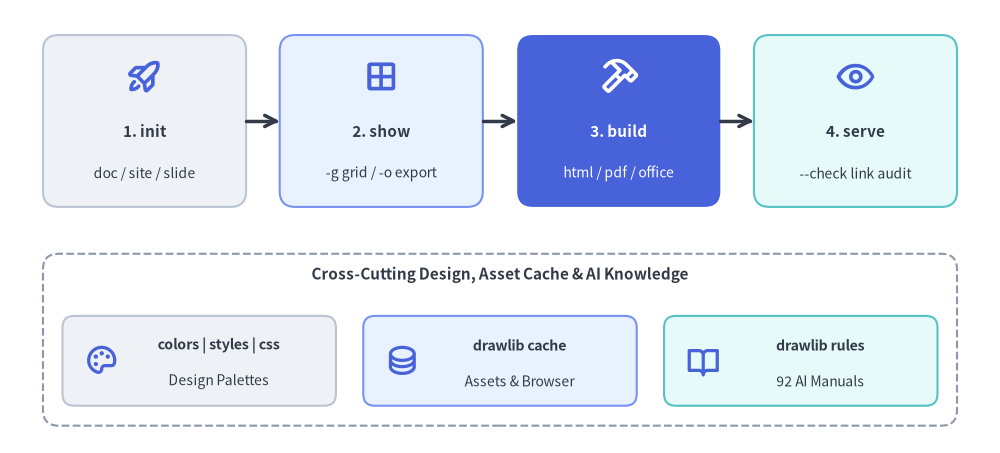
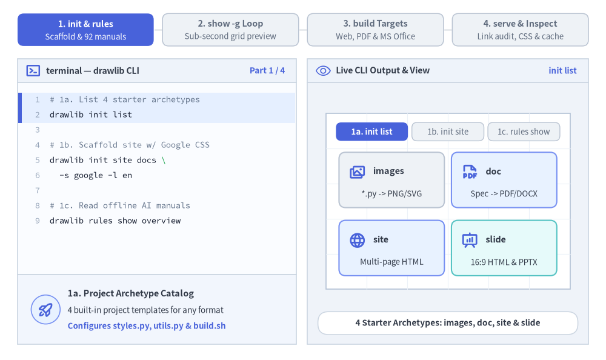
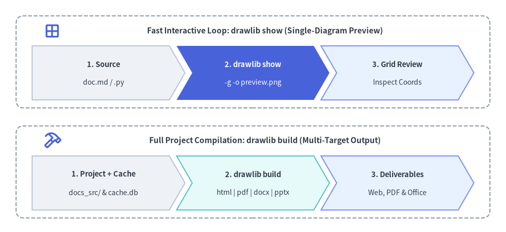

# CLI Reference Manual

Drawlib provides a unified Command Line Interface (`drawlib`) for compiling documentation, extracting standalone visual diagrams, managing cache assets, validating links, and inspecting built-in design systems.


<figure class="drawlib-image" style="text-align: center;">
  
  <figcaption class="drawlib-caption">The Nine Drawlib CLI Subcommands Organized by Workflow Stage</figcaption>
</figure>

<details class="drawlib-code-details">
<summary>Source Code</summary>

```python
from drawlib.canvas import save, setup
from drawlib.icons import phosphor
from drawlib.lines import line
from drawlib.shapes import rectangle
from drawlib.styles import Styles
from drawlib.text import text

setup(width=128, height=58)

# Top Row: Primary 4-Stage Authoring & Publishing Pipeline
stages = [
    (18.5, "1. init", "doc / site / slide", Styles.Neutral, Styles.DarkBold, Styles.Dark, phosphor.rocket_launch, Styles.PrimaryBold),
    (48.8, "2. show", "-g grid / -o export", Styles.PrimaryNeutral, Styles.DarkBold, Styles.Dark, phosphor.grid_four, Styles.PrimaryBold),
    (79.2, "3. build", "html / pdf / office", Styles.PrimaryFlat, Styles.WhiteBold, Styles.White, phosphor.hammer, Styles.WhiteBold),
    (109.5, "4. serve", "--check link audit", Styles.SecondaryNeutral, Styles.DarkBold, Styles.Dark, phosphor.eye, Styles.PrimaryBold),
]
for sx, title, sub, st, tst, sub_st, icon_fn, icon_st in stages:
    rectangle((sx, 42.5), width=26, height=22, style=st.patch(shape_r=2.0))
    icon_fn((sx, 48.2), width=4.8, style=icon_st)
    text((sx, 41.2), title, style=tst.patch(text_size=11.0))
    text((sx, 35.8), sub, style=sub_st.patch(text_size=10.0))

line((31.5, 42.5), (35.8, 42.5), arrow_head="->", style=Styles.DarkBold)
line((61.8, 42.5), (66.2, 42.5), arrow_head="->", style=Styles.DarkBold)
line((92.2, 42.5), (96.5, 42.5), arrow_head="->", style=Styles.DarkBold)

# Bottom Row: Supporting Design Systems, Cache & AI Rules Subcommands
rectangle((64, 14.5), width=117, height=22, style=Styles.MutedDashed.patch(shape_r=2.0))
text((64, 22.8), "Cross-Cutting Design, Asset Cache & AI Knowledge", style=Styles.DarkBold.patch(text_size=11.0))

bottom_cards = [
    (25.5, "colors | styles | css", "Design Palettes", Styles.Neutral, phosphor.palette),
    (64.0, "drawlib cache", "Assets & Browser", Styles.PrimaryNeutral, phosphor.database),
    (102.5, "drawlib rules", "92 AI Manuals", Styles.SecondaryNeutral, phosphor.book_open),
]
for bx, btitle, bsub, bst, bicon in bottom_cards:
    rectangle((bx, 11.8), width=35, height=11.5, style=bst.patch(shape_r=1.5))
    bicon((bx - 12.5, 11.8), width=4.4, style=Styles.PrimaryBold)
    text((bx + 2.5, 13.8), btitle, style=Styles.DarkBold.patch(text_size=10.2))
    text((bx + 2.5, 9.2), bsub, style=Styles.Dark.patch(text_size=10.0))

save()
```

</details>


---

## 1. Interactive CLI Workflow Tour

From project bootstrapping (`init` and `rules`) to sub-second coordinate grid previews (`show -g`), multi-format compilation (`build`), and pre-flight link and asset verification (`serve --check` and `cache`), all nine `drawlib` subcommands work together in one cohesive loop:


<figure class="drawlib-image" style="text-align: center;">
  
  <figcaption class="drawlib-caption">Drawlib CLI Daily Workflow Tour: Scaffolding & AI Rules, Single-Diagram Grid Preview, 7 Build Targets, and Link Audit & Design Inspectors (APNG Animation)</figcaption>
</figure>

<details class="drawlib-code-details">
<summary>Source Code</summary>

```python
from __future__ import annotations

from drawlib.anim import Animation
from drawlib.canvas import save, setup
from drawlib.icons import client, devops, phosphor, workspace
from drawlib.icons import code as code_icons
from drawlib.lines import line
from drawlib.shapes import circle, rectangle
from drawlib.smartarts import SourceCode, SourceCodeStyles
from drawlib.styles import Styles
from drawlib.text import text

W, H = 138.0, 82.0
setup(width=W, height=H)
anim = Animation(fps=10.0, loop=0)

CODE_TEXT_SIZE = 10.0
PT_TO_CANVAS = W / 720.0
FONT_CANVAS = CODE_TEXT_SIZE * PT_TO_CANVAS
LINE_H = FONT_CANVAS * 1.8
PAD_Y = FONT_CANVAS * 1.2

CODE_STYLES = SourceCodeStyles.get("default", font_lang="en", text_size=CODE_TEXT_SIZE).patch(
    box_style=Styles.Neutral.patch(shape_fill_color=(0, 0, 0, 0), shape_line_width=0),
)

PANE_HEADER = Styles.Neutral.patch(
    shape_fill_color=(238, 243, 250),
    shape_line_color=(203, 213, 225),
    shape_line_width=1.2,
    shape_r=0.0,
)
EDITOR_BODY = Styles.Neutral.patch(
    shape_fill_color=(250, 252, 255),
    shape_line_color=(203, 213, 225),
    shape_line_width=1.2,
    shape_r=0.0,
)
TAKEAWAY_BODY = Styles.Neutral.patch(
    shape_fill_color=(242, 246, 253),
    shape_line_color=(203, 213, 225),
    shape_line_width=1.2,
    shape_r=0.0,
)
STUDIO_BODY = Styles.Neutral.patch(
    shape_fill_color=(239, 243, 249),
    shape_line_color=(203, 213, 225),
    shape_line_width=1.2,
    shape_r=0.0,
)

PART_ITEMS = [
    ("1. init & rules", "Scaffold & 92 manuals"),
    ("2. show -g Loop", "Sub-second grid preview"),
    ("3. build Targets", "Web, PDF & MS Office"),
    ("4. serve & Inspect", "Link audit, CSS & cache"),
]


def draw_step_bar(active_part: int) -> None:
    """Draw top 4-part progress bar (active_part is 1..4)."""
    pill_w = 31.0
    pill_h = 7.4
    gap = 2.0
    start_x = 4.0 + pill_w / 2.0
    cy = 75.2

    for idx, (label, sublabel) in enumerate(PART_ITEMS, start=1):
        cx = start_x + (idx - 1) * (pill_w + gap)
        if idx > 1:
            prev_cx = cx - (pill_w + gap)
            line(
                (prev_cx + pill_w / 2.0 + 0.2, cy),
                (cx - pill_w / 2.0 - 0.2, cy),
                style=Styles.PrimaryBold if idx <= active_part else Styles.MutedThin,
            )

        if idx == active_part:
            st = Styles.PrimaryFlat.patch(shape_r=1.4)
            tst = Styles.WhiteBold.patch(text_size=10.3)
            sub_tst = Styles.White.patch(text_size=9.5)
        elif idx < active_part:
            st = Styles.PrimaryNeutral.patch(shape_r=1.4, shape_line_width=1.1)
            tst = Styles.PrimaryBold.patch(text_size=10.3)
            sub_tst = Styles.Primary.patch(text_size=9.5)
        else:
            st = Styles.Neutral.patch(shape_r=1.4, shape_line_width=1.1)
            tst = Styles.MutedBold.patch(text_size=10.3)
            sub_tst = Styles.Muted.patch(text_size=9.5)

        rectangle((cx, cy), width=pill_w, height=pill_h, style=st)
        text((cx, cy + 1.35), label, style=tst)
        text((cx, cy - 1.55), sublabel, style=sub_tst)


def draw_left_pane(
    active_part: int,
    code_lines: list[str],
    hl_range: tuple[int, int],
    icon_fn: object,
    summary_title: str,
    summary_line1: str,
    summary_line2: str,
) -> None:
    """Draw left terminal CLI pane + bottom concept takeaway card."""
    x0, w = 4.0, 63.5
    cx = x0 + w / 2.0
    top_y = 63.2
    header_h = 5.4
    editor_h = 43.8
    takeaway_h = 15.8

    rectangle((cx, top_y + header_h / 2.0), width=w, height=header_h, style=PANE_HEADER)
    phosphor.terminal_window((x0 + 3.6, top_y + header_h / 2.0), width=3.5, style=Styles.PrimaryBold)
    text(
        (x0 + 6.5, top_y + header_h / 2.0),
        "terminal — drawlib CLI",
        style=Styles.DarkBold.patch(text_size=10.2, halign="left"),
    )
    text(
        (x0 + w - 2.6, top_y + header_h / 2.0),
        f"Part {active_part} / 4",
        style=Styles.PrimaryBold.patch(text_size=9.8, halign="right"),
    )

    rectangle((cx, top_y - editor_h / 2.0), width=w, height=editor_h, style=EDITOR_BODY)

    hl_start, hl_end = hl_range
    hl_top = top_y - PAD_Y - hl_start * LINE_H
    hl_bot = top_y - PAD_Y - (hl_end + 1) * LINE_H
    hl_cy = (hl_top + hl_bot) / 2.0
    hl_h = hl_top - hl_bot
    rectangle(
        (cx, hl_cy),
        width=w - 0.6,
        height=hl_h,
        style=Styles.Neutral.patch(shape_fill_color=(229, 239, 255), shape_line_width=0),
    )
    rectangle(
        (x0 + 0.55, hl_cy),
        width=0.9,
        height=hl_h,
        style=Styles.PrimaryFlat.patch(shape_line_width=0),
    )

    SourceCode.draw(
        xy=(x0, top_y),
        width=w,
        code="\n".join(code_lines),
        styles=CODE_STYLES,
        code_lang="bash",
        show_linenum=True,
        align="top_left",
    )

    take_cy = 3.6 + takeaway_h / 2.0
    rectangle((cx, take_cy), width=w, height=takeaway_h, style=TAKEAWAY_BODY)
    circle(
        (x0 + 6.4, take_cy),
        radius=3.3,
        style=Styles.PrimaryNeutral.patch(shape_line_width=1.2),
    )
    icon_fn((x0 + 6.4, take_cy), width=3.8, style=Styles.PrimaryBold)  # type: ignore[operator]
    text(
        (x0 + 11.4, take_cy + 3.6),
        summary_title,
        style=Styles.DarkBold.patch(text_size=10.4, halign="left"),
    )
    text(
        (x0 + 11.4, take_cy - 0.2),
        summary_line1,
        style=Styles.Dark.patch(text_size=9.7, halign="left"),
    )
    text(
        (x0 + 11.4, take_cy - 3.8),
        summary_line2,
        style=Styles.PrimaryBold.patch(text_size=9.6, halign="left"),
    )


def draw_output_studio(param_badge: str, footer_caption: str) -> tuple[float, float]:
    """Draw right CLI output & artifact inspector shell and footer."""
    x0, w = 70.0, 64.0
    cx = x0 + w / 2.0
    top_y = 63.2
    header_h = 5.4
    body_h = 59.6

    rectangle((cx, top_y + header_h / 2.0), width=w, height=header_h, style=PANE_HEADER)
    phosphor.eye((x0 + 3.6, top_y + header_h / 2.0), width=3.5, style=Styles.Primary)
    text(
        (x0 + 6.5, top_y + header_h / 2.0),
        "Live CLI Output & View",
        style=Styles.DarkBold.patch(text_size=10.2, halign="left"),
    )
    text(
        (x0 + w - 2.6, top_y + header_h / 2.0),
        param_badge,
        style=Styles.PrimaryBold.patch(text_size=9.6, halign="right"),
    )

    rectangle((cx, 3.6 + body_h / 2.0), width=w, height=body_h, style=STUDIO_BODY)

    sheet_cx, sheet_cy = cx, 36.2
    sheet_w, sheet_h = 55.6, 40.0
    sx0, sy0 = sheet_cx - sheet_w / 2.0, sheet_cy - sheet_h / 2.0
    rectangle(
        (sheet_cx, sheet_cy),
        width=sheet_w,
        height=sheet_h,
        style=Styles.Neutral.patch(
            shape_fill_color=(255, 255, 255),
            shape_line_color=(180, 194, 214),
            shape_line_width=1.2,
        ),
    )
    g_st = Styles.MutedThin.patch(line_color=(236, 241, 248), line_width=0.8)
    for gx in range(1, 6):
        vx = sx0 + gx * (sheet_w / 6.0)
        line((vx, sy0), (vx, sy0 + sheet_h), style=g_st)
    for gy in range(1, 5):
        vy = sy0 + gy * (sheet_h / 5.0)
        line((sx0, vy), (sx0 + sheet_w, vy), style=g_st)

    rectangle(
        (cx, 8.4),
        width=59.2,
        height=5.2,
        style=Styles.Neutral.patch(
            shape_fill_color=(255, 255, 255),
            shape_line_color=(203, 213, 225),
            shape_line_width=1.1,
            shape_r=2.4,
        ),
        text=footer_caption,
        text_style=Styles.DarkBold.patch(text_size=9.8),
    )
    return sheet_cx, sheet_cy


def draw_sub_pills(scx: float, labels: list[str], active_idx: int) -> None:
    """Draw 3-step tracker pills near the top of the studio sheet."""
    pw, ph, pgap = 16.4, 4.2, 0.9
    p_start = scx - (3 * pw + 2 * pgap) / 2.0 + pw / 2.0
    for idx, lbl in enumerate(labels):
        px = p_start + idx * (pw + pgap)
        if idx == active_idx:
            pst = Styles.PrimaryFlat.patch(shape_r=1.2)
            ptst = Styles.WhiteBold.patch(text_size=9.5)
        elif idx < active_idx:
            pst = Styles.PrimaryNeutral.patch(shape_r=1.2, shape_line_width=1.0)
            ptst = Styles.PrimaryBold.patch(text_size=9.5)
        else:
            pst = Styles.Neutral.patch(shape_r=1.2, shape_line_width=1.0)
            ptst = Styles.Muted.patch(text_size=9.5)
        rectangle((px, 52.0), width=pw, height=ph, style=pst, text=lbl, text_style=ptst)


# =========================================================================
# Part 1: 1. init & rules (3 frames: 3.3 + 3.3 + 3.5 = 10.1s)
# =========================================================================
PART1_CODE = [
    "# 1a. List 4 starter archetypes",
    "drawlib init list",
    "",
    "# 1b. Scaffold site w/ Google CSS",
    "drawlib init site docs \\",
    "  -s google -l en",
    "",
    "# 1c. Read offline AI manuals",
    "drawlib rules show overview",
]

PART1_STATES = [
    (
        "1a",
        3.3,
        (0, 1),
        "init list",
        "4 Starter Archetypes: images, doc, site & slide",
        "1a. Project Archetype Catalog",
        "4 built-in project templates for any format",
        "Configures styles.py, utils.py & build.sh",
    ),
    (
        "1b",
        3.3,
        (3, 5),
        "init site -s",
        "Scaffolds docs_src/ With Google Theme & Fonts",
        "1b. Zero-Config Project Bootstrap",
        "Creates docs_src/, navbar.md & _assets/",
        "-s google syncs style.css and styles.py",
    ),
    (
        "1c",
        3.5,
        (7, 8),
        "92 AI Guides",
        "92 Offline Reference Guides + Companion PNGs",
        "1c. Embedded AI Knowledge Base",
        "92 offline manuals for geometry, styles & API",
        "Auto-renders companion illustrations locally",
    ),
]

for p1_idx, (mode, dur, hl_rng, badge, foot, s_t, s_1, s_2) in enumerate(PART1_STATES):
    with anim.frame(duration=dur):
        draw_step_bar(1)
        draw_left_pane(1, PART1_CODE, hl_rng, phosphor.rocket_launch, s_t, s_1, s_2)
        scx, _ = draw_output_studio(badge, foot)
        draw_sub_pills(scx, ["1a. init list", "1b. init site", "1c. rules show"], p1_idx)

        if mode == "1a":
            archetypes = [
                (89.2, 41.0, "images", "*.py -> PNG/SVG", phosphor.images, Styles.Neutral),
                (114.8, 41.0, "doc", "Spec -> PDF/DOCX", phosphor.file_pdf, Styles.PrimaryNeutral),
                (89.2, 25.5, "site", "Multi-page HTML", phosphor.globe, Styles.PrimaryNeutral),
                (114.8, 25.5, "slide", "16:9 HTML & PPTX", phosphor.presentation_chart, Styles.SecondaryNeutral),
            ]
            for ax, ay, name, desc, ic_fn, cst in archetypes:
                rectangle((ax, ay), width=24.0, height=12.6, style=cst.patch(shape_r=1.5))
                ic_fn((ax - 7.8, ay + 1.8), width=4.0, style=Styles.PrimaryBold)
                text((ax - 4.2, ay + 2.0), name, style=Styles.DarkBold.patch(text_size=10.4, halign="left"))
                text((ax, ay - 3.2), desc, style=Styles.Dark.patch(text_size=9.5))
        elif mode == "1b":
            rectangle(
                (scx, 44.5),
                width=50.0,
                height=5.6,
                style=Styles.PrimaryFlat.patch(shape_r=1.3),
            )
            phosphor.folder_open((79.8, 44.5), width=3.6, style=Styles.WhiteBold)
            text((82.6, 44.5), "docs_src/", style=Styles.WhiteBold.patch(text_size=10.2, halign="left"))
            text((124.8, 44.5), "-s google", style=Styles.White.patch(text_size=9.5, halign="right"))

            rows = [
                (37.6, "styles.py & utils.py", "Tokens & helpers", "py", Styles.PrimaryNeutral),
                (31.6, "navbar.md & index.md", "Sidebar & hero", "md", Styles.Neutral),
                (25.6, "_assets/ & style.css", "Media & CSS", "folder", Styles.Neutral),
                (19.6, "build.sh", "1-cmd compiler", "sh", Styles.SecondaryNeutral),
            ]
            for ry, rname, rdesc, rkind, rst in rows:
                rectangle((scx, ry), width=50.0, height=5.0, style=rst.patch(shape_r=1.1))
                if rkind == "py":
                    code_icons.python((79.8, ry), width=3.0, style=Styles.Neutral)
                elif rkind == "md":
                    phosphor.file_text((79.8, ry), width=3.1, style=Styles.PrimaryBold)
                elif rkind == "folder":
                    phosphor.folder((79.8, ry), width=3.1, style=Styles.PrimaryBold)
                else:
                    phosphor.file_code((79.8, ry), width=3.1, style=Styles.PrimaryBold)
                text((82.6, ry), rname, style=Styles.DarkBold.patch(text_size=9.6, halign="left"))
                text((125.0, ry), rdesc, style=Styles.Dark.patch(text_size=9.5, halign="right"))
        else:
            rectangle((89.8, 33.0), width=26.6, height=27.0, style=Styles.Neutral.patch(shape_r=1.5))
            phosphor.book_open((80.2, 42.6), width=3.8, style=Styles.PrimaryBold)
            text((83.2, 42.6), "overview", style=Styles.DarkBold.patch(text_size=10.2, halign="left"))
            text((89.8, 36.8), "92 AI Rule Guides", style=Styles.PrimaryBold.patch(text_size=9.6))
            text((89.8, 31.8), "• (0,0) Bottom-Left", style=Styles.Dark.patch(text_size=9.5))
            text((89.8, 27.4), "• 50%+ Neutral Card", style=Styles.Dark.patch(text_size=9.5))
            text((89.8, 23.0), "• 720pt Font Math", style=Styles.Dark.patch(text_size=9.5))

            line((103.3, 33.0), (106.8, 33.0), arrow_head="->", style=Styles.DarkBold)

            rectangle((117.4, 33.0), width=20.4, height=27.0, style=Styles.PrimaryNeutral.patch(shape_r=1.5))
            phosphor.images((117.4, 42.4), width=4.0, style=Styles.PrimaryBold)
            text((117.4, 37.2), "rules/*.png", style=Styles.DarkBold.patch(text_size=9.7))
            rectangle((117.4, 28.4), width=15.0, height=10.5, style=Styles.White.patch(shape_r=1.0))
            line((112.0, 25.0), (112.0, 32.0), arrow_head="->", style=Styles.PrimaryBold)
            line((112.0, 25.0), (123.0, 25.0), arrow_head="->", style=Styles.PrimaryBold)
            text((118.2, 29.0), "(0,0)", style=Styles.PrimaryBold.patch(text_size=9.5))

# =========================================================================
# Part 2: 2. show -g Loop (3 frames: 3.3 + 3.3 + 3.5 = 10.1s)
# =========================================================================
PART2_CODE = [
    "# 2a. Index blocks in Markdown",
    "drawlib show page.md",
    "",
    "# 2b. Fast 10u/5u grid preview",
    "drawlib show page.md arch.png \\",
    "  -g -o .drawlib/scratch/g.png",
    "",
    "# 2c. Standalone .py w/ styles",
    "drawlib show script.py \\",
    "  -s styles.py -u utils.py \\",
    "  -o out.png",
]

PART2_STATES = [
    (
        "2a",
        3.3,
        (0, 1),
        "Block Table",
        "Lists Embedded Blocks (#0 hero.png, #1 arch.png)",
        "2a. Inspect Embedded Blocks",
        "Omitting target prints indexed block table",
        "Shows block index, filename & fence mode",
    ),
    (
        "2b",
        3.3,
        (3, 5),
        "-g < 1s Grid",
        "Renders 10u/5u Coordinate Grid to .drawlib/scratch/",
        "2b. Sub-Second Grid Preview (-g)",
        "Target by explicit filename (arch.png)",
        "10u/5u grid catches clipping & margins fast",
    ),
    (
        "2c",
        3.5,
        (7, 10),
        "-s & -u Parity",
        "Previews Standalone .py With Project styles.py",
        "2c. Standalone Script Export",
        "-s styles.py & -u utils.py inject tokens",
        "Guarantees 100% parity with full builds",
    ),
]

for p2_idx, (mode, dur, hl_rng, badge, foot, s_t, s_1, s_2) in enumerate(PART2_STATES):
    with anim.frame(duration=dur):
        draw_step_bar(2)
        draw_left_pane(2, PART2_CODE, hl_rng, phosphor.grid_four, s_t, s_1, s_2)
        scx, _ = draw_output_studio(badge, foot)
        draw_sub_pills(scx, ["2a. Block Index", "2b. Grid (-g)", "2c. .py Preview"], p2_idx)

        if mode == "2a":
            rectangle(
                (scx, 44.2),
                width=50.0,
                height=5.2,
                style=Styles.Neutral.patch(shape_fill_color=(232, 238, 248), shape_r=1.1),
            )
            text((79.5, 44.2), "Idx", style=Styles.DarkBold.patch(text_size=9.6, halign="left"))
            text((89.0, 44.2), "Block File", style=Styles.DarkBold.patch(text_size=9.6, halign="left"))
            text((124.5, 44.2), "Fence", style=Styles.DarkBold.patch(text_size=9.6, halign="right"))

            rectangle((scx, 37.6), width=50.0, height=5.8, style=Styles.Neutral.patch(shape_r=1.1))
            text((79.5, 37.6), "#0", style=Styles.DarkBold.patch(text_size=9.6, halign="left"))
            text((89.0, 37.6), "hero.png", style=Styles.DarkBold.patch(text_size=9.7, halign="left"))
            text((124.5, 37.6), "code=fold", style=Styles.Dark.patch(text_size=9.5, halign="right"))

            rectangle((scx, 30.8), width=50.0, height=5.8, style=Styles.PrimaryNeutral.patch(shape_r=1.1))
            text((79.5, 30.8), "#1", style=Styles.PrimaryBold.patch(text_size=9.6, halign="left"))
            text((89.0, 30.8), "arch.png", style=Styles.PrimaryBold.patch(text_size=9.7, halign="left"))
            text((124.5, 30.8), "code=show", style=Styles.PrimaryBold.patch(text_size=9.5, halign="right"))

            rectangle((scx, 22.4), width=50.0, height=6.4, style=Styles.SecondaryNeutral.patch(shape_r=1.3))
            phosphor.check_circle((80.2, 22.4), width=3.6, style=Styles.PrimaryBold)
            text(
                (83.2, 22.4),
                "Target arch.png directly in < 1s",
                style=Styles.DarkBold.patch(text_size=9.6, halign="left"),
            )
        elif mode == "2b":
            gx0, gy0, gw, gh = 80.0, 22.5, 45.0, 22.5
            rectangle(
                (gx0 + gw / 2.0, gy0 + gh / 2.0),
                width=gw,
                height=gh,
                style=Styles.White.patch(shape_line_color=(96, 165, 250), shape_line_width=1.3),
            )
            for step in range(1, 5):
                vx = gx0 + step * 9.0
                st_g = (
                    Styles.Primary.patch(line_width=0.9)
                    if step % 2 == 0
                    else Styles.MutedDashed.patch(line_width=0.7)
                )
                line((vx, gy0), (vx, gy0 + gh), style=st_g)
            for step in range(1, 3):
                hy = gy0 + step * 7.5
                line((gx0, hy), (gx0 + gw, hy), style=Styles.Primary.patch(line_width=0.9))

            text((gx0, gy0 - 2.3), "0", style=Styles.PrimaryBold.patch(text_size=9.5))
            text((gx0 + 18.0, gy0 - 2.3), "20", style=Styles.PrimaryBold.patch(text_size=9.5))
            text((gx0 + 36.0, gy0 - 2.3), "40", style=Styles.PrimaryBold.patch(text_size=9.5))
            text((gx0 - 2.4, gy0 + 7.5), "10", style=Styles.PrimaryBold.patch(text_size=9.5))
            text((gx0 - 2.4, gy0 + 15.0), "20", style=Styles.PrimaryBold.patch(text_size=9.5))

            rectangle(
                (91.5, 33.8),
                width=14.0,
                height=8.5,
                style=Styles.Neutral.patch(shape_r=1.2),
                text="Gateway",
                text_style=Styles.DarkBold.patch(text_size=9.6),
            )
            rectangle(
                (113.5, 33.8),
                width=14.0,
                height=8.5,
                style=Styles.PrimaryNeutral.patch(shape_r=1.2),
                text="SQL DB",
                text_style=Styles.DarkBold.patch(text_size=9.6),
            )
            line((98.5, 33.8), (106.5, 33.8), arrow_head="->", style=Styles.DarkBold)
            rectangle(
                (116.8, 44.8),
                width=16.5,
                height=4.0,
                style=Styles.PrimaryFlat.patch(shape_r=1.0),
                text="-g 10u/5u",
                text_style=Styles.WhiteBold.patch(text_size=9.5),
            )
        else:
            inputs = [
                (42.5, "script.py", code_icons.python, Styles.PrimaryNeutral, True),
                (33.2, "-s styles.py", phosphor.palette, Styles.Neutral, False),
                (23.9, "-u utils.py", phosphor.sliders, Styles.Neutral, False),
            ]
            for iy, ilbl, i_fn, ist, is_png in inputs:
                rectangle((86.2, iy), width=19.8, height=6.8, style=ist.patch(shape_r=1.2))
                if is_png:
                    i_fn((78.8, iy), width=3.0, style=Styles.Neutral)
                else:
                    i_fn((78.8, iy), width=3.2, style=Styles.PrimaryBold)
                text((81.2, iy), ilbl, style=Styles.DarkBold.patch(text_size=9.5, halign="left"))
                line((96.1, iy), (100.8, 33.2), arrow_head="->", style=Styles.DarkBold)

            rectangle(
                (105.8, 33.2),
                width=10.0,
                height=10.0,
                style=Styles.PrimaryFlat.patch(shape_r=1.4),
                text="show",
                text_style=Styles.WhiteBold.patch(text_size=9.8),
            )
            line((110.8, 33.2), (114.4, 33.2), arrow_head="->", style=Styles.DarkBold)
            rectangle((121.0, 33.2), width=13.2, height=19.0, style=Styles.SecondaryNeutral.patch(shape_r=1.4))
            phosphor.images((121.0, 37.8), width=4.2, style=Styles.PrimaryBold)
            text((121.0, 31.8), "out.png", style=Styles.DarkBold.patch(text_size=9.8))
            text((121.0, 27.2), "Synced!", style=Styles.PrimaryBold.patch(text_size=9.5))

# =========================================================================
# Part 3: 3. build Targets (3 frames: 3.3 + 3.3 + 3.5 = 10.1s)
# =========================================================================
PART3_CODE = [
    "# 3a. Web & GitHub Markdown",
    "drawlib build html docs_src/",
    "drawlib build markdown docs_src/",
    "# 3b. Vector PDF & MS Word",
    "drawlib build pdf doc_src/ --toc",
    "drawlib build docx doc_src/",
    "# 3c. 16:9 Slide Deck & PPTX",
    "drawlib build slide slide_src/",
    "drawlib build pptx slide_src/",
    "# (+ build image scripts/ -g)",
]

PART3_STATES = [
    (
        "3a",
        3.3,
        (0, 2),
        "Web + GitHub",
        "Compiles Static Website + GitHub-Flavored Markdown",
        "3a. Web & Repository Targets",
        "build html generates searchable static site",
        "build markdown exports GFM + <doc>_images/",
    ),
    (
        "3b",
        3.3,
        (3, 5),
        "PDF + Word",
        "Compiles Vector A4 PDF (--toc) + Native Word (.docx)",
        "3b. Linear Spec & Office Docs",
        "build pdf renders vector A4 w/ auto TOC",
        "build docx produces editable native MS Word",
    ),
    (
        "3c",
        3.5,
        (6, 9),
        "16:9 + PPTX",
        "7 Build Targets: HTML, MD, PDF, DOCX, Slide, PPTX, Img",
        "3c. Presentations & Batch Images",
        "build slide adds ?presenter=1 dual view",
        "build pptx exports editable 16:9 slides + notes",
    ),
]

for p3_idx, (mode, dur, hl_rng, badge, foot, s_t, s_1, s_2) in enumerate(PART3_STATES):
    with anim.frame(duration=dur):
        draw_step_bar(3)
        draw_left_pane(3, PART3_CODE, hl_rng, phosphor.hammer, s_t, s_1, s_2)
        scx, _ = draw_output_studio(badge, foot)
        draw_sub_pills(scx, ["3a. HTML & MD", "3b. PDF & DOCX", "3c. Slide & PPTX"], p3_idx)

        if mode == "3a":
            rectangle((83.6, 33.4), width=15.0, height=19.0, style=Styles.Neutral.patch(shape_r=1.4))
            phosphor.folder_open((83.6, 38.2), width=4.0, style=Styles.PrimaryBold)
            text((83.6, 32.2), "docs_src/", style=Styles.DarkBold.patch(text_size=9.7))
            text((83.6, 27.6), "*.md", style=Styles.Dark.patch(text_size=9.5))

            line((91.1, 37.5), (98.4, 40.8), arrow_head="->", style=Styles.DarkBold)
            line((91.1, 29.5), (98.4, 26.0), arrow_head="->", style=Styles.DarkBold)

            rectangle((113.0, 40.8), width=29.0, height=11.6, style=Styles.PrimaryNeutral.patch(shape_r=1.4))
            phosphor.globe((102.5, 40.8), width=4.2, style=Styles.PrimaryBold)
            text((106.2, 42.8), "docs_html/", style=Styles.DarkBold.patch(text_size=10.2, halign="left"))
            text((106.2, 38.4), "Sidebar & Search", style=Styles.Dark.patch(text_size=9.5, halign="left"))

            rectangle((113.0, 26.0), width=29.0, height=11.6, style=Styles.SecondaryNeutral.patch(shape_r=1.4))
            devops.github((102.5, 26.0), width=3.9, style=Styles.Neutral)
            text((106.2, 28.0), "docs/ (*.md)", style=Styles.DarkBold.patch(text_size=10.2, halign="left"))
            text((106.2, 23.6), "GFM + _images/", style=Styles.Dark.patch(text_size=9.5, halign="left"))
        elif mode == "3b":
            rectangle((83.6, 33.4), width=15.0, height=19.0, style=Styles.Neutral.patch(shape_r=1.4))
            phosphor.folder_open((83.6, 38.2), width=4.0, style=Styles.PrimaryBold)
            text((83.6, 32.2), "doc_src/", style=Styles.DarkBold.patch(text_size=9.7))
            text((83.6, 27.6), "chapters", style=Styles.Dark.patch(text_size=9.5))

            line((91.1, 37.5), (98.4, 40.8), arrow_head="->", style=Styles.DarkBold)
            line((91.1, 29.5), (98.4, 26.0), arrow_head="->", style=Styles.DarkBold)

            rectangle((113.0, 40.8), width=29.0, height=11.6, style=Styles.PrimaryNeutral.patch(shape_r=1.4))
            phosphor.file_pdf((102.5, 40.8), width=4.2, style=Styles.PrimaryBold)
            text((106.2, 42.8), "manual.pdf", style=Styles.DarkBold.patch(text_size=10.2, halign="left"))
            text((106.2, 38.4), "Vector A4 + TOC", style=Styles.Dark.patch(text_size=9.5, halign="left"))

            rectangle((113.0, 26.0), width=29.0, height=11.6, style=Styles.Neutral.patch(shape_r=1.4))
            workspace.word((102.5, 26.0), width=4.0, style=Styles.Neutral)
            text((106.2, 28.0), "manual.docx", style=Styles.DarkBold.patch(text_size=10.2, halign="left"))
            text((106.2, 23.6), "Editable MS Word", style=Styles.Dark.patch(text_size=9.5, halign="left"))
        else:
            rectangle((83.6, 36.2), width=15.0, height=16.5, style=Styles.Neutral.patch(shape_r=1.4))
            phosphor.presentation_chart((83.6, 40.2), width=4.0, style=Styles.PrimaryBold)
            text((83.6, 34.6), "slide_src/", style=Styles.DarkBold.patch(text_size=9.6))
            text((83.6, 30.6), "16:9 *.md", style=Styles.Dark.patch(text_size=9.5))

            line((91.1, 39.8), (98.4, 42.2), arrow_head="->", style=Styles.DarkBold)
            line((91.1, 32.8), (98.4, 30.2), arrow_head="->", style=Styles.DarkBold)

            rectangle((113.0, 42.2), width=29.0, height=10.0, style=Styles.PrimaryNeutral.patch(shape_r=1.3))
            phosphor.globe((102.5, 42.2), width=3.9, style=Styles.PrimaryBold)
            text((106.2, 44.0), "slide_html/", style=Styles.DarkBold.patch(text_size=10.0, halign="left"))
            text((106.2, 40.0), "16:9 + ?presenter=1", style=Styles.Dark.patch(text_size=9.5, halign="left"))

            rectangle((113.0, 30.2), width=29.0, height=10.0, style=Styles.SecondaryNeutral.patch(shape_r=1.3))
            workspace.powerpoint((102.5, 30.2), width=3.9, style=Styles.Neutral)
            text((106.2, 32.0), "deck.pptx", style=Styles.DarkBold.patch(text_size=10.0, halign="left"))
            text((106.2, 28.0), "960x540pt + Notes", style=Styles.Dark.patch(text_size=9.5, halign="left"))

            rectangle((scx, 20.4), width=50.0, height=5.2, style=Styles.Neutral.patch(shape_r=1.1))
            phosphor.images((79.8, 20.4), width=3.2, style=Styles.PrimaryBold)
            text(
                (82.8, 20.4),
                "+ build image -> batch PNG/SVG/WebP",
                style=Styles.DarkBold.patch(text_size=9.5, halign="left"),
            )

# =========================================================================
# Part 4: 4. serve & Inspect (3 frames: 3.3 + 3.3 + 3.5 = 10.1s)
# =========================================================================
PART4_CODE = [
    "# 4a. Headless link & img audit",
    "drawlib serve docs_html/ --check",
    "",
    "# 4b. Design token inspectors",
    "drawlib colors list",
    "drawlib styles show google 1",
    "drawlib css list",
    "# 4c. Offline asset & browser",
    "drawlib cache list",
    "drawlib cache download --all",
]

PART4_STATES = [
    (
        "4a",
        3.3,
        (0, 1),
        "Exit Code 0",
        "Headless Pre-Flight Audit: 0 Broken Links -> Exit 0",
        "4a. Broken-Link Quality Gate",
        "Scans all HTML hrefs, anchors & image src",
        "Exits 0 when clean, 1 on any missing link",
    ),
    (
        "4b",
        3.3,
        (3, 6),
        "Design Tokens",
        "Inspect Color Palettes, Style Matrices & CSS Themes",
        "4b. Built-In Design Inspectors",
        "Preview color swatches & style matrices",
        "Export Google / Default HTML & PDF CSS",
    ),
    (
        "4c",
        3.5,
        (7, 9),
        "Offline Cache",
        "Warms Fonts, 34 Icon Suites, Maps & Chromium Offline",
        "4c. Asset & Browser Cache",
        "Audits & pre-warms fonts, icons & GeoMaps",
        "Provisions headless Chromium for PDF/PPTX",
    ),
]

for p4_idx, (mode, dur, hl_rng, badge, foot, s_t, s_1, s_2) in enumerate(PART4_STATES):
    with anim.frame(duration=dur):
        draw_step_bar(4)
        draw_left_pane(4, PART4_CODE, hl_rng, phosphor.shield_check, s_t, s_1, s_2)
        scx, _ = draw_output_studio(badge, foot)
        draw_sub_pills(scx, ["4a. --check", "4b. Tokens & CSS", "4c. cache --all"], p4_idx)

        if mode == "4a":
            rectangle((scx, 43.6), width=50.0, height=6.4, style=Styles.SecondaryNeutral.patch(shape_r=1.3))
            phosphor.check_circle((80.2, 43.6), width=3.8, style=Styles.PrimaryBold)
            text(
                (83.4, 43.6),
                "Audit Passed: 0 Broken Links (Exit 0)",
                style=Styles.DarkBold.patch(text_size=9.8, halign="left"),
            )

            checks = [
                (35.4, "Internal HTML Hrefs", "0 broken", Styles.Neutral),
                (28.6, "Diagram Image Assets", "100% found", Styles.Neutral),
                (21.8, "Local Dev Preview", "localhost:8000", Styles.PrimaryNeutral),
            ]
            for cy_row, clbl, cval, cst in checks:
                rectangle((scx, cy_row), width=50.0, height=5.4, style=cst.patch(shape_r=1.1))
                text((79.6, cy_row), clbl, style=Styles.DarkBold.patch(text_size=9.6, halign="left"))
                text((124.8, cy_row), cval, style=Styles.PrimaryBold.patch(text_size=9.5, halign="right"))
        elif mode == "4b":
            inspectors = [
                (42.4, "drawlib colors", "default | google | mono | css", phosphor.palette, Styles.Neutral),
                (33.2, "drawlib styles", "Neutral, PrimaryNeutral, Flat", phosphor.squares_four, Styles.PrimaryNeutral),
                (24.0, "drawlib css list", "HTML & PDF theme presets", phosphor.file_code, Styles.SecondaryNeutral),
            ]
            for iy, ititle, isub, i_fn, ist in inspectors:
                rectangle((scx, iy), width=50.0, height=7.4, style=ist.patch(shape_r=1.3))
                i_fn((80.4, iy), width=3.8, style=Styles.PrimaryBold)
                text((83.8, iy + 1.5), ititle, style=Styles.DarkBold.patch(text_size=9.9, halign="left"))
                text((83.8, iy - 1.8), isub, style=Styles.Dark.patch(text_size=9.5, halign="left"))
        else:
            packs = [
                (89.2, 41.0, "Fonts", "font_* • Roboto/CJK", phosphor.book_open, Styles.Neutral, False),
                (114.8, 41.0, "34 Icons", "Phosphor, Cloud, 2D", phosphor.package, Styles.PrimaryNeutral, False),
                (89.2, 25.5, "GeoMaps", "map_* • World/Cities", phosphor.globe, Styles.Neutral, False),
                (114.8, 25.5, "Chromium", "PDF & PPTX Shell", client.chromium, Styles.SecondaryNeutral, True),
            ]
            for px, py, ptitle, psub, p_fn, pst, is_png in packs:
                rectangle((px, py), width=24.0, height=12.6, style=pst.patch(shape_r=1.5))
                if is_png:
                    p_fn((px - 7.6, py + 1.8), width=3.6, style=Styles.Neutral)
                else:
                    p_fn((px - 7.6, py + 1.8), width=3.8, style=Styles.PrimaryBold)
                text((px - 4.2, py + 2.0), ptitle, style=Styles.DarkBold.patch(text_size=10.2, halign="left"))
                text((px, py - 3.2), psub, style=Styles.Dark.patch(text_size=9.5))

save()
```

</details>


---

## 2. Quick Command Matrix

```bash
# Compilation
drawlib build html docs_src/ -o docs_html/                  # Responsive static HTML website
drawlib build markdown docs_src/ -o docs/                  # GitHub-ready Markdown
drawlib build pdf doc_src/ -o manual.pdf --toc              # High-fidelity vector PDF
drawlib build docx doc_src/ -o manual.docx --generate-index # Editable MS Word (.docx) document
drawlib build slide slide_src/ -o slide_html/               # Interactive 16:9 HTML slide deck
drawlib build pptx slide_src/ -o deck.pptx                  # Editable 16:9 MS PowerPoint (.pptx) deck
drawlib build image scripts/ -o assets/ -g                  # Batch Python image rendering

# Scaffolding
drawlib init list                                          # List starter project templates (site, doc, slide, images)
drawlib init doc my_doc                                    # Scaffold linear document project (HTML, PDF, DOCX, MD, images)
drawlib init site my_site                                  # Scaffold documentation site
drawlib init slide my_deck -s google                       # Scaffold 16:9 presentation slide deck
drawlib init images my_images                              # Scaffold standalone images project (alias: image)

# Inspection & Preview
drawlib show doc.md                                        # List all drawlib code blocks in doc.md
drawlib show doc.md arch.png -o .drawlib/scratch/arch.png          # Headless extraction by explicit filename (Recommended)
drawlib show doc.md arch.png -g -o .drawlib/scratch/arch_grid.png  # Export named block with coordinate grid
drawlib show script.py -o .drawlib/scratch/fig.png                 # Export standalone Python script

# Local Server & Verification
drawlib serve docs_html/                                   # Local preview on http://localhost:8000
drawlib serve docs_html/ --check                           # Pre-flight broken link/asset audit

# Design Systems, Cache & AI Rules
drawlib colors list                                        # List color catalogs (default, google, monochrome, css)
drawlib styles list                                        # List style catalogs (default, google, monochrome)
drawlib css list                                           # List CSS presets for HTML and PDF
drawlib cache list                                         # Inspect cached fonts, icons, and maps
drawlib cache download --all                               # Pre-download fonts, icons, maps, and headless Chromium
drawlib rules list                                         # List 92 AI rule instruction manuals
```

---

## 3. Global CLI Options

Global flags apply before any top-level command (`drawlib [GLOBAL_OPTIONS] COMMAND ...`):

| Flag | Description |
|---|---|
| `-v`, `--version` | Print installed `drawlib` version and exit with status `0`. |
| `-h`, `--help` | Show contextual help message and available subcommands. |
| `--quiet` | Suppress non-critical standard output (emit warnings and errors only). |
| `--verbose` / `--debug` | Enable diagnostic logging, timing metrics, and cache hit/miss details. |
| `--developer` | Enable verbose logging and disable user-friendly error wrapping so full Python stack traces propagate. |

*(Note: `--quiet` cannot be combined with `--verbose`, `--debug`, or `--developer`; doing so exits with code `2`.)*

---

## 4. Compilation Subsystem (`drawlib build`)


<figure class="drawlib-image" style="text-align: center;">
  
  <figcaption class="drawlib-caption">Interactive Single-Diagram Preview (drawlib show) vs. Full Project Compilation (drawlib build)</figcaption>
</figure>

<details class="drawlib-code-details">
<summary>Source Code</summary>

```python
from drawlib.canvas import save, setup
from drawlib.icons import phosphor
from drawlib.shapes import rectangle
from drawlib.smartarts import ChevronProcess
from drawlib.styles import Styles
from drawlib.text import text

setup(width=126, height=58)

# Top Panel: Fast Interactive Loop (drawlib show)
rectangle((63, 42.5), width=118, height=23, style=Styles.MutedDashed.patch(shape_r=2.0))
phosphor.grid_four((13, 50.2), width=4.4, style=Styles.PrimaryBold)
text(
    (66, 50.2),
    "Fast Interactive Loop: drawlib show (Single-Diagram Preview)",
    style=Styles.DarkBold.patch(text_size=11.0),
)

show_flow = ChevronProcess(
    style=Styles.Neutral,
    text_style=Styles.DarkBold.patch(text_size=10.5),
    description_style=Styles.Dark.patch(text_size=10.0),
    corner_angle=60.0,
    spacing=1.8,
    flat_left_end=True,
)
show_flow.add("1. Source", description="doc.md / .py")
show_flow.add(
    "2. drawlib show",
    description="-g -o preview.png",
    style=Styles.PrimaryFlat,
    text_style=Styles.WhiteBold.patch(text_size=10.5),
    description_style=Styles.White.patch(text_size=10.0),
)
show_flow.add("3. Grid Review", description="Inspect Coords", style=Styles.PrimaryNeutral)
show_flow.draw(xy=(8, 33.0), width=110, height=13.5)

# Bottom Panel: Full Project Compilation (drawlib build)
rectangle((63, 15.0), width=118, height=23, style=Styles.MutedDashed.patch(shape_r=2.0))
phosphor.hammer((13, 22.8), width=4.4, style=Styles.PrimaryBold)
text(
    (66, 22.8),
    "Full Project Compilation: drawlib build (Multi-Target Output)",
    style=Styles.DarkBold.patch(text_size=11.0),
)

build_flow = ChevronProcess(
    style=Styles.Neutral,
    text_style=Styles.DarkBold.patch(text_size=10.5),
    description_style=Styles.Dark.patch(text_size=10.0),
    corner_angle=60.0,
    spacing=1.8,
    flat_left_end=True,
)
build_flow.add("1. Project + Cache", description="docs_src/ & cache.db")
build_flow.add(
    "2. drawlib build",
    description="html | pdf | docx | pptx",
    style=Styles.SecondaryNeutral,
)
build_flow.add("3. Deliverables", description="Web, PDF & Office", style=Styles.PrimaryNeutral)
build_flow.draw(xy=(8, 5.5), width=110, height=13.5)

save()
```

</details>


### 4.1 `drawlib build html`
Compiles Markdown documents or directories into a responsive static HTML documentation website (`site` when `navbar.md` is present) or merged single-page HTML document (`doc` when `navbar.md` is absent).

```bash
drawlib build html <INPUT> [OPTIONS]
```

| Option | Shorthand | Default | Description |
|---|---|---|---|
| `--output` | `-o` | `<input_dir>` or `<name>.html` | Destination directory or HTML file path. |
| `--format` | `-f` | `png` | Image format for embedded diagrams (`png` or `webp`). |
| `--styles` | `-s` | Auto-resolved `styles.py` | Path to project styles script. |
| `--utils` | `-u` | Auto-resolved `utils.py` | Path to helper drawing script. |
| `--no-cache` | | `False` | Force clean diagram rendering, ignoring `.drawlib/cache.db`. |

### 4.2 `drawlib build markdown`
Compiles source Markdown containing embedded ````drawlib```` blocks into standard GitHub-Flavored Markdown. Rendered diagrams are exported to companion image folders (`<doc>_images/`).

```bash
drawlib build markdown docs_src/ -o docs/ [OPTIONS]
```

- Supports `-o/--output`, `-f/--format <png|webp>`, `-s/--styles`, `-u/--utils`, and `--no-cache`.
- **Overwrite Protection**: Refuses to overwrite source files in-place (`src_abs == dest_abs`). Always compile to a distinct output directory (e.g. `docs/` or `docs_markdown/`).

### 4.3 `drawlib build pdf`
Merges Markdown chapters, single Markdown files, or 16:9 slide decks into a high-fidelity vector PDF using headless Chromium via Playwright (`chromium-headless-shell` is automatically installed on first run, or pre-downloaded via `drawlib cache download --browser`).

```bash
drawlib build pdf doc_src/ -o report.pdf --toc --page-break
```

| Option | Shorthand | Default | Description |
|---|---|---|---|
| `--output` | `-o` | `<first_stem>.pdf` | Destination PDF file path. |
| `--title` | | Extracted from H1 | Overall document title displayed on cover and running headers. |
| `--generate-index` | `--toc` | `False` | Insert an automated Table of Contents between the 1st (`00_cover.md`) and 2nd chapter. |
| `--page-break` / `--no-page-break` | | `True` | Insert CSS page breaks (`page-break-before: always`) between chapters. |
| `--styles` / `--utils` | `-s` / `-u` | Auto-resolved | Path to `styles.py` and `utils.py`. |
| `--no-cache` | | `False` | Bypass `.drawlib/cache.db` and re-render all diagrams. |
| `--timestamp` | | `False` | Include current build timestamp in PDF metadata (omitted by default for deterministic builds). |

### 4.4 `drawlib build docx`
Compiles a directory of Markdown chapters (`doc` project) or a single `.md` file into a native editable MS Word (`.docx`) document (headings, prose, bullet/numbered lists, tables, blockquotes, syntax-highlighted code blocks, optional cover page, and Table of Contents), rendering ````drawlib```` blocks (including SVG, WebP, and animated blocks) as crisp high-DPI static PNGs.

```bash
drawlib build docx doc_src/ -o report.docx --generate-index --page-break
```

| Option | Shorthand | Default | Description |
|---|---|---|---|
| `--output` | `-o` | `<first_stem>.docx` | Output MS Word (`.docx`) file path. |
| `--page-break` / `--no-page-break` | | `True` | Insert page breaks between merged chapters. |
| `--generate-index` / `--no-generate-index` | | `False` | Generate an index (Table of Contents) and insert it between the 1st (`00_cover.md`) and 2nd documents. |
| `--title` | | Extracted from H1 | Document title override for the merged Word document. |
| `--dpi` | | `200` | Rasterization DPI for embedded `drawlib` diagrams. |
| `--styles` / `--utils` | `-s` / `-u` | Auto-resolved | Path to `styles.py` and `utils.py`. |
| `--no-cache` | | `False` | Disable reading and writing `.drawlib/cache.db`. |
| `--timestamp` | | `False` | Include current build timestamp in Word metadata instead of normalizing it. |

### 4.5 `drawlib build slide`
Compiles a directory of Markdown slide files (`slide_src/`) into a standalone 16:9 HTML presentation deck (`index.html`) with dual-window Presenter View (`?presenter=1`).

```bash
drawlib build slide slide_src/ -o slide_html/ [OPTIONS]
```

| Option | Shorthand | Default | Description |
|---|---|---|---|
| `--output` | `-o` | `<dir>_html/` | Output directory path for the presentation deck. |
| `--theme` | `-t` | Auto / `default` | CSS theme preset (`google`, `default`, `google-dark`, `default-dark`). |
| `--format` | `-f` | `svg` | Default image format for embedded diagrams (`svg`, `webp`, or `png`). |
| `--styles` / `--utils` | `-s` / `-u` | Auto-resolved | Path to `styles.py` and `utils.py`. |
| `--no-cache` | | `False` | Disable reading and writing `.drawlib/cache.db`. |

### 4.6 `drawlib build pptx`
Compiles a directory of Markdown slide files (`slide_src/`) into a native editable 16:9 (`960×540 pt`) MS PowerPoint (`.pptx`) deck by measuring the `1920×1080` slide layout and computed CSS styles via headless Chromium (`::: block` cards with `rgba` alpha, text boxes, bullet/numbered lists, tables, inline code, and `::: note` speaker notes), embedding ````drawlib```` diagrams as high-DPI static PNGs.

```bash
drawlib build pptx slide_src/ -o deck.pptx --dpi 240 --anim-frame last
```

| Option | Shorthand | Default | Description |
|---|---|---|---|
| `--output` | `-o` | `<dir_name>.pptx` | Output MS PowerPoint (`.pptx`) file path. |
| `--theme` | `-t` | Auto / `default` | CSS theme preset (`google`, `default`, `google-dark`, `default-dark`). |
| `--title` | | Extracted from deck | Presentation title override for PowerPoint metadata. |
| `--dpi` | | `240` | Rasterization DPI for embedded `drawlib` diagrams. |
| `--anim-frame` | | `last` | Frame (`first` or `last`) extracted from animated diagrams. |
| `--styles` / `--utils` | `-s` / `-u` | Auto-resolved | Path to `styles.py` and `utils.py`. |
| `--no-cache` | | `False` | Disable reading and writing `.drawlib/cache.db`. |
| `--timestamp` | | `False` | Include current build timestamp in PowerPoint metadata instead of normalizing it. |

### 4.7 `drawlib build image`
Batch executes standalone Python illustration scripts (`.py`) or extracts embedded drawing blocks from Markdown files (`.md`) to generate image assets.

```bash
drawlib build image images_src/ -o images/ --grid
```

| Option | Shorthand | Default | Description |
|---|---|---|---|
| `--output`, `--output-dir` | `-o` | `None` | Output file path (single script) or destination directory. |
| `--format` | `-f` | Script setting (`png`) | Global output image format override (`png`, `webp`, `jpg`, `pdf`). |
| `--styles` / `--utils` | `-s` / `-u` | Auto-resolved | Path to `styles.py` and `utils.py`. |
| `--grid` | `-g` | `False` | Save companion `*_grid.<ext>` images overlaid with coordinate grids. |
| `--disable-auto-clear` | | `False` | Disable automatic `canvas.clear()` between executed `.py` files. |
| `--enable-auto-initialize` | | `False` | Enable full canvas re-initialization between executed `.py` files. |
| `--no-cache` | | `False` | Bypass `.drawlib/cache.db`. |

- **Python Scripts**: Redirects `save()` outputs into `-o`, mirroring nested subdirectory structures automatically. Performs pre-execution static AST analysis across all scripts and aborts immediately if two scripts would write to the same output file.
- **Markdown Files**: Extracts embedded ````drawlib```` blocks into `<markdown_name>_images/<image_file>` subdirectories.

---

## 5. Scaffolding Subsystem (`drawlib init`)

Bootstraps new projects with standardized folder structures, configuration scripts, and build automations:

```bash
drawlib init <TYPE> [target] [OPTIONS]
drawlib init list
```

- `<TYPE>`: Subcommand choosing project type: `doc`, `site`, `slide`, `images` (alias: `image`), or `list`.
- `[target]`: Base name for the project and source folder (creates `<target>_src/`). Defaults: `doc` for `doc`, `docs` for `site`, `slide` for `slide`, `images` for `images`.
- `-s`, `--style <theme>`: Style preset theme (`default`, `google`, `monochrome`, etc.) synchronously configuring both `style.css` and `styles.py`.
- `-l`, `--lang <code>`: Starter content and font configuration language (`en`, `ja`, `zh-cn`, `ko`, `th`, `hi`, etc.). Default: `en`.
- `-f`, `--force`: Overwrite existing files if destination directory already exists.

---

## 6. Single Diagram Extraction & Preview (`drawlib show`)

Lists embedded blocks in a document, previews a diagram in a desktop GUI window, or exports it headlessly to disk when `-o` is supplied:

```bash
# 1. List all drawlib blocks in a Markdown document (when [TARGET] is omitted):
drawlib show docs_src/overview.md

# 2. Export block by explicit filename with coordinate grid (Recommended):
drawlib show docs_src/overview.md arch.png -g -o .drawlib/scratch/arch_grid.png

# 3. Export block by 1-based index (or -1 for the last block in the file):
drawlib show docs_src/overview.md 1 -g -o .drawlib/scratch/fig1.png
drawlib show docs_src/overview.md -1 -o .drawlib/scratch/last_fig.png

# 4. Preview standalone Python script in interactive GUI window:
drawlib show my_drawing.py
```

Supports `-o/--output`, `-g/--grid`, `-s/--styles`, `-u/--utils`, and `--no-cache`.

---

## 7. Local Server & Pre-Flight Link Checking (`drawlib serve`)

Starts a zero-dependency local HTTP development server (`Cache-Control: no-store`) to preview built HTML documentation:

```bash
# Start server on default port 8000 (runs link check first and opens browser):
drawlib serve docs_html/

# Custom port without opening browser:
drawlib serve docs_html/ -p 8080 --no-browser

# Pre-flight broken link and missing asset check only (exits 0 if clean, 1 if broken):
drawlib serve docs_html/ --check

# Start server immediately without running pre-flight link scan:
drawlib serve docs_html/ --skip-check
```

---

## 8. Design Systems, Stylesheets & Asset Cache (`css`, `colors`, `styles`, `cache`)

### 8.1 CSS Stylesheet Presets (`drawlib css`)
```bash
drawlib css list [html|pdf]                            # List built-in CSS themes and target support
drawlib css show html google                           # Print synthesized Google HTML CSS to terminal
drawlib css show html google -o docs_src/style.css --force  # Export preset to file
```

### 8.2 Color & Style Visual Catalogs (`drawlib colors` & `drawlib styles`)
```bash
# Color palettes (default, google, monochrome, css):
drawlib colors list
drawlib colors show google --sort hsv -g -o .drawlib/scratch/colors_google.png

# Style matrices (default, google, monochrome):
drawlib styles list
drawlib styles show google 1 -o .drawlib/scratch/styles_google_p1.png
drawlib styles show default --all -o .drawlib/scratch/styles_default.png
drawlib styles show default -c blue -o .drawlib/scratch/styles_blue.png
```

### 8.3 Cache Management (`drawlib cache`)
```bash
drawlib cache list                  # Inspect font, icon, and map packages and local cache size
drawlib cache download --all        # Pre-download all font, icon, map, and headless Chromium assets
drawlib cache download --fonts      # Pre-download font packages only
drawlib cache download --icons      # Pre-download icon packages only
drawlib cache download --maps       # Pre-download GeoMap packages only
drawlib cache download --browser    # Pre-download headless Chromium browser only
drawlib cache clear --images        # Clear SQLite build & CLI image cache (.drawlib/cache.db)
drawlib cache clear --all           # Clear all caches (fonts, icons, maps, and .drawlib/cache.db)
```

---

## 9. AI Rules Catalog (`drawlib rules`)

Inspect built-in architectural and library manuals (with on-demand companion illustration rendering into `_cached_assets/rules/`) from the terminal:

```bash
drawlib rules list                            # List all 92 rule topics and cache status
drawlib rules show agent-instruction          # View AI agent bootstrap manual
drawlib rules show overview                   # View Cartesian geometry principles
drawlib rules show style-guide                # View 50%+ neutral baseline & semantic color rules
drawlib rules show review-guide               # View 3-stage multimodal review loop & 720pt font math
drawlib rules show anim-guide                 # View animation idioms across all modules
drawlib rules show project-overview           # View 4 project archetypes & shared architecture
drawlib rules show project-site               # View multi-page website authoring & navbar.md rules
drawlib rules show project-slide              # View 1920x1080 slide authoring & stage rules
drawlib rules show lib-graph-overview         # View declarative graph layout solvers overview
drawlib rules show lib-diagrams-overview --raw # Output raw Markdown without building/checking cache
drawlib rules show lib-shapes-overview --rebuild # Force regenerate companion rule illustrations
drawlib rules build --all                     # Pre-build illustrations for all 92 rule topics
drawlib rules clear                           # Delete cached rule documents and generated images
```

---

## 10. CLI Exit Codes

| Exit Code | Meaning | Common Causes |
| :---: | :--- | :--- |
| **`0`** | Success | Command completed normally (`--check` passed with 0 broken links). |
| **`1`** | Build / Execution Error | Missing mandatory files (`index.md`, `navbar.md`), Python exception in a ````drawlib```` block, duplicate output collision, or broken links detected by `drawlib serve --check`. |
| **`2`** | Bad Parameter / Usage Error | Conflicting CLI flags (e.g. `--quiet` with `--verbose`), unknown subcommand, or missing required argument. |
