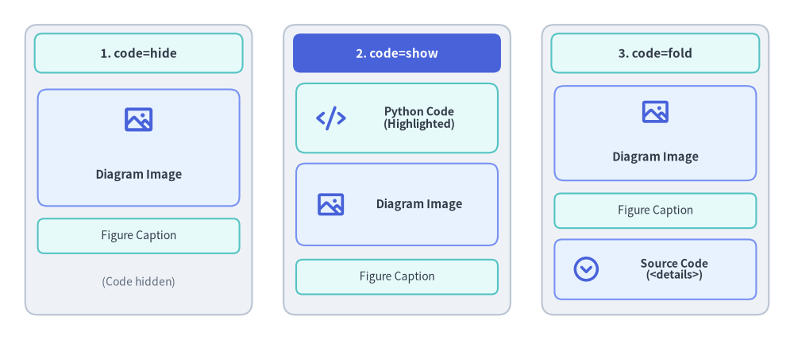
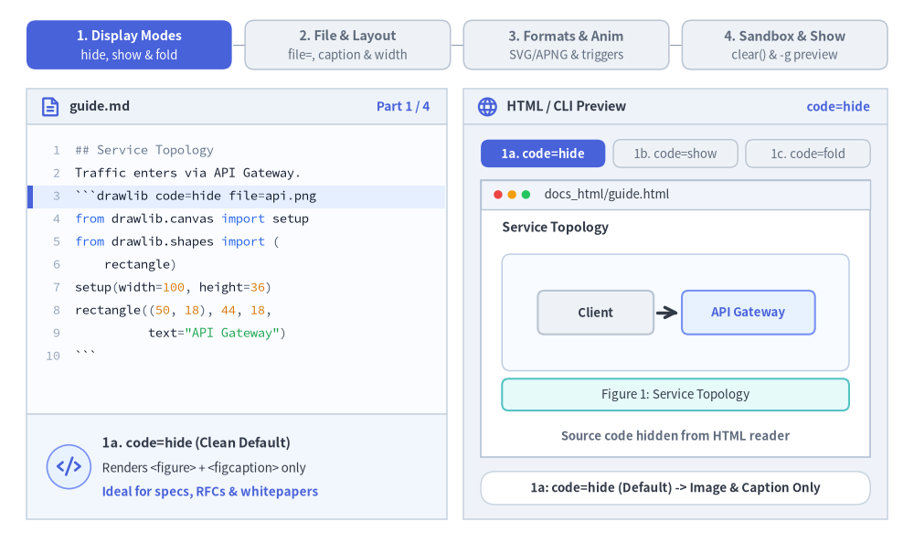
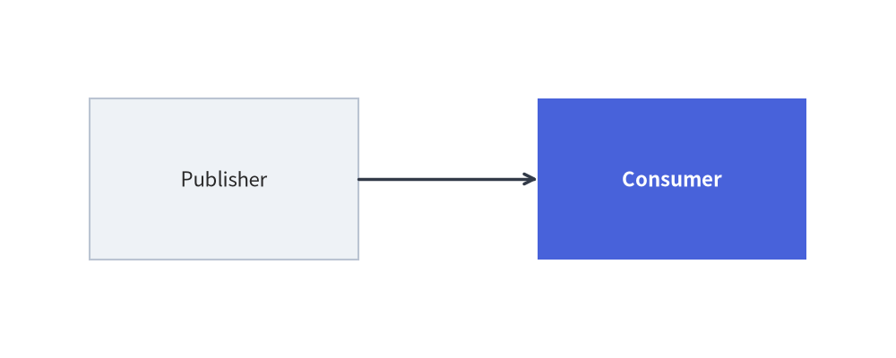

# Embedded Code Blocks (````drawlib````)

Drawlib allows you to embed Python drawing scripts directly into Markdown documents using the ````drawlib```` code fence. The builder compiles these blocks into vector images during site or document builds, automatically generating HTML elements, companion image files, and syntax-highlighted code blocks.

Choose from three display modes (`code=hide`, `code=show`, and `code=fold`) to control how source code is presented alongside rendered diagrams:


<figure class="drawlib-image" style="text-align: center;">
  
  <figcaption class="drawlib-caption">Visual Comparison of code=hide, code=show, and code=fold Display Modes</figcaption>
</figure>

<details class="drawlib-code-details">
<summary>Source Code</summary>

```python
from drawlib.canvas import save, setup
from drawlib.icons import phosphor
from drawlib.shapes import rectangle
from drawlib.styles import Styles
from drawlib.text import text

setup(width=126, height=54)

# 1. Left Card: code=hide (Default)
rectangle((22, 27), width=36, height=46, style=Styles.Neutral.patch(shape_r=2.0))
rectangle(
    (22, 45.5),
    width=33,
    height=6.2,
    style=Styles.SecondaryNeutral.patch(shape_r=1.2),
    text="1. code=hide",
    text_style=Styles.DarkBold.patch(text_size=11.0),
)
rectangle((22, 30.5), width=32, height=18.5, style=Styles.PrimaryNeutral.patch(shape_r=1.5))
phosphor.image((22, 35.0), width=5.2, style=Styles.PrimaryBold)
text((22, 26.2), "Diagram Image", style=Styles.DarkBold.patch(text_size=10.5))
rectangle(
    (22, 16.5),
    width=32,
    height=5.5,
    style=Styles.SecondaryNeutral.patch(shape_r=1.0),
    text="Figure Caption",
    text_style=Styles.Dark.patch(text_size=10.0),
)
text((22, 9.2), "(Code hidden)", style=Styles.Muted.patch(text_size=10.0))

# 2. Center Card: code=show (PrimaryFlat header banner)
rectangle((63, 27), width=36, height=46, style=Styles.Neutral.patch(shape_r=2.0))
rectangle(
    (63, 45.5),
    width=33,
    height=6.2,
    style=Styles.PrimaryFlat.patch(shape_r=1.2),
    text="2. code=show",
    text_style=Styles.WhiteBold.patch(text_size=11.0),
)
rectangle((63, 35.2), width=32, height=11.0, style=Styles.SecondaryNeutral.patch(shape_r=1.5))
phosphor.code((52.5, 35.2), width=4.8, style=Styles.PrimaryBold)
text((66.5, 35.2), "Python Code\n(Highlighted)", style=Styles.DarkBold.patch(text_size=10.2))
rectangle((63, 21.5), width=32, height=13.0, style=Styles.PrimaryNeutral.patch(shape_r=1.5))
phosphor.image((52.5, 21.5), width=4.8, style=Styles.PrimaryBold)
text((66.5, 21.5), "Diagram Image", style=Styles.DarkBold.patch(text_size=10.5))
rectangle(
    (63, 10.0),
    width=32,
    height=5.5,
    style=Styles.SecondaryNeutral.patch(shape_r=1.0),
    text="Figure Caption",
    text_style=Styles.Dark.patch(text_size=10.0),
)

# 3. Right Card: code=fold
rectangle((104, 27), width=36, height=46, style=Styles.Neutral.patch(shape_r=2.0))
rectangle(
    (104, 45.5),
    width=33,
    height=6.2,
    style=Styles.SecondaryNeutral.patch(shape_r=1.2),
    text="3. code=fold",
    text_style=Styles.DarkBold.patch(text_size=11.0),
)
rectangle((104, 32.8), width=32, height=15.0, style=Styles.PrimaryNeutral.patch(shape_r=1.5))
phosphor.image((104, 36.2), width=4.8, style=Styles.PrimaryBold)
text((104, 29.0), "Diagram Image", style=Styles.DarkBold.patch(text_size=10.5))
rectangle(
    (104, 20.5),
    width=32,
    height=5.5,
    style=Styles.SecondaryNeutral.patch(shape_r=1.0),
    text="Figure Caption",
    text_style=Styles.Dark.patch(text_size=10.0),
)
rectangle((104, 11.2), width=32, height=9.5, style=Styles.PrimaryNeutral.patch(shape_r=1.2))
phosphor.caret_circle_down((93.0, 11.2), width=4.6, style=Styles.PrimaryBold)
text((107.0, 11.2), "Source Code\n(<details>)", style=Styles.DarkBold.patch(text_size=10.0))

save()
```

</details>


---

## 1. Interactive Fence Attributes & Display Tour

Each ````drawlib```` block combines declarative fence header options (`code=`, `file=`, `caption=`, `align=`, `width=`, `anim_trigger=`, `anim_pause=`) with an isolated Python execution sandbox (`canvas.clear()`). Explore how fence attributes control rendered HTML figures, vector/animated formats, and sub-second `drawlib show -g` coordinate previews:


<figure class="drawlib-image" style="text-align: center;">
  
  <figcaption class="drawlib-caption">Embedded Drawlib Fence Tour: Code Display Modes, File & Layout Sizing, Output Formats & Animation Controls, and Sandbox Preview (APNG Animation)</figcaption>
</figure>

<details class="drawlib-code-details">
<summary>Source Code</summary>

```python
from __future__ import annotations

from drawlib.anim import Animation
from drawlib.canvas import save, setup
from drawlib.icons import phosphor
from drawlib.lines import line
from drawlib.shapes import circle, rectangle
from drawlib.smartarts import SourceCode, SourceCodeStyles
from drawlib.styles import Styles
from drawlib.text import text

W, H = 138.0, 82.0
setup(width=W, height=H)
anim = Animation(fps=10.0, loop=0)

BT = "`" * 3
CODE_TEXT_SIZE = 10.0
PT_TO_CANVAS = W / 720.0
FONT_CANVAS = CODE_TEXT_SIZE * PT_TO_CANVAS
LINE_H = FONT_CANVAS * 1.8
PAD_Y = FONT_CANVAS * 1.2

CODE_STYLES = SourceCodeStyles.get("default", font_lang="en", text_size=CODE_TEXT_SIZE).patch(
    box_style=Styles.Neutral.patch(shape_fill_color=(0, 0, 0, 0), shape_line_width=0),
)

PANE_HEADER = Styles.Neutral.patch(
    shape_fill_color=(238, 243, 250),
    shape_line_color=(203, 213, 225),
    shape_line_width=1.2,
    shape_r=0.0,
)
EDITOR_BODY = Styles.Neutral.patch(
    shape_fill_color=(250, 252, 255),
    shape_line_color=(203, 213, 225),
    shape_line_width=1.2,
    shape_r=0.0,
)
TAKEAWAY_BODY = Styles.Neutral.patch(
    shape_fill_color=(242, 246, 253),
    shape_line_color=(203, 213, 225),
    shape_line_width=1.2,
    shape_r=0.0,
)
STUDIO_BODY = Styles.Neutral.patch(
    shape_fill_color=(239, 243, 249),
    shape_line_color=(203, 213, 225),
    shape_line_width=1.2,
    shape_r=0.0,
)

PART_ITEMS = [
    ("1. Display Modes", "hide, show & fold"),
    ("2. File & Layout", "file=, caption & width"),
    ("3. Formats & Anim", "SVG/APNG & triggers"),
    ("4. Sandbox & Show", "clear() & -g preview"),
]


def draw_step_bar(active_part: int) -> None:
    """Draw top 4-part progress bar (active_part is 1..4)."""
    pill_w = 31.0
    pill_h = 7.4
    gap = 2.0
    start_x = 4.0 + pill_w / 2.0
    cy = 75.2

    for idx, (label, sublabel) in enumerate(PART_ITEMS, start=1):
        cx = start_x + (idx - 1) * (pill_w + gap)
        if idx > 1:
            prev_cx = cx - (pill_w + gap)
            line(
                (prev_cx + pill_w / 2.0 + 0.2, cy),
                (cx - pill_w / 2.0 - 0.2, cy),
                style=Styles.PrimaryBold if idx <= active_part else Styles.MutedThin,
            )

        if idx == active_part:
            st = Styles.PrimaryFlat.patch(shape_r=1.4)
            tst = Styles.WhiteBold.patch(text_size=10.3)
            sub_tst = Styles.White.patch(text_size=9.5)
        elif idx < active_part:
            st = Styles.PrimaryNeutral.patch(shape_r=1.4, shape_line_width=1.1)
            tst = Styles.PrimaryBold.patch(text_size=10.3)
            sub_tst = Styles.Primary.patch(text_size=9.5)
        else:
            st = Styles.Neutral.patch(shape_r=1.4, shape_line_width=1.1)
            tst = Styles.MutedBold.patch(text_size=10.3)
            sub_tst = Styles.Muted.patch(text_size=9.5)

        rectangle((cx, cy), width=pill_w, height=pill_h, style=st)
        text((cx, cy + 1.35), label, style=tst)
        text((cx, cy - 1.55), sublabel, style=sub_tst)


def draw_left_pane(
    active_part: int,
    code_lines: list[str],
    hl_range: tuple[int, int],
    icon_fn: object,
    summary_title: str,
    summary_line1: str,
    summary_line2: str,
    code_lang: str = "markdown",
    pane_title: str = "guide.md",
) -> None:
    """Draw left Markdown fence editor + bottom takeaway card."""
    x0, w = 4.0, 63.5
    cx = x0 + w / 2.0
    top_y = 63.2
    header_h = 5.4
    editor_h = 43.8
    takeaway_h = 15.8

    rectangle((cx, top_y + header_h / 2.0), width=w, height=header_h, style=PANE_HEADER)
    phosphor.file_text((x0 + 3.6, top_y + header_h / 2.0), width=3.4, style=Styles.PrimaryBold)
    text(
        (x0 + 6.5, top_y + header_h / 2.0),
        pane_title,
        style=Styles.DarkBold.patch(text_size=10.2, halign="left"),
    )
    text(
        (x0 + w - 2.6, top_y + header_h / 2.0),
        f"Part {active_part} / 4",
        style=Styles.PrimaryBold.patch(text_size=9.8, halign="right"),
    )

    rectangle((cx, top_y - editor_h / 2.0), width=w, height=editor_h, style=EDITOR_BODY)

    hl_start, hl_end = hl_range
    hl_top = top_y - PAD_Y - hl_start * LINE_H
    hl_bot = top_y - PAD_Y - (hl_end + 1) * LINE_H
    hl_cy = (hl_top + hl_bot) / 2.0
    hl_h = hl_top - hl_bot
    rectangle(
        (cx, hl_cy),
        width=w - 0.6,
        height=hl_h,
        style=Styles.Neutral.patch(shape_fill_color=(229, 239, 255), shape_line_width=0),
    )
    rectangle(
        (x0 + 0.55, hl_cy),
        width=0.9,
        height=hl_h,
        style=Styles.PrimaryFlat.patch(shape_line_width=0),
    )

    SourceCode.draw(
        xy=(x0, top_y),
        width=w,
        code="\n".join(code_lines),
        styles=CODE_STYLES,
        code_lang=code_lang,
        show_linenum=True,
        align="top_left",
    )

    take_cy = 3.6 + takeaway_h / 2.0
    rectangle((cx, take_cy), width=w, height=takeaway_h, style=TAKEAWAY_BODY)
    circle(
        (x0 + 6.4, take_cy),
        radius=3.3,
        style=Styles.PrimaryNeutral.patch(shape_line_width=1.2),
    )
    icon_fn((x0 + 6.4, take_cy), width=3.8, style=Styles.PrimaryBold)  # type: ignore[operator]
    text(
        (x0 + 11.4, take_cy + 3.6),
        summary_title,
        style=Styles.DarkBold.patch(text_size=10.4, halign="left"),
    )
    text(
        (x0 + 11.4, take_cy - 0.2),
        summary_line1,
        style=Styles.Dark.patch(text_size=9.7, halign="left"),
    )
    text(
        (x0 + 11.4, take_cy - 3.8),
        summary_line2,
        style=Styles.PrimaryBold.patch(text_size=9.6, halign="left"),
    )


def draw_preview_studio(
    param_badge: str,
    footer_caption: str,
    chrome_url: str = "docs_html/guide.html",
) -> tuple[float, float]:
    """Draw right browser/CLI preview studio shell, inner white page sheet, and footer."""
    x0, w = 70.0, 64.0
    cx = x0 + w / 2.0
    top_y = 63.2
    header_h = 5.4
    body_h = 59.6

    rectangle((cx, top_y + header_h / 2.0), width=w, height=header_h, style=PANE_HEADER)
    phosphor.globe((x0 + 3.6, top_y + header_h / 2.0), width=3.4, style=Styles.PrimaryBold)
    text(
        (x0 + 6.5, top_y + header_h / 2.0),
        "HTML / CLI Preview",
        style=Styles.DarkBold.patch(text_size=10.2, halign="left"),
    )
    text(
        (x0 + w - 2.6, top_y + header_h / 2.0),
        param_badge,
        style=Styles.PrimaryBold.patch(text_size=9.6, halign="right"),
    )

    rectangle((cx, 3.6 + body_h / 2.0), width=w, height=body_h, style=STUDIO_BODY)

    sheet_cx, sheet_cy = cx, 33.9
    sheet_w, sheet_h = 58.8, 41.8
    rectangle(
        (sheet_cx, sheet_cy),
        width=sheet_w,
        height=sheet_h,
        style=Styles.Neutral.patch(
            shape_fill_color=(255, 255, 255),
            shape_line_color=(180, 194, 214),
            shape_line_width=1.2,
        ),
    )
    # Mini browser/terminal chrome bar at top of sheet (y = [50.4, 54.8])
    rectangle(
        (sheet_cx, 52.6),
        width=sheet_w,
        height=4.4,
        style=Styles.Neutral.patch(
            shape_fill_color=(241, 245, 251),
            shape_line_color=(180, 194, 214),
            shape_line_width=1.0,
        ),
    )
    for dx_dot, col_dot in ((0.0, (239, 68, 68)), (2.1, (245, 158, 11)), (4.2, (34, 197, 94))):
        circle(
            (75.2 + dx_dot, 52.6),
            radius=0.65,
            style=Styles.Neutral.patch(shape_fill_color=col_dot, shape_line_width=0),
        )
    text((82.2, 52.6), chrome_url, style=Styles.Dark.patch(text_size=9.5, halign="left"))

    rectangle(
        (cx, 8.3),
        width=58.8,
        height=5.0,
        style=Styles.Neutral.patch(
            shape_fill_color=(255, 255, 255),
            shape_line_color=(203, 213, 225),
            shape_line_width=1.1,
            shape_r=2.2,
        ),
        text=footer_caption,
        text_style=Styles.DarkBold.patch(text_size=9.7),
    )
    return sheet_cx, sheet_cy


def draw_sub_pills(scx: float, labels: list[str], active_idx: int) -> None:
    """Draw 3-step tracker pills above the white preview sheet."""
    pw, ph, pgap = 18.8, 4.2, 1.2
    p_start = scx - (3 * pw + 2 * pgap) / 2.0 + pw / 2.0
    for idx, lbl in enumerate(labels):
        px = p_start + idx * (pw + pgap)
        if idx == active_idx:
            pst = Styles.PrimaryFlat.patch(shape_r=1.2)
            ptst = Styles.WhiteBold.patch(text_size=9.5)
        elif idx < active_idx:
            pst = Styles.PrimaryNeutral.patch(shape_r=1.2, shape_line_width=1.0)
            ptst = Styles.PrimaryBold.patch(text_size=9.5)
        else:
            pst = Styles.Neutral.patch(shape_r=1.2, shape_line_width=1.0)
            ptst = Styles.Muted.patch(text_size=9.5)
        rectangle((px, 58.8), width=pw, height=ph, style=pst, text=lbl, text_style=ptst)


def draw_mini_diagram_card(cx: float, cy: float, w: float, h: float) -> None:
    """Draw a mini rendered API Gateway diagram inside the browser <figure> card."""
    rectangle(
        (cx, cy),
        width=w,
        height=h,
        style=Styles.Neutral.patch(
            shape_fill_color=(248, 251, 255),
            shape_line_color=(191, 206, 228),
            shape_line_width=1.1,
            shape_r=1.3,
        ),
    )
    nw = min(17.5, w * 0.34)
    nh = min(6.6, h * 0.62)
    rectangle(
        (cx - w * 0.23, cy),
        width=nw,
        height=nh,
        style=Styles.Neutral.patch(shape_r=1.0),
        text="Client",
        text_style=Styles.DarkBold.patch(text_size=9.5),
    )
    rectangle(
        (cx + w * 0.21, cy),
        width=nw + 2.6,
        height=nh,
        style=Styles.PrimaryNeutral.patch(shape_r=1.0),
        text="API Gateway",
        text_style=Styles.PrimaryBold.patch(text_size=9.5),
    )
    line(
        (cx - w * 0.23 + nw / 2.0 + 0.5, cy),
        (cx + w * 0.21 - (nw + 2.6) / 2.0 - 0.5, cy),
        arrow_head="->",
        style=Styles.DarkBold,
    )


# =========================================================================
# Part 1: 1. Display Modes (code=hide, code=show, code=fold)
# =========================================================================
def make_p1_code(mode_val: str) -> list[str]:
    return [
        "## Service Topology",
        "Traffic enters via API Gateway.",
        f"{BT}drawlib code={mode_val} file=api.png",
        "from drawlib.canvas import setup",
        "from drawlib.shapes import (",
        "    rectangle)",
        "setup(width=100, height=36)",
        "rectangle((50, 18), 44, 18,",
        '          text="API Gateway")',
        f"{BT}",
    ]


PART1_STATES = [
    (
        "hide",
        3.3,
        "code=hide",
        "1a: code=hide (Default) -> Image & Caption Only",
        "1a. code=hide (Clean Default)",
        "Renders <figure> + <figcaption> only",
        "Ideal for specs, RFCs & whitepapers",
    ),
    (
        "show",
        3.3,
        "code=show",
        "1b: code=show -> Highlighted Python Above Image",
        "1b. code=show (Tutorial Mode)",
        "Syntax-highlighted code above image",
        "Ideal for API guides & code recipes",
    ),
    (
        "fold",
        3.5,
        "code=fold",
        "1c: code=fold -> Visual Above Fold + <details>",
        "1c. code=fold (Hero & Overview)",
        "Diagram immediately visible on load",
        "Collapsible <details> drawer below",
    ),
]

for p1_idx, (mode_val, dur, badge_txt, foot_txt, s_t, s_1, s_2) in enumerate(PART1_STATES):
    with anim.frame(duration=dur):
        draw_step_bar(1)
        draw_left_pane(1, make_p1_code(mode_val), (2, 2), phosphor.code, s_t, s_1, s_2, code_lang="python")
        scx, _ = draw_preview_studio(badge_txt, foot_txt)
        draw_sub_pills(scx, ["1a. code=hide", "1b. code=show", "1c. code=fold"], p1_idx)

        text((75.8, 47.6), "Service Topology", style=Styles.DarkBold.patch(text_size=10.1, halign="left"))

        if mode_val == "hide":
            draw_mini_diagram_card(scx, 34.8, 52.4, 17.6)
            rectangle(
                (scx, 22.4),
                width=52.4,
                height=4.8,
                style=Styles.SecondaryNeutral.patch(shape_r=1.0),
                text="Figure 1: Service Topology",
                text_style=Styles.Dark.patch(text_size=9.6),
            )
            text((scx, 16.2), "Source code hidden from HTML reader", style=Styles.MutedBold.patch(text_size=9.5))
        elif mode_val == "show":
            rectangle(
                (scx, 40.2),
                width=52.4,
                height=9.2,
                style=Styles.PrimaryNeutral.patch(
                    shape_fill_color=(235, 243, 255),
                    shape_line_color=(37, 99, 235),
                    shape_line_width=1.5,
                    shape_r=1.2,
                ),
            )
            phosphor.code((79.4, 40.2), width=3.8, style=Styles.PrimaryBold)
            text(
                (82.8, 41.8),
                "<pre> Highlighted Python Code",
                style=Styles.PrimaryBold.patch(text_size=9.8, halign="left"),
            )
            text(
                (82.8, 38.2),
                "setup(100, 36); rectangle(...)",
                style=Styles.Dark.patch(text_size=9.5, halign="left"),
            )
            draw_mini_diagram_card(scx, 28.2, 52.4, 11.4)
            rectangle(
                (scx, 18.8),
                width=52.4,
                height=4.6,
                style=Styles.SecondaryNeutral.patch(shape_r=1.0),
                text="Figure 1: Service Topology",
                text_style=Styles.Dark.patch(text_size=9.6),
            )
        else:
            draw_mini_diagram_card(scx, 38.6, 52.4, 12.6)
            rectangle(
                (scx, 28.8),
                width=52.4,
                height=4.5,
                style=Styles.SecondaryNeutral.patch(shape_r=1.0),
                text="Figure 1: Service Topology",
                text_style=Styles.Dark.patch(text_size=9.6),
            )
            rectangle(
                (scx, 20.2),
                width=52.4,
                height=7.6,
                style=Styles.PrimaryNeutral.patch(
                    shape_fill_color=(232, 242, 255),
                    shape_line_color=(37, 99, 235),
                    shape_line_width=1.6,
                    shape_r=1.2,
                ),
            )
            phosphor.caret_right((79.4, 20.2), width=3.6, style=Styles.PrimaryBold)
            text(
                (82.6, 20.2),
                "Source Code (<details> drawer)",
                style=Styles.PrimaryBold.patch(text_size=9.8, halign="left"),
            )

# =========================================================================
# Part 2: 2. File & Layout (file= + caption=, 100% Width, width=80%)
# =========================================================================
PART2_STATES = [
    (
        "file_cap",
        3.3,
        [
            "## Figure Asset & Caption",
            f"{BT}drawlib file=arch.png",
            '# + caption="Service Topology"',
            "setup(width=100, height=36)",
            "rectangle((50, 18), 44, 18,",
            '          text="API Gateway")',
            f"{BT}",
            "# Deterministic asset path:",
            "# -> guide_images/arch.png",
        ],
        (1, 2),
        "file + caption",
        "2a: Deterministic *_images/ Path & <figcaption>",
        "2a. Explicit file= & caption=",
        "Writes to guide_images/arch.png",
        "Prevents numbering shifts on edits",
    ),
    (
        "full_width",
        3.3,
        [
            "## Full-Width Card (Best Practice)",
            "# AVOID narrow px caps:",
            "# width=500px  (shrinks labels!)",
            "",
            "# DO: omit px cap -> 100% width",
            f"{BT}drawlib align=center",
            "setup(width=110, height=40)",
            "# text_size >= 10 matches 16px!",
            "rectangle((55, 20), 48, 18)",
            f"{BT}",
        ],
        (4, 7),
        "100% Container",
        "2b: Omit Narrow px Caps -> Fills 100% Container",
        "2b. Full .drawlib-image Width",
        "Omit 500px/600px fence width caps",
        "text_size >= 10 matches 16px prose",
    ),
    (
        "pct_width",
        3.5,
        [
            "## Responsive Percentage Sizing",
            f"{BT}drawlib width=80% align=center",
            "# file=compact_badge.png",
            "setup(width=88, height=34)",
            "rectangle((44, 17), 42, 16,",
            '          text="80% Responsive")',
            "save()",
            f"{BT}",
            "# Scales smoothly across mobile",
            "# & desktop viewports!",
        ],
        (1, 2),
        "width=80%",
        "2c: Explicit Percentage Width Scales Responsively",
        "2c. Responsive width=80%",
        "Centers figure at 80% container width",
        "Adapts cleanly to mobile & desktop",
    ),
]

for p2_idx, (mode_2, dur, code_2, hl_rng, badge_txt, foot_txt, s_t, s_1, s_2) in enumerate(PART2_STATES):
    with anim.frame(duration=dur):
        draw_step_bar(2)
        draw_left_pane(
            2,
            code_2,
            hl_rng,
            phosphor.arrows_out_line_horizontal,
            s_t,
            s_1,
            s_2,
            code_lang="python",
        )
        scx, _ = draw_preview_studio(badge_txt, foot_txt)
        draw_sub_pills(scx, ["2a. file & cap", "2b. 100% Width", "2c. width=80%"], p2_idx)

        if mode_2 == "file_cap":
            rectangle(
                (scx, 45.8),
                width=52.8,
                height=5.6,
                style=Styles.PrimaryNeutral.patch(shape_r=1.2),
            )
            phosphor.folder_open((79.2, 45.8), width=3.6, style=Styles.PrimaryBold)
            text(
                (82.4, 45.8),
                "guide_images/arch.png",
                style=Styles.PrimaryBold.patch(text_size=9.8, halign="left"),
            )
            rectangle(
                (scx, 30.2),
                width=52.8,
                height=21.6,
                style=Styles.PrimaryDashed.patch(shape_fill_color=(0, 0, 0, 0), shape_line_width=1.2, shape_r=1.5),
            )
            draw_mini_diagram_card(scx, 33.8, 49.0, 11.8)
            rectangle(
                (scx, 23.2),
                width=49.0,
                height=5.2,
                style=Styles.SecondaryNeutral.patch(shape_line_width=1.3, shape_r=1.0),
                text="<figcaption> Service Topology",
                text_style=Styles.DarkBold.patch(text_size=9.6),
            )
            text((scx, 15.8), "Semantic <figure> + deterministic asset file", style=Styles.Dark.patch(text_size=9.5))
        elif mode_2 == "full_width":
            # Bad narrow px cap comparison
            rectangle(
                (scx, 43.2),
                width=52.8,
                height=9.6,
                style=Styles.MutedDashed.patch(shape_fill_color=(250, 251, 253), shape_r=1.2),
            )
            rectangle(
                (scx, 43.2),
                width=27.0,
                height=6.8,
                style=Styles.Neutral.patch(shape_r=1.0),
                text="500px cap (cramped)",
                text_style=Styles.MutedBold.patch(text_size=9.5),
            )
            # Good 100% container fill
            draw_mini_diagram_card(scx, 28.6, 52.8, 13.4)
            line((75.8, 19.6), (128.2, 19.6), arrow_head="<->", style=Styles.PrimaryBold)
            text(
                (scx, 16.0),
                "100% .drawlib-image  •  matches 16px body text",
                style=Styles.PrimaryBold.patch(text_size=9.5),
            )
        else:
            rectangle(
                (scx, 34.4),
                width=52.8,
                height=26.4,
                style=Styles.MutedDashed.patch(shape_fill_color=(249, 251, 254), shape_r=1.4),
            )
            draw_mini_diagram_card(scx, 38.0, 42.2, 14.2)
            line((80.9, 27.8), (123.1, 27.8), arrow_head="<->", style=Styles.PrimaryBold)
            text(
                (scx, 24.4),
                "width=80%  •  align=center",
                style=Styles.PrimaryBold.patch(text_size=9.6),
            )
            text(
                (scx, 16.6),
                "10% symmetric margins on left & right",
                style=Styles.Dark.patch(text_size=9.5),
            )

# =========================================================================
# Part 3: 3. Formats & Anim (.svg vs .png, APNG/WebP, click & pause)
# =========================================================================
PART3_STATES = [
    (
        "svg_png",
        3.3,
        [
            "## Vector SVG vs Raster PNG",
            "# Infinite-zoom vector SVG:",
            f"{BT}drawlib file=diagram.svg",
            "setup(width=100, height=36)",
            f"{BT}",
            "",
            "# Crisp 200 DPI PNG:",
            f"{BT}drawlib file=diagram.png",
            "setup(width=100, height=36)",
            f"{BT}",
        ],
        (2, 7),
        ".svg vs .png",
        "3a: Infinite-Zoom SVG vs Crisp 200 DPI PNG",
        "3a. Vector SVG & 200 DPI PNG",
        "Format inferred from file= extension",
        ".svg scales infinitely; .png universal",
    ),
    (
        "apng_webp",
        3.3,
        [
            f"{BT}drawlib file=flow_anim.png",
            "# .png -> APNG | .webp -> WebP",
            "from drawlib.anim import Animation",
            "setup(width=100, height=36)",
            "anim = Animation(fps=10, loop=0)",
            "for step in (1, 2, 3):",
            "    with anim.frame(duration=1.2):",
            "        draw_stage(step)",
            "save()",
            f"{BT}",
        ],
        (0, 6),
        "APNG / WebP",
        "3b: Multi-Frame APNG (.png) & Animated WebP (.webp)",
        "3b. Native APNG & WebP",
        "Animation(fps=10, loop=0) in blocks",
        "Plays in browsers, GitHub MD & decks",
    ),
    (
        "click_pause",
        3.5,
        [
            "## Interactive Playback Controls",
            f"{BT}drawlib anim_trigger=click",
            "# + anim_pause=1.5 file=demo.png",
            "from drawlib.anim import Animation",
            "anim = Animation(fps=10, loop=0)",
            "with anim.frame(duration=1.5):",
            "    draw_interactive_step()",
            "save()",
            f"{BT}",
        ],
        (1, 2),
        "click & pause",
        "3c: Interactive anim_trigger=click & anim_pause=1.5",
        "3c. Click-to-Play & Pause Control",
        "anim_trigger=click waits for reader",
        "anim_pause=1.5 holds at checkpoints",
    ),
]

for p3_idx, (mode_3, dur, code_3, hl_rng, badge_txt, foot_txt, s_t, s_1, s_2) in enumerate(PART3_STATES):
    with anim.frame(duration=dur):
        draw_step_bar(3)
        draw_left_pane(3, code_3, hl_rng, phosphor.film_strip, s_t, s_1, s_2, code_lang="python")
        scx, _ = draw_preview_studio(badge_txt, foot_txt)
        draw_sub_pills(scx, ["3a. SVG vs PNG", "3b. APNG/WebP", "3c. click/pause"], p3_idx)

        if mode_3 == "svg_png":
            rectangle(
                (88.2, 34.4),
                width=25.4,
                height=24.0,
                style=Styles.PrimaryNeutral.patch(shape_line_width=1.4, shape_r=1.5),
            )
            phosphor.sparkle((88.2, 41.6), width=4.6, style=Styles.PrimaryBold)
            text((88.2, 35.8), "diagram.svg", style=Styles.PrimaryBold.patch(text_size=10.1))
            text((88.2, 31.4), "Infinite Zoom", style=Styles.DarkBold.patch(text_size=9.6))
            text((88.2, 27.4), "Vector DOM", style=Styles.Dark.patch(text_size=9.5))

            rectangle(
                (115.8, 34.4),
                width=25.4,
                height=24.0,
                style=Styles.SecondaryNeutral.patch(shape_line_width=1.4, shape_r=1.5),
            )
            phosphor.image((115.8, 41.6), width=4.6, style=Styles.SecondaryBold)
            text((115.8, 35.8), "diagram.png", style=Styles.DarkBold.patch(text_size=10.1))
            text((115.8, 31.4), "Crisp 200 DPI", style=Styles.DarkBold.patch(text_size=9.6))
            text((115.8, 27.4), "GitHub & PDF", style=Styles.Dark.patch(text_size=9.5))

            text((scx, 16.6), "Output format inferred automatically", style=Styles.Dark.patch(text_size=9.5))
        elif mode_3 == "apng_webp":
            rectangle(
                (scx, 36.8),
                width=52.8,
                height=19.6,
                style=Styles.PrimaryNeutral.patch(shape_line_width=1.4, shape_r=1.5),
            )
            text(
                (78.2, 43.2),
                "Multi-Frame Stream",
                style=Styles.DarkBold.patch(text_size=9.9, halign="left"),
            )
            rectangle(
                (120.2, 43.2),
                width=14.8,
                height=4.0,
                style=Styles.PrimaryFlat.patch(shape_r=1.0),
                text="10 FPS",
                text_style=Styles.WhiteBold.patch(text_size=9.5),
            )
            for f_i, fx in enumerate((84.5, 102.0, 119.5), start=1):
                fst = Styles.PrimaryFlat if f_i == 2 else Styles.Neutral
                ftxt = Styles.WhiteBold if f_i == 2 else Styles.DarkBold
                rectangle(
                    (fx, 33.4),
                    width=14.2,
                    height=8.4,
                    style=fst.patch(shape_r=1.1),
                    text=f"Frame {f_i}",
                    text_style=ftxt.patch(text_size=9.6),
                )
                if f_i < 3:
                    line((fx + 7.4, 33.4), (fx + 10.1, 33.4), arrow_head="->", style=Styles.PrimaryBold)

            rectangle(
                (88.2, 21.4),
                width=25.2,
                height=5.4,
                style=Styles.Neutral.patch(shape_r=1.1),
                text=".png (APNG)",
                text_style=Styles.DarkBold.patch(text_size=9.6),
            )
            rectangle(
                (115.8, 21.4),
                width=25.2,
                height=5.4,
                style=Styles.SecondaryNeutral.patch(shape_r=1.1),
                text=".webp (-50% size)",
                text_style=Styles.DarkBold.patch(text_size=9.6),
            )
            text((scx, 15.6), "Zero JS required for APNG & WebP", style=Styles.Dark.patch(text_size=9.5))
        else:
            rectangle(
                (scx, 34.8),
                width=52.8,
                height=22.8,
                style=Styles.Neutral.patch(
                    shape_fill_color=(246, 249, 255),
                    shape_line_color=(37, 99, 235),
                    shape_line_width=1.5,
                    shape_r=1.6,
                ),
            )
            rectangle(
                (scx, 38.6),
                width=30.0,
                height=7.8,
                style=Styles.PrimaryFlat.patch(shape_r=1.6),
            )
            phosphor.play_circle((91.4, 38.6), width=4.4, style=Styles.WhiteBold)
            text((94.8, 38.6), "Click to Play", style=Styles.WhiteBold.patch(text_size=10.2, halign="left"))

            line((79.0, 28.0), (125.0, 28.0), style=Styles.MutedThin.patch(line_width=2.0))
            line((79.0, 28.0), (104.0, 28.0), style=Styles.PrimaryBold.patch(line_width=2.4))
            circle((104.0, 28.0), radius=1.3, style=Styles.PrimaryFlat)
            rectangle(
                (117.2, 28.0),
                width=18.2,
                height=4.4,
                style=Styles.SecondaryNeutral.patch(shape_r=1.0),
                text="pause = 1.5s",
                text_style=Styles.DarkBold.patch(text_size=9.5),
            )
            text(
                (scx, 17.2),
                "Interactive triggers & pause checkpoints",
                style=Styles.PrimaryBold.patch(text_size=9.5),
            )

# =========================================================================
# Part 4: 4. Sandbox & Show (canvas.clear(), show list, show -g grid)
# =========================================================================
PART4_STATES = [
    (
        "sandbox",
        3.3,
        [
            "# Block #1 in guide.md:",
            f"{BT}drawlib file=fig_one.png",
            "setup(width=100, height=36)",
            "circle((50, 18), radius=12)",
            f"{BT}",
            "# Auto canvas.clear() between!",
            "# Block #2 starts 100% clean:",
            f"{BT}drawlib file=fig_two.png",
            "setup(width=120, height=44)",
            "rectangle((60, 22), 40, 18)",
            f"{BT}",
        ],
        (5, 7),
        "canvas.clear()",
        "4a: Automatic canvas.clear() Prevents State Bleed",
        "4a. Sandbox Canvas Isolation",
        "Auto canvas.clear() before each block",
        "Zero style or shape contamination",
        "docs_html/guide.html",
    ),
    (
        "show_list",
        3.3,
        [
            "# List all blocks in guide.md:",
            "uv run drawlib show guide.md",
            "",
            "# Discovered drawlib blocks:",
            "# #0  L12  fig_one.png  (fold)",
            "# #1  L38  arch.png     (show)",
            "# #2  L74  demo.png     (hide)",
            "",
            "# No full site build needed!",
        ],
        (1, 6),
        "drawlib show",
        "4b: drawlib show Lists Block Indices & Filenames",
        "4b. Block Discovery Table",
        "Lists #index, line & target file=",
        "Inspect single blocks without build",
        "Terminal: drawlib show guide.md",
    ),
    (
        "show_grid",
        3.5,
        [
            "# Render 1 block with 10u/5u grid:",
            "uv run drawlib show guide.md \\",
            "    arch.png -g \\",
            "    -s styles.py -u utils.py \\",
            "    -o .drawlib/scratch/grid.png",
            "",
            "# Renders in < 1s for AI & dev",
            "# micro-geometry verification!",
        ],
        (1, 4),
        "show ... -g",
        "4c: -g Renders 10u/5u Coordinate Grid in <1s",
        "4c. 10u/5u Grid Preview (-g)",
        "Exports ruler overlay in < 1 second",
        "Catches clipping & margin bugs fast",
        "Preview: .drawlib/scratch/grid.png",
    ),
]

for p4_idx, (mode_4, dur, code_4, hl_rng, badge_txt, foot_txt, s_t, s_1, s_2, url_txt) in enumerate(PART4_STATES):
    with anim.frame(duration=dur):
        draw_step_bar(4)
        c_lang = "python" if mode_4 == "sandbox" else "bash"
        p_title = "guide.md" if mode_4 == "sandbox" else "Terminal CLI"
        draw_left_pane(4, code_4, hl_rng, phosphor.grid_four, s_t, s_1, s_2, code_lang=c_lang, pane_title=p_title)
        scx, _ = draw_preview_studio(badge_txt, foot_txt, chrome_url=url_txt)
        draw_sub_pills(scx, ["4a. Sandbox", "4b. show list", "4c. show -g"], p4_idx)

        if mode_4 == "sandbox":
            rectangle(
                (scx, 43.2),
                width=52.4,
                height=9.8,
                style=Styles.Neutral.patch(shape_r=1.3),
                text="Block #1: fig_one.png  (100 x 36)",
                text_style=Styles.DarkBold.patch(text_size=9.8),
            )
            rectangle(
                (scx, 33.4),
                width=48.8,
                height=5.6,
                style=Styles.SecondaryFlat.patch(shape_r=1.4),
            )
            phosphor.shield_check((83.4, 33.4), width=3.8, style=Styles.WhiteBold)
            text(
                (86.6, 33.4),
                "canvas.clear()  •  Isolated State",
                style=Styles.WhiteBold.patch(text_size=9.7, halign="left"),
            )
            rectangle(
                (scx, 23.6),
                width=52.4,
                height=9.8,
                style=Styles.PrimaryNeutral.patch(shape_r=1.3),
                text="Block #2: fig_two.png  (120 x 44)",
                text_style=Styles.PrimaryBold.patch(text_size=9.8),
            )
            text((scx, 15.6), "Adjacent blocks never leak styles or shapes", style=Styles.Dark.patch(text_size=9.5))
        elif mode_4 == "show_list":
            rectangle(
                (scx, 44.2),
                width=52.8,
                height=5.2,
                style=Styles.PrimaryNeutral.patch(shape_r=1.0),
            )
            text((79.0, 44.2), "Idx", style=Styles.DarkBold.patch(text_size=9.6))
            text((88.5, 44.2), "Line", style=Styles.DarkBold.patch(text_size=9.6))
            text((104.5, 44.2), "Target File", style=Styles.DarkBold.patch(text_size=9.6))
            text((122.0, 44.2), "Mode", style=Styles.DarkBold.patch(text_size=9.6))

            tbl_rows = [
                (38.0, "#0", "L12", "fig_one.png", "fold", False),
                (31.8, "#1", "L38", "arch.png", "show", True),
                (25.6, "#2", "L74", "demo.png", "hide", False),
            ]
            for ry, c0, c1, c2, c3, hi in tbl_rows:
                rst = (
                    Styles.PrimaryNeutral.patch(shape_line_color=(37, 99, 235), shape_line_width=1.4, shape_r=1.0)
                    if hi
                    else Styles.Neutral.patch(shape_r=1.0)
                )
                tst = (Styles.PrimaryBold if hi else Styles.Dark).patch(text_size=9.6)
                rectangle((scx, ry), width=52.8, height=5.2, style=rst)
                text((79.0, ry), c0, style=tst)
                text((88.5, ry), c1, style=tst)
                text((104.5, ry), c2, style=tst)
                text((122.0, ry), c3, style=tst)

            text((scx, 17.6), "Target any block by file= name or #index", style=Styles.DarkBold.patch(text_size=9.5))
        else:
            # 10u/5u Coordinate Grid Preview Sheet
            gx0, gy0, gw_box, gh_box = 81.0, 21.8, 42.0, 21.6
            rectangle(
                (gx0 + gw_box / 2.0, gy0 + gh_box / 2.0),
                width=gw_box,
                height=gh_box,
                style=Styles.Neutral.patch(
                    shape_fill_color=(255, 255, 255),
                    shape_line_color=(59, 130, 246),
                    shape_line_width=1.3,
                ),
            )
            grid_major = Styles.PrimaryThin.patch(line_color=(191, 219, 254), line_width=0.9)
            for ix in range(1, 4):
                lx = gx0 + ix * (gw_box / 4.0)
                line((lx, gy0), (lx, gy0 + gh_box), style=grid_major)
            for iy in range(1, 3):
                ly = gy0 + iy * (gh_box / 3.0)
                line((gx0, ly), (gx0 + gw_box, ly), style=grid_major)

            for lbl_x, vx in (("0", gx0), ("50", gx0 + gw_box / 2.0), ("100", gx0 + gw_box)):
                text((vx, gy0 - 2.3), lbl_x, style=Styles.PrimaryBold.patch(text_size=9.5))
            for lbl_y, vy in (("0", gy0), ("20", gy0 + gh_box / 2.0), ("40", gy0 + gh_box)):
                text((gx0 - 1.6, vy), lbl_y, style=Styles.PrimaryBold.patch(text_size=9.5, halign="right"))

            rectangle(
                (gx0 + 12.0, gy0 + 10.8),
                width=14.6,
                height=8.4,
                style=Styles.Neutral.patch(shape_r=1.0),
                text="Gateway",
                text_style=Styles.DarkBold.patch(text_size=9.5),
            )
            rectangle(
                (gx0 + 30.5, gy0 + 10.8),
                width=13.2,
                height=8.4,
                style=Styles.PrimaryNeutral.patch(shape_r=1.0),
                text="SQL DB",
                text_style=Styles.PrimaryBold.patch(text_size=9.5),
            )
            line(
                (gx0 + 19.3, gy0 + 10.8),
                (gx0 + 23.9, gy0 + 10.8),
                arrow_head="->",
                style=Styles.DarkBold,
            )
            rectangle(
                (123.6, 46.6),
                width=11.6,
                height=4.0,
                style=Styles.SecondaryFlat.patch(shape_r=1.0),
                text="< 1 s",
                text_style=Styles.WhiteBold.patch(text_size=9.5),
            )
            text((scx, 15.4), "10u / 5u coordinate ruler overlay (-g)", style=Styles.DarkBold.patch(text_size=9.5))

save()
```

</details>


---

## 2. Basic Code Fence Syntax

Embedded drawing blocks use the `drawlib` language identifier with Python keyword-argument style (`key=value`) attributes:


```python
from drawlib.canvas import save, setup
from drawlib.shapes import rectangle
from drawlib.lines import line
from drawlib.styles import Styles

setup(width=100, height=40)
rectangle((25, 20), width=30, height=18, style=Styles.Neutral, text="Publisher")
rectangle((75, 20), width=30, height=18, style=Styles.PrimaryFlat, text="Consumer", text_style=Styles.WhiteBold)
line((40, 20), (60, 20), arrow_head="->", style=Styles.DarkBold)
save()
```

<figure class="drawlib-image" style="text-align: center;">
  
  <figcaption class="drawlib-caption">Service Architecture Example</figcaption>
</figure>


---

## 3. Header Attributes Reference

Options are specified as space-delimited `key=value` pairs on the opening code fence line (quotes are required only when values contain spaces, such as `caption="Service Architecture"`):

```text
``` drawlib file=<name.png> [code=hide|show|fold] [align=left|center|right] [caption="TEXT"] [OPTIONS...]
```

*(Note: In authoring, replace the brackets with your desired configuration options without the space after the backticks.)*

### 3.1 Code Display Modes

| Key-Value Option | HTML Rendering Behavior | Markdown Rendering Behavior |
|---|---|---|
| `code=hide` *(default)* | Displays image only (`<figure></figure>`). | Replaces block with standard Markdown image link. |
| `code=show` | Displays syntax-highlighted code block followed immediately by the image. | Renders code block followed by image link. |
| `code=fold` | Displays image followed by a collapsible dropdown (`<details><summary>Source Code</summary>...</details>`). | Displays image followed by collapsed details dropdown. |

### 3.2 Complete Fence Attributes Reference

| Category | Attribute Syntax | Default | Description |
|---|---|---|---|
| **Filename** | `file=<name.png>` | *(Required in docs)* | Explicit output filename in `<doc_stem>_images/<name.png>` (or `images/<slide_stem>/<name>` in slides). |
| **Image Format** | `format=<fmt>` | `png` (`svg` in slides) | Output image format (`png`, `webp`, `svg`, `apng`) if not inferred from `file=` extension. |
| **Width** | `width=650px`, `width=80%` | `None` (natural size) | CSS display width (`px`, `%`, `rem`, `vw`, or bare number → `px`). |
| **Height** | `height=400px` | `None` | Optional CSS display height override. |
| **Alignment** | `align=center`, `align=left`, `align=right` | `center` | Horizontal figure alignment on the page (`left`, `center`, `right`). |
| **Caption** | `caption="Text"` or `caption='Text'` | `None` | Wraps the figure in semantic `<figure>` and `<figcaption>` elements. |
| **CSS Class** | `class=hero-fig`, `class="card shadow"` | `None` | Appends custom CSS classes to the figure wrapper. |
| **Cache Control** | `no_cache=true` | `False` | Forces this specific block to re-execute on every build, bypassing `.drawlib/cache.db`. |
| **Slide Animation Controls** | `anim_trigger=auto\|click`, `anim_loop=once\|infinite`, `anim_pause=(2, 4)` | `auto`, `infinite`, `()` | Controls interactive `<canvas>` animation playback in HTML slide decks (see [Slide Deck Project Guide](./project_slide.md)). |

> [!TIP]
> **Best Practice for AI & Automation**:
> Always specify an explicit `file=<name.png>` attribute for every embedded block. Named blocks prevent numbering shifts when diagrams are inserted or removed, produce clean asset directories, and allow individual diagrams to be verified deterministically via `drawlib show <file.md> <image_name.png>`.

> [!NOTE]
> **Animations in Code Blocks (APNG & WebP)**:
> Embedded `drawlib` blocks fully support generating multi-frame animated illustrations using `from drawlib.anim import Animation`. The document compiler automatically outputs an animated PNG (APNG) or Animated WebP file based on the `file=` extension (`.png`, `.apng`, or `.webp`). See [Animations Overview (APNG & WebP)](../08_animations/overview.md) for full details.

### 3.3 HTML `<script type="text/drawlib">` Alternative Syntax
When authoring raw `.html` documents instead of `.md` files, you can embed Drawlib blocks using `<script type="text/drawlib">` tags with standard HTML attributes (`width="600px"`, `align="center"`, `file="arch.png"`, `caption="Architecture"`, `code="fold"`).

---

## 4. Working Directory & Path Resolution

When compiling embedded code blocks:
1. **Working Directory (`os.chdir`)**: Drawlib automatically sets the current working directory to the directory containing the Markdown document (or project root when `_assets/` resides at the root).
2. **Relative File Paths**: Relative paths to local assets (e.g. `image("../_assets/logo.png")`) resolve identically whether running `drawlib build` or testing with `drawlib show`.
3. **Module Resolution (`sys.path`)**: The document directory and project root are added to `sys.path`, allowing you to import local helper modules (such as `import styles` or `import utils`).

---

## 5. Canvas Isolation & Sandbox

- **Automatic Clear**: Drawlib invokes `canvas.clear()` before executing each embedded code block. State, shapes, and settings from a preceding diagram will never contaminate subsequent blocks.
- **Explicit Imports**: Embedded drawing blocks use explicit imports (e.g. `from drawlib.shapes import circle`, `from drawlib.styles import Styles`). This guarantees clean namespace boundaries, full IDE autocompletion support, and self-contained reproducibility.
- **Automatic Capture & `save()` Handling**: The Document Builder automatically captures the canvas and renders the companion image to disk when a block finishes execution. Calling `save()` within a block is optional; if present, the engine safely intercepts it to prevent duplicate file writes or collisions. In complete examples, including `save()` (without arguments) is recommended to maintain 100% copy-paste portability with standalone Python scripts.

---

## 6. Rapid Verification Workflow (`drawlib show`)

Do not run a full site build to verify coordinate adjustments on a single diagram. Inspect individual code blocks instantly using `drawlib show`:

```bash
# 1. List all available drawlib blocks in a Markdown document (index, line number, target filename):
uv run drawlib show docs_src/my_doc.md

# 2. Render a specific block by its explicit file: name with coordinate grid (-g) (Recommended):
uv run drawlib show docs_src/my_doc.md code_blocks_service_arch.png -g -o .drawlib/scratch/preview.png

# 3. Or target a block by 1-based index (1, 2, or -1 for the last block):
uv run drawlib show docs_src/my_doc.md 1 -g -o .drawlib/scratch/preview.png
```
