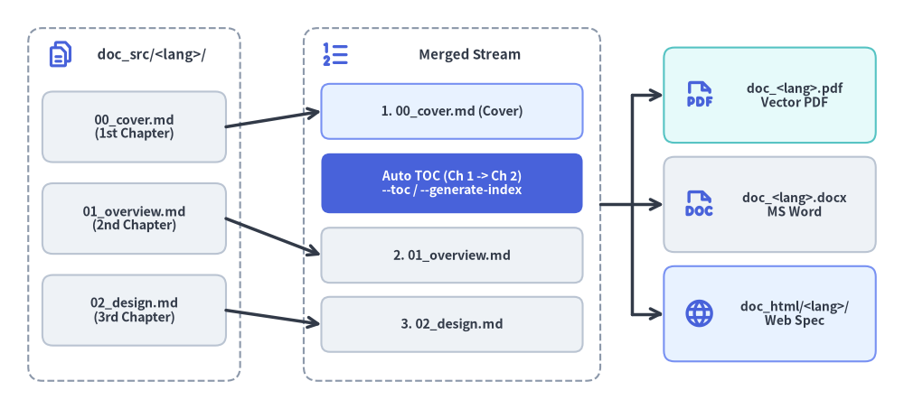
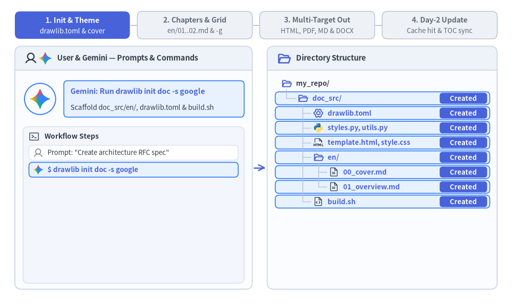

# Linear Document Project Guide (`drawlib init doc`)

The `doc` starter template is designed for authoring linear technical documents — such as specifications, Request for Comments (RFCs), system architecture proposals, whitepapers, thesis papers, and formal engineering reports.

By unifying single-page specs and multi-chapter reports into a single archetype, Drawlib allows you to compile **HTML, vector PDF, editable MS Word (`.docx`), Markdown, and standalone images** from the same Markdown source files.


<figure class="drawlib-image" style="text-align: center;">
  
  <figcaption class="drawlib-caption">Lexicographical Chapter Merging and Automatic Table of Contents (--toc / --generate-index) Injection</figcaption>
</figure>

<details class="drawlib-code-details">
<summary>Source Code</summary>

```python
from drawlib.canvas import save, setup
from drawlib.icons import phosphor
from drawlib.lines import line
from drawlib.shapes import rectangle
from drawlib.styles import Styles
from drawlib.text import text

setup(width=128, height=58)

# Left Container: doc_src/ Lexicographical Source Chapters
rectangle((19, 29), width=30, height=50, style=Styles.MutedDashed.patch(shape_r=2.0))
phosphor.files((8.5, 50.2), width=4.2, style=Styles.PrimaryBold)
text((21.5, 50.2), "doc_src/<lang>/", style=Styles.DarkBold.patch(text_size=10.8))

src_chapters = [
    (40.0, "00_cover.md\n(1st Chapter)"),
    (27.0, "01_overview.md\n(2nd Chapter)"),
    (14.0, "02_design.md\n(3rd Chapter)"),
]
for sy, label in src_chapters:
    rectangle(
        (19, sy),
        width=26,
        height=10.0,
        style=Styles.Neutral.patch(shape_r=1.5),
        text=label,
        text_style=Styles.DarkBold.patch(text_size=10.2),
    )

# Center Container: Merged Linear Document Stream (--page-break)
rectangle((64, 29), width=42, height=50, style=Styles.MutedDashed.patch(shape_r=2.0))
phosphor.list_numbers((47.5, 50.2), width=4.4, style=Styles.PrimaryBold)
text((66.5, 50.2), "Merged Stream", style=Styles.DarkBold.patch(text_size=10.8))

rectangle(
    (64, 42.2),
    width=37,
    height=7.8,
    style=Styles.PrimaryNeutral.patch(shape_r=1.2),
    text="1. 00_cover.md (Cover)",
    text_style=Styles.DarkBold.patch(text_size=10.2),
)
rectangle(
    (64, 32.0),
    width=37,
    height=8.5,
    style=Styles.PrimaryFlat.patch(shape_r=1.2),
    text="Auto TOC (Ch 1 -> Ch 2)\n--toc / --generate-index",
    text_style=Styles.WhiteBold.patch(text_size=10.0),
)
rectangle(
    (64, 21.8),
    width=37,
    height=7.8,
    style=Styles.Neutral.patch(shape_r=1.2),
    text="2. 01_overview.md",
    text_style=Styles.DarkBold.patch(text_size=10.2),
)
rectangle(
    (64, 12.0),
    width=37,
    height=7.8,
    style=Styles.Neutral.patch(shape_r=1.2),
    text="3. 02_design.md",
    text_style=Styles.DarkBold.patch(text_size=10.2),
)

# Arrows: Source -> Merged Stream
line((32, 40.0), (45.5, 42.2), arrow_head="->", style=Styles.DarkBold)
line((32, 27.0), (45.5, 21.8), arrow_head="->", style=Styles.DarkBold)
line((32, 14.0), (45.5, 12.0), arrow_head="->", style=Styles.DarkBold)

# Right: Exported Linear Deliverables
rectangle((109, 44.5), width=30, height=13.5, style=Styles.SecondaryNeutral.patch(shape_r=1.5))
phosphor.file_pdf((99.0, 44.5), width=4.6, style=Styles.PrimaryBold)
text((112.5, 44.5), "doc_<lang>.pdf\nVector PDF", style=Styles.DarkBold.patch(text_size=10.0))

rectangle((109, 29.0), width=30, height=13.5, style=Styles.Neutral.patch(shape_r=1.5))
phosphor.file_doc((99.0, 29.0), width=4.6, style=Styles.PrimaryBold)
text((112.5, 29.0), "doc_<lang>.docx\nMS Word", style=Styles.DarkBold.patch(text_size=10.0))

rectangle((109, 13.5), width=30, height=13.5, style=Styles.PrimaryNeutral.patch(shape_r=1.5))
phosphor.globe((99.0, 13.5), width=4.6, style=Styles.PrimaryBold)
text((112.5, 13.5), "doc_html/<lang>/\nWeb Spec", style=Styles.DarkBold.patch(text_size=10.0))

# Connectors: Merged Stream -> Deliverables
line((85, 29.0), (89.5, 29.0), style=Styles.DarkBold)
line((89.5, 13.5), (89.5, 44.5), style=Styles.DarkBold)
line((89.5, 44.5), (94.0, 44.5), arrow_head="->", style=Styles.DarkBold)
line((89.5, 29.0), (94.0, 29.0), arrow_head="->", style=Styles.DarkBold)
line((89.5, 13.5), (94.0, 13.5), arrow_head="->", style=Styles.DarkBold)

save()
```

</details>


---

## 1. End-to-End Project Workflow

A `doc` project walks through four phases: scaffold `doc_src/` and configure shared theme/cover metadata, author numbered Markdown chapters verified with `-g` grid previews, compile multi-target deliverables (HTML, vector PDF, Markdown, plus optional on-demand MS Word `.docx`), and perform incremental Day-2 updates backed by `.drawlib/cache.db`.


<figure class="drawlib-image" style="text-align: center;">
  
  <figcaption class="drawlib-caption">Linear Document Project Lifecycle: Scaffolding, Multi-Chapter Authoring, 5-Target Export, and Day-2 Incremental Build (APNG Animation)</figcaption>
</figure>


<div class="drawlib-source-link">
  <a href="https://github.com/yuichi110/drawlib/blob/main/docs/docs_src/en/09_doc_builder_and_cli/project_doc.md" target="_blank" rel="noopener noreferrer">View animation source code on GitHub &rarr;</a>
</div>

---

## 2. Project Initialization

Scaffold a linear document project using `drawlib init` (every `doc` project uses the unified `<src_dir>/<lang>/` locale layout, even for a single language):

```bash
# Scaffold standard doc project in current directory (creates 'doc_src/en/'):
drawlib init doc

# With custom target name, theme, and single or multiple locales (creates 'my_report_src/<lang>/'):
drawlib init doc my_report -s google -l en
drawlib init doc my_report -s google -l en,ja
```

---

## 3. Directory Layout & Anatomy

### Editable Source Directory (`doc_src/`)
- **`drawlib.toml`**: Project manifest declaring `type = "doc"`, `style`, and the required `[i18n]` section (`default_lang`, `langs` with `len >= 1`, and optional `[i18n.labels]`; `lang` under `[project]` is disallowed).
- **`<lang>/` (`en/00_cover.md`, `en/01_overview.md`, `en/02_design.md`, ...)**: Locale chapter directories containing numbered Markdown chapter files with prose and embedded ````drawlib```` blocks, merged in sorted lexicographical order per locale.
- **`styles.py` & `utils.py`**: Shared Python styling configuration (`Colors`, `Styles`, language fonts; plus optional per-locale `<lang>/styles.py` overrides) and reusable diagram helper functions.
- **`template.html` & `style.css`**: Jinja2 single-page HTML layout and print-aware CSS (`@media print` / `@page A4`) for browser preview and vector PDF generation.
- **`_assets/`**: Static logos, raster screenshots, or custom `.ttf` fonts (referenced from Markdown prose in `<lang>/` via `../_assets/...`).
- **`build.sh` & Target Scripts**: Master orchestrator (`build.sh`) alongside modular scripts (`build_html.sh`, `build_pdf.sh`, `build_docx.sh`, `build_markdown.sh`, `build_image.sh`, and `serve.sh`).

### Generated Output Artifacts
- **`doc_html/`**: Merged single-page HTML document per locale (`doc_html/<lang>/index.html`, plus root redirect `doc_html/index.html` and shared `doc_html/images/`) for fast browser preview and internal web hosting.
- **`doc_<lang>.pdf`** *(e.g. `doc_en.pdf`)*: Print-ready A4 vector PDF per locale rendered via headless Chromium with cover page, localized Table of Contents (`--toc`), and chapter page breaks (`--page-break`).
- **`doc_<lang>.docx`** *(e.g. `doc_en.docx`, On-Demand)*: Native editable Microsoft Word document per locale exported via `build_docx.sh` (`drawlib build docx`) with cover page, localized Table of Contents (`--generate-index`), and high-DPI PNG figures.
- **`doc_markdown/`**: GitHub-ready Markdown chapters per locale (`doc_markdown/<lang>/`) referencing shared `../images/` assets.
- **`doc_images/`**: Extracted standalone diagram images organized per chapter.

> **Note (`No navbar.md` in `doc` Projects):** Never create a `navbar.md` file inside `doc_src/` or `doc_src/<lang>/`. Drawlib uses `type = "doc"` and the absence of `navbar.md` to compile each locale directory as a merged linear document rather than a multi-page sidebar site. Files prefixed with `_` (such as `_outline.md`) and `README.md` are automatically excluded from compilation.

---

## 4. Five Target Outputs from One Source

A `doc` project compiles into 5 distinct target artifacts:

| Output Target | Target Audience | Primary Use Case | Build Script / Command |
| :--- | :--- | :--- | :--- |
| **`doc_html/`** | Web Browsers | Fast local preview (`<lang>/index.html`), web publishing, internal documentation wikis | `build_html.sh` |
| **`doc_<lang>.pdf`** | Print & Distribution | Formal whitepapers, client deliverables, printable reports with localized Table of Contents | `build_pdf.sh` |
| **`doc_<lang>.docx`** | Collaborative Editing & Review | Native editable MS Word documents per locale (headings, lists, tables, syntax-highlighted code blocks, cover + TOC, high-DPI PNG diagrams) | `build_docx.sh` (`drawlib build docx`) |
| **`doc_markdown/`** | GitHub & Version Control | Direct viewing in GitHub/GitLab repositories (`<lang>/*.md`) with rendered image links | `build_markdown.sh` |
| **`doc_images/`** | Presentations & Messaging | Drag-and-drop into Google Slides, Keynote, PowerPoint, Slack, or PRs | `build_image.sh` |

---

## 5. Chapter Ordering, Cover Page & Table of Contents Mechanics

Because a `doc` project does not use a `navbar.md` sidebar file, Drawlib merges all `.md` files in each `doc_src/<lang>/` directory (excluding `README.md` and `_`-prefixed files) into a single linear document for `doc_html/<lang>/index.html`, `doc_<lang>.pdf`, and `doc_<lang>.docx`:
1. **Lexicographical Chapter Sorting**: Name your chapter files with numeric prefixes (`00_cover.md`, `01_overview.md`, `02_design.md`, `03_benchmarks.md`) inside `<lang>/` so they are merged in deterministic reading order.
2. **Cover Page Convention (`00_cover.md`)**: The first file in sorted order acts as the document cover page. When `--toc` (`--generate-index`) is passed to `drawlib build pdf` or `--generate-index` is passed to `drawlib build docx`, the automated Table of Contents is inserted cleanly **between the 1st document (`00_cover.md`) and the 2nd document (`01_overview.md`)**.
3. **Chapter Page Breaks (`--page-break`)**: By default in both PDF and Word (`.docx`) compilation (`--page-break`), each merged `.md` file begins on a new page. Pass `--no-page-break` if you prefer continuous flow without forced page breaks between files.

---

## 6. Modular Build Scripts Architecture

Each project contains specialized scripts alongside a master orchestrator:

1. **`build_html.sh`**:
   Compiles and merges Markdown chapters per locale into standalone HTML documents (`doc_html/<lang>/index.html` + root `doc_html/index.html` redirect). Extremely fast for local verification.
2. **`build_pdf.sh`**:
   Renders each locale's merged document into an A4 vector PDF (`doc_<lang>.pdf`) via headless Chromium (`page.pdf()`). Supports automatic localized Table of Contents (`--toc`) and clean chapter page breaks (`--page-break`).
3. **`build_docx.sh` *(On-Demand)***:
   Exports each locale's merged chapters into a native editable Microsoft Word document (`doc_<lang>.docx`) with cover page, localized Table of Contents (`--generate-index`), and high-DPI PNG figures. Pre-scaffolded with `+x` permissions; run on demand (`./doc_src/build_docx.sh`).
4. **`build_markdown.sh`**:
   Converts inline ````drawlib```` blocks into standard Markdown image tags in `doc_markdown/<lang>/` pointing to shared rendered diagrams in `doc_markdown/images/`.
5. **`build_image.sh`**:
   Scans all Markdown files, extracts embedded ````drawlib```` blocks, and renders them cleanly into `doc_images/` without risk of name collisions.
6. **`build.sh` (Master Script)**:
   Runs the standard target builds (HTML, PDF, Markdown, Images) in sequence to produce release artifacts quickly.

---

## 7. Direct CLI Commands (Including MS Word `.docx`)

You can run any build target—including native MS Word (`.docx`) export—directly from the terminal (passing `-o doc.pdf` or `-o doc.docx` on a `doc_src/` project automatically emits per-locale `<base>_<lang>.pdf` / `<base>_<lang>.docx`, such as `doc_en.pdf` and `doc_en.docx`):

```bash
# 1. Compile to HTML (emits doc_html/<lang>/index.html + root redirect):
drawlib build html doc_src/ -o doc_html/

# 2. Compile to PDF with Cover and Table of Contents (emits doc_<lang>.pdf):
drawlib build pdf doc_src/ -o doc.pdf --toc --page-break

# 3. Compile to editable MS Word (.docx) with Cover, TOC, and 200 DPI PNGs (emits doc_<lang>.docx):
drawlib build docx doc_src/ -o doc.docx --generate-index --page-break --dpi 200

# 4. Compile to GitHub-ready Markdown (emits doc_markdown/<lang>/):
drawlib build markdown doc_src/ -o doc_markdown/

# 5. Extract diagram images from Markdown:
drawlib build image doc_src/ -o doc_images/
```

---

## 8. Parallel Multi-Agent Chapter Authoring

Because a `doc` project separates chapters into numbered Markdown files (`<lang>/00_cover.md`, `<lang>/01_overview.md`, `<lang>/02_architecture.md`, `<lang>/03_security.md`, etc.), AI coding agents can author multi-chapter whitepapers and specifications in parallel:
1. **Phase 1 (Parent Setup)**: Scaffold `doc_src/` (`drawlib init doc`), finalize `drawlib.toml`, `styles.py`, `utils.py`, and `<lang>/00_cover.md`, and establish the numbered chapter filenames.
2. **Phase 2 (Parallel Subagents)**: Delegate individual chapters (`doc_src/<lang>/0N_<topic>.md`) to parallel subagents. Each subagent authors its assigned chapter (`2+` diagrams, Chapter Hero at `Lines 5–15`) and verifies its diagrams with unique grid preview paths (`-o .drawlib/scratch/0N_<diagram>_grid.png`).
3. **Phase 3 (Unified Compilation)**: After all subagents complete their chapters, the parent agent runs `./doc_src/build.sh` (and `drawlib build docx` when needed) once to merge all chapters into `doc_html/<lang>/index.html`, `doc_<lang>.pdf`, and `doc_<lang>.docx`.

---

## 9. Unified `i18n` & Multi-Language Linear Documents (`drawlib.toml`)

Every `doc_src/` project is `i18n`-native out of the box (`langs = ["en"]` by default). Adding a second language edition later requires zero `git mv` file moves or build-script changes—simply pass comma-separated locales at `init` time or append a locale directory (`doc_src/ja/`) and update `[i18n]` in `doc_src/drawlib.toml`:

```bash
uv run drawlib init doc whitepaper -l en,ja -s google
```

```toml
[project]
name = "whitepaper"
type = "doc"
style = "google"

[i18n]
default_lang = "en"
langs = ["en", "ja"]

[i18n.labels]
en = "English"
ja = "日本語"
```

- **Symmetric Locale Chapter Directories (`doc_src/<lang>/`)**: Place numbered chapter files (`00_cover.md`, `01_overview.md`, ...) inside each locale directory (`doc_src/en/`, `doc_src/ja/`). Pre-flight checks verify chapter file-set parity, Markdown structural skeleton parity, and relative link integrity across all locales.
- **Per-Locale `styles.py` & Shared Figure Deduplication**: Language-neutral diagrams (`file=fig_pipeline.png`) use root `doc_src/styles.py` and render once into shared `images/`. For localized figures requiring CJK typography, place `doc_src/<lang>/styles.py` (for example `ja/styles.py` with `FontJapanese`) and assign a locale-specific filename (`file=fig_pipeline_ja.png`).
- **Consistent Locale-Suffixed PDF & MS Word Deliverables (`<base>_<lang>.pdf` / `.docx`)**: Whether `langs` has 1 locale (`["en"]` -> `whitepaper_en.pdf`) or multiple locales (`["en", "ja"]` -> `whitepaper_en.pdf`, `whitepaper_ja.pdf`), `drawlib build pdf` and `drawlib build docx` emit `<base>_<lang>.pdf` and `<base>_<lang>.docx` with localized Table of Contents headings (`"Table of Contents"`, `"目次"`, etc.).
- **Print-Safe HTML Language Switcher**: When `len(langs) > 1`, merged HTML previews (`whitepaper_html/<lang>/index.html`) render a top-right language dropdown for instant browser switching while `@media print` hides the toolbar cleanly during vector PDF generation.
- **Synchronized GitHub Markdown (`whitepaper_markdown/<lang>/`)**: `build_markdown.sh` outputs per-locale Markdown chapters referencing shared `../images/` assets without duplicating raster files.

