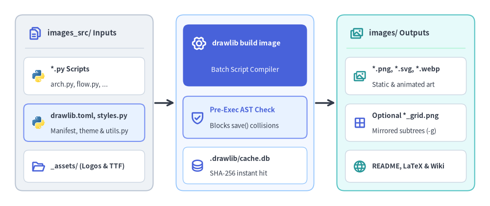
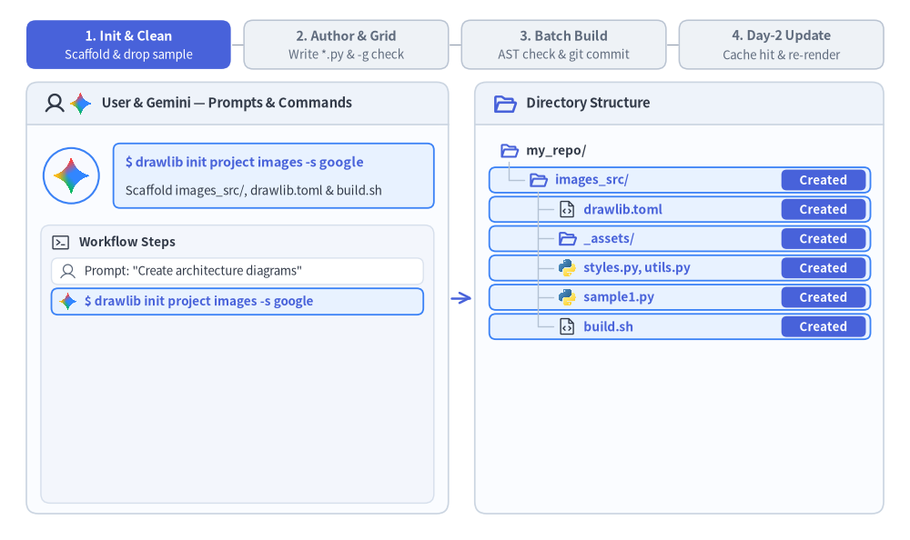
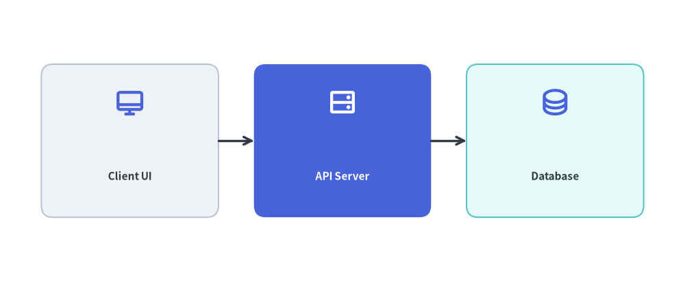

# Images Project Guide (`drawlib init images`)

The `images` starter template (CLI alias: `image`) is designed for generating standalone illustration assets, presentation diagrams, article hero banners, and social preview cards directly from batch Python scripts.

Each project separates editable Python source scripts (`images_src/`) from generated image artifacts (`images/`), guarded by pre-execution AST collision checks and incremental SHA-256 caching:


<figure class="drawlib-image" style="text-align: center;">
  
  <figcaption class="drawlib-caption">Standalone Image Batch Project Architecture: Shared Config, AST Collision Guard, and Parallel Output</figcaption>
</figure>

<details class="drawlib-code-details">
<summary>Source Code</summary>

```python
from drawlib.canvas import save, setup
from drawlib.icons import code, phosphor
from drawlib.lines import line
from drawlib.shapes import rectangle
from drawlib.styles import Styles
from drawlib.text import text

setup(width=128, height=54)

CARD_WHITE = Styles.Neutral.patch(
    shape_fill_color=(255, 255, 255),
    shape_line_color=(203, 213, 225),
    shape_line_width=1.0,
    shape_r=1.3,
)

# =========================================================
# 1. Left Card: images_src/ Inputs
# =========================================================
rectangle((22.0, 27.0), width=36.0, height=46.0, style=Styles.Neutral.patch(shape_r=2.0))
phosphor.files((9.2, 45.2), width=3.8, style=Styles.PrimaryBold)
text((12.4, 45.2), "images_src/ Inputs", style=Styles.DarkBold.patch(text_size=10.8, halign="left"))
line(
    (6.5, 41.4),
    (37.5, 41.4),
    style=Styles.Neutral.patch(line_color=(203, 213, 225), line_width=1.0),
)

rectangle((22.0, 34.0), width=31.6, height=9.8, style=CARD_WHITE)
code.python((10.0, 34.0), width=3.6, style=Styles.Neutral)
text((13.2, 35.8), "*.py Scripts", style=Styles.DarkBold.patch(text_size=10.2, halign="left"))
text((13.2, 31.8), "arch.py, flow.py, ...", style=Styles.Dark.patch(text_size=9.6, halign="left"))

rectangle((22.0, 21.8), width=31.6, height=9.8, style=Styles.PrimaryNeutral.patch(shape_r=1.3))
code.python((10.0, 21.8), width=3.6, style=Styles.Neutral)
text((13.2, 23.6), "styles.py & utils.py", style=Styles.DarkBold.patch(text_size=10.2, halign="left"))
text((13.2, 19.6), "Shared theme & macros", style=Styles.Dark.patch(text_size=9.6, halign="left"))

rectangle((22.0, 10.4), width=31.6, height=8.4, style=CARD_WHITE)
phosphor.folder_open((10.0, 10.4), width=3.6, style=Styles.PrimaryBold)
text((13.2, 10.4), "_assets/ (Logos & TTF)", style=Styles.DarkBold.patch(text_size=9.8, halign="left"))

# Connector: Inputs -> Compiler
line((40.4, 27.0), (45.6, 27.0), arrow_head="->", style=Styles.DarkBold)

# =========================================================
# 2. Center Focal Stage: drawlib build image Compiler
# =========================================================
rectangle(
    (64.0, 27.0),
    width=36.0,
    height=46.0,
    style=Styles.Neutral.patch(
        shape_fill_color=(244, 248, 255),
        shape_line_color=(147, 197, 253),
        shape_line_width=1.3,
        shape_r=2.0,
    ),
)

rectangle((64.0, 39.4), width=32.4, height=16.2, style=Styles.PrimaryFlat.patch(shape_r=1.6))
phosphor.gear_six((52.0, 42.6), width=4.0, style=Styles.WhiteBold)
text((55.4, 42.6), "drawlib build image", style=Styles.WhiteBold.patch(text_size=10.4, halign="left"))
text((64.0, 35.6), "Batch Script Compiler", style=Styles.White.patch(text_size=9.8))

rectangle((64.0, 23.2), width=32.4, height=11.0, style=Styles.PrimaryNeutral.patch(shape_r=1.3))
phosphor.shield_check((51.6, 23.2), width=3.9, style=Styles.PrimaryBold)
text((54.8, 25.2), "Pre-Exec AST Check", style=Styles.PrimaryBold.patch(text_size=10.0, halign="left"))
text((54.8, 21.0), "Blocks save() collisions", style=Styles.Dark.patch(text_size=9.5, halign="left"))

rectangle(
    (64.0, 10.6),
    width=32.4,
    height=9.6,
    style=CARD_WHITE.patch(shape_line_color=(147, 197, 253)),
)
phosphor.database((51.6, 10.6), width=3.7, style=Styles.PrimaryBold)
text((54.8, 12.4), ".drawlib/cache.db", style=Styles.DarkBold.patch(text_size=10.0, halign="left"))
text((54.8, 8.6), "SHA-256 instant hit", style=Styles.Dark.patch(text_size=9.5, halign="left"))

# Connector: Compiler -> Outputs
line((82.4, 27.0), (87.6, 27.0), arrow_head="->", style=Styles.DarkBold)

# =========================================================
# 3. Right Card: images/ Batch Outputs
# =========================================================
rectangle(
    (106.0, 27.0),
    width=36.0,
    height=46.0,
    style=Styles.SecondaryNeutral.patch(shape_r=2.0),
)
phosphor.images((93.2, 45.2), width=3.8, style=Styles.SecondaryBold)
text((96.4, 45.2), "images/ Outputs", style=Styles.DarkBold.patch(text_size=10.8, halign="left"))
line(
    (90.5, 41.4),
    (121.5, 41.4),
    style=Styles.Neutral.patch(line_color=(167, 243, 208), line_width=1.0),
)

rectangle((106.0, 34.0), width=31.6, height=9.8, style=CARD_WHITE)
phosphor.images((94.0, 34.0), width=3.6, style=Styles.SecondaryBold)
text((97.2, 35.8), "*.png, *.svg, *.webp", style=Styles.DarkBold.patch(text_size=10.0, halign="left"))
text((97.2, 31.8), "Static & animated art", style=Styles.Dark.patch(text_size=9.5, halign="left"))

rectangle((106.0, 21.8), width=31.6, height=9.8, style=CARD_WHITE)
phosphor.grid_four((94.0, 21.8), width=3.6, style=Styles.PrimaryBold)
text((97.2, 23.6), "Optional *_grid.png", style=Styles.DarkBold.patch(text_size=10.0, halign="left"))
text((97.2, 19.6), "Mirrored subtrees (-g)", style=Styles.Dark.patch(text_size=9.5, halign="left"))

rectangle((106.0, 10.4), width=31.6, height=8.4, style=CARD_WHITE)
phosphor.globe((94.0, 10.4), width=3.6, style=Styles.SecondaryBold)
text((97.2, 10.4), "README, LaTeX & Wiki", style=Styles.DarkBold.patch(text_size=9.8, halign="left"))

save()
```

</details>


---

## 1. End-to-End Project Workflow

An `images` project follows a streamlined four-phase lifecycle: scaffold the project and clean starter samples, verify geometry with the `-g` coordinate grid, run the batch compiler with AST collision protection, and enjoy sub-millisecond SQLite cache hits on Day-2 updates.


<figure class="drawlib-image" style="text-align: center;">
  
  <figcaption class="drawlib-caption">Standalone Image Project Lifecycle: Scaffolding, Grid Preview, Batch Build, and Incremental Cache Hit (APNG Animation)</figcaption>
</figure>


<div class="drawlib-source-link">
  <a href="https://github.com/yuichi110/drawlib/blob/main/docs/docs_src/en/09_doc_builder_and_cli/project_image.md" target="_blank" rel="noopener noreferrer">View animation source code on GitHub &rarr;</a>
</div>

---

## 2. Project Initialization

Scaffold a new images project using `drawlib init`:

```bash
# Scaffold standard images project in current directory (creates 'images_src/'):
drawlib init images

# Or with custom target name, theme, and language (creates 'my_assets_src/'):
drawlib init images my_assets -s google -l en
```

---

## 3. Directory Layout & Anatomy

### Editable Source Directory (`images_src/`)
- **`styles.py` & `utils.py`**: Project-wide styling overrides (`Colors`, `Styles`, CJK fonts) and reusable component helpers automatically loaded during `drawlib show` and `drawlib build image`.
- **`_assets/`**: Static raster logos, background images, or custom `.ttf` fonts referenced via relative paths (for example, `"_assets/logo.png"`).
- **`*.py` Drawing Scripts**: Standalone Python scripts (including nested subdirectories such as `network/vpc_peering.py`) that call `save()` to emit images.
- **`build.sh` & `build_image.sh`**: Batch shell wrappers invoking `drawlib build image images_src/ -o images/`.

### Generated Output Directory (`images/`)
- **`*.png`, `*.svg`, `*.webp`**: Compiled static and animated illustration artifacts mirroring the directory hierarchy of `images_src/`.
- **Optional `*_grid.png`**: Coordinate grid overlays generated on demand when `--grid` (`-g`) is passed.

### Key Rules
- **Source of Truth**: Always author drawing scripts in `images_src/`. After scaffolding, replace or remove the starter `sample1.py` and `sample2.py` files so only your desired diagrams are built.
- **Never Edit `images/`**: The `images/` folder is an output artifact directory overwritten during builds.

---

## 4. Writing Drawing Scripts

In an `images` project, each `.py` file inside `images_src/` is an independent drawing script. Call `save()` at the end of the script to output the image:


```python
# images_src/architecture_overview.py
from drawlib.canvas import save, setup
from drawlib.icons import phosphor
from drawlib.lines import line
from drawlib.shapes import rectangle
from drawlib.styles import Styles
from drawlib.text import text

setup(width=116, height=48)

# Draw components (50%+ neutral baseline + 1 primary focal point)
rectangle((22, 24), width=30, height=26, style=Styles.Neutral.patch(shape_r=2.0))
phosphor.desktop((22, 30.5), width=5.2, style=Styles.PrimaryBold)
text((22, 18.0), "Client UI", style=Styles.DarkBold.patch(text_size=11.0))

rectangle((58, 24), width=30, height=26, style=Styles.PrimaryFlat.patch(shape_r=2.0))
phosphor.hard_drives((58, 30.5), width=5.2, style=Styles.WhiteBold)
text((58, 18.0), "API Server", style=Styles.WhiteBold.patch(text_size=11.0))

rectangle((94, 24), width=30, height=26, style=Styles.SecondaryNeutral.patch(shape_r=2.0))
phosphor.database((94, 30.5), width=5.2, style=Styles.PrimaryBold)
text((94, 18.0), "Database", style=Styles.DarkBold.patch(text_size=11.0))

line((37, 24), (43, 24), arrow_head="->", style=Styles.DarkBold)
line((73, 24), (79, 24), arrow_head="->", style=Styles.DarkBold)

# Save image (defaults to <script_stem>.png or save("architecture_overview.png") in scripts)
save()
```

<figure class="drawlib-image" style="text-align: center;">
  
  <figcaption class="drawlib-caption">Rendered Output of images_src/architecture_overview.py</figcaption>
</figure>


### How `save()` Interacts with `drawlib build image -o images/`:
- **Automatic Output Redirection**: When executed via `drawlib build image images_src/ -o images/`, relative paths passed to `save("architecture_overview.png")` (or `save()` with no filename, which defaults to `<script_stem>.png`) are automatically written inside the `-o images/` directory, preserving any nested subdirectory hierarchy under `images_src/`.
- **Pre-Execution AST Duplicate Collision Check**: Before running any scripts in a batch, Drawlib parses the Python AST of all target `.py` files to inspect their `save(...)` targets. If two scripts would write to the exact same output file path, the build aborts immediately before modifying disk state.

---

## 5. Building Images

### Automated Build (`./build_image.sh` or `./build.sh`)
Execute the provided build script:

```bash
./images_src/build.sh
```

### Direct CLI Command
Alternatively, invoke the builder directly:

```bash
drawlib build image images_src/ -o images/ -s images_src/styles.py -u images_src/utils.py
```

### Useful Build Flags:
- `--grid` (`-g`): Automatically generates companion `*_grid.png` images overlaid with coordinate grid lines for visual debugging.
- `-f webp`: Overrides output format across all scripts to modern WebP.
- `--no-cache`: Forces a clean re-render of all images, bypassing the SQLite hash cache (`.drawlib/cache.db`).

---

## 6. Parallel Multi-Agent Script Authoring

Because each `.py` script in `images_src/` is independent, AI coding agents can generate multiple illustrations in parallel by delegating scripts across subagents:
1. **Phase 1 (Parent Setup)**: Run `drawlib init images` and configure shared `images_src/styles.py`, `images_src/utils.py`, and `_assets/` first.
2. **Phase 2 (Parallel Subagents)**: Assign each subagent a disjoint script (`images_src/<name>.py`). Each subagent authors its script and runs a grid preview with a **unique scratch filename** (`uv run drawlib show images_src/<name>.py -s images_src/styles.py -u images_src/utils.py -g -o .drawlib/scratch/<name>_grid.png`) to verify layout without colliding with other subagents.
3. **Phase 3 (Unified Batch Build)**: Once all subagents finish, the parent agent runs `./images_src/build.sh` once to compile all scripts into `images/`.
